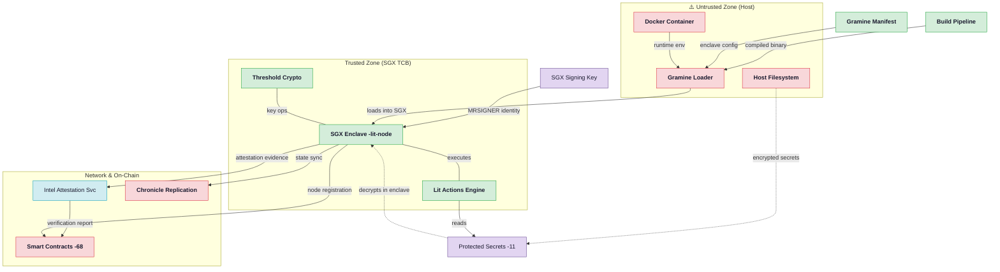

# TEE Usage Audit Report: Node

## Executive Summary
This audit was limited to Solidity smart contract review; Rust TEE enclave source was truncated and unavailable for analysis, preventing verification of core enclave security properties.

**Confirmed Findings (1 Informational):**
- IV-INV-04: Build signing key read from plain filesystem (see full finding for file references)

**Critical Unknowns (9 distinct items unresolved due to missing enclave code):**
- U-INV-02: MRENCLAVE-bound sealing for protected_mrenclave_files in enclave manifest
- U-INV-03: On-chain PKP access control and permission management for threshold signing
- U-INV-06: Attestation quote verification and nonce/timestamp validation in Staking.sol, PKPHelper.sol, PKPHelperV2.sol
- U-INV-07: Sealed secret loading/unsealing logic with version/epoch validation
- U-INV-09: Enclave egress handling for constant-length outputs and error leakage
- U-INV-10: sgx.allowed_files entries containing security-sensitive data

**No Positive Guards confirmed. 4 findings dismissed during adversarial review.**

**Actionable Recommendations:**
- Provide complete Rust enclave source for full TEE security assessment
- Remediate IV-INV-04: store build signing keys in sealed storage, not plain filesystem
- Verify MRENCLAVE-bound sealing is correctly implemented (resolves U-INV-02)
- Document attestation verification flow in contracts cited under U-INV-06
- Classify U-INV-09 scope: confirm whether enclave-derived secrets traverse this boundary

## Dashboard Summary

| Severity | Trust-Path Tier | Count |
| --- | --- | --- |
| Info | core | 1 |

## Trust Boundary Analysis

| Actor | Component | Context | Boundary Type |
| --- | --- | --- | --- |
| Node Operator | SGX Enclave (lit-node binary, rust/lit-node/) | untrusted | enclave/host |
| Lit Protocol | Lit Actions Engine (rust/lit-actions/) | trusted | enclave internal |
| Lit Protocol | Gramine Build Pipeline (rust/lit-os/) | trusted | build-time |
| Lit Protocol | SGX Signing Key (enclave-key.pem) | trusted | crypto boundary |
| Node Operator | Docker Container (ubuntu2204) | untrusted | host/runtime |
| Intel / Lit Protocol | Remote Attestation Module | trusted | network |
| Lit Protocol | Smart Contracts (blockchain/contracts/) | untrusted | on-chain/off-chain |
| Lit Protocol Network | Protected Secret Files (11 files) | trusted | storage/crypto |
| Lit Protocol | Chronicle Replication Component | untrusted | network |
| Lit Protocol | Gramine Manifest (rust/lit-os/) | trusted | configuration |
| Node Operator | Host Filesystem (/home/ubuntu/.config/) | untrusted | storage |

## Architecture Diagrams

### System Architecture with Trust Boundaries
The Lit Protocol system uses a 2GB Intel SGX enclave managed by Gramine to run the lit-node binary, which handles threshold cryptography, secret management, and Lit Actions execution within a hardware-isolated TCB. Trust boundaries exist between the enclave and the untrusted host (Docker/Ubuntu2204), between build-time signing infrastructure and runtime enclave identity, and between on-chain smart contracts and off-chain enclave operations. Protected secret files (11 total) are bound to MRENCLAVE measurements ensuring they can only be decrypted inside the correct enclave, while remote attestation provides cryptographic proof of enclave identity to on-chain verifiers and peer nodes. The Lit Actions JavaScript/TypeScript engine introduces a programmable attack surface within the TCB, amplifying the criticality of correct enclave measurement and thorough code review of the untrusted-labeled rust/lit-node/ source directory.



### Trust Boundary Narrative

The trusted boundary centers on **Node-to-Node Inter-Enclave Boundary (Boundary 4)**, **Host Filesystem ↔ Enclave Filesystem (Boundary 2)**, **Enclave TCB boundary encompassing Lit Actions execution engine**, **SGX Signing Infrastructure (Component 3) — Build Pipeline Trust**, **Host OS ↔ SGX Enclave (Boundary 1) — Ingress data flow**. The analysis identified 10 invariants governing trust path integrity.

**Trust Paths Identified:**
- `INV-01`: Node-to-Node Inter-Enclave Boundary (Boundary 4) — Every inter-node threshold cryptographic operation must be preceded by verification of the peer node's attestation evidence, including both MRENCLAVE and MRSIGNER measurement validation.
- `INV-02`: Host Filesystem ↔ Enclave Filesystem (Boundary 2) — Protected secret files declared as protected_mrenclave_files must use MRENCLAVE-bound sealing rather than MRSIGNER-bound sealing to ensure only the exact enclave build can decrypt them.
- `INV-03`: Enclave TCB boundary encompassing Lit Actions execution engine — User-submitted Lit Actions (JavaScript/TypeScript) executing inside the enclave must not have direct access to threshold key shares, network secrets, or other enclave-internal cryptographic material without an access control mediation layer.
- `INV-04`: SGX Signing Infrastructure (Component 3) — Build Pipeline Trust — The SGX enclave signing key referenced in build scripts must not use a hardcoded filesystem path and must be provisioned through a secure secret management mechanism.
- `INV-05`: Host OS ↔ SGX Enclave (Boundary 1) — Ingress data flow — All data entering the enclave from host-mediated channels (network RPC, filesystem reads on non-protected files, environment variables) must be validated before use in security-critical enclave operations.
- `INV-06`: Enclave ↔ Blockchain (Boundary 3) and Node ↔ Node (Boundary 4) — Attestation verification — Attestation quote verification must include freshness validation (nonce binding or timestamp checking) to prevent replay of old quotes from compromised or outdated enclaves.
- `INV-07`: Host Filesystem ↔ Enclave Filesystem (Boundary 2) — Sealed state continuity — Protected secret files loaded by the enclave must include version or epoch metadata that is validated to prevent rollback to older secret states by a malicious host.
- `INV-08`: Enclave ↔ Blockchain (Boundary 3) — On-chain registration binding — Node registration on the blockchain must cryptographically bind the submitted attestation evidence to the specific enclave measurement (MRENCLAVE) that will run on that node.
- `INV-09`: Host OS ↔ SGX Enclave (Boundary 1) — Egress response flow — Enclave responses to network requests must use constant-length output formatting and generic error messages to prevent leakage of secret-dependent information through response length or error detail.
- `INV-10`: Host Filesystem ↔ Enclave Filesystem (Boundary 2) — Allowed files bypass — Files listed in sgx.allowed_files must not contain security-sensitive data, as they pass through the enclave boundary without encryption or integrity verification.

### Data Flow Summary

Of 10 invariants, **10** involve data crossing the trust boundary between enclave and host.

**Bidirectional** (10 flows)
_Flows crossing the boundary in both directions_
- `INV-01`: **peer attestation quote received over network** → **threshold signing key share acceptance**
- `INV-02`: **Gramine manifest protected_files_key configuration** → **enclave secret material recovery**
- `INV-03`: **user-submitted Lit Actions code via IPFS or direct submissio** → **threshold key share memory**
- `INV-04`: **sign_sgx.sh hardcoded key path /home/ubuntu/.config/gramine/** → **gramine-sgx-sign --key command producing MRSIGNER identity**
- `INV-05`: **std::net::TcpStream read** → **threshold signing key derivation input**
- `INV-06`: **received attestation quote with embedded timestamp** → **node registration acceptance on-chain**
- `INV-07`: **host-provided sealed secret files** → **enclave initialization with restored secrets**
- `INV-08`: **enclave-generated attestation quote with MRENCLAVE** → **on-chain node registry entry**

### Invariant Reference

| ID | Description | Trust Path |
| --- | --- | --- |
| INV-01 | Every inter-node threshold cryptographic operation must be preceded by verification of the peer node's attestation evidence, including both MRENCLAVE and MRSIGNER measurement validation. | Node-to-Node Inter-Enclave Boundary (Boundary 4) |
| INV-02 | Protected secret files declared as protected_mrenclave_files must use MRENCLAVE-bound sealing rather than MRSIGNER-bound sealing to ensure only the exact enclave build can decrypt them. | Host Filesystem ↔ Enclave Filesystem (Boundary 2) |
| INV-03 | User-submitted Lit Actions (JavaScript/TypeScript) executing inside the enclave must not have direct access to threshold key shares, network secrets, or other enclave-internal cryptographic material without an access control mediation layer. | Enclave TCB boundary encompassing Lit Actions execution engine |
| INV-04 | The SGX enclave signing key referenced in build scripts must not use a hardcoded filesystem path and must be provisioned through a secure secret management mechanism. | SGX Signing Infrastructure (Component 3) — Build Pipeline Trust |
| INV-05 | All data entering the enclave from host-mediated channels (network RPC, filesystem reads on non-protected files, environment variables) must be validated before use in security-critical enclave operations. | Host OS ↔ SGX Enclave (Boundary 1) — Ingress data flow |
| INV-06 | Attestation quote verification must include freshness validation (nonce binding or timestamp checking) to prevent replay of old quotes from compromised or outdated enclaves. | Enclave ↔ Blockchain (Boundary 3) and Node ↔ Node (Boundary 4) — Attestation verification |
| INV-07 | Protected secret files loaded by the enclave must include version or epoch metadata that is validated to prevent rollback to older secret states by a malicious host. | Host Filesystem ↔ Enclave Filesystem (Boundary 2) — Sealed state continuity |
| INV-08 | Node registration on the blockchain must cryptographically bind the submitted attestation evidence to the specific enclave measurement (MRENCLAVE) that will run on that node. | Enclave ↔ Blockchain (Boundary 3) — On-chain registration binding |
| INV-09 | Enclave responses to network requests must use constant-length output formatting and generic error messages to prevent leakage of secret-dependent information through response length or error detail. | Host OS ↔ SGX Enclave (Boundary 1) — Egress response flow |
| INV-10 | Files listed in sgx.allowed_files must not contain security-sensitive data, as they pass through the enclave boundary without encryption or integrity verification. | Host Filesystem ↔ Enclave Filesystem (Boundary 2) — Allowed files bypass |

## Dismissed Findings

_The following findings were dismissed during adversarial review._

### ~~RV-U-INV-01: Missing attestation in backup recovery proofs~~
- **Original Severity**: Low
- **Dismissal Reason**: Adversarial review: false positive. Attestation verification occurs at node registration/joining time, not at every individual proof submission. Requiring re-attestation on every backup recovery proof would be architecturally redundant and is not standard TEE protocol design. The _checkBackupSetForSender validates membership in a set that was itself established through prior attestation. No concrete end-to-end attack chain provided; the attack requires a node that is 'compromised and holding valid keys' which means attestation was already satisfied or the threat is post-compromise (out of scope). Weak confidence, no trust boundary trace.
- **Location(s)**: `blockchain/contracts/contracts/lit-node/BackupRecovery/BackupRecoveryFacet.sol:197`, `blockchain/contracts/contracts/lit-node/BackupRecovery/BackupRecoveryFacet.sol:78`

### ~~RV3-U-INV-06: Missing timestamp freshness validation in proofs~~
- **Original Severity**: Low
- **Dismissal Reason**: Adversarial review: false positive. Speculative replay attack with no concrete demonstration. The finding itself admits the timestamp IS hashed into the schnorr proof verification, meaning the proof is cryptographically bound to that timestamp. No evidence that the backup recovery state machine allows a stale proof to alter already-completed recovery state. Blockchain state transitions are sequential — a replayed transaction would execute against updated state. Weak confidence, no trust boundary trace, no demonstrated end-to-end exploit.
- **Location(s)**: `blockchain/contracts/contracts/lit-node/BackupRecovery/BackupRecoveryFacet.sol:167`

### ~~RV3-U-INV-08: Atestation-MRENCLAVE binding unverified in facets~~
- **Original Severity**: Info
- **Dismissal Reason**: Adversarial review: false positive. The finding explicitly states 'Without visible facet code, attacker could...' — this is reviewing code that was not examined. The entire attack path is conditional on the facet code lacking binding logic, which was never verified. This is pure speculation about code the auditor didn't review. Dismissing as ungrounded.
- **Location(s)**: `blockchain/contracts/contracts/lit-node/Staking.sol:68`

### ~~RV3-U-INV-09: Custom errors leak key material on-chain~~
- **Original Severity**: Low
- **Dismissal Reason**: Adversarial review: false positive. The alleged 'key material' consists of publicKey (public by definition) and encrypted blsKey (encrypted, requiring a separate decryption key). Neither constitutes secret key material leakage. Public keys are not secrets. Encrypted keys are useless without the decryption key held in the TEE. The finding mischaracterizes public/encrypted data as 'key material.' No concrete evidence of secret-dependent output variation. Dismissing as misunderstanding of what constitutes sensitive material.
- **Location(s)**: `blockchain/contracts/contracts/lit-node/BackupRecovery/BackupRecoveryFacet.sol:24`

## Appendix

_Info-severity TEE findings, items requiring manual review, and non-TEE findings are included here for completeness._

### Info-Severity TEE Findings

### [INFO] IV-INV-04: Build signing key read from plain filesystem [Configuration Integrity] (incorrect_usage) (CWE-312)

**Root Cause**: The build private key is loaded via a plain fs::read() from a configurable filesystem path with no HSM, sealed storage, or vault-based provisioning.
**Impact**: An attacker who compromises the filesystem or obtains the PEM file can sign rogue enclave binaries with an identical MRSIGNER, enabling unsealing of all MRSIGNER-protected secrets and full supply chain compromise.
**Confidence**: Confirmed | **Invariant**: INV-04 | **Tier**: core

**Preconditions**:
- Attacker has read access to the filesystem path referenced by build_priv_key_path config
- The signing key is used for enclave identity (MRSIGNER derivation)

**Attack Scenario**:
  1. Attacker gains read access to filesystem path in build_priv_key_path config. (`rust/lit-os/lit-attestation-service/src/context.rs:28`)
  2. Attacker extracts the EC private key from the PEM file on disk. (`rust/lit-os/lit-attestation-service/src/context.rs:30`)
  3. Attacker signs a malicious enclave binary with the stolen key.
  4. Rogue enclave shares MRSIGNER and can unseal all protected secrets.

### Code Evidence

**`rust/lit-os/lit-attestation-service/src/context.rs:28`**
```
      18 |     pub build_priv_key: String,
      19 |     pub instance_id: String,
      20 |     pub build_id: String,
      21 |     pub release_id: Option<String>,
      22 |     pub subnet_id: Option<String>,
      23 | }
      24 | 
      25 | impl ServiceContext {
      26 |     pub fn from_lit_config(lit_config: Arc<LitConfig>) -> Result<Self> {
      27 |         // Parse build priv key
>>>   28 |         let build_priv_key_path = lit_config.litos_build_priv_key_path();
      29 |         let build_priv_key_str =
      30 |             String::from_utf8(fs::read(build_priv_key_path.as_path()).map_err(|e| {
      31 |                 io_err(
      32 |                     e,
      33 |                     Some(format!("failed to read build priv key: {:?}", &build_priv_key_path)),
      34 |                 )
      35 |             })?)
      36 |             .map_err(|e| {
      37 |                 conversion_err(
      38 |                     e,
```
Attacker gains read access to filesystem path in build_priv_key_path config.

**`rust/lit-os/lit-attestation-service/src/context.rs:30`**
```
      20 |     pub build_id: String,
      21 |     pub release_id: Option<String>,
      22 |     pub subnet_id: Option<String>,
      23 | }
      24 | 
      25 | impl ServiceContext {
      26 |     pub fn from_lit_config(lit_config: Arc<LitConfig>) -> Result<Self> {
      27 |         // Parse build priv key
      28 |         let build_priv_key_path = lit_config.litos_build_priv_key_path();
      29 |         let build_priv_key_str =
>>>   30 |             String::from_utf8(fs::read(build_priv_key_path.as_path()).map_err(|e| {
      31 |                 io_err(
      32 |                     e,
      33 |                     Some(format!("failed to read build priv key: {:?}", &build_priv_key_path)),
      34 |                 )
      35 |             })?)
      36 |             .map_err(|e| {
      37 |                 conversion_err(
      38 |                     e,
      39 |                     Some(format!(
      40 |                         "Failed to parse build priv key ({:?}) pem as utf8",
```
Attacker extracts the EC private key from the PEM file on disk.

**Remediation**: Provision the build signing key via HSM, sealed storage, or a CI secret vault rather than reading a PEM file from the filesystem. Remove the plaintext key from disk entirely.

### Items Requiring Manual Review

#### U-INV-02: MRENCLAVE sealing policy not verifiable

Whether protected_mrenclave_files use MRENCLAVE-bound sealing in enclave manifest/config.
- **Why Uncertain**: Provided source files are Solidity smart contracts with no enclave manifest, sealing config, or protected_files_key declarations.

Second-pass notes: The additional source code provided consists entirely of Solidity smart contracts (Staking.sol, EIP1271.sol, LibDiamond.sol, Forwarder.sol, StakingBalances.sol) and README documentation. None of these files contain enclave manifest files, SGX sealing configuration, protected_mrenclave_files declarations, EDL files, or Rust TEE sealing/unsealing code. The invariant concerns MRENCLAVE vs MRSIGNER sealing policy for protected enclave files, which would be defined in SGX enclave configuration (e.g.,
- **Recommended Steps**: Provide enclave manifest or .sgx file with protected_mrenclave_files entries, Provide Rust TEE sealing/unsealing code in rust/lit-node/ enclave source, Check EDL or build config for sgx_seal_key_mrenclave setting

#### U-INV-03: Enclave Lit Action isolation unverifiable

On-chain PKP access control and permission management for threshold signing operations.
- **Why Uncertain**: Provided code is Solidity smart contracts (on-chain), not the enclave-side Lit Actions execution engine where INV-03 would be enforced.

Second-pass notes: The additional code (PKPHelper.sol, PKPNFTMetadata.sol, ReleaseRegister.sol, PKPHelperV2.sol) is still Solidity on-chain contracts. PKPHelper manages on-chain permission registration (auth methods, permitted addresses) and PKP minting. PKPPermissions on-chain checks control *who* can request a signature, but the invariant concerns *what a running Lit Action can access in enclave memory*. The enclave-side sandbox (JS/TS engine initialization, API surface exposed to user code, threshold key share 
- **Recommended Steps**: Provide enclave Lit Action sandbox/runtime source code, Provide JS/TS engine API surface exposed to user code, Provide threshold key share storage and access code

#### U-INV-05: Enclave ingress validation unverifiable

Solidity contracts only; Rust enclave code was truncated and unavailable for analysis.
- **Why Uncertain**: Provided source is Solidity smart contracts (on-chain), not Rust TEE enclave code handling ECALL/RPC ingress boundaries.

Second-pass notes: The additional source code provided is exclusively Solidity smart contracts (BackupRecoveryFacet.sol, EIP1271.sol, LibDiamond.sol, StakingBalances.sol, Staking.sol). The invariant concerns Rust TEE enclave ECALL/RPC ingress boundary validation — specifically whether data entering the enclave from host-mediated channels (network RPC, filesystem reads, environment variables) is validated before security-critical use. None of the newly provided files are Rust source code, ECALL handlers, or RPC dis
- **Recommended Steps**: Provide Rust enclave ECALL handlers and RPC parsing code, Provide rust/ source files handling network/filesystem input, Check Rust RPC dispatch for input validation guards

#### U-INV-07: Sealed data anti-rollback enforcement unclear

Source code for sealed secret loading and unsealing logic for version/epoch validation.
- **Why Uncertain**: Provided code covers logging service init and attestation tests only; sealed data handling is not present.

Second-pass notes: The additional code provided is entirely Solidity smart contracts (on-chain), not TEE enclave Rust code. The on-chain contracts show version checking mechanisms (BackupRecoveryFacet.sol line 207: verificationVersion check, Staking.sol lines 92-97: versionRequirements, Staking.sol lines 82-88: epoch tracking), but these operate at the blockchain consensus layer, not within the enclave's seal/unseal path. The invariant specifically concerns enclave-internal sealed data anti-rollback — requiring th
- **Recommended Steps**: Provide sealed data unseal/load code paths, Search for version counter or epoch fields in seal/unseal logic, Check anti-rollback counter comparison against enclave minimum

#### U-INV-10: Allowed files manifest audit absent

Searched for sgx.allowed_files manifest config and enclave file I/O handling in provided code.
- **Why Uncertain**: Provided source is Solidity smart contracts (PKPHelper, PKPNFTMetadata), not SGX enclave code or manifest files.

Second-pass notes: The additional source code provided is still exclusively Solidity smart contracts (PKPHelper.sol, PKPNFTMetadata.sol, Staking.sol). There is zero evidence related to SGX enclave configuration, manifest files, allowed_files declarations, or enclave file I/O code. The invariant about sgx.allowed_files cannot be verified or falsified from on-chain Solidity code alone. SGX .manifest/.xml files and enclave native source code (C/C++/Rust) are required to assess this invariant.
- **Recommended Steps**: Provide SGX .manifest or .xml files listing allowed_files entries, Provide enclave C/C++/Rust file I/O code for allowed file reads, Audit manifest for config files with keys, secrets, or policy data

#### U-INV-06: Attestation freshness not in provided code

Staking.sol, PKPHelper.sol, PKPHelperV2.sol for attestation quote verification and nonce/timestamp checks.
- **Why Uncertain**: Provided files are staking and PKP minting contracts; attestation verification logic likely resides in node-side Rust code or other on-chain contracts not included.

Second-pass notes: The provided code still does not contain the core TEE attestation quote verification logic. BackupRecoveryFacet.sol shows partial evidence of a freshness-aware pattern: a ProofExpired error is declared (line 31), and timestamps are extracted from schnorr proofs (line 213: uint64 timestamp = uint64(bytes8(proof[1:9]))). However, the code is truncated before showing whether this timestamp is actually compared to block.timestamp. More critically, this is backup recovery proof verification, NOT TEE 
- **Recommended Steps**: Provide node-side TEE quote verification code (Rust), Check any on-chain validator registration contracts, Review DcapAttestation or quote verification modules

#### U-INV-01: Attestation guard absent from on-chain code

Solidity contracts for staking, PKP minting, and permission management.
- **Why Uncertain**: TEE attestation verification happens off-chain in node software; provided on-chain contracts contain no attestation logic by design.
- **Recommended Steps**: Examine Rust/Go node code for quote verification before threshold ops, Search for DCAP/quote verification functions in TEE enclave entry points, Trace threshold signing code paths to preceding attestation checks

#### U-INV-02: MRENCLAVE sealing policy unverified

Whether protected_mrenclave_files use MRENCLAVE-bound sealing in enclave config.
- **Why Uncertain**: Provided source files are Solidity smart contracts; no enclave manifest or sealing config present.
- **Recommended Steps**: Provide enclave .manifest or .toml with protected_files_key setting, Provide Rust enclave sealing/unsealing code for analysis, Search for protected_mrenclave_files and sgx_seal_key_mrenclave in codebase

#### U-INV-03: Enclave Lit Action isolation unverifiable

On-chain PKP permission contracts for access control mediation of PKP signing operations.
- **Why Uncertain**: Provided code is Solidity on-chain contracts only; the enclave-side Lit Actions execution engine, sandbox, and key material access paths are not present for review.
- **Recommended Steps**: Provide enclave source containing Lit Action JS execution sandbox, Review V8 isolate configuration and exposed native bindings, Trace threshold key share access from enclave storage to API surface

#### U-INV-05: Enclave ingress validation incomplete

Solidity contracts for input validation; Rust enclave code was truncated and unavailable.
- **Why Uncertain**: The invariant concerns enclave boundary validation in Rust, but only Solidity smart contracts were provided in full.
- **Recommended Steps**: Provide Rust enclave ECALL/OCALL boundary code for review, Examine RPC handler input validation in rust/ sources, Check report_data population and threshold key derivation paths

#### U-INV-06: Attestation freshness not in scope

Staking.sol, PKPHelper.sol, PKPHelperV2.sol for attestation quote verification logic.
- **Why Uncertain**: Provided Solidity contracts contain staking/NFT logic only; attestation quote verification occurs in node-side code not provided.
- **Recommended Steps**: Provide node-side TEE attestation verification Rust code, Search for DCAP/quote verification in node codebase, Check for nonce binding in enclave handshake protocol

#### U-INV-07: Sealed data rollback protection not visible

Logging service and attestation test code for sealed data version/epoch validation.
- **Why Uncertain**: Provided source files contain logging service setup and integration tests only; no sealing/unsealing code with version metadata is present to evaluate.
- **Recommended Steps**: Provide sealed data read/write and unseal logic source files, Check lit-os-core for seal/unseal with version counter validation, Review any epoch or monotonic counter enforcement code

#### U-INV-08: MRENCLAVE binding at registration

Staking.sol storage init and contract logic for MRENCLAVE verification during node registration.
- **Why Uncertain**: Staking uses Diamond proxy pattern; registration logic lives in facets not provided. No MRENCLAVE verification visible in shown code but cannot confirm absence in facets.
- **Recommended Steps**: Inspect Staking facets (e.g., StakingFacet.sol) for join/register logic, Check if quote MRENCLAVE is validated or stored on-chain, Search LibStakingStorage.sol for attestation-related fields

#### U-INV-09: Enclave egress response formatting

Enclave boundary egress for constant-length outputs and generic error handling.
- **Why Uncertain**: Provided code is Solidity contracts only; enclave Rust egress logic not included for review.
- **Recommended Steps**: Provide Rust enclave ECALL/OCALL response handling code, Review Lit Action execution response serialization, Check threshold BLS signature assembly output padding

#### U-INV-10: Allowed files manifest not in scope

Whether sgx.allowed_files entries contain security-sensitive data or are consumed unsafely.
- **Why Uncertain**: Provided source is Solidity smart contracts (PKPHelper.sol, PKPNFTMetadata.sol) with no SGX manifest or enclave file I/O code to audit.
- **Recommended Steps**: Provide SGX .manifest or .xml with sgx.allowed_files section, Provide enclave source that reads allowed files (C/Rust/Edl), Search codebase for ocall_file or untrusted fs access patterns
