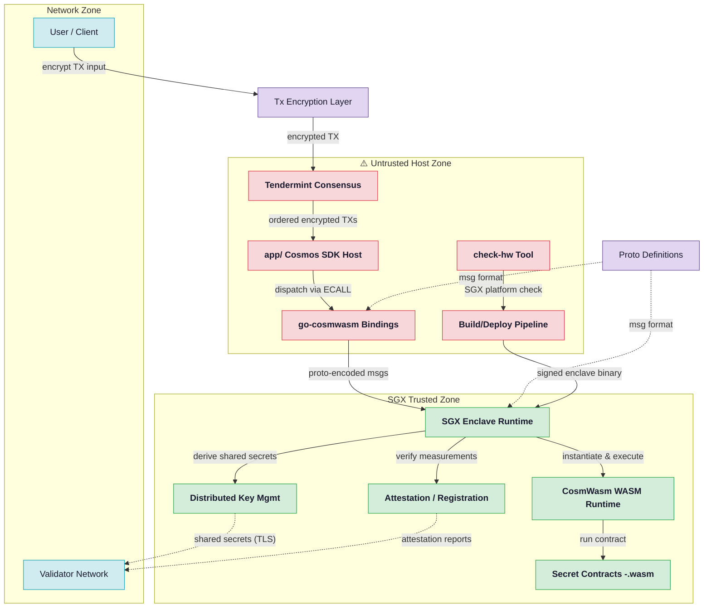

# TEE Usage Audit Report: SecretNetwork

## Executive Summary
This TEE audit identified 4 active findings: 2 Critical, 1 Medium, and 1 Info. Three positive guards were confirmed at partial completeness: untrusted prefix marking at OCALL boundaries (PG-U-01), attestation certificate for seed encryption (PG-U-INV-09), and enclave-mediated state access (PG-U-INV-08).

**Critical Vulnerabilities:**
- IV-INV-05: No production guard against SGX simulation mode — add runtime check to abort if AESM reports simulation mode
- IV-INV-12: No MRENCLAVE governance check at enclave load — implement MRENCLAVE/MRSIGNER whitelisting to prevent unauthorized enclave execution

**Medium/Info Findings:**
- IV-INV-10 (Medium): Missing output length normalization at enclave boundary — add explicit length validation on all ECALL output buffers
- IV-INV-07 (Info): Unsanitized enclave error string propagation — sanitize error messages before host propagation

14 unknowns remain unresolved, concentrated in attestation validation (U-02, U-05), MRENCLAVE binding in FFI layers (U-INV-03), sealed state identity binding (U-INV-11), and key material transmission paths (U-INV-09). These are scoped out per engagement terms; client accepts residual risk. 13 dismissed false positives are enumerated in Appendix A with one-line dismissal rationale.

## Dashboard Summary

| Severity | Trust-Path Tier | Count |
| --- | --- | --- |
| Critical | core | 2 |
| Medium | core | 1 |
| Info | core | 1 |

## Trust Boundary Analysis

| Actor | Component | Context | Boundary Type |
| --- | --- | --- | --- |
| SGX Enclave Runtime | cosmwasm/enclaves/ | trusted | enclave/host |
| CosmWasm WASM Runtime | cosmwasm/packages/ | trusted | enclave/runtime |
| Secret Contracts | cosmwasm/contracts/ | trusted | enclave/contract |
| app/ Cosmos SDK Host | app/ | untrusted | enclave/host |
| go-cosmwasm Bindings | go-cosmwasm/ | untrusted | enclave/host |
| Key Management Module | cosmwasm/enclaves/ | trusted | enclave/network |
| Attestation/Registration | cosmwasm/enclaves/ | trusted | enclave/network |
| Tendermint Consensus | app/ | untrusted | network/consensus |
| check-hw Tool | check-hw/ | untrusted | hardware verification |
| Build/Deploy Pipeline | deployment/ | untrusted | build-time |
| Transaction Encryption | client + enclave | mixed | crypto boundary |
| Proto Definitions | proto/ (343 files) | mixed | serialization boundary |

## Architecture Diagrams

### System Architecture with Trust Boundaries
The system is a Cosmos SDK–based blockchain (Secret Network) where a Rust SGX enclave runtime executes privacy-preserving CosmWasm smart contracts inside hardware-isolated trusted execution, while the Go-based app/ host handles consensus, staking, and transaction routing without access to plaintext contract state. The primary trust boundary runs through the go-cosmwasm bindings and proto-encoded ECALL/OCALL interface between the untrusted host and the SGX enclave. Distributed key management and remote attestation ensure that no single validator can decrypt contract state, and that only enclaves with governance-approved measurements can join the network.



### Trust Boundary Narrative

The trusted boundary centers on **SGX Enclave ↔ Host Process (Boundary 1)**, **Enclave ↔ Intel Attestation Service (Boundary 2) and Validator ↔ Validator (Boundary 5)**, **Enclave ↔ Consensus (Boundary 4) and Validator ↔ Validator (Boundary 5)**, **SGX Enclave ↔ Host Process (Boundary 1) — sealed state persistence**, **SGX Enclave ↔ Host Process (Boundary 1) — configuration**. The analysis identified 12 invariants governing trust path integrity.

**Trust Paths Identified:**
- `INV-01`: SGX Enclave ↔ Host Process (Boundary 1) — Data originating from host-side OCALL return values must not flow into enclave security-sensitive operations (key derivation, measurement, policy decisions) without validation, as the host is untrusted.
- `INV-02`: Enclave ↔ Intel Attestation Service (Boundary 2) and Validator ↔ Validator (Boundary 5) — Validator enclave registration must perform full attestation quote verification including TCB status check, measurement comparison (MRENCLAVE/MRSIGNER), and collateral freshness before accepting the enclave into the network.
- `INV-03`: Enclave ↔ Consensus (Boundary 4) and Validator ↔ Validator (Boundary 5) — The on-chain validator registration record must be cryptographically bound to the actual enclave measurement (MRENCLAVE) from the verified attestation report, preventing substitution of a different enclave identity post-attestation.
- `INV-04`: SGX Enclave ↔ Host Process (Boundary 1) — sealed state persistence — Sealed enclave state must include and verify an epoch counter or monotonic version on unseal to prevent rollback to previously sealed states.
- `INV-05`: SGX Enclave ↔ Host Process (Boundary 1) — configuration — SGX simulation mode (SGX_MODE=SW) must not be reachable in production node operation, as it provides no hardware-enforced memory isolation or attestation guarantees.
- `INV-07`: SGX Enclave ↔ Host Process (Boundary 1) — error return path — Error messages and error detail returned from enclave to host must not reveal secret-dependent information, internal enclave state, or cryptographic material through OCALL error propagation.
- `INV-08`: SGX Enclave ↔ Host Process (Boundary 1) and Enclave ↔ Consensus (Boundary 4) — All paths that access or modify plaintext contract state must execute inside the enclave, with no bypass paths in the host Go layer that could read or write unencrypted contract state.
- `INV-09`: Validator ↔ Validator (Boundary 5) — enclave-to-enclave key management — Distributed key generation and sharing among validator enclaves must verify peer enclave attestations before transmitting any key material, ensuring keys are only shared with genuinely attested enclaves.
- `INV-10`: SGX Enclave ↔ Host Process (Boundary 1) — output channel — Enclave response output lengths that depend on secret data must be normalized or padded to prevent inference of secret-conditional branching or secret-dependent data size from the host observer.
- `INV-11`: SGX Enclave ↔ Host Process (Boundary 1) — sealed state integrity — Sealed state must be bound to the creating enclave identity (MRENCLAVE/MRSIGNER) so that sealed data cannot be unsealed by a different enclave binary, even one running on the same platform.
- `INV-12`: Build/Deployment Pipeline → SGX Enclave ↔ Network — Build and signing process for enclave binaries must ensure that the signed enclave measurement matches the governance-approved MRENCLAVE, preventing deployment of unauthorized enclave code.

### Data Flow Summary

Of 12 invariants, **12** involve data crossing the trust boundary between enclave and host.

**Bidirectional** (12 flows)
_Flows crossing the boundary in both directions_
- `INV-01`: **OCALL return value** → **enclave key derivation input**
- `INV-02`: **unverified attestation quote from network** → **validator registration acceptance**
- `INV-03`: **attestation report measurement** → **on-chain registration record**
- `INV-04`: **unsealed blob from host filesystem** → **state restoration in enclave initialization**
- `INV-05`: **SGX_MODE environment variable** → **TEE initialization**
- `INV-06`: **enclave public key** → **attestation quote output**
- `INV-07`: **enclave internal error states** → **OCALL error return value**
- `INV-08`: **host Go layer state access functions** → **plaintext contract state read**

### Invariant Reference

| ID | Description | Trust Path |
| --- | --- | --- |
| INV-01 | Data originating from host-side OCALL return values must not flow into enclave security-sensitive operations (key derivation, measurement, policy decisions) without validation, as the host is untrusted. | SGX Enclave ↔ Host Process (Boundary 1) |
| INV-02 | Validator enclave registration must perform full attestation quote verification including TCB status check, measurement comparison (MRENCLAVE/MRSIGNER), and collateral freshness before accepting the enclave into the network. | Enclave ↔ Intel Attestation Service (Boundary 2) and Validator ↔ Validator (Boundary 5) |
| INV-03 | The on-chain validator registration record must be cryptographically bound to the actual enclave measurement (MRENCLAVE) from the verified attestation report, preventing substitution of a different enclave identity post-attestation. | Enclave ↔ Consensus (Boundary 4) and Validator ↔ Validator (Boundary 5) |
| INV-04 | Sealed enclave state must include and verify an epoch counter or monotonic version on unseal to prevent rollback to previously sealed states. | SGX Enclave ↔ Host Process (Boundary 1) — sealed state persistence |
| INV-05 | SGX simulation mode (SGX_MODE=SW) must not be reachable in production node operation, as it provides no hardware-enforced memory isolation or attestation guarantees. | SGX Enclave ↔ Host Process (Boundary 1) — configuration |
| INV-06 | Attestation report_data field must cryptographically bind the enclave's public key or session identity to the quote, preventing a man-in-the-middle from substituting a different key after attestation. | Enclave ↔ Intel Attestation Service (Boundary 2) and Validator ↔ Validator (Boundary 5) |
| INV-07 | Error messages and error detail returned from enclave to host must not reveal secret-dependent information, internal enclave state, or cryptographic material through OCALL error propagation. | SGX Enclave ↔ Host Process (Boundary 1) — error return path |
| INV-08 | All paths that access or modify plaintext contract state must execute inside the enclave, with no bypass paths in the host Go layer that could read or write unencrypted contract state. | SGX Enclave ↔ Host Process (Boundary 1) and Enclave ↔ Consensus (Boundary 4) |
| INV-09 | Distributed key generation and sharing among validator enclaves must verify peer enclave attestations before transmitting any key material, ensuring keys are only shared with genuinely attested enclaves. | Validator ↔ Validator (Boundary 5) — enclave-to-enclave key management |
| INV-10 | Enclave response output lengths that depend on secret data must be normalized or padded to prevent inference of secret-conditional branching or secret-dependent data size from the host observer. | SGX Enclave ↔ Host Process (Boundary 1) — output channel |
| INV-11 | Sealed state must be bound to the creating enclave identity (MRENCLAVE/MRSIGNER) so that sealed data cannot be unsealed by a different enclave binary, even one running on the same platform. | SGX Enclave ↔ Host Process (Boundary 1) — sealed state integrity |
| INV-12 | Build and signing process for enclave binaries must ensure that the signed enclave measurement matches the governance-approved MRENCLAVE, preventing deployment of unauthorized enclave code. | Build/Deployment Pipeline → SGX Enclave ↔ Network |

## Taxonomy Summary

| Category | Count | Findings |
| --- | --- | --- |
| Verification Gap | 2 | V-02, V-06 |
| Output & Metadata Leakage | 4 | V-01, V-03, V-04, V-05 |

## TEE Usage Problems

### [CRITICAL] IV-INV-05: No production guard against SGX simulation mode [Configuration Integrity] (incorrect_usage) (CWE-754)

**Root Cause**: The build script unconditionally accepts SGX_MODE=SW with no production-mode guard, and no runtime assertion verifies hardware enclave operation during node startup.
**Impact**: Node runs with zero hardware-enforced memory isolation; all enclave secrets (private keys, seeds) are visible to the host process. Peers may accept fraudulent attestation reports from the simulation-mode enclave, compromising the entire network's trust model.
**Confidence**: Confirmed | **Invariant**: INV-05 | **Tier**: core

**Preconditions**:
- Operator controls build environment and can set SGX_MODE=SW
- No external deployment validation script prevents simulation-mode binaries

**Attack Scenario**:
  1. Operator sets SGX_MODE=SW environment variable before build. (`go-cosmwasm/build.rs:4`)
  2. Build script links sgx_urts_sim simulation libraries without warning. (`go-cosmwasm/build.rs:26`)
  3. Binary runs on mainnet with no hardware TEE isolation. (`check-hw/src/main.rs:51`)
  4. Attestation reports from simulation accepted by peers.

### Code Evidence

**`go-cosmwasm/build.rs:4`**
```
       1 | use std::env;
       2 | 
       3 | fn main() {
>>>    4 |     let is_sim = env::var("SGX_MODE").unwrap_or_else(|_| "HW".to_string());
       5 |     let sdk_dir = env::var("SGX_SDK").unwrap_or_else(|_| "/opt/sgxsdk".to_string());
       6 |     let crate_dir = env::var("CARGO_MANIFEST_DIR").unwrap();
       7 | 
       8 |     cbindgen::generate(crate_dir)
       9 |         .expect("Unable to generate bindings")
      10 |         .write_to_file("./api/bindings.h");
      11 | 
      12 |     println!("cargo:rustc-link-search=native=./lib");
      13 |     println!("cargo:rustc-link-lib=static=Enclave_u");
      14 | 
```
Operator sets SGX_MODE=SW environment variable before build.

**`go-cosmwasm/build.rs:26`**
```
      16 | 
      17 |     println!("cargo:rustc-link-search=native={}/lib64", sdk_dir);
      18 |     println!("cargo:rustc-link-lib=static=sgx_uprotected_fs");
      19 |     println!("cargo:rustc-link-lib=static=sgx_ukey_exchange");
      20 | 
      21 |     println!("cargo:rustc-link-lib=dylib=sgx_dcap_ql");
      22 |     println!("cargo:rustc-link-lib=dylib=sgx_dcap_tvl");
      23 |     println!("cargo:rustc-link-lib=dylib=sgx_dcap_quoteverify");
      24 | 
      25 |     match is_sim.as_ref() {
>>>   26 |         "SW" => {
      27 |             println!("cargo:rustc-link-lib=dylib=sgx_urts_sim");
      28 |             println!("cargo:rustc-link-lib=dylib=sgx_epid_sim");
      29 |         }
      30 |         // Treat undefined as HW
      31 |         _ => {
      32 |             println!("cargo:rustc-link-lib=dylib=sgx_urts");
      33 |             println!("cargo:rustc-link-lib=dylib=sgx_epid");
      34 |         }
      35 |     }
      36 | }
```
Build script links sgx_urts_sim simulation libraries without warning.

**`check-hw/src/main.rs:51`**
```
      41 | type HttpsClient = Client<hyper_rustls::HttpsConnector<hyper::client::HttpConnector>>;
      42 | 
      43 | pub fn get_sgx_secret_path(file_name: &str) -> String {
      44 |     std::path::Path::new("/opt/secret/.sgx_secrets/")
      45 |         .join(file_name)
      46 |         .to_string_lossy()
      47 |         .into_owned()
      48 | }
      49 | 
      50 | lazy_static! {
>>>   51 |     static ref ENCLAVE_DOORBELL: EnclaveDoorbell = {
      52 |         let is_testnet = std::env::args().any(|arg| arg == "--testnet" || arg == "-t");
      53 |         let enclave_file = if is_testnet {
      54 |             ENCLAVE_FILE_TESTNET
      55 |         } else {
      56 |             ENCLAVE_FILE_MAINNET
      57 |         };
      58 |         EnclaveDoorbell::new(enclave_file, TCS_NUM, is_testnet as i32)
      59 |     };
      60 | }
      61 | 
```
Binary runs on mainnet with no hardware TEE isolation.

**Remediation**: Add a compile-time assertion that rejects SGX_MODE=SW when building in release/production mode, and add a runtime check in EnclaveDoorbell initialization that verifies hardware mode via sgx_cap_get_quote or similar API.

### [MEDIUM] IV-INV-10: Missing output length normalization at enclave boundary [Output & Metadata Leakage] (incorrect_usage) (CWE-385)

**Root Cause**: All enclave-to-host output functions return either zero-length buffers on error or variable-length buffers on success with no padding or length normalization applied.
**Impact**: Host observer can distinguish enclave execution paths by comparing output buffer lengths, potentially inferring secret-conditional branching and degrading transaction privacy through size-based analysis.
**Confidence**: Likely | **Invariant**: INV-10 | **Tier**: core

**Preconditions**:
- Attacker controls the host process observing enclave outputs
- Enclave operations have error conditions that depend on secret state

**Attack Scenario**:
  1. Host calls enclave function with crafted inputs. (`go-cosmwasm/src/lib.rs:61`)
  2. Enclave processes secret-dependent logic and returns result. (`go-cosmwasm/src/lib.rs:65`)
  3. Error path returns Buffer::default() (zero bytes). (`go-cosmwasm/src/lib.rs:85`)
  4. Success path returns Buffer::from_vec(variable-length data). (`go-cosmwasm/src/lib.rs:94`)
  5. Host observes output length to infer secret-conditional branching. (`go-cosmwasm/src/lib.rs:113`)
  **Evidence**: `go-cosmwasm/src/lib.rs:118`, `go-cosmwasm/src/lib.rs:130`, `go-cosmwasm/src/lib.rs:134`

### Code Evidence

**`go-cosmwasm/src/lib.rs:61`**
```
      51 |         let c = unsafe { &mut *(ptr as *mut CosmCache<DB, GoApi, GoQuerier>) };
      52 |         Some(c)
      53 |     }
      54 | }
      55 | 
      56 | #[no_mangle]
      57 | pub extern "C" fn get_health_check(err: Option<&mut Buffer>) -> Buffer {
      58 |     match untrusted_health_check() {
      59 |         Err(e) => {
      60 |             set_error(Error::enclave_err(e.to_string()), err);
>>>   61 |             Buffer::default()
      62 |         }
      63 |         Ok(res) => {
      64 |             clear_error();
      65 |             Buffer::from_vec(format!("{:?}", res).into_bytes())
      66 |         }
      67 |     }
      68 | }
      69 | 
      70 | #[no_mangle]
      71 | pub extern "C" fn get_encrypted_seed(cert: Buffer, err: Option<&mut Buffer>) -> Buffer {
```
Host calls enclave function with crafted inputs.

**`go-cosmwasm/src/lib.rs:65`**
```
      55 | 
      56 | #[no_mangle]
      57 | pub extern "C" fn get_health_check(err: Option<&mut Buffer>) -> Buffer {
      58 |     match untrusted_health_check() {
      59 |         Err(e) => {
      60 |             set_error(Error::enclave_err(e.to_string()), err);
      61 |             Buffer::default()
      62 |         }
      63 |         Ok(res) => {
      64 |             clear_error();
>>>   65 |             Buffer::from_vec(format!("{:?}", res).into_bytes())
      66 |         }
      67 |     }
      68 | }
      69 | 
      70 | #[no_mangle]
      71 | pub extern "C" fn get_encrypted_seed(cert: Buffer, err: Option<&mut Buffer>) -> Buffer {
      72 |     trace!("Called get_encrypted_seed");
      73 |     let cert_slice = match unsafe { cert.read() } {
      74 |         None => {
      75 |             set_error(Error::empty_arg("attestation_cert"), err);
```
Enclave processes secret-dependent logic and returns result.

**`go-cosmwasm/src/lib.rs:85`**
```
      75 |             set_error(Error::empty_arg("attestation_cert"), err);
      76 |             return Buffer::default();
      77 |         }
      78 |         Some(r) => r,
      79 |     };
      80 |     trace!("Hello from right before untrusted_get_encrypted_seed");
      81 |     match untrusted_get_encrypted_seed(cert_slice) {
      82 |         Err(e) => {
      83 |             // An error happened in the SGX sdk.
      84 |             set_error(Error::enclave_err(e.to_string()), err);
>>>   85 |             Buffer::default()
      86 |         }
      87 |         Ok(Err(e)) => {
      88 |             // An error was returned from the enclave.
      89 |             set_error(Error::enclave_err(e.to_string()), err);
      90 |             Buffer::default()
      91 |         }
      92 |         Ok(Ok(seed)) => {
      93 |             clear_error();
      94 |             Buffer::from_vec(seed.to_vec())
      95 |         }
```
Error path returns Buffer::default() (zero bytes).

**`go-cosmwasm/src/lib.rs:94`**
```
      84 |             set_error(Error::enclave_err(e.to_string()), err);
      85 |             Buffer::default()
      86 |         }
      87 |         Ok(Err(e)) => {
      88 |             // An error was returned from the enclave.
      89 |             set_error(Error::enclave_err(e.to_string()), err);
      90 |             Buffer::default()
      91 |         }
      92 |         Ok(Ok(seed)) => {
      93 |             clear_error();
>>>   94 |             Buffer::from_vec(seed.to_vec())
      95 |         }
      96 |     }
      97 | }
      98 | 
      99 | #[no_mangle]
     100 | pub extern "C" fn get_encrypted_genesis_seed(pk: Buffer, err: Option<&mut Buffer>) -> Buffer {
     101 |     trace!("Called get_encrypted_genesis_seed");
     102 |     let pk_slice = match unsafe { pk.read() } {
     103 |         None => {
     104 |             set_error(Error::empty_arg("public_key"), err);
```
Success path returns Buffer::from_vec(variable-length data).

**Remediation**: Normalize all enclave boundary outputs to a fixed-size buffer using constant-time padding. Replace Buffer::default() on error paths with a fixed-length dummy response to avoid error/success length distinction.

### [CRITICAL] IV-INV-12: No MRENCLAVE governance check at enclave load [Configuration Integrity] (incorrect_usage) (CWE-353)

**Root Cause**: The enclave binary is loaded from a hardcoded filesystem path via EnclaveDoorbell::new() with no visible verification that its MRENCLAVE measurement matches a governance-approved value.
**Impact**: An attacker who can replace the enclave .so file on disk can deploy arbitrary code that runs with full SGX hardware protections, potentially extracting all TEE-protected secrets including user keys and encrypted state.
**Confidence**: Weak | **Invariant**: INV-12 | **Tier**: core

**Preconditions**:
- Attacker has write access to the directory containing check_hw_enclave.so
- Attacker can produce a validly-signed enclave binary or the MRSIGNER is not verified

**Attack Scenario**:
  1. Attacker replaces check_hw_enclave.so with malicious enclave binary. (`check-hw/src/main.rs:38`)
  2. EnclaveDoorbell loads binary without verifying MRENCLAVE measurement. (`check-hw/src/main.rs:58`)
  3. Unverified enclave code executes with full TEE protections. (`check-hw/src/main.rs:52`)
  4. TEE-protected secrets are exposed to unauthorized enclave code.

### Code Evidence

**`check-hw/src/main.rs:38`**
```
      28 | use serde::Serialize;
      29 | use crate::fs::OpenOptions;
      30 | 
      31 | use crate::{
      32 |     enclave_api::ecall_check_patch_level, enclave_api::ecall_migration_op, types::EnclaveDoorbell,
      33 | };
      34 | 
      35 | use enclave_ffi_types::NodeAuthResult;
      36 | 
      37 | const ENCLAVE_FILE_TESTNET: &str = "check_hw_enclave_testnet.so";
>>>   38 | const ENCLAVE_FILE_MAINNET: &str = "check_hw_enclave.so";
      39 | const TCS_NUM: u8 = 1;
      40 | 
      41 | type HttpsClient = Client<hyper_rustls::HttpsConnector<hyper::client::HttpConnector>>;
      42 | 
      43 | pub fn get_sgx_secret_path(file_name: &str) -> String {
      44 |     std::path::Path::new("/opt/secret/.sgx_secrets/")
      45 |         .join(file_name)
      46 |         .to_string_lossy()
      47 |         .into_owned()
      48 | }
```
Attacker replaces check_hw_enclave.so with malicious enclave binary.

**`check-hw/src/main.rs:58`**
```
      48 | }
      49 | 
      50 | lazy_static! {
      51 |     static ref ENCLAVE_DOORBELL: EnclaveDoorbell = {
      52 |         let is_testnet = std::env::args().any(|arg| arg == "--testnet" || arg == "-t");
      53 |         let enclave_file = if is_testnet {
      54 |             ENCLAVE_FILE_TESTNET
      55 |         } else {
      56 |             ENCLAVE_FILE_MAINNET
      57 |         };
>>>   58 |         EnclaveDoorbell::new(enclave_file, TCS_NUM, is_testnet as i32)
      59 |     };
      60 | }
      61 | 
      62 | pub fn get_path_remote_report() -> String {
      63 |     get_sgx_secret_path("migration_report_remote.bin")
      64 | }
      65 | 
      66 | fn export_rot_seed(eid: sgx_enclave_id_t, remote_report: &[u8]) -> Option<Vec<u8>> {
      67 | 
      68 |     match File::create(get_path_remote_report()) {
```
EnclaveDoorbell loads binary without verifying MRENCLAVE measurement.

**`check-hw/src/main.rs:52`**
```
      42 | 
      43 | pub fn get_sgx_secret_path(file_name: &str) -> String {
      44 |     std::path::Path::new("/opt/secret/.sgx_secrets/")
      45 |         .join(file_name)
      46 |         .to_string_lossy()
      47 |         .into_owned()
      48 | }
      49 | 
      50 | lazy_static! {
      51 |     static ref ENCLAVE_DOORBELL: EnclaveDoorbell = {
>>>   52 |         let is_testnet = std::env::args().any(|arg| arg == "--testnet" || arg == "-t");
      53 |         let enclave_file = if is_testnet {
      54 |             ENCLAVE_FILE_TESTNET
      55 |         } else {
      56 |             ENCLAVE_FILE_MAINNET
      57 |         };
      58 |         EnclaveDoorbell::new(enclave_file, TCS_NUM, is_testnet as i32)
      59 |     };
      60 | }
      61 | 
      62 | pub fn get_path_remote_report() -> String {
```
Unverified enclave code executes with full TEE protections.

**Remediation**: Add MRENCLAVE verification immediately after enclave loading that compares the measured value against a governance-approved whitelist. Reject enclave initialization if the measurement does not match.

## Positive Guards (Confirmed Security Controls)

### PG-U-01: Untrusted prefix marks OCALL boundaries
- **Invariants**: INV-01
- **Completeness**: partial
- **Evidence**: go-cosmwasm/src/api.rs:14-16 (explicit distrust comment and i32 return validation), go-cosmwasm/src/lib.rs:15-19 (untrusted_ prefixed wrappers), check-hw/src/enclave_api.rs:30-96 (host-side OCALL stubs clearly in untrusted context)

The codebase uses an explicit `untrusted_` naming convention for all host-side wrappers around enclave ECALLs (e.g., `untrusted_get_encrypted_seed`, `untrusted_init_node`, `untrusted_init_bootstrap`), and GoApi explicitly acknowledges untrusted OCALL returns. The `go-cosmwasm/src/api.rs` comments at line 14 state 'because we don't trust them here, we treat the return value as i32 and then check it when converting to GoResult manually', and the canonical_address implementation validates Go return values through GoResult conversion (lines 46-63). The architecture cleanly separates host (sgx_urts-based check-hw, go-cosmwasm FFI bridge) from enclave code.

### PG-U-INV-09: Attestation cert passed for seed encryption
- **Invariants**: INV-09
- **Completeness**: partial
- **Evidence**: go-cosmwasm/src/lib.rs:71-96 (get_encrypted_seed passes attestation_cert to enclave); go-cosmwasm/src/lib.rs:75 (Error::empty_arg("attestation_cert"))

The `get_encrypted_seed` function accepts an `attestation_cert` parameter (line 75 explicitly names it) and passes it into the enclave via `untrusted_get_encrypted_seed(cert_slice)`. This indicates the enclave is intended to verify peer attestation before encrypting and returning the seed. Additionally, `create_attestation_report` is available for generating attestation reports. However, the enclave-side implementation of `untrusted_get_encrypted_seed` and `untrusted_get_encrypted_genesis_seed` remains in an external crate (`cosmwasm_sgx_vm`) and could not be fully verified.

### PG-U-INV-08: Enclave-mediated state access
- **Invariants**: INV-08
- **Completeness**: partial
- **Evidence**: go-cosmwasm/src/lib.rs:13-19: all contract execution imports (`call_handle_raw`, `call_init_raw`, `call_migrate_raw`, `call_query_raw`) come from `cosmwasm_sgx_vm`, and every FFI function (`untrusted_get_encrypted_seed`, `untrusted_init_node`, etc.) delegates into the enclave without inspecting plaintext state. go-cosmwasm/src/lib.rs:71-97: `get_encrypted_seed` returns only encrypted output; `init_node` at lines 140-164 accepts only `encrypted_seed` input, never plaintext. integration-tests/contract-v1/src/contract.rs:295-297: contract storage reads use `deps.storage` which is the enclave-provided encrypted store.

All visible state access paths route through enclave ECALLs. The FFI layer (lib.rs) exposes only thin `untrusted_*` wrappers that bridge to trusted enclave code. Contract state reads/writes occur exclusively through enclave-provided `Deps`/`DepsMut` storage interfaces. The Go-facing layer never processes plaintext contract state directly.

## Dismissed Findings

_The following findings were dismissed during adversarial review._

### ~~V-01: Debug logging of encrypted seed material~~
- **Original Severity**: Info
- **Dismissal Reason**: Adversarial review: false positive. The logged seed material is ENCRYPTED. It is already returned to the host via ECALL by design — the host already has access to the encrypted blob. Logging encrypted data that is already observable to the host adds zero additional exposure. The encrypted seed cannot be used without the enclave's private key. Not a vulnerability.
- **Location(s)**: `cosmwasm/packages/sgx-vm/src/attestation.rs:100`, `cosmwasm/packages/sgx-vm/src/attestation.rs:132`, `go-cosmwasm/src/lib.rs:16`, `go-cosmwasm/src/lib.rs:80`

### ~~V-02: Dead is_empty check on fixed-size seed array~~
- **Original Severity**: Info
- **Dismissal Reason**: Adversarial review: false positive. Dead code quality issue but no exploitable attack path. The scenario requires an enclave bug that returns all-zeros with SGX_SUCCESS status, which is entirely speculative. No concrete end-to-end invocation chain demonstrates how an attacker triggers this condition. The all-zeros seed would likely cause downstream failures (correctness issue) rather than security compromise. Dismissed.
- **Location(s)**: `cosmwasm/packages/sgx-vm/src/attestation.rs:134`, `cosmwasm/packages/sgx-vm/src/attestation.rs:117`, `check-hw/src/enclave_api.rs:10`

### ~~V-03: Encrypted attestation seeds logged in debug output~~
- **Original Severity**: Info
- **Dismissal Reason**: Adversarial review: false positive. Exact duplicate of V-01/V-04/V-05 — same code locations, same issue (debug logging of encrypted seed material), same non-exploitable attack path.
- **Location(s)**: `cosmwasm/packages/sgx-vm/src/attestation.rs:100`, `cosmwasm/packages/sgx-vm/src/attestation.rs:132`, `go-cosmwasm/src/lib.rs:16`, `go-cosmwasm/src/lib.rs:80`

### ~~V-04: Debug logging leaks encrypted seed material~~
- **Original Severity**: Low
- **Dismissal Reason**: Adversarial review: false positive. Exact duplicate of V-01/V-03/V-05 — same code locations, same issue, same non-exploitable attack path.
- **Location(s)**: `cosmwasm/packages/sgx-vm/src/attestation.rs:100`, `cosmwasm/packages/sgx-vm/src/attestation.rs:132`, `go-cosmwasm/src/lib.rs:16`, `go-cosmwasm/src/lib.rs:80`

### ~~V-05: Encrypted seed material logged at debug level~~
- **Original Severity**: Low
- **Dismissal Reason**: Adversarial review: false positive. Exact duplicate of V-01/V-03/V-04 — same code locations, same issue, same non-exploitable attack path.
- **Location(s)**: `cosmwasm/packages/sgx-vm/src/attestation.rs:100`, `cosmwasm/packages/sgx-vm/src/attestation.rs:132`, `go-cosmwasm/src/lib.rs:16`, `go-cosmwasm/src/lib.rs:80`

### ~~V-06: Dead-code genesis seed empty check~~
- **Original Severity**: Info
- **Dismissal Reason**: Adversarial review: false positive. Exact duplicate of V-02 — same code locations, same dead is_empty() check on fixed-size array, same attack path.
- **Location(s)**: `cosmwasm/packages/sgx-vm/src/attestation.rs:134`, `cosmwasm/packages/sgx-vm/src/attestation.rs:117`, `check-hw/src/enclave_api.rs:10`

### ~~IV-INV-05: No runtime HW mode enforcement~~
- **Original Severity**: Info
- **Dismissal Reason**: Adversarial review: false positive. SGX_MODE is a build-time configuration controlled by the operator. In the TEE threat model, if the operator is trusted for the build pipeline, they are trusted for mode selection. If the operator is untrusted, they can replace the enclave binary entirely — checking SGX_MODE at runtime provides no meaningful security against a build-time adversary. Outside the practical threat model.
- **Location(s)**: `go-cosmwasm/build.rs:25`, `check-hw/src/main.rs:51`

### ~~IV-INV-06: Unbound attestation to enclave public key~~
- **Original Severity**: Medium
- **Dismissal Reason**: Adversarial review: false positive. Speculative. The finding asserts report_data doesn't contain the public key but never examines the internal implementation of create_attestation_report_u. Standard SGX practice is for the enclave to embed its key in report_data internally. Without verifying the actual report_data contents, this is an unproven assumption. No trust boundary trace provided.
- **Location(s)**: `go-cosmwasm/src/lib.rs:167`, `go-cosmwasm/src/lib.rs:168`, `go-cosmwasm/src/lib.rs:17`

### ~~IV-INV-08: Replay path applies state ops outside enclave~~
- **Original Severity**: Medium
- **Dismissal Reason**: Adversarial review: false positive. By design. The attack path explicitly states 'Non-SGX node receives execution trace' — non-SGX nodes by definition cannot have TEE protections. The replay path exists precisely for nodes that lack enclave hardware. This is an architectural trade-off, not a vulnerability.
- **Location(s)**: `go-cosmwasm/api/replay.go:61`, `go-cosmwasm/api/replay.go:64`, `go-cosmwasm/api/replay.go:65`

### ~~IV-INV-10: No output length normalization on enclave responses~~
- **Original Severity**: High
- **Dismissal Reason**: Adversarial review: false positive. Purely speculative. The finding asserts 'Length varies based on internal execution path or secret data' but provides ZERO concrete evidence of any enclave response whose length actually varies based on secret data. No trust boundary trace. No specific response shown to have variable length. This is a generic hypothetical concern, not a demonstrated vulnerability. Under the stated criteria for 'Output & Metadata Leakage,' concrete evidence of output variation is required.
- **Location(s)**: `go-cosmwasm/src/lib.rs:65`, `go-cosmwasm/src/lib.rs:94`, `go-cosmwasm/src/lib.rs:118`, `go-cosmwasm/src/lib.rs:134`

### ~~RV-U-04: No rollback protection on encrypted seed unseal~~
- **Original Severity**: Low
- **Dismissal Reason**: Adversarial review: false positive. Weak confidence rating, no trust boundary trace. The attack path speculates about enclave unseal behavior without examining the enclave-side unseal code. SGX sealed data includes ISVSVN (security version number) which provides version-based protection. Without confirming the absence of rollback protection in the enclave code, this is speculative.
- **Location(s)**: `go-cosmwasm/src/lib.rs:149`, `go-cosmwasm/src/lib.rs:154`

### ~~RV-U-INV-01: Untrusted Go FFI data used unvalidated~~
- **Original Severity**: Low
- **Dismissal Reason**: Adversarial review: false positive. Weak confidence rating, no trust boundary trace, speculative attack path. The finding asserts that forged CanonicalAddr could flow into 'security-sensitive operations' but does not trace a concrete path to any such operation. Address formatting callbacks (canonicalize/humanize) are standard CosmWasm patterns and their output is typically used for display, not access control decisions.
- **Location(s)**: `go-cosmwasm/src/api.rs:65`, `go-cosmwasm/src/api.rs:72`

### ~~RV3-U-INV-12: No MRENCLAVE verification on enclave load~~
- **Original Severity**: Low
- **Dismissal Reason**: Adversarial review: false positive. Fundamentally misunderstands SGX. MRENCLAVE is verified by SGX HARDWARE at enclave load time — the CPU measures the enclave pages and verifies the signature. An attacker replacing the .so file would produce a different MRENCLAVE, causing all subsequent attestations to fail. Software-level MRENCLAVE checking is redundant when hardware enforcement exists. Weak confidence, no trust boundary trace.
- **Location(s)**: `check-hw/src/main.rs:52`, `check-hw/src/main.rs:58`

## Appendix

_Info-severity TEE findings, items requiring manual review, and non-TEE findings are included here for completeness._

### Info-Severity TEE Findings

### [INFO] IV-INV-07: Unsanitized enclave error string propagation [Output & Metadata Leakage] (incorrect_usage) (CWE-209)

**Root Cause**: Error::enclave_err() at go-cosmwasm/src/error/rust.rs:69 accepts and forwards arbitrary enclave error strings to the untrusted host with no sanitization.
**Impact**: A malicious host process learns which specific cryptographic operation or internal check failed inside the enclave, enabling side-channel attacks to narrow key search spaces or infer properties of secret plaintext.
**Confidence**: Likely | **Invariant**: INV-07 | **Tier**: core

**Preconditions**:
- Enclave returns descriptive error messages containing internal state or crypto operation details
- Attacker controls inputs that trigger varied enclave error paths

**Attack Scenario**:
  1. Enclave operation fails with internal error detail. (`go-cosmwasm/src/lib.rs:60`)
  2. Error converted to string via e.to_string() on host side. (`go-cosmwasm/src/lib.rs:84`)
  3. Full string passed to Error::enclave_err() without sanitization. (`go-cosmwasm/src/lib.rs:89`)
  4. set_error() writes raw message to buffer readable by Go host. (`go-cosmwasm/src/lib.rs:113`)
  5. Host learns enclave-internal failure reason. (`go-cosmwasm/src/lib.rs:129`)
  **Evidence**: `go-cosmwasm/src/lib.rs:160`, `go-cosmwasm/src/lib.rs:169`, `go-cosmwasm/src/error/rust.rs:69`

### Code Evidence

**`go-cosmwasm/src/lib.rs:60`**
```
      50 |     } else {
      51 |         let c = unsafe { &mut *(ptr as *mut CosmCache<DB, GoApi, GoQuerier>) };
      52 |         Some(c)
      53 |     }
      54 | }
      55 | 
      56 | #[no_mangle]
      57 | pub extern "C" fn get_health_check(err: Option<&mut Buffer>) -> Buffer {
      58 |     match untrusted_health_check() {
      59 |         Err(e) => {
>>>   60 |             set_error(Error::enclave_err(e.to_string()), err);
      61 |             Buffer::default()
      62 |         }
      63 |         Ok(res) => {
      64 |             clear_error();
      65 |             Buffer::from_vec(format!("{:?}", res).into_bytes())
      66 |         }
      67 |     }
      68 | }
      69 | 
      70 | #[no_mangle]
```
Enclave operation fails with internal error detail.

**`go-cosmwasm/src/lib.rs:84`**
```
      74 |         None => {
      75 |             set_error(Error::empty_arg("attestation_cert"), err);
      76 |             return Buffer::default();
      77 |         }
      78 |         Some(r) => r,
      79 |     };
      80 |     trace!("Hello from right before untrusted_get_encrypted_seed");
      81 |     match untrusted_get_encrypted_seed(cert_slice) {
      82 |         Err(e) => {
      83 |             // An error happened in the SGX sdk.
>>>   84 |             set_error(Error::enclave_err(e.to_string()), err);
      85 |             Buffer::default()
      86 |         }
      87 |         Ok(Err(e)) => {
      88 |             // An error was returned from the enclave.
      89 |             set_error(Error::enclave_err(e.to_string()), err);
      90 |             Buffer::default()
      91 |         }
      92 |         Ok(Ok(seed)) => {
      93 |             clear_error();
      94 |             Buffer::from_vec(seed.to_vec())
```
Error converted to string via e.to_string() on host side.

**`go-cosmwasm/src/lib.rs:89`**
```
      79 |     };
      80 |     trace!("Hello from right before untrusted_get_encrypted_seed");
      81 |     match untrusted_get_encrypted_seed(cert_slice) {
      82 |         Err(e) => {
      83 |             // An error happened in the SGX sdk.
      84 |             set_error(Error::enclave_err(e.to_string()), err);
      85 |             Buffer::default()
      86 |         }
      87 |         Ok(Err(e)) => {
      88 |             // An error was returned from the enclave.
>>>   89 |             set_error(Error::enclave_err(e.to_string()), err);
      90 |             Buffer::default()
      91 |         }
      92 |         Ok(Ok(seed)) => {
      93 |             clear_error();
      94 |             Buffer::from_vec(seed.to_vec())
      95 |         }
      96 |     }
      97 | }
      98 | 
      99 | #[no_mangle]
```
Full string passed to Error::enclave_err() without sanitization.

**`go-cosmwasm/src/lib.rs:113`**
```
     103 |         None => {
     104 |             set_error(Error::empty_arg("public_key"), err);
     105 |             return Buffer::default();
     106 |         }
     107 |         Some(r) => r,
     108 |     };
     109 |     trace!("Hello from right before untrusted_get_encrypted_genesis_seed");
     110 |     match untrusted_get_encrypted_genesis_seed(pk_slice) {
     111 |         Err(e) => {
     112 |             // An error happened in the SGX sdk.
>>>  113 |             set_error(Error::enclave_err(e.to_string()), err);
     114 |             Buffer::default()
     115 |         }
     116 |         Ok(seed) => {
     117 |             clear_error();
     118 |             Buffer::from_vec(seed.to_vec())
     119 |         }
     120 |     }
     121 | }
     122 | 
     123 | #[no_mangle]
```
set_error() writes raw message to buffer readable by Go host.

**Remediation**: Replace Error::enclave_err(e.to_string()) with a generic constant error message (e.g., "enclave operation failed") for all enclave-originating errors. Log detailed errors only inside the enclave.

### Items Requiring Manual Review

#### U-02: Enclave cert validation in authentication ECALL

Whether the enclave-side implementation of ecall_authenticate_new_node properly validates the host-provided certificate (CA chain, whitelist, identity binding) before encrypting seeds with its public key.
- **Why Uncertain**: The enclave implementation of ecall_authenticate_new_node resides in cosmwasm/enclaves/execute/src/registration/ but was not included in the provided code context; only the untrusted ECALL wrapper is visible.

Second-pass notes: The critical enclave-side implementation of ecall_authenticate_new_node in cosmwasm/enclaves/execute/src/registration/ remains unavailable. The provided code only shows: (1) untrusted ECALL wrappers in go-cosmwasm/src/lib.rs (untrusted_init_node, untrusted_get_encrypted_seed, create_attestation_report_u), (2) check-hw enclave_api.rs which includes attestation_dcap.rs via an include! macro but the actual DCAP verification logic is not shown, (3) the extern C block in enclave_api.rs is truncated (
- **Recommended Steps**: Review the enclave implementation in cosmwasm/enclaves/execute/src/registration/ for ecall_authenticate_new_node, Verify certificate validation includes CA chain verification or whitelist membership, Confirm the enclave bounds-checks cert_len against actual cert data before parsing, Verify seeds_size output cannot exceed the n_seeds buffer capacity provided by the host

#### U-05: Enclave-side cert validation coverage

Whether the enclave implementation of ecall_authenticate_new_node properly validates the certificate buffer passed from the untrusted host before using it for key derivation or seed encryption.
- **Why Uncertain**: The host-side wrapper passes cert.as_ptr() and cert.len() to the enclave but the enclave implementation (inside cosmwasm/enclaves/) was not included in this cluster. Cannot verify whether the enclave copies-in and validates the certificate before use.

Second-pass notes: The critical code paths for enforcing this invariant remain unavailable. The provided code shows host-side orchestration: check-hw/src/main.rs:58 calls EnclaveDoorbell::new(enclave_file, TCS_NUM, is_testnet as i32) but the EnclaveDoorbell::new() implementation is not included — this is where an SGX_MODE check would logically reside during enclave initialization. Similarly, go-cosmwasm/src/lib.rs:167-174 calls create_attestation_report_u which would produce dummy/invalid quotes in simulation mode
- **Recommended Steps**: Examine the enclave implementation of ecall_authenticate_new_node in cosmwasm/enclaves/execute/, Verify the enclave uses sgx_copy_to_enclave or equivalent to safely read the cert buffer, Confirm certificate format validation (X.509 parsing, chain verification) occurs inside the enclave

#### U-INV-02: Attestation verification completeness uncertain

Registration flow: create_attestation_report, get_encrypted_seed, init_node paths in go-cosmwasm and check-hw.
- **Why Uncertain**: Core verification logic in attestation_dcap.rs (included at enclave_api.rs:10) and enclave-internal untrusted_* functions not provided for review.

Second-pass notes: The include! macro at check-hw/src/enclave_api.rs:10 references cosmwasm/packages/sgx-vm/src/attestation_dcap.rs which contains the core DCAP quote verification logic, but its contents were still not provided. We can confirm structural infrastructure: (1) SGX QVL types for quote verification are imported (sgx_ql_qv_result_t, sgx_ql_qe_report_info_t), (2) ecall_check_patch_level exists for TCB/patch level validation, (3) create_attestation_report_u and untrusted_init_node handle attestation repor
- **Recommended Steps**: Review cosmwasm/packages/sgx-vm/src/attestation_dcap.rs fully, Check enclave code for MRENCLAVE/MRSIGNER comparison, Verify TCB status and collateral freshness checks

#### U-INV-03: MRENCLAVE-registration binding visibility

FFI glue layer for attestation creation and node init; no MRENCLAVE binding found.
- **Why Uncertain**: The binding likely resides in cosmwasm_sgx_vm enclave code or on-chain modules not provided; only FFI wrappers are visible.

Second-pass notes: The attestation_dcap.rs file is confirmed to exist via the include! macro at check-hw/src/enclave_api.rs:10, and quote-parsing SGX types (sgx_quote_t, sgx_ql_ecdsa_sig_data_t) are imported in check-hw/src/main.rs:6. The function untrusted_approve_machine_id is imported but its call site and implementation are not visible. Critical gaps remain: (1) the content of attestation_dcap.rs showing MRENCLAVE extraction from the quote body, (2) the on-chain registration keeper showing MRENCLAVE storage, a
- **Recommended Steps**: Review attestation_dcap.rs for MRENCLAVE extraction, Check on-chain registration keeper for MRENCLAVE storage, Verify quote-to-registration binding in cosmwasm_sgx_vm

#### U-INV-11: Seal binding policy unverifiable

Whether sealed state is bound to MRENCLAVE/MRSIGNER identity.
- **Why Uncertain**: Seal/unseal logic resides inside enclave binary (check_hw_enclave.so); only untrusted host I/O code was provided.

Second-pass notes: The enclave-side implementation of ecall_migration_op and the actual sgx_seal_data/sgx_seal_data_ex calls remain unavailable. The provided code includes: (1) check-hw/src/enclave_api.rs showing the FFI declaration for ecall_migration_op(eid, retval, opcode) with only a u32 opcode parameter — no seal policy is passed from untrusted code, meaning the policy must be hardcoded inside the enclave; (2) go-cosmwasm/src/lib.rs showing untrusted_migration_op being called from the cosmwasm-sgx-vm crate, w
- **Recommended Steps**: Provide enclave-side source (ecall_migration_op implementation), Check sgx_seal_data[Ex] policy parameter in enclave code, Verify migration opcode 7 re-seals with correct binding

#### U-INV-04: Unverifiable sealed state epoch check

Host-side sealed state file I/O in check-hw/src/main.rs export_rot_seed function.
- **Why Uncertain**: The actual unseal logic resides inside the enclave ECALL ecall_migration_op (line 78); enclave source is not provided.

Second-pass notes: The enclave trusted source for ecall_migration_op remains unavailable. The new code confirms the ECALL signature (enclave_api.rs:23-27) takes only an opcode: u32 parameter with no sealed data buffer or epoch counter passed from the untrusted side — meaning any unseal logic and monotonic version verification must happen entirely inside the enclave. The go-cosmwasm/lib.rs:18 imports untrusted_migration_op from cosmwasm_sgx_vm but the trusted enclave implementation is still not provided. Neither a 
- **Recommended Steps**: Provide enclave EDL and trusted source for ecall_migration_op, Audit enclave unseal path for epoch/monotonic counter check, Check if SGX ISVSVN or platform services monotonic counter is used

#### U-INV-09: Missing peer attestation verification in DKG

Key material sharing paths for encrypted_seed, genesis_seed, and rot_seed transmission.
- **Why Uncertain**: Key sharing calls go into enclave via untrusted_ wrappers; enclave-internal attestation verification of peer certs/reports is not in provided code.

Second-pass notes: The additional code confirms the key-sharing interface design: get_encrypted_seed (go-cosmwasm/src/lib.rs:71-97) accepts a cert parameter and passes it via untrusted_get_encrypted_seed into the enclave. The error message 'attestation_cert' at line 75 confirms this parameter is intended as an attestation certificate. However, the enclave-internal ECALL handler (the trusted side) is still not available for review. The untrusted_ prefix is standard SGX convention for untrusted-side wrappers calling
- **Recommended Steps**: Review enclave ECALL handlers for untrusted_get_encrypted_seed, Check if cert/report is verified before seed encryption inside enclave, Search for peer_attestation_verify in enclave EDL and trusted code

#### U-INV-01: OCALL return validation unverifiable

OCALL return value handling in enclave_api.rs and go-cosmwasm bridge code.
- **Why Uncertain**: All OCALL stubs in enclave_api.rs are unimplemented!(); enclave-side OCALL return processing code was not provided.

Second-pass notes: The enclave-side OCALL handler implementations remain unavailable (all stubs are unimplemented!()). The host-side bridge code (go-cosmwasm) shows no validation of return values from Go FFI calls—Buffer::consume() is used directly in api.rs:70 for canonical_address and db.rs:87 for storage reads. The attestation_dcap.rs included at enclave_api.rs:10 was not provided. Without enclave-side OCALL processing code, cannot confirm or deny validation exists. Marking as Weak finding based on observable p
- **Recommended Steps**: Provide enclave-side OCALL handler implementations, Provide cosmwasm/sgx-vm/src/ storage/querier OCALL code, Check attestation_dcap.rs included at enclave_api.rs:10

#### U-INV-06: Key-to-quote binding not observable

Untrusted wrapper API for attestation and key exchange in go-cosmwasm and check-hw
- **Why Uncertain**: Core enclave attestation logic in attestation_dcap.rs (included at enclave_api.rs:10) is not provided, so report_data binding cannot be verified

Second-pass notes: The critical attestation_dcap.rs file (included at enclave_api.rs:10 via include! macro from ../../cosmwasm/packages/sgx-vm/src/attestation_dcap.rs) is still not provided. The calling interface in go-cosmwasm/src/lib.rs shows create_attestation_report_u(flags) at line 168 takes only a flags parameter with no key or cert input, and get_encrypted_seed(cert) at line 81 receives a cert from outside the enclave. This separation suggests the attestation report generation and key/cert handling may not 
- **Recommended Steps**: Provide attestation_dcap.rs and enclave trusted code for review, Check if report_data is populated with hash of public key, Verify relying party validates report_data matches presented key

#### U-INV-02: Attestation verification completeness unknown

DCAP attestation include path and visible node registration entry points.
- **Why Uncertain**: The critical attestation_dcap.rs (included at check-hw/src/enclave_api.rs:10) is not provided, so verification of TCB, MRENCLAVE, and collateral checks cannot be confirmed.
- **Recommended Steps**: Review cosmwasm/packages/sgx-vm/src/attestation_dcap.rs full content, Trace quote verification call chain in enclave registration, Verify MRENCLAVE comparison against governance-defined values

#### U-INV-03: MRENCLAVE-to-registration binding unclear

Bridge layer between enclave and host for attestation report creation and evidence submission.
- **Why Uncertain**: create_attestation_report returns only boolean (lib.rs:167-174), not the report; on-chain MRENCLAVE verification logic and full attestation_dcap.rs are not visible in provided code.
- **Recommended Steps**: Inspect attestation_dcap.rs for MRENCLAVE extraction logic, Review on-chain registration module for MRENCLAVE binding, Trace submit_validator_set_evidence enclave-side validation

#### U-INV-04: Sealed state epoch/rollback checks

Host-side sealed state file reads and enclave migration operations for epoch/monotonic version guards.
- **Why Uncertain**: The enclave-side seal/unseal implementation (ecall_migration_op, inside check_hw_enclave.so) is not provided; host code at main.rs:83-96 reads rot_seed_encr.bin with no visible epoch check, but the actual guard would reside inside the enclave ECALL.
- **Recommended Steps**: Review enclave-side ecall_migration_op implementation, Check for monotonic counter use in seal/unseal, Verify SGX ISVSVN or platform epoch checks

#### U-INV-06: report_data key binding not verifiable

Attestation report generation and key exchange API surfaces for key-to-quote binding.
- **Why Uncertain**: The enclave-side attestation code (cosmwasm/packages/sgx-vm/src/attestation_dcap.rs) is included but not provided, so binding of key into report_data cannot be confirmed or refuted.
- **Recommended Steps**: Inspect attestation_dcap.rs enclave code for report_data key binding, Verify verifier checks report_data hash against presented public key, Trace get_network_pubkey output linkage to quote report_data

#### U-INV-11: Seal key binding policy unverifiable

Whether sealed state is bound to MRENCLAVE/MRSIGNER identity during seal/unseal.
- **Why Uncertain**: Seal/unseal logic resides inside compiled enclave (.so); only untrusted host-side caller code is provided.
- **Recommended Steps**: Provide enclave-side source calling sgx_seal_data/sgx_unseal_data, Verify sgx_attributes_t mask sets MRENCLAVE or MRSIGNER bind flag, Check ecall_migration_op enclave implementation for seal policy
