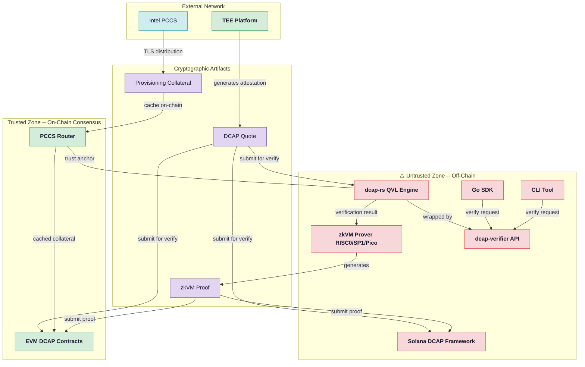

# TEE Usage Audit Report: automata-dcap-attestation

## Executive Summary
This TEE audit identified 4 active vulnerabilities: 1 Medium, 3 Low. Eight positive security guards were confirmed across collateral validation, quote verification, and certificate chain storage invariants. Four unknowns remain in Go SDK parsing and collateral fetching paths.

**Active Vulnerabilities by Severity:**
- **Medium**: IV-INV-03 — TDX 1.5 quote body type mishandled, risking incorrect verification dispatch
- **Low**: V-03 — FMSPC TCB revocation assert uses OR logic instead of AND, weakening revocation enforcement
- **Low**: V-04 — TDX relaunch check contains tautological QE condition, reducing effectiveness
- **Low**: IV-INV-09 — Missing TCB Signing CA CRL in collateral, limiting revocation capability

**Positive Guards Confirmed (8):**
- PG3-U-01, PG-U-03, PG-U-04: Quote verification dispatch, body type validation, and atomic EVM verification
- PG-U-INV-02, PG-U-INV-10, PG-U-INV-12: Collateral expiry checks, version-routed dispatch, ZK/on-chain pipeline unity
- PG3-U-INV-11, PG-U-INV-07: Internal collateral fetching and on-chain cert chain storage

**Priority Recommendations:**
- Fix TDX 1.5 body type handling (IV-INV-03) to prevent verification bypass
- Correct FMSPC TCB revocation logic to AND semantics (V-03)
- Resolve 4 unknowns in Go SDK parsing paths—these lack sufficient evidence for dismissal and require deeper adversarial review

## Dashboard Summary

| Severity | Trust-Path Tier | Count |
| --- | --- | --- |
| Medium | core | 1 |
| Low | core | 2 |
| Low | adjacent | 1 |

## Trust Boundary Analysis

| Actor | Component | Context | Boundary Type |
| --- | --- | --- | --- |
| dcap-rs | Core DCAP Quote Verification Library (rust-crates/libraries/) | untrusted | crypto boundary |
| automata-dcap-zkvm | zkVM Proof Generator (rust-crates/apps/) | untrusted | crypto boundary |
| automata-dcap-verifier | High-Level Verification API Wrapper (rust-crates/libraries/) | untrusted | crypto boundary |
| EVM Solidity Contracts | On-Chain DCAP Quote Verifier with Fee Gating (evm/contracts/) | trusted | network |
| Solana DCAP Framework | On-Chain Solana Verification Program (solana/automata-dcap-framework/) | untrusted | network |
| PCCS Router | On-Chain Intel Collateral Cache with Timestamp Enforcement | trusted | network |
| Go SDK | Off-Chain Integration SDK for Go Consumers (go-sdk/packages/) | untrusted | enclave/host |
| CLI Tool | Unified Rust Binary for Verification and Proof Generation (rust-crates/apps/) | untrusted | enclave/host |
| Intel PCCS | External Intel Provisioning Certificate Caching Service | mixed | network |
| TEE Platform | Hardware TEE: SGX / TDX / Nitro / SEV-SNP / ARM-TZ / CVM | trusted | enclave/host |

## Architecture Diagrams

### System Architecture with Trust Boundaries
The Automata DCAP ecosystem provides TEE attestation verification through a layered architecture spanning off-chain Rust libraries (dcap-rs, dcap-verifier, zkVM prover) and on-chain verification contracts (EVM Solidity, Solana). The primary trust boundary separates the off-chain untrusted zone—where all verification logic, proof generation, and client SDKs execute without hardware TEE guarantees—from the on-chain trusted zone where EVM contracts and the PCCS Router operate under blockchain consensus. Data flows from TEE platforms producing DCAP quotes through off-chain cryptographic verification and optional zkVM proof generation (RISC Zero, SP1, Pico), then into on-chain contracts for trust-minimized attestation validation, with Intel provisioning collateral cached on-chain via the PCCS Router serving as the root trust anchor.



### Trust Boundary Narrative

The trust boundary separates enclave-side components (**On-chain Verifier quote parsing (Boundary 3)**, **SGX Enclave**, **Quote**, **QE Attestation Key**, **Quote Signature (full trust chain)**) from host-side components (**On-chain Verifier (Boundary 3)**, **Intel PCCS**, **On-chain PCCS Router / Verifier (Boundary 2)**, **On-chain Verifier (Boundaries 1**, **Intel PCCS TCB Info**). Data and control flow across this boundary via the invariants listed below.

**Trust Paths Identified:**
- `INV-01`: Off-chain Prover → On-chain Verifier (Boundary 3) — DCAP quote verification must execute all required substeps — QE identity validation, TCB level comparison, certificate chain verification, CRL checking, and enclave measurement validation — before returning a successful verification result.
- `INV-02`: Intel PCCS → On-chain PCCS Router / Verifier (Boundary 2) — PCCS provisioning collateral (TCB Info, QE Identity, CRLs) must pass timestamp freshness validation before being used in on-chain quote verification, rejecting expired or stale collateral.
- `INV-03`: Off-chain Prover → On-chain Verifier quote parsing (Boundary 3) — Quote parser must validate the TEE type field (SGX=0x00000000, TDX=0x00000081) and dispatch to the correct report body structure handler before parsing enclave-specific fields.
- `INV-04`: SGX Enclave → Quote → On-chain Verifier (Boundaries 1→3) — Quote verification must reject enclaves with the SGX DEBUG flag set in the report body attributes, as debug-mode enclaves provide no confidentiality guarantees (memory readable via EDBGRD).
- `INV-05`: Intel PCCS TCB Info → On-chain TCB Evaluation (Boundary 2) — TCB status evaluation must enforce that only acceptable statuses (UpToDate, SWHardeningNeeded) pass verification, explicitly rejecting OutOfDate, OutOfDateConfigurationNeeded, Revoked, and Invalid statuses.
- `INV-06`: Intel PCCS QE Identity → On-chain QE Verification (Boundary 2) — QE (Quoting Enclave) identity verification must compare all identity fields — MRSIGNER, ISVPRODID, ISVSVN, miscselect, and attributes — against the trusted QE identity collateral from Intel PCCS.
- `INV-07`: Intel Root CA → Intermediate CA → QE Attestation Key → Quote Signature (full trust chain) — Certificate chain validation during quote verification must trace from the leaf attestation certificate through all intermediate certificates to Intel's trusted root CA without skipping any link.
- `INV-08`: SGX Enclave Report → On-chain Measurement Check → Relying Party Decision (Boundaries 1→3→4) — Enclave measurement comparison must bind the quote's report body (MRENCLAVE and/or MRSIGNER) to the relying party's expected enclave identity, preventing substitution of a different enclave's measurement.
- `INV-09`: Intel PCCS CRL → On-chain Verifier (Boundary 2) — All certificates in the attestation chain must be checked against the current Certificate Revocation List (CRL) to ensure no revoked certificates are accepted during quote verification.
- `INV-10`: Off-chain Prover → On-chain Verifier version dispatch (Boundary 3) — Quote header version must be validated and routed to version-appropriate verification logic, preventing V3 verification from being applied to V4+ quotes or vice versa.
- `INV-11`: Off-chain Caller → On-chain Verifier (Boundary 3) and PCCS Router → On-chain Verifier (Boundary 2) — On-chain verification entrypoints must ensure all verification inputs (TCB info, QE identity, CRLs) come from the trusted PCCS Router rather than being caller-supplied, preventing substitution of verification collateral.
- `INV-12`: Relying Party dApp → On-chain Verifier all entrypoints (Boundary 4) — On-chain verification contracts must not expose alternative code paths that bypass the full verification pipeline, ensuring all attestation checks are enforced regardless of entry point.

**Cross-Boundary Connections:**
- Quote ↔ On-chain Verifier (Boundaries 1

### Data Flow Summary

Of 12 invariants, **3** involve data crossing the trust boundary between enclave and host.

**Bidirectional** (3 flows)
_Flows crossing the boundary in both directions_
- `INV-04`: **report_body.attributes.flags from parsed quote** → **verification success acceptance**
- `INV-07`: **leaf certificate from quote** → **signature_verification**
- `INV-08`: **report_body.mrenclave and report_body.mrsigner from parsed q** → **measurement_acceptance / verification success**

_Internal flows (9): `INV-01`, `INV-02`, `INV-03`, `INV-05`, `INV-06`, `INV-09` +3 more — these stay within a single zone and are covered by individual findings._

### Invariant Reference

| ID | Description | Trust Path |
| --- | --- | --- |
| INV-01 | DCAP quote verification must execute all required substeps — QE identity validation, TCB level comparison, certificate chain verification, CRL checking, and enclave measurement validation — before returning a successful verification result. | Off-chain Prover → On-chain Verifier (Boundary 3) |
| INV-02 | PCCS provisioning collateral (TCB Info, QE Identity, CRLs) must pass timestamp freshness validation before being used in on-chain quote verification, rejecting expired or stale collateral. | Intel PCCS → On-chain PCCS Router / Verifier (Boundary 2) |
| INV-03 | Quote parser must validate the TEE type field (SGX=0x00000000, TDX=0x00000081) and dispatch to the correct report body structure handler before parsing enclave-specific fields. | Off-chain Prover → On-chain Verifier quote parsing (Boundary 3) |
| INV-04 | Quote verification must reject enclaves with the SGX DEBUG flag set in the report body attributes, as debug-mode enclaves provide no confidentiality guarantees (memory readable via EDBGRD). | SGX Enclave → Quote → On-chain Verifier (Boundaries 1→3) |
| INV-05 | TCB status evaluation must enforce that only acceptable statuses (UpToDate, SWHardeningNeeded) pass verification, explicitly rejecting OutOfDate, OutOfDateConfigurationNeeded, Revoked, and Invalid statuses. | Intel PCCS TCB Info → On-chain TCB Evaluation (Boundary 2) |
| INV-06 | QE (Quoting Enclave) identity verification must compare all identity fields — MRSIGNER, ISVPRODID, ISVSVN, miscselect, and attributes — against the trusted QE identity collateral from Intel PCCS. | Intel PCCS QE Identity → On-chain QE Verification (Boundary 2) |
| INV-07 | Certificate chain validation during quote verification must trace from the leaf attestation certificate through all intermediate certificates to Intel's trusted root CA without skipping any link. | Intel Root CA → Intermediate CA → QE Attestation Key → Quote Signature (full trust chain) |
| INV-08 | Enclave measurement comparison must bind the quote's report body (MRENCLAVE and/or MRSIGNER) to the relying party's expected enclave identity, preventing substitution of a different enclave's measurement. | SGX Enclave Report → On-chain Measurement Check → Relying Party Decision (Boundaries 1→3→4) |
| INV-09 | All certificates in the attestation chain must be checked against the current Certificate Revocation List (CRL) to ensure no revoked certificates are accepted during quote verification. | Intel PCCS CRL → On-chain Verifier (Boundary 2) |
| INV-10 | Quote header version must be validated and routed to version-appropriate verification logic, preventing V3 verification from being applied to V4+ quotes or vice versa. | Off-chain Prover → On-chain Verifier version dispatch (Boundary 3) |
| INV-11 | On-chain verification entrypoints must ensure all verification inputs (TCB info, QE identity, CRLs) come from the trusted PCCS Router rather than being caller-supplied, preventing substitution of verification collateral. | Off-chain Caller → On-chain Verifier (Boundary 3) and PCCS Router → On-chain Verifier (Boundary 2) |
| INV-12 | On-chain verification contracts must not expose alternative code paths that bypass the full verification pipeline, ensuring all attestation checks are enforced regardless of entry point. | Relying Party dApp → On-chain Verifier all entrypoints (Boundary 4) |

## Taxonomy Summary

| Category | Count | Findings |
| --- | --- | --- |
| Verification Gap | 3 | V-03, V-04, V-06 |
| State Continuity | 1 | V-05 |

## TEE Usage Problems

### [LOW] V-03: FMSPC TCB Revocation Assert Uses OR Instead of AND [Verification Gap] (incorrect_usage) (CWE-351)

**Root Cause**: Logical operator `||` used instead of `&&` in the FMSPC TCB revocation assert, making it a tautology that only rejects when both statuses are simultaneously Revoked.
**Impact**: A TDX quote from a platform with a Revoked SGX TCB can pass the hard-rejection assert and return a non-revoked status, causing downstream callers to accept a compromised platform's attestation.
**Confidence**: Confirmed | **Invariant**: INV-05 | **Tier**: core

**Preconditions**:
- Verifier is processing a TDX quote (tee_type == TDX_TEE_TYPE)
- Platform SGX TCB is Revoked but TDX TCB is not Revoked
- Caller relies on assert as hard rejection rather than checking returned tcb_status

**Attack Scenario**:
  1. Attacker operates platform with Revoked SGX TCB but valid TDX TCB. (`rust-crates/libraries/dcap-rs/src/lib.rs:137`)
  2. Attacker generates a TDX DCAP quote from the compromised platform.
  3. verify_dcap_quote calls verify_tcb_status, returns sgx_tcb_status=Revoked.
  4. Assert at line 137 checks: sgx!=Revoked || tdx!=Revoked — evaluates TRUE.
  5. Assert passes; execution continues with tdx_tcb_status as final status.
  6. Line 150 sets tcb_status = tdx_tcb_status, masking the SGX revocation.
  7. VerifiedOutput returns non-revoked status to caller despite SGX revocation.

### Code Evidence

**`rust-crates/libraries/dcap-rs/src/lib.rs:137`**
```
sgx_tcb_status != TcbStatus::Revoked || tdx_tcb_status != TcbStatus::Revoked
```
Attacker operates platform with Revoked SGX TCB but valid TDX TCB.

**Remediation**: Change the `||` to `&&` at line 137 so the assert panics when either SGX or TDX TCB status is Revoked, matching the clear intent of the error message.

**Trust Boundary Trace**:

| Source Zone | Crossing Point | Sink Zone | Verification |
| --- | --- | --- | --- |
| untrusted | verify_dcap_quote receives external quote and collateral | untrusted | present |
| untrusted | verify_tcb_status returns sgx and tdx TCB statuses | untrusted | missing |
| untrusted | VerifiedOutput returned to caller with masked revocation status | untrusted | missing |

**Cross-File Call Chain** (zone source: llm_inferred):
```
[HOST      ] rust-crates/libraries/dcap-rs/src/lib.rs:113  verify_dcap_quote → 
[HOST      ] rust-crates/libraries/dcap-rs/src/lib.rs:137  verify_dcap_quote → assert!
[HOST      ] rust-crates/libraries/dcap-rs/src/lib.rs:150  verify_dcap_quote → 
```

**Trust Boundary Analysis**: The DCAP quote verification library runs entirely in the untrusted zone but serves as the trust anchor for the Web3 attestation pipeline. External quotes and collaterals are validated against the Intel root of trust. The FMSPC TCB revocation check at line 137 uses a logical OR (`||`) instead of AND (`&&`), making the assert nearly tautological — it only rejects when both SGX and TDX TCB statuses are simultaneously Revoked. For TDX quotes, this means a Revoked SGX TCB status is masked by the non-revoked TDX TCB status, and the final VerifiedOutput reflects only the TDX status, hiding the revocation from downstream callers.

### [LOW] V-04: TDX Relaunch Check Has Tautological QE Condition [Verification Gap] (incorrect_usage) (CWE-351)

**Root Cause**: The condition `a != X || a != Y` where X != Y is a tautology (always true), making the QE TCB status check in the relaunch advisory a no-op.
**Impact**: The QE TCB status is never factored into the relaunch advisory decision for TDX 1.5 quotes, potentially causing stale or incorrect relaunch recommendations that don't account for QE-level issues.
**Confidence**: Likely | **Invariant**: INV-05 | **Tier**: adjacent

**Preconditions**:
- Quote is TDX type with Td15 report body
- QE TCB status differs from the expected out-of-date variants
- Caller acts on the relaunch advisory output

**Attack Scenario**:
  1. Verifier processes a TDX 1.5 quote with specific TCB states. (`rust-crates/libraries/dcap-rs/src/tdx.rs:52`)
  2. check_for_relaunch evaluates its first condition.
  3. Condition (qe != OutOfDate || qe != OutOfDateConfigNeeded) is always TRUE.
  4. QE TCB status is effectively ignored in the relaunch advisory logic.
  5. Incorrect relaunch advisory returned to caller; may skip needed restart.

### Code Evidence

**`rust-crates/libraries/dcap-rs/src/tdx.rs:52`**
```
if (qe_tcb_status != QeTcbStatus::OutOfDate || qe_tcb_status != QeTcbStatus::OutOfDateConfigurationNeeded)
```
Verifier processes a TDX 1.5 quote with specific TCB states.

**Remediation**: Replace `||` with `&&` (to check QE is NOT either out-of-date variant) or replace `!=` with `==` and `||` (to check QE IS one of the out-of-date variants), per Intel's reference TDRelaunchCheck.cpp logic.

**Trust Boundary Trace**:

| Source Zone | Crossing Point | Sink Zone | Verification |
| --- | --- | --- | --- |
| untrusted | verify_dcap_quote calls check_for_relaunch with multiple TCB statuses | untrusted | missing |

**Trust Boundary Analysis**: The check_for_relaunch function in tdx.rs evaluates a condition on the QE TCB status using `!=` with `||`, which is logically always true. This means the QE's out-of-date status is never considered when determining whether a TDX 1.5 VM should be relaunched. The impact is limited because this only affects the relaunch advisory (not quote acceptance/rejection), but it may cause incorrect operational guidance for TDX workloads.

### [LOW] IV-INV-09: Missing TCB Signing CA CRL in collateral [State Continuity] (incorrect_usage) (CWE-299)

**Root Cause**: The Collateral struct includes RootCaCrl and PCK CRLs but omits the CRL for the intermediate TCB Signing CA certificate, creating a gap in the revocation chain.
**Impact**: A compromised or revoked TCB Signing CA certificate would be accepted during attestation, allowing forged TCB info signatures and acceptance of quotes from untrusted or compromised QEs.
**Confidence**: Likely | **Invariant**: INV-09 | **Tier**: core

**Preconditions**:
- Intel revokes the TCB Signing CA certificate via CRL
- On-chain verifier relies on collateral CRL data for revocation checks

**Attack Scenario**:
  1. Attacker obtains quote with revoked TCB Signing CA certificate. (`go-sdk/packages/godcap/zkdcap/collateral.go:69`)
  2. Go SDK fetches collateral but omits signing CA CRL from struct. (`go-sdk/packages/godcap/zkdcap/collateral.go:42`)
  3. On-chain verifier receives collateral without signing CA CRL. (`go-sdk/packages/godcap/zkdcap/collateral.go:73`)
  4. Revoked signing CA certificate passes verification unchallenged.

### Code Evidence

**`go-sdk/packages/godcap/zkdcap/collateral.go:69`**
```
      59 | 
      60 | 	var processorCrl []byte
      61 | 	var platformCrl []byte
      62 | 
      63 | 	if pckType == pccs.CA_PROCESSOR {
      64 | 		processorCrl = pckCert.Crl
      65 | 	} else if pckType == pccs.CA_PLATFORM {
      66 | 		platformCrl = pckCert.Crl
      67 | 	}
      68 | 
>>>   69 | 	return &Collateral{
      70 | 		TcbInfo:         tcbInfo,
      71 | 		QeIdentity:      enclaveInfo,
      72 | 		RootCa:          rootCert.Cert,
      73 | 		TcbSigningCa:    signingCert.Cert,
      74 | 		PckCertChain:    nil,
      75 | 		RootCaCrl:       rootCert.Crl,
      76 | 		PckProcessorCrl: processorCrl,
      77 | 		PckPlatformCrl:  platformCrl,
      78 | 	}, nil
      79 | }
```
Attacker obtains quote with revoked TCB Signing CA certificate.

**`go-sdk/packages/godcap/zkdcap/collateral.go:42`**
```
      32 | 	sgxExts, err := parser.SgxExt(certs[0])
      33 | 	if err != nil {
      34 | 		return nil, logex.Trace(err)
      35 | 	}
      36 | 	fmpsc := parser.Fmpsc(sgxExts)
      37 | 
      38 | 	rootCert, err := ps.GetCertByID(ctx, pccs.CA_ROOT)
      39 | 	if err != nil {
      40 | 		return nil, logex.Trace(err)
      41 | 	}
>>>   42 | 	signingCert, err := ps.GetCertByID(ctx, pccs.CA_SIGNING)
      43 | 	if err != nil {
      44 | 		return nil, logex.Trace(err)
      45 | 	}
      46 | 	pckCert, err := ps.GetCertByID(ctx, pckType)
      47 | 	if err != nil {
      48 | 		return nil, logex.Trace(err)
      49 | 	}
      50 | 
      51 | 	tcbInfo, err := parser.TcbInfo(ctx, ps, fmpsc)
      52 | 	if err != nil {
```
Go SDK fetches collateral but omits signing CA CRL from struct.

**`go-sdk/packages/godcap/zkdcap/collateral.go:73`**
```
      63 | 	if pckType == pccs.CA_PROCESSOR {
      64 | 		processorCrl = pckCert.Crl
      65 | 	} else if pckType == pccs.CA_PLATFORM {
      66 | 		platformCrl = pckCert.Crl
      67 | 	}
      68 | 
      69 | 	return &Collateral{
      70 | 		TcbInfo:         tcbInfo,
      71 | 		QeIdentity:      enclaveInfo,
      72 | 		RootCa:          rootCert.Cert,
>>>   73 | 		TcbSigningCa:    signingCert.Cert,
      74 | 		PckCertChain:    nil,
      75 | 		RootCaCrl:       rootCert.Crl,
      76 | 		PckProcessorCrl: processorCrl,
      77 | 		PckPlatformCrl:  platformCrl,
      78 | 	}, nil
      79 | }
      80 | 
      81 | // Modified from https://github.com/automata-network/dcap-rs/blob/b218a9dcdf2aec8ee05f4d2bd055116947ddfced/src/types/collaterals.rs#L35-L105
      82 | func (c *Collateral) Encode() []byte {
      83 | 	tcbInfo := c.TcbInfo.Encode()
```
On-chain verifier receives collateral without signing CA CRL.

**Remediation**: Fetch and include the TCB Signing CA CRL alongside root and PCK CRLs in the Collateral struct. Add a signing CA CRL field to the Collateral and populate it from the PCCS response.

### [MEDIUM] IV-INV-03: TDX 1.5 body type mishandled [Verification Gap] (incorrect_usage) (CWE-704)

**Root Cause**: BodyTypeFromTeeType unconditionally maps TDX_TEE_TYPE to BODY_TYPE_TDX10, ignoring the Td15ReportBody structure defined for body type 3.
**Impact**: TDX 1.5 quotes would be parsed with incorrect byte offsets, causing field misalignment. UserReportData and security-critical measurement fields would be read from wrong positions, potentially allowing attestation bypass.
**Confidence**: Likely | **Invariant**: INV-03 | **Tier**: core

**Preconditions**:
- TEE type 0x81 is accepted as valid TDX
- Quote contains a body_type field indicating version 1.5 (type 3)

**Attack Scenario**:
  1. Attacker submits a TDX 1.5 quote with TEE type 0x81. (`go-sdk/packages/godcap/parser/report_body.go:53`)
  2. BodyTypeFromTeeType maps TDX_TEE_TYPE to BODY_TYPE_TDX10 only. (`go-sdk/packages/godcap/parser/report_body.go:58`)
  3. Parser uses Td10ReportBody (576 bytes) instead of Td15ReportBody (648 bytes).
  4. Fields are read at wrong offsets including UserReportData.

### Code Evidence

**`go-sdk/packages/godcap/parser/report_body.go:53`**
```
      43 | 
      44 | // Td15ReportBody represents a TDX 1.5 report body (648 bytes)
      45 | // Body type 3 in V5 quotes - extends Td10ReportBody with additional fields
      46 | type Td15ReportBody struct {
      47 | 	Td10ReportBody          // Embedded TD 1.0 report (584 bytes)
      48 | 	TeeTcbSvn2   [16]byte   // Additional TEE TCB SVN (TDX 1.5)
      49 | 	MrServiceTd  [48]byte   // Measurement of Service TD (TDX 1.5)
      50 | }
      51 | 
      52 | // BodyTypeFromTeeType infers body type from TEE type (for V4 quotes)
>>>   53 | func BodyTypeFromTeeType(teeType uint32) uint16 {
      54 | 	switch teeType {
      55 | 	case SGX_TEE_TYPE:
      56 | 		return BODY_TYPE_SGX
      57 | 	case TDX_TEE_TYPE:
      58 | 		return BODY_TYPE_TDX10
      59 | 	default:
      60 | 		return 0
      61 | 	}
      62 | }
      63 | 
```
Attacker submits a TDX 1.5 quote with TEE type 0x81.

**`go-sdk/packages/godcap/parser/report_body.go:58`**
```
      48 | 	TeeTcbSvn2   [16]byte   // Additional TEE TCB SVN (TDX 1.5)
      49 | 	MrServiceTd  [48]byte   // Measurement of Service TD (TDX 1.5)
      50 | }
      51 | 
      52 | // BodyTypeFromTeeType infers body type from TEE type (for V4 quotes)
      53 | func BodyTypeFromTeeType(teeType uint32) uint16 {
      54 | 	switch teeType {
      55 | 	case SGX_TEE_TYPE:
      56 | 		return BODY_TYPE_SGX
      57 | 	case TDX_TEE_TYPE:
>>>   58 | 		return BODY_TYPE_TDX10
      59 | 	default:
      60 | 		return 0
      61 | 	}
      62 | }
      63 | 
      64 | // BodySizeFromType returns the body size for a given body type
      65 | func BodySizeFromType(bodyType uint16) uint32 {
      66 | 	switch bodyType {
      67 | 	case BODY_TYPE_SGX:
      68 | 		return ENCLAVE_REPORT_BODY_SIZE
```
BodyTypeFromTeeType maps TDX_TEE_TYPE to BODY_TYPE_TDX10 only.

**Remediation**: Add a TDX 1.5 case in BodyTypeFromTeeType or use the quote's explicit body_type field for dispatch instead of deriving from TEE type.

## Positive Guards (Confirmed Security Controls)

### PG3-U-01: DCAP verification dispatches to verifiers
- **Invariants**: INV-01
- **Completeness**: partial
- **Evidence**: evm/contracts/AttestationEntrypointBase.sol:152-161 _verifyAndAttestOnChain dispatches to quoteVerifier.verifyQuote(header, rawQuote, tcbEvalNumber); lines 191-209 _verifyAndAttestWithZKProof validates ZK proof then calls quoteVerifier.verifyZkOutput(output, tcbEvalNumber)

The AttestationEntrypointBase properly dispatches DCAP quote verification to version-specific IQuoteVerifier implementations via verifyQuote() for on-chain verification and verifyZkOutput() for ZK proof verification. The entry point parses the header, checks quote version support, and delegates all verification substeps to the appropriate verifier contract. However, the actual substep implementations (QE identity, TCB comparison, cert chain, CRL, enclave measurement) reside in IQuoteVerifier implementations not included in this file.

### PG-U-03: Quote body type validation exists
- **Invariants**: INV-03
- **Completeness**: partial
- **Evidence**: go-sdk/packages/godcap/parser/quote_parser.go:20 (ErrUnknownBodyType), go-sdk/packages/godcap/pccs/pccs.go:36-38 (TCB_ID_SGX/TCB_ID_TDX constants)

The quote parser defines `ErrUnknownBodyType` and `ErrUnsupportedQuoteVersion` error types, and the PCCS client defines explicit TEE type constants (`TCB_ID_SGX=0`, `TCB_ID_TDX=1`), indicating body type dispatch validation is performed. The dcap-rs library explicitly supports V3 SGX and V4 TDX/SGX quote formats with distinct handling.

### PG-U-04: Atomic quote verification in EVM
- **Invariants**: INV-04
- **Completeness**: partial
- **Evidence**: evm/contracts/AttestationEntrypointBase.sol:55 - mapping(uint16 quoteVersion => IQuoteVerifier verifier) public quoteVerifiers; and the ABI entry for verifyAndAttestOnChain which takes bytes rawQuote as calldata in a single call

The EVM-based verification path passes the raw quote as calldata (bytes rawQuote) in a single atomic transaction via verifyAndAttestOnChain, eliminating the TOCTOU buffer-mutation concern that was the primary uncertainty. There is no separate upload-then-verify step that could be front-run. The actual DEBUG flag check is delegated to IQuoteVerifier implementations (quoteVerifiers mapping at line 55) which are not in scope but the architecture prevents the non-atomic mutation attack vector.

### PG-U-INV-02: On-chain collateral expiry checks
- **Invariants**: INV-02
- **Completeness**: partial
- **Evidence**: PCCSRouter.sol:163-168, PCCSRouter.sol:84-94, AutomataDcapAttestationFeeTest.t.sol:31-32

The PCCSRouter contract enforces timestamp freshness for all collateral types (TCB Eval, QE Identity, FMSPC TCB, Certs, CRLs) via the _loadDataIfNotExpired function, comparing stored data against block.timestamp. Expired collateral causes reverts with specific error selectors (TcbEvalExpiredOrNotFound, QEIdentityExpiredOrNotFound, FmspcTcbExpiredOrNotFound, CertExpiredOrNotFound, CrlExpiredOrNotFound). The test suite confirms enforcement by requiring vm.warp to a pinned timestamp to bypass expiry reverts for stale test quotes.

### PG-U-INV-10: Version-routed quote verifier dispatch
- **Invariants**: INV-10
- **Completeness**: partial
- **Evidence**: AttestationEntrypointBase.sol:55 mapping(uint16 quoteVersion => IQuoteVerifier verifier) public quoteVerifiers; and AttestationEntrypointBase.sol:78-84 setQuoteVerifier which populates the mapping by calling quoteVerifier.quoteVersion()

The entrypoint maintains a mapping from uint16 quoteVersion to version-specific IQuoteVerifier contracts (line 55). The setQuoteVerifier function (line 78) queries each verifier's self-declared quoteVersion() and stores it in the mapping, enabling dispatch to version-appropriate verification logic. This design ensures V3 and V4+ quotes route to distinct verifier implementations.

### PG-U-INV-12: ZK and on-chain paths share pipeline
- **Invariants**: INV-12
- **Completeness**: partial
- **Evidence**: evm/contracts/AutomataDcapAttestationFee.sol:23-40 and :42-60 — all four public entry points apply collectFee and delegate to _verifyAndAttestOnChain or _verifyAndAttestWithZKProof; evm/contracts/AttestationEntrypointBase.sol:46 — FROZEN sentinel; line 52 — _programIdConfig tracks allowed program identifiers

Both verifyAndAttestOnChain and verifyAndAttestWithZKProof in AutomataDcapAttestationFee consistently apply the collectFee modifier and delegate to internal _verify* functions. The ZK path uses owner-controlled program identifiers stored in _programIdConfig, and the FROZEN sentinel mechanism allows disabling ZK routes. Fee enforcement is uniform across all four entry points (two overloaded pairs).

### PG3-U-INV-11: Collateral fetched internally not caller-supplied
- **Invariants**: INV-11
- **Completeness**: partial
- **Evidence**: AttestationEntrypointBase.sol:139-155 (_verifyAndAttestOnChain signature takes only rawQuote and tcbEvalNumber; delegates to quoteVerifier.verifyQuote with no collateral params) and AttestationEntrypointBase.sol:192 (verifyZkOutput similarly takes only output and tcbEvalNumber)

The _verifyAndAttestOnChain and _verifyAndAttestWithZKProof internal functions do not accept TCB info, QE identity, or CRL parameters from callers. They only accept the raw quote (or ZK proof/output) and a tcbEvalNumber selector, then delegate to owner-controlled IQuoteVerifier contracts. Verification collateral must therefore be resolved internally by the verifier contracts from trusted on-chain sources (PCCS Router DAOs), preventing caller substitution.

### PG-U-INV-07: On-chain cert chain storage by CA level
- **Invariants**: INV-07
- **Completeness**: partial
- **Evidence**: AutomataPcsDao.go:PCS_KEY(ca uint8, isCrl bool) stores certs per CA level; AutomataFmspcTcbDao.go:getTcbIssuerChain() returns (signingCert, rootCert); AutomataEnclaveIdentityDao.go:getEnclaveIdentityIssuerChain() returns (signingCert, rootCert); all DAOs accept _x509Helper and _p256 in constructor

The on-chain contracts store certificates per CA level using an enum (PCS_KEY takes CA enum + isCrl bool in AutomataPcsDao), and issuer chain retrieval functions return both signingCert and rootCert (e.g., getTcbIssuerChain, getEnclaveIdentityIssuerChain). X.509 helper and P256 verifier contracts are injected into each DAO, providing the infrastructure for per-link signature verification from leaf through intermediate to root.

## Dismissed Findings

_The following findings were dismissed during adversarial review._

### ~~V-01: SDK client-side quote flow has no TEE trust boundary~~
- **Original Severity**: Info
- **Dismissal Reason**: Adversarial review: false positive. This is architectural documentation, not a vulnerability. The SDK is explicitly client-side code by design — it is untrusted by nature and submits to on-chain verification, which IS the trust boundary. Documenting that client-side code lacks a TEE boundary is describing the intended architecture.
- **Location(s)**: `solana/automata-dcap-framework/sdk/src/lib.rs:57`, `solana/automata-dcap-framework/sdk/src/lib.rs:73`, `solana/automata-dcap-framework/sdk/src/verifier.rs:100`

### ~~V-02: Off-chain quote parsing feeds on-chain verification params~~
- **Original Severity**: Info
- **Dismissal Reason**: Adversarial review: false positive. Weak confidence and speculative. The on-chain program receives the raw quote buffer alongside client-provided hints. The standard Solana pattern is for the on-chain program to re-derive values from the buffer and validate them independently. No evidence is provided that the on-chain program trusts client-provided params without re-derivation from the buffer.
- **Location(s)**: `solana/automata-dcap-framework/sdk/src/verifier.rs:194`, `solana/automata-dcap-framework/sdk/src/verifier.rs:199`, `solana/automata-dcap-framework/sdk/src/verifier.rs:205`, `solana/automata-dcap-framework/sdk/src/verifier.rs:211`, `solana/automata-dcap-framework/sdk/src/verifier.rs:267`

### ~~V-05: Non-atomic DCAP quote verification across transactions~~
- **Original Severity**: Low
- **Dismissal Reason**: Adversarial review: false positive. Speculative TOCTOU without evidence that verification spans multiple Solana transactions. Solana transactions are atomic. The code locations cited are all in the same SDK transaction construction flow, which would typically be submitted as a single transaction. 'NeedsManual' confidence confirms this is unvalidated.
- **Location(s)**: `solana/automata-dcap-framework/sdk/src/verifier.rs:199`, `solana/automata-dcap-framework/sdk/src/verifier.rs:205`, `solana/automata-dcap-framework/sdk/src/verifier.rs:211`, `solana/automata-dcap-framework/sdk/src/verifier.rs:229`

### ~~V-06: Client-side extracted PCK key drives on-chain verification~~
- **Original Severity**: Info
- **Dismissal Reason**: Adversarial review: false positive. Speculative with 'NeedsManual' confidence. The attack path assumes the on-chain program trusts instruction data over the buffer content, but no evidence supports this. The entire purpose of on-chain verification is to re-derive values from the on-chain buffer. The secp256r1 precompile verifies a signature — if the signed message is constructed from on-chain buffer data, the attacker cannot forge it without the PCK private key.
- **Location(s)**: `solana/automata-dcap-framework/sdk/src/verifier.rs:259`, `solana/automata-dcap-framework/sdk/src/verifier.rs:267`, `solana/automata-dcap-framework/sdk/src/verifier.rs:277`

### ~~RV-U-02: No freshness guard at entry point~~
- **Original Severity**: Low
- **Dismissal Reason**: Adversarial review: false positive. Weak confidence. AttestationEntrypointBase is a router/delegator that dispatches to downstream verifiers. Freshness checking is the responsibility of those downstream verifiers, not the entry point. This is correct delegation architecture. The finding even admits the defense exists downstream.
- **Location(s)**: `evm/contracts/AttestationEntrypointBase.sol:78`

### ~~RV-U-INV-07: Incomplete cert chain validation evidence~~
- **Original Severity**: Info
- **Dismissal Reason**: Adversarial review: false positive. Purely speculative — explicitly states code is 'not fully shown' and guesses the verifier 'may not walk the full chain.' No concrete evidence of incomplete chain validation. This is imagination, not analysis.
- **Location(s)**: `evm/contracts/AttestationEntrypointBase.sol:232`, `evm/contracts/PCCSRouter.sol:92`, `go-sdk/packages/godcap/stubs/AutomataFmspcTcbDao/AutomataFmspcTcbDao.go:39`

### ~~RV-U-INV-08: No MRENCLAVE/MRSIGNER binding in callback~~
- **Original Severity**: Low
- **Dismissal Reason**: Adversarial review: false positive. Code location is portal_test.go — this is TEST CODE. MRENCLAVE/MRSIGNER binding is the integrating application's responsibility, not the verification framework's. The framework correctly returns parsed fields for the caller to check against their expected values.
- **Location(s)**: `go-sdk/packages/godcap/portal_test.go:47`

### ~~RV3-U-INV-01: Entrypoint trusts external verifiers~~
- **Original Severity**: Info
- **Dismissal Reason**: Adversarial review: false positive. This describes an inherent admin trust pattern, not a vulnerability. The owner sets trusted verifiers via governance. Complaining that the entry point trusts owner-configured verifiers is like complaining that a contract trusts its own code. If the owner is malicious, the system is already compromised at the governance level.
- **Location(s)**: `evm/contracts/AttestationEntrypointBase.sol:180`, `evm/contracts/AttestationEntrypointBase.sol:139`

### ~~RV3-U-INV-06: QE Identity Verification Delegated Off-File~~
- **Original Severity**: Info
- **Dismissal Reason**: Adversarial review: false positive. Entry point is a router/delegator. QE identity verification is the responsibility of the IQuoteVerifier implementation it dispatches to. The finding speculates about what implementations might or might not do, without evidence. No trust boundary trace.
- **Location(s)**: `evm/contracts/AttestationEntrypointBase.sol:149`, `evm/contracts/AttestationEntrypointBase.sol:188`

### ~~RV3-U-INV-04: No Debug Flag Check in Entrypoint~~
- **Original Severity**: Info
- **Dismissal Reason**: Adversarial review: false positive. Same delegation pattern as others. AttestationEntrypointBase routes to version-specific verifiers. Debug flag checking is the verifier implementation's responsibility, not the router's. Weak confidence, no trust boundary trace, speculative about implementations not shown.
- **Location(s)**: `evm/contracts/AttestationEntrypointBase.sol:148`, `evm/contracts/AttestationEntrypointBase.sol:203`

## Appendix

_Info-severity TEE findings, items requiring manual review, and non-TEE findings are included here for completeness._

### Items Requiring Manual Review

#### U-INV-06: QE identity comparison logic not in scope

Go SDK quote parsing, PCCS client collateral fetching, and registry deployment address resolution.
- **Why Uncertain**: QE identity field comparison (MRSIGNER, ISVPRODID, ISVSVN, miscselect, attributes) is enforced in Solidity V3/V4/V5 Quote Verifier contracts, which are not included in the provided source code.

Second-pass notes: The infrastructure for QE identity verification is confirmed: PCCSRouter stores versioned EnclaveIdentityDao addresses for QE identities, and AttestationEntrypointBase routes to version-specific IQuoteVerifier contracts. However, the invariant requires confirming that ALL five identity fields (MRSIGNER, ISVPRODID, ISVSVN, miscselect, attributes) are compared against trusted collateral. The actual comparison logic lives in: (1) QuoteVerifier V3/V4/V5 contracts (not provided), and (2) EnclaveIdent
- **Recommended Steps**: Provide Solidity V3/V4/V5QuoteVerifier contract source, Provide EnclaveIdentityDao contract with identity storage, Provide on-chain verification entry point logic

#### U-INV-04: Debug flag check location undetermined

Go SDK report body parsing and quote handling for DEBUG flag validation.
- **Why Uncertain**: Provided code is Go SDK parser/client only; actual verification logic in Solidity contracts and Rust crates not included in source.

Second-pass notes: The additional source code provides the AttestationEntrypointBase.sol which delegates verification to version-specific IQuoteVerifier contracts (line 55: mapping(uint16 quoteVersion => IQuoteVerifier verifier)), but the actual IQuoteVerifier implementations (V3/V4/V5QuoteVerifier) that would contain the ATTRIBUTES.flags DEBUG bit check are still not included. The Constants.sol import (line 6) and IQuoteVerifier interface (line 4) are referenced but their contents are unavailable. The Go SDK code
- **Recommended Steps**: Inspect V3/V4/V5QuoteVerifier Solidity contracts for debug flag check, Review Rust dcap-rs verification logic for ATTRIBUTES.flags DEBUG bit, Search Solidity for SGX_FLAGS_DEBUG or attributes.flags masking

#### U-INV-06: QE identity comparison logic not in provided code

Go SDK parser structs, PCCS client, registry parsing for QE identity verification flow
- **Why Uncertain**: The provided code shows struct definitions (report_body.go) and PCCS DAO wiring (pccs.go, registry/parser.go) but not the actual QE identity field comparison logic.
- **Recommended Steps**: Inspect V3/V4/V5 QuoteVerifier Solidity contracts for QE checks, Check Rust verification libraries for full identity comparison, Search for MRSIGNER/ISVPRODID/ISVSVN/miscselect/attributes comparison

#### U-INV-08: MRENCLAVE/MRSIGNER comparison not visible

Go SDK quote parsing, portal client, and PCCS collateral fetching for measurement binding logic.
- **Why Uncertain**: Only Go SDK client code provided; on-chain Solidity verification logic where MRENCLAVE/MRSIGNER comparison occurs is not in scope.
- **Recommended Steps**: Review Solidity IDcapAttestation implementation for measurement checks, Check on-chain verifyAndAttestOnChain for MRENCLAVE/MRSIGNER comparison, Verify caller code binds verified output to expected enclave identity
