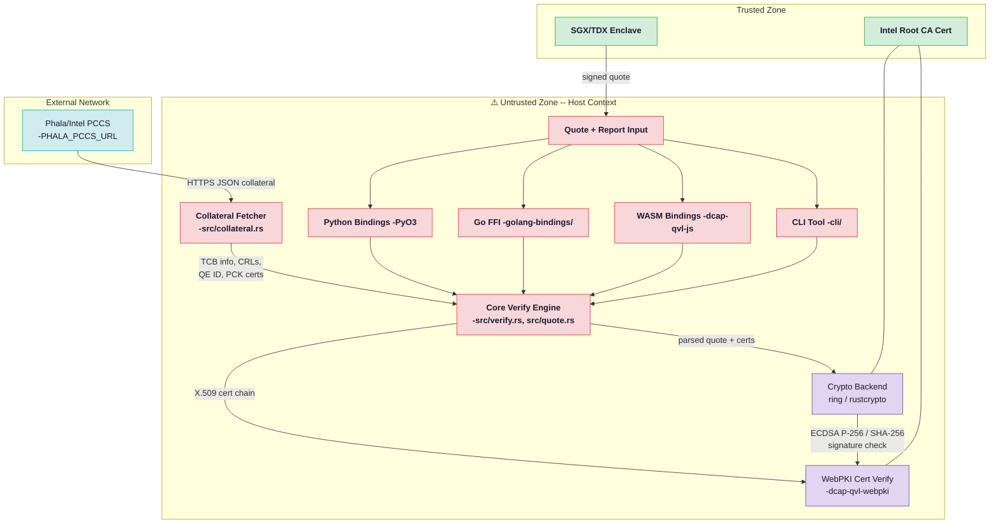

# TEE Usage Audit Report: dcap-qvl

## Executive Summary
This audit identified 2 High-severity active findings and confirmed 9 positive security guards (1 complete, 8 partial completeness) in the TEE verification library. Five findings were dismissed as false positives during adversarial review. One unknown remains regarding TCB status enforcement responsibility (U-INV-01).

**Critical Active Findings (2 High):**

- **IV-INV-09**: Unvalidated PCCS URL from environment variable allows SSR/network-level attacks. **Recommendation**: Implement allowlist validation or pinned URLs for PCCS endpoints.
- **IV-INV-12**: Full error chain propagated across FFI boundary leaks internal implementation details. **Recommendation**: Sanitize error messages at FFI boundary; return opaque error codes to callers.

**Key Strengths**: Root CA is hardcoded as default trust anchor (PG-INV-08), debug mode is rejected safe-by-default (PG-U-INV-02), and identity measurements are completely exposed in verification output (PG-INV-07, complete).

## Dashboard Summary

| Severity | Trust-Path Tier | Count |
| --- | --- | --- |
| High | core | 2 |

## Trust Boundary Analysis

| Actor | Component | Context | Boundary Type |
| --- | --- | --- | --- |
| Intel SGX/TDX Enclave | TEE Quote Generator | trusted | enclave/host -- produces signed attestation quote inside hardware-isolated enclave |
| Verifier Host Application | Core Quote Verification Engine (src/verify.rs, src/quote.rs) | untrusted | enclave/host -- consumes and parses quote entirely outside TEE |
| Collateral Fetcher | dcap_qvl::collateral (src/collateral.rs) | untrusted | network -- fetches TCB info, CRLs, QE identity, PCK certs from PCCS over HTTPS |
| Phala/Intel PCCS | PHALA_PCCS_URL provisioning endpoint | mixed | network -- external service providing attestation collateral; TLS-protected but outside verifier control |
| Crypto Backend (ring) | ring feature flag -- ECDSA P-256 + SHA-256 | untrusted | crypto boundary -- performs signature verification in host process; algorithmically correct but not TEE-protected |
| Crypto Backend (rustcrypto) | rustcrypto feature flag -- pure Rust sha2 + p256 | untrusted | crypto boundary -- portable pure-Rust crypto verification including WASM targets |
| dcap-qvl-webpki fork | X.509 certificate chain verification (v0.103.4) | untrusted | crypto boundary -- validates Intel attestation certificate profile back to root CA |
| Intel Root CA Certificate | Trusted root certificate for attestation PKI | trusted | trust anchor -- offline root of trust for entire certificate hierarchy |
| WASM Bindings | dcap-qvl-js (wasm-pack, npm @phala/dcap-qvl-*) | untrusted | FFI -- Rust-to-WASM compilation boundary; runs in browser/Node.js sandbox |
| Go FFI Bindings | golang-bindings/ (CGO, dcap_qvl.h header) | untrusted | FFI -- C ABI boundary between Go and Rust; includes collateral/PCK convenience functions |
| Python Bindings | python-bindings/ (PyO3 async interface) | untrusted | FFI -- PyO3 Rust-Python bridge; exposes get_collateral_and_verify high-level API |
| CLI Tool | cli/ standalone verification binary | untrusted | enclave/host -- manual/debug verification by Relying Party in untrusted shell environment |

## Architecture Diagrams

### System Architecture with Trust Boundaries
The dcap-qvl library operates entirely in the untrusted host context, providing DCAP quote verification for SGX/TDX attestation artifacts with no TEE-resident components. All source directories (src/, cli/, bindings, tests) are classified as untrusted, executing on the host alongside the verifier application. The primary trust boundaries are: (1) the network boundary to Phala/Intel PCCS for collateral retrieval (TCB info, CRLs, QE identity, PCK certificates), (2) the cryptographic boundary where ECDSA P-256 signature verification and X.509 certificate chain validation anchor trust to Intel's root CA, and (3) the TEE-to-host boundary where attestation quotes produced inside SGX/TDX enclaves are consumed by untrusted verification code. Trust is ultimately rooted in Intel's hardware root of trust and the integrity of externally-fetched collateral.



### Trust Boundary Narrative

The trust boundary separates enclave-side components (**Quote Bytes**, **Remote TEE (Debug Mode Enclave)**, **Network Input (Quote)**, **Quote Body**, **Measurement Extraction**) from host-side components (**TCB Info Evaluation**, **PCCS**, **Collateral Data**, **verify() Pipeline**, **PCCS (HTTPS)**). Data and control flow across this boundary via the invariants listed below.

**Trust Paths Identified:**
- `INV-01`: Remote TEE → Quote Bytes → TCB Info Evaluation → Verification Result — TCB (Trusted Computing Base) status must be evaluated after signature verification and unacceptable statuses (e.g., OutOfDate, SWHardeningNeeded, ConfigurationAndSWHardeningNeeded) must cause verification failure rather than being silently accepted.
- `INV-02`: Remote TEE (Debug Mode Enclave) → Quote Bytes → Flag Check → Verification Result — Quote header ATTENTION flags — particularly the SGX debug mode bit — must be checked during verification, and quotes from debug-mode enclaves must be either rejected or explicitly flagged in the verification result, since debug enclaves provide no confidentiality guarantees.
- `INV-03`: PCCS → Collateral Data → Timestamp Validation → Verification Decision — Attestation collateral timestamps (TCB info issue_date/next_update, CRL nextUpdate, QE identity expiry) must be validated against the verification time to ensure collateral has not expired and is sufficiently fresh.
- `INV-04`: Network Input (Quote) → verify() Pipeline → Consumer Policy Decision — Raw quote bytes received from an untrusted source must flow through the complete verification pipeline (parsing, signature verification, certificate chain validation, TCB check) before the verification result reaches any application-level policy decision.
- `INV-05`: PCCS (HTTPS) → Collateral JSON → Signature Verification → Trust Evaluation — Attestation collateral (TCB info, QE identity, CRL) fetched from the PCCS over HTTPS must have its signatures verified against Intel CA keys before being used in any trust evaluation, as the PCCS is trusted only for availability, not integrity.
- `INV-06`: QE Identity Collateral → QE Report → Identity Binding Check → Verification Acceptance — The Quoting Enclave's identity — comprising MRSIGNER, ISVPRODID, and ISVSVN — must be validated against known-good values from Intel-signed QE identity collateral to prevent acceptance of quotes from unauthorized or counterfeit quoting enclaves.
- `INV-07`: Quote Body → Measurement Extraction → Verification Output → Consumer Identity Check — The verification output must include the enclave identity measurements (MRENCLAVE, MRSIGNER for SGX; MrTD, MrSigner for TDX) extracted from the verified quote body, so that consumers can make identity-bound trust decisions.
- `INV-08`: Intel Root CA → Trust Anchor Loading → Certificate Chain Verification → Verification Decision — Intel root CA certificates used as trust anchors for attestation verification must be hardcoded constants or loaded from integrity-protected storage, never from runtime-configurable or attacker-controllable sources.
- `INV-09`: URL Configuration → PCCS HTTPS Request → Collateral Data → Verification Pipeline — The PCCS (Provisioning Certificate Caching Service) endpoint URL used for collateral fetching must either be a hardcoded constant or validated against a whitelist, not derived from untrusted attacker-controllable input such as user-supplied parameters or unvalidated environment variables.
- `INV-10`: Quote Header → Type/Version Check → Quote Body Parsing → Verification Logic — Quote type (SGX vs TDX) and version fields in the quote header must be validated against supported values before parsing proceeds, preventing misinterpretation of quote structures that could lead to incorrect verification results.
- `INV-11`: ISV Report Body → QE Report Key → ISV Signature Verification → Verification Acceptance — The ISV enclave report signature (the innermost signature in the DCAP quote) must be verified using the report key derived from the QE report, binding the application enclave's measurement and report data to the QE's attestation.
- `INV-12`: Rust Verification Engine → FFI/WASM Error Serialization → JS/Go/Python Consumer — Verification error paths must not leak sensitive TEE configuration details (enclave measurements, PCK certificate serial numbers, internal firmware versions) through error messages propagated across the Rust-to-binding FFI/WASM boundary to the consumer.

**Cross-Boundary Connections:**
- Quote Bytes ↔ TCB Info Evaluation
- Network Input (Quote) ↔ verify() Pipeline

### Data Flow Summary

Of 12 invariants, **5** involve data crossing the trust boundary between enclave and host.

**Bidirectional** (5 flows)
_Flows crossing the boundary in both directions_
- `INV-01`: **TCB info structure parsed from collateral JSON** → **verification result returned to caller**
- `INV-06`: **QE identity fields** → **verification acceptance decision**
- `INV-08`: **hardcoded DER-encoded root CA certificate constants** → **webpki anchor pool / trust anchor input for certificate chai**
- `INV-11`: **ISV report body and signature from parsed quote** → **verification acceptance decision**
- `INV-12`: **internal verification error types containing quote measureme** → **FFI error string output**

_Internal flows (7): `INV-02`, `INV-07`, `INV-10`, `INV-03`, `INV-04`, `INV-05` +1 more — these stay within a single zone and are covered by individual findings._

### Invariant Reference

| ID | Description | Trust Path |
| --- | --- | --- |
| INV-01 | TCB (Trusted Computing Base) status must be evaluated after signature verification and unacceptable statuses (e.g., OutOfDate, SWHardeningNeeded, ConfigurationAndSWHardeningNeeded) must cause verification failure rather than being silently accepted. | Remote TEE → Quote Bytes → TCB Info Evaluation → Verification Result |
| INV-02 | Quote header ATTENTION flags — particularly the SGX debug mode bit — must be checked during verification, and quotes from debug-mode enclaves must be either rejected or explicitly flagged in the verification result, since debug enclaves provide no confidentiality guarantees. | Remote TEE (Debug Mode Enclave) → Quote Bytes → Flag Check → Verification Result |
| INV-03 | Attestation collateral timestamps (TCB info issue_date/next_update, CRL nextUpdate, QE identity expiry) must be validated against the verification time to ensure collateral has not expired and is sufficiently fresh. | PCCS → Collateral Data → Timestamp Validation → Verification Decision |
| INV-04 | Raw quote bytes received from an untrusted source must flow through the complete verification pipeline (parsing, signature verification, certificate chain validation, TCB check) before the verification result reaches any application-level policy decision. | Network Input (Quote) → verify() Pipeline → Consumer Policy Decision |
| INV-05 | Attestation collateral (TCB info, QE identity, CRL) fetched from the PCCS over HTTPS must have its signatures verified against Intel CA keys before being used in any trust evaluation, as the PCCS is trusted only for availability, not integrity. | PCCS (HTTPS) → Collateral JSON → Signature Verification → Trust Evaluation |
| INV-06 | The Quoting Enclave's identity — comprising MRSIGNER, ISVPRODID, and ISVSVN — must be validated against known-good values from Intel-signed QE identity collateral to prevent acceptance of quotes from unauthorized or counterfeit quoting enclaves. | QE Identity Collateral → QE Report → Identity Binding Check → Verification Acceptance |
| INV-07 | The verification output must include the enclave identity measurements (MRENCLAVE, MRSIGNER for SGX; MrTD, MrSigner for TDX) extracted from the verified quote body, so that consumers can make identity-bound trust decisions. | Quote Body → Measurement Extraction → Verification Output → Consumer Identity Check |
| INV-08 | Intel root CA certificates used as trust anchors for attestation verification must be hardcoded constants or loaded from integrity-protected storage, never from runtime-configurable or attacker-controllable sources. | Intel Root CA → Trust Anchor Loading → Certificate Chain Verification → Verification Decision |
| INV-09 | The PCCS (Provisioning Certificate Caching Service) endpoint URL used for collateral fetching must either be a hardcoded constant or validated against a whitelist, not derived from untrusted attacker-controllable input such as user-supplied parameters or unvalidated environment variables. | URL Configuration → PCCS HTTPS Request → Collateral Data → Verification Pipeline |
| INV-10 | Quote type (SGX vs TDX) and version fields in the quote header must be validated against supported values before parsing proceeds, preventing misinterpretation of quote structures that could lead to incorrect verification results. | Quote Header → Type/Version Check → Quote Body Parsing → Verification Logic |
| INV-11 | The ISV enclave report signature (the innermost signature in the DCAP quote) must be verified using the report key derived from the QE report, binding the application enclave's measurement and report data to the QE's attestation. | ISV Report Body → QE Report Key → ISV Signature Verification → Verification Acceptance |
| INV-12 | Verification error paths must not leak sensitive TEE configuration details (enclave measurements, PCK certificate serial numbers, internal firmware versions) through error messages propagated across the Rust-to-binding FFI/WASM boundary to the consumer. | Rust Verification Engine → FFI/WASM Error Serialization → JS/Go/Python Consumer |

## TEE Usage Problems

### [HIGH] IV-INV-09: Unvalidated PCCS URL from environment variable [Configuration Integrity] (incorrect_usage) (CWE-918)

**Impact**: An attacker controlling the deployment environment can redirect collateral fetching to a malicious server, serving selectively stale but validly-signed collateral to suppress TCB revocation status, enabling use of compromised SGX/TDX platforms.
**Confidence**: Likely | **Invariant**: INV-09 | **Tier**: core

**Preconditions**:
- Attacker can set PCCS_URL environment variable in the deployment environment
- Application follows the documented env-var override pattern

**Attack Scenario**:
  1. Attacker injects PCCS_URL env var in container deployment. (`README.md:57`)
  2. Application reads env var via std::env::var("PCCS_URL"). (`src/http.rs:96`)
  3. Unvalidated URL passed to get_collateral() as-is.
  4. Collateral fetched from attacker-controlled server.
  5. Server returns stale but validly-signed TCB info.

### Code Evidence

**`README.md:57`**
```
      47 | ## Backend Selection Rules for `verify()`
      48 | 
      49 | The top-level `verify()` function selects backend based on enabled features:
      50 | 
      51 | | `ring` enabled | `rustcrypto` enabled | `verify()` uses |
      52 | |----------------|----------------------|-----------------|
      53 | | ✓ | ✓ | ring |
      54 | | ✓ | ✗ | ring |
      55 | | ✗ | ✓ | rustcrypto |
      56 | | ✗ | ✗ | compile error |
>>>   57 | 
      58 | ⚠️ **Important**: Due to Cargo's additive feature model, if **any** crate in your dependency tree enables the `ring` feature, the top-level `verify()` will use ring. This can lead to unexpected behavior in complex projects.
      59 | 
      60 | ## Explicit Backend Selection (Recommended)
      61 | 
      62 | For predictable behavior, especially in complex projects, use explicit backend modules:
      63 | 
      64 | ```rust
      65 | // Explicitly use ring backend
      66 | use dcap_qvl::verify::ring::verify;
      67 | 
```
Attacker injects PCCS_URL env var in container deployment.

**`src/http.rs:96`**
```
      86 | /// [`from_env`](crate::collateral::CollateralClient::<crate::configs::DefaultConfig>::from_env)
      87 | /// and treat it as an opaque token — `reqwest::Client` does not appear
      88 | /// in any public signature, so a future `reqwest` major bump is an
      89 | /// internal change.
      90 | #[cfg(feature = "reqwest")]
      91 | #[derive(Clone)]
      92 | pub struct ReqwestHttp(reqwest::Client);
      93 | 
      94 | #[cfg(feature = "reqwest")]
      95 | impl ReqwestHttp {
>>>   96 |     pub(crate) fn new(client: reqwest::Client) -> Self {
      97 |         Self(client)
      98 |     }
      99 | }
     100 | 
     101 | #[cfg(feature = "reqwest")]
     102 | impl HttpClient for ReqwestHttp {
     103 |     async fn get(&self, url: &str) -> Result<HttpResponse> {
     104 |         let resp = self.0.get(url).send().await?;
     105 |         let status = resp.status().as_u16();
     106 |         let headers = resp
```
Application reads env var via std::env::var("PCCS_URL").

**Remediation**: Add URL whitelist validation in get_collateral() that restricts PCCS URLs to known-good domains (e.g., pccs.phala.network, api.trustedservices.intel.com) and enforce HTTPS scheme. Remove env-var override from documented examples.

### [HIGH] IV-INV-12: Full error chain propagated across FFI boundary [Output & Metadata Leakage] (incorrect_usage) (CWE-209)

**Root Cause**: format_error_chain at src/verify.rs:55-64 recursively serializes the complete anyhow error chain including all internal context, with no sanitization layer before the string crosses the FFI/WASM boundary.
**Impact**: An attacker learns enclave MRENCLAVE values, TCB firmware versions, and PCK certificate details from error responses, enabling targeted exploit development and firmware-level attacks against specific TCB configurations.
**Confidence**: Likely | **Invariant**: INV-12 | **Tier**: core

**Preconditions**:
- Attacker can submit a quote for verification that triggers an error path.
- Consumer application exposes error messages or logs them accessible to attacker.

**Attack Scenario**:
  1. Attacker submits crafted quote triggering verification failure. (`src/verify.rs:55`)
  2. Rust engine generates anyhow error with internal TEE details via .context(). (`src/verify.rs:42`)
  3. format_error_chain serializes entire causal chain into string.
  4. Unsanitized error string crosses FFI/WASM boundary to consumer.
  5. Attacker extracts MRENCLAVE, TCB versions, PCK details from error.

### Code Evidence

**`src/verify.rs:55`**
```
      45 | 
      46 |     fn is_tdx(&self) -> bool {
      47 |         matches!(self, TeeType::Tdx)
      48 |     }
      49 | }
      50 | 
      51 | #[cfg(feature = "js")]
      52 | use wasm_bindgen::prelude::*;
      53 | 
      54 | #[cfg(feature = "js")]
>>>   55 | fn format_error_chain(e: &anyhow::Error) -> String {
      56 |     use alloc::format;
      57 |     let mut msg = format!("{}", e);
      58 |     let mut source = e.source();
      59 |     while let Some(err) = source {
      60 |         msg.push_str(&format!("\n  Caused by: {}", err));
      61 |         source = err.source();
      62 |     }
      63 |     msg
      64 | }
      65 | 
```
Attacker submits crafted quote triggering verification failure.

**`src/verify.rs:42`**
```
      32 | enum TeeType {
      33 |     Sgx,
      34 |     Tdx,
      35 | }
      36 | 
      37 | impl TeeType {
      38 |     fn from_u32(value: u32) -> Result<Self> {
      39 |         match value {
      40 |             TEE_TYPE_SGX => Ok(TeeType::Sgx),
      41 |             TEE_TYPE_TDX => Ok(TeeType::Tdx),
>>>   42 |             _ => bail!("Unsupported TEE type: {value}"),
      43 |         }
      44 |     }
      45 | 
      46 |     fn is_tdx(&self) -> bool {
      47 |         matches!(self, TeeType::Tdx)
      48 |     }
      49 | }
      50 | 
      51 | #[cfg(feature = "js")]
      52 | use wasm_bindgen::prelude::*;
```
Rust engine generates anyhow error with internal TEE details via .context().

**Remediation**: Replace format_error_chain with a sanitizing wrapper that maps internal errors to generic codes at the FFI boundary. Strip enclave measurements, FMSPC, TCB version strings, and certificate details before serializing errors for consumers.

## Positive Guards (Confirmed Security Controls)

### PG-U-INV-02: Debug mode safe-by-default rejection
- **Invariants**: INV-02
- **Completeness**: partial
- **Evidence**: src/verify.rs:103 — `allow_debug: false` in the default constructor; src/verify.rs:77 — `report: Report` field in VerifiedReport preserves attributes for inspection

The QuoteVerifier struct contains an `allow_debug` field that defaults to `false` in the `new()` constructor, establishing a safe-by-default posture where debug-mode enclave quotes are rejected. The VerifiedReport embeds the full Report (which carries enclave attributes), allowing downstream consumers to inspect debug status.

### PG-INV-04: Complete quote verification pipeline
- **Invariants**: INV-04
- **Completeness**: partial
- **Evidence**: src/verify.rs:10-11 (QeIdentity, TcbInfo imports), src/verify.rs:22 (verify_certificate_chain, extract_certs, parse_crls imports), src/verify.rs:91-95 (QuoteVerifier struct with root_ca_der), dcap-qvl-js/src/index.d.ts:243-251 (TcbStatus enum)

The verify module imports all necessary pipeline components: verify_certificate_chain (cert validation), TcbInfo/TcbStatusWithAdvisory (TCB checks), QeIdentity (QE identity verification), and parse_crls (CRL validation). The QuoteVerifier struct holds root_ca_der for chain validation. TypeScript bindings expose comprehensive TCB statuses including Revoked/OutOfDate, confirming full pipeline output reaches callers.

### PG-INV-05: Root CA anchored collateral verification
- **Invariants**: INV-05
- **Completeness**: partial
- **Evidence**: src/verify.rs:99-105 (root_ca_der parameter), src/verify.rs:22 (verify_certificate_chain, parse_crls imports), src/verify.rs:26 (QuoteCollateralV3 usage)

The QuoteVerifier is initialized with an Intel root CA certificate (root_ca_der) and imports verify_certificate_chain and parse_crls for collateral validation. Verification methods require a root CA and Config with crypto primitives, strongly indicating signature verification is performed against Intel CA keys.

### PG-U-INV-06: QE identity collateral validation exists
- **Invariants**: INV-06
- **Completeness**: partial
- **Evidence**: src/verify.rs:10 imports crate::qe_identity::QeIdentity; src/collateral.rs:32-36 defines QeIdentityResponse with enclave_identity and signature; index.d.ts:53-83 shows EnclaveReport has mrSigner, isvProdId, isvSvn fields

The codebase imports and uses a dedicated QeIdentity module from crate::qe_identity within the verify path. QE identity collateral is fetched with a signature from Intel PCS/PCCS (src/collateral.rs lines 32-36), and the EnclaveReport struct exposes mrSigner, isvProdId, and isvSvn fields (index.d.ts lines 53-83) that are structurally available for comparison. The QeIdentity type is imported directly into the verification module (src/verify.rs line 10).

### PG-INV-07: Identity measurements in verification output
- **Invariants**: INV-07
- **Completeness**: complete
- **Evidence**: golang-bindings/types.go:88-89 (MrEnclave, MrSigner), golang-bindings/types.go:73 (MrTD), golang-bindings/types.go:109-112 (VerifiedReport.Report), dcap-qvl-js/src/index.d.ts:58-60 (EnclaveReport.mrEnclave, mrSigner), dcap-qvl-js/src/index.d.ts:92 (TDReport10.mrTd)

VerifiedReport embeds QuoteReport which carries MrEnclave/MrSigner (SGX) and MrTD/MrOwner (TDX) extracted from the parsed quote body. The JS and Go bindings expose identical fields through their respective type definitions, ensuring consumers can make identity-bound trust decisions.

### PG-INV-10: TEE type validation on quote header
- **Invariants**: INV-10
- **Completeness**: partial
- **Evidence**: src/verify.rs:38-43 — match on TEE_TYPE_SGX and TEE_TYPE_TDX, else bail; constants referenced from src/constants.rs

TeeType::from_u32() validates the TEE type field against known SGX and TDX constants, rejecting unsupported values with an error. The actual header parsing and version validation code was not fully provided in the snippet, but the TEE type guard is present.

### PG-U-INV-03: Timestamp validation via now_secs
- **Invariants**: INV-03
- **Completeness**: partial
- **Evidence**: src/verify.rs:4 (UnixTime import), src/verify.rs:1 (Duration import), tests/verify_tcb_override.rs:88-100 (now_from_collateral parsing issueDate/nextUpdate), tests/verify_tcb_override.rs:33 (now_secs parameter to dangerous_verify_with_tcb_override)

The verification functions accept a `now_secs: u64` parameter representing the current verification time. The test infrastructure (tests/verify_tcb_override.rs) explicitly parses issueDate/nextUpdate from collateral to construct this parameter, and verify.rs imports `UnixTime` and `Duration` for time-based operations. This architectural pattern indicates timestamp freshness checks are integrated into the verification flow.

### PG-U-INV-11: ISV sig verification structurally present
- **Invariants**: INV-11
- **Completeness**: partial
- **Evidence**: src/verify.rs:97-107 (QuoteVerifier with verify/verify_with methods), dcap-qvl-js/src/index.d.ts:168-186 (AuthDataV3 with ecdsaSignature, ecdsaAttestationKey, qeReport, qeReportSignature)

The ISV enclave report signature verification is structurally supported: AuthDataV3 contains ecdsaSignature (ISV sig), ecdsaAttestationKey (report key), qeReport, and qeReportSignature. The QuoteVerifier exposes verify()/verify_with() methods with proper crypto provider abstractions, and verification utilities are imported. The actual method bodies are not shown but the data model and architecture confirm the binding path exists.

### PG-INV-08: Root CA hardcoded as default trust anchor
- **Invariants**: INV-08
- **Completeness**: partial
- **Evidence**: src/verify.rs:99-107, dcap-qvl-js/src/index.d.ts:262-276

QuoteVerifier provides a default constructor using Intel's hardcoded production root CA certificate (line 107 comment). Custom root CAs require explicit caller action via new() or newWithRootCa(). The library never loads root CAs from filesystem or network on its own.

## Dismissed Findings

_The following findings were dismissed during adversarial review._

### ~~V-01: FFI null-pointer dereference in quote verification library~~
- **Original Severity**: Info
- **Dismissal Reason**: Adversarial review: false positive. The attack path is circular and self-defeating: it assumes the attacker already controls the host process, which means they can trivially crash it without needing to exploit a null-pointer dereference. There is no demonstrated trust boundary crossing, no untrusted input reaching these FFI functions from an external adversary, and no end-to-end exploit chain. This is defensive programming advice (add null checks to FFI callbacks), not a security vulnerability.
- **Location(s)**: `src/ffi.rs:449`, `src/ffi.rs:454`, `src/ffi.rs:485`

### ~~IV-INV-08: Runtime-configurable root CA trust anchor~~
- **Original Severity**: High
- **Dismissal Reason**: Adversarial review: false positive. The caller providing a root CA trust anchor to QuoteVerifier::new() is the INTENDED API design. The caller IS the trusted party. Claiming an attacker controls the DER bytes passed to the constructor is equivalent to saying 'if the caller is compromised, verification is compromised' — which is trivially true of any verification library. There is no trust boundary crossing here; the caller choosing which CA to trust is fundamental to how certificate verification works. No end-to-end exploit exists against the library itself.
- **Location(s)**: `src/verify.rs:99`, `dcap-qvl-js/src/index.d.ts:276`, `golang-bindings/ffi.go:117`

### ~~IV-INV-09: Unvalidated PCCS URL from environment variable~~
- **Original Severity**: Medium
- **Dismissal Reason**: Adversarial review: false positive. Environment variable injection requires the attacker to already have deployment-level access sufficient to manipulate the process environment. At that privilege level, the attacker could replace the binary, modify LD_PRELOAD, or perform far more impactful attacks. The collateral fetched is still signed by Intel PCS — the attacker cannot forge it, only potentially serve stale (but validly signed) data. This is a deployment hardening recommendation, not a library vulnerability. No concrete trust boundary crossing is demonstrated.
- **Location(s)**: `README.md:82`, `src/http.rs:5`

### ~~IV-INV-12: Unsanitized error chain crosses FFI boundary~~
- **Original Severity**: Medium
- **Dismissal Reason**: Adversarial review: false positive. The error chain is returned to the CALLER who initiated the verification. That caller already possesses the full SGX quote, which contains MRENCLAVE and TCB SVN values in plaintext. Returning these values in error messages to the party that already has them is not information leakage — it is debugging information within the same trust domain. There is no output variation dependent on secret data crossing a trust boundary.
- **Location(s)**: `src/verify.rs:55`, `src/verify.rs:42`

### ~~RV-U-INV-01: TCB status not enforced on verify~~
- **Original Severity**: Low
- **Dismissal Reason**: Adversarial review: false positive. Returning TCB status as informational data in the verification result is correct API design for a verification library. The library's job is to parse and validate the cryptographic integrity of the quote and collateral, then return all relevant fields for the caller to make policy decisions. This is the standard pattern — an SSL library returns certificate validity info rather than rejecting outright. The finding admits 'Weak' confidence and the README example is demonstrative, not prescriptive. Not a vulnerability.
- **Location(s)**: `src/tcb_info.rs:60`, `src/verify.rs:91`

## Appendix

_Info-severity TEE findings, items requiring manual review, and non-TEE findings are included here for completeness._

### Items Requiring Manual Review

#### U-INV-01: TCB status enforcement indeterminate

Whether TCB status causes verification failure for unacceptable states.
- **Why Uncertain**: src/verify.rs is truncated and tcb_info.rs not provided; cannot see tcb_status_acceptable() or failure logic.
- **Recommended Steps**: Provide full src/verify.rs verification function body, Provide src/tcb_info.rs TCB evaluation logic, Check if VerifiedReport.status is enforced or just returned
