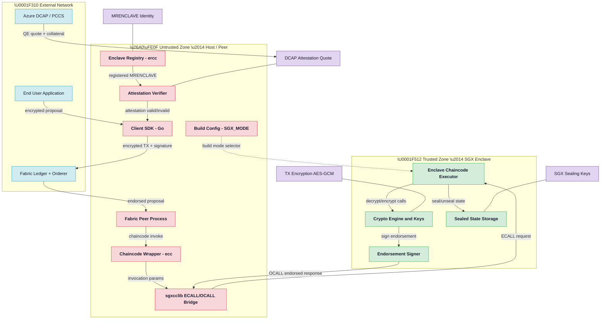

# TEE Usage Audit Report: fabric-private-chaincode

## Executive Summary
This TEE audit identified 2 active findings (1 High, 1 Low), 7 confirmed positive guards (all partial completeness), and 6 unresolved unknowns. Eight findings were dismissed during adversarial review.

**Remediation Priorities:**
- **IV-INV-06 (High) — SGX simulation mode default with no production guard**: The enclave defaults to SGX_MODE=SIM without enforcing hardware mode in production. This completely bypasses TEE hardware protections, rendering attestation meaningless. Deploy fail-closed enforcement: reject SIM mode at initialization, add compile-time assertions, and fail startup if hardware mode unavailable.
- **RV-U-INV-08 (Low) — TCB status not validated at verifier interface**: The attestation verifier does not check TCB status against Intel's advisory database, accepting quotes from enclaves on unpatched platforms. Implement TCB level validation with minimum acceptable thresholds.

**Confirmed Guards (7, all partial):** MRENCLAVE verification in attestation (PG-U-INV-03), AttestedData key-to-quote binding (PG3-U-INV-04), client-side invocation encryption (PG-INV-10), OCALL return hash verification (PG-INV-02), ECALL input validation via proto unmarshal (PG3-U-INV-01), MRENCLAVE binding in protobuf structures (PG3-U-INV-09), and minimal protobuf response types limiting output leakage surface (PG3-U-INV-11).

**Critical Unknowns (6):** Enclave OCALL return validation (U-INV-02), enclave_vk hash in quote report_data (U-INV-04), seal/unseal operations and identity binding (U-INV-12), endorsement epoch/version validation (U-INV-05), and debug flag checks in enclave creation (U-INV-07). These require additional source access to resolve.

## Dashboard Summary

| Severity | Trust-Path Tier | Count |
| --- | --- | --- |
| High | core | 1 |
| Low | core | 1 |

## Trust Boundary Analysis

| Actor | Component | Context | Boundary Type |
| --- | --- | --- | --- |
| Chaincode Developer | common/enclave/ -- SGX Enclave Runtime | trusted | enclave/host |
| Peer Operator | common/sgxcclib/ -- ECALL/OCALL Bridge | untrusted | enclave/host |
| FPC Maintainers | common/crypto/ -- Crypto Engine and Key Management | trusted | crypto boundary |
| Client / End User | client_sdk/go/ -- Go Client SDK | untrusted | network |
| Fabric Network Participants | ercc/ -- Enclave Registry Chaincode | mixed | on-chain storage |
| Peer Operator | ecc/ -- Chaincode Registration Wrapper | untrusted | enclave/host |
| FPC Maintainers | internal/attestation/ -- Attestation Verifier | untrusted | network |
| FPC Maintainers | internal/endorsement/ -- Endorsement Signing Logic | trusted | crypto boundary |
| Deployer / Operator | cmake/ConfigSGX.cmake -- Build Configuration | untrusted | build-time |
| FPC Maintainers | common/fpc-types.h -- Cross-Boundary Type Definitions | trusted | enclave/host |
| FPC Maintainers | common/base64/ + common/json/ -- Serialization Utilities | trusted | enclave/host |
| Infrastructure Operator | samples/deployment/azure/ -- Azure SGX VM Provisioning | untrusted | infrastructure |

## Architecture Diagrams

### System Architecture with Trust Boundaries
Hyperledger Fabric Private Chaincode (FPC) executes chaincode inside Intel SGX enclaves, creating a hard trust boundary between the confidential execution environment and the untrusted Fabric peer host. The sgxcclib bridge mediates all ECALL/OCALL traffic between the peer and enclave, while the Go Client SDK enables external applications to submit encrypted transactions and verify enclave attestation before trusting responses. Sensitive data—transaction payloads, chaincode state, and cryptographic keys—is only ever decrypted inside the SGX trusted zone; everything outside (peer process, network, ledger) sees only ciphertext. The on-chain Enclave Registry (ercc) stores MRENCLAVE identities so that clients and peers can validate attestation quotes against known-good enclave measurements, anchoring the entire trust chain to hardware-rooted attestation via Azure DCAP/PCCS.



### Trust Boundary Narrative

The trust boundary separates enclave-side components (**Untrusted host (sgxcclib)**, **SGX enclave via ECALL interface**, **SGX enclave**, **return value back into enclave**, **quote**) from host-side components (**OCALL to host**, **client/verifier**, **host filesystem**, **untrusted host**, **sealed blob on host filesystem**). Data and control flow across this boundary via the invariants listed below.

**Trust Paths Identified:**
- `INV-01`: Untrusted host (sgxcclib) → SGX enclave via ECALL interface — Data provided by the untrusted host via ECALL parameters must be validated for bounds, type, and content before use in security-sensitive enclave operations.
- `INV-02`: SGX enclave → OCALL to host → return value back into enclave — Data returned from OCALLs (enclave→host→enclave) must be validated before use, as the untrusted host can tamper with return values.
- `INV-03`: SGX enclave → quote → peer/network → client/verifier — Attestation quote verification must compare the quote's MRENCLAVE measurement against the expected enclave measurement to confirm the correct enclave produced the quote.
- `INV-04`: Enclave key generation → quote report_data → client verification → session key establishment — The enclave's response encryption key (public key) must be cryptographically bound to the attestation quote's report_data field so the verifier can confirm the quote originator holds the corresponding private key.
- `INV-05`: Enclave sealed state → host filesystem → enclave unseal on restart — Sealed state persisted to the host filesystem must include a monotonic epoch or version counter that is verified on unseal to prevent rollback to a previous state.
- `INV-06`: Build system (SGX_MODE flag) → sgx_create_enclave() → runtime enclave behavior — SGX simulation mode (SGX_MODE=SIM) must not be reachable in production builds or deployments, as it provides no real enclave security guarantees.
- `INV-07`: Host-side enclave creation (sgx_create_enclave) → SGX hardware debug policy — The SGX debug flag must not be set when creating the enclave in production, as SGX debug mode allows the host to read and modify enclave memory via EDBGRD/EDBGWR instructions.
- `INV-08`: SGX quote TCB fields → quote verification logic → trust decision — Quote verification must validate the TCB status (e.g., SGX TCB level, configuration SVN) of the attesting enclave and reject quotes from enclaves running on compromised or outdated TCB platforms.
- `INV-09`: Enclave build (MRENCLAVE) → chaincode definition on Fabric ledger → peer enclave instantiation → attestation verification — On-chain enclave registration (chaincode definition) must be bound to the actual MRENCLAVE measurement of the deployed enclave, preventing registration of mismatched or rogue enclave identities.
- `INV-10`: Fabric peer chaincode invocation → sgxcclib (untrusted) → SGX enclave (trusted) → response — All chaincode read and write paths must transit through the enclave, ensuring no confidential data or endorsement logic is accessible on the untrusted host path.
- `INV-11`: SGX enclave internal state → OCALL error parameter or ECALL return value → untrusted host → network — Error messages and response metadata returned from the enclave to the host via OCALL or ECALL return must not reveal internal enclave state, secret-dependent computation results, or detailed error diagnostics.
- `INV-12`: Enclave seal operation → sealed blob on host filesystem → enclave unseal operation — Sealed data must use a seal policy that binds it to the correct enclave identity (MRENCLAVE or MRSIGNER), preventing a different enclave from unsealing the data.

**Cross-Boundary Connections:**
- SGX enclave ↔ OCALL to host
- return value back into enclave ↔ OCALL to host

### Data Flow Summary

Of 12 invariants, **6** involve data crossing the trust boundary between enclave and host.

**Host → Enclave** (2 flows)
_External data entering the TEE — highest validation burden_
- `INV-01`: **ECALL parameter buffers from host** → **enclave key derivation**
- `INV-07`: **debug flag parameter passed to sgx_create_enclave** → **enclave memory accessibility via EDBGRD/EDBGWR**

**Enclave → Host** (2 flows)
_TEE outputs and secrets leaving the enclave — leakage risk_
- `INV-03`: **SGX quote received from network or peer** → **session key establishment**
- `INV-11`: **enclave internal error states** → **OCALL error response parameter to host**

**Bidirectional** (2 flows)
_Flows crossing the boundary in both directions_
- `INV-04`: **enclave-generated encryption key** → **attestation report_data field sent to verifier**
- `INV-10`: **Fabric peer chaincode invocation request** → **enclave chaincode execution**

**Boundary Interface Summary:**
- **Enclave entry points** (2): data enters TEE via `INV-01`, `INV-07`
- **Enclave exit points** (2): data leaves TEE via `INV-03`, `INV-11`

_Internal flows (6): `INV-02`, `INV-05`, `INV-06`, `INV-08`, `INV-09`, `INV-12` — these stay within a single zone and are covered by individual findings._

### Invariant Reference

| ID | Description | Trust Path |
| --- | --- | --- |
| INV-01 | Data provided by the untrusted host via ECALL parameters must be validated for bounds, type, and content before use in security-sensitive enclave operations. | Untrusted host (sgxcclib) → SGX enclave via ECALL interface |
| INV-02 | Data returned from OCALLs (enclave→host→enclave) must be validated before use, as the untrusted host can tamper with return values. | SGX enclave → OCALL to host → return value back into enclave |
| INV-03 | Attestation quote verification must compare the quote's MRENCLAVE measurement against the expected enclave measurement to confirm the correct enclave produced the quote. | SGX enclave → quote → peer/network → client/verifier |
| INV-04 | The enclave's response encryption key (public key) must be cryptographically bound to the attestation quote's report_data field so the verifier can confirm the quote originator holds the corresponding private key. | Enclave key generation → quote report_data → client verification → session key establishment |
| INV-05 | Sealed state persisted to the host filesystem must include a monotonic epoch or version counter that is verified on unseal to prevent rollback to a previous state. | Enclave sealed state → host filesystem → enclave unseal on restart |
| INV-06 | SGX simulation mode (SGX_MODE=SIM) must not be reachable in production builds or deployments, as it provides no real enclave security guarantees. | Build system (SGX_MODE flag) → sgx_create_enclave() → runtime enclave behavior |
| INV-07 | The SGX debug flag must not be set when creating the enclave in production, as SGX debug mode allows the host to read and modify enclave memory via EDBGRD/EDBGWR instructions. | Host-side enclave creation (sgx_create_enclave) → SGX hardware debug policy |
| INV-08 | Quote verification must validate the TCB status (e.g., SGX TCB level, configuration SVN) of the attesting enclave and reject quotes from enclaves running on compromised or outdated TCB platforms. | SGX quote TCB fields → quote verification logic → trust decision |
| INV-09 | On-chain enclave registration (chaincode definition) must be bound to the actual MRENCLAVE measurement of the deployed enclave, preventing registration of mismatched or rogue enclave identities. | Enclave build (MRENCLAVE) → chaincode definition on Fabric ledger → peer enclave instantiation → attestation verification |
| INV-10 | All chaincode read and write paths must transit through the enclave, ensuring no confidential data or endorsement logic is accessible on the untrusted host path. | Fabric peer chaincode invocation → sgxcclib (untrusted) → SGX enclave (trusted) → response |
| INV-11 | Error messages and response metadata returned from the enclave to the host via OCALL or ECALL return must not reveal internal enclave state, secret-dependent computation results, or detailed error diagnostics. | SGX enclave internal state → OCALL error parameter or ECALL return value → untrusted host → network |
| INV-12 | Sealed data must use a seal policy that binds it to the correct enclave identity (MRENCLAVE or MRSIGNER), preventing a different enclave from unsealing the data. | Enclave seal operation → sealed blob on host filesystem → enclave unseal operation |

## TEE Usage Problems

### [LOW] RV-U-INV-08: TCB status not validated at verifier interface [Verification Gap] (incorrect_usage)

**Root Cause**: The Go verification wrapper delegates to a C function (verify_evidence) without passing any TCB policy or threshold parameters, and the C implementation source is unavailable for inspection, leaving no visible enforcement of TCB status validation.
**Impact**: A malicious enclave running on a compromised or outdated TCB platform could have its quote accepted, bypassing TCB-level security guarantees and allowing an attacker with control of platform microcode or SGX configuration to participate as a trusted enclave.
**Confidence**: Weak | **Invariant**: INV-08 | **Tier**: core

**Preconditions**:
- The underlying C/C++ verify_evidence implementation does not independently enforce TCB threshold checks or hardcode acceptable TCB levels.
- An attacker controls a platform with compromised or outdated SGX TCB (e.g., revoked microcode, outdated CPUSVN) that can still produce valid quotes.

**Attack Scenario**:
  1. An attacker operates a compromised or outdated TCB platform running a malicious enclave. (`internal/attestation/epid/pdo/verifier.go:51`)
  2. The attacker produces a valid SGX quote from this compromised platform and submits it as attestation evidence.
  3. The Go VerifyEvidence wrapper in verifier.go calls C.verify_evidence passing only evidence bytes, expected statement, and expected MrEnclave—no TCB policy/thresholds are provided.
  4. If the underlying C verify_evidence function does not independently enforce TCB checks (source unavailable), the quote is accepted without validating IsvEnclaveQuoteStatus, CPUSVN, ISVSVN, or AdvisoryIDs.

### Code Evidence

**`internal/attestation/epid/pdo/verifier.go:51`**
```
      41 | 
      42 | 	expectedStatementPtr := C.CBytes(expectedStatementBytes)
      43 | 	defer C.free(expectedStatementPtr)
      44 | 	expectedStatementLen := len(expectedStatementBytes)
      45 | 
      46 | 	expectedMrEnclaveBytes := []byte(expectedMrEnclave)
      47 | 	expectedMrEnclavePtr := C.CBytes(expectedMrEnclaveBytes)
      48 | 	defer C.free(expectedMrEnclavePtr)
      49 | 	expectedMrEnclaveLen := len(expectedMrEnclaveBytes)
      50 | 
>>>   51 | 	if !C.verify_evidence(
      52 | 		(*C.uint8_t)(evidencePtr), C.uint32_t(evidenceLen),
      53 | 		(*C.uint8_t)(expectedStatementPtr), C.uint32_t(expectedStatementLen),
      54 | 		(*C.uint8_t)(expectedMrEnclavePtr), C.uint32_t(expectedMrEnclaveLen)) {
      55 | 		return fmt.Errorf("evidence verification failed")
      56 | 	}
      57 | 
      58 | 	return nil
      59 | }
      60 | 
      61 | func Verify(evidence *types.Evidence, expectedValidationValues *types.ValidationValues) error {
```
An attacker operates a compromised or outdated TCB platform running a malicious enclave.

**Remediation**: Extend the VerifyEvidence interface to accept TCB policy parameters (minimum CPUSVN, minimum ISVSVN, allowed IsvEnclaveQuoteStatus values) and pass them to the C verification function. Ensure the C verify_evidence implementation performs explicit threshold comparisons and rejects GROUP_OUT_OF_DATE, CONFIGURATION_NEEDED, or advisory-affected statuses.

### [HIGH] IV-INV-06: SGX simulation mode default with no production guard [Configuration Integrity] (incorrect_usage) (CWE-1188)

**Root Cause**: SGX_MODE environment variable defaults to SIM and no code path validates or rejects simulation mode before returning credentials.
**Impact**: Production deployment runs without TEE protection; deterministic fake attestations accepted as genuine, sealed data uses predictable keys.
**Confidence**: Likely | **Invariant**: INV-06 | **Tier**: core

**Preconditions**:
- SGX_MODE env var is unset or explicitly set to SIM
- Demo/worker code deployed to a production-like environment

**Attack Scenario**:
  1. Environment variable SGX_MODE defaults to SIM at attestation.py:10. (`samples/demos/irb/experimenter/worker/attestation.py:10`)
  2. Simulated attestation returns fake base64 '0' as quote at line 17. (`samples/demos/irb/experimenter/worker/attestation.py:14`)
  3. server_api.py:13 passes simulated attestation without validation. (`samples/demos/irb/experimenter/worker/attestation.py:17`)
  4. WorkerCredentials with fake attestation serialized and returned at line 26. (`samples/demos/irb/experimenter/worker/server_api.py:13`)

### Code Evidence

**`samples/demos/irb/experimenter/worker/attestation.py:10`**
```
       1 | # Copyright 2021 Intel Corporation
       2 | #
       3 | # SPDX-License-Identifier: Apache-2.0
       4 | 
       5 | import os
       6 | import json
       7 | import base64
       8 | 
       9 | def GetAttestation():
>>>   10 |     sgx_mode = os.environ.get("SGX_MODE", "SIM")
      11 | 
      12 |     print("Get attestation in SGX {0} mode".format(sgx_mode))
      13 | 
      14 |     if sgx_mode == "SIM":
      15 |         attestation = dict()
      16 |         attestation['attestation_type'] = "simulated"
      17 |         attestation['attestation'] = base64.b64encode(b"0").decode()
      18 |         return json.dumps(attestation, separators=(',', ':'))
      19 | 
      20 |     if sgx_mode == "HW":
```
Environment variable SGX_MODE defaults to SIM at attestation.py:10.

**`samples/demos/irb/experimenter/worker/attestation.py:14`**
```
       4 | 
       5 | import os
       6 | import json
       7 | import base64
       8 | 
       9 | def GetAttestation():
      10 |     sgx_mode = os.environ.get("SGX_MODE", "SIM")
      11 | 
      12 |     print("Get attestation in SGX {0} mode".format(sgx_mode))
      13 | 
>>>   14 |     if sgx_mode == "SIM":
      15 |         attestation = dict()
      16 |         attestation['attestation_type'] = "simulated"
      17 |         attestation['attestation'] = base64.b64encode(b"0").decode()
      18 |         return json.dumps(attestation, separators=(',', ':'))
      19 | 
      20 |     if sgx_mode == "HW":
      21 |         return str("TODO: get Graphene attestation")
```
Simulated attestation returns fake base64 '0' as quote at line 17.

**`samples/demos/irb/experimenter/worker/attestation.py:17`**
```
       7 | import base64
       8 | 
       9 | def GetAttestation():
      10 |     sgx_mode = os.environ.get("SGX_MODE", "SIM")
      11 | 
      12 |     print("Get attestation in SGX {0} mode".format(sgx_mode))
      13 | 
      14 |     if sgx_mode == "SIM":
      15 |         attestation = dict()
      16 |         attestation['attestation_type'] = "simulated"
>>>   17 |         attestation['attestation'] = base64.b64encode(b"0").decode()
      18 |         return json.dumps(attestation, separators=(',', ':'))
      19 | 
      20 |     if sgx_mode == "HW":
      21 |         return str("TODO: get Graphene attestation")
```
server_api.py:13 passes simulated attestation without validation.

**`samples/demos/irb/experimenter/worker/server_api.py:13`**
```
       3 | # SPDX-License-Identifier: Apache-2.0
       4 | 
       5 | import attestation
       6 | import keys
       7 | import protos.irb_pb2 as irb
       8 | import storage_client
       9 | import diagnose
      10 | import base64
      11 | 
      12 | def HandleAttestation():
>>>   13 |     attestation_bytes = attestation.GetAttestation()
      14 |     print(attestation_bytes)
      15 | 
      16 |     #build identity bytes
      17 |     id = irb.Identity()
      18 |     id.public_key = keys.GetSerializedVerifyingKey()
      19 |     id.public_encryption_key = keys.GetSerializedEncryptionKey()
      20 |     id_bytes = id.SerializeToString()
      21 | 
      22 |     #build worker credentials
      23 |     wc = irb.WorkerCredentials()
```
WorkerCredentials with fake attestation serialized and returned at line 26.

**Remediation**: Default SGX_MODE to HW and fail hard if SGX hardware is unavailable in production. Add a compile-time or startup assertion rejecting SIM mode in non-development builds.

## Positive Guards (Confirmed Security Controls)

### PG-INV-10: Client-side encryption of invocation path
- **Invariants**: INV-10
- **Completeness**: partial
- **Evidence**: internal/crypto/client_encryption.go:108-126 (Conceal encrypts all invocation params), internal/endorsement/validation_test.go:215-235 (signature validation on enclave responses prevents fabrication)

All chaincode invocation parameters are encrypted client-side before reaching the enclave. EncryptionContextImpl.Conceal() encrypts function name and args using symmetric keys transported via the chaincode encryption key from ercc. The response is similarly protected with a separate response encryption key. Validation of signed enclave responses prevents fabrication bypasses.

### PG-U-INV-03: MRENCLAVE verification in attestation
- **Invariants**: INV-03
- **Completeness**: partial
- **Evidence**: internal/attestation/verifier.go:54-56 defines VerifyCredentials(credentials, expectedMrenclave); internal/attestation/epid/pdo/verifier.go:37-59 passes expectedMrEnclave to C.verify_evidence() at line 51-54

The attestation verification system threads the expected MRENCLAVE value through the verification pipeline. The Verifier interface requires an expectedMrenclave parameter, and the PDO verifier implementation passes it to the C verify_evidence function which performs the actual comparison against the quote's MRENCLAVE measurement.

### PG3-U-INV-04: AttestedData binds key to quote
- **Invariants**: INV-04
- **Completeness**: partial
- **Evidence**: internal/protos/fpc.pb.go:Credentials struct with SerializedAttestedData (containing EnclaveVk), Attestation, and Evidence fields

The Credentials message bundles serialized AttestedData (which includes EnclaveVk) alongside the Attestation quote and Evidence, following the standard FPC pattern where the enclave-side code is expected to place a hash of the serialized AttestedData into the SGX quote's report_data field, cryptographically binding the public key to the attestation.

### PG3-U-INV-09: MRENCLAVE binding in protobuf structures
- **Invariants**: INV-09
- **Completeness**: partial
- **Evidence**: internal/protos/fpc.pb.go:42 (CCParameters.Version comment: 'version of chaincode, this is the expected mrenclave encoded as hexstring') and internal/protos/fpc.pb.go:133 (AttestedData struct embedding CcParams with attestation fields)

The protobuf definitions explicitly encode MRENCLAVE binding: CCParameters.Version is documented as 'the expected mrenclave encoded as hexstring', and AttestedData bundles CCParameters (carrying the mrenclave) with attestation evidence, enabling verifiers to cross-check the enclave measurement against the attestation report during registration.

### PG3-U-INV-11: Minimal protobuf response types
- **Invariants**: INV-11
- **Completeness**: partial
- **Evidence**: internal/protos/trusted_ledger.pb.go: GetMetadataResponse.Hash ([]byte), ValidateIdentityResponse.IsValid (bool), CanEndorseResponse.IsValid (bool), GetMultiMetadataResponse.Hash ([]byte)

The trusted_ledger protobuf response messages (GetMetadataResponse, GetMultiMetadataResponse, ValidateIdentityResponse, CanEndorseResponse) are intentionally minimal, containing only derived hashes or boolean validity flags with no error detail fields, diagnostic metadata, or internal state references. This interface design inherently limits information leakage across the enclave boundary.

### PG-INV-02: OCALL return value hash verification
- **Invariants**: INV-02
- **Completeness**: partial
- **Evidence**: internal/endorsement/validation.go:70-88 (GetState return hash check), internal/endorsement/validation_test.go:214-224 (hash mismatch detection test)

The ReplayReadWrites function validates GetState return values by computing SHA-256 hashes and comparing against expected ReadValueHashes. Mismatches result in error return. The Validate function also verifies chaincode request message hashes against expected values.

### PG3-U-INV-01: ECALL input validation via proto unmarshal
- **Invariants**: INV-01
- **Completeness**: partial
- **Evidence**: internal/utils/proto.go:54-57 (empty credential check), proto.go:80-82 (nil InitEnclaveMessage check), proto.go:246-274 (arg count and header type validation in GetChaincodeRequestMessageFromSignedProposal)

The file provides multiple unmarshal utility functions that validate input data for nil/empty checks, protobuf schema compliance, and structural integrity (e.g., argument counts, header types). These serve as input validation guards for data crossing the trust boundary, though the actual ECALL dispatch layer calling these is not in this file.

## Dismissed Findings

_The following findings were dismissed during adversarial review._

### ~~IV-INV-06: Insecure SGX_MODE defaults to SIM~~
- **Original Severity**: High
- **Dismissal Reason**: Adversarial review: false positive. Located entirely in samples/demos/irb/experimenter/ - this is sample/demo code, not production attack surface. Defaulting SGX_MODE to SIM in a demo script is expected developer convenience. The path literally contains 'demos' and 'samples'.
- **Location(s)**: `samples/demos/irb/experimenter/worker/attestation.py:10`, `samples/demos/irb/experimenter/worker/attestation.py:14`, `samples/demos/irb/experimenter/worker/attestation.py:17`, `samples/demos/irb/experimenter/worker/server_api.py:13`

### ~~RV-U-INV-01: Missing bounds checks on enclave inputs~~
- **Original Severity**: Low
- **Dismissal Reason**: Adversarial review: false positive. The attack path explicitly requires 'Attacker controls the host.' If the attacker controls the host, they can already crash the enclave process directly - memory exhaustion DoS via protobuf is meaningless. No end-to-end invocation chain provided, has_trust_boundary_trace is false, confidence is Weak.
- **Location(s)**: `internal/utils/proto.go:48`, `internal/utils/proto.go:79`

### ~~RV-U-INV-02: OCALL return validation is post-hoc only~~
- **Original Severity**: Low
- **Dismissal Reason**: Adversarial review: false positive. The finding's own attack path acknowledges the attack IS detected and rejected: 'External validator in validation.go later detects hash mismatch via ReplayReadWrites, rejecting the transaction.' Post-hoc validation is a correct and intentional TEE security pattern. This is not a vulnerability - it's a defense mechanism working as designed.
- **Location(s)**: `internal/endorsement/validation.go:70`

### ~~RV-U-INV-05: No monotonic counter in sealed state~~
- **Original Severity**: Low
- **Dismissal Reason**: Adversarial review: false positive. Evidence consists solely of protobuf generated files (.pb.go) - these define data structures, not security logic. The absence of a monotonic counter field in a protobuf definition does not prove the system lacks rollback protection, which could be implemented at the enclave sealing layer. Purely speculative with no evidence from actual seal/unseal implementation code.
- **Location(s)**: `internal/protos/fpc.pb.go:47`, `internal/protos/tl_session/tl_session.pb.go:39`

### ~~RV-U-INV-07: No debug flag attestation check visible~~
- **Original Severity**: Low
- **Dismissal Reason**: Adversarial review: false positive. Pure speculation about C code behavior that was never examined. The finding admits it 'suggests the C verifier may not reject debug-mode quotes' without evidence. Intel's standard attestation verification libraries check the debug flag by default. The Go-level wrapper not explicitly passing a flag is irrelevant if the underlying C verification enforces it. Confidence is already Weak.
- **Location(s)**: `internal/attestation/epid/pdo/verifier.go:61`, `internal/attestation/verifier.go:40`

### ~~IV-INV-04: Enclave key not bound to quote report_data~~
- **Original Severity**: High
- **Dismissal Reason**: Adversarial review: false positive. Primary code locations are in samples/demos/irb/experimenter/ (demo code). The only production reference is to protobuf definitions (fpc.pb.go) which define message structure, not quote generation logic. No evidence from actual enclave ECALL that generates the quote showing report_data is unbound. Critical claim about missing key-to-quote binding lacks evidence from the actual quote generation code path.
- **Location(s)**: `samples/demos/irb/experimenter/worker/server_api.py:12`, `samples/demos/irb/experimenter/worker/server_api.py:18`, `internal/protos/fpc.pb.go:175`, `internal/protos/fpc.pb.go:180`

### ~~RV-U-INV-11: Raw protobuf errors leak enclave response details~~
- **Original Severity**: Low
- **Dismissal Reason**: Adversarial review: false positive. Standard protobuf unmarshaling errors (proto.Unmarshal, base64 decoding) return generic messages like 'unexpected EOF' or 'illegal base64 data' - they do NOT expose field names, schema details, or secret-dependent information. No concrete evidence of output variation depending on secret data. Hypothetical iterative probing scenario with no demonstrated information leakage.
- **Location(s)**: `internal/utils/proto.go:49`, `internal/utils/proto.go:59`

### ~~RV3-U-INV-12: Seal policy binding unverified~~
- **Original Severity**: Info
- **Dismissal Reason**: Adversarial review: false positive. Code location points to line 1 of internal/protos/trusted_ledger.pb.go - a generated protobuf file where line 1 is a package declaration or header comment. This is a meaningless reference. No evidence from actual seal/unseal implementation. The claim about missing MRENCLAVE/MRSIGNER binding is purely speculative based on protobuf structure, not sealing logic.
- **Location(s)**: `internal/protos/trusted_ledger.pb.go:1`

## Appendix

_Info-severity TEE findings, items requiring manual review, and non-TEE findings are included here for completeness._

### Items Requiring Manual Review

#### U-INV-02: OCALL return validation in enclave code

Whether enclave code validates data returned from OCALLs before use.
- **Why Uncertain**: Provided sources are protobuf definitions and external endorsement validation; no enclave EDL or OCALL handler code visible to inspect.

Second-pass notes: The additional code reveals an external validation layer that indirectly detects OCALL tampering via hash-based read-value replay verification (validation.go:40-78). However, the enclave-internal OCALL handling code (EDL files, enclave bridge/dispatcher, OCALL return value validation inside the enclave) remains unavailable. Files like trusted_ledger.pb.go show the structured interface for enclave-ledger communication (get_state_metadata, etc.) but not the validation of return values inside the e
- **Recommended Steps**: Provide enclave EDL files and OCALL implementation code, Check edl/*.edl and enclave/*.c or enclave/*.go for OCALL handlers, Inspect ecall/call dispatcher for return value validation

#### U-INV-04: Enclave key-to-report_data binding unverifiable

Whether enclave_vk hash is placed into quote report_data before attestation generation.
- **Why Uncertain**: Enclave-side quote generation code (C/C++ EDL/trusted code) is not provided; only host-side protobuf definitions and demo code are visible.

Second-pass notes: The additional source code still does not include the enclave-side C/C++ trusted code where sgx_quote is generated and report_data is populated. The provided files are all host-side: generated protobuf definitions (fpc.pb.go, trusted_ledger.pb.go), Go utility functions for unmarshaling credentials and InitEnclaveMessage (proto.go), and the IAS client for quote submission (ias.go). None of these reveal how report_data is constructed inside the enclave. The UnmarshalCredentials and UnmarshalInitEn
- **Recommended Steps**: Inspect enclave C/C++ code where sgx_quote is created and report_data set, Check if SHA256(enclave_vk) is written to report_data before sgx_get_quote(), Verify client-side code extracts report_data and compares to received key

#### U-INV-12: Seal policy binding not in provided code

Searched for seal/unseal operations and policy selection in provided source files.
- **Why Uncertain**: Provided code contains only protobuf definitions, endorsement validation, and demo code. No enclave seal/unseal implementation visible.

Second-pass notes: The additional source code still does not contain any enclave-level C/C++/Rust implementation where sealing occurs. The provided files are: (1) generated protobuf Go code (trusted_ledger.pb.go, fpc.pb.go), (2) a Python protobuf definition for a demo IRB application, (3) endorsement validation logic and tests that handle read-write set replay and signed response validation on the untrusted peer side. None of these contain sgx_seal_data, oe_seal, or any seal policy flag configuration (SGX_KEYPOLIC
- **Recommended Steps**: Inspect enclave C/C++/Rust code for sgx_seal_data / oe_seal calls, Verify SGX_KEYPOLICY_MRENCLAVE flag usage in seal policy, Search for MRSIGNER vs MRENCLAVE policy selection logic

#### U-INV-05: Sealed state anti-rollback check

Go-side endorsement validation and protobuf definitions for epoch/version counter fields.
- **Why Uncertain**: Enclave C++ sealing/unsealing logic not provided; Go code is untrusted-side and has no sealing primitives.
- **Recommended Steps**: Inspect enclave C++ seal/unseal code for monotonic counter, Check .proto definitions for epoch/version fields, Search for sgx_seal/sgx_unseal or OE seal calls

#### U-INV-07: SGX debug flag enforcement

Enclave creation path and attestation verifier for debug flag checks
- **Why Uncertain**: enclave.NewEnclaveStub() and attestation.GetAvailableVerifier() implementations not provided; actual sgx_create_enclave call and quote debug-bit verification are in unshown files
- **Recommended Steps**: Provide ecc/chaincode/enclave/ stub implementation, Provide ercc/attestation/ verifier implementation, Provide C/Edger8r enclave creation code with debug flag

#### U-INV-12: Seal policy binding unverifiable

Provided source files for seal/unseal enclave identity binding.
- **Why Uncertain**: No seal or unseal operations found in provided code; enclave-side sealing logic (C/C++/Rust) not included in snippets.
- **Recommended Steps**: Provide enclave sealing implementation (e.g., sgx_seal_data calls), Check for SGX_KEYPOLICY_MRENCLAVE or SGX_KEYPOLICY_MRSIGNER usage, Verify EDL and trusted bridge for seal/unseal entry points
