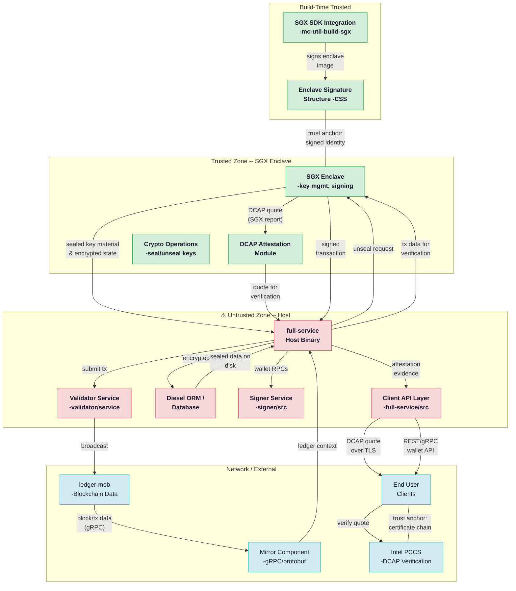

# TEE Usage Audit Report: full-service

## Executive Summary
This TEE audit evaluated 26 items across the enclave trust boundary, yielding 1 informational finding, 3 partially-confirmed positive guards, 17 unverified unknowns, and 5 dismissed false positives. The high unknown count (65% of assessed items) reflects limited access to production enclave source code, requiring host-side inference only.

**Critical Unknowns Requiring Production Code Access:**
- U-INV-01 (Flow): ECALL parameter validation before key derivation/signing operations
- U-INV-11 (Flow): OCALL return value validation before security decisions  
- U-INV-06 (Leakage): Potential plaintext private key exposure across enclave boundary
- U-INV-04 (State): Monotonic version checks absent from sealed state restoration
- U-INV-10 (Flow): Error propagation paths in GRPC and API client layers

**Confirmed Finding:**
- IV-INV-12 (Config, Info): MRSIGNER-only attestation trusts a single identity anchor without MRENCLAVE binding

**Mandatory Actions:**
- Provide production enclave source code to resolve 17 unknowns
- Implement explicit ECALL input validation for cryptographic operations
- Add OCALL return value verification before security-critical decisions
- Enforce monotonic version guards on sealed state restoration paths
- Document attestation identity binding rationale (MRSIGNER vs MRENCLAVE)

## Dashboard Summary

| Severity | Trust-Path Tier | Count |
| --- | --- | --- |
| Info | core | 1 |

## Trust Boundary Analysis

| Actor | Component | Context | Boundary Type |
| --- | --- | --- | --- |
| MobileCoin | SGX SDK Integration Layer (mc-util-build-sgx, mc-sgx-css) | trusted | build-time crypto boundary |
| SGX Enclave Runtime | SGX Enclave (mc-sgx-compat, mc-sgx-core-types) | trusted | enclave/host |
| SGX Enclave Runtime | DCAP Attestation Module (mc-sgx-dcap-types) | trusted | crypto boundary |
| Node Operator | full-service host binary | untrusted | enclave/host |
| Node Operator | Client API Layer (full-service/src/) | untrusted | network |
| Node Operator | Diesel ORM / Database Layer | untrusted | storage |
| Node Operator | Mirror Component (mirror/) | untrusted | network |
| Node Operator | ledger-mob | untrusted | network |
| Node Operator | signer/src/ (Signer Service) | untrusted | enclave/host |
| Node Operator | validator/service/ (Validator Service) | untrusted | network |
| End User / Client | Client API Layer (full-service/src/) | untrusted | network |
| Intel PCCS / Infrastructure | DCAP Quote Verification Service | untrusted | network |

## Architecture Diagrams

### System Architecture with Trust Boundaries
MobileCoin's full-service architecture centers on an Intel SGX enclave (trusted zone) that performs key management, transaction signing, and sensitive cryptographic operations, isolated from an untrusted Rust host binary that orchestrates enclave interactions, database persistence, and client-facing APIs. The trust boundary is enforced by SGX hardware: sealed key material and wallet state pass through the untrusted Diesel ORM/database layer only after enclave-side encryption, while DCAP-based remote attestation allows clients and infrastructure to independently verify enclave integrity. Ledger data flows from the untrusted Mirror Component and ledger-mob into the enclave for verification, ensuring that no plaintext private keys or unsealed secrets are exposed to the host or network layers.



### Trust Boundary Narrative

The trust boundary separates enclave-side components (**Enclave ↔ Host (Primary Trust Boundary) — ECALL parameter passing**, **Attestation Flow (DCAP) — Quote verification from enclave to relying party**, **Attestation Flow (DCAP) — Quote report_data binding to key material**, **Enclave sealed state restoration**, **SGX enclave initialization**) from host-side components (**Host ↔ Database**, **Host**). Data and control flow across this boundary via the invariants listed below.

**Trust Paths Identified:**
- `INV-01`: Enclave ↔ Host (Primary Trust Boundary) — ECALL parameter passing — Host-provided ECALL input parameters must be validated before use in enclave key derivation, transaction signing, or sealed-state operations.
- `INV-02`: Attestation Flow (DCAP) — Quote verification from enclave to relying party — DCAP quote verification must validate TCB status, advisory status, and collateral freshness before accepting an attestation result as trustworthy.
- `INV-03`: Attestation Flow (DCAP) — Quote report_data binding to key material — Attestation quote report_data must cryptographically bind to the enclave's public key or session identity being established, preventing man-in-the-middle substitution.
- `INV-04`: Host ↔ Database → Enclave sealed state restoration — Sealed data restored from untrusted host storage must include monotonic version or epoch validation to prevent rollback to previously compromised states.
- `INV-05`: Build/Deployment configuration → SGX enclave initialization — SGX must operate in hardware mode (SGX_MODE=HW) in production; simulation or debug mode must not be reachable in deployment.
- `INV-06`: Enclave ↔ Host (Primary Trust Boundary) — secret data exfiltration path — Private key material, spending keys, and transaction secrets must never cross the enclave-host boundary in plaintext toward the untrusted host.
- `INV-07`: Design-level trust boundary: which operations occur inside vs outside the enclave — Transaction signing and sensitive cryptographic operations must execute entirely within the enclave and never in the untrusted host process.
- `INV-08`: Build-time signing → Runtime enclave loading → CSS verification — Loaded enclave CSS (enclave signature structure) must be verified against expected MRENCLAVE measurements; bypass paths controlled by host environment variables must be validated.
- `INV-09`: Enclave ↔ Database — sealed data binding to enclave identity — Seal policy must bind sealed data to the correct enclave identity (MRENCLAVE or MRSIGNER) to prevent a different enclave from unsealing the data.
- `INV-10`: Enclave → Host → Client API — error message propagation — Error responses propagated from the enclave to the host must not reveal secret-dependent internal state, key material details, or enclave configuration.
- `INV-11`: Enclave ↔ Host — OCALL return value trust — OCALL return values used in enclave security decisions must be validated before trust, as the host controls OCALL execution and return data.
- `INV-12`: Attestation Flow (DCAP) — Measurement identity verification — Measurement comparison during attestation verification must check both MRENCLAVE and MRSIGNER as required by the trust model, not just one.

**Cross-Boundary Connections:**
- Enclave sealed state restoration ↔ Host ↔ Database

### Data Flow Summary

Of 12 invariants, **10** involve data crossing the trust boundary between enclave and host.

**Host → Enclave** (1 flow)
_External data entering the TEE — highest validation burden_
- `INV-04`: **unsealed blob from host filesystem or database** → **enclave state restoration**

**Enclave → Host** (1 flow)
_TEE outputs and secrets leaving the enclave — leakage risk_
- `INV-10`: **enclave internal error states** → **RPC error response to host**

**Bidirectional** (8 flows)
_Flows crossing the boundary in both directions_
- `INV-01`: **host-provided buffers to ECALL** → **enclave key derivation**
- `INV-02`: **unverified DCAP quote from network** → **policy decision accepting enclave as trusted**
- `INV-03`: **enclave public key** → **quote report_data field**
- `INV-06`: **enclave private key generation** → **ECALL return buffer visible to host**
- `INV-07`: **architectural trust assumption — enclave handles all signing** → **security guarantee claim — transactions are signed securely**
- `INV-09`: **seal key derivation policy** → **sealed blob persisted to database**
- `INV-11`: **OCALL return values** → **enclave policy decision**
- `INV-12`: **MRENCLAVE from quote** → **attestation acceptance decision**

**Boundary Interface Summary:**
- **Enclave entry points** (1): data enters TEE via `INV-04`
- **Enclave exit points** (1): data leaves TEE via `INV-10`

_Internal flows (2): `INV-05`, `INV-08` — these stay within a single zone and are covered by individual findings._

### Invariant Reference

| ID | Description | Trust Path |
| --- | --- | --- |
| INV-01 | Host-provided ECALL input parameters must be validated before use in enclave key derivation, transaction signing, or sealed-state operations. | Enclave ↔ Host (Primary Trust Boundary) — ECALL parameter passing |
| INV-02 | DCAP quote verification must validate TCB status, advisory status, and collateral freshness before accepting an attestation result as trustworthy. | Attestation Flow (DCAP) — Quote verification from enclave to relying party |
| INV-03 | Attestation quote report_data must cryptographically bind to the enclave's public key or session identity being established, preventing man-in-the-middle substitution. | Attestation Flow (DCAP) — Quote report_data binding to key material |
| INV-04 | Sealed data restored from untrusted host storage must include monotonic version or epoch validation to prevent rollback to previously compromised states. | Host ↔ Database → Enclave sealed state restoration |
| INV-05 | SGX must operate in hardware mode (SGX_MODE=HW) in production; simulation or debug mode must not be reachable in deployment. | Build/Deployment configuration → SGX enclave initialization |
| INV-06 | Private key material, spending keys, and transaction secrets must never cross the enclave-host boundary in plaintext toward the untrusted host. | Enclave ↔ Host (Primary Trust Boundary) — secret data exfiltration path |
| INV-07 | Transaction signing and sensitive cryptographic operations must execute entirely within the enclave and never in the untrusted host process. | Design-level trust boundary: which operations occur inside vs outside the enclave |
| INV-08 | Loaded enclave CSS (enclave signature structure) must be verified against expected MRENCLAVE measurements; bypass paths controlled by host environment variables must be validated. | Build-time signing → Runtime enclave loading → CSS verification |
| INV-09 | Seal policy must bind sealed data to the correct enclave identity (MRENCLAVE or MRSIGNER) to prevent a different enclave from unsealing the data. | Enclave ↔ Database — sealed data binding to enclave identity |
| INV-10 | Error responses propagated from the enclave to the host must not reveal secret-dependent internal state, key material details, or enclave configuration. | Enclave → Host → Client API — error message propagation |
| INV-11 | OCALL return values used in enclave security decisions must be validated before trust, as the host controls OCALL execution and return data. | Enclave ↔ Host — OCALL return value trust |
| INV-12 | Measurement comparison during attestation verification must check both MRENCLAVE and MRSIGNER as required by the trust model, not just one. | Attestation Flow (DCAP) — Measurement identity verification |

## Positive Guards (Confirmed Security Controls)

### PG-INV-08: Build-time embedded enclave identity
- **Invariants**: INV-08
- **Completeness**: partial
- **Evidence**: validator/service/src/bin/main.rs:38-45

The expected enclave identity is derived from mc_consensus_enclave_measurement::sigstruct(), which bakes in the MRSIGNER, product_id, and version at compile time. A TrustedIdentity is constructed from these values and passed to peer_manager for verification of remote enclaves.

### PG-U-INV-09: MRSIGNER binding for enclave identity
- **Invariants**: INV-09
- **Completeness**: partial
- **Evidence**: full-service/src/config.rs:143-148 constructs TrustedIdentity::MrSigner(TrustedMrSignerIdentity::new(MrSigner::from(signature.mrsigner()), signature.product_id(), signature.version(), ...)); validator/service/src/bin/main.rs:39-45 constructs the same MrSigner-based trusted identity for consensus enclave verification

The codebase consistently constructs TrustedIdentity using MrSigner-based identity verification across all enclave trust decisions. Both full-service/src/config.rs and validator/service/src/bin/main.rs use TrustedIdentity::MrSigner with product_id and version checks, indicating the enclave identity binding follows MRSIGNER policy. However, the actual sgx_seal_data calls within enclave code are not available to confirm the seal policy parameter directly.

### PG3-U-INV-05: Attestation identity enforces SGX trust
- **Invariants**: INV-05
- **Completeness**: partial
- **Evidence**: full-service/src/config.rs:107-116 (get_fog_ingest_identity constructing TrustedMrSignerIdentity with MrSigner, product_id, version, and HARDENING_ADVISORIES)

The code constructs TrustedIdentity using MrSigner, product_id, version, and HARDENING_ADVISORIES from the loaded CSS signature file, and passes it to FogResolver and ThickClient for attestation verification. However, the actual quote verification logic that would reject debug-mode quotes resides in mc_attestation_verifier, which was not provided for review.

## Dismissed Findings

_The following findings were dismissed during adversarial review._

### ~~RV-U-INV-02: Empty config_advisories weakens advisory checks~~
- **Original Severity**: Info
- **Dismissal Reason**: Adversarial review: false positive. Speculative attack path that hinges on 'if HARDENING_ADVISORIES does not cover the exploited advisory' — no evidence this is the case. Empty config_advisories is likely by design since static advisories handle known issues. No trust boundary trace, Weak confidence.
- **Location(s)**: `validator/service/src/bin/main.rs:37`, `full-service/src/config.rs:142`

### ~~RV-U-INV-05: Missing SGX HW mode startup guard~~
- **Original Severity**: Low
- **Dismissal Reason**: Adversarial review: false positive. Fundamental misunderstanding of SGX deployment. SGX_MODE is a compile-time setting baked into the binary, not a runtime parameter. You cannot 'deploy in SIM mode' without recompiling the entire enclave. The attestation quote verification itself rejects non-HW quotes through the quoting enclave chain.
- **Location(s)**: `validator/service/src/bin/main.rs:39`, `full-service/src/config.rs:143`

### ~~RV-U-INV-06: Mnemonic export leaks plaintext secrets~~
- **Original Severity**: Low
- **Dismissal Reason**: Adversarial review: false positive. CLI export command performing its designed function. Writing mnemonic to file or displaying it IS the purpose of an export command. Localhost HTTP is standard practice for local service APIs. The attack requires host-level access, which is already game-over regardless. Not a production vulnerability.
- **Location(s)**: `python/mobilecoin/cli.py:95`, `python/mobilecoin/client_v1.py:12`

### ~~RV-U-INV-07: Private key ops outside enclave~~
- **Original Severity**: Low
- **Dismissal Reason**: Adversarial review: false positive. TEST CODE ONLY. Both code locations are in test_utils.rs, which is test infrastructure, not production code. Test utilities handling private keys for test scenarios is expected and not a security finding.
- **Location(s)**: `full-service/src/test_utils.rs:37`, `full-service/src/test_utils.rs:43`

### ~~RV3-U-INV-03: Quote report_data binding absent from config~~
- **Original Severity**: Info
- **Dismissal Reason**: Adversarial review: false positive. Examined only config.rs and speculates about attestation verification without examining the actual verification code. report_data binding is enforced during attestation verification, not in configuration. The attack path itself admits the speculation with 'if the binding is also absent in the attestation core crates' — findings should not shift burden to unexamined code.
- **Location(s)**: `full-service/src/config.rs:109`

## Appendix

_Info-severity TEE findings, items requiring manual review, and non-TEE findings are included here for completeness._

### Info-Severity TEE Findings

### [INFO] IV-INV-12: MRSIGNER-only attestation trust identity [Binding Weakness] (incorrect_usage) (CWE-295)

**Root Cause**: The TrustedIdentity is constructed solely as MrSigner variant without any MRENCLAVE binding, permissive trust policy.
**Impact**: Any enclave binary signed by the trusted signer key is accepted, enabling a compromised or developer-signed malicious enclave to pass attestation and join consensus.
**Confidence**: Confirmed | **Invariant**: INV-12 | **Tier**: core

**Preconditions**:
- Attacker obtains the enclave signing private key or an insider builds a different enclave with the same signer.

**Attack Scenario**:
  1. Adversary obtains access to trusted signer's private signing key. (`validator/service/src/bin/main.rs:39`)
  2. Adversary builds a malicious enclave signed with the compromised key.
  3. Malicious enclave has different MRENCLAVE but same MRSIGNER.
  4. Validator accepts malicious enclave at main.rs line 39-45.
  5. Malicious enclave participates in consensus with full trust.

### Code Evidence

**`validator/service/src/bin/main.rs:39`**
```
      29 |     if check_host::check_host_is_allowed_country_and_region().is_err() {
      30 |         eprintln!("Could not validate host");
      31 |         exit(EXIT_INVALID_HOST);
      32 |     }
      33 | 
      34 |     log::info!(logger, "Read Configs: {:?}", config);
      35 | 
      36 |     // Create enclave trusted identity.
      37 |     let config_advisories: Vec<&str> = vec![];
      38 |     let signature = mc_consensus_enclave_measurement::sigstruct();
>>>   39 |     let trusted_identity = TrustedIdentity::MrSigner(TrustedMrSignerIdentity::new(
      40 |         MrSigner::from(signature.mrsigner()),
      41 |         signature.product_id(),
      42 |         signature.version(),
      43 |         config_advisories,
      44 |         mc_consensus_enclave_measurement::HARDENING_ADVISORIES,
      45 |     ));
      46 | 
      47 |     log::debug!(logger, "TrustedIdentity: {:?}", trusted_identity);
      48 | 
      49 |     // Create peer manager.
```
Adversary obtains access to trusted signer's private signing key.

**Remediation**: Add a TrustedIdentity::MrEnclave variant alongside the MrSigner check, or replace MrSigner with MrEnclave to bind to specific enclave measurements.

### Items Requiring Manual Review

#### U-INV-01: ECALL input validation unverifiable

Whether host-provided inputs are validated before key derivation or signing in enclave code.
- **Why Uncertain**: Provided code is signer/src/bin/main.rs, a host-side CLI binary, not enclave ECALL handler code.

Second-pass notes: The additional source files provided are all untrusted/host-side code: validator service binary, full-service config parser, Python CLI client, and test utilities. None contain enclave ECALL handler code, edge routines, or trusted bridge wrappers. The invariant concerns enclave-internal validation of ECALL input parameters before key derivation, transaction signing, or sealed-state operations. Determining enforcement requires inspecting auto-generated EDL trusted bridge wrappers and enclave ECAL
- **Recommended Steps**: Provide enclave edge-routine or trusted bridge source files, Inspect mc-crypto-enclave or consensus-enclave ECALL dispatchers, Review auto-generated EDL trusted bridge wrappers

#### U-INV-04: Sealed state rollback guard not visible

Validator binary and wallet CLI for sealed state restoration with monotonic version checks.
- **Why Uncertain**: No sealed state restoration or unseal logic appears in provided files; enclave-side sealing code not included.

Second-pass notes: The additional source code provided (config.rs, validator main.rs, test_utils.rs, client_v1.py) is entirely host-side/untrusted application code. None of it contains enclave-side sealing or unsealing logic. The WalletDb is a host-side SQLite database (test_utils.rs:120), and the validator creates a LedgerDB from host storage (main.rs:72), but these are untrusted-side operations. The actual SGX seal/unseal implementations — which would be in enclave EDL files or trusted enclave Rust crates using 
- **Recommended Steps**: Provide enclave sealing/unsealing implementation files, Check for monotonic counter comparison during unseal, Trace database-to-enclave sealed blob restoration path

#### U-INV-10: Enclave error sanitization absent from scope

Error propagation paths in validator GRPC client and Python wallet API client.
- **Why Uncertain**: Provided code covers host-side client and Python API layers, not enclave boundary error handling or OCALL response sanitization.

Second-pass notes: The additional source code (config.rs, client_v1.py, client.py, check_host.rs, test_utils.rs) is still predominantly client-side Python consumers and server configuration. The invariant concerns enclave-to-host OCALL error sanitization and server-side JSON-RPC error construction. The Python clients at client_v1.py:69-70 and client_v1.py:79-82 propagate whatever error the server returns (WalletAPIError wraps full response_data, ValueError exposes raw_response), confirming there is no client-side 
- **Recommended Steps**: Audit enclave OCALL error wrappers for secret leakage, Check full-service API JSON-RPC error sanitization, Verify mc_connection Error type for detail exposure

#### U-INV-11: OCALL return value validation

Whether enclave code validates OCALL return values before security decisions.
- **Why Uncertain**: Provided code is all untrusted-side (CLI client, validator service binary, gRPC API). No enclave EDL or trusted source files included to trace OCALL handling.

Second-pass notes: The additional source code provided (full-service config, Python clients, test utilities) is still entirely untrusted-side code. None of it contains enclave EDL definitions, trusted enclave source code, or OCALL return value handling logic inside a TEE. The config.rs file references enclave measurement modules (mc_consensus_enclave_measurement::HARDENING_ADVISORIES at line 148) and performs MrSigner-based identity verification (lines 140-151), confirming enclave infrastructure exists, but the en
- **Recommended Steps**: Provide enclave EDL files defining OCALL signatures, Provide enclave trusted source code processing OCALL returns, Trace OCALL return data flows inside consensus enclave

#### U-INV-07: Enclave trust boundary for signing unverified

Host-side validator service and Python wallet clients for signing call sites.
- **Why Uncertain**: Enclave EDL, consensus enclave signing implementation, and full-service wallet service handlers were not provided for inspection.

Second-pass notes: The additional code confirms enclave identity infrastructure exists (MrSigner verification, SigStruct-based trusted identity construction in both validator and full-service), but the three critical gaps from the first pass remain unaddressed: (1) the consensus enclave EDL file defining ECALL/OCALL boundaries for signing operations was not provided, (2) the actual signing ecall implementation paths inside the enclave were not shown, and (3) the export_account_secrets function implementation was n
- **Recommended Steps**: Audit consensus enclave EDL for signing trusted/untrusted boundaries, Verify all signing ecall paths in enclave implementation, Check if export_account_secrets exposes keys outside enclave

#### U-INV-02: DCAP verification completeness unclear

Trusted identity configuration in validator service showing advisory and identity setup.
- **Why Uncertain**: Actual DCAP quote verification, TCB status checks, and collateral freshness logic not present in provided files.

Second-pass notes: The new code reveals TrustedMrSignerIdentity construction with advisory parameters (config_advisories, HARDENING_ADVISORIES) in full-service/src/config.rs:140-151 and validator/service/src/bin/main.rs:37-45, showing advisory-checking infrastructure exists. However, config_advisories is explicitly set to an empty vec![] in both sites, meaning only hardcoded HARDENING_ADVISORIES are checked. Crucially, we still lack visibility into: (1) TrustedMrSignerIdentity::verify() implementation in mc_attest
- **Recommended Steps**: Review mc_attestation_verifier crate for quote verification logic, Check TrustedMrSignerIdentity::verify() implementation, Trace collateral freshness and TCB status validation paths

#### U-INV-03: report_data key binding not visible

Validator service identity setup and MrSigner-based trusted identity configuration.
- **Why Uncertain**: The provided code only shows MrSigner identity verification, not the quote report_data population or binding to enclave public key material.

Second-pass notes: The provided code shows MrSigner-based trusted identity construction and verification, confirming enclave identity checking. However, the specific invariant — that report_data in the attestation quote cryptographically binds to the enclave's public key or session identity — remains unverifiable. The enclave-side quote generation code (where report_data is populated) and the verifier-side code (where report_data is extracted and checked against key material) are not present in the provided source
- **Recommended Steps**: Locate enclave-side quote generation code where report_data is set, Locate verifier-side code extracting and checking report_data against key, Trace session establishment to confirm key binding

#### U-INV-06: Key exfiltration guard not assessable

Test file for JSON-RPC transaction operations; no production enclave boundary code provided.
- **Why Uncertain**: Provided source is e2e test code exercising public JSON-RPC APIs, not enclave ECALL/OCALL boundary code where invariant would be enforced.

Second-pass notes: The additional source code provides the full-service wallet application layer and Python client, but still does not include the enclave ECALL/OCALL edge routines or sealing/unsealing logic needed to verify this invariant. Notable observations from the new code: (1) client.py lines 162-167 expose an 'export_account_secrets' JSON-RPC method that retrieves account secrets (mnemonics/private keys) from the service — however, full-service appears to be a host-side wallet application, not an enclave. 
- **Recommended Steps**: Provide ECALL wrapper and enclave edge code for review, Review key serialization paths crossing enclave boundary, Check sealed blob return types in ECALL signatures

#### U-INV-09: Seal policy identity binding not visible

Seal/unseal operations and MRENCLAVE/MRSIGNER binding in enclave code.
- **Why Uncertain**: Provided code is Python client/wallet API layer; enclave sealing logic is in Rust SGX code not included in scope.

Second-pass notes: The additional code shows consistent MRSIGNER-based identity binding across attestation verification paths, which is a positive signal that the project follows proper enclave identity practices. However, the actual sgx_seal_data/sgx_unseal_data calls within the enclave trusted code (Rust SGX enclave layer) are still not in scope. The invariant cannot be fully verified without seeing the enclave-side sealing implementation that specifies the SGX_SEAL_POLICY_MRSIGNER or SGX_SEAL_POLICY_MRENCLAVE p
- **Recommended Steps**: Review Rust enclave seal/unseal implementation for policy binding, Check sgx_seal_data calls for MRENCLAVE vs MRSIGNER policy, Audit unseal path for identity verification guards

#### U-INV-01: ECALL input validation in enclave

Whether ECALL parameters are validated before key derivation, signing, or sealing operations.
- **Why Uncertain**: Provided source is host-side binary (signer/src/bin/main.rs); no enclave ECALL handler code or OCALL/ECALL interface definitions were included for review.
- **Recommended Steps**: Provide enclave EDL/ECALL handler source for review, Provide mc-crypto-ring-signature-signer and mc-transaction-signer internals

#### U-INV-02: DCAP quote verification logic not visible

TrustedIdentity configuration and advisory parameter setup in validator service.
- **Why Uncertain**: Core DCAP verification (TCB status, collateral freshness, advisory checks) resides in mc_attestation_verifier crate, not provided.
- **Recommended Steps**: Review mc_attestation_verifier crate for TCB/freshness checks, Check how config_advisories (line 37) is used in verification, Inspect peer_manager quote verification flow

#### U-INV-03: report_data binding not visible in code

Validator service identity setup and CLI client code for attestation report_data binding.
- **Why Uncertain**: Core attestation verification and session key establishment code is not present in provided files.
- **Recommended Steps**: Review mc_attestation_verifier quote parsing for report_data extraction, Check peer_manager attestation handshake for key-to-report_data binding, Inspect enclave REPORT_REPORT_DATA usage in consensus enclave EDL

#### U-INV-04: Sealed state rollback protection

Sealed data restoration paths for monotonic version/epoch validation guards.
- **Why Uncertain**: Provided code covers validator main, Python CLI, and HTTP client—none contain enclave sealed state restoration or unseal logic.
- **Recommended Steps**: Examine enclave sealing/unsealing Rust crate for anti-rollback counters, Search for monotonic counter comparisons during state restore, Check ledger_db initialization for epoch/version validation on load

#### U-INV-06: Key exfiltration via ECALL returns

Whether private keys or spending secrets cross enclave boundary in plaintext.
- **Why Uncertain**: Provided file is e2e test code only; production ECALL/OCALL boundary and key serialization logic not present.
- **Recommended Steps**: Inspect ECALL return buffer serialization in enclave code, Check spending key storage and retrieval paths, Verify sealed blob handling at enclave boundary

#### U-INV-07: Signing trust path not verifiable

Host-side validator binary and Python wallet client for signing call locations.
- **Why Uncertain**: Enclave EDL and trusted signing implementation not provided; only host-side and client code visible.
- **Recommended Steps**: Audit consensus_enclave EDL for signing ECALLs, Verify build_transaction delegates to enclave ECALL, Check export_account_secrets key exposure path

#### U-INV-10: Enclave error sanitization not verifiable

Error propagation in validator GRPC client and Python client API layers.
- **Why Uncertain**: Provided code shows only host-side and client-side layers; enclave boundary error handling (ECALL/OCALL edge) is not included for review.
- **Recommended Steps**: Inspect enclave ECALL error return paths for secret leakage, Review error.rs module referenced at lib.rs:5 for sanitization, Check full-service enclave boundary for error message wrapping

#### U-INV-11: OCALL return validation scope

Host-side validator service and CLI client for OCALL return value handling.
- **Why Uncertain**: Provided code is host-side (validator service, CLI client). No enclave EDL or ECALL/OCALL implementation code was included for analysis.
- **Recommended Steps**: Provide enclave EDL files and OCALL handler implementations, Review *.edl, *_enclave.rs, and sgx_tstd OCALL wrappers, Trace each OCALL return to its consumption point in enclave
