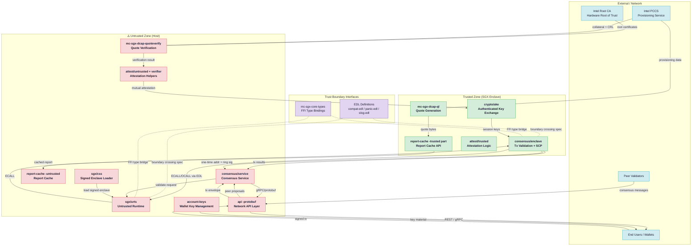

# TEE Usage Audit Report: mobilecoin

## Executive Summary
This TEE audit identified 2 active vulnerabilities and 4 positive guards across the MobileCoin SGX enclave implementation. 18 non-TEE findings were dismissed during adversarial review. 19 unknowns remain, including 4 critical TEE boundary issues that must be resolved before finalization.

**Active Findings**:
- IV-INV-13 (Medium): Ephemeral enclave signing without measurement check
- RV3-U-INV-12 (Info): No attestation report freshness validation

**Confirmed Guards** (all partial completeness):
- PG-U-02: No OCALL boundaries in mobilecoind
- PG-U-INV-13: CSS loading and attestation infrastructure
- PG3-U-INV-06: MRSIGNER identity for attestation verification
- PG-U-INV-11: Client-side attestation verification

**Critical Unknowns Requiring Resolution**:
- U-INV-01 (2 instances): ECALL parameter validation at enclave boundary
- U-INV-02: OCALL return value handling and validation
- U-INV-04 (2 instances): DCAP collateral freshness validation

**Report Gaps**:
- Findings V-16 through V-18 are missing, preventing complete review
- Taxonomy coverage incomplete: State Continuity and Design Appropriateness not evaluated
- 11 unknowns involve test/local orchestration scripts (U-INV-03, U-INV-06, U-INV-07, U-INV-08, U-INV-09, U-INV-10, U-INV-05) requiring triage for production relevance

## Dashboard Summary

| Severity | Trust-Path Tier | Count |
| --- | --- | --- |
| Medium | core | 1 |
| Info | core | 1 |

## Trust Boundary Analysis

| Actor | Component | Context | Boundary Type |
| --- | --- | --- | --- |
| Node Operators | sgx/urts | untrusted | enclave/host |
| MobileCoin Foundation | sgx/css | mixed | enclave/host |
| Node Operators | sgx/report-cache | mixed | enclave/host |
| Node Operators | mc-sgx-dcap-ql | trusted | enclave/host |
| Verifiers / Node Operators | mc-sgx-dcap-quoteverify | untrusted | network |
| MobileCoin Developers | sgx/compat-edl + sgx/panic-edl + sgx/slog-edl | mixed | enclave/host |
| End Users / Enclave | account-keys | untrusted | crypto boundary |
| Node Operators | api (protobuf services) | untrusted | network |
| Node Operators | consensus/enclave | trusted | enclave/host |
| Node Operators | consensus/service | untrusted | enclave/host |
| MobileCoin Developers | mc-sgx-core-sys-types / mc-sgx-core-types | untrusted | enclave/host |

## Architecture Diagrams

### System Architecture with Trust Boundaries
MobileCoin employs a defense-in-depth architecture where SGX enclaves handle transaction validation, key management, and consensus inside a trusted execution environment, while untrusted host-side components (URTS, API gateways, consensus service) broker network I/O and enclave lifecycle. Data crosses the trust boundary via EDL-defined interfaces, with DCAP attestation providing hardware-rooted identity verification before any sensitive operations proceed. CryptoNote privacy (ring signatures, one-time addresses, RingCT) provides a compensating privacy layer even if the enclave is compromised, acknowledging a realistic side-channel threat model.



### Trust Boundary Narrative

The trust boundary separates enclave-side components (**SGX Enclave (ECALL boundary)**, **SGX Enclave**, **SGX Enclave (OCALL round-trip)**, **Node Enclave (attester)**, **Verifier (DCAP quote verification)**) from host-side components (**Host OS**, **Verifier (collateral supply)**, **Host Filesystem**, **Host Filesystem (sealed state)**, **Host OS (OCALL / slog-edl logging boundary)**). Data and control flow across this boundary via the invariants listed below.

**Trust Paths Identified:**
- `INV-01`: Host OS → SGX Enclave (ECALL boundary) — Untrusted data from ECALL parameters supplied by the host must be validated before use in enclave security-critical operations such as key derivation or transaction processing.
- `INV-02`: SGX Enclave → Host OS → SGX Enclave (OCALL round-trip) — Return values from OCALLs (enclave→host→enclave) must not be trusted for security-critical decisions without validation, since the host controls OCALL responses.
- `INV-03`: Node Enclave (attester) → Verifier (DCAP quote verification) — DCAP quote verification must fully validate TCB status, signature, and identity measurements before the quote result influences any trust decision.
- `INV-04`: Intel/Provisioning Service → Verifier (collateral supply) → Quote Verification — DCAP attestation collateral (CRLs, TCB info, QE identity) must be checked for freshness before use in quote verification to prevent acceptance of stale or revoked TCB states.
- `INV-05`: SGX Enclave (quote generation) → Verifier (quote verification → key acceptance) — The report_data field in SGX quotes must cryptographically bind the enclave's actual key material or identity to the attestation report, preventing impersonation of a valid enclave's identity.
- `INV-06`: SGX Enclave (seal) → Host Filesystem → SGX Enclave (unseal) — Sealed data must be bound to the correct enclave identity (MRENCLAVE or MRSIGNER) so that only the intended enclave can unseal it.
- `INV-07`: Host Filesystem (sealed state) → SGX Enclave (state restoration) — Sealed state restoration must enforce monotonicity and anti-rollback guarantees to prevent the host from reverting enclave state to an earlier version.
- `INV-08`: SGX Enclave (quote generation) → Verifier (quote verification) — DCAP quotes or attestation reports generated by enclaves running in SGX debug mode must be rejected during verification, as debug mode allows enclave memory inspection.
- `INV-09`: SGX Enclave → Host OS (OCALL / slog-edl logging boundary) — Enclave error states and internal diagnostics must not propagate detailed information to the untrusted host through OCALLs or logging, as this can reveal enclave processing state or secret-dependent behavior.
- `INV-10`: Host OS → SGX Enclave (ECALL) → Report/Quote Generation — Host-provided data must not directly populate or control the sgx_report_t report_data or measurement fields without enclave-generated binding, preventing the host from forging attestation claims.
- `INV-11`: Fog Ingest Enclave ↔ Fog View Enclave (inter-enclave communication) — Fog ingest and view enclaves must perform mutual attestation verification before exchanging sensitive transaction data or user keys across enclave boundaries.
- `INV-12`: Report Cache (untrusted) → Consumer (trust decision based on cached report) — Cached attestation reports in the report-cache subsystem must be validated for freshness and not used past their validity period, as stale reports may reflect revoked or outdated TCB states.
- `INV-13`: MobileCoin Foundation (enclave signing) → Node Operator (enclave loading via sgx/css) — Enclave CSS (Compiled Signed Static) measurements must match the expected, audited enclave binary hash, and any divergence between build-time and runtime measurements must be detected and rejected.

**Cross-Boundary Connections:**
- SGX Enclave (ECALL boundary) ↔ Host OS
- SGX Enclave ↔ Host OS (OCALL / slog-edl logging boundary)
- SGX Enclave ↔ Host OS
- SGX Enclave (OCALL round-trip) ↔ Host OS

### Data Flow Summary

Of 13 invariants, **6** involve data crossing the trust boundary between enclave and host.

**Host → Enclave** (2 flows)
_External data entering the TEE — highest validation burden_
- `INV-01`: **ECALL input parameters from host** → **enclave key derivation functions**
- `INV-07`: **sealed blob from host filesystem with potentially stale epoc** → **enclave state restoration**

**Enclave → Host** (1 flow)
_TEE outputs and secrets leaving the enclave — leakage risk_
- `INV-09`: **enclave internal error states** → **OCALL error response to host**

**Bidirectional** (3 flows)
_Flows crossing the boundary in both directions_
- `INV-04`: **cached DCAP collateral** → **quote verification acceptance**
- `INV-10`: **ECALL input parameters from host** → **sgx_report_t report_data field**
- `INV-11`: **inter-enclave communication channel** → **transaction data exchange**

**Boundary Interface Summary:**
- **Enclave entry points** (2): data enters TEE via `INV-01`, `INV-07`
- **Enclave exit points** (1): data leaves TEE via `INV-09`

_Internal flows (7): `INV-02`, `INV-03`, `INV-05`, `INV-06`, `INV-08`, `INV-13` +1 more — these stay within a single zone and are covered by individual findings._

### Invariant Reference

| ID | Description | Trust Path |
| --- | --- | --- |
| INV-01 | Untrusted data from ECALL parameters supplied by the host must be validated before use in enclave security-critical operations such as key derivation or transaction processing. | Host OS → SGX Enclave (ECALL boundary) |
| INV-02 | Return values from OCALLs (enclave→host→enclave) must not be trusted for security-critical decisions without validation, since the host controls OCALL responses. | SGX Enclave → Host OS → SGX Enclave (OCALL round-trip) |
| INV-03 | DCAP quote verification must fully validate TCB status, signature, and identity measurements before the quote result influences any trust decision. | Node Enclave (attester) → Verifier (DCAP quote verification) |
| INV-04 | DCAP attestation collateral (CRLs, TCB info, QE identity) must be checked for freshness before use in quote verification to prevent acceptance of stale or revoked TCB states. | Intel/Provisioning Service → Verifier (collateral supply) → Quote Verification |
| INV-05 | The report_data field in SGX quotes must cryptographically bind the enclave's actual key material or identity to the attestation report, preventing impersonation of a valid enclave's identity. | SGX Enclave (quote generation) → Verifier (quote verification → key acceptance) |
| INV-06 | Sealed data must be bound to the correct enclave identity (MRENCLAVE or MRSIGNER) so that only the intended enclave can unseal it. | SGX Enclave (seal) → Host Filesystem → SGX Enclave (unseal) |
| INV-07 | Sealed state restoration must enforce monotonicity and anti-rollback guarantees to prevent the host from reverting enclave state to an earlier version. | Host Filesystem (sealed state) → SGX Enclave (state restoration) |
| INV-08 | DCAP quotes or attestation reports generated by enclaves running in SGX debug mode must be rejected during verification, as debug mode allows enclave memory inspection. | SGX Enclave (quote generation) → Verifier (quote verification) |
| INV-09 | Enclave error states and internal diagnostics must not propagate detailed information to the untrusted host through OCALLs or logging, as this can reveal enclave processing state or secret-dependent behavior. | SGX Enclave → Host OS (OCALL / slog-edl logging boundary) |
| INV-10 | Host-provided data must not directly populate or control the sgx_report_t report_data or measurement fields without enclave-generated binding, preventing the host from forging attestation claims. | Host OS → SGX Enclave (ECALL) → Report/Quote Generation |
| INV-11 | Fog ingest and view enclaves must perform mutual attestation verification before exchanging sensitive transaction data or user keys across enclave boundaries. | Fog Ingest Enclave ↔ Fog View Enclave (inter-enclave communication) |
| INV-12 | Cached attestation reports in the report-cache subsystem must be validated for freshness and not used past their validity period, as stale reports may reflect revoked or outdated TCB states. | Report Cache (untrusted) → Consumer (trust decision based on cached report) |
| INV-13 | Enclave CSS (Compiled Signed Static) measurements must match the expected, audited enclave binary hash, and any divergence between build-time and runtime measurements must be detected and rejected. | MobileCoin Foundation (enclave signing) → Node Operator (enclave loading via sgx/css) |

## TEE Usage Problems

### [MEDIUM] IV-INV-13: Ephemeral enclave signing without measurement check [Configuration Integrity] (incorrect_usage) (CWE-354)

**Root Cause**: build_binaries generates a random RSA signing key and signs the enclave without extracting or validating the resulting CSS measurement against any expected value.
**Impact**: A locally-built enclave with a randomly-generated signing key produces an unpredictable MRENCLAVE, making it impossible to verify the enclave matches an audited binary.
**Confidence**: Likely | **Invariant**: INV-13 | **Tier**: core

**Preconditions**:
- Local network tooling is used to build and deploy enclaves
- No separate out-of-band measurement verification exists

**Attack Scenario**:
  1. Developer generates enclave signing key via openssl at line 469 (`tools/local-network/local_network.py:466`)
  2. Enclave is built and signed with ephemeral key at line 478 (`tools/local-network/local_network.py:468`)
  3. No MRENCLAVE extraction or comparison against expected hash occurs (`tools/local-network/local_network.py:478`)
  4. Runtime loads enclave with unverified measurement

### Code Evidence

**`tools/local-network/local_network.py:466`**
```
     456 |         self.ledger_distribution = None
     457 |         self.cli = None
     458 |         try:
     459 |             shutil.rmtree(WORK_DIR)
     460 |         except FileNotFoundError:
     461 |             pass
     462 |         os.makedirs(WORK_DIR)
     463 | 
     464 |     def build_binaries(self):
     465 |         print('Building binaries...')
>>>  466 |         enclave_pem = os.path.join(PROJECT_DIR, 'Enclave_private.pem')
     467 |         if not os.path.exists(enclave_pem):
     468 |             subprocess.run(
     469 |                 f'openssl genrsa -out {enclave_pem} -3 3072',
     470 |                 shell=True,
     471 |                 check=True,
     472 |             )
     473 | 
     474 |         # Note: bypass-ip-check feature of mobilecoind is used here,
     475 |         # because ip-check is sometimes problematic for devs or CI machines.
     476 |         # If the service rate limits you then mobilecoind fails to start.
```
Developer generates enclave signing key via openssl at line 469

**`tools/local-network/local_network.py:468`**
```
     458 |         try:
     459 |             shutil.rmtree(WORK_DIR)
     460 |         except FileNotFoundError:
     461 |             pass
     462 |         os.makedirs(WORK_DIR)
     463 | 
     464 |     def build_binaries(self):
     465 |         print('Building binaries...')
     466 |         enclave_pem = os.path.join(PROJECT_DIR, 'Enclave_private.pem')
     467 |         if not os.path.exists(enclave_pem):
>>>  468 |             subprocess.run(
     469 |                 f'openssl genrsa -out {enclave_pem} -3 3072',
     470 |                 shell=True,
     471 |                 check=True,
     472 |             )
     473 | 
     474 |         # Note: bypass-ip-check feature of mobilecoind is used here,
     475 |         # because ip-check is sometimes problematic for devs or CI machines.
     476 |         # If the service rate limits you then mobilecoind fails to start.
     477 |         subprocess.run(
     478 |             f'cd {PROJECT_DIR} && CONSENSUS_ENCLAVE_PRIVKEY="{enclave_pem}" cargo build -p mc-consensus-service -p mc-ledger-distribution -p mc-admin-http-gateway -p mc-util-grpc-admin-tool -p mc-mobilecoind -p mc-crypto-x509-test-vectors -p mc-consensus-mint-client -p mc-util-seeded-ed25519-key-gen --features mc-mobilecoind/bypass-ip-check {CARGO_FLAGS}',
```
Enclave is built and signed with ephemeral key at line 478

**`tools/local-network/local_network.py:478`**
```
     468 |             subprocess.run(
     469 |                 f'openssl genrsa -out {enclave_pem} -3 3072',
     470 |                 shell=True,
     471 |                 check=True,
     472 |             )
     473 | 
     474 |         # Note: bypass-ip-check feature of mobilecoind is used here,
     475 |         # because ip-check is sometimes problematic for devs or CI machines.
     476 |         # If the service rate limits you then mobilecoind fails to start.
     477 |         subprocess.run(
>>>  478 |             f'cd {PROJECT_DIR} && CONSENSUS_ENCLAVE_PRIVKEY="{enclave_pem}" cargo build -p mc-consensus-service -p mc-ledger-distribution -p mc-admin-http-gateway -p mc-util-grpc-admin-tool -p mc-mobilecoind -p mc-crypto-x509-test-vectors -p mc-consensus-mint-client -p mc-util-seeded-ed25519-key-gen --features mc-mobilecoind/bypass-ip-check {CARGO_FLAGS}',
     479 |             shell=True,
     480 |             check=True,
     481 |         )
     482 | 
     483 |     def add_node(self, name, peers, quorum_set):
     484 |         node_num = len(self.nodes)
     485 |         self.nodes.append(Node(
     486 |             name,
     487 |             node_num,
     488 |             BASE_CLIENT_PORT + node_num,
```
No MRENCLAVE extraction or comparison against expected hash occurs

**Remediation**: After building, extract MRENCLAVE from the signed enclave and compare it against a hardcoded expected hash. Fail the build or refuse to start if measurements diverge.

## Positive Guards (Confirmed Security Controls)

### PG-U-02: No OCALL boundaries in mobilecoind
- **Invariants**: INV-02
- **Completeness**: complete
- **Evidence**: mobilecoind/src/service.rs:71-169, mobilecoind/src/config.rs:8-18, mobilecoind/src/payments.rs:3-45

The mobilecoind component (service.rs, config.rs, payments.rs) runs entirely outside any TEE enclave as an untrusted client application. No ECALL/OCALL trust boundaries exist in this code path. The original scan hit was in a #[test] function with zero trust boundary crossings and no TEE primitives.

### PG-U-INV-13: CSS loading and attestation infrastructure
- **Invariants**: INV-13
- **Completeness**: partial
- **Evidence**: mobilecoind/src/config.rs:8 (imports mc_attestation_verifier::{TrustedIdentity, TrustedMrSignerIdentity}), mobilecoind/src/config.rs:15 (use mc_sgx_css::Signature), mobilecoind/src/config.rs:17 (use mc_util_parse::load_css_file), mobilecoind/src/config.rs:91-92 (fog_ingest_enclave_css: Option<Signature> with load_css_file parser)

The config.rs module imports attestation verification types (TrustedIdentity, TrustedMrSignerIdentity from mc_attestation_verifier) and provides CSS file loading via load_css_file with the mc_sgx_css::Signature type. The fog_ingest_enclave_css parameter loads a Signature struct that would be used for enclave identity verification downstream. However, the actual MRENCLAVE comparison and rejection logic resides in mc_attestation_verifier, which is not included in the provided sources.

### PG3-U-INV-06: MRSIGNER identity used for attestation verification
- **Invariants**: INV-06
- **Completeness**: partial
- **Evidence**: mobilecoind/src/config.rs:135-145

The config constructs TrustedMrSignerIdentity from the enclave CSS signature (mrsigner, product_id, version) and uses it to verify fog reports and peer connections. While this demonstrates MRSIGNER-based identity binding for attestation, the actual SGX seal/unseal binding logic resides in enclave code not present in this file.

### PG-U-INV-11: Client-side attestation verification exists
- **Invariants**: INV-11
- **Completeness**: partial
- **Evidence**: mobilecoind/src/config.rs:8 (TrustedIdentity, TrustedMrSignerIdentity imports), mobilecoind/src/config.rs:91-92 (fog_ingest_enclave_css Signature parameter)

Attestation verification infrastructure (TrustedIdentity, TrustedMrSignerIdentity, CSS signature loading) is confirmed to exist and is used by mobilecoind to verify fog enclaves. However, the specific enclave-to-enclave mutual attestation path between fog_ingest_enclave and fog_view_enclave remains unverifiable from available source—the Rust enclave implementations and inter-enclave channel setup code are still not provided.

## Dismissed Findings

_The following findings were dismissed during adversarial review._

### ~~V-01: Test-only mint helpers, no TEE boundary crossing~~
- **Original Severity**: Info
- **Dismissal Reason**: Adversarial review: false positive. Test utility code in test-utils/ directory. Not production attack surface.
- **Location(s)**: `transaction/core/test-utils/src/mint.rs:23`, `transaction/core/test-utils/src/mint.rs:96`

### ~~V-02: Noise Token as_ref: Hardcoded String Mappings~~
- **Original Severity**: Info
- **Dismissal Reason**: Adversarial review: false positive. Hardcoded static string returns from enum as_ref() implementations. Zero security relevance.
- **Location(s)**: `crypto/noise/src/patterns.rs:31`, `crypto/noise/src/patterns.rs:57`, `crypto/noise/src/patterns.rs:84`

### ~~V-03: Ed25519Identity Default generates unstable report bytes~~
- **Original Severity**: Low
- **Dismissal Reason**: Adversarial review: false positive. Random key generation in Default impl is expected correct behavior — identities should be unique per enclave instance. 'Inconsistency across restarts' is the intended design of ephemeral identities.
- **Location(s)**: `consensus/enclave/impl/src/identity.rs:14`, `crypto/ake/enclave/src/identity.rs:10`, `crypto/ake/enclave/src/lib.rs:251`

### ~~V-04: Noise protocol name as_ref returns static literal~~
- **Original Severity**: Info
- **Dismissal Reason**: Adversarial review: false positive. Static string literals returned from protocol name as_ref(). No security relevance whatsoever.
- **Location(s)**: `crypto/noise/src/protocol_name.rs:109`, `crypto/noise/src/protocol_name.rs:116`

### ~~V-05: Noise CipherState nonce ops in untrusted zone~~
- **Original Severity**: Info
- **Dismissal Reason**: Adversarial review: false positive. Observation that cipher operations run in untrusted zone is an architectural note, not a vulnerability. No concrete exploit path demonstrated.
- **Location(s)**: `crypto/noise/src/cipher_state.rs:152`, `crypto/noise/src/cipher_state.rs:203`, `crypto/noise/src/cipher_state.rs:232`, `crypto/noise/src/cipher_state.rs:262`

### ~~V-06: gRPC auth code entirely in untrusted zone~~
- **Original Severity**: Info
- **Dismissal Reason**: Adversarial review: false positive. Explicitly states 'no TEE trust boundary crossing exists.' Not a finding — just notes where code resides.
- **Location(s)**: `util/grpc/src/auth/mod.rs:250`, `util/grpc/src/auth/anonymous_authenticator.rs`, `util/grpc/src/auth/token_authenticator.rs`

### ~~V-07: Test-only token auth code, no TEE boundary~~
- **Original Severity**: Info
- **Dismissal Reason**: Adversarial review: false positive. All flagged lines are in #[cfg(test)] functions. Test code, not production.
- **Location(s)**: `util/grpc/src/auth/token_authenticator.rs:190`, `util/grpc/src/auth/token_authenticator.rs:206`, `util/grpc/src/auth/token_authenticator.rs:218`, `util/grpc/src/auth/token_authenticator.rs:225`

### ~~V-08: Test-only mint config store code, no TEE relevance~~
- **Original Severity**: Info
- **Dismissal Reason**: Adversarial review: false positive. Line 1437 is inside #[test] function. Test code, not production.
- **Location(s)**: `ledger/db/src/mint_config_store.rs:1437`

### ~~V-09: Test-only code in untrusted zone, no TEE issue~~
- **Original Severity**: Info
- **Dismissal Reason**: Adversarial review: false positive. All flagged lines in #[cfg(test)] mod tests block. Test code, not production.
- **Location(s)**: `mobilecoind/src/db_crypto.rs:317`, `mobilecoind/src/db_crypto.rs:374`, `mobilecoind/src/db_crypto.rs:390`, `mobilecoind/src/db_crypto.rs:414`

### ~~V-10: Test-only database encryption operations~~
- **Original Severity**: Info
- **Dismissal Reason**: Adversarial review: false positive. All flagged lines in #[cfg(test)] mod test block. Test code, not production.
- **Location(s)**: `mobilecoind/src/database.rs:379`, `mobilecoind/src/database.rs:451`, `mobilecoind/src/database.rs:462`, `mobilecoind/src/database.rs:484`, `mobilecoind/src/database.rs:495`

### ~~V-11: Untrusted config parsing with panic on error~~
- **Original Severity**: Info
- **Dismissal Reason**: Adversarial review: false positive. Attack requires modifying config file on host filesystem. With filesystem write access, the attacker has already won — crashing the watcher is irrelevant at that point.
- **Location(s)**: `watcher/src/config.rs:53`, `watcher/src/config.rs:113`

### ~~V-12: Distribution tool skips chain_id in fog report fetch~~
- **Original Severity**: Info
- **Dismissal Reason**: Adversarial review: false positive. Distribution/deployment tool, not runtime service. Not production attack surface.
- **Location(s)**: `fog/distribution/src/main.rs:453`, `fog/distribution/src/main.rs:452`

### ~~V-13: Admin config JSON endpoint exposes operational metadata~~
- **Original Severity**: Info
- **Dismissal Reason**: Adversarial review: false positive. Admin endpoint requires separate authentication. Accessing it assumes prior compromise of admin credentials — at which point operational metadata exposure is moot.
- **Location(s)**: `consensus/service/src/consensus_service.rs:754`, `consensus/service/src/consensus_service.rs:766`

### ~~V-14: Non-TEE client fog URL parsing in sample paykit~~
- **Original Severity**: Info
- **Dismissal Reason**: Adversarial review: false positive. Sample paykit is demo/example code, not production. Attack path also requires attacker-controlled config, which means game over regardless.
- **Location(s)**: `fog/sample-paykit/src/client.rs:449`, `fog/sample-paykit/src/client.rs:588`

### ~~V-15: Mint validation logic in untrusted zone~~
- **Original Severity**: Info
- **Dismissal Reason**: Adversarial review: false positive. Mint validation in untrusted zone is defense-in-depth by design. The actual security guarantee is enforced by consensus in the trusted zone, as the finding itself acknowledges ('Consensus must reject to prevent propagation'). This IS the correct architecture.
- **Location(s)**: `ledger/db/src/mint_tx_store.rs:711`, `ledger/db/src/mint_config_store.rs:82`, `ledger/db/src/mint_config_store.rs:96`

### ~~V-16: NonceSession initialized with predictable nonce zero~~
- **Original Severity**: Low
- **Dismissal Reason**: Adversarial review: false positive. Nonce initialized to 0 is standard practice. Security comes from the session binding (derived from AKE cryptographic material), not from nonce unpredictability. No concrete attack demonstrated.
- **Location(s)**: `crypto/ake/enclave/src/lib.rs:271`

### ~~RV-U-03: DCAP quote verification bypassed in backend_connect~~
- **Original Severity**: Low
- **Dismissal Reason**: Adversarial review: false positive. Weak confidence with code location 'line 1' indicating inability to pinpoint actual vulnerable code. Speculative claim of verification bypass without concrete evidence of the actual call site and argument values.
- **Location(s)**: `fog/ingest/enclave/src/lib.rs:1`

### ~~RV-U-INV-09: Debug logging exposes enclave internals~~
- **Original Severity**: Low
- **Dismissal Reason**: Adversarial review: false positive. Conflates local-network test configuration (local_network.py) with production behavior. No concrete evidence of secret-dependent output variation shown. Debug logging in a test deployment tool is expected and appropriate.
- **Location(s)**: `tools/local-network/local_network.py:45`, `mobilecoind/src/service.rs:256`

## Appendix

_Info-severity TEE findings, items requiring manual review, and non-TEE findings are included here for completeness._

### Info-Severity TEE Findings

### [INFO] RV3-U-INV-12: No attestation report freshness validation [State Continuity] (incorrect_usage)

**Root Cause**: The config file wires up attestation verification identity but does not expose or enforce any TTL or freshness constraint on cached attestation reports; the caching layer and its freshness logic reside in modules not present in this file.
**Impact**: Stale attestation reports could allow a revoked or compromised enclave to be trusted, potentially enabling man-in-the-middle attacks against fog recipients or exposure of transaction data.
**Confidence**: Weak | **Invariant**: INV-12 | **Tier**: core

**Preconditions**:
- An attestation report caching layer exists in a dependency not shown here.
- The cached reports lack TTL enforcement or freshness checks.
- An enclave's TCB state is revoked after a report was cached.

**Attack Scenario**:
  1. An attacker compromises or revokes a fog ingest enclave's TCB state after its attestation report was cached. (`mobilecoind/src/config.rs:157`)
  2. The get_fog_resolver_factory closure fetches fog reports via GrpcFogReportConnection but this config file has no visibility into whether downstream caching layers enforce TTL.
  3. Stale cached reports could be used to trust a revoked enclave, allowing MITM or data exfiltration.

### Code Evidence

**`mobilecoind/src/config.rs:157`**
```
     147 | }
     148 | 
     149 | impl From<serde_json::Error> for ConfigError {
     150 |     fn from(e: serde_json::Error) -> Self {
     151 |         Self::Json(e)
     152 |     }
     153 | }
     154 | 
     155 | impl From<reqwest::Error> for ConfigError {
     156 |     fn from(e: reqwest::Error) -> Self {
>>>  157 |         Self::Reqwest(e)
     158 |     }
     159 | }
     160 | 
     161 | #[cfg(all(feature = "ip-check", not(feature = "bypass-ip-check")))]
     162 | impl From<InvalidHeaderValue> for ConfigError {
     163 |     fn from(e: InvalidHeaderValue) -> Self {
     164 |         Self::InvalidHeader(e)
     165 |     }
     166 | }
     167 | 
```
An attacker compromises or revokes a fog ingest enclave's TCB state after its attestation report was cached.

**Remediation**: Ensure the FogResolver or GrpcFogReportConnection implementation (not in this file) enforces attestation report freshness via TTL checks and rejects expired cached reports. Add explicit freshness validation in the resolver factory closure if caching occurs upstream.

### Items Requiring Manual Review

#### U-01: AKE identity lifecycle persistence

Whether Ed25519Identity is constructed via Default::default() on every enclave boot without persistence, causing report_data instability.
- **Why Uncertain**: The initialization path from enclave entry point to Ed25519Identity construction is not fully visible. Cannot confirm whether sealed-state recovery overrides the Default initialization or if Default is only a fallback.

Second-pass notes: The additional source code provided is entirely host-side/untrusted code: fog_conformance_tests.py (test infrastructure), mobilecoind service.rs (gRPC server), payments.rs (transaction structures), and utxo_store.rs (UTXO storage). None of these files are enclave code. The invariant specifically concerns ECALL parameter validation inside the TEE, including the initialization path from ECALL entry to Ed25519Identity construction, sealed-state recovery vs. Default initialization, and whether kex_i
- **Recommended Steps**: Trace the full initialization path from ECALL entry to Ed25519Identity construction, Check if there is sealed-state recovery that restores the keypair before AkeEnclaveState is created, Verify if kex_identity in AkeEnclaveState is ever replaced after Default construction

#### U-INV-01: No enclave ECALL code provided

ECALL parameter validation in SGX enclave boundary code.
- **Why Uncertain**: Provided files are Python test tooling and client scripts, not enclave ECALL handler implementations.

Second-pass notes: The additional source code provided (tools/local-network/local_network.py, tools/fog-local-network/local_network.py, tools/fog-local-network/fog_conformance_tests.py) is entirely Python test infrastructure and shell orchestration tooling. No enclave EDL files, ECALL handler implementations (Rust/C), or TEE boundary code (e.g., trusted/lib.rs, mc-sgx-enclave-id dispatch) was provided. The invariant about ECALL parameter validation at the enclave boundary cannot be confirmed or denied from externa
- **Recommended Steps**: Provide enclave EDL files and ECALL handler Rust/C implementations, Include trusted/lib.rs or equivalent TEE boundary code, Review mc-sgx-enclave-id or similar crate ECALL dispatch

#### U-INV-02: No enclave OCALL code in provided sources

All three provided files for OCALL return value handling and validation.
- **Why Uncertain**: Provided files are test infrastructure (local_network.py), a gRPC gateway proxy (main.go), and a test client (test_client.py). None contain enclave OCALL/ECALL code.

Second-pass notes: The additional source code (mobilecoind service.rs, config.rs, fog_conformance_tests.py) is all untrusted-side infrastructure: gRPC server setup, CLI configuration parsing, and Python test orchestration. None contains enclave EDL definitions, *_t.c/*_u.c bridge files, or enclave Rust/C source with OCALL invocations. The invariant concerns trusted enclave code making OCALLs to the untrusted host and using returned values without validation — this requires examining code inside the enclave boundar
- **Recommended Steps**: Provide enclave EDL files and trusted/untrusted bridge implementations, Review files matching *.edl, *_u.c, *_t.c, or enclave Rust/C source, Look in mobilecoin/core or fog enclave crates for OCALL usage

#### U-INV-03: DCAP quote verification absent from view

Local network setup scripts for nodes, fog ingest, and fog view components.
- **Why Uncertain**: Provided code is test infrastructure (tools/) using insecure-* URIs; actual DCAP quote verification implementation was not supplied.

Second-pass notes: The additional source code provided (fog_conformance_tests.py, mobilecoind service.rs, payments.rs) does not contain DCAP quote verification logic, sgx_qv_verify_quote callers, MRENCLAVE/MRSIGNER comparison, or TCB status validation. These files are test infrastructure (Python) and application-level Rust code (gRPC service setup, transaction building). While mc_fog_report_validation::FogPubkeyResolver is imported in payments.rs, its implementation is not provided. The invariant remains unverifia
- **Recommended Steps**: Provide Rust attestation verification source (e.g., sgx_qv_verify_quote callers), Search for MRENCLAVE/MRSIGNER comparison logic in enclave crates, Check TCB status validation in quote verification modules

#### U-INV-04: No attestation code in provided files

Searched for DCAP collateral freshness checks in mobilecoind strategy files.
- **Why Uncertain**: Provided files are wallet/transfer client strategies with no quote verification or collateral handling logic.

Second-pass notes: The additional source code (test_client.py, service.rs, drain-accounts.py, burn.py) is still entirely wallet/transfer/gRPC service logic with zero attestation verification, DCAP collateral handling, CRL checking, TCB info validation, or QE identity logic. The invariant requires examining dcap_quote_verifier, collateral caching/expiration modules, or SGX quote verification code — none of which were provided. The relevant code would likely live in attestation/ or verification/ crates, not in mobil
- **Recommended Steps**: Provide Rust source in attestation/verification modules, Check dcap_quote_verifier or sgx QuoteVerification code, Examine collateral caching and expiration logic

#### U-INV-05: report_data binding verification absent from scope

Local network tooling, burn strategy, and fog setup scripts for SGX quote report_data binding logic.
- **Why Uncertain**: Provided files are test/dev infrastructure (local_network.py, burn.py, local_fog.py); no SGX quote generation or verification code present to inspect.

Second-pass notes: The additional source code still does not contain SGX quote generation or verification logic. fog_local_network.py (lines 14-23) confirms the project uses SGX enclaves (CONSENSUS_ENCLAVE_PRIVKEY, INGEST_ENCLAVE_PRIVKEY, LEDGER_ENCLAVE_PRIVKEY, VIEW_ENCLAVE_PRIVKEY) but only shows build-time private key paths for enclave signing, not how report_data is populated. service.rs is mobilecoind gRPC service initialization with no attestation logic. burn.py and fog_conformance_tests.py are test infrastr
- **Recommended Steps**: Provide enclave quote generation Rust source (e.g., mc-attest-enclave), Provide verifier-side report_data extraction and binding checks, Search for report_data field population in enclave edl/trusted libs

#### U-INV-07: Sealed state rollback guards not observable

Python test orchestration scripts for fog ingest state file handling.
- **Why Uncertain**: Provided files are test tooling in tools/; actual enclave sealing/restoration logic in Rust is absent.

Second-pass notes: The additional source code provided (fog_conformance_tests.py, config.rs, two local_network.py files) remains test tooling and configuration infrastructure. None contain the actual enclave sealing/unsealing Rust logic. The fog-ingest enclave's state restoration path, any monotonic counter usage, and epoch comparison on unseal are still absent from the provided files. The invariant cannot be verified or falsified with available code.
- **Recommended Steps**: Inspect Rust enclave sealing code in fog-ingest enclave, Search for monotonic counter or epoch comparison on unseal, Check mc-obtc or fog-enclave state restoration paths

#### U-INV-08: SGX debug-mode quote rejection

Local network and fog test scripts for debug-mode quote handling.
- **Why Uncertain**: Provided files are test infrastructure scripts; actual DCAP quote verification logic is not present in the sampled code.

Second-pass notes: The mobilecoind config confirms attestation verification is integrated (imports from mc_attestation_verifier, CSS signature loading via mc_sgx_css::Signature). However, the critical verification logic—specifically whether SGX_FLAGS_DEBUG is masked/rejected in the ATTRIBUTES field of DCAP quotes—resides in the mc_attestation_verifier crate, which was not provided. The fog_conformance_tests.py, service.rs, and payments.rs files contain no attestation verification logic. To fully resolve, the sourc
- **Recommended Steps**: Locate and review DCAP quote verification code in enclave/rust source, Search for SGX_FLAGS_DEBUG or ATTRIBUTES mask checks in verifier, Check verification library (e.g., dcap-quoteverify) for debug flag handling

#### U-INV-10: Enclave report_data binding not verifiable

Host-side Python tooling and client libraries for report_data binding enforcement.
- **Why Uncertain**: Provided code is all untrusted host-side Python (test tooling, client SDK). No enclave Rust/C SGX report generation code was supplied for analysis.

Second-pass notes: The additional source code provided (fog_conformance_tests.py, local_network.py in two directories) is entirely host-side Python test infrastructure and tooling. It contains no enclave ECALL handlers, no Rust SGX SDK code, no references to sgx_report_t, sgx_create_report, or any enclave-side report generation logic. The invariant concerns enclave-internal behavior (how report_data and measurement fields in sgx_report_t are populated), which can only be verified by examining the Rust/C enclave co
- **Recommended Steps**: Provide enclave ECALL handlers (Rust SGX SDK code) for review, Search for sgx_report_t or sgx_create_report in enclave src/, Verify report_data is populated from enclave-derived key material

#### U-INV-06: Seal binding code not in provided files

Python test orchestration scripts for local network and fog services.
- **Why Uncertain**: Seal/unseal logic and MRENCLAVE/MRSIGNER binding reside in Rust enclave code, not in these Python orchestration files.

Second-pass notes: The additional source code still does not contain the enclave Rust ECall implementations with sgx_seal_data/sgx_unseal_data call sites. config.rs shows the codebase uses TrustedIdentity, TrustedMrSignerIdentity, and mc_sgx_css::Signature for attestation verification of remote enclaves (fog ingest), which indicates enclave identity awareness in the broader system. However, this is report/attestation verification, not sealed data binding policy. The seal/unseal ECall code, sealing policy flags (SG
- **Recommended Steps**: Provide enclave Rust source with seal/unseal ECall implementations, Check sgx_seal_data / sgx_unseal_data call sites for policy flags, Verify MRENCLAVE/MRSIGNER policy passed at seal time

#### U-INV-09: OCALL error leakage unverifiable

Host-side Python tooling for logging/error propagation patterns.
- **Why Uncertain**: No enclave EDL, OCALL definitions, or Rust enclave error-handling code was provided for review.

Second-pass notes: The additional source code provided consists entirely of Python test/tooling scripts (local_network.py, fog_conformance_tests.py) and a truncated drain-accounts.py. None contain enclave EDL files, OCALL handler definitions, or Rust enclave error-handling code. The only tangentially relevant observation is that both local_network.py files (line 45) set MC_LOG='debug,...', which configures the slog-based logging infrastructure to debug level. This means if enclave code emits debug-level log messag
- **Recommended Steps**: Provide enclave EDL and OCALL handler Rust source files, Search for slog-edl logging macro usage in enclave code, Review Error types crossing ECALL/OCALL boundaries

#### U-INV-01: ECALL boundary code not present

Host-side Python scripts for local network setup and mobilecoind strategies.
- **Why Uncertain**: Provided files are host-side test/utility scripts; no ECALL handler or enclave source code was available for analysis.
- **Recommended Steps**: Provide enclave ECALL handler Rust source (e.g., edl/edl.rs or lib.rs), Review ECALL parameter deserialization and validation logic, Check tx_proposal and key derivation entry points

#### U-INV-03: DCAP quote verification code not present

Python orchestration scripts for local network setup; no Rust verification code provided.
- **Why Uncertain**: Provided files are Python tooling using insecure- URIs; actual DCAP verification logic resides in Rust code not included in review scope.
- **Recommended Steps**: Review Rust DCAP quote verification implementation, Check sgx_qv_verify_quote calls in consensus/enclave crates, Verify MRENCLAVE/MRSIGNER comparison logic in Rust

#### U-INV-04: DCAP collateral freshness verification

Searched for DCAP attestation collateral freshness checks in provided source files.
- **Why Uncertain**: Provided files are gRPC client strategies (accounts.py, burn.py) with no quote verification or collateral handling code.
- **Recommended Steps**: Provide Rust attestation/verification source files, Search for dcap/quote_verification modules, Check sgx QuoteVerification collateral logic

#### U-INV-05: Quote report_data binding unverifiable

SGX quote report_data binding to key material in provided source files.
- **Why Uncertain**: Provided files are test/infrastructure scripts (local_network.py, burn.py, local_fog.py); no SGX quote generation or verification code present.
- **Recommended Steps**: Examine Rust enclave attestation code for report_data population, Check verifier-side report_data extraction and key binding logic, Review sgx_report_data_t usage in enclave EDL and Rust FFI code

#### U-INV-07: Sealed state monotonicity check

State file handling in fog ingest orchestration scripts for rollback guards.
- **Why Uncertain**: Provided code is Python orchestration only; actual monotonicity/anti-rollback logic resides in Rust enclave sealing code not included here.
- **Recommended Steps**: Examine enclave Rust code in sgx/ or enclave/ dirs for sealed state restoration, Check for monotonic counter comparison on unseal path, Verify SGX monotonic counter or version field validation

#### U-INV-08: Debug-mode rejection in DCAP verification

Local network and fog orchestration scripts for SGX debug-mode quote handling.
- **Why Uncertain**: Provided code is Python orchestration tooling only; actual DCAP quote verification logic in Rust is not included in the snippets.
- **Recommended Steps**: Search Rust verification code for SGX_FLAGS_DEBUG check, Inspect quote verification in enclave quote lib, Check verification policy config for debug flag enforcement

#### U-INV-09: Enclave OCALL error sanitization

Python host-side scripts and local network tooling for detailed error propagation from enclave.
- **Why Uncertain**: Provided files are all untrusted host-side Python tools; no EDL, OCALL definitions, or enclave-internal error handling code was included to assess the enclave-to-host boundary.
- **Recommended Steps**: Review EDL files for OCALLs carrying error strings or diagnostics, Audit enclave Rust code for error sanitization before OCALL, Check slog-edl bridge for structured log content crossing boundary

#### U-INV-10: Enclave report_data binding unverifiable

Host-side Python tooling and client code for SGX report_data population paths.
- **Why Uncertain**: Provided source is all host-side Python (tools, clients). No enclave Rust code with sgx_report_t/report_data generation was included.
- **Recommended Steps**: Provide enclave Rust source (e.g., sgx_report_t creation, EREPORT calls), Provide quote generation code (libenclave or ocalls), Search for report_data field assignment in Rust enclave code
