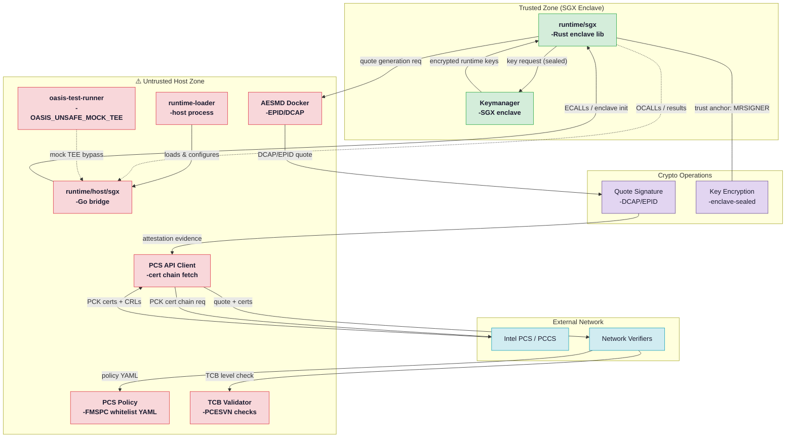

# TEE Usage Audit Report: oasis-core

## Executive Summary
This audit identified 1 active finding of Low severity, confirmed 10 positive guards, and left 4 unknowns requiring further investigation. 7 findings were dismissed during adversarial review.

**Active Finding:**
• RV-U-INV-12 [State]: SGX-only sealing on TDX platforms causes data inaccessibility when TDX is active. Remediation: Implement platform-aware sealing logic that detects TDX vs SGX at runtime and applies appropriate sealing key derivation.

**Key Gaps (Unknowns):**
• U-INV-04 [Binding]: RAK embedding in attestation report_data unverified in 2 code paths
• U-INV-10 [Guard]: PCS/PCK certificate chain validation logic unverified in crypto/RPC modules

**Positive Guards (10 confirmed):** Key operational guards include ECALL input validation (PG-INV-01, partial), TCB status validation (PG-INV-02, partial), mock signer exclusion (PG-INV-08, complete), NoiseSession key op gating (PG-U-INV-09, partial), generation-based state continuity (PG-INV-12, partial), and checksum storage verification (PG-U-INV-11, partial).

## Dashboard Summary

| Severity | Trust-Path Tier | Count |
| --- | --- | --- |
| Low | core | 1 |

## Trust Boundary Analysis

| Actor | Component | Context | Boundary Type |
| --- | --- | --- | --- |
| Node Operator | runtime-loader | untrusted | enclave/host |
| Node Operator | runtime/host/sgx (Go) | untrusted | enclave/host |
| Node Operator | runtime/sgx (Rust enclave) | trusted | enclave/host |
| Designated Network Entity | keymanager (SGX enclave) | trusted | enclave/host |
| Node Operator | AESMD (EPID/DCAP) | untrusted | enclave/host |
| Network/Verifiers | go/common/sgx/pcs/policy | untrusted | network |
| Network/Verifiers | go/common/sgx/pcs/tcb | untrusted | network |
| Node Operators/Verifiers | go/common/sgx/pcs (PCS client) | untrusted | network |
| Intel | Intel PCS / PCCS | untrusted | network |
| Developers | go/oasis-test-runner | untrusted | enclave/host |
| Network/Verifiers | Quote signature verification | mixed | crypto boundary |

## Architecture Diagrams

### System Architecture with Trust Boundaries
The system implements a TEE-protected runtime architecture primarily using Intel SGX enclaves, where trusted components (runtime/sgx crate, keymanager enclave) operate inside enclaves while the vast majority of Go-based host code (go/runtime/, go/common/, go/consensus/, etc.) runs in untrusted context. Attestation flows from enclaves through Intel's AESMD service to the PCS API for certificate chain retrieval, with quote validation performed by network verifiers using FMSPC-whitelisted policies and TCB level checks. The trust boundary is sharply drawn at the enclave edge: the runtime-loader and runtime/host/sgx bridge manage enclave lifecycle from untrusted host space, while all cryptographic key material and sensitive state remains confined within SGX enclaves.



### Trust Boundary Narrative

The trust boundary separates enclave-side components (**Enclave via ECALL entry points**, **Local Node quote verification (go/common/sgx/pcs/tcb)**, **Peer Node Attestation**, **Local Node Policy Enforcement (go/common/sgx/pcs/policy)**, **Enclave Quote Generation**) from host-side components (**Untrusted Host**, **Host Filesystem (sealed state)**, **Host Storage**). Data and control flow across this boundary via the invariants listed below.

**Trust Paths Identified:**
- `INV-01`: Untrusted Host → Enclave via ECALL entry points — Host-controlled data passed to enclave via ECALL parameters must be validated before use in security-critical enclave decisions such as key derivation or state modification.
- `INV-02`: Network Peer → Local Node quote verification (go/common/sgx/pcs/tcb) — DCAP quote verification must validate complete TCB status including PCESVN level before accepting attestation evidence as trustworthy.
- `INV-03`: Peer Node Attestation → Local Node Policy Enforcement (go/common/sgx/pcs/policy) — Quote policy enforcement must check FMSPC whitelist membership and maximum attestation age before accepting peer attestations.
- `INV-04`: Enclave Quote Generation → Network Attestation Dissemination — The attestation report_data field must cryptographically bind the Runtime Attestation Key (RAK) public key to the enclave quote to prevent key substitution attacks.
- `INV-05`: Enclave → Host Filesystem (sealed state) → Enclave on restart — Sealed data must be bound to the enclave's MRENCLAVE identity using SGX sealing to prevent a different enclave from unsealing the data.
- `INV-06`: Enclave State Persistence → Host Storage → Enclave State Recovery — TEE sealed state must include epoch or version binding to ensure monotonic progression and prevent rollback to previous states.
- `INV-07`: Build/Deployment Configuration → TEE Initialization in runtime-loader — The OASIS_UNSAFE_MOCK_TEE environment flag must not be active in production deployments as it completely bypasses TEE hardware attestation and enforcement.
- `INV-08`: Build Configuration → Attestation Verification (keymanager mock signers) — Debug SGX builds with mock trusted signers must not be accepted in production attestation verification paths.
- `INV-09`: Runtime Enclave ↔ Key Manager Enclave (cross-enclave key exchange) — Key release from the keymanager enclave to a requesting runtime enclave requires mutual attestation — both runtime-to-keymanager and keymanager-to-runtime attestation must complete before key material is exchanged.
- `INV-10`: Intel PCS API → Node Certificate Chain Validation (go/common/sgx GetPCKCertificateChain) — PCS PCK certificate chain verification must validate the full chain anchored in Intel's root CA before trusting any attestation collateral.
- `INV-11`: Untrusted Host → Enclave via OCALL return values — OCALL return values consumed by the enclave must be validated before use in security-critical decisions since they originate from the untrusted host.
- `INV-12`: TDX VM State Persistence → Host Storage → TDX VM State Recovery — TDX runtime state persistence must not rely on SGX-style monotonic counters, and any persisted trusted state must implement alternative continuity guarantees appropriate to the TDX platform.

**Cross-Boundary Connections:**
- Enclave via ECALL entry points ↔ Untrusted Host

### Data Flow Summary

Of 12 invariants, **8** involve data crossing the trust boundary between enclave and host.

**Host → Enclave** (4 flows)
_External data entering the TEE — highest validation burden_
- `INV-01`: **host-provided ECALL parameters** → **enclave key derivation**
- `INV-02`: **DCAP quote from network peer** → **attestation acceptance decision**
- `INV-10`: **PCK certificate chain from Intel PCS API** → **DCAP quote trust decision**
- `INV-11`: **OCALL return values from host process** → **enclave policy decisions**

**Enclave → Host** (1 flow)
_TEE outputs and secrets leaving the enclave — leakage risk_
- `INV-04`: **RAK public key generated in enclave** → **on-chain node registration**

**Bidirectional** (3 flows)
_Flows crossing the boundary in both directions_
- `INV-03`: **RAK-signed attestation from peer node** → **peer node acceptance**
- `INV-08`: **mock trusted signer keys in debug builds** → **keymanager attestation acceptance**
- `INV-09`: **runtime attestation quote sent to keymanager** → **key material released by keymanager**

**Boundary Interface Summary:**
- **Enclave entry points** (4): data enters TEE via `INV-01`, `INV-02`, `INV-10`, `INV-11`
- **Enclave exit points** (1): data leaves TEE via `INV-04`

_Internal flows (4): `INV-05`, `INV-06`, `INV-07`, `INV-12` — these stay within a single zone and are covered by individual findings._

### Invariant Reference

| ID | Description | Trust Path |
| --- | --- | --- |
| INV-01 | Host-controlled data passed to enclave via ECALL parameters must be validated before use in security-critical enclave decisions such as key derivation or state modification. | Untrusted Host → Enclave via ECALL entry points |
| INV-02 | DCAP quote verification must validate complete TCB status including PCESVN level before accepting attestation evidence as trustworthy. | Network Peer → Local Node quote verification (go/common/sgx/pcs/tcb) |
| INV-03 | Quote policy enforcement must check FMSPC whitelist membership and maximum attestation age before accepting peer attestations. | Peer Node Attestation → Local Node Policy Enforcement (go/common/sgx/pcs/policy) |
| INV-04 | The attestation report_data field must cryptographically bind the Runtime Attestation Key (RAK) public key to the enclave quote to prevent key substitution attacks. | Enclave Quote Generation → Network Attestation Dissemination |
| INV-05 | Sealed data must be bound to the enclave's MRENCLAVE identity using SGX sealing to prevent a different enclave from unsealing the data. | Enclave → Host Filesystem (sealed state) → Enclave on restart |
| INV-06 | TEE sealed state must include epoch or version binding to ensure monotonic progression and prevent rollback to previous states. | Enclave State Persistence → Host Storage → Enclave State Recovery |
| INV-07 | The OASIS_UNSAFE_MOCK_TEE environment flag must not be active in production deployments as it completely bypasses TEE hardware attestation and enforcement. | Build/Deployment Configuration → TEE Initialization in runtime-loader |
| INV-08 | Debug SGX builds with mock trusted signers must not be accepted in production attestation verification paths. | Build Configuration → Attestation Verification (keymanager mock signers) |
| INV-09 | Key release from the keymanager enclave to a requesting runtime enclave requires mutual attestation — both runtime-to-keymanager and keymanager-to-runtime attestation must complete before key material is exchanged. | Runtime Enclave ↔ Key Manager Enclave (cross-enclave key exchange) |
| INV-10 | PCS PCK certificate chain verification must validate the full chain anchored in Intel's root CA before trusting any attestation collateral. | Intel PCS API → Node Certificate Chain Validation (go/common/sgx GetPCKCertificateChain) |
| INV-11 | OCALL return values consumed by the enclave must be validated before use in security-critical decisions since they originate from the untrusted host. | Untrusted Host → Enclave via OCALL return values |
| INV-12 | TDX runtime state persistence must not rely on SGX-style monotonic counters, and any persisted trusted state must implement alternative continuity guarantees appropriate to the TDX platform. | TDX VM State Persistence → Host Storage → TDX VM State Recovery |

## TEE Usage Problems

### [LOW] RV-U-INV-12: SGX-only sealing on TDX platforms [State Continuity] (inappropriate_design)

**Root Cause**: Sealing and key policy code unconditionally imports and uses SGX ISA types (sgx_isa::Keypolicy, sgx::seal::new_deoxysii, SignedPolicySGX) with no platform dispatch or TDX fallback.
**Impact**: On TDX platforms, persisted keymanager secrets may be stored without hardware-bound rollback protection, enabling rollback or replay of trusted state from untrusted storage.
**Confidence**: Weak | **Invariant**: INV-12 | **Tier**: core

**Preconditions**:
- Runtime deployed on TDX without SGX co-support.
- Keymanager persists and reloads secrets across restarts via untrusted local storage.

**Attack Scenario**:
  1. An operator deploys the keymanager runtime on a TDX platform without SGX support. (`keymanager/src/crypto/kdf.rs:20`)
  2. The runtime invokes sealing via sgx::seal::new_deoxysii (imported unconditionally in kdf.rs:20 and storage.rs:15) and references sgx_isa::Keypolicy (storage.rs:7) and SignedPolicySGX (handler.rs:25) with no platform branching. (`keymanager/src/churp/storage.rs:7`)
  3. On TDX, these SGX-specific primitives either fail at runtime or silently provide no TEE-native rollback protection, leaving persisted secrets in untrusted storage (ProtocolUntrustedLocalStorage, secrets.rs:90-101) without continuity guarantees. (`keymanager/src/churp/storage.rs:15`)
  **Evidence**: `keymanager/src/churp/handler.rs:25`

### Code Evidence

**`keymanager/src/crypto/kdf.rs:20`**
```
      10 | use lazy_static::lazy_static;
      11 | use lru::LruCache;
      12 | use sgx_isa::Keypolicy;
      13 | use sp800_185::{CShake, KMac};
      14 | use zeroize::Zeroize;
      15 | 
      16 | use oasis_core_runtime::{
      17 |     common::{
      18 |         crypto::{mrae::nonce::Nonce, signature, x25519},
      19 |         namespace::Namespace,
>>>   20 |         sgx::seal::new_deoxysii,
      21 |     },
      22 |     consensus::beacon::EpochTime,
      23 |     storage::KeyValue,
      24 |     BUILD_INFO,
      25 | };
      26 | 
      27 | use crate::{
      28 |     api::KeyManagerError,
      29 |     crypto::{
      30 |         pack_runtime_id_generation, unpack_encrypted_secret_nonce, KeyPair, KeyPairId, Secret,
```
An operator deploys the keymanager runtime on a TDX platform without SGX support.

**`keymanager/src/churp/storage.rs:7`**
```
       1 | //! CHURP storage handler.
       2 | pub use std::{convert::TryInto, sync::Arc};
       3 | 
       4 | use anyhow::Result;
       5 | use group::{ff::PrimeField, Group, GroupEncoding};
       6 | use secret_sharing::{churp::VerifiableSecretShare, poly::BivariatePolynomial};
>>>    7 | use sgx_isa::Keypolicy;
       8 | 
       9 | use oasis_core_runtime::{
      10 |     common::{
      11 |         crypto::mrae::{
      12 |             deoxysii::TAG_SIZE,
      13 |             nonce::{Nonce, NONCE_SIZE},
      14 |         },
      15 |         sgx::seal::new_deoxysii,
      16 |     },
      17 |     consensus::beacon::EpochTime,
```
The runtime invokes sealing via sgx::seal::new_deoxysii (imported unconditionally in kdf.rs:20 and storage.rs:15) and references sgx_isa::Keypolicy (storage.rs:7) and SignedPolicySGX (handler.rs:25) with no platform branching.

**`keymanager/src/churp/storage.rs:15`**
```
       5 | use group::{ff::PrimeField, Group, GroupEncoding};
       6 | use secret_sharing::{churp::VerifiableSecretShare, poly::BivariatePolynomial};
       7 | use sgx_isa::Keypolicy;
       8 | 
       9 | use oasis_core_runtime::{
      10 |     common::{
      11 |         crypto::mrae::{
      12 |             deoxysii::TAG_SIZE,
      13 |             nonce::{Nonce, NONCE_SIZE},
      14 |         },
>>>   15 |         sgx::seal::new_deoxysii,
      16 |     },
      17 |     consensus::beacon::EpochTime,
      18 |     storage::KeyValue,
      19 | };
      20 | use zeroize::Zeroize;
      21 | 
      22 | use super::{EncodedVerifiableSecretShare, Error};
      23 | 
      24 | /// Domain separation tag for encrypting bivariate polynomials for proactivization.
      25 | const BIVARIATE_POLYNOMIAL_SEAL_CONTEXT: &[u8] =
```
On TDX, these SGX-specific primitives either fail at runtime or silently provide no TEE-native rollback protection, leaving persisted secrets in untrusted storage (ProtocolUntrustedLocalStorage, secrets.rs:90-101) without continuity guarantees.

**`keymanager/src/churp/handler.rs:25`**
```
      15 |     common::{
      16 |         crypto::{
      17 |             hash::Hash,
      18 |             signature::{PublicKey, Signer},
      19 |         },
      20 |         namespace::Namespace,
      21 |         sgx::EnclaveIdentity,
      22 |     },
      23 |     consensus::{
      24 |         beacon::EpochTime,
>>>   25 |         keymanager::churp::{SignedPolicySGX, Status, SuiteId},
      26 |         verifier::Verifier,
      27 |     },
      28 |     enclave_rpc::Context as RpcContext,
      29 |     future::block_on,
      30 |     identity::Identity,
      31 |     protocol::ProtocolUntrustedLocalStorage,
      32 |     Protocol,
      33 | };
      34 | 
      35 | use secret_sharing::{
```
Related to: On TDX platforms, persisted keymanager secrets may be stored without hardware-bound rollback protection, enabling rollback or replay of trusted state from untrusted storage.

**Remediation**: Introduce platform-conditional branching (e.g., cfg target_feature or BUILD_INFO tee_kind) to select TDX-appropriate sealing and state continuity mechanisms. For TDX, replace sgx_isa::Keypolicy and sgx::seal::new_deoxysii with TD-binding-aware encryption and implement generation-based or consensus-anchored rollback protection for persisted state.

## Positive Guards (Confirmed Security Controls)

### PG-INV-01: ECALL input validation in key ops
- **Invariants**: INV-01
- **Completeness**: partial
- **Evidence**: keymanager/src/runtime/secrets.rs:150-151 — authorize_private_key_generation validates runtime_id, validate_height_freshness validates height before KDF call at lines 153-158

The get_or_create_keys RPC handler validates runtime_id via authorization check and height via freshness validation before passing parameters to key derivation. These are the security-critical guards preventing unauthorized key access and replay attacks.

### PG-INV-02: TCB status validation in quote verification
- **Invariants**: INV-02
- **Completeness**: partial
- **Evidence**: runtime/src/common/sgx/pcs/quote.rs:84-96

Quote verification at runtime/src/common/sgx/pcs/quote.rs:84 calls quote.verify() to resolve a TCB level, then lines 87-96 enforce status acceptance policy: UpToDate and SWHardeningNeeded always pass; OutOfDate/ConfigurationNeeded variants only pass with compile-time unsafe flag; all others rejected. PCESVN is parsed from V3 quote headers (line 159-161) and passed into TCB level resolution. QE identity and TCB info are both verified with policy checks (lines 67-74).

### PG-INV-08: Mock signer exclusion in production builds
- **Invariants**: INV-08
- **Completeness**: complete
- **Evidence**: keymanager/src/policy/signers.rs:31 contains `assert!(!BUILD_INFO.is_secure)` preventing production use; keymanager/src/policy/signers.rs:54-59 shows default empty signers with threshold 9001; keymanager/src/crypto/kdf.rs:41-94 shows BUILD_INFO.is_secure consistently gating debug vs production behavior

The unsafe_mock() function that creates trusted signers from well-known debug seeds is guarded by a runtime assertion `assert!(!BUILD_INFO.is_secure)` which panics if called in a secure/production build. Additionally, the default TrustedSigners has an empty signers set with threshold 9001, making signature verification impossible without explicit production signer configuration.

### PG-U-INV-09: NoiseSession gates sensitive key ops
- **Invariants**: INV-09
- **Completeness**: partial
- **Evidence**: keymanager/src/churp/methods.rs:46-73 (NoiseSession kind for all secret-returning methods), keymanager/src/client/remote.rs:21-22 (QuotePolicy import), keymanager/src/churp/types.rs:106-112 (RAK-signed application requests)

All sensitive key-material operations (share_reduction_point, share_distribution_point, bivariate_share, sgx_policy_key_share) are classified as RpcKind::NoiseSession, requiring an established mutually-authenticated Noise session before invocation. The RemoteClient imports enclave_rpc::session and sgx::{EnclaveIdentity, QuotePolicy}, and SignedApplicationRequest requires RAK signatures, evidencing mutual attestation in both directions. Only public key queries are explicitly unauthenticated (by design).

### PG-INV-12: Generation-based state continuity guarantees
- **Invariants**: INV-12
- **Completeness**: partial
- **Evidence**: keymanager/src/runtime/secrets.rs:90 uses ProtocolUntrustedLocalStorage; secrets.rs:151 calls validate_height_freshness; secrets.rs:157 passes req.generation for versioned key derivation; keymanager/src/client/remote.rs:85-93 uses in-memory LRU caches only

State persistence uses ProtocolUntrustedLocalStorage (explicitly untrusted, no SGX monotonic counter dependency) with generation-based key versioning and consensus height freshness validation as alternative continuity mechanisms. No monotonic counter usage is visible in the provided code paths.

### PG-U-INV-05: SGX sealing with Keypolicy import
- **Invariants**: INV-05
- **Completeness**: partial
- **Evidence**: keymanager/src/crypto/kdf.rs:12 imports sgx_isa::Keypolicy; kdf.rs:20 imports new_deoxysii from seal; kdf.rs:101 defines MASTER_SECRET_SEAL_CONTEXT. keymanager/src/churp/storage.rs:7 imports Keypolicy; storage.rs:15 imports new_deoxysii; storage.rs:28 defines SECRET_SHARE_SEAL_CONTEXT.

Both sealing modules (kdf.rs and storage.rs) import Keypolicy from sgx_isa and new_deoxysii from the SGX seal module, with properly domain-separated sealing contexts (e.g., MASTER_SECRET_SEAL_CONTEXT, SECRET_SHARE_SEAL_CONTEXT). The Keypolicy import strongly indicates SGX key derivation policy is applied during seal/unseal operations, though the specific MRENCLAVE vs MRSIGNER binding at call sites is truncated.

### PG-U-INV-06: Policy serial rollback protection enforced
- **Invariants**: INV-06
- **Completeness**: partial
- **Evidence**: keymanager/src/policy/cached.rs:75-88 — serial comparison with Ordering::Greater → PolicyRollback, Ordering::Equal with mismatch → PolicyChanged; keymanager/src/api/errors.rs:44-59 — MasterSecretChecksumMismatch, EphemeralSecretChecksumMismatch, generation/epoch-parameterized errors

The policy cached init method enforces monotonic serial number progression, explicitly rejecting rollback (Ordering::Greater returns PolicyRollback error) and detecting tampering (Ordering::Equal with different checksum returns PolicyChanged). Generation-based error types for master/ephemeral secrets also indicate epoch-aware validation exists.

### PG-U-INV-11: Checksum verifies untrusted storage reads
- **Invariants**: INV-11
- **Completeness**: partial
- **Evidence**: keymanager/src/crypto/kdf.rs:40-45 (CHECKSUM_CUSTOM), keymanager/src/crypto/kdf.rs:75-80 (CHECKSUM_MASTER_SECRET_CUSTOM), keymanager/src/crypto/kdf.rs:98 (MASTER_SECRET_CHECKSUM_STORAGE_KEY_PREFIX), keymanager/src/crypto/kdf.rs:110-127 (State with checksum fields), keymanager/src/client/remote.rs:221 (verify_data_and_trusted_signers), keymanager/src/runtime/secrets.rs:89-90 (storage explicitly labeled untrusted)

The KDF uses checksum-based integrity verification for data read from ProtocolUntrustedLocalStorage. Multiple checksum custom strings (CHECKSUM_CUSTOM, CHECKSUM_MASTER_SECRET_CUSTOM) and a dedicated storage key prefix (MASTER_SECRET_CHECKSUM_STORAGE_KEY_PREFIX) are defined for validating master secrets loaded from untrusted storage. The State struct carries checksum fields that are verified before use. Remote client also validates untrusted policy data via verify_data_and_trusted_signers.

### PG-U-INV-07: BUILD_INFO.is_secure guards mock TEE paths
- **Invariants**: INV-07
- **Completeness**: partial
- **Evidence**: keymanager/src/policy/signers.rs:31 asserts !BUILD_INFO.is_secure before generating mock signing keys; keymanager/src/crypto/kdf.rs:41-94 uses distinct custom strings (e.g., 'ekiden-validate-master-secret' vs '...-insecure') conditioned on BUILD_INFO.is_secure across all 8 lazy_static derivation parameters

Multiple defense-in-depth guards prevent mock/unsafe TEE functionality from executing in production. The unsafe_mock() method in signers.rs explicitly asserts !BUILD_INFO.is_secure (panicking if called in secure builds). KDF derivation uses different cryptographic custom strings for secure vs insecure builds, ensuring keys derived in mock mode are incompatible with production keys.

### PG-U-INV-03: Quote policy enforcement infrastructure exists
- **Invariants**: INV-03
- **Completeness**: partial
- **Evidence**: keymanager/src/client/remote.rs:21 imports QuotePolicy from oasis_core_runtime::common::sgx; keymanager/src/runtime/secrets.rs:45 imports PolicyVerifier from oasis_core_runtime::policy; keymanager/src/client/remote.rs:60 uses verify_data_and_trusted_signers for policy verification

The codebase imports and uses QuotePolicy, EnclaveIdentity, and PolicyVerifier throughout the keymanager client and runtime secrets modules, indicating policy enforcement infrastructure is in place. However, the specific implementation of FMSPC whitelist validation and max attestation age checks resides in go/common/sgx/pcs/policy which was not provided for review.

## Dismissed Findings

_The following findings were dismissed during adversarial review._

### ~~V-01: Logging filter is defensive, not a TEE vulnerability~~
- **Original Severity**: Info
- **Dismissal Reason**: Adversarial review: false positive. Self-declared non-finding: the title explicitly states 'defensive, not a TEE vulnerability' and the description confirms no attack path exists. Filing a non-issue as a finding inflates report counts.
- **Location(s)**: `go/common/logging/filter.go:13`

### ~~V-02: Test vector generator outputs private key material~~
- **Original Severity**: Info
- **Dismissal Reason**: Adversarial review: false positive. Test infrastructure tool, not production code. The file path gen_account_vectors/main.go is a build-time vector generator. Outputting private keys from test mnemonics is the entire purpose of this tool. No production attack surface exists.
- **Location(s)**: `go/staking/gen_account_vectors/main.go:97`, `go/staking/gen_account_vectors/main.go:121`

### ~~V-03: Multi-logger dispatches unvalidated keyvals to backends~~
- **Original Severity**: Low
- **Dismissal Reason**: Adversarial review: false positive. Standard logging behavior weaponized into a non-vulnerability. The attack path requires an attacker to have 'already compromised an input source,' meaning they are already inside the trust boundary. Loggers are supposed to log what they receive — this is not injectable output. No trust boundary trace, no concrete exploit chain.
- **Location(s)**: `go/common/logging/multi.go:16`

### ~~V-04: CLI stats tool has no TEE trust boundary interaction~~
- **Original Severity**: Info
- **Dismissal Reason**: Adversarial review: false positive. Self-declared non-finding: title states 'no TEE trust boundary interaction' and description confirms 'No TEE primitives are invoked or trust boundaries crossed.' This is a CLI diagnostics tool filing as a non-issue.
- **Location(s)**: `go/oasis-node/cmd/control/runtime_stats.go:246`, `go/oasis-node/cmd/control/runtime_stats.go:293`

### ~~V-05: Logging library: no TEE usage problem found~~
- **Original Severity**: Info
- **Dismissal Reason**: Adversarial review: false positive. Self-declared non-finding: title literally states 'no TEE usage problem found.' The analyst examined the code and confirmed no vulnerability exists. This should not appear in a findings list.
- **Location(s)**: `go/common/logging/logging.go:162`

### ~~RV-U-INV-07: BUILD_INFO.is_secure controls insecure mode~~
- **Original Severity**: Info
- **Dismissal Reason**: Adversarial review: false positive. By-design development mode with speculative attack path. OASIS_UNSAFE_MOCK_TEE is explicitly named 'unsafe' and is a development/test flag. In production TEE deployments, attestation cryptographically verifies the enclave identity, making mock mode detectable and rejectable by verifiers. The '-insecure' suffix on KDF custom strings is itself a safety mechanism ensuring test-derived keys cannot be confused with production keys. Confidence is already 'Weak' and no trust boundary trace exists.
- **Location(s)**: `keymanager/src/crypto/kdf.rs:41`, `keymanager/src/crypto/kdf.rs:47`, `keymanager/src/crypto/kdf.rs:54`, `keymanager/src/crypto/kdf.rs:61`, `keymanager/src/crypto/kdf.rs:68`, `keymanager/src/crypto/kdf.rs:75`, `keymanager/src/crypto/kdf.rs:82`, `keymanager/src/crypto/kdf.rs:89`

### ~~RV-U-INV-06: Epoch binding partial, rollback incomplete~~
- **Original Severity**: Low
- **Dismissal Reason**: Adversarial review: false positive. Purely speculative with no concrete evidence. The attack path uses 'may not enforce monotonic epoch checks' — hedging language that reveals the analyst did not confirm the vulnerability. TEE sealing binds state to enclave identity, making blob replacement by an external attacker infeasible without breaking the TEE itself. No trust boundary trace. Confidence is 'Weak.' Without demonstrating that the sealed state can actually be rolled back past epoch checks, this is an unverified hypothesis.
- **Location(s)**: `keymanager/src/runtime/secrets.rs:90`, `keymanager/src/crypto/kdf.rs:30`

## Appendix

_Info-severity TEE findings, items requiring manual review, and non-TEE findings are included here for completeness._

### Items Requiring Manual Review

#### U-INV-04: RAK-to-report_data binding not visible

Key manager runtime code for RAK binding in quote report_data field.
- **Why Uncertain**: Core quote generation and Identity initialization code (oasis-core-runtime::identity) is not provided; binding logic resides there.

Second-pass notes: The provided source code (handler.rs, remote.rs, secrets.rs, requests.rs, kdf.rs) are consumers of the oasis-core-runtime identity and session modules but do not contain the actual quote generation logic or report_data population. The critical binding logic resides in oasis-core-runtime::identity (Identity/RAK initialization) and enclave_rpc::session (quote generation and RAK embedding), which were identified as missing in the first pass and remain unavailable. remote.rs imports session and uses
- **Recommended Steps**: Inspect oasis-core-runtime identity.rs for report_data population, Check enclave_rpc session.rs for quote generation and RAK embedding, Verify remote.rs client validates report_data against presented RAK

#### U-INV-10: PCK cert chain validation not in scope

Keymanager crypto, secrets, and RPC client code for PCS/PCK cert chain validation.
- **Why Uncertain**: Provided files are keymanager Rust code; the invariant references go/common/sgx GetPCKCertificateChain which is not included.

Second-pass notes: The provided Rust code shows consumers of attestation results (RemoteClient, Secrets handler) that reference QuotePolicy and EnclaveIdentity types, but the actual PCS PCK certificate chain validation logic—including root CA pinning and full chain verification—lives in oasis_core_runtime (the runtime library dependency) or in Go code at go/common/sgx. Neither was provided. The simple-rofl test demonstrates the codebase understands certificate chain verification (using MbedTlsServerCertVerifier wi
- **Recommended Steps**: Provide go/common/sgx PCK cert chain validation code, Check ias/pcs verifier code for root CA pinning

#### U-INV-04: RAK-to-report_data binding not visible

Keymanager application code for RAK embedding in attestation report_data.
- **Why Uncertain**: Quote generation and report_data population occur in oasis-core-runtime Identity/attestation layer, not in provided keymanager code.
- **Recommended Steps**: Inspect oasis-core-runtime identity module for report_data construction, Check quote generation path for RAK public key hash embedding, Verify remote client validates report_data against expected RAK

#### U-INV-10: PCK cert chain validation not in scope

Keymanager Rust source for PCS PCK certificate chain validation logic.
- **Why Uncertain**: Provided code is keymanager Rust; invariant references go/common/sgx GetPCKCertificateChain which was not supplied.
- **Recommended Steps**: Provide go/common/sgx PCK cert chain validation code, Check PCS client for root CA pinning logic, Verify certificate expiry checks in collateral fetch
