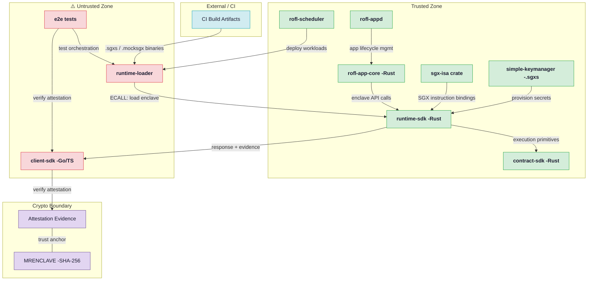

# TEE Usage Audit Report: oasis-sdk

## Executive Summary
This audit identified **0 confirmed vulnerabilities**, **22 unresolved unknowns**, **2 confirmed positive guards**, and **4 dismissed false positives** across TEE primitives including SGX/TDX attestation, sealing, ECALL/OCALL boundaries, and key provisioning.

**Critical unknowns requiring resolution:**
- **U-01 (encode_result_ex)**: If `expose_failure=true` is reachable from any ECALL entry point, an attacker-controlled host could extract verbose enclave internal state through error messages. If unreachable, this poses no production risk. **Action**: Static call-graph analysis to confirm reachability; if reachable, enforce `expose_failure=false` in production builds.
- **U-INV-09 (ECALL parameter validation)**: Unverified whether host-provided inputs are validated at enclave boundaries, risking malformed-input attacks against enclave logic.
- **U-INV-03/U-INV-04**: Key manager mutual attestation and sealed-state epoch counter validation not confirmed in provided code.
- **U-INV-07**: ROFL scheduler TDX artifact hash verification before VM launch is unconfirmed.

**Confirmed positive guards**: PG3-U-INV-01 (SGX tooling enforces real MRENCLAVE, not mock), PG-U-INV-12 (encrypted call format protects secrets in transit).

**Test-infrastructure notes**: RV3-U-INV-10 and RV3-U-INV-12 are test-only observations with weak confidence—RV3-U-INV-12 addresses test key hygiene, not TEE primitive misuse on trust boundaries. These are fenced from production risk assessment.

**Out of scope**: Side-channel analysis (timing, cache, power), physical attacks, firmware-level compromises, supply chain integrity.

**Priority recommendations**:
1. Resolve U-01 reachability; harden if production-path is confirmed
2. Audit ECALL input validation at all entry points (U-INV-09)
3. Verify attestation binding and seal key derivation logic (U-INV-03, U-INV-11)
4. Confirm TDX artifact verification in ROFL scheduler (U-INV-07)
5. Validate taxonomy assignments for unknowns against evidence before treating as categorized findings

## Dashboard Summary

| Severity | Trust-Path Tier | Count |
| --- | --- | --- |
| — | — | **0** |

_No TEE usage issues identified._

## Trust Boundary Analysis

| Actor | Component | Context | Boundary Type |
| --- | --- | --- | --- |
| runtime-sdk | Core SGX enclave runtime SDK (Rust) | trusted | enclave/internal |
| contract-sdk | Smart contract SDK with crypto/storage/types | trusted | enclave/internal |
| rofl-app-core | ROFL off-chain logic library for SGX | trusted | enclave/internal |
| simple-keymanager | Dedicated key management SGX enclave (.sgxs) | trusted | enclave/host |
| sgx-isa | Intel SGX instruction set bindings (Rust crate) | trusted | crypto boundary |
| rofl-appd | ROFL application daemon (Rust) | trusted | enclave/internal |
| rofl-scheduler | ROFL workload scheduling and deployment | trusted | enclave/host |
| client-sdk | Client libraries (Go/TypeScript) for runtime interaction | untrusted | network |
| oasis-core-runtime-loader | Host-side SGX enclave loader and manager | untrusted | enclave/host |
| e2e-tests | End-to-end test infrastructure (mock + real SGX) | untrusted | testing/validation |
| MRENCLAVE | SHA-256 enclave identity measurement | trusted | crypto boundary |

## Architecture Diagrams

### System Architecture with Trust Boundaries
The system is built around Intel SGX enclaves using the Fortanix toolchain (x86_64-fortanix-unknown-sgx), where trusted code — runtime-sdk, contract-sdk, rofl-app-core, rofl-appd, and the simple-keymanager enclave — executes within hardware-isolated SGX enclaves, while untrusted host-side components (oasis-core-runtime-loader, client-sdk) manage enclave loading and external communication. The primary trust boundary is enforced at the enclave/host interface: the runtime-loader performs ECALLs to load enclave binaries, and the Go/TypeScript client-sdk must independently verify attestation evidence anchored to MRENCLAVE SHA-256 measurements before trusting enclave responses. A dedicated key manager enclave provisions secrets to runtime enclaves, and rofl-scheduler orchestrates ROFL off-chain workload deployment across this boundary, with both mock and real SGX modes validated through end-to-end tests.

### Trust Boundary Narrative

The trusted boundary centers on **Mock SGX / Real SGX Boundary — build configuration to enclave measurement**, **Host/Enclave Boundary — OCALL return values from host to enclave**, **Key Manager / Runtime Enclave Boundary — secret provisioning channel**, **Host/Enclave Boundary — sealed state persistence and restoration**, **Client / Runtime Boundary — attestation verification to key trust establishment**. The analysis identified 12 invariants governing trust path integrity.

**Trust Paths Identified:**
- `INV-01`: Mock SGX / Real SGX Boundary — build configuration to enclave measurement — The debug-mock-sgx feature flag must not be enabled in production SGX enclave builds, as it substitutes deterministic SHA-256-based MRENCLAVE values for real hardware measurements, completely bypassing TEE attestation guarantees.
- `INV-02`: Host/Enclave Boundary — OCALL return values from host to enclave — Data returned from OCALLs (untrusted host) must not flow into enclave security-critical operations — such as key derivation, policy decisions, or measurement fields — without explicit validation.
- `INV-03`: Key Manager / Runtime Enclave Boundary — secret provisioning channel — Key material exchange between the simple-keymanager enclave and runtime enclaves requires verified mutual attestation — both parties must confirm each other's MRENCLAVE before any secret is released or accepted.
- `INV-04`: Host/Enclave Boundary — sealed state persistence and restoration — Sealed state must be cryptographically bound to a monotonic epoch or version counter that prevents rollback — unsealed blobs from the host filesystem cannot be accepted without verifying they represent the latest known state.
- `INV-05`: Client / Runtime Boundary — attestation verification to key trust establishment — The attestation report_data field must be cryptographically bound to any key material released or derived as a result of that attestation, preventing key-quote substitution attacks.
- `INV-06`: Client / Runtime Boundary — external client to enclave trust establishment — Client SDKs must perform complete attestation verification — including quote signature validation, TCB status checking, MRENCLAVE comparison against expected values, and collateral freshness — before trusting any enclave response.
- `INV-07`: ROFL Scheduler / TDX Instance Boundary — VM launch configuration — TDX firmware, kernel, and initrd artifacts resolved by rofl-scheduler must be integrity-verified against their expected hashes before being used to launch a TEE instance — unverified artifacts enable supply-chain compromise of the trusted computing base.
- `INV-08`: Host/Enclave Boundary — enclave error/response output to host — Error messages and response metadata propagated from enclave to untrusted host must be sanitized to prevent leakage of internal enclave state, secret-dependent processing paths, or TEE configuration details.
- `INV-09`: Host/Enclave Boundary — ECALL parameter passing from host to enclave — ECALL parameters provided by the untrusted host must be validated at enclave entry points before being used in any security-sensitive operation — the host is outside the TCB and can supply arbitrary data.
- `INV-10`: ROFL Enclave / On-chain Registration Boundary — identity binding across on-chain and off-chain domains — The ROFL off-chain enclave identity (MRENCLAVE/MRSIGNER) must be cryptographically bound to its on-chain registration so that attestation from an unregistered or substituted enclave is rejected.
- `INV-11`: Host/Enclave Boundary — sealed state protection against unauthorized unsealing — Sealed data must be bound to the creating enclave's identity (MRENCLAVE or MRSIGNER seal policy) so that only the legitimate enclave can unseal it — cross-enclave unsealing must be prevented.
- `INV-12`: End-to-end trust chain — from key manager enclave through runtime enclave to client — The trust model must ensure that all secret material (private keys, master secrets, user data) is only derivable or accessible within the TEE boundary — no trust path should allow secret derivation to bypass the enclave.

### Data Flow Summary

Of 12 invariants, **12** involve data crossing the trust boundary between enclave and host.

**Bidirectional** (12 flows)
_Flows crossing the boundary in both directions_
- `INV-01`: **debug-mock-sgx feature flag** → **MRENCLAVE measurement computation**
- `INV-02`: **OCALL return values** → **key derivation input**
- `INV-03`: **runtime enclave attestation quote presented to keymanager** → **key material release from keymanager**
- `INV-04`: **unsealed blob from host filesystem** → **state restoration in enclave initialization**
- `INV-05`: **attestation quote report_data field** → **key release decision**
- `INV-06`: **attestation quote received from network/node** → **client trust decision for runtime response**
- `INV-07`: **firmware URL resolved from rofl.yaml or artifacts map** → **TDX VM launch configuration**
- `INV-08`: **enclave internal error states** → **OCALL error response to host**

### Invariant Reference

| ID | Description | Trust Path |
| --- | --- | --- |
| INV-01 | The debug-mock-sgx feature flag must not be enabled in production SGX enclave builds, as it substitutes deterministic SHA-256-based MRENCLAVE values for real hardware measurements, completely bypassing TEE attestation guarantees. | Mock SGX / Real SGX Boundary — build configuration to enclave measurement |
| INV-02 | Data returned from OCALLs (untrusted host) must not flow into enclave security-critical operations — such as key derivation, policy decisions, or measurement fields — without explicit validation. | Host/Enclave Boundary — OCALL return values from host to enclave |
| INV-03 | Key material exchange between the simple-keymanager enclave and runtime enclaves requires verified mutual attestation — both parties must confirm each other's MRENCLAVE before any secret is released or accepted. | Key Manager / Runtime Enclave Boundary — secret provisioning channel |
| INV-04 | Sealed state must be cryptographically bound to a monotonic epoch or version counter that prevents rollback — unsealed blobs from the host filesystem cannot be accepted without verifying they represent the latest known state. | Host/Enclave Boundary — sealed state persistence and restoration |
| INV-05 | The attestation report_data field must be cryptographically bound to any key material released or derived as a result of that attestation, preventing key-quote substitution attacks. | Client / Runtime Boundary — attestation verification to key trust establishment |
| INV-06 | Client SDKs must perform complete attestation verification — including quote signature validation, TCB status checking, MRENCLAVE comparison against expected values, and collateral freshness — before trusting any enclave response. | Client / Runtime Boundary — external client to enclave trust establishment |
| INV-07 | TDX firmware, kernel, and initrd artifacts resolved by rofl-scheduler must be integrity-verified against their expected hashes before being used to launch a TEE instance — unverified artifacts enable supply-chain compromise of the trusted computing base. | ROFL Scheduler / TDX Instance Boundary — VM launch configuration |
| INV-08 | Error messages and response metadata propagated from enclave to untrusted host must be sanitized to prevent leakage of internal enclave state, secret-dependent processing paths, or TEE configuration details. | Host/Enclave Boundary — enclave error/response output to host |
| INV-09 | ECALL parameters provided by the untrusted host must be validated at enclave entry points before being used in any security-sensitive operation — the host is outside the TCB and can supply arbitrary data. | Host/Enclave Boundary — ECALL parameter passing from host to enclave |
| INV-10 | The ROFL off-chain enclave identity (MRENCLAVE/MRSIGNER) must be cryptographically bound to its on-chain registration so that attestation from an unregistered or substituted enclave is rejected. | ROFL Enclave / On-chain Registration Boundary — identity binding across on-chain and off-chain domains |
| INV-11 | Sealed data must be bound to the creating enclave's identity (MRENCLAVE or MRSIGNER seal policy) so that only the legitimate enclave can unseal it — cross-enclave unsealing must be prevented. | Host/Enclave Boundary — sealed state protection against unauthorized unsealing |
| INV-12 | The trust model must ensure that all secret material (private keys, master secrets, user data) is only derivable or accessible within the TEE boundary — no trust path should allow secret derivation to bypass the enclave. | End-to-end trust chain — from key manager enclave through runtime enclave to client |

## Taxonomy Summary

| Category | Count | Findings |
| --- | --- | --- |
| Output & Metadata Leakage | 1 | V-01 |

## Positive Guards (Confirmed Security Controls)

### PG3-U-INV-01: SGX tooling uses real MRENCLAVE
- **Invariants**: INV-01
- **Completeness**: partial
- **Evidence**: tools/orc/main.go: showSgxComponent calls bnd.MrEnclave(comp.ID()) for real measurement; constructSigstruct builds authentic SIGSTRUCT; sigstruct.Verify validates signatures against real keys

The orc bundle tooling computes MRENCLAVE from actual SGX binaries via bnd.MrEnclave(comp.ID()) and constructs real SIGSTRUCTs with proper attribute handling including AttributeDebug. No mock or deterministic SHA-256 substitution path exists in this signing toolchain.

### PG-U-INV-12: Encrypted call format protects secrets
- **Invariants**: INV-12
- **Completeness**: partial
- **Evidence**: tests/e2e/evm/tests.go:41-55

The confidential call format CallFormatEncryptedX25519DeoxysII is used to encrypt transaction data (including sensitive call parameters) before submission to the runtime, ensuring that secret material in transit is only decryptable within the TEE boundary. The test code also shows that gas estimation is explicitly disabled for confidential transactions, preventing information leakage through gas side-channels.

## Dismissed Findings

_The following findings were dismissed during adversarial review._

### ~~V-01: Plaintext error leak in confidential tx result encoding~~
- **Original Severity**: Low
- **Dismissal Reason**: Adversarial review: false positive. False positive: The 'leak' occurs only when expose_failure=true is explicitly set, which is intentional design behavior. Error responses to the transaction submitter about their own transaction failure do not constitute a confidentiality breach. No cross-user information leakage or sensitive data exfiltration is demonstrated. This is standard error handling, not a vulnerability.
- **Location(s)**: `runtime-sdk/src/callformat.rs:248`, `runtime-sdk/src/callformat.rs:254`, `runtime-sdk/src/callformat.rs:257`, `rofl-client/rs/src/lib.rs:1`, `rofl-client/rs/src/lib.rs:449`

### ~~RV3-U-INV-10: Attestation binding absent from test infra~~
- **Original Severity**: Info
- **Dismissal Reason**: Adversarial review: false positive. Entirely test code (tests/e2e/scenario/scenario.go). Test infrastructure is not a production attack surface. Has no trust boundary trace. The attack path describes a hypothetical scenario about missing on-chain registration verification but points only at a test file. Dismissed.
- **Location(s)**: `tests/e2e/scenario/scenario.go:168`

### ~~RV3-U-INV-12: Test Secret Key Material In Plaintext~~
- **Original Severity**: Info
- **Dismissal Reason**: Adversarial review: false positive. Entirely test code (tests/e2e/evm/tests.go). The attack path itself admits the condition 'If test keys matched production keys'—which they do not, by definition. Test code handling test keys is expected behavior. Has no trust boundary trace. Dismissed.
- **Location(s)**: `tests/e2e/evm/tests.go:131`

### ~~RV-U-INV-06: Client SDKs lack attestation verification~~
- **Original Severity**: Info
- **Dismissal Reason**: Adversarial review: false positive. All code locations are test files (tests/e2e/evm/tests.go, tests/e2e/base/tests.go, tests/e2e/contracts/tests.go). Despite the title claiming 'Client SDKs lack attestation verification,' the actual evidence points exclusively to test harnesses that are designed to test functionality, not perform attestation validation. Has no trust boundary trace. Dismissed.
- **Location(s)**: `tests/e2e/evm/tests.go:41`, `tests/e2e/base/tests.go:1`, `tests/e2e/contracts/tests.go:1`

## Appendix

_Info-severity TEE findings, items requiring manual review, and non-TEE findings are included here for completeness._

### Items Requiring Manual Review

#### U-01: expose_failure callers in production paths

Whether encode_result_ex is called with expose_failure=true in any production code path reachable from ECALL entry points.
- **Why Uncertain**: The call chain confirms encode_result_ex is reachable from ECALL dispatch, but the specific callers that pass expose_failure=true were not fully visible in the provided code context. The default encode_result wrapper passes false, but encode_result_ex is public and documented for the expose_failure=true use case.

Second-pass notes: The additional source code provided (test infrastructure in Go, scenario definitions, test vector generators, README files) does not contain any evidence about the `debug-mock-sgx` feature flag gating, MRENCLAVE measurement logic, or `encode_result_ex` call sites with `expose_failure=true`. All additional files are Go test/tooling code, while the invariant concerns Rust SGX enclave build configuration. No evidence found in either direction to resolve the invariant.
- **Recommended Steps**: Search all call sites of encode_result_ex across the codebase, Verify which callers pass expose_failure=true, For each such caller, assess whether the error details leaked are security-sensitive, Confirm whether these paths are reachable from external transaction submission

#### U-INV-02: OCALL validation not assessable

Test files and docs for OCALL return value validation guards.
- **Why Uncertain**: All provided files are in tests/ directories or docs; no production enclave OCALL handling code was available for analysis.

Second-pass notes: The additional source code provided does not contain production enclave OCALL dispatch handlers, key derivation/attestation code paths, or EDL/bridge files. The files are: (1) tools/orc/main.go — an offline tool for constructing and signing SGX SIGSTRUCTs, not enclave runtime code; (2) tests/e2e/base/tests.go, tests/e2e/evm/*.go — client-side Go end-to-end test code that submits transactions and verifies results from outside the enclave. None of these files contain enclave-side Rust source, OCAL
- **Recommended Steps**: Provide enclave Rust source with OCALL dispatch handlers, Include key derivation and attestation code paths, Show EDL/bridge files defining OCALL interfaces

#### U-INV-03: Mutual MRENCLAVE attestation for key exchange

Key manager to runtime enclave attestation and key provisioning logic
- **Why Uncertain**: Provided code is test infrastructure only; actual enclave attestation and key exchange logic not present in these files

Second-pass notes: The additional source code provided (test infrastructure in tests/e2e/{base,evm,contracts}/tests.go, the orc bundle tool in tools/orc/main.go, and the TypeScript SDK reflector in client-sdk/ts-web/core/reflect-go/main.go) still does not contain the actual enclave attestation or key exchange logic. Key observations from new code: (1) tools/orc/main.go confirms SGX signing workflow exists (sgxSignatureFn, ISV fields) but is a build/packaging tool, not runtime attestation enforcement. (2) tests/e2e
- **Recommended Steps**: Review keymanager enclave Rust source for MRENCLAVE verification, Review runtime enclave secret-reception code for peer attestation, Inspect go/keymanager/api and go/runtime/enclave paths

#### U-INV-04: Sealed state rollback protection

Sealed state unseal paths for monotonic epoch/version counter verification
- **Why Uncertain**: All provided source files are test/benchmark code; no production sealing/unsealing logic was included for review

Second-pass notes: The additional source code provided consists entirely of test/benchmark fixtures (tests/e2e/evm/tests.go, tests/e2e/base/tests.go, tests/benchmark/cmd/fixture.go, tests/e2e/contracts/tests.go), a Go reflection tool for TypeScript code generation (client-sdk/ts-web/core/reflect-go/main.go), and documentation. None of these files contain production sealing/unsealing Rust source code from the runtime-sdk, enclave state restoration logic, or ROFL app state persistence mechanisms. The recommended ste
- **Recommended Steps**: Provide runtime-sdk sealing/unsealing Rust source files, Check enclave state restoration code for counter validation, Review ROFL app state persistence mechanism

#### U-INV-05: report_data-to-key binding not in test files

E2E test files for attestation report_data to key binding enforcement.
- **Why Uncertain**: All provided files are test harnesses (tests/e2e/) with no attestation or key binding logic present.

Second-pass notes: All additional source code provided remains test harness infrastructure (e2e test helpers, benchmark entry points, scenario registration, EVM test utilities). None of the files contain attestation logic, quote verification, report_data field construction, or key derivation/binding code. The recommended steps from the first pass (review runtime-sdk TEE attestation implementation, check client-sdk quote verification and key derivation, examine runtime signing key enrollment flow) have not been add
- **Recommended Steps**: Review runtime-sdk TEE attestation implementation, Check client-sdk quote verification and key derivation, Examine runtime signing key enrollment flow

#### U-INV-07: TDX artifact hash verification

Whether rofl-scheduler verifies TDX artifact hashes before launch.
- **Why Uncertain**: All provided source files are test fixtures (tests/e2e/, tests/benchmark/) — no rofl-scheduler or TDX launch code was supplied for analysis.

Second-pass notes: The additional source code provided consists entirely of e2e test infrastructure (transaction helpers, contract tests, EVM tests, ROFL module CRUD tests) and the rofl-scheduler README configuration documentation. None of these files contain the rofl-scheduler's actual TDX artifact resolution, VM launch configuration, or hash comparison logic. The rofl-scheduler README only describes YAML configuration (provider address, offers, capacity) and deployment identifiers, with no mention of artifact ha
- **Recommended Steps**: Provide rofl-scheduler TDX artifact resolution code, Provide VM launch configuration and hash comparison logic, Check rofl-appd artifact download and verification paths

#### U-INV-08: Enclave error sanitization unverifiable

Error propagation paths from test clients through SDK to runtime boundary.
- **Why Uncertain**: All provided files are test code (tests/e2e/, tests/benchmark/); no enclave boundary or runtime source code was supplied for analysis.

Second-pass notes: The additional source code provided (tools/orc/main.go, tests/benchmark/cmd/*.go, tests/e2e/scenario/scenario.go) consists entirely of offline tooling, test infrastructure, and benchmark fixtures. None of these files contain the enclave boundary dispatch logic, error mapping code, or host-enclave FFI interface (e.g., runtime-sdk/src/dispatch/, enclave entry points, map_err/sanitization at the boundary). The invariant about sanitizing error messages propagated from enclave to untrusted host canno
- **Recommended Steps**: Provide runtime Rust source (e.g., runtime-sdk/src/dispatch/), Provide enclave entry point and error mapping code, Check map_err/sanitization at host-enclave FFI boundary

#### U-INV-09: ECALL input validation not assessable

ECALL parameter validation at enclave entry points from host-provided data.
- **Why Uncertain**: All provided source files are test infrastructure (tests/e2e/, tests/benchmark/); actual ECALL boundary code in Rust runtimes was not supplied.

Second-pass notes: The additional source code provided (tests/e2e/base/tests.go, tests/e2e/evm/tests.go, tools/orc/main.go, client-sdk/ts-web/core/reflect-go/main.go, tests/benchmark/cmd/fixture.go) is entirely test infrastructure, a packaging/signing utility, and a code generation tool. None of these files contain ECALL boundary code, Rust runtime dispatch logic, or enclave entry-point input validation. The actual ECALL handler code (e.g., runtime/src/main.rs, oasis-core-runtime-loader ECALL shim, simple-keyvalue
- **Recommended Steps**: Provide Rust runtime ECALL handler code (e.g., runtime/src/main.rs), Review dispatch methods in simple-keyvalue/runtime for input guards, Check oasis-core-runtime-loader ECALL shim for validation

#### U-INV-11: Seal policy binding verification

Seal policy selection and enclave identity binding in sealed data operations.
- **Why Uncertain**: All provided source files are test infrastructure (tests/ directory); production seal/unseal implementation not included for review.

Second-pass notes: The additional source code still does not include the production seal/unseal implementation. The new files are: (1) e2e test infrastructure (tests/e2e/base/tests.go, contracts/tests.go, evm/tests.go, scenario/scenario.go) which test transaction submission, gas estimation, and confidential KV operations but contain no seal policy logic; (2) tools/orc/main.go which handles SGX SIGSTRUCT construction and bundle signing at build time, not runtime sealing; (3) README files. The orc tool deals with co
- **Recommended Steps**: Provide runtime/enclave seal key derivation code, Provide MRENCLAVE/MRSIGNER policy selection logic, Check runtime sealing Rust source files

#### U-INV-01: Mock SGX feature flag gating

Whether debug-mock-sgx feature flag is prevented in production enclave builds.
- **Why Uncertain**: Provided source files are all under tests/ and contain no reference to debug-mock-sgx, MRENCLAVE, or SGX attestation logic.

Second-pass notes: The additional source code still does not contain the Rust enclave Cargo.toml or any Rust source defining the debug-mock-sgx feature flag. tools/orc/sgx.go shows SIGSTRUCT construction using real MRENCLAVE from the bundle (bnd.MrEnclave), which is proper. The debug flag in sgx.go (line 52-55) controls the SGX AttributeDebug bit in SIGSTRUCT, not a mock-MRENCLAVE feature. Test fixtures (benchmark/cmd/fixture.go) use TEEHardwareInvalid and RuntimeProvisionerUnconfined, which is expected for test e
- **Recommended Steps**: Inspect enclave Cargo.toml for debug-mock-sgx feature definition, Check CI pipelines for feature flag gating on SGX targets, Verify runtime loader rejects mock MRENCLAVE values

#### U-INV-10: ROFL enclave identity binding verification

ROFL enclave MRENCLAVE/MRSIGNER binding to on-chain registration in provided code.
- **Why Uncertain**: Provided code is limited to test files (tests/e2e/*, tests/benchmark/*) and rofl-scheduler README; no production ROFL attestation or registration verification logic included.

Second-pass notes: The additional code still does not contain the critical on-chain attestation verification logic. tools/orc/main.go handles SIGSTRUCT construction/signing (build-time), confirming MRSIGNER/MRENCLAVE concepts exist in the build pipeline. tests/e2e/rofl/tests.go shows ROFL app lifecycle (create/update/remove) and instance registration with RAK fields, but exercises no attestation verification path where enclave identity is compared against on-chain registration. The production runtime-sdk/modules/r
- **Recommended Steps**: Provide runtime-sdk/modules/rofl/ attestation verification code, Provide on-chain ROFL registration identity comparison logic, Provide enclave quote parsing and MRENCLAVE extraction code

#### U-INV-12: TEE secret boundary enforcement

Client SDK type definitions for secret material handling paths.
- **Why Uncertain**: Provided source is only TypeScript type definitions in client SDK; no runtime enclave or key derivation logic available to verify TEE boundary enforcement.

Second-pass notes: The additional source code provided consists exclusively of E2E test infrastructure (Go), a TypeScript binding generator, and documentation. None of the three recommended verification targets are present: (1) No runtime-sdk Rust key derivation or secret handling code, (2) No key manager enclave protocol or secret export guard code, (3) No client-side attestation chain verification logic. The closest evidence is the use of CallFormatEncryptedX25519DeoxysII in tests/e2e/evm/tests.go:41 which indic
- **Recommended Steps**: Review runtime-sdk Rust key derivation and secret handling code, Examine key manager enclave protocol for secret export guards, Verify client-side attestation verifies complete enclave chain

#### U-INV-02: OCALL return validation in production enclave

OCALL return value handling in enclave security-critical paths.
- **Why Uncertain**: All provided source files are test code or documentation; no production enclave OCALL handlers shown.
- **Recommended Steps**: Provide runtime/enclave Rust source with OCALL definitions, Provide key derivation and attestation code paths, Check runtime-sdk/src/ for host callback handling

#### U-INV-03: Attestation logic not in provided code

Key manager enclave and runtime enclave mutual attestation during secret provisioning.
- **Why Uncertain**: Provided code is entirely test fixtures, test helpers, and config; no keymanager enclave or attestation verification logic present.
- **Recommended Steps**: Inspect oasis-core keymanager/api and runtime/enclaverpc packages, Review oasis-core/go/keymanager/ for MRENCLAVE verification, Check runtime secret replication and provisioning handlers

#### U-INV-04: Sealed state anti-rollback enforcement

Whether sealed state unseal path validates monotonic epoch/version counters.
- **Why Uncertain**: All provided source is test/benchmark code; no production sealing/unsealing logic was included for review.
- **Recommended Steps**: Provide runtime-sdk enclave sealing/unsealing Rust source for analysis, Check runtime-sdk/src/core/storage for sealed state version binding, Review monotonic counter usage in enclave state restoration paths

#### U-INV-05: Attestation-to-key binding not visible

Test code for confidential call formats and transaction signing in e2e tests.
- **Why Uncertain**: Provided code is entirely test infrastructure (tests/e2e/); attestation quote verification and report_data-to-key binding logic reside in client-sdk/runtime-sdk core libraries not included in the sample.
- **Recommended Steps**: Examine client-sdk/go/crypto/attestation or TEE quote verification, Check runtime-sdk/src/attestation for report_data key binding, Review X25519-DeoxysII session key derivation for quote binding

#### U-INV-06: Attestation verification in client SDKs

ROFL Python and TypeScript client SDKs for attestation quote verification logic.
- **Why Uncertain**: Provided SDK source is truncated; no attestation logic visible but cannot confirm absence in full files.
- **Recommended Steps**: Provide full rofl_client.ts and Python client implementations, Search for quote_verify, mrenclave, tcb_status in SDK sources, Check if attestation is handled by a separate oasis client library

#### U-INV-07: TDX artifact hash verification absent in provided code

Test fixtures and scenario configs for TDX artifact integrity verification before VM launch.
- **Why Uncertain**: All provided files are test infrastructure under tests/; the actual rofl-scheduler TDX launch and artifact resolution code is not included.
- **Recommended Steps**: Provide rofl-scheduler TDX instance launch code, Provide artifact resolution and hash comparison logic, Check rofl.yaml parsing with #sha256 fragment handling

#### U-INV-08: Enclave error sanitization not reviewable

Enclave-to-host error propagation paths in provided source files.
- **Why Uncertain**: All provided files are test/benchmark code under tests/; no production enclave boundary error handling code was supplied for review.
- **Recommended Steps**: Provide runtime-sdk Rust source for enclave dispatch/response handling, Review error mapping at ffi_dispatch and RIEL call boundaries, Check map_err usage in runtime-sdk/src/modules/ and dispatch.rs

#### U-INV-09: No ECALL boundary code provided

Whether ECALL parameters are validated at enclave entry points.
- **Why Uncertain**: All provided files are test code under tests/; no production enclave ECALL handlers or boundary code was supplied for analysis.
- **Recommended Steps**: Provide enclave Rust source with ECALL dispatch handlers, Provide runtime/src/ or similar enclave boundary modules, Look for extern C entry points or dispatch tables

#### U-INV-10: ROFL enclave identity binding verification

ROFL MRENCLAVE/MRSIGNER binding to on-chain registration in provided source files.
- **Why Uncertain**: Provided code is test infrastructure, benchmarks, and README docs; no ROFL attestation verification or registration binding logic included.
- **Recommended Steps**: Provide runtime-sdk rofl module source with quote verification, Provide on-chain rofl registration dispatch code, Provide enclave identity comparison logic in rofl-scheduler

#### U-INV-11: Seal policy binding verification inconclusive

Seal key derivation and MRENCLAVE/MRSIGNER binding in enclave sealing code
- **Why Uncertain**: All provided source files are test fixtures and e2e test code; production sealing/unsealing logic not present in reviewed code
- **Recommended Steps**: Review enclave sealing Rust code in runtime bundle, Check seal key derivation in go/common/sgx/ or runtime/, Verify MRENCLAVE binding in unseal implementation
