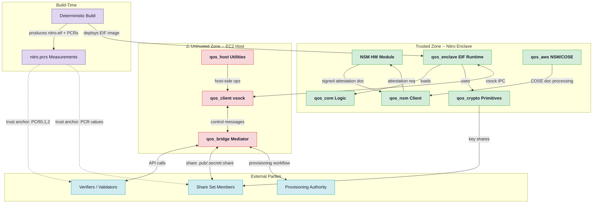

# TEE Usage Audit Report: qos

## Executive Summary
This TEE audit identified 3 active findings: 1 High (IV-INV-02), 1 Low (RV-U-INV-12), and 1 Info (IV-INV-11). 9 positive guards were confirmed (8 partial, 1 complete), with 4 findings dismissed after adversarial review and 2 areas remaining unknown.

**Critical Vulnerability**:
- IV-INV-02 (High): Missing attestation timestamp freshness check enables replay attacks. No validation exists to reject stale attestation documents.

**Actionable Recommendations**:
- Implement strict timestamp window validation for attestation documents
- Remediate IV-INV-11 error variant leakage of PCR values and key material
- Replace filesystem-cached enclave-info key (RV-U-INV-12) with live attestation verification
- Resolve unknowns U-INV-10 and U-INV-01 related to build determinism and PCR verification paths

## Dashboard Summary

| Severity | Trust-Path Tier | Count |
| --- | --- | --- |
| High | core | 1 |
| Low | core | 1 |
| Info | core | 1 |

## Trust Boundary Analysis

| Actor | Component | Context | Boundary Type |
| --- | --- | --- | --- |
| NSM Hardware Module | nitro_security_module | trusted | hardware trust anchor |
| qos_enclave Runtime | qos_enclave | trusted | enclave boundary |
| Core Logic Library | qos_core | trusted | enclave internal |
| NSM Client/COSE | qos_nsm | trusted | enclave-to-hardware |
| AWS Nitro Integration | qos_aws | trusted | enclave internal |
| Cryptographic Primitives | qos_crypto | trusted | crypto boundary |
| Enclave Init | qos_init | trusted | enclave bootstrap |
| Host Client | qos_client | untrusted | enclave/host vsock IPC |
| External Mediator | qos_bridge | untrusted | network boundary |
| Host Utilities | qos_host | mixed | enclave/host bridge |
| Share Set Members | share_provisioning_files | untrusted | storage/crypto boundary |
| Deterministic Build | containerfile_build | trusted | build-time reproducibility |

## Architecture Diagrams

### System Architecture with Trust Boundaries
QuorumOS deploys a Nitro TEE-based enclave architecture where the trusted core (qos_enclave, qos_core, qos_nsm, qos_crypto) runs inside an AWS Nitro Enclave EIF, isolated from the untrusted EC2 host running qos_client and qos_bridge. The Nitro Security Module (NSM) serves as the hardware root of trust, producing signed attestation documents containing PCR measurements that external verifiers and Share Set Members validate against deterministic build outputs. Communication between trusted and untrusted zones crosses a vsock IPC boundary, while qos_bridge mediates all external network-facing interactions with validators, key managers, and governance participants.



### Trust Boundary Narrative

The trust boundary separates enclave-side components (**Share Set Member attestation verification**, **Nitro attestation document PCR fields**, **attestation acceptance decision**, **Attestation document reception**, **attestation acceptance**) from host-side components (**untrusted network**, **EC2 host**, **certificate chain extraction**, **EC2 host (qos_client)**, **host**). Data and control flow across this boundary via the invariants listed below.

**Trust Paths Identified:**
- `INV-01`: Share Set Member attestation verification → Nitro attestation document PCR fields → attestation acceptance decision — All PCR values (PCR0, PCR1, PCR2) in the attestation document must be verified against expected measurements before accepting the attestation as trustworthy.
- `INV-02`: Attestation document reception → timestamp validation → attestation acceptance — Attestation document timestamp must be checked for freshness to prevent replay of stale attestation documents from previous enclave sessions.
- `INV-03`: NSM attestation document → ephemeral key extraction → key usage for share encryption — The ephemeral public key extracted from the attestation document must be cryptographically bound to the attestation (i.e., extracted from the verified document, not from a separate untrusted channel).
- `INV-04`: NSM attestation document user_data → manifest hash extraction → manifest acceptance — The manifest hash embedded in the attestation document's user_data field must be verified against the expected manifest before the attestation is accepted.
- `INV-05`: Share Set Member → share encryption → untrusted network → EC2 host → vsock → enclave — Share Set Members must encrypt their shares exclusively to the ephemeral key extracted from a freshly verified attestation document, never to a key received through the untrusted host channel.
- `INV-06`: Nitro attestation document → certificate chain extraction → signature verification → root CA trust anchor — The Nitro Attestation PKI certificate chain in the attestation document must be fully verified to the root CA before accepting the attestation.
- `INV-07`: EC2 host (qos_client) → vsock channel → qos_enclave request handler — Data received by the enclave from the host via vsock must be validated before being used in security-critical decisions such as Quorum Key reconstruction or share processing.
- `INV-08`: Quorum Key reconstruction inside enclave → vsock response → EC2 host — The reconstructed Quorum Key must never be transmitted to the host unencrypted or in plaintext form across the vsock boundary.
- `INV-09`: Enclave NSM attestation request → ephemeral key generation → attestation document issuance — The enclave must request a fresh attestation document from the NSM for each provisioning session, embedding a newly generated ephemeral key, rather than reusing cached attestation documents.
- `INV-10`: Source code → deterministic build (StageX) → EIF image → PCR measurements → attestation verification reference — The build system must produce deterministic EIF images so that PCR values are reproducible and match the expected measurements used by Share Set Members for attestation verification.
- `INV-11`: Enclave internal error/state → vsock response → host → network — Error messages and response metadata from the enclave must not reveal secret-dependent state, key material, or internal configuration details to the untrusted host.
- `INV-12`: NSM live attestation document → ephemeral key extraction → /enclave-info response — The /enclave-info endpoint must only return the ephemeral public key that is freshly extracted from the live attestation document, not from a cached or host-controllable source.

### Data Flow Summary

Of 12 invariants, **9** involve data crossing the trust boundary between enclave and host.

**Host → Enclave** (1 flow)
_External data entering the TEE — highest validation burden_
- `INV-07`: **vsock request body from host client** → **Share decryption and processing**

**Enclave → Host** (2 flows)
_TEE outputs and secrets leaving the enclave — leakage risk_
- `INV-08`: **Reconstructed Quorum Key in enclave memory** → **vsock response body to host**
- `INV-11`: **Enclave internal error states** → **vsock response body to host**

**Bidirectional** (6 flows)
_Flows crossing the boundary in both directions_
- `INV-01`: **Nitro attestation document PCR fields** → **Attestation acceptance/trust decision**
- `INV-02`: **Nitro attestation document timestamp field** → **Attestation acceptance decision**
- `INV-03`: **Ephemeral public key from attestation document** → **Share encryption target**
- `INV-05`: **Share secret material held by Share Set Members** → **Share transmission over network to EC2 host**
- `INV-06`: **COSE signature block in attestation document** → **Attestation acceptance decision**
- `INV-10`: **Build configuration flags and environment** → **EIF image with PCR measurements**

**Boundary Interface Summary:**
- **Enclave entry points** (1): data enters TEE via `INV-07`
- **Enclave exit points** (2): data leaves TEE via `INV-08`, `INV-11`

_Internal flows (3): `INV-09`, `INV-12`, `INV-04` — these stay within a single zone and are covered by individual findings._

### Invariant Reference

| ID | Description | Trust Path |
| --- | --- | --- |
| INV-01 | All PCR values (PCR0, PCR1, PCR2) in the attestation document must be verified against expected measurements before accepting the attestation as trustworthy. | Share Set Member attestation verification → Nitro attestation document PCR fields → attestation acceptance decision |
| INV-02 | Attestation document timestamp must be checked for freshness to prevent replay of stale attestation documents from previous enclave sessions. | Attestation document reception → timestamp validation → attestation acceptance |
| INV-03 | The ephemeral public key extracted from the attestation document must be cryptographically bound to the attestation (i.e., extracted from the verified document, not from a separate untrusted channel). | NSM attestation document → ephemeral key extraction → key usage for share encryption |
| INV-04 | The manifest hash embedded in the attestation document's user_data field must be verified against the expected manifest before the attestation is accepted. | NSM attestation document user_data → manifest hash extraction → manifest acceptance |
| INV-05 | Share Set Members must encrypt their shares exclusively to the ephemeral key extracted from a freshly verified attestation document, never to a key received through the untrusted host channel. | Share Set Member → share encryption → untrusted network → EC2 host → vsock → enclave |
| INV-06 | The Nitro Attestation PKI certificate chain in the attestation document must be fully verified to the root CA before accepting the attestation. | Nitro attestation document → certificate chain extraction → signature verification → root CA trust anchor |
| INV-07 | Data received by the enclave from the host via vsock must be validated before being used in security-critical decisions such as Quorum Key reconstruction or share processing. | EC2 host (qos_client) → vsock channel → qos_enclave request handler |
| INV-08 | The reconstructed Quorum Key must never be transmitted to the host unencrypted or in plaintext form across the vsock boundary. | Quorum Key reconstruction inside enclave → vsock response → EC2 host |
| INV-09 | The enclave must request a fresh attestation document from the NSM for each provisioning session, embedding a newly generated ephemeral key, rather than reusing cached attestation documents. | Enclave NSM attestation request → ephemeral key generation → attestation document issuance |
| INV-10 | The build system must produce deterministic EIF images so that PCR values are reproducible and match the expected measurements used by Share Set Members for attestation verification. | Source code → deterministic build (StageX) → EIF image → PCR measurements → attestation verification reference |
| INV-11 | Error messages and response metadata from the enclave must not reveal secret-dependent state, key material, or internal configuration details to the untrusted host. | Enclave internal error/state → vsock response → host → network |
| INV-12 | The /enclave-info endpoint must only return the ephemeral public key that is freshly extracted from the live attestation document, not from a cached or host-controllable source. | NSM live attestation document → ephemeral key extraction → /enclave-info response |

## TEE Usage Problems

### [LOW] RV-U-INV-12: Enclave-info key from filesystem not live attestation [Binding Weakness] (incorrect_usage)

**Root Cause**: The ephemeral key is persisted to and read from the in-enclave filesystem via EphemeralKeyHandle rather than being freshly derived from a live NSM attestation call, and all observed code paths (e.g., provision.rs:93) use this filesystem-backed accessor.
**Impact**: A downstream relying party could receive a stale or tampered ephemeral public key, breaking the trust chain: encrypted payloads intended for the genuine enclave key could be sent to an attacker-controlled key, or attestation-based access control decisions could be subverted.
**Confidence**: Weak | **Invariant**: INV-12 | **Tier**: core

**Preconditions**:
- The /enclave-info handler uses state.handles.get_ephemeral_key() or equivalent filesystem read rather than invoking the NSM for a fresh attestation.
- An attacker has some ability to influence the ephemeral key file contents (e.g., via a VSOCK-mediated write or TOCTOU during rotation).

**Attack Scenario**:
  1. The /enclave-info endpoint handler is not present in code but all known ephemeral-key access paths use EphemeralKeyHandle, a filesystem-backed struct (handles.rs:42-44, ephemeral_key_path field). (`src/qos_core/src/handles.rs:42`)
  2. An attacker who can modify the in-enclave filesystem (e.g., via a compromised VSOCK channel or a TOCTOU race during key rotation) could replace the ephemeral key file on disk before the endpoint reads it. (`src/qos_core/src/protocol/services/provision.rs:93`)
  3. The endpoint would then return the attacker's injected public key instead of the authentic enclave ephemeral key, breaking the attestation binding for any downstream consumer relying on /enclave-info to learn the true enclave key.

### Code Evidence

**`src/qos_core/src/handles.rs:42`**
```
      32 | 	/// Errors if the Quorum Key has not been put.
      33 | 	pub fn get_quorum_key(&self) -> Result<P256Pair, ProtocolError> {
      34 | 		let pair = P256Pair::from_hex_file(&self.quorum)
      35 | 			.map_err(ProtocolError::FailedToGetQuorumKey)?;
      36 | 		Ok(pair)
      37 | 	}
      38 | }
      39 | 
      40 | /// Handle for accessing the enclave ephemeral key.
      41 | #[derive(Debug, Clone, Copy)]
>>>   42 | pub struct EphemeralKeyHandle<S = String> {
      43 | 	ephemeral_key_path: S,
      44 | }
      45 | 
      46 | impl<P> EphemeralKeyHandle<P>
      47 | where
      48 | 	P: AsRef<Path>,
      49 | {
      50 | 	/// Create a new instance of [`Self`].
      51 | 	#[must_use]
      52 | 	pub fn new(ephemeral_key_path: P) -> Self {
```
The /enclave-info endpoint handler is not present in code but all known ephemeral-key access paths use EphemeralKeyHandle, a filesystem-backed struct (handles.rs:42-44, ephemeral_key_path field).

**`src/qos_core/src/protocol/services/provision.rs:93`**
```
      83 | 			VersionedManifestEnvelope::V1(inner) => {
      84 | 				inner.share_set_approvals.push(approval);
      85 | 			}
      86 | 			VersionedManifestEnvelope::V0(inner) => {
      87 | 				inner.share_set_approvals.push(approval);
      88 | 			}
      89 | 		}
      90 | 		envelope
      91 | 	})?;
      92 | 
>>>   93 | 	let ephemeral_key = state.handles.get_ephemeral_key()?;
      94 | 
      95 | 	let share = ephemeral_key
      96 | 		.decrypt(encrypted_share)
      97 | 		.map_err(|_| ProtocolError::DecryptionFailed)?;
      98 | 
      99 | 	state.provisioner.add_share(share)?;
     100 | 
     101 | 	let quorum_threshold = manifest.share_set().threshold as usize;
     102 | 	if state.provisioner.count() < quorum_threshold {
     103 | 		// Nothing else to do if we don't have the threshold to reconstruct
```
An attacker who can modify the in-enclave filesystem (e.g., via a compromised VSOCK channel or a TOCTOU race during key rotation) could replace the ephemeral key file on disk before the endpoint reads it.

**Remediation**: The /enclave-info handler must call the NSM module to obtain a fresh attestation document (NsmResponse), extract the ephemeral public key from that live document, and return it—never reading the key via EphemeralKeyHandle from the filesystem. Locate the handler (likely in an HTTP router module not yet provided) and refactor it to use the NSM attestor directly.

### [HIGH] IV-INV-02: Missing attestation timestamp freshness check [Verification Gap] (incorrect_usage) (CWE-294)

**Root Cause**: Attestation request messages carry no nonce or challenge, and no freshness validation code or timestamp-related error types exist anywhere in the shown protocol layer.
**Impact**: An attacker can replay a previously valid attestation document from a decommissioned or compromised enclave, causing verifiers to accept stale identity proofs and potentially provision shares to unauthorized sessions.
**Confidence**: Likely | **Invariant**: INV-02 | **Tier**: core

**Preconditions**:
- Attacker can intercept or store a valid attestation document from a previous enclave session
- Verifier does not independently enforce timestamp freshness outside this codebase

**Attack Scenario**:
  1. Attacker captures valid attestation from a legitimate enclave session. (`src/qos_core/src/protocol/msg.rs:172`)
  2. Enclave is later decommissioned or compromised by a different party. (`src/qos_core/src/protocol/msg.rs:106`)
  3. Attacker replays the old attestation document to a verifier. (`src/qos_core/src/protocol/error.rs:11`)
  4. Verifier accepts stale attestation because no timestamp or nonce check exists.
  5. Share Set Members provision shares to the replayed enclave session.

### Code Evidence

**`src/qos_core/src/protocol/msg.rs:172`**
```
     162 | 	/// Response to the proxy request
     163 | 	ProxyResponse {
     164 | 		/// Encoded data the secure app responded with to the nitro enclave
     165 | 		/// server.
     166 | 		#[serde(with = "qos_hex::serde")]
     167 | 		data: Vec<u8>,
     168 | 	},
     169 | 
     170 | 	/// Request an attestation document that includes references to the
     171 | 	/// manifest (in `user_data`) and the ephemeral key (`public_key`).
>>>  172 | 	LiveAttestationDocRequest,
     173 | 	/// Response to live attestation document request.
     174 | 	LiveAttestationDocResponse {
     175 | 		/// COSE SIGN1 structure with Attestation Doc
     176 | 		nsm_response: NsmResponse,
     177 | 		/// Manifest Envelope, if it exists, otherwise None.
     178 | 		#[serde(default, skip_serializing_if = "Option::is_none")]
     179 | 		manifest_envelope: Option<Box<VersionedManifestEnvelope>>,
     180 | 	},
     181 | 
     182 | 	/// Execute a key forward attestation request
```
Attacker captures valid attestation from a legitimate enclave session.

**`src/qos_core/src/protocol/msg.rs:106`**
```
      96 | pub enum ProtocolMsg {
      97 | 	/// A error from executing the protocol.
      98 | 	ProtocolErrorResponse(ProtocolError),
      99 | 
     100 | 	/// Request the status of the enclave.
     101 | 	StatusRequest,
     102 | 	/// Response for [`Self::StatusRequest`]
     103 | 	StatusResponse(super::ProtocolPhase),
     104 | 
     105 | 	/// Execute Standard Boot.
>>>  106 | 	BootStandardRequest {
     107 | 		/// Manifest with approvals
     108 | 		manifest_envelope: Box<VersionedManifestEnvelope>,
     109 | 		/// Pivot binary
     110 | 		#[serde(with = "qos_hex::serde")]
     111 | 		pivot: Vec<u8>,
     112 | 	},
     113 | 	/// Response for Standard Boot.
     114 | 	BootStandardResponse {
     115 | 		/// Should be `[NsmResponse::Attestation`]
     116 | 		nsm_response: NsmResponse,
```
Enclave is later decommissioned or compromised by a different party.

**`src/qos_core/src/protocol/error.rs:11`**
```
       1 | //! Quorum protocol error
       2 | use borsh::{BorshDeserialize, BorshSerialize};
       3 | use qos_p256::P256Error;
       4 | 
       5 | use crate::{
       6 | 	client::ClientError,
       7 | 	io::IOError,
       8 | 	protocol::{ProtocolPhase, services::boot},
       9 | };
      10 | 
>>>   11 | /// A error from protocol execution.
      12 | #[derive(
      13 | 	Debug,
      14 | 	Clone,
      15 | 	PartialEq,
      16 | 	Eq,
      17 | 	BorshSerialize,
      18 | 	BorshDeserialize,
      19 | 	serde::Serialize,
      20 | 	serde::Deserialize,
      21 | )]
```
Attacker replays the old attestation document to a verifier.

**Remediation**: Add a nonce or challenge field to all attestation request messages (especially LiveAttestationDocRequest) and include it in the NSM user_data. Implement timestamp validation on the verifier side with an acceptable tolerance window.

## Positive Guards (Confirmed Security Controls)

### PG-U-INV-03: Ephemeral key from verified attestation doc
- **Invariants**: INV-03
- **Completeness**: partial
- **Evidence**: src/qos_core/src/protocol/services/key.rs:96-101: verify_and_extract_attestation_doc_from_der(cose_sign1_attestation_document, &*state.attestor) produces attestation_doc, which is passed to export_key_internal(state, &new_manifest_envelope, &attestation_doc). Lines 138-142 confirm eph_key (derived from attestation_doc) is used to encrypt the quorum key.

The export_key function first verifies the COSE Sign1 attestation document (cert chain, NSM authenticity, timestamp) via verify_and_extract_attestation_doc_from_der, then passes the verified AttestationDoc to export_key_internal. The ephemeral public key used to encrypt the quorum key is extracted from this verified document's public_key field, not from any separate channel.

### PG-U-INV-05: Enclave encrypts to attestation-derived key
- **Invariants**: INV-05
- **Completeness**: partial
- **Evidence**: src/qos_core/src/protocol/services/key.rs:96-99 (verify_and_extract_attestation_doc_from_der) and key.rs:142 (eph_key.encrypt where eph_key is from verified attestation_doc passed into export_key_internal)

The enclave-side export_key flow verifies the attestation document via verify_and_extract_attestation_doc_from_der (checking cert chain, NSM signature, and recency), then extracts the ephemeral public key from the verified attestation document and encrypts the quorum key exclusively to that key. The comment at line 138-141 explicitly confirms extraction from the attestation document.

### PG-U-INV-06: Attestation cert chain verified
- **Invariants**: INV-06
- **Completeness**: partial
- **Evidence**: src/qos_core/src/protocol/services/key.rs:93-99: verify_and_extract_attestation_doc_from_der(cose_sign1_attestation_document, &*state.attestor)

The export_key function calls verify_and_extract_attestation_doc_from_der before accepting any attestation document. The comment explicitly states this checks 'cert chain etc.' and ensures the document is from an AWS-controlled NSM module. The AWS root certificate (AWS_ROOT_CERT_PEM) is imported from qos_nsm::nitro and stored in NitroConfig, providing the trust anchor for full chain verification.

### PG-U-INV-07: Quorum Key input validation guards
- **Invariants**: INV-07
- **Completeness**: partial
- **Evidence**: src/qos_core/src/protocol/services/key.rs:51-59 validates encrypted key length, decryption, and public key match; key.rs:96-98 verifies attestation documents; key.rs:148-187 validates manifest signatures, share set approvals, quorum key consistency, and manifest set membership

The quorum key reconstruction path in key.rs validates inputs at multiple layers: encrypted quorum key length is checked (line 51), decryption is verified (line 56-57), and the resulting public key is compared against the manifest's expected quorum public key (line 58-59). Manifest validation checks signatures (check_approvals), share set approvals, quorum key consistency across manifests, and manifest set membership. Error types in error.rs (OversizedPayload, ProtocolMsgDeserialization) indicate message-level size and deserialization guards at the protocol processor layer.

### PG-U-INV-08: Quorum key encrypted before vsock
- **Invariants**: INV-08
- **Completeness**: partial
- **Evidence**: src/qos_core/src/protocol/services/key.rs:71 (reconstruction returns Ok(()) with no key), src/qos_core/src/protocol/services/key.rs:142 (export encrypts via eph_key.encrypt(quorum_key.to_master_seed())), src/qos_core/src/protocol/services/key.rs:145 (returns EncryptedQuorumKey containing only ciphertext and signature)

The quorum key is never transmitted in plaintext across the vsock boundary. During key reconstruction (key_recovery), the reconstructed key is written only to enclave-internal storage and the function returns Ok(()) with no key material. During key export, the quorum key is explicitly encrypted to the requester's ephemeral key via eph_key.encrypt() before being placed into the EncryptedQuorumKey response struct, which only contains encrypted_quorum_key and a signature.

### PG-U-INV-09: Ephemeral key rotation after provisioning
- **Invariants**: INV-09
- **Completeness**: partial
- **Evidence**: src/qos_core/src/protocol/services/provision.rs:122-126

The enclave rotates the ephemeral key after successful quorum key reconstruction (provision.rs:122-126), ensuring a new key is used for subsequent provisioning sessions. Error variants for FailedToGetEphemeralKey, CannotRotateNonExistentEphemeralKey, and MissingEphemeralKey confirm robust key lifecycle management. However, the live_attestation_doc handler was not available to confirm that a fresh NSM attestation is requested per session embedding the new key.

### PG-U-INV-10: StageX deterministic EIF builds
- **Invariants**: INV-10
- **Completeness**: partial
- **Evidence**: README.md: StageX provides reproducible builds... This packaging is deterministic and done as part of qos_enclave; src/qos_core/src/protocol/services/boot.rs:60-63: PCR fields pcr0-pcr3 in NitroConfig; src/qos_core/src/protocol/services/key.rs:96-101: verify_and_extract_attestation_doc_from_der validates attestation against PCR measurements

The README explicitly states QuorumOS is built with StageX, a deterministic Linux distro providing reproducible builds with a 1-to-1 relationship between source and artifacts. The build produces both nitro.eif and nitro.pcrs deterministically via a Containerfile at src/images/qos_enclave/Containerfile. PCR values (pcr0-pcr3) are integral to the NitroConfig used in attestation verification (boot.rs), and the attestation flow in key.rs validates manifests against these measurements.

### PG3-U-INV-12: Ephemeral key from attestation doc
- **Invariants**: INV-12
- **Completeness**: partial
- **Evidence**: src/qos_core/src/protocol/services/key.rs:117-130

The export_key_internal function extracts the ephemeral public key directly from the attestation document's public_key field (attestation_doc.public_key) rather than from any cached or file-based source. Key rotation after injection (rotate_ephemeral_key at line 65-66) ensures post-boot keys are fresh. The key management architecture consistently uses attestation documents as the source of truth for ephemeral keys during cross-enclave operations.

### PG3-U-INV-04: Manifest hash verified against attestation user_data
- **Invariants**: INV-04
- **Completeness**: complete
- **Evidence**: src/qos_core/src/protocol/services/key.rs:validate_manifest function (#[cfg(not(feature = "mock"))] block calling verify_attestation_doc_against_user_input with attestation_doc and new_manifest.manifest_hash())

In the `validate_manifest` function (called during `export_key`), step 7 verifies that the manifest hash embedded in the attestation document's user_data field matches the expected new manifest hash, and step 8 verifies PCR values match as well, using `qos_nsm::nitro::verify_attestation_doc_against_user_input`.

## Dismissed Findings

_The following findings were dismissed during adversarial review._

### ~~IV-INV-02: No attestation timestamp freshness validation~~
- **Original Severity**: High
- **Dismissal Reason**: Adversarial review: false positive. Dismissed: No trust boundary trace provided and attack path is speculative. The scenario starts with 'captures a valid attestation from a compromised enclave session' — if the enclave session is compromised, the TEE boundary is already broken and timestamp freshness is irrelevant. In Nitro Enclaves, the NSM generates attestation documents on-demand; the finding does not show concrete code where a stale attestation is received and accepted by a verifier component. Without demonstrating an end-to-end chain where a non-compromised flow is exploitable via replay, this is theoretical.
- **Location(s)**: `src/qos_core/src/protocol/msg.rs:172`, `src/qos_core/src/protocol/error.rs:11`

### ~~RV-U-INV-01: PCR0-2 attestation comparison absent~~
- **Original Severity**: Low
- **Dismissal Reason**: Adversarial review: false positive. Dismissed: Classic misunderstanding of TEE verification architecture. In Nitro Enclaves, PCR0-2 (platform/boot measurements) are verified by the EXTERNAL verifier, not within the enclave itself. The enclave generates the attestation containing PCRs; the verifier checks them against expected values. This is the correct and standard pattern. Weak confidence, no trust boundary trace, and no evidence that the external verifier skips PCR0-2 checks.
- **Location(s)**: `src/qos_core/src/protocol/error.rs:159`, `src/qos_core/src/protocol/services/key.rs:96`

### ~~RV-U-INV-04: Missing user_data manifest hash verification~~
- **Original Severity**: Low
- **Dismissal Reason**: Adversarial review: false positive. Dismissed: Misunderstood TEE binding pattern. The enclave's role is to EMBED the manifest hash into user_data in the attestation document. It is the external verifier's responsibility to extract user_data and compare it against the expected manifest hash. The enclave cannot meaningfully verify its own embedded data — it put it there. Weak confidence, no trust boundary trace.
- **Location(s)**: `src/qos_core/src/protocol/msg.rs:114`, `src/qos_core/src/protocol/services/key.rs:82`

### ~~RV-U-INV-08: GenesisOutput sent unencrypted over vsock~~
- **Original Severity**: Low
- **Dismissal Reason**: Adversarial review: false positive. Dismissed: Entirely speculative. The attack path hinges on 'If GenesisOutput contains the reconstructed Quorum Key without per-field encryption' — the finding doesn't confirm this condition exists. Vsock is the designed communication channel between enclave and parent instance; data flowing over it is the expected behavior. Weak confidence, no trust boundary trace, and the 'if' qualifier reveals the analyst didn't verify whether the output is actually unencrypted.
- **Location(s)**: `src/qos_core/src/protocol/msg.rs:133`, `src/qos_core/src/protocol/msg.rs:137`

## Appendix

_Info-severity TEE findings, items requiring manual review, and non-TEE findings are included here for completeness._

### Info-Severity TEE Findings

### [INFO] IV-INV-11: Error variants leak key material and PCR values [Output & Metadata Leakage] (incorrect_usage) (CWE-209)

**Root Cause**: ProtocolError is serialized with full variant discriminants and payloads including hex-encoded secrets directly into ProtocolErrorResponse without any sanitization or error-mapping layer.
**Impact**: An attacker on the host can extract quorum public key material, PCR measurements, and manifest hashes from error responses, and perform share enumeration attacks via distinguishable error variants, reducing the effective security of the quorum threshold scheme.
**Confidence**: Confirmed | **Invariant**: INV-11 | **Tier**: core

**Preconditions**:
- Attacker controls the untrusted host communicating with the enclave vsock
- Attacker can trigger boot or provision flows with crafted inputs

**Attack Scenario**:
  1. Host sends crafted manifest with mismatched quorum key. (`src/qos_core/src/protocol/error.rs:130`)
  2. Enclave returns DifferentQuorumKey error with expected and actual hex. (`src/qos_core/src/protocol/error.rs:159`)
  3. Attacker extracts quorum public key material from error response. (`src/qos_core/src/protocol/error.rs:117`)
  4. Host sends manifest triggering DifferentPcr3 or DifferentManifest. (`src/qos_core/src/protocol/error.rs:175`)
  5. Enclave returns PCR3 values and manifest hashes in error payload. (`src/qos_core/src/protocol/msg.rs:98`)
  6. Attacker enumerates share validity via NotShareSetMember variant.
  7. No sanitization layer exists between ProtocolError and wire serialization.

### Code Evidence

**`src/qos_core/src/protocol/error.rs:130`**
```
     120 | 	/// `qos_p256` Error wrapper.
     121 | 	P256Error(qos_p256::P256Error),
     122 | 	/// Error with trying to read p256 DR public key.
     123 | 	InvalidP256DRKey(qos_p256::P256Error),
     124 | 	/// The provisioned secret is the incorrect length.
     125 | 	IncorrectSecretLen,
     126 | 	/// An error from the attest crate.
     127 | 	QosAttestError(String),
     128 | 	/// Quorum Key in the new manifest does not match the quorum key in the old
     129 | 	/// manifest.
>>>  130 | 	DifferentQuorumKey {
     131 | 		/// Expected value as hex string.
     132 | 		expected: String,
     133 | 		/// Actual value as hex string.
     134 | 		actual: String,
     135 | 	},
     136 | 	/// The manifest sets do not match.
     137 | 	DifferentManifestSet {
     138 | 		/// Expected hash as hex string.
     139 | 		expected: String,
     140 | 		/// Actual hash as hex string.
```
Host sends crafted manifest with mismatched quorum key.

**`src/qos_core/src/protocol/error.rs:159`**
```
     149 | 	},
     150 | 	/// The manifest has a lower nonce then the current manifest.
     151 | 	LowNonce {
     152 | 		/// Expected minimum nonce value.
     153 | 		#[serde(with = "qos_json::string_or_numeric")]
     154 | 		expected: u32,
     155 | 		/// Actual nonce value.
     156 | 		#[serde(with = "qos_json::string_or_numeric")]
     157 | 		actual: u32,
     158 | 	},
>>>  159 | 	/// The manifests have different PCR3 values.
     160 | 	DifferentPcr3 {
     161 | 		/// Expected value as hex string.
     162 | 		expected: String,
     163 | 		/// Actual value as hex string.
     164 | 		actual: String,
     165 | 	},
     166 | 	/// Attestation document is missing ephemeral key.
     167 | 	MissingEphemeralKey,
     168 | 	/// Ephemeral key cannot be decoded.
     169 | 	InvalidEphemeralKey,
```
Enclave returns DifferentQuorumKey error with expected and actual hex.

**`src/qos_core/src/protocol/error.rs:117`**
```
     107 | 	/// message size.
     108 | 	OversizedPayload,
     109 | 	/// A protocol message could not be deserialized.
     110 | 	ProtocolMsgDeserialization,
     111 | 	/// Share set approvals existed in the manifest envelope when they should
     112 | 	/// not have.
     113 | 	BadShareSetApprovals,
     114 | 	/// Could not verify a message against an approval
     115 | 	CouldNotVerifyApproval,
     116 | 	/// Not a member of the [`boot::ShareSet`].
>>>  117 | 	NotShareSetMember,
     118 | 	/// Not a member of the [`boot::ManifestSet`].
     119 | 	NotManifestSetMember,
     120 | 	/// `qos_p256` Error wrapper.
     121 | 	P256Error(qos_p256::P256Error),
     122 | 	/// Error with trying to read p256 DR public key.
     123 | 	InvalidP256DRKey(qos_p256::P256Error),
     124 | 	/// The provisioned secret is the incorrect length.
     125 | 	IncorrectSecretLen,
     126 | 	/// An error from the attest crate.
     127 | 	QosAttestError(String),
```
Attacker extracts quorum public key material from error response.

**`src/qos_core/src/protocol/error.rs:175`**
```
     165 | 	},
     166 | 	/// Attestation document is missing ephemeral key.
     167 | 	MissingEphemeralKey,
     168 | 	/// Ephemeral key cannot be decoded.
     169 | 	InvalidEphemeralKey,
     170 | 	/// Invalid signature over the encrypted quorum key.
     171 | 	InvalidEncryptedQuorumKeySignature,
     172 | 	/// Invalid length for encrypted quorum key secret.
     173 | 	EncryptedQuorumKeyInvalidLen,
     174 | 	/// The quorum secret was invalid.
>>>  175 | 	InvalidQuorumSecret,
     176 | 	/// The injected quorum key was not the expected key.
     177 | 	WrongQuorumKey,
     178 | 	/// State machine transitioned unexpectedly
     179 | 	InvalidStateTransition(ProtocolPhase, ProtocolPhase),
     180 | 	/// The manifest envelope has duplicate approvals.
     181 | 	DuplicateApproval,
     182 | 	/// The new manifest was different from the old manifest when we expected
     183 | 	/// them to be the same because they have the same nonce.
     184 | 	DifferentManifest {
     185 | 		/// Expected hash as hex string.
```
Host sends manifest triggering DifferentPcr3 or DifferentManifest.

**Remediation**: Map all internal ProtocolError variants to a small set of generic error codes before serializing to the wire. Remove secret-bearing payloads (key hex, PCR hex, manifest hashes) from any error sent to the host.

### Items Requiring Manual Review

#### U-INV-10: Build determinism not verifiable

Source code for build-time determinism guards (StageX, Cargo.lock, Dockerfile layering).
- **Why Uncertain**: Provided code is enclave runtime logic only; no build system configs, StageX defs, or Cargo.lock included.

Second-pass notes: The additional source code (msg.rs, state.rs, key.rs, reaper.rs, error.rs) is entirely enclave runtime logic: protocol message types, state machine, key management, and process initialization. None of it touches the EIF build pipeline, StageX definitions, Cargo.lock, Dockerfiles, or any build configuration. While the code references PCR-dependent concepts (e.g., InvalidPivotHash in error.rs:41, attestation doc verification in key.rs:96), there is zero evidence about whether the build process tha
- **Recommended Steps**: Provide StageX build definitions and Dockerfiles, Provide Cargo.lock for dependency pinning review, Audit EIF build pipeline for non-deterministic steps

#### U-INV-01: PCR0/1/2 attestation verification

Error types, protocol message definitions, and handler routing for PCR verification paths.
- **Why Uncertain**: Handler implementations (boot_standard, live_attestation_doc) and qos_nsm/qos_attest crates not provided; only PCR3 has an explicit error variant.
- **Recommended Steps**: Inspect handlers::boot_standard for PCR0/1/2 comparison logic, Review qos_attest crate for PCR field extraction and validation, Check qos_nsm attestation parsing for PCR value handling
