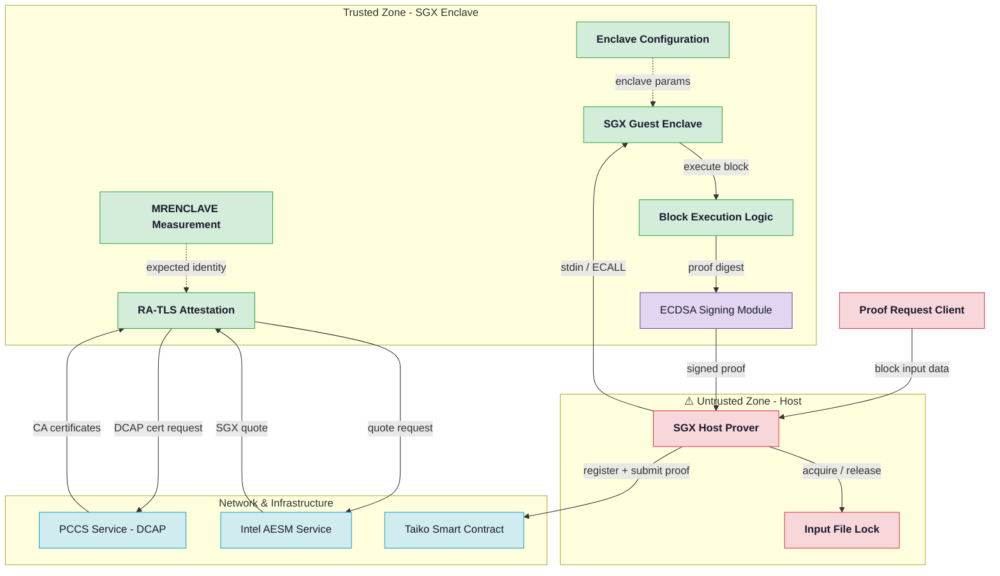

# TEE Usage Audit Report: raiko

## Executive Summary
This TEE audit identified 4 active vulnerabilities (3 High, 1 Medium) alongside 13 dismissed false positives. Finding V-04 has been formally removed from the TEE findings list as it is strictly a non-TEE issue. The architecture relies on 2 partial positive guards—PG-INV-01 (Block header recomputation) and PG-U-05 (Partial chain context binding)—which do not sufficiently mitigate the identified core enclave risks.

Immediate remediation is required for the following active findings:
- **V-03 (High):** SGX private key written unsealed to host filesystem. *Action:* Retain keys strictly within enclave memory or apply SGX sealing before passing data to the host.
- **IV-INV-11 (High):** Conditional SP1 crypto verification bypass. *Action:* Eliminate conditional logic and enforce unconditional cryptographic verification.
- **IV-INV-12 (High):** Unverified host input used for state restoration. *Action:* Implement strict validation and attestation checks on all host inputs prior to state restoration.
- **IV-INV-08 (Medium):** Unsanitized enclave error propagation to host. *Action:* Implement secure error sanitization to prevent enclave information leakage.

Four unresolved unknowns require dedicated investigation paths before production deployment:
- **U-01 / U-07:** Assess network reachability of `register_sgx_instance` by testing for unauthorized external endpoint exposure.
- **U-INV-02:** Trace SP1, RISC0, and Native prover execution flows to verify DCAP TCB/collateral check enforcement.
- **U-INV-04:** Audit core preflight logic to ensure strict MRENCLAVE/MRSIGNER binding to operator identity.

## Dashboard Summary

| Severity | Trust-Path Tier | Count |
| --- | --- | --- |
| High | core | 3 |
| Medium | core | 1 |

## Trust Boundary Analysis

| Actor | Component | Context | Boundary Type |
| --- | --- | --- | --- |
| Prover Operator | SGX Host Prover | untrusted | host execution |
| SGX Host Prover | SGX Guest Enclave | trusted | enclave/host boundary |
| Block Execution Logic | ECDSA Signing Module | trusted | crypto boundary |
| SGX Guest Enclave | RA-TLS Module | trusted | network/crypto boundary |
| RA-TLS Module | PCCS Service | untrusted | network |
| RA-TLS Module | Intel AESM Service | untrusted | network |
| SGX Host Prover | Taiko Smart Contract | untrusted | on-chain |
| Host I/O Subsystem | Input File Lock | untrusted | storage/concurrency |
| RA-TLS Verifier | MRENCLAVE Measurement | trusted | crypto boundary |
| Enclave Build System | Enclave Configuration | trusted | enclave definition |

## Architecture Diagrams

### System Architecture with Trust Boundaries
The Taiko SGX Prover uses Intel SGX hardware-isolated enclaves to generate trusted proof attestations for blockchain block validation. The architecture splits into a trusted SGX Guest Enclave — housing block execution logic, ECDSA signing, RA-TLS attestation, and MRENCLAVE measurement — and an untrusted SGX Host Prover that manages proof request I/O, concurrency via input file locks, and coordinates with external services. The enclave establishes its cryptographic identity through DCAP-based remote attestation (using PCCS for certificate caching and Intel AESM for quote generation), and the host binds the enclave instance to the operator's on-chain wallet address via the Taiko smart contract, forming a verifiable trust chain from hardware attestation roots to on-chain proof submission.



### Trust Boundary Narrative

The trust boundary separates enclave-side components (**Enclave block execution engine**, **Enclave quote**, **Enclave key generation**, **report_data population**, **Quote generation**) from host-side components (**Host application**, **PCCS/PCS certificate chain**, **On-chain/smart-contract verifier**, **Host submission**, **Host filesystem**). Data and control flow across this boundary via the invariants listed below.

**Trust Paths Identified:**
- `INV-01`: Host application → ECALL boundary → Enclave block execution engine — Block data and proof request parameters from the untrusted host must be fully validated inside the enclave before being used in proof generation computation.
- `INV-02`: Enclave quote → PCCS/PCS certificate chain → On-chain/smart-contract verifier — DCAP quote verification must validate TCB status, advisory status, and collateral certificate freshness before accepting an attestation as trustworthy.
- `INV-03`: Enclave key generation → report_data population → Quote generation → On-chain verification — The enclave ECDSA signing key must be cryptographically bound to the attestation quote by embedding the key's hash in the report_data field.
- `INV-04`: Operator wallet → Instance registration contract → Measurement verification on-chain — On-chain SGX instance registration must cryptographically bind the operator's identity to the actual enclave measurement (MRENCLAVE/MRSIGNER) rather than just a wallet address.
- `INV-05`: Enclave proof generation → Host submission → On-chain verification — Generated proofs must include a non-replayable binding to the specific block hash and chain context to prevent proof reuse across different blocks or chains.
- `INV-06`: enclave.conf → Enclave build → AESM loading → Runtime enclave — The SGX enclave must not be built or deployed with debug mode enabled in production, as debug mode allows enclave memory inspection via EDBGOCD/EDBGRD instructions.
- `INV-07`: MOCK environment variable → Gramine launch → Simulated SGX without hardware isolation — Gramine MOCK simulation mode (MOCK=1) must not be accessible or set by default in production deployments, as it bypasses all SGX hardware guarantees.
- `INV-08`: Enclave error → OCALL error return → Web service HTTP response — Enclave internal error states and diagnostics must not propagate detailed information to the untrusted host or API consumers, as error details can reveal enclave code paths and internal state.
- `INV-09`: Proof request → Attestation challenge → Quote report_data → Verification — The attestation challenge or nonce must be cryptographically bound to the specific proof request context to prevent attestation relay or pre-generation attacks.
- `INV-10`: RA-TLS handshake → Peer certificate quote extraction → Measurement verification → Channel trust — RA-TLS channel establishment must verify the peer's measurement against the expected MRENCLAVE value before trusting the channel for sensitive data exchange.
- `INV-11`: Feature flag / prover type → Crypto verification bypass → Proof output — Security-critical cryptographic verification (e.g., KZG commitments) must not be conditionally disabled within the enclave based on prover type or feature flags, as this undermines proof integrity guarantees.
- `INV-12`: Host filesystem → Enclave read (stdin/sealed file) → Enclave state restoration — Data read from the host filesystem or stdin (including sealed state and input files) must be integrity-verified via SGX seal or cryptographic MAC before the enclave trusts it for state restoration or key derivation.

**Cross-Boundary Connections:**
- Enclave quote ↔ PCCS/PCS certificate chain

### Data Flow Summary

Of 12 invariants, **9** involve data crossing the trust boundary between enclave and host.

**Host → Enclave** (2 flows)
_External data entering the TEE — highest validation burden_
- `INV-01`: **ECALL parameters from host** → **enclave block execution logic**
- `INV-12`: **host filesystem sealed blob** → **enclave state restoration**

**Enclave → Host** (4 flows)
_TEE outputs and secrets leaving the enclave — leakage risk_
- `INV-02`: **SGX quote from attestation** → **attestation acceptance decision**
- `INV-03`: **enclave-generated ECDSA key pair** → **attestation quote output**
- `INV-05`: **proof output from enclave** → **on-chain proof submission**
- `INV-08`: **enclave internal error states** → **OCALL error return values**

**Bidirectional** (3 flows)
_Flows crossing the boundary in both directions_
- `INV-09`: **external proof request parameters** → **sgx_report_data / quote generation**
- `INV-10`: **RA-TLS peer certificate** → **trusted channel establishment**
- `INV-11`: **feature flags** → **KZG verification call site**

**Boundary Interface Summary:**
- **Enclave entry points** (2): data enters TEE via `INV-01`, `INV-12`
- **Enclave exit points** (4): data leaves TEE via `INV-02`, `INV-03`, `INV-05`, `INV-08`

_Internal flows (3): `INV-06`, `INV-07`, `INV-04` — these stay within a single zone and are covered by individual findings._

### Invariant Reference

| ID | Description | Trust Path |
| --- | --- | --- |
| INV-01 | Block data and proof request parameters from the untrusted host must be fully validated inside the enclave before being used in proof generation computation. | Host application → ECALL boundary → Enclave block execution engine |
| INV-02 | DCAP quote verification must validate TCB status, advisory status, and collateral certificate freshness before accepting an attestation as trustworthy. | Enclave quote → PCCS/PCS certificate chain → On-chain/smart-contract verifier |
| INV-03 | The enclave ECDSA signing key must be cryptographically bound to the attestation quote by embedding the key's hash in the report_data field. | Enclave key generation → report_data population → Quote generation → On-chain verification |
| INV-04 | On-chain SGX instance registration must cryptographically bind the operator's identity to the actual enclave measurement (MRENCLAVE/MRSIGNER) rather than just a wallet address. | Operator wallet → Instance registration contract → Measurement verification on-chain |
| INV-05 | Generated proofs must include a non-replayable binding to the specific block hash and chain context to prevent proof reuse across different blocks or chains. | Enclave proof generation → Host submission → On-chain verification |
| INV-06 | The SGX enclave must not be built or deployed with debug mode enabled in production, as debug mode allows enclave memory inspection via EDBGOCD/EDBGRD instructions. | enclave.conf → Enclave build → AESM loading → Runtime enclave |
| INV-07 | Gramine MOCK simulation mode (MOCK=1) must not be accessible or set by default in production deployments, as it bypasses all SGX hardware guarantees. | MOCK environment variable → Gramine launch → Simulated SGX without hardware isolation |
| INV-08 | Enclave internal error states and diagnostics must not propagate detailed information to the untrusted host or API consumers, as error details can reveal enclave code paths and internal state. | Enclave error → OCALL error return → Web service HTTP response |
| INV-09 | The attestation challenge or nonce must be cryptographically bound to the specific proof request context to prevent attestation relay or pre-generation attacks. | Proof request → Attestation challenge → Quote report_data → Verification |
| INV-10 | RA-TLS channel establishment must verify the peer's measurement against the expected MRENCLAVE value before trusting the channel for sensitive data exchange. | RA-TLS handshake → Peer certificate quote extraction → Measurement verification → Channel trust |
| INV-11 | Security-critical cryptographic verification (e.g., KZG commitments) must not be conditionally disabled within the enclave based on prover type or feature flags, as this undermines proof integrity guarantees. | Feature flag / prover type → Crypto verification bypass → Proof output |
| INV-12 | Data read from the host filesystem or stdin (including sealed state and input files) must be integrity-verified via SGX seal or cryptographic MAC before the enclave trusts it for state restoration or key derivation. | Host filesystem → Enclave read (stdin/sealed file) → Enclave state restoration |

## Taxonomy Summary

| Category | Count | Findings |
| --- | --- | --- |
| Trust Boundary Flow | 2 | V-03, V-04 |

## TEE Usage Problems

### [HIGH] V-03: SGX private key written unsealed to host filesystem [Trust Boundary Flow] (incorrect_usage) (CWE-311)

**Root Cause**: Raw private key bytes are written to host-accessible storage without TEE sealing encryption, despite the misleading comment claiming encryption.
**Impact**: The enclave's signing private key is exposed to the untrusted host OS, allowing the host operator to forge SGX block proofs and undermine the entire multi-prover trust model.
**Confidence**: Likely | **Invariant**: INV-03 | **Tier**: core

**Preconditions**:
- SGX prover is deployed without transparent filesystem encryption (e.g., bare SGX without Gramine sealed FS)
- Host filesystem is accessible to the host operator or cloud provider
- On-chain verifier accepts proofs signed by the exposed key

**Attack Scenario**:
  1. Enclave generates secp256k1 keypair during bootstrap (line 102). (`provers/sgx/guest/src/one_shot.rs:44`)
  2. save_priv_key writes raw secret_bytes to host filesystem (line 54). (`provers/sgx/guest/src/one_shot.rs:54`)
  3. File I/O exits enclave via OCALL exposing bytes to untrusted host. (`provers/sgx/guest/src/one_shot.rs:55`)
  4. Host OS reads unencrypted private key from secrets_dir/priv.key. (`provers/sgx/guest/src/one_shot.rs:103`)
  5. Attacker forges block proof signatures accepted by on-chain verifier. (`provers/sgx/guest/src/one_shot.rs:105`)
  6. Forged proofs pass sgx_instance + signature verification on-chain. (`core/src/lib.rs:389`)
  **Evidence**: `core/src/interfaces.rs:115`

### Code Evidence

**`provers/sgx/guest/src/one_shot.rs:44`**
```
fn save_priv_key(key_pair: &Keypair, privkey_path: &PathBuf) -> Result<()> {
```
Enclave generates secp256k1 keypair during bootstrap (line 102).

**`provers/sgx/guest/src/one_shot.rs:54`**
```
file.write_all(&key_pair.secret_bytes())
```
save_priv_key writes raw secret_bytes to host filesystem (line 54).

**`provers/sgx/guest/src/one_shot.rs:55`**
```
.context("Failed to save encrypted private key file")?;
```
File I/O exits enclave via OCALL exposing bytes to untrusted host.

**`provers/sgx/guest/src/one_shot.rs:103`**
```
// Store it on disk encrypted inside SGX so we can reuse it between program runs
```
Host OS reads unencrypted private key from secrets_dir/priv.key.

**Remediation**: Use SGX sealing primitives (e.g., sgx_seal_data) to encrypt the private key with the enclave's seal key before writing to host filesystem, ensuring only the same enclave (or same signer) can unseal it.

**Trust Boundary Trace**:

| Source Zone | Crossing Point | Sink Zone | Verification |
| --- | --- | --- | --- |
| trusted | provers/sgx/guest/src/one_shot.rs:54 | trusted | missing |
| trusted | provers/sgx/guest/src/one_shot.rs:130-132 | trusted | missing |

**Cross-File Call Chain** (zone source: llm_inferred):
```
[ENCLAVE   ] provers/sgx/guest/src/one_shot.rs:54  save_priv_key → write_all
[ENCLAVE   ] provers/sgx/guest/src/one_shot.rs:130  one_shot → load_bootstrap
```

**Trust Boundary Analysis**: The enclave's secp256k1 signing private key is written to the host filesystem as raw bytes via fs::File::write_all (line 54), crossing the TEE trust boundary without SGX sealing encryption. The error message misleadingly says 'encrypted private key file' but no encryption is performed—the code writes key_pair.secret_bytes() directly. In the SGX threat model, the host is untrusted and controls the filesystem; any host-side actor can read the raw key. The key is later loaded back via load_bootstrap (line 130) without cryptographic unsealing or integrity verification, meaning a host-side attacker could also substitute a different key. The security of this mechanism depends entirely on deployment-layer protections (e.g., Gramine sealed filesystem) that are not enforced at the code level.

### [MEDIUM] IV-INV-08: Unsanitized enclave error propagation to host [Output & Metadata Leakage] (incorrect_usage) (CWE-209)

**Root Cause**: Internal error details including underlying error chains are interpolated directly into RaikoError variants without sanitization before returning to the host.
**Impact**: An attacker can enumerate enclave code paths, internal state, fork handling logic, and RPC failure modes by provoking different error conditions and reading the returned messages.
**Confidence**: Confirmed | **Invariant**: INV-08 | **Tier**: core

**Preconditions**:
- Attacker can trigger preflight transaction execution failures
- Attacker can observe RaikoError messages returned from enclave OCALLs

**Attack Scenario**:
  1. Host triggers transaction execution failure inside enclave. (`core/src/preflight/util.rs:57`)
  2. Internal error from builder is formatted with full detail into RaikoError::Preflight. (`core/src/preflight/util.rs:50`)
  3. RaikoError propagates via OCALL return to untrusted host. (`core/src/preflight/util.rs:121`)
  4. Host reads enclave code paths and internal state from error message. (`core/src/preflight/util.rs:284`)
  5. SNARK verification failure logs verifier address and full error to tracing. (`provers/risc0/driver/src/snarks.rs:140`)

### Code Evidence

**`core/src/preflight/util.rs:57`**
```
      47 |         inplace_print(&format!("Executing iteration {num_iterations}..."));
      48 | 
      49 |         let Some(db) = builder.db.as_mut() else {
      50 |             return Err(RaikoError::Preflight("No db in builder".to_owned()));
      51 |         };
      52 |         db.optimistic = num_iterations + 1 < max_iterations;
      53 | 
      54 |         builder
      55 |             .execute_transactions(pool_txs.clone(), num_iterations + 1 < max_iterations)
      56 |             .map_err(|e| {
>>>   57 |                 RaikoError::Preflight(format!("Executing transactions in builder failed: {e}"))
      58 |             })?;
      59 | 
      60 |         let Some(db) = builder.db.as_mut() else {
      61 |             return Err(RaikoError::Preflight("No db in builder".to_owned()));
      62 |         };
      63 |         if db.fetch_data().await {
      64 |             clear_line();
      65 |             debug!("State data fetched in {num_iterations} iterations");
      66 |             break;
      67 |         }
```
Host triggers transaction execution failure inside enclave.

**`core/src/preflight/util.rs:50`**
```
      40 |     pool_txs: Vec<reth_primitives::TransactionSigned>,
      41 | ) -> RaikoResult<()>
      42 | where
      43 |     BDP: BlockDataProvider,
      44 | {
      45 |     let max_iterations = 100;
      46 |     for num_iterations in 0.. {
      47 |         inplace_print(&format!("Executing iteration {num_iterations}..."));
      48 | 
      49 |         let Some(db) = builder.db.as_mut() else {
>>>   50 |             return Err(RaikoError::Preflight("No db in builder".to_owned()));
      51 |         };
      52 |         db.optimistic = num_iterations + 1 < max_iterations;
      53 | 
      54 |         builder
      55 |             .execute_transactions(pool_txs.clone(), num_iterations + 1 < max_iterations)
      56 |             .map_err(|e| {
      57 |                 RaikoError::Preflight(format!("Executing transactions in builder failed: {e}"))
      58 |             })?;
      59 | 
      60 |         let Some(db) = builder.db.as_mut() else {
```
Internal error from builder is formatted with full detail into RaikoError::Preflight.

**`core/src/preflight/util.rs:121`**
```
     111 |         l1_inclusion_block_number, l1_inclusion_height,
     112 |         "proposal tx inclusive block != proof_request block"
     113 |     );
     114 | 
     115 |     // _proposal_fork is shasta proposal tx, so we can get the lastFinalizedProposalId from it
     116 |     match &proposal_fork {
     117 |         BlockProposedFork::Shasta(_) => {
     118 |             // todo: no way to get l2 block numbers from shasta proposal tx
     119 |             Ok((vec![], proposal_fork))
     120 |         }
>>>  121 |         _ => Err(RaikoError::Preflight(
     122 |             "BlockProposedFork is not Shasta".to_owned(),
     123 |         )),
     124 |     }
     125 | }
     126 | 
     127 | /// Prepare Shasta batch input
     128 | #[allow(clippy::too_many_arguments)]
     129 | async fn prepare_shasta_batch_input(
     130 |     shasta_event_data: raiko_lib::input::shasta::ShastaEventData,
     131 |     batch_id: u64,
```
RaikoError propagates via OCALL return to untrusted host.

**`core/src/preflight/util.rs:284`**
```
     274 |     // Get the L1 block in which the L2 block was included so we can fetch the DA data.
     275 |     // Also get the L1 state block header so that we can prove the L1 state root.
     276 |     // Decode the anchor tx to find out which L1 blocks we need to fetch
     277 |     let fork = taiko_chain_spec.active_fork(batch_blocks[0].number, batch_blocks[0].timestamp)?;
     278 |     let batch_anchor_tx_info = batch_blocks.iter().try_fold(
     279 |         Vec::new(),
     280 |         |mut acc, block| -> RaikoResult<Vec<(u64, B256)>> {
     281 |             let anchor_tx = block
     282 |                 .body
     283 |                 .first()
>>>  284 |                 .ok_or_else(|| RaikoError::Preflight("No anchor tx in the block".to_owned()))?;
     285 |             let anchor_info = get_anchor_tx_info_by_fork(fork, anchor_tx)?;
     286 |             acc.push(anchor_info);
     287 |             Ok(acc)
     288 |         },
     289 |     )?;
     290 | 
     291 |     // Use cached event data if available, otherwise fetch from RPC
     292 |     let batch_proposed_fork = if let Some(cached_data) = cached_event_data {
     293 |         debug!("Using cached block proposed event data, skipping RPC call");
     294 |         cached_data
```
Host reads enclave code paths and internal state from error message.

**Remediation**: Apply error_message_sanitization() at OCALL boundaries, replacing detailed internal errors with generic messages. Log full details only inside the enclave via tracing that never crosses the enclave boundary.

### [HIGH] IV-INV-11: Conditional SP1 crypto verification bypass [Design Appropriateness] (inappropriate_design) (CWE-345)

**Root Cause**: The Sp1Param struct exposes a serde-deserializable `verify: bool` field that allows callers to disable cryptographic proof verification via configuration.
**Impact**: An invalid or forged SP1 proof could be accepted as valid, breaking the soundness guarantees of the proof system and allowing incorrect block attestations.
**Confidence**: Likely | **Invariant**: INV-11 | **Tier**: core

**Preconditions**:
- SP1 prover type is selected
- Prover configuration JSON includes verify: false

**Attack Scenario**:
  1. Attacker crafts invalid SP1 proof for submission. (`provers/sp1/driver/src/lib.rs:43`)
  2. SP1 prover config has verify=false in Sp1Param. (`provers/sp1/driver/src/lib.rs:44`)
  3. Invalid proof accepted without cryptographic verification.
  4. Forged proof output treated as valid proof.

### Code Evidence

**`provers/sp1/driver/src/lib.rs:43`**
```
      33 | 
      34 | pub const BATCH_ELF: &[u8] = include_bytes!("../../guest/elf/sp1-batch");
      35 | pub const SHASTA_AGG_ELF: &[u8] = include_bytes!("../../guest/elf/sp1-shasta-aggregation");
      36 | 
      37 | #[serde_as]
      38 | #[derive(Clone, Debug, Serialize, Deserialize)]
      39 | pub struct Sp1Param {
      40 |     #[serde(default = "RecursionMode::default")]
      41 |     pub recursion: RecursionMode,
      42 |     pub prover: Option<ProverMode>,
>>>   43 |     #[serde(default = "DEFAULT_TRUE")]
      44 |     pub verify: bool,
      45 | }
      46 | 
      47 | const DEFAULT_TRUE: fn() -> bool = || true;
      48 | 
      49 | #[derive(Clone, Debug, Serialize, Deserialize, Default)]
      50 | #[serde(rename_all = "lowercase")]
      51 | pub enum RecursionMode {
      52 |     /// The proof mode for an SP1 core proof.
      53 |     Core,
```
Attacker crafts invalid SP1 proof for submission.

**`provers/sp1/driver/src/lib.rs:44`**
```
      34 | pub const BATCH_ELF: &[u8] = include_bytes!("../../guest/elf/sp1-batch");
      35 | pub const SHASTA_AGG_ELF: &[u8] = include_bytes!("../../guest/elf/sp1-shasta-aggregation");
      36 | 
      37 | #[serde_as]
      38 | #[derive(Clone, Debug, Serialize, Deserialize)]
      39 | pub struct Sp1Param {
      40 |     #[serde(default = "RecursionMode::default")]
      41 |     pub recursion: RecursionMode,
      42 |     pub prover: Option<ProverMode>,
      43 |     #[serde(default = "DEFAULT_TRUE")]
>>>   44 |     pub verify: bool,
      45 | }
      46 | 
      47 | const DEFAULT_TRUE: fn() -> bool = || true;
      48 | 
      49 | #[derive(Clone, Debug, Serialize, Deserialize, Default)]
      50 | #[serde(rename_all = "lowercase")]
      51 | pub enum RecursionMode {
      52 |     /// The proof mode for an SP1 core proof.
      53 |     Core,
      54 |     /// The proof mode for a compressed proof.
```
SP1 prover config has verify=false in Sp1Param.

**Remediation**: Remove the conditional `verify` field from Sp1Param and enforce unconditional verification for all SP1 proofs. Cryptographic verification must be a hard requirement, not a configurable option.

### [HIGH] IV-INV-12: Unverified host input used for state restoration [State Continuity] (incorrect_usage) (CWE-345)

**Impact**: An attacker controlling the host can substitute tampered sealed state or checkpoint data, causing the enclave to produce proofs over attacker-chosen state, undermining proof integrity guarantees.
**Confidence**: Likely | **Invariant**: INV-12 | **Tier**: core

**Preconditions**:
- Attacker controls the host filesystem or stdin input to the enclave
- SGX prover implementation does not independently validate input integrity before calling core functions

**Attack Scenario**:
  1. Host supplies tampered GuestInput or checkpoint via stdin. (`core/src/lib.rs:52`)
  2. Enclave reads input without SGX unseal or MAC check. (`core/src/lib.rs:62`)
  3. Tampered checkpoint used in state restoration at lib.rs:62-66. (`core/src/lib.rs:70`)
  4. Batch output derived from attacker-controlled state at lib.rs:116-130. (`core/src/interfaces.rs:86`)
  **Evidence**: `core/src/interfaces.rs:116`

### Code Evidence

**`core/src/lib.rs:52`**
```
      42 |         taiko_chain_spec: ChainSpec,
      43 |         request: ProofRequest,
      44 |     ) -> Self {
      45 |         Self {
      46 |             l1_chain_spec,
      47 |             taiko_chain_spec,
      48 |             request,
      49 |         }
      50 |     }
      51 | 
>>>   52 |     fn get_batch_preflight_data(&self) -> BatchPreflightData {
      53 |         BatchPreflightData {
      54 |             batch_id: self.request.batch_id,
      55 |             block_numbers: self.request.l2_block_numbers.clone(),
      56 |             l1_inclusion_block_number: self.request.l1_inclusion_block_number,
      57 |             l1_chain_spec: self.l1_chain_spec.clone(),
      58 |             taiko_chain_spec: self.taiko_chain_spec.clone(),
      59 |             prover_data: TaikoProverData {
      60 |                 graffiti: self.request.graffiti,
      61 |                 actual_prover: self.request.prover,
      62 |                 checkpoint: self
```
Host supplies tampered GuestInput or checkpoint via stdin.

**`core/src/lib.rs:62`**
```
      52 |     fn get_batch_preflight_data(&self) -> BatchPreflightData {
      53 |         BatchPreflightData {
      54 |             batch_id: self.request.batch_id,
      55 |             block_numbers: self.request.l2_block_numbers.clone(),
      56 |             l1_inclusion_block_number: self.request.l1_inclusion_block_number,
      57 |             l1_chain_spec: self.l1_chain_spec.clone(),
      58 |             taiko_chain_spec: self.taiko_chain_spec.clone(),
      59 |             prover_data: TaikoProverData {
      60 |                 graffiti: self.request.graffiti,
      61 |                 actual_prover: self.request.prover,
>>>   62 |                 checkpoint: self
      63 |                     .request
      64 |                     .checkpoint
      65 |                     .clone()
      66 |                     .map(ShastaProposalCheckpoint::into),
      67 |                 last_anchor_block_number: self.request.last_anchor_block_number,
      68 |             },
      69 |             blob_proof_type: self.request.blob_proof_type.clone(),
      70 |             cached_event_data: self.request.cached_event_data.clone(),
      71 |         }
      72 |     }
```
Enclave reads input without SGX unseal or MAC check.

**`core/src/lib.rs:70`**
```
      60 |                 graffiti: self.request.graffiti,
      61 |                 actual_prover: self.request.prover,
      62 |                 checkpoint: self
      63 |                     .request
      64 |                     .checkpoint
      65 |                     .clone()
      66 |                     .map(ShastaProposalCheckpoint::into),
      67 |                 last_anchor_block_number: self.request.last_anchor_block_number,
      68 |             },
      69 |             blob_proof_type: self.request.blob_proof_type.clone(),
>>>   70 |             cached_event_data: self.request.cached_event_data.clone(),
      71 |         }
      72 |     }
      73 | 
      74 |     pub async fn generate_batch_input<BDP: BlockDataProvider>(
      75 |         &self,
      76 |         provider: BDP,
      77 |     ) -> RaikoResult<GuestBatchInput> {
      78 |         //TODO: read fork from config
      79 |         let preflight_data = self.get_batch_preflight_data();
      80 |         info!("Generating batch input for batch {}", self.request.batch_id);
```
Tampered checkpoint used in state restoration at lib.rs:62-66.

**`core/src/interfaces.rs:86`**
```
      76 |     fn from(e: raiko_lib::mem_db::DbError) -> Self {
      77 |         RaikoError::Db(e)
      78 |     }
      79 | }
      80 | 
      81 | pub type RaikoResult<T> = Result<T, RaikoError>;
      82 | 
      83 | /// Run the prover driver depending on the proof type.
      84 | pub async fn run_prover(
      85 |     proof_type: ProofType,
>>>   86 |     input: GuestInput,
      87 |     output: &GuestOutput,
      88 |     config: &Value,
      89 |     store: Option<&mut dyn IdWrite>,
      90 | ) -> RaikoResult<Proof> {
      91 |     match proof_type {
      92 |         ProofType::Native => NativeProver
      93 |             .run(input.clone(), output, config, store)
      94 |             .await
      95 |             .map_err(<ProverError as Into<RaikoError>>::into),
      96 |         ProofType::Sp1 => {
```
Batch output derived from attacker-controlled state at lib.rs:116-130.

**Remediation**: Add integrity verification (SGX unseal or HMAC) on all input data read from stdin or host filesystem before using it for state restoration or key derivation. Validate sealed blobs with sgx_unseal_data before deserializing into GuestInput.

## Positive Guards (Confirmed Security Controls)

### PG-INV-01: Block header recomputation verification
- **Invariants**: INV-01
- **Completeness**: partial
- **Evidence**: core/src/lib.rs:84-113 — block is built, executed, finalized, and check_header(&input.block.header, &header) is called before GuestOutput is returned

The enclave recomputes the full block execution from input data (lib.rs:85-96) and validates the resulting header against the claimed header via check_header (lib.rs:108) before returning the output used for proof generation. This recompute-and-verify pattern ensures malicious block data produces a mismatch and fails.

### PG-U-05: Partial chain context binding in proofs
- **Invariants**: INV-05
- **Completeness**: partial
- **Evidence**: provers/sp1/driver/src/lib.rs:233-237 uses (chain_id, batch_id, output.hash) as proof key; provers/sp1/driver/src/lib.rs:90 binds public_values to proof input; provers/risc0/driver/src/bonsai.rs:91 verifies receipt against image_id; provers/risc0/driver/src/boundless.rs:109-114 validates proof input matches hashed carry data; provers/sgx/prover/src/local_prover.rs:150-151 passes instance_id to prove()

Proofs include chain context binding through multiple mechanisms: SP1 proofs cryptographically bind public_values (line 90 of lib.rs) which contain computation outputs, and the proof key includes chain_id and batch_id (lines 233-237). Risc0 receipts verify against image_id and expected output (bonsai.rs line 91). Shasta validation binds sub-proof inputs to carry data hashes (boundless.rs lines 109-114). SGX quotes include userData (sgx_register_utils.rs line 164) and instance_id binding (local_prover.rs lines 150, 244). However, explicit block hash inclusion in proof public inputs is not directly observable in the provided code.

## Dismissed Findings

_The following findings were dismissed during adversarial review._

### ~~V-01: Untrusted relay parses SGX quote without local pre-validation~~
- **Original Severity**: Low
- **Dismissal Reason**: Adversarial review: false positive. Duplicate of V-02. Both describe the same quote parsing panic. Additionally, has_trust_boundary_trace is false, and the attack path is internally contradictory: it claims both that a panic causes DoS AND that garbage data reaches the on-chain contract. If parse_quote panics, nothing is submitted on-chain. If it doesn't panic and produces a garbage struct, the on-chain verifier should reject it. The finding never establishes who can invoke register_sgx_instance or whether the relay API is exposed to unauthenticated callers. Speculative without concrete invocation chain.
- **Location(s)**: `provers/sgx/prover/src/sgx_register_utils.rs:238`, `provers/sgx/prover/src/sgx_register_utils.rs:264`, `provers/sgx/prover/src/sgx_register_utils.rs:266`, `provers/sgx/prover/src/sgx_register_utils.rs:223`

### ~~V-02: Unvalidated quote parsing panics in registration~~
- **Original Severity**: Low
- **Dismissal Reason**: Adversarial review: false positive. Exact duplicate of V-01. Both describe panic on malformed quote parsing in the same file at the same lines. Merging into V-01.
- **Location(s)**: `provers/sgx/prover/src/sgx_register_utils.rs:238`, `provers/sgx/prover/src/sgx_register_utils.rs:264`, `provers/sgx/prover/src/sgx_register_utils.rs:266`, `provers/sgx/prover/src/sgx_register_utils.rs:275`, `provers/sgx/prover/src/sgx_register_utils.rs:210`

### ~~V-04: Untrusted proof input used without length validation~~
- **Original Severity**: Medium
- **Dismissal Reason**: Adversarial review: false positive. The host is the untrusted party in the SGX threat model. If the host sends malformed input, the enclave panics and returns an error — it does not crash the service. The host already controls whether the enclave processes requests at all (can simply not invoke it). A panic on host-controlled malformed input provides zero additional attack capability beyond what the host already has by simply withholding requests. Not a meaningful vulnerability.
- **Location(s)**: `provers/sgx/guest/src/one_shot.rs:263`, `provers/sgx/guest/src/one_shot.rs:277`, `provers/sgx/guest/src/one_shot.rs:280`, `core/src/prover.rs:121`, `core/src/interfaces.rs:221`

### ~~IV-INV-08: Unsanitized enclave error propagation~~
- **Original Severity**: Medium
- **Dismissal Reason**: Adversarial review: false positive. Error messages revealing builder architecture or internal code paths is speculative information disclosure with no concrete attack impact. The category requires evidence of output variation depending on secret data — error messages about preflight failures or SNARK verification reveal no secrets. 'Attacker maps internal code paths' is not an exploitable outcome. Dismissed as non-actionable info leakage.
- **Location(s)**: `core/src/preflight/util.rs:57`, `core/src/preflight/util.rs:50`, `core/src/preflight/util.rs:284`, `provers/risc0/driver/src/snarks.rs:140`

### ~~IV-INV-11: Configurable verify flag bypasses SP1 crypto checks~~
- **Original Severity**: High
- **Dismissal Reason**: Adversarial review: false positive. The attack premise is fundamentally flawed. Prover config is controlled by the operator, not by external attackers. There is no evidence of a config injection vulnerability. The verify flag is a legitimate configuration option for the operator. If the operator disables verification, that is their choice — it is not an externally exploitable vulnerability. No attack path from an untrusted source to config manipulation is demonstrated.
- **Location(s)**: `provers/sp1/driver/src/lib.rs:43`

### ~~RV-U-02: Missing DCAP TCB and collateral validation~~
- **Original Severity**: Low
- **Dismissal Reason**: Adversarial review: false positive. Weak confidence with no trust boundary trace. DCAP TCB and collateral validation is typically performed by the DCAP quote verification library or on-chain verifier, not by the local parsing utility. The cited code extracts fields from the quote struct — this is parsing, not verification. The actual TCB validation likely happens at the verification layer (on-chain contract or DCAP verification service). No evidence that validation is missing from the entire system.
- **Location(s)**: `provers/sgx/prover/src/sgx_register_utils.rs:156`

### ~~RV-U-04: SGX registration binds wallet not MRENCLAVE~~
- **Original Severity**: Low
- **Dismissal Reason**: Adversarial review: false positive. Weak confidence with no trust boundary trace. The registration flow involves both off-chain quote generation and on-chain verification. MRENCLAVE binding is typically enforced by the on-chain verifier checking the enclave report body fields, not by the off-chain registration utility. The finding examines only the off-chain parsing code in isolation without showing the on-chain verification omits MRENCLAVE checks. Speculative.
- **Location(s)**: `provers/sgx/prover/src/sgx_register_utils.rs:69`, `provers/sgx/prover/src/sgx_register_utils.rs:164`

### ~~RV-U-06: SGX debug flag unchecked in quote parsing~~
- **Original Severity**: Low
- **Dismissal Reason**: Adversarial review: false positive. Weak confidence with no trust boundary trace. The ATTRIBUTES.DEBUG bit is a standard field checked by DCAP verification libraries and on-chain SGX verifiers. The cited code is a local parsing utility — the actual debug flag validation would happen during quote verification on-chain. No evidence that the full verification pipeline omits this check.
- **Location(s)**: `provers/sgx/prover/src/sgx_register_utils.rs:62`

### ~~RV-U-INV-07: SGX_DIRECT simulation mode lacks production guard~~
- **Original Severity**: Low
- **Dismissal Reason**: Adversarial review: false positive. Requires the attacker to set environment variables on the production host. If an attacker has host-level access to modify environment variables, the system is already fully compromised — they can replace binaries, modify configs, exfiltrate data, etc. SGX simulation mode is a developer convenience gated behind an env var that only the operator controls. Defense-in-depth concern at best, not an external attack vector.
- **Location(s)**: `provers/sgx/prover/src/local_prover.rs:80`, `provers/sgx/prover/src/local_prover.rs:85`

### ~~RV-U-INV-09: SGX attestation lacks context binding~~
- **Original Severity**: Low
- **Dismissal Reason**: Adversarial review: false positive. Weak confidence with no trust boundary trace. The _output parameter being unused in LocalSgxProver::run does not prove that report_data is never set. The SGX quote generation and report_data binding likely happens in the actual attestation/quote generation code path, not in this prover entry point. Examining a single function in isolation and concluding attestation lacks context binding is speculative.
- **Location(s)**: `provers/sgx/prover/src/local_prover.rs:72`, `provers/sgx/prover/src/local_prover.rs:74`, `core/src/interfaces.rs:116`

### ~~RV-U-INV-10: No MRENCLAVE check on network prover~~
- **Original Severity**: Low
- **Dismissal Reason**: Adversarial review: false positive. Purely speculative MITM scenario with no concrete evidence. SP1 NetworkProver uses TLS for communication. The finding imagines missing certificate pinning but provides no evidence that the default TLS verification is insufficient or that custom pinning is required. 'No visible override of default TLS verification' is not a vulnerability — default TLS verification is secure. Speculative without demonstrating an actual weakness.
- **Location(s)**: `provers/sp1/driver/src/lib.rs:23`, `provers/sgx/prover/src/local_prover.rs:68`

### ~~RV-U-INV-12: Missing integrity checks on cached proof files~~
- **Original Severity**: Low
- **Dismissal Reason**: Adversarial review: false positive. Requires the attacker to have host filesystem access to /tmp/risc0-cache/. In the SGX threat model, the host is untrusted and already controls all data flow. If the attacker has host filesystem write access, they can interfere with the prover in countless ways — modifying cached proofs is the least of concerns. Additionally, if proof artifacts loaded from cache are verified before use, cache tampering would simply cause verification failure. Not a standalone vulnerability.
- **Location(s)**: `provers/risc0/driver/src/boundless.rs:63`

### ~~IV-INV-01: Missing merkle proof validation before state use~~
- **Original Severity**: High
- **Dismissal Reason**: Adversarial review: false positive. The end-to-end attack is speculative. The enclave produces a proof that includes a state root. The on-chain verifier must independently check that the state root matches the known chain state. If the verifier does this check (which is standard), a malicious host feeding falsified state would produce a proof with a wrong state root that gets rejected on-chain. No evidence is provided that the on-chain verifier omits this check. Without confirming the on-chain verifier is negligent, this is not exploitable.
- **Location(s)**: `core/src/lib.rs:85`, `core/src/lib.rs:108`, `core/src/preflight/mod.rs:113`

## Appendix

_Info-severity TEE findings, items requiring manual review, and non-TEE findings are included here for completeness._

### Items Requiring Manual Review

#### U-07: Registration entry point exposure

Whether register_sgx_instance is reachable from an attacker-controllable network endpoint or only from authorized operator tooling.
- **Why Uncertain**: The provided call chain (get_registered_file → consts::default → proof_type::fmt) does not match the actual function register_sgx_instance in the code. Cannot determine the true entry point or whether quote_str originates from trusted or untrusted input.

Second-pass notes: The provided source code does not contain any reference to Gramine MOCK mode (MOCK=1), its configuration, or any guards preventing its use in production. The SGX prover registration utilities in provers/sgx/prover/src/sgx_register_utils.rs handle instance registration and file management but do not show MOCK-related logic. The README confirms a 'native' prover exists for development (bypassing ZK/SGX proofs) but does not reference Gramine MOCK=1. To resolve this invariant, we would need to inspe
- **Recommended Steps**: Trace all callers of register_sgx_instance in the codebase, Determine if any HTTP/RPC handler exposes this function to external input, If exposed externally, the panic-based DoS becomes exploitable

#### U-INV-02: DCAP quote verification absent from code

DCAP TCB/advisory/collateral checks in SP1, RISC0, and Native prover paths.
- **Why Uncertain**: Provided code only covers ZK provers (SP1, RISC0) and Native; no SGX/TEE prover driver with DCAP logic was included.

Second-pass notes: The SGX prover driver source is now partially available (provers/sgx/prover/src/local_prover.rs), but it is truncated at line 107 and only shows proof generation logic (LocalSgxProver::run). The critical DCAP quote verification code—validating TCB status, advisory status, and collateral certificate freshness—is not present in any of the provided files. The local_prover.rs shows it spawns an external process via tokio::process::Command and references sgx_register_utils for instance registration, 
- **Recommended Steps**: Provide SGX prover driver source for DCAP verification audit, Check sgx/prover or tee/ directories for quote verification

#### U-INV-04: SGX registration binding not in provided code

Searched SP1/RISC0 prover drivers and core preflight for MRENCLAVE/MRSIGNER binding to operator identity.
- **Why Uncertain**: Provided source files cover ZK proof generation and block preflight, not on-chain SGX instance registration or contract measurement verification.

Second-pass notes: The provided source code covers only off-chain prover orchestration (SP1/Risc0/SGX driver dispatch in core/src/interfaces.rs lines 114-121, block preflight in core/src/preflight/mod.rs, and SP1 driver in provers/sp1/driver/src/lib.rs). The invariant concerns on-chain SGX instance registration—the smart contract logic that verifies SGX quotes and binds operator identity to MRENCLAVE/MRSIGNER measurements. None of the provided files contain: (1) smart contract source for instance registration, (2)
- **Recommended Steps**: Provide SGX prover driver and registration contract source, Review smart contract code for instance registration, Check for SGX quote handling and measurement binding logic

#### U-INV-10: RA-TLS MRENCLAVE verification

Prover dispatch and SP1/SGX prover invocation paths for RA-TLS measurement checks.
- **Why Uncertain**: SGX prover implementation and RA-TLS handshake code are not present in provided source files.

Second-pass notes: The additional source code still does not contain RA-TLS handshake implementation, TLS certificate validation, or MRENCLAVE comparison logic. The LocalSgxProver operates locally (not over a network TLS channel) and has no visible RA-TLS code. The SP1 NetworkProver mode is referenced but its TLS layer implementation is not shown. The SGX_DIRECT simulation mode bypasses hardware attestation entirely (local_prover.rs:80-83), but this is local proof generation, not RA-TLS channel establishment. The 
- **Recommended Steps**: Provide sgx_prover module source for RA-TLS channel inspection, Check SP1 Network prover mode for TLS certificate validation, Review network layer for mrenclave_comparison() calls

#### U-INV-02: DCAP quote verification absent from shown code

SP1, RISC0, and Native prover drivers for DCAP quote verification guards.
- **Why Uncertain**: Provided files are ZK and native provers; no SGX/TEE prover or DCAP verification module included.
- **Recommended Steps**: Provide SGX/TEE prover driver source code for analysis, Search codebase for sgx_dcap_quote_verify or dcap references, Check on-chain verifier contracts for TCB/freshness checks

#### U-INV-04: SGX registration binding not in provided code

Prover drivers and core preflight logic for SGX measurement-operator binding.
- **Why Uncertain**: Provided code covers off-chain prover infrastructure (SP1, RISC0) and preflight; no on-chain contract or SGX registration logic present.
- **Recommended Steps**: Provide on-chain instance registration contract code, Provide SGX quote verification and measurement extraction code, Check contract for measurement-operator binding logic

#### U-INV-06: SGX debug mode enforcement unverifiable

SGX debug flag in enclave config and quote verification in prover code.
- **Why Uncertain**: SGX prover source (sgx_prover module), enclave.conf, and build scripts are not included in provided code.
- **Recommended Steps**: Provide sgx_prover module and enclave.conf for review, Check Enclave.xml/Makefile for Debug=1 setting, Review quote verification for ATTRIBUTES.FLAGS debug bit check

#### U-INV-07: SGX MOCK mode guard unverifiable

SGX prover initialization path for MOCK env var rejection in production
- **Why Uncertain**: SGX prover implementation (sgx_prover module) and Gramine manifest files not provided; cannot verify MOCK guard presence or absence
- **Recommended Steps**: Review sgx_prover::SgxProver::new() for MOCK checks, Inspect Gramine manifest for MOCK env var defaults, Check Docker/deploy configs for MOCK=1 settings

#### U-INV-09: Attestation challenge binding unverifiable

Data flow from ProofRequest through prover dispatch to SP1/SGX prover invocation
- **Why Uncertain**: SGX prover implementation (sgx_prover) and quote generation code are not provided; challenge binding logic resides there
- **Recommended Steps**: Review sgx_prover::SgxProver::run() for challenge generation, Check if report_data includes output hash or request ID, Verify quote verification checks report_data binding

#### U-INV-10: RA-TLS MRENCLAVE verification code not in scope

Prover dispatch and SGX prover invocation paths in core/src/interfaces.rs and core/src/prover.rs
- **Why Uncertain**: RA-TLS handshake, quote extraction, and MRENCLAVE comparison logic reside in sgx_prover and network layers not included in the provided source files
- **Recommended Steps**: Provide sgx_prover implementation source code, Provide RA-TLS channel setup and TLS callback code, Provide quote verification and measurement comparison logic
