# TEE Usage Audit Report: sapphire-paratime

## Executive Summary
The TEE audit identified 1 Medium-severity vulnerability: IV-INV-11 (Subcall errors leak enclave processing details). Four positive security guards were confirmed: compile-time debug gate (PG-U-INV-01), TrustRoot identity anchors (PG3-U-INV-05), precompile bounds (PG-U-INV-06), and public-key-only OCALL responses (PG-U-INV-07). Eight findings were dismissed as false positives during adversarial review.

Fifteen unknowns remain due to incomplete source access, covering: client SDK attestation enforcement (U-INV-12), attestation quote binding (U-INV-09), sealed blob monotonicity (U-INV-10), key derivation attestation flows (U-INV-04, U-INV-08), MRENCLAVE verification (U-INV-05), and unsafe flag presence (U-INV-02, U-INV-03).

**Immediate Actions:**
• Remediate IV-INV-11: Sanitize subcall error messages to prevent enclave detail leakage
• Provide client SDK source to resolve U-INV-12 (attestation enforcement before data submission)
• Provide Sapphire.sol/Subcall.sol to verify attestation in key derivation paths (U-INV-04, U-INV-08)
• Provide sealed blob unseal implementation to verify epoch/version monotonicity (U-INV-10)
• Confirm production config disables OASIS_UNSAFE_SKIP_AVR_VERIFY and OASIS_UNSAFE_ALLOW_DEBUG_ENCLAVES

## Dashboard Summary

| Severity | Trust-Path Tier | Count |
| --- | --- | --- |
| Medium | core | 1 |

## Trust Boundary Analysis

| Actor | Component | Context | Boundary Type |
| --- | --- | --- | --- |
| Runtime Developers | Sapphire ParaTime Runtime (runtime/src/) | trusted | enclave/host |
| Runtime Developers | SGX Enclave Binary (.sgxs) | trusted | crypto boundary |
| Runtime Developers | Fortanix SGX Toolchain | mixed | build pipeline |
| Node Operators | Oasis Node Host | untrusted | enclave/host |
| DApp Developers | Client SDK -- JavaScript (clients/js/) | untrusted | network |
| DApp Developers | Client SDK -- Go (clients/go/) | untrusted | network |
| DApp Developers | Client SDK -- Python (clients/py/) | untrusted | network |
| DApp Developers | Solidity Smart Contracts (contracts/) | untrusted | enclave/host |
| Intel SGX Infrastructure | Attestation Mechanism | mixed | crypto boundary |
| Runtime Developers | Mock SGX Variant (debug-mock-sgx) | untrusted | enclave/host |

## Architecture Diagrams

### System Architecture with Trust Boundaries
The Oasis Sapphire ParaTime architecture centers on an Intel SGX enclave that executes a Rust runtime and EVM smart contracts within a hardware-isolated trusted execution environment. The trusted zone — comprising the compiled enclave binary, the runtime logic, and the attestation mechanism — is isolated from the untrusted Oasis Node Host via SGX ECALL/OCALL boundaries. Untrusted client SDKs (JavaScript, Go, Python) and Solidity smart contract source code reside outside the enclave, communicating through encrypted RPC transactions that traverse the host process. Trust is anchored by Intel SGX remote attestation, which allows all parties to independently verify the enclave's identity and integrity before interacting.

```mermaid
flowchart TD
    subgraph TZ [" Trusted Zone -- SGX Enclave"]
        runtime["Sapphire ParaTime Runtime"]
        enclave["SGX Enclave Binary -.sgxs"]
        attestation["Attestation Mechanism"]
        evm["Enclave EVM Execution"]
    end

    subgraph UZ ["⚠️ Untrusted Zone"]
        host["Oasis Node Host"]
        sdk_js["Client SDK -- JS"]
        sdk_go["Client SDK -- Go"]
        sdk_py["Client SDK -- Python"]
        contracts["Solidity Contracts"]
        mock_sgx["Mock SGX -debug"]
    end

    subgraph NZ [" External Infrastructure"]
        fortanix["Fortanix SGX Toolchain"]
        intel["Intel SGX Attestation Svc"]
    end

    fortanix -->|"produces .sgxs via elf2sgxs"| enclave
    runtime -->|"compiled into"| enclave
    host -->|"ECALLs"| enclave
    enclave -->|"OCALLs / results"| host
    attestation ---|"SGX quote / RA report"| intel
    attestation -->|"verify enclave identity"| enclave
    sdk_js -->|"encrypted TXs via RPC"| host
    sdk_go -->|"encrypted TXs via RPC"| host
    sdk_py -->|"encrypted TXs via RPC"| host
    contracts -->|"encrypted events / signers"| host
    evm -->|"runs contract logic"| enclave
    mock_sgx -.->|"UNSAFE: no HW attestation"| host

    class runtime trusted
    class enclave trusted
    class attestation trusted
    class evm trusted
    class host untrusted
    class sdk_js untrusted
    class sdk_go untrusted
    class sdk_py untrusted
    class contracts untrusted
    class mock_sgx untrusted
    class fortanix extnet
    class intel extnet

    classDef trusted fill:#d4edda,stroke:#28a745,color:#1a1a2e,font-weight:bold
    classDef untrusted fill:#f8d7da,stroke:#dc3545,color:#1a1a2e,font-weight:bold
    classDef extnet fill:#d1ecf1,stroke:#17a2b8,color:#1a1a2e
    classDef crypto fill:#e2d5f1,stroke:#6a4c93,color:#1a1a2e
```



### Trust Boundary Narrative

The trust boundary separates enclave-side components (**Attestation verification chain**, **Attestation Verification**, **Enclave ↔ Host Boundary**, **Attestation Quote Verification**, **Attestation Quote**) from host-side components (**Oasis Node Host**, **Host Process**, **Host Storage**, **Host/Client Error Response**). Data and control flow across this boundary via the invariants listed below.

**Trust Paths Identified:**
- `INV-01`: Build → Deployment → Attestation verification chain — The `debug-mock-sgx` feature flag must not be enabled in production enclave builds, as it bypasses SGX attestation entirely and renders all enclave confidentiality guarantees void.
- `INV-02`: Oasis Node Host → Attestation Verification → Trust Establishment — The `OASIS_UNSAFE_SKIP_AVR_VERIFY` environment variable must not be read and honored in production Go client/node code, as it disables attestation verification report (AVR) checking.
- `INV-03`: Enclave ↔ Host Boundary → Attestation Quote Verification → Debug Mode Check — The `OASIS_UNSAFE_ALLOW_DEBUG_ENCLAVES` environment variable must not be honored in production, as SGX debug-mode enclaves expose their entire memory to the host via EDBGRD/EDBGWR instructions.
- `INV-04`: Client SDK → Attestation Verification → Encryption Key Derivation → Data Submission — Attestation verification results must be checked for success before any encryption key is derived from or used with the attested enclave, preventing key exchange with unverified endpoints.
- `INV-05`: Attestation Quote → Measurement Extraction → Expected Value Comparison → Trust Decision — The MRENCLAVE measurement extracted from attestation quotes must be compared against an expected, hardcoded or config-anchored value before the enclave is trusted.
- `INV-06`: Host Process → ECALL Boundary → Enclave Internal Processing — Host-provided data entering the enclave via ECALL parameters (block context, transaction inputs) must be validated before use in cryptographic operations, policy decisions, or state modifications.
- `INV-07`: Enclave Internal → OCALL Boundary → Host Process — Sensitive data (private keys, decrypted transactions, internal state) must never be passed unencrypted through OCALL return values or output buffers to the untrusted host.
- `INV-08`: Client SDK Encryption Key Derivation ← Attestation Quote Measurement ← Enclave Identity — Client-side encryption keys must be cryptographically bound to the enclave's attested measurement, ensuring that encrypted data can only be decrypted by the specific, verified enclave instance.
- `INV-09`: Enclave Key Generation → Quote report_data Binding → Client Verification → Key Trust — The attestation quote's report_data field must contain a cryptographic hash of the enclave's public key to prevent key substitution attacks where a valid quote is paired with an attacker's key.
- `INV-10`: Host Storage → Sealed Blob → Enclave Unseal → State Restoration — Sealed state loaded from host storage must be verified against epoch or version metadata and enforce monotonic progression to prevent rollback to previous sealed states.
- `INV-11`: Enclave Internal Error → Enclave Boundary → Host/Client Error Response — Errors originating from enclave processing of confidential data must be wrapped in generic error messages before being returned to the host or client, preventing leakage of secret-dependent processing state.
- `INV-12`: Client SDK → Attestation + Key Exchange → Encrypted Channel → Confidential Data Submission — The client SDK must perform a complete attested key exchange with the enclave before transmitting any confidential data, ensuring no code path submits encrypted data without first verifying the enclave's identity.

**Cross-Boundary Connections:**
- Attestation Verification ↔ Oasis Node Host

### Data Flow Summary

Of 12 invariants, **9** involve data crossing the trust boundary between enclave and host.

**Host → Enclave** (1 flow)
_External data entering the TEE — highest validation burden_
- `INV-06`: **ECALL input parameters** → **enclave key derivation**

**Enclave → Host** (2 flows)
_TEE outputs and secrets leaving the enclave — leakage risk_
- `INV-07`: **enclave private key material** → **OCALL output buffer parameters**
- `INV-11`: **enclave internal error from confidential computation** → **RPC error response to client**

**Bidirectional** (6 flows)
_Flows crossing the boundary in both directions_
- `INV-01`: **debug-mock-sgx feature flag in Cargo.toml** → **production enclave binary deployment**
- `INV-03`: **os.Getenv** → **conditional acceptance of debug-mode attestation quotes**
- `INV-05`: **MRENCLAVE field from parsed attestation quote** → **trust establishment decision**
- `INV-08`: **enclave public key from attestation report** → **client-side data encryption**
- `INV-09`: **enclave-generated key pair** → **client verification of key-to-quote binding**
- `INV-10`: **unsealed blob read from host filesystem** → **enclave state restoration**

**Boundary Interface Summary:**
- **Enclave entry points** (1): data enters TEE via `INV-06`
- **Enclave exit points** (2): data leaves TEE via `INV-07`, `INV-11`

_Internal flows (3): `INV-02`, `INV-04`, `INV-12` — these stay within a single zone and are covered by individual findings._

### Invariant Reference

| ID | Description | Trust Path |
| --- | --- | --- |
| INV-01 | The `debug-mock-sgx` feature flag must not be enabled in production enclave builds, as it bypasses SGX attestation entirely and renders all enclave confidentiality guarantees void. | Build → Deployment → Attestation verification chain |
| INV-02 | The `OASIS_UNSAFE_SKIP_AVR_VERIFY` environment variable must not be read and honored in production Go client/node code, as it disables attestation verification report (AVR) checking. | Oasis Node Host → Attestation Verification → Trust Establishment |
| INV-03 | The `OASIS_UNSAFE_ALLOW_DEBUG_ENCLAVES` environment variable must not be honored in production, as SGX debug-mode enclaves expose their entire memory to the host via EDBGRD/EDBGWR instructions. | Enclave ↔ Host Boundary → Attestation Quote Verification → Debug Mode Check |
| INV-04 | Attestation verification results must be checked for success before any encryption key is derived from or used with the attested enclave, preventing key exchange with unverified endpoints. | Client SDK → Attestation Verification → Encryption Key Derivation → Data Submission |
| INV-05 | The MRENCLAVE measurement extracted from attestation quotes must be compared against an expected, hardcoded or config-anchored value before the enclave is trusted. | Attestation Quote → Measurement Extraction → Expected Value Comparison → Trust Decision |
| INV-06 | Host-provided data entering the enclave via ECALL parameters (block context, transaction inputs) must be validated before use in cryptographic operations, policy decisions, or state modifications. | Host Process → ECALL Boundary → Enclave Internal Processing |
| INV-07 | Sensitive data (private keys, decrypted transactions, internal state) must never be passed unencrypted through OCALL return values or output buffers to the untrusted host. | Enclave Internal → OCALL Boundary → Host Process |
| INV-08 | Client-side encryption keys must be cryptographically bound to the enclave's attested measurement, ensuring that encrypted data can only be decrypted by the specific, verified enclave instance. | Client SDK Encryption Key Derivation ← Attestation Quote Measurement ← Enclave Identity |
| INV-09 | The attestation quote's report_data field must contain a cryptographic hash of the enclave's public key to prevent key substitution attacks where a valid quote is paired with an attacker's key. | Enclave Key Generation → Quote report_data Binding → Client Verification → Key Trust |
| INV-10 | Sealed state loaded from host storage must be verified against epoch or version metadata and enforce monotonic progression to prevent rollback to previous sealed states. | Host Storage → Sealed Blob → Enclave Unseal → State Restoration |
| INV-11 | Errors originating from enclave processing of confidential data must be wrapped in generic error messages before being returned to the host or client, preventing leakage of secret-dependent processing state. | Enclave Internal Error → Enclave Boundary → Host/Client Error Response |
| INV-12 | The client SDK must perform a complete attested key exchange with the enclave before transmitting any confidential data, ensuring no code path submits encrypted data without first verifying the enclave's identity. | Client SDK → Attestation + Key Exchange → Encrypted Channel → Confidential Data Submission |

## TEE Usage Problems

### [MEDIUM] IV-INV-11: Subcall errors leak enclave processing details [Output & Metadata Leakage] (incorrect_usage) (CWE-209)

**Root Cause**: Subcall.sol custom errors include uint64 status and string data fields that directly propagate enclave SDK module response details to callers.
**Impact**: An attacker could infer confidential state (e.g., balance adequacy, delegation status) from the status code and data string returned in Subcall errors.
**Confidence**: Likely | **Invariant**: INV-11 | **Tier**: core

**Preconditions**:
- Attacker can invoke Subcall operations (delegate, withdraw, transfer)
- Returned status and data fields contain secret-dependent information

**Attack Scenario**:
  1. Attacker triggers a Subcall operation on confidential state (`contracts/contracts/Subcall.sol:47`)
  2. Enclave SDK module returns error with status and data string (`contracts/contracts/Subcall.sol:49`)
  3. Custom Solidity error propagates status and data to caller (`contracts/contracts/Subcall.sol:51`)
  4. Attacker infers secret-dependent state from error details (`contracts/contracts/Subcall.sol:53`)

### Code Evidence

**`contracts/contracts/Subcall.sol:47`**
```
      37 |         0x0100000000000000000000000000000000000103;
      38 | 
      39 |     /// Raised if the underlying subcall precompile does not succeed
      40 |     error SubcallError();
      41 | 
      42 |     /// There was an error parsing the receipt
      43 |     error ParseReceiptError(uint64 receiptId);
      44 | 
      45 |     error ConsensusUndelegateError(uint64 status, string data);
      46 | 
>>>   47 |     error ConsensusDelegateError(uint64 status, string data);
      48 | 
      49 |     error ConsensusTakeReceiptError(uint64 status, string data);
      50 | 
      51 |     error ConsensusWithdrawError(uint64 status, string data);
      52 | 
      53 |     error AccountsTransferError(uint64 status, string data);
      54 | 
      55 |     /// Expected map of different size!
      56 |     error WrongMapSizeError();
      57 | 
```
Attacker triggers a Subcall operation on confidential state

**`contracts/contracts/Subcall.sol:49`**
```
      39 |     /// Raised if the underlying subcall precompile does not succeed
      40 |     error SubcallError();
      41 | 
      42 |     /// There was an error parsing the receipt
      43 |     error ParseReceiptError(uint64 receiptId);
      44 | 
      45 |     error ConsensusUndelegateError(uint64 status, string data);
      46 | 
      47 |     error ConsensusDelegateError(uint64 status, string data);
      48 | 
>>>   49 |     error ConsensusTakeReceiptError(uint64 status, string data);
      50 | 
      51 |     error ConsensusWithdrawError(uint64 status, string data);
      52 | 
      53 |     error AccountsTransferError(uint64 status, string data);
      54 | 
      55 |     /// Expected map of different size!
      56 |     error WrongMapSizeError();
      57 | 
      58 |     /// Unknown type of receipt!
      59 |     error TakeReceiptKindOutOfRange(uint256 receiptKind);
```
Enclave SDK module returns error with status and data string

**`contracts/contracts/Subcall.sol:51`**
```
      41 | 
      42 |     /// There was an error parsing the receipt
      43 |     error ParseReceiptError(uint64 receiptId);
      44 | 
      45 |     error ConsensusUndelegateError(uint64 status, string data);
      46 | 
      47 |     error ConsensusDelegateError(uint64 status, string data);
      48 | 
      49 |     error ConsensusTakeReceiptError(uint64 status, string data);
      50 | 
>>>   51 |     error ConsensusWithdrawError(uint64 status, string data);
      52 | 
      53 |     error AccountsTransferError(uint64 status, string data);
      54 | 
      55 |     /// Expected map of different size!
      56 |     error WrongMapSizeError();
      57 | 
      58 |     /// Unknown type of receipt!
      59 |     error TakeReceiptKindOutOfRange(uint256 receiptKind);
      60 | 
      61 |     /// The origin is not authorized for the given ROFL app
```
Custom Solidity error propagates status and data to caller

**`contracts/contracts/Subcall.sol:53`**
```
      43 |     error ParseReceiptError(uint64 receiptId);
      44 | 
      45 |     error ConsensusUndelegateError(uint64 status, string data);
      46 | 
      47 |     error ConsensusDelegateError(uint64 status, string data);
      48 | 
      49 |     error ConsensusTakeReceiptError(uint64 status, string data);
      50 | 
      51 |     error ConsensusWithdrawError(uint64 status, string data);
      52 | 
>>>   53 |     error AccountsTransferError(uint64 status, string data);
      54 | 
      55 |     /// Expected map of different size!
      56 |     error WrongMapSizeError();
      57 | 
      58 |     /// Unknown type of receipt!
      59 |     error TakeReceiptKindOutOfRange(uint256 receiptKind);
      60 | 
      61 |     /// The origin is not authorized for the given ROFL app
      62 |     error RoflOriginNotAuthorizedForApp();
      63 | 
```
Attacker infers secret-dependent state from error details

**Remediation**: Replace detailed Subcall custom errors with a generic error type that omits status codes and data strings from enclave SDK module responses.

## Positive Guards (Confirmed Security Controls)

### PG-U-INV-07: Public-key-only OCALL response structs
- **Invariants**: INV-07
- **Completeness**: partial
- **Evidence**: integrations/foundry/lib/oasisprotocol-sapphire-foundry/precompiles/src/main.rs:52-55 (CallDataPublicKeyQueryResponse contains only public_key and epoch); main.rs:56-63 (PrivateKey struct commented out); contracts/contracts/Sapphire.sol:37-44 (precompile addresses for keypair generation/signing — secrets flow in, but return types are public)

The CallDataPublicKeyQueryResponse struct exposed across the enclave boundary contains only a SignedPublicKey and epoch — no private key material. The PrivateKey struct is commented out, suggesting intentional suppression of secret-bearing types at the interface layer. Precompile addresses in Sapphire.sol accept secrets as EVM-call inputs (within TEE) but the response structs visible to the host do not carry them.

### PG3-U-INV-05: Hardcoded TrustRoot anchors enclave identity
- **Invariants**: INV-05
- **Completeness**: partial
- **Evidence**: runtime/src/lib.rs:103-128 (consensus_trust_root returning hardcoded TrustRoot with runtime_id for mainnet/testnet)

The runtime provides hardcoded TrustRoot values (height, hash, runtime_id, chain_context) for both mainnet and testnet under #[cfg(target_env = "sgx")] via consensus_trust_root(). These serve as config-anchored expected values that the oasis-runtime-sdk verifier uses to validate attestation quotes and enforce MRENCLAVE comparison. The actual comparison logic resides in the SDK framework's verifier, but the expected identity anchors are correctly hardcoded here.

### PG-U-INV-06: Precompile bounds: 1024 byte cap
- **Invariants**: INV-06
- **Completeness**: partial
- **Evidence**: contracts/contracts/Sapphire.sol:122 — comment: 'If the number of bytes requested is too large (over 1024), a smaller amount (1024) will be returned.'

The Sapphire.sol documentation for randomBytes (line 122) states that requests over 1024 bytes are capped at 1024, indicating enclave-side bounds validation exists for at least the RANDOM_BYTES precompile. However, the actual Rust enclave handler source code was not provided for full verification.

### PG-U-INV-01: debug-mock-sgx compile-time gate exists
- **Invariants**: INV-01
- **Completeness**: partial
- **Evidence**: runtime/src/lib.rs:6 uses `#[cfg(not(feature = "debug-mock-sgx"))]` to gate real signature imports, and runtime/src/lib.rs:224 uses `#[cfg(feature = "debug-mock-sgx")]` to activate mock code paths.

The `debug-mock-sgx` feature flag is gated via `#[cfg(...)]` attributes at compile time. Line 6 conditionally excludes real crypto (PublicKey) when the feature is off, and line 224 activates mock paths only when the feature is explicitly enabled. This is a compile-time gate; the mock code will not exist in the binary unless the feature is explicitly passed during build.

## Dismissed Findings

_The following findings were dismissed during adversarial review._

### ~~V-01: Dev proxy logs sensitive tx data to console~~
- **Original Severity**: Info
- **Dismissal Reason**: Adversarial review: false positive. File is clients/js/scripts/proxy.ts — a developer tooling script, not production code. Console logging in a dev proxy is expected and intentional behavior. No production attack surface exists here.
- **Location(s)**: `clients/js/scripts/proxy.ts:104`, `clients/js/scripts/proxy.ts:175`, `clients/js/scripts/proxy.ts:191`, `clients/js/scripts/proxy.ts:81`

### ~~IV-INV-11: Verbose errors leak enclave processing state~~
- **Original Severity**: Info
- **Dismissal Reason**: Adversarial review: false positive. Conflates Foundry test integration tooling (non-production precompiles for local testing) with production enclave behavior. Subcall.sol error messages are standard Solidity revert patterns visible in open-source code anyway — the 'leaked format information' is already public. No concrete evidence of secret-dependent output variation.
- **Location(s)**: `integrations/foundry/lib/oasisprotocol-sapphire-foundry/precompiles/src/main.rs:77`, `integrations/foundry/lib/oasisprotocol-sapphire-foundry/precompiles/src/main.rs:112`, `contracts/contracts/Subcall.sol:47`, `contracts/contracts/Subcall.sol:49`, `contracts/contracts/Subcall.sol:51`, `contracts/contracts/Subcall.sol:53`

### ~~RV-U-INV-01: No build-time guard on debug-mock-sgx feature~~
- **Original Severity**: Low
- **Dismissal Reason**: Adversarial review: false positive. Attack requires compromising the CI/build pipeline, which is a supply-chain threat outside the code vulnerability scope. Production deployments verify enclave identity through attestation and measurement comparison — a mock-SGX build would fail attestation against expected MRENCLAVE. Standard feature-flag development pattern.
- **Location(s)**: `runtime/src/lib.rs:6`

### ~~RV-U-INV-04: No attestation check before key derivation~~
- **Original Severity**: Info
- **Dismissal Reason**: Adversarial review: false positive. On-chain Solidity contracts cannot perform TEE attestation — this is architecturally impossible. Attestation verification is the client SDK's responsibility. The attack path explicitly admits the relevant code is 'not shown in provided code,' making this speculation about out-of-scope components.
- **Location(s)**: `contracts/contracts/CalldataEncryption.sol:9`, `contracts/contracts/CalldataEncryption.sol:14`

### ~~RV3-U-INV-06: ECALL input validation not in this file~~
- **Original Severity**: Info
- **Dismissal Reason**: Adversarial review: false positive. Title literally admits 'ECALL input validation not in this file' — there is no evidence of missing validation, only absence of evidence in the examined file. No trust boundary trace, weak confidence, and the impact 'depends on upstream SDK validation not shown.' Pure speculation.
- **Location(s)**: `runtime/src/lib.rs:1`

### ~~RV3-U-INV-08: No enclave measurement binding in precompiles~~
- **Original Severity**: Info
- **Dismissal Reason**: Adversarial review: false positive. Fundamental misunderstanding of TEE architecture. Precompiles execute inside the enclave — they don't need measurement binding because they ARE the enclave. Measurement binding occurs at the attestation/quote verification layer on the client side. The attack path conditionals on 'if the client-side SDK omits proper attestation' which is speculating about an assumed-correct component.
- **Location(s)**: `contracts/contracts/Sapphire.sol:187`, `contracts/contracts/Sapphire.sol:222`, `contracts/contracts/Sapphire.sol:255`

### ~~RV3-U-INV-10: Static state version not verified against sealed state~~
- **Original Severity**: Info
- **Dismissal Reason**: Adversarial review: false positive. Within the TEE threat model, host storage is untrusted by design. Sealed state is encrypted and integrity-protected by the enclave's sealing keys — a replaced blob would fail decryption or integrity checks. State version management is an operational concern, not a security vulnerability exploitable without already breaking the TEE.
- **Location(s)**: `runtime/src/lib.rs:50`

### ~~RV3-U-INV-12: Client Attestation Enforcement Unverifiable~~
- **Original Severity**: Info
- **Dismissal Reason**: Adversarial review: false positive. Title admits it is 'Unverifiable.' Client-side attestation enforcement is the client SDK's responsibility by architecture — the on-chain contract cannot enforce what clients do locally. The attack path requires the attacker to already control the client, in which case the data is compromised regardless of attestation.
- **Location(s)**: `contracts/contracts/Sapphire.sol:1`

## Appendix

_Info-severity TEE findings, items requiring manual review, and non-TEE findings are included here for completeness._

### Items Requiring Manual Review

#### U-INV-02: AVR verify skip env var in Go code

Presence of OASIS_UNSAFE_SKIP_AVR_VERIFY in provided source files.
- **Why Uncertain**: No Go client/node source files were provided; all given files are Rust runtime and Solidity contracts.

Second-pass notes: The invariant concerns the OASIS_UNSAFE_SKIP_AVR_VERIFY environment variable in Go client/node code. The additional source code provided (runtime/src/lib.rs in Rust, Solidity contracts including Token.sol, Subcall.sol, A13e.sol, and BinaryHandler.sol) contains no Go source files whatsoever. The README references a Go package at pkg.go.dev/github.com/oasisprotocol/sapphire-paratime but no Go source was included. The Rust runtime code shows SGX-related feature flags (debug-mock-sgx, target_env = s
- **Recommended Steps**: Provide Go node/client source for AVR verification logic, Search Go codebase for os.Getenv calls referencing AVR skip

#### U-INV-03: Debug enclave attestation policy

Whether OASIS_UNSAFE_ALLOW_DEBUG_ENCLAVES is gated in production attestation paths.
- **Why Uncertain**: The provided source lacks attestation quote verification code; SGX ATTRIBUTES.Flags.Debug check resides in oasis-sdk/oasis-core, not in these snippets.

Second-pass notes: The provided source code still does not contain the attestation quote verification logic or the OASIS_UNSAFE_ALLOW_DEBUG_ENCLAVES handling. The runtime/src/lib.rs shows a different unsafe env var (OASIS_UNSAFE_USE_LOCALNET_CHAINID at line 32) and a compile-time feature flag (debug-mock-sgx at line 6), which demonstrates the project's convention of prefixing dangerous options with 'UNSAFE' and using compile-time guards rather than runtime toggles. However, the actual SGX ATTRIBUTES.Flags.Debug ch
- **Recommended Steps**: Review oasis-sdk quote verification for debug flag rejection, Check oasis-core runtime host for OASIS_UNSAFE_ALLOW_DEBUG_ENCLAVES gating, Verify Sapphire registry policy rejects debug-mode enclave registrations

#### U-INV-09: Quote report_data key binding

Whether attestation quote report_data is bound to enclave public key hash.
- **Why Uncertain**: Provided source files contain no quote generation or attestation verification code; binding logic resides in oasis-core TEE runtime libraries not included here.

Second-pass notes: The additional source code provides precompile implementations, Solidity library interfaces, and runtime configuration, but none of it contains attestation quote generation or verification logic. The code references `SignedPublicKey` from `oasis_core_keymanager` and `TrustRoot` for SGX builds, suggesting key authentication mechanisms exist, but the specific invariant—whether report_data is populated with hash(public_key) during quote generation and verified on the client side—remains in the oasi
- **Recommended Steps**: Provide oasis-core quote generation code (e.g., quote_verify or ias module), Check enclave report_data population in TEE attestation layer, Review client-side verification that report_data = hash(public_key)

#### U-INV-08: Key-measurement binding not verifiable

Solidity precompile wrappers for key derivation and encryption in Sapphire.sol
- **Why Uncertain**: Attestation verification and client-side key-measurement binding occurs in off-chain SDK and enclave runtime code, not in the provided Solidity wrappers.

Second-pass notes: The invariant cannot be fully verified from the provided Solidity wrappers alone. The deriveSymmetricKey precompile wrapper (Sapphire.sol:187-196) takes only a peer public key and secret key — no enclave measurement or attestation metadata is passed through the Solidity interface. The SiweAuth._authTokenEncKey (line 78) is generated from plain randomBytes with no measurement binding. However, the actual measurement binding could occur inside the opaque precompile implementations (addresses 0x010
- **Recommended Steps**: Review client SDK key derivation for measurement binding, Audit enclave runtime deriveSymmetricKey precompile impl, Check CallDataPublicKey response for attestation metadata

#### U-INV-10: Sealed state rollback guard not visible

Sealed blob unseal path for epoch/version monotonicity enforcement in shown source files.
- **Why Uncertain**: The enclave unseal and state restoration code path is not present in the provided files; state_version() is a compile-time constant, not a runtime monotonic check.

Second-pass notes: The critical enclave unseal and state restoration code paths remain absent from the provided files. state_version() in runtime/src/lib.rs:45-53 is confirmed as a compile-time const fn returning fixed values (7 for mainnet, 11 for testnet), which by itself cannot enforce runtime monotonic progression against previously sealed states. However, the actual sealed blob verification logic resides in oasis-runtime-sdk state.rs and keymanager state unseal implementations, which are still not provided. W
- **Recommended Steps**: Provide SDK state loading/unseal implementation files, Check oasis-runtime-sdk state.rs for sealed blob verification, Inspect keymanager state unseal for epoch counter checks

#### U-INV-12: Client SDK attestation enforcement

Whether client SDK enforces attested key exchange before confidential data submission.
- **Why Uncertain**: Provided code covers on-chain library (Sapphire.sol), runtime config, and Foundry test precompiles, but no client SDK source is included.

Second-pass notes: The provided code is entirely on-chain infrastructure (Solidity libraries and Rust runtime configuration). Subcall.sol exposes core.CallDataPublicKey (line 28), and Sapphire.sol provides encryption/decryption precompiles (lines 33-36, 198-219), confirming the enclave side supports key exchange and encrypted calldata. However, the CLIENT SDK source (JS/TS) that would fetch callDataPublicKey, perform attestation verification, and gate encrypt calls on prior key resolution is still not included. Th
- **Recommended Steps**: Provide client SDK source (e.g. JS/TS paratime client), Search for callDataPublicKey fetch + verify flow, Check if encrypt calls gate on prior key resolution

#### U-INV-04: Attestation-to-key-derivation guard not observable

Sapphire.sol precompile wrappers and Subcall.sol for attestation verification preceding key derivation.
- **Why Uncertain**: Provided code contains only low-level crypto library wrappers; no attestation verification logic or client-side key exchange flow is present to inspect.

Second-pass notes: The additional source code (Sapphire.sol, Subcall.sol, EthereumUtils.sol) provides low-level cryptographic primitives (generateCurve25519KeyPair, DERIVE_KEY precompile, CallDataPublicKey subcall) but still does not include the client SDK attestation verification logic, the key exchange protocol implementation, or the full callDataPublicKey-to-deriveSymmetricKey flow. The libraries expose key derivation primitives (x25519 via DERIVE_KEY precompile at 0x02, generateCurve25519KeyPair at lines 144-1
- **Recommended Steps**: Provide client SDK attestation verification source code, Provide key exchange protocol implementation files, Trace callDataPublicKey flow through to deriveSymmetricKey

#### U-INV-05: MRENCLAVE attestation verification logic

Attestation quote MRENCLAVE comparison against expected hardcoded values in provided source files.
- **Why Uncertain**: The provided code contains runtime config, precompiles, and Solidity libraries but no attestation quote verification or MRENCLAVE comparison logic.

Second-pass notes: The runtime/src/lib.rs imports TrustRoot (SGX attestation verifier, line 9, behind cfg target_env=sgx) and TrustedSigners (keymanager trusted signers, line 12), indicating attestation infrastructure exists. However, the actual quote verification, MRENCLAVE extraction, and comparison logic lives in the oasis-runtime-sdk dependency which was not provided. The EVM/Solidity layer (Sapphire.sol, Subcall.sol, Endpoint.sol) correctly does not perform attestation - that is handled at the runtime/node la
- **Recommended Steps**: Provide quote verification and attestation processing source files, Search for files containing MRENCLAVE, verify_quote, or attestation, Check runtime handshake and enclave registration code paths

#### U-INV-02: AVR bypass env var not verifiable

Searched all provided source for OASIS_UNSAFE_SKIP_AVR_VERIFY references and AVR bypass logic.
- **Why Uncertain**: Provided code is Rust runtime and Solidity contracts; no Go client/node code with AVR verification is included.
- **Recommended Steps**: Provide Go node/client source containing AVR verification logic, Search go/ directory for OASIS_UNSAFE_SKIP_AVR_VERIFY reads, Check runtime/host/ for attestation verify call sites

#### U-INV-03: Debug enclave rejection logic not in scope

Searched provided source for OASIS_UNSAFE_ALLOW_DEBUG_ENCLAVES and quote debug flag checks.
- **Why Uncertain**: Attestation quote verification and debug-mode enclave rejection are implemented in oasis-core/oasis-sdk dependencies, not in provided files.
- **Recommended Steps**: Review oasis-sdk quote verifier for debug flag checks, Check oasis-core registry/committee for debug enclave policy, Verify OASIS_UNSAFE_ALLOW_DEBUG_ENCLAVES is gated behind test builds

#### U-INV-04: Attestation-to-key-derivation guard absent

Key derivation precompiles and subcall wrappers for attestation verification flow
- **Why Uncertain**: No attestation verification code is present in provided snippets; only low-level crypto primitives visible
- **Recommended Steps**: Provide attestation verification source code, Provide code linking verification result to deriveSymmetricKey, Check client SDK for verify-then-derive flow

#### U-INV-08: Key-measurement binding not verifiable

On-chain precompile wrappers for key derivation and encryption in Sapphire.sol and Subcall.sol.
- **Why Uncertain**: The invariant requires client-side binding of encryption keys to attestation measurements, but only on-chain Solidity precompile wrappers are provided; client SDK and enclave runtime code are absent.
- **Recommended Steps**: Review client SDK attestation verification and key binding code, Check if core.CallDataPublicKey response includes attestation evidence, Verify enclave-side report_data contains derived public key

#### U-INV-09: Attestation quote report_data binding

Quote report_data binding to enclave public key hash in attestation flows.
- **Why Uncertain**: No attestation quote generation or verification code present in the provided source files.
- **Recommended Steps**: Provide enclave quote generation code (e.g., sgx_quote.rs or similar), Provide client-side quote verification logic, Search for report_data or quote_ex functions in the codebase

#### U-INV-10: Sealed state rollback guards

Searched for sealed blob unseal with epoch/version monotonic checks.
- **Why Uncertain**: The provided code shows precompiles, runtime config, and Solidity wrappers but not the actual state unseal/restore logic in oasis-runtime-sdk.
- **Recommended Steps**: Provide oasis-runtime-sdk state.rs unseal implementation, Check keymanager unseal path for epoch monotonicity, Review oasis-core-runtime storage layer for rollback counters

#### U-INV-12: Client SDK attestation enforcement

Whether SDK enforces attested key exchange before encrypted data submission.
- **Why Uncertain**: Provided code shows only on-chain Solidity library, runtime config, and Foundry test precompiles; actual client SDK source not included for review.
- **Recommended Steps**: Review client SDK (JS/TS) for attestation-before-encrypt ordering, Check if SignedPublicKey verification is mandatory in SDK, Verify no direct encrypt calls bypass key exchange envelope
