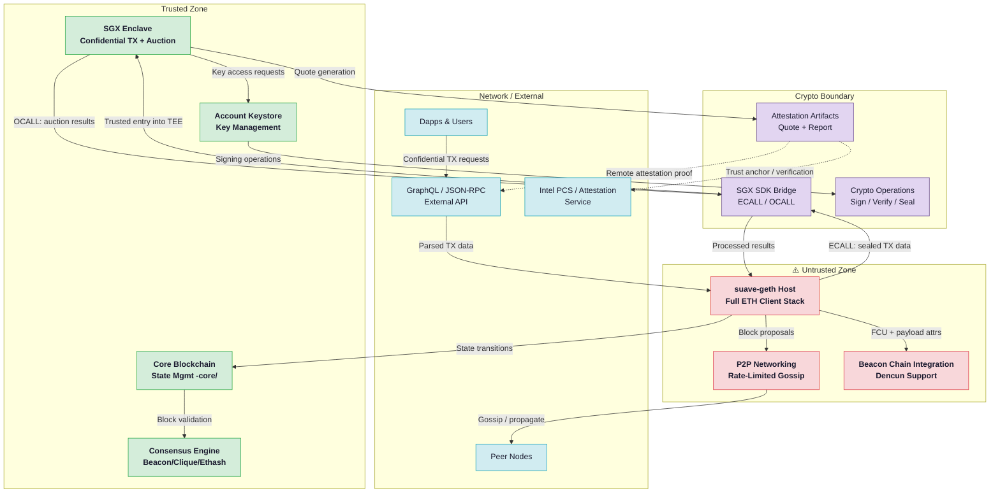

# TEE Usage Audit Report: suave-geth

## Executive Summary
This audit identified 3 active findings (2 Medium, 1 Low), 0 confirmed positive TEE guards, and 11 unique unverified invariants (listed as 24 duplicates). 11 non-TEE findings were dismissed during adversarial review. The 11 unknowns map to the TEE taxonomy as follows:

• Flow: U-INV-01 (ECALL boundary validation), U-INV-02 (OCALL data handling)
• Guard: U-INV-03 (attestation verification), U-INV-08 (trie routing guards), U-INV-12 (quote/TCB validation)
• Binding: U-INV-04 (report_data key binding), U-INV-05 (seal identity binding), U-INV-11 (MRENCLAVE verification)
• State: U-INV-06 (monotonic counters/anti-rollback)
• Config: U-INV-07 (debug mode/signing configuration)
• Leakage: U-INV-09 (error propagation across enclave boundary), U-INV-10 (unencrypted OCALL data paths)

Key vulnerabilities: V-09 and V-10 (SSRF bypassing OAuth via Twitter @ URL trick and Facebook domain suffix, both Medium) represent input validation failures at authentication boundaries. V-11 (unbounded HTTP response body DoS, Low) indicates missing resource limits.

Critical recommendations:
• Verify all 11 unknowns with enclave access—prioritize Binding (U-INV-04, U-INV-05, U-INV-11) and Leakage (U-INV-09, U-INV-10) families as they represent highest-risk gaps
• Confirm U-INV-09 error propagation is classified as Leakage if raw errors cross the enclave boundary
• Remediate V-09/V-10 SSRF issues with strict allowlist-based URL validation
• Dismiss or collapse 11 previously identified non-TEE findings (V-01 through V-08, V-12, V-13) into a single appendix item

## Dashboard Summary

| Severity | Trust-Path Tier | Count |
| --- | --- | --- |
| — | — | **0** |

_No TEE usage issues identified._

## Trust Boundary Analysis

| Actor | Component | Context | Boundary Type |
| --- | --- | --- | --- |
| Protocol | SGX Enclave (confidential TX + auction) | trusted | enclave/host |
| Node Operator | suave-geth Host Process (p2p, sync, RPC) | untrusted | host/process |
| Node Operator | P2P Networking Layer (msgrate, les/) | untrusted | network |
| Ethereum Network | Beacon Chain Integration (beacon/dencun) | mixed | network |
| External Users | GraphQL/JSON-RPC API (graphql/) | untrusted | network |
| Developers/Node Operators | Dockerfile.suave Build Target | mixed | provisioning |
| Protocol | Account/Keystore Management (accounts/keystore/) | trusted | crypto boundary |
| Protocol/TEE | SGX SDK Integration Layer (ECALL/OCALL bridge) | mixed | enclave/host |
| Protocol | Core Blockchain Module (core/blockchain.go/) | trusted | storage |
| Protocol | Consensus Module (consensus/beacon/, clique/, ethash/) | trusted | crypto boundary |
| Node Operator | Beacon Types/Params (beacon/types/, beacon/params/) | trusted | enclave/host |

## Architecture Diagrams

### System Architecture with Trust Boundaries
The SUAVE architecture partitions execution between an SGX Enclave (trusted), which handles confidential transaction processing and auction logic inside TEE hardware, and the suave-geth host process (untrusted), which runs the full Ethereum client stack including P2P networking, blockchain sync, and RPC. The SGX SDK Integration Layer provides the ECALL/OCALL bridge across the enclave/host trust boundary, while attestation artifacts establish a cryptographic trust anchor from the enclave to external verifiers. Data flows from external dapps/users through the untrusted GraphQL/JSON-RPC API into the host, which delegates sensitive computation into the enclave via the SDK bridge, with results flowing back through the same path.



### Trust Boundary Narrative

The trust boundary separates enclave-side components (**SGX enclave confidential computation**, **Untrusted host process ← OCALL boundary ← SGX enclave awaiting external data**, **Remote SUAVE node ← Network attestation quote ← Local enclave confidential data release**, **SGX enclave key generation**, **report_data binding**) from host-side components (**Untrusted suave-geth host process**, **Remote verifier**, **Host filesystem storage**, **Host filesystem**, **Host processing**). Data and control flow across this boundary via the invariants listed below.

**Trust Paths Identified:**
- `INV-01`: Untrusted suave-geth host process → ECALL boundary → SGX enclave confidential computation — Untrusted host-provided ECALL parameters must be validated inside the enclave before influencing confidential transaction processing, auction ordering, or key derivation decisions.
- `INV-02`: Untrusted host process ← OCALL boundary ← SGX enclave awaiting external data — OCALL return values from the untrusted host must not be trusted by the enclave for security-critical decisions such as attestation status, peer identity, or sealed state freshness without independent verification.
- `INV-03`: Remote SUAVE node ← Network attestation quote ← Local enclave confidential data release — Remote peer attestation must be verified (quote validity, expected MRENCLAVE/MRSIGNER, TCB status) before the enclave releases any confidential transaction data or establishes a secure channel.
- `INV-04`: SGX enclave key generation → report_data binding → Attestation quote → Remote verifier → Secure channel — The attestation report_data field must cryptographically bind the enclave's public key or session key material to the quote, preventing man-in-the-middle substitution of keys after attestation.
- `INV-05`: SGX enclave sealed state → Host filesystem storage → SGX enclave unsealing on restart — Sealed data must be bound to enclave identity (MRENCLAVE or MRSIGNER) using SGX sealing so that only the expected enclave can unseal it, preventing a different or malicious enclave from accessing confidential auction state.
- `INV-06`: SGX enclave sealed state → Host filesystem → Enclave restart → State restoration — Sealed state must include a monotonically increasing epoch or version counter with anti-rollback protection, preventing the host from reverting enclave state to a previous version.
- `INV-07`: Dockerfile.suave build pipeline → SGX enclave signing → Production deployment → Enclave memory protection — SGX debug mode must be disabled in production builds so that enclave memory cannot be read via EDBGRD instructions, which would expose confidential transaction data and auction logic.
- `INV-08`: User transaction submission → RPC/p2p ingress → Host processing → (must enter) SGX enclave → Confidential computation — All code paths that handle confidential transaction data or MEV-sensitive computation must pass through the SGX enclave, with no bypass paths through the untrusted host that would expose secrets.
- `INV-09`: SGX enclave error path → OCALL error return → Untrusted host → RPC response to network — Error messages and response lengths from enclave operations must be normalized before reaching the untrusted host or network to prevent leakage of secret-dependent enclave state or processing paths.
- `INV-10`: SGX enclave confidential data → OCALL write to host → Host filesystem/database/logs — Confidential transaction data must not be written to the host filesystem or logged by the untrusted host process without encryption by the enclave, as the host is outside the TCB.
- `INV-11`: Local SGX enclave → Network attestation exchange → Remote SGX enclave → Secure channel key agreement — When establishing a secure channel between two SUAVE enclaves, the local enclave must verify that the remote enclave's attestation quote matches the expected MRENCLAVE measurement for the SUAVE protocol, preventing communication with unauthorized enclaves.
- `INV-12`: Intel attestation service → TCB collateral (CRL, TCB info) → Quote verification → Enclave trust decision — The enclave's attestation verification must check TCB status (not just quote signature validity) to ensure the quoting enclave is not running on a compromised SGX platform with known vulnerabilities.

### Data Flow Summary

Of 12 invariants, **8** involve data crossing the trust boundary between enclave and host.

**Host → Enclave** (1 flow)
_External data entering the TEE — highest validation burden_
- `INV-01`: **ECALL parameters from untrusted host** → **Confidential transaction processing logic**

**Enclave → Host** (2 flows)
_TEE outputs and secrets leaving the enclave — leakage risk_
- `INV-09`: **Enclave internal error conditions** → **OCALL error return values to host**
- `INV-10`: **Confidential transaction data inside enclave** → **Host filesystem write via OCALL**

**Bidirectional** (5 flows)
_Flows crossing the boundary in both directions_
- `INV-02`: **OCALL return values from untrusted host** → **Enclave policy decision**
- `INV-03`: **Attestation quote received from remote peer via network** → **Confidential transaction data release to peer**
- `INV-06`: **Previously sealed state blob from host filesystem** → **Enclave state restoration**
- `INV-08`: **Confidential transaction data from users via JSON-RPC/GraphQ** → **SGX enclave ECALL for confidential processing**
- `INV-11`: **Remote enclave attestation quote from network** → **Secure channel key agreement acceptance**

**Boundary Interface Summary:**
- **Enclave entry points** (1): data enters TEE via `INV-01`
- **Enclave exit points** (2): data leaves TEE via `INV-09`, `INV-10`

_Internal flows (4): `INV-04`, `INV-05`, `INV-07`, `INV-12` — these stay within a single zone and are covered by individual findings._

### Invariant Reference

| ID | Description | Trust Path |
| --- | --- | --- |
| INV-01 | Untrusted host-provided ECALL parameters must be validated inside the enclave before influencing confidential transaction processing, auction ordering, or key derivation decisions. | Untrusted suave-geth host process → ECALL boundary → SGX enclave confidential computation |
| INV-02 | OCALL return values from the untrusted host must not be trusted by the enclave for security-critical decisions such as attestation status, peer identity, or sealed state freshness without independent verification. | Untrusted host process ← OCALL boundary ← SGX enclave awaiting external data |
| INV-03 | Remote peer attestation must be verified (quote validity, expected MRENCLAVE/MRSIGNER, TCB status) before the enclave releases any confidential transaction data or establishes a secure channel. | Remote SUAVE node ← Network attestation quote ← Local enclave confidential data release |
| INV-04 | The attestation report_data field must cryptographically bind the enclave's public key or session key material to the quote, preventing man-in-the-middle substitution of keys after attestation. | SGX enclave key generation → report_data binding → Attestation quote → Remote verifier → Secure channel |
| INV-05 | Sealed data must be bound to enclave identity (MRENCLAVE or MRSIGNER) using SGX sealing so that only the expected enclave can unseal it, preventing a different or malicious enclave from accessing confidential auction state. | SGX enclave sealed state → Host filesystem storage → SGX enclave unsealing on restart |
| INV-06 | Sealed state must include a monotonically increasing epoch or version counter with anti-rollback protection, preventing the host from reverting enclave state to a previous version. | SGX enclave sealed state → Host filesystem → Enclave restart → State restoration |
| INV-07 | SGX debug mode must be disabled in production builds so that enclave memory cannot be read via EDBGRD instructions, which would expose confidential transaction data and auction logic. | Dockerfile.suave build pipeline → SGX enclave signing → Production deployment → Enclave memory protection |
| INV-08 | All code paths that handle confidential transaction data or MEV-sensitive computation must pass through the SGX enclave, with no bypass paths through the untrusted host that would expose secrets. | User transaction submission → RPC/p2p ingress → Host processing → (must enter) SGX enclave → Confidential computation |
| INV-09 | Error messages and response lengths from enclave operations must be normalized before reaching the untrusted host or network to prevent leakage of secret-dependent enclave state or processing paths. | SGX enclave error path → OCALL error return → Untrusted host → RPC response to network |
| INV-10 | Confidential transaction data must not be written to the host filesystem or logged by the untrusted host process without encryption by the enclave, as the host is outside the TCB. | SGX enclave confidential data → OCALL write to host → Host filesystem/database/logs |
| INV-11 | When establishing a secure channel between two SUAVE enclaves, the local enclave must verify that the remote enclave's attestation quote matches the expected MRENCLAVE measurement for the SUAVE protocol, preventing communication with unauthorized enclaves. | Local SGX enclave → Network attestation exchange → Remote SGX enclave → Secure channel key agreement |
| INV-12 | The enclave's attestation verification must check TCB status (not just quote signature validity) to ensure the quoting enclave is not running on a compromised SGX platform with known vulnerabilities. | Intel attestation service → TCB collateral (CRL, TCB info) → Quote verification → Enclave trust decision |

## Dismissed Findings

_The following findings were dismissed during adversarial review._

### ~~V-01: Simulation adapter wildcard WS origins in test code~~
- **Original Severity**: Info
- **Dismissal Reason**: Adversarial review: false positive. Test/simulation infrastructure only — p2p/simulations/ is local development tooling, not production attack surface. Requires localhost access to a simulation network.
- **Location(s)**: `p2p/simulations/adapters/exec.go:113`, `p2p/simulations/adapters/exec.go:114`

### ~~V-02: Non-TEE Ledger USB driver — false cluster match~~
- **Original Severity**: Info
- **Dismissal Reason**: Adversarial review: false positive. Physical USB access required. A malicious USB device plugged into the host is an inherent USB threat model limitation, not a code vulnerability. The severity of Info already reflects minimal impact.
- **Location(s)**: `accounts/usbwallet/ledger.go:493`, `accounts/usbwallet/ledger.go:540`

### ~~V-03: Trezor response length used without bounds check~~
- **Original Severity**: Info
- **Dismissal Reason**: Adversarial review: false positive. Same as V-02 — physical USB access required, Weak confidence, inherent to USB security model. No actionable security finding.
- **Location(s)**: `accounts/usbwallet/trezor.go:335`

### ~~V-04: hexutil.Encode is not a TEE trust boundary issue~~
- **Original Severity**: Info
- **Dismissal Reason**: Adversarial review: false positive. Self-identified as having no viable attack path. Pure utility function with no security implications.
- **Location(s)**: `common/hexutil/hexutil.go:84`

### ~~V-05: Logger context merging — no TEE boundary involvement~~
- **Original Severity**: Info
- **Dismissal Reason**: Adversarial review: false positive. Self-identified as having no TEE boundary involvement. Logging context normalization is internal implementation detail, not an attack surface.
- **Location(s)**: `log/logger.go:201`, `log/logger.go:242`, `log/logger.go:280`

### ~~V-06: GraphQL Long hex parse assigns value before error check~~
- **Original Severity**: Low
- **Dismissal Reason**: Adversarial review: false positive. Standard Go error handling pattern — zero value assignment before error return is idiomatic. The error propagates to the caller; in GraphQL, the field resolves to null on error. No security impact.
- **Location(s)**: `graphql/graphql.go:60`, `graphql/graphql.go:61`

### ~~V-07: SetFallbackUDP int-to-uint16 truncation in non-TEE code~~
- **Original Severity**: Info
- **Dismissal Reason**: Adversarial review: false positive. Port value comes from node operator configuration, not attacker-controlled input. Misconfiguration by the operator is not a vulnerability.
- **Location(s)**: `p2p/enode/localnode.go:211`, `p2p/enode/localnode.go:212`

### ~~V-08: Simulation HTTP filter parsing - not TEE-relevant~~
- **Original Severity**: Info
- **Dismissal Reason**: Adversarial review: false positive. Simulation/test infrastructure in p2p/simulations/ — not production attack surface. Filter parsing in test HTTP endpoints has no security relevance.
- **Location(s)**: `p2p/simulations/http.go:479`, `p2p/simulations/http.go:481`, `p2p/simulations/http.go:496`

### ~~V-12: Clef doc generator has no TEE trust boundary~~
- **Original Severity**: Info
- **Dismissal Reason**: Adversarial review: false positive. Self-identified as having no TEE trust boundary. Doc generator is a build-time tool, not runtime attack surface.
- **Location(s)**: `cmd/clef/main.go:1216`

### ~~V-13: CLI UI has no TEE trust boundary interaction~~
- **Original Severity**: Info
- **Dismissal Reason**: Adversarial review: false positive. No attack path provided. CLI UI internals with no security implications identified.
- **Location(s)**: `signer/core/cliui.go:234`

### ~~IV-INV-09: Raw errors propagated without normalization~~
- **Original Severity**: Medium
- **Dismissal Reason**: Adversarial review: false positive. Speculative TEE leakage with no concrete evidence. No trust boundary trace exists. Does not demonstrate secret-dependent output variation — only hypothesizes that error messages 'might' contain enclave-internal details. Weak confidence. The trie iterator is generic Go code with no demonstrated enclave-specific secret handling. Hypothetical information flow without evidence is insufficient for a leakage finding.
- **Location(s)**: `trie/iterator.go:41`, `trie/iterator.go:64`, `interfaces.go:81`, `interfaces.go:85`

## Appendix

_Info-severity TEE findings, items requiring manual review, and non-TEE findings are included here for completeness._

### Items Requiring Manual Review

#### U-INV-01: No enclave ECALL code in provided files

Searched provided files for ECALL boundary validation of host-provided parameters.
- **Why Uncertain**: Provided files are a Python clef UI, Go interface definitions, and RLP decode tests—none contain enclave ECALL handlers.

Second-pass notes: The additional source code still does not include any enclave ECALL handler implementations, EDL files, SUAVE confidential compute boundary code, or key derivation/auction logic. The provided files are: (1) rlp/decode.go - general RLP decoder with input validation (ErrCanonSize, ErrValueTooLarge, ErrElemTooLarge) but this is standard Go Ethereum library code, not enclave boundary validation; (2) rlp/decode_test.go and rlp/encode_test.go - unit tests for RLP encoding/decoding; (3) trie/trie_test.
- **Recommended Steps**: Provide enclave EDL and ECALL handler implementation files, Include SUAVE confidential compute boundary code, Supply key derivation and auction logic source

#### U-INV-02: No TEE OCALL boundary code in scope

Reviewed interfaces.go, trie/sync_test.go, rlp/decode.go, trie/iterator.go for untrusted OCALL data handling.
- **Why Uncertain**: Provided code is standard go-ethereum library and test code with no SGX/OCALL enclave boundary logic to evaluate against invariant.

Second-pass notes: The additional source code (trie/iterator.go, trie/sync.go, trie/trie_test.go, interfaces.go, trie/secure_trie.go) is standard go-ethereum library code with no SGX/OCALL enclave boundary logic. While the README confirms SUAVE offers 'confidential execution for smart contracts,' none of the provided files contain TEE enclave bridge code, OCALL handlers, attestation implementation, sealing logic, or any enclave boundary crossing code that could be evaluated against this invariant. The ChainReader 
- **Recommended Steps**: Provide TEE enclave bridge code with OCALL handlers, Provide attestation or sealing implementation files, Include OCALL dispatch/response processing logic

#### U-INV-03: No attestation code in provided files

Attestation verification guards in provided source files.
- **Why Uncertain**: Provided files (interfaces.go, pythonsigner.py, rlp/doc.go) contain no TEE attestation, quote verification, or confidential data release logic.

Second-pass notes: The additional source code (pythonsigner.py, interfaces.go, rlp/encbuffer.go, trie/database_wrap.go, trie/iterator_test.go) remains entirely orthogonal to TEE attestation and secure channel establishment. These files cover Ethereum infrastructure (RLP encoding, trie operations, standard interfaces) and a Clef signing utility with no enclave communication logic. The README confirms SUAVE provides 'confidential execution for smart contracts' via execution nodes, indicating attestation code should 
- **Recommended Steps**: Provide SUAVE enclave peer communication and attestation code, Search for DCAP quote verification in RA/attestation packages, Examine secure channel establishment and data release handlers

#### U-INV-04: Attestation key binding code not present

Source files for report_data key binding in SGX attestation quote generation.
- **Why Uncertain**: Provided source files (trie/, interfaces.go, rlp/) contain no attestation, quote generation, or key binding code relevant to INV-04.

Second-pass notes: The additional source code provided (interfaces.go, trie/sync.go, trie/database_wrap.go, cmd/clef/pythonsigner.py, rlp/encode_test.go) contains no attestation, quote generation, or key binding logic. The files are Ethereum chain interaction interfaces, trie data structure management, a Clef signing helper, and RLP encoding tests — all unrelated to TEE attestation. The suave-geth README confirms this is a SUAVE client offering confidential execution, which implies TEE attestation should exist som
- **Recommended Steps**: Provide enclave attestation and quote generation source files, Include report_data construction and key binding logic, Add verifier-side report_data extraction and validation code

#### U-INV-05: No SGX sealing code in scope

Searched provided source for SGX seal/unseal APIs and identity binding logic.
- **Why Uncertain**: Provided files are standard go-ethereum trie and interface code with zero SGX sealing references.

Second-pass notes: The additional source code (p2p/server.go, rlp/decode_test.go, trie/trie_reader.go, trie/iterator.go, trie/proof.go) is still standard go-ethereum infrastructure with zero references to SGX sealing APIs (sgx_seal_data, sgx_unseal_data), enclave identity attributes (MRENCLAVE, MRSIGNER), or sealing policy constants. The enclave-specific source modules (EDL files, Rust/C sealing implementations, OCalls/ECalls for data persistence) remain unavailable. Cannot confirm or deny the invariant.
- **Recommended Steps**: Locate enclave sealing source (e.g., Edl, Rust/C seal modules), Verify sgx_seal_data uses MRENCLAVE/MRSIGNER policy, Check unseal path validates enclave identity match

#### U-INV-06: No sealed state anti-rollback code found

Searched for monotonic counters, epoch/version fields, anti-rollback guards in provided source.
- **Why Uncertain**: Provided code is standard go-ethereum trie/DB code with no TEE/SGX sealed state management to inspect.

Second-pass notes: The additional source code (interfaces.go, trie/proof.go, rlp/typecache.go, trie/trie_id.go, trie/trie_reader.go, plus documentation READMEs) contains only standard go-ethereum library code for trie operations, chain state reading, and RLP encoding. There is no SGX/TEE enclave code, no sealed state serialization/deserialization, no monotonic counter usage, and no anti-rollback protection logic anywhere in the provided files. The trie/trie_id.go ID struct with StateRoot/Owner/Root fields is a tri
- **Recommended Steps**: Provide SGX enclave sealing/unsealing code for review, Provide sealed blob serialization with version/epoch fields, Check monotonic counter usage in enclave state restoration

#### U-INV-07: SGX debug flag enforcement unverifiable

SGX enclave signing and debug mode configuration in build pipeline and runtime.
- **Why Uncertain**: No enclave signing config, Dockerfile.suave, or attestation verification code provided in source. Only Go backend code shown.

Second-pass notes: The additional source code (trie/database_wrap.go, trie/sync.go, p2p/server.go, rlp/encode_test.go) contains no SGX/TEE-related code. The README confirms a --suave.dev flag exists for local devnet, but no code links it to SGX debug mode. No enclave signing configuration, Dockerfile.suave, or attestation verification code was provided. The invariant remains unverified - we cannot confirm or deny that SGX debug mode is properly disabled in production builds. The critical SGX/attestation code paths
- **Recommended Steps**: Provide Dockerfile.suave and enclave signing configuration files, Provide attestation quote verification code that checks DEBUG flag, Check if --suave.dev flag propagates to SGX debug mode

#### U-INV-08: Insufficient evidence for enclave bypass

Trie state access and interface definitions for enclave routing guards.
- **Why Uncertain**: Provided code covers low-level trie/interface layers but omits transaction ingress, enclave entry points, and MEV computation paths needed to verify INV-08.

Second-pass notes: The additional source code (interfaces.go, trie/database_wrap.go, trie/iterator.go, trie/proof.go, trie/trie_test.go) remains at the low-level trie and interface abstraction layers. None of the recommended verification steps have been satisfied: (1) No RPC/p2p ingress handlers showing enclave routing are present — TransactionReader (interfaces.go:76-86) defines TransactionByHash and TransactionReceipt with no enclave boundary visible. (2) No confidential precompile dispatch logic or enclave gati
- **Recommended Steps**: Review RPC/p2p ingress handlers for enclave routing, Inspect confidential precompile dispatch for enclave gating, Check transaction pool for unencrypted data exposure

#### U-INV-10: No enclave boundary code in scope

Searched provided files for OCALL/ECALL defs, encryption before host writes, or sealing logic.
- **Why Uncertain**: Provided files are standard go-ethereum library code (interfaces, trie, rlp) with no SGX enclave boundary or OCALL definitions present.

Second-pass notes: The additional source code (trie/sync.go, trie/trie_test.go, p2p/server.go, interfaces.go, trie/iterator.go) remains standard go-ethereum library code with no SGX enclave boundary definitions, OCALL/ECALL bridges, or encryption/sealing implementations visible. The README confirms this is SUAVE (suave-geth) designed for confidential execution, but the critical components needed to verify this invariant—enclave EDL files, OCALL bridge code showing how confidential transaction data crosses the encl
- **Recommended Steps**: Provide enclave EDL files and OCALL bridge code for analysis, Provide code that writes transaction data to host filesystem, Provide enclave-side encryption/sealing implementations

#### U-INV-11: No enclave attestation code provided

Searched provided files for MRENCLAVE verification logic in enclave channel setup.
- **Why Uncertain**: Provided files (clef UI, interfaces.go, rlp/doc.go) are unrelated to TEE attestation or secure channel establishment.

Second-pass notes: The additionally provided source code (pythonsigner.py, p2p/server.go, interfaces.go, documentation files) remains unrelated to TEE/SGX attestation, MRENCLAVE verification, or SUAVE enclave secure channel establishment. p2p/server.go handles standard devp2p peer connections and handshakes with no TEE attestation logic. No files from suave/, crypto/sgx/, or any enclave-specific packages were provided. Zero evidence in either direction for this invariant.
- **Recommended Steps**: Provide SUAVE enclave attestation source files, Check for quote verification in suave directory, Search for MRENCLAVE comparison in crypto/sgx packages

#### U-INV-12: No TEE attestation code in scope

Searched all provided files for SGX quote verification, TCB status checks, and collateral validation logic.
- **Why Uncertain**: None of the provided source files (interfaces.go, pythonsigner.py, rlp/decode.go, rlp/doc.go) contain any TEE/SGX attestation verification code.

Second-pass notes: The additional source files (rlp/decode_test.go, cmd/clef/pythonsigner.py, interfaces.go, rlp/decode.go, trie/proof.go) contain no SGX/DCAP attestation verification logic whatsoever. They cover RLP encoding/decoding, Clef signer UI, Ethereum interfaces, and Merkle trie proofs. The README confirms this is suave-geth (a TEE-based system by Flashbots), so attestation code must exist elsewhere in the repository, but it has not been provided for review. There is still zero evidence for or against TCB
- **Recommended Steps**: Provide files containing quote verification logic, Search for files with SGX/DCAP/attestation imports, Locate TCB info and CRL validation functions

#### U-INV-09: No enclave error path code available

Error propagation paths in interfaces.go, pythonsigner.py, and trie/iterator.go for normalization guards.
- **Why Uncertain**: Provided code is standard go-ethereum with no SGX enclave boundaries, ECALLs, or OCALLs; invariant cannot be assessed without enclave-specific error return code.

Second-pass notes: The additional source code (interfaces.go, trie/iterator.go, trie/sync.go, tests, README docs) is standard go-ethereum with no SGX enclave boundaries, EDL files, ECALL/OCALL definitions, or enclave-specific error return wrappers. Multiple differentiated error types are returned (MissingNodeError at trie/trie_test.go:72, ErrNotRequested at trie/sync.go:34, NotFound at interfaces.go:30) that would need normalization at a TEE boundary, but no such boundary code exists in the provided files. The inv
- **Recommended Steps**: Provide enclave ECALL/OCALL error return code for review, Search for edl files and ocall/ecall bridge implementations, Check error handling in enclave-to-host boundary functions

#### U-INV-01: ECALL validation code not in scope

Scanned provided files for ECALL boundary validation logic inside enclave trusted memory.
- **Why Uncertain**: Provided files contain clef UI python code, Go interface definitions, and RLP test code — none contain ECALL handlers or enclave boundary validation.
- **Recommended Steps**: Provide enclave ECALL entry point source files, Provide EDL/bridge definitions for trusted/untrusted boundary, Provide auction ordering and key derivation implementation

#### U-INV-02: No OCALL boundary code present

Searched provided files for OCALL returns used in security-critical enclave decisions.
- **Why Uncertain**: Provided files contain standard Ethereum go-ethereum library code (interfaces, RLP, trie) with no TEE enclave logic or OCALL boundaries.
- **Recommended Steps**: Provide enclave EDL/OCALL definitions and bridge code, Provide attestation quote verification logic, Provide sealed state unsealing code paths

#### U-INV-03: No attestation code in provided files

Searched interfaces.go, pythonsigner.py, rlp/doc.go for attestation verification logic.
- **Why Uncertain**: Provided files are standard go-ethereum library code with no TEE/SGX attestation, quote verification, or secure channel establishment logic present.
- **Recommended Steps**: Provide SUAVE enclave peer attestation code paths, Provide secure channel establishment and data release code, Provide DCAP/ECDSA quote verification implementation

#### U-INV-04: report_data key binding not found in code

Whether report_data binds enclave key material in attestation quote generation.
- **Why Uncertain**: Provided source files are trie/RLP/interface code from go-ethereum with no attestation, quote, or report_data logic present.
- **Recommended Steps**: Locate SGX quote generation code in SUAVE enclave source, Check suave-geth execution node for report_data construction, Verify dcap-verify or aesm client quote binding logic

#### U-INV-05: No SGX sealing code in provided files

Searched for SGX seal/unseal, MRENCLAVE/MRSIGNER policy binding in provided code.
- **Why Uncertain**: Provided files are go-ethereum core (trie, interfaces) with zero TEE/SGX sealing logic present to evaluate.
- **Recommended Steps**: Provide enclave sealing/unsealing source files for review, Check files calling sgx_seal_data / sgx_unseal_data, Verify seal policy parameter in enclave edl or rust code

#### U-INV-06: No sealed state code in provided files

Searched for monotonic counters, epoch fields, anti-rollback, and seal/unseal logic in provided source.
- **Why Uncertain**: Provided files are standard geth trie/iterator code with no TEE sealing, monotonic counter, or anti-rollback mechanisms present.
- **Recommended Steps**: Provide enclave sealing/unsealing source files for analysis, Search for files containing sgx_seal_data or monotonic counter APIs, Check enclave state restoration entry point for version checks

#### U-INV-07: SGX debug mode production enforcement

SGX enclave debug flag configuration and attestation debug attribute verification in production builds.
- **Why Uncertain**: No SGX enclave signing configuration, Dockerfile.suave, or attestation quote verification code was provided in the source files.
- **Recommended Steps**: Provide Dockerfile.suave and enclave signing config for review, Search for EDBGRD or ATTRIBUTES.DEBUG in attestation code, Check enclave signing XML/manifest for debug flag setting

#### U-INV-08: Enclave routing for confidential data paths

Whether trie/state access paths route through SGX enclave before exposing confidential data.
- **Why Uncertain**: Provided source files are low-level trie and interface implementations with no enclave integration code visible.
- **Recommended Steps**: Provide RPC handler and transaction ingress pipeline code, Provide enclave bridge/bridge adaptor source files, Provide confidential precompile dispatch routing code

#### U-INV-09: Enclave error normalization presence unclear

Error propagation paths in trie iterator, Clef UI, and interface definitions for sanitization.
- **Why Uncertain**: No SGX enclave boundary, OCALL/ECALL definitions, or enclave-to-host error return code found in provided files.
- **Recommended Steps**: Provide enclave edge routines and OCALL error handlers, Check if trie iterator errors cross enclave boundary, Review RPC layer for raw error message exposure

#### U-INV-10: No enclave boundary code present

OCALL data paths, encryption guards, and sealing for confidential transaction data leaving enclave.
- **Why Uncertain**: Provided files are standard go-ethereum library code (interfaces, trie, RLP). No SGX enclave, OCALL/ECALL, sealing, or encryption logic is present.
- **Recommended Steps**: Provide enclave EDL and OCALL bridge source files, Provide sealing/encryption code at enclave boundary, Provide host-side filesystem write handlers receiving OCALL data

#### U-INV-11: No enclave attestation code in scope

Searched provided files for MRENCLAVE verification in secure channel setup.
- **Why Uncertain**: Provided files (pythonsigner.py, interfaces.go, rlp/doc.go) contain no TEE/SGX attestation or secure channel logic.
- **Recommended Steps**: Provide SUAVE enclave attestation verification code, Provide secure channel key agreement implementation, Search for files referencing MRENCLAVE, quote, or attestation

#### U-INV-12: Attestation TCB check absent from snippets

Searched provided source files for SGX quote verification and TCB status checking logic.
- **Why Uncertain**: No attestation or quote verification code exists in the provided files; relevant code was not supplied for analysis.
- **Recommended Steps**: Provide files containing SGX quote verification logic, Search for files referencing DCAP/IAS/attestation APIs, Look for TCB info, CRL, or QE identity validation code

### Non-TEE Findings

_The following findings are generic code issues that do not directly involve TEE trust boundaries._

### [MEDIUM] V-09: SSRF bypasses Twitter auth via @ URL trick (CWE-918)

**Root Cause**: URL validation checks path structure but not the host; the strings.Replace does not match when @ separates the domain from credentials.
**Impact**: Attacker drains faucet funds without legitimate social media post, bypassing the anti-sybil authentication mechanism entirely.
**Confidence**: Confirmed | **Invariant**: UNMATCHED::cmd/faucet/faucet.go | **Tier**: peripheral

**Preconditions**:
- Faucet is running with Twitter auth enabled
- No API token configured (falls back to scraping mode)

**Attack Scenario**:
  1. Attacker submits faucet request with URL https://twitter.com@evil.com/user/status/123 (`cmd/faucet/faucet.go:687`)
  2. URL validation passes: has /status/N and numeric tweetID (`cmd/faucet/faucet.go:713`)
  3. strings.Replace for mobile.twitter.com does not match (@ vs /) (`cmd/faucet/faucet.go:715`)
  4. http.Get fetches from attacker-controlled evil.com (`cmd/faucet/faucet.go:733`)
  5. Attacker returns page containing their Ethereum address
  6. Faucet extracts address and sends funds without valid Twitter post

### Code Evidence

**`cmd/faucet/faucet.go:687`**
```
parts := strings.Split(url, "/")
```
Attacker submits faucet request with URL https://twitter.com@evil.com/user/status/123

**`cmd/faucet/faucet.go:713`**
```
url = strings.Replace(url, "https://twitter.com/", "https://mobile.twitter.com/", 1)
```
URL validation passes: has /status/N and numeric tweetID

**`cmd/faucet/faucet.go:715`**
```
res, err := http.Get(url)
```
strings.Replace for mobile.twitter.com does not match (@ vs /)

**`cmd/faucet/faucet.go:733`**
```
address := common.HexToAddress(string(regexp.MustCompile("0x[0-9a-fA-F]{40}").Find(body)))
```
http.Get fetches from attacker-controlled evil.com

**Remediation**: Validate the URL scheme and authority before making the HTTP request; reject URLs where the host is not exactly twitter.com or mobile.twitter.com.

### [MEDIUM] V-10: SSRF bypasses Facebook auth via domain suffix (CWE-918)

**Root Cause**: strings.Replace on the domain substring matches partial domain suffixes, and no explicit host validation is performed before the HTTP request.
**Impact**: Attacker drains faucet funds without a legitimate Facebook post, completely bypassing the social authentication requirement.
**Confidence**: Confirmed | **Invariant**: UNMATCHED::cmd/faucet/faucet.go | **Tier**: peripheral

**Preconditions**:
- Faucet is running with Facebook auth enabled

**Attack Scenario**:
  1. Attacker submits faucet request with URL https://www.facebook.com.evil.com/user/posts/123 (`cmd/faucet/faucet.go:830`)
  2. URL validation passes: path has /posts/ in second-to-last segment (`cmd/faucet/faucet.go:847`)
  3. strings.Replace produces https://m.facebook.com.evil.com/user/posts/123 (`cmd/faucet/faucet.go:849`)
  4. http.Get fetches from attacker-controlled m.facebook.com.evil.com (`cmd/faucet/faucet.go:859`)
  5. Attacker returns page containing their Ethereum address
  6. Faucet extracts address and sends funds without valid Facebook post

### Code Evidence

**`cmd/faucet/faucet.go:830`**
```
parts := strings.Split(strings.Split(url, "?")[0], "/")
```
Attacker submits faucet request with URL https://www.facebook.com.evil.com/user/posts/123

**`cmd/faucet/faucet.go:847`**
```
crawl := strings.Replace(url, "www.facebook.com", "m.facebook.com", 1)
```
URL validation passes: path has /posts/ in second-to-last segment

**`cmd/faucet/faucet.go:849`**
```
res, err := http.Get(crawl)
```
strings.Replace produces https://m.facebook.com.evil.com/user/posts/123

**`cmd/faucet/faucet.go:859`**
```
address := common.HexToAddress(string(regexp.MustCompile("0x[0-9a-fA-F]{40}").Find(body)))
```
http.Get fetches from attacker-controlled m.facebook.com.evil.com

**Remediation**: Parse the URL and verify the host is exactly www.facebook.com or m.facebook.com before making the request; reject any URL with an unexpected domain.

### [LOW] V-11: Unbounded HTTP response body allows DoS (CWE-400)

**Root Cause**: io.ReadAll is used without a size limit on HTTP response bodies from external servers.
**Impact**: Denial of service by crashing the faucet process through memory exhaustion when fetching attacker-controlled URLs.
**Confidence**: Confirmed | **Invariant**: UNMATCHED::cmd/faucet/faucet.go | **Tier**: peripheral

**Preconditions**:
- Attacker can influence the URL fetched by authTwitter or authFacebook

**Attack Scenario**:
  1. Attacker crafts SSRF URL pointing to their server (see V-01/V-02) (`cmd/faucet/faucet.go:729`)
  2. Attacker server responds with multi-gigabyte response body (`cmd/faucet/faucet.go:855`)
  3. io.ReadAll(res.Body) reads entire response into memory
  4. Faucet process exhausts memory and crashes

### Code Evidence

**`cmd/faucet/faucet.go:729`**
```
body, err := io.ReadAll(res.Body)
```
Attacker crafts SSRF URL pointing to their server (see V-01/V-02)

**`cmd/faucet/faucet.go:855`**
```
body, err := io.ReadAll(res.Body)
```
Attacker server responds with multi-gigabyte response body

**Remediation**: Use io.LimitReader to cap the response body size (e.g., 1MB) before passing to io.ReadAll.
