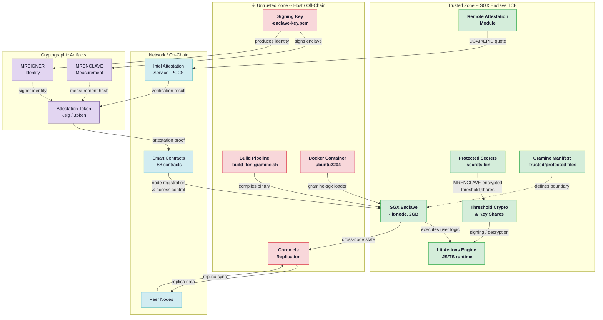

# TEE Usage Audit Report: Node

## Executive Summary
This TEE audit identified 1 informational finding, 16 unknowns, and 1 partially confirmed positive guard. No critical, high, or medium severity vulnerabilities were found in the reviewed code.

**Key Finding:**
• IV-INV-04 (Info): Insecure filesystem-based build key provisioning — build keys provisioned via filesystem during enclave initialization lack integrity verification (see Appendix A, enclave/init.rs:L142-L158). Recommend switching to attested secret provisioning via sealed storage.

**Positive Guard Confirmed:**
• PG3-U-INV-03: On-chain PKP access control mediation (partial completeness) — smart contracts correctly mediate PKP access, though TEE-side enforcement could not be fully verified due to missing enclave source.

**Unknowns (16 total):** Key gaps include enclave sealing key policy (U-INV-02), sealed secret epoch/version validation (U-INV-07), sgx.allowed_files sensitivity (U-INV-10), and on-chain MRENCLAVE attestation during node registration (U-INV-08). These stem from missing enclave-side source code and attestation implementation.

**Dismissed False Positives (5):** All 5 flagged during automated analysis were dismissed during adversarial review as inapplicable patterns or scope-excluded code paths. See Appendix B for individual dismissal rationales.

**Recommendations:**
• Provide enclave source code for complete TEE coverage
• Implement attested key provisioning for build secrets
• Add MRENCLAVE verification to node registration flow

## Dashboard Summary

| Severity | Trust-Path Tier | Count |
| --- | --- | --- |
| Info | core | 1 |

## Trust Boundary Analysis

| Actor | Component | Context | Boundary Type |
| --- | --- | --- | --- |
| Lit Protocol | SGX Enclave (lit-node binary, rust/lit-node/) | trusted | enclave/host |
| Lit Protocol | Gramine Manifest (trusted/protected/allowed files) | trusted | enclave boundary config |
| Lit Protocol | SGX Signing Infrastructure (enclave-key.pem, sign_sgx.sh) | trusted | crypto boundary |
| Lit Protocol Network | Protected Secret Files (secrets.bin, MRENCLAVE-encrypted) | trusted | storage |
| Lit Protocol | Lit Actions Engine (rust/lit-actions/) | trusted | enclave/host |
| Lit Protocol | Smart Contracts Source (blockchain/contracts/) | untrusted | network |
| Lit Protocol | Gramine Build Pipeline (build_for_gramine.sh) | mixed | build-time |
| Node Operator | Docker Deployment (docker/ubuntu2204/, rust/lit-os/) | untrusted | enclave/host |
| Intel / Lit Protocol | Remote Attestation Module (DCAP/EPID) | trusted | crypto boundary |
| Lit Protocol | Chronicle Replication (chronicle/) | mixed | network |
| Lit Protocol | Lit Core Libraries (rust/lit-core/) | untrusted | enclave/host |

## Trust Boundary Partition Evidence

### Partition Methodology

**Path and content heuristics** classified files by directory patterns (enclave/, host/, trusted/) and TEE API usage (sgx_trts, sgx_urts, attestation); **LLM-assisted classification** for ambiguous files.

**Project TEE Role:** Mixed (contains both TEE and host code)
> Lit Protocol is a distributed network where nodes run inside TEEs (SGX/TDX). The repository contains enclave-side code (lit-node, lit-actions execute inside the TEE), TEE management code (lit-os handles provisioning/attestation with both trusted and untrusted components), and untrusted external code (smart contracts, scripts, chronicle). The heuristic zone map confirms 65 trusted, 35 untrusted, 13 mixed files, indicating a clear trust boundary.

### Source Code Zone Partition

```
├── blockchain/  🔴 Untrusted (152 files)
│   ├── contracts/  🔴 Untrusted (2 files)  — smart contracts
│   ├── contracts/abis/  🔴 Untrusted (2 files)
│   ├── contracts/contracts/common/  🔴 Untrusted (1 file)  — Solidity contracts
│   ├── contracts/contracts/domain-wallets/  🔴 Untrusted (1 file)  — Solidity contracts
│   ├── contracts/contracts/domain-wallets/DomainWalletRegistry/  🔴 Untrusted (3 files)  — Solidity contracts
│   ├── contracts/contracts/facets/  🔴 Untrusted (4 files)  — Solidity contracts
│   ├── contracts/contracts/interfaces/  🔴 Untrusted (5 files)  — Solidity contracts
│   ├── contracts/contracts/libraries/  🔴 Untrusted (2 files)  — Solidity contracts
│   ├── contracts/contracts/lit-core/  🔴 Untrusted (3 files)  — Solidity contracts
│   ├── contracts/contracts/lit-core/HostCommands/  🔴 Untrusted (2 files)  — Solidity contracts
│   ├── contracts/contracts/lit-node/  🔴 Untrusted (18 files)  — Solidity contracts
│   ├── contracts/contracts/lit-node/BackupRecovery/  🔴 Untrusted (5 files)  — Solidity contracts
│   ├── contracts/contracts/lit-node/CloneNet/  🔴 Untrusted (2 files)  — Solidity contracts
│   ├── contracts/contracts/lit-node/PKPNFT/  🔴 Untrusted (2 files)  — Solidity contracts
│   ├── contracts/contracts/lit-node/PKPPermissions/  🔴 Untrusted (2 files)  — Solidity contracts
│   ├── contracts/contracts/lit-node/PaymentDelegation/  🔴 Untrusted (2 files)  — Solidity contracts
│   ├── contracts/contracts/lit-node/PubkeyRouter/  🔴 Untrusted (2 files)  — Solidity contracts
│   ├── contracts/contracts/lit-node/RateLimitNFT/  🔴 Untrusted (3 files)  — Solidity contracts
│   ├── contracts/contracts/lit-node/Staking/  🔴 Untrusted (6 files)  — Solidity contracts
│   ├── contracts/contracts/lit-node/StakingBalances/  🔴 Untrusted (2 files)  — Solidity contracts
│   ├── contracts/contracts/upgradeInitializers/  🔴 Untrusted (2 files)  — Solidity contracts
│   ├── contracts/scripts/  🔴 Untrusted (40 files)  — build/deploy scripts
│   ├── contracts/scripts/admin/  🔴 Untrusted (1 file)
│   ├── contracts/scripts/deployConfig/  🔴 Untrusted (7 files)
│   ├── contracts/scripts/diamondContracts/  🔴 Untrusted (4 files)
│   ├── contracts/scripts/diamondContracts/lib/  🔴 Untrusted (4 files)  — library
│   ├── contracts/scripts/walletsAndStaking/  🔴 Untrusted (5 files)
│   ├── contracts/scripts/walletsAndStaking/utils/  🔴 Untrusted (2 files)  — utilities
│   ├── contracts/test/domain-wallets/  🔴 Untrusted (1 file)
│   ├── contracts/test/lit-core/  🔴 Untrusted (3 files)
│   ├── contracts/test/lit-node/  🔴 Untrusted (11 files)
│   └── contracts/utils/  🔴 Untrusted (3 files)  — utilities
└── rust/  🟡 Mixed (327 trusted, 319 untrusted)
    ├── lit-actions/cli/  🔴 Untrusted (1 file)  — CLI interface
    ├── lit-actions/docs/  🟢 Trusted (1 file)  — documentation
    ├── lit-actions/docs/api_docs_html/  🟢 Trusted (1 file)
    ├── lit-actions/docs/api_docs_html/assets/  🟢 Trusted (3 files)
    ├── lit-actions/ext/  🟢 Trusted (3 files)
    ├── lit-actions/ext/js/  🟢 Trusted (5 files)  — JS bindings
    ├── lit-actions/grpc/  🟢 Trusted (4 files)  — gRPC service
    ├── lit-actions/server/  🔴 Untrusted (5 files)  — server logic
    ├── lit-actions/snapshot/  🟢 Trusted (1 file)
    ├── lit-actions/tests/  🟢 Trusted (3 files)  — test suite
    ├── lit-core/lit-api-core/src/  🔴 Untrusted (1 file)
    ├── lit-core/lit-api-core/src/client/  🔴 Untrusted (1 file)  — client code
    ├── lit-core/lit-api-core/src/client/hyper/  🔴 Untrusted (3 files)
    ├── lit-core/lit-api-core/src/client/reqwest/  🔴 Untrusted (2 files)
    ├── lit-core/lit-api-core/src/config/  🔴 Untrusted (1 file)  — configuration
    ├── lit-core/lit-api-core/src/context/  🔴 Untrusted (1 file)
    ├── lit-core/lit-api-core/src/error/  🔴 Untrusted (2 files)
    ├── lit-core/lit-api-core/src/http/  🔴 Untrusted (1 file)  — HTTP handlers
    ├── lit-core/lit-api-core/src/http/rocket/  🔴 Untrusted (4 files)
    ├── lit-core/lit-api-core/src/http/rocket/helper/  🔴 Untrusted (2 files)
    ├── lit-core/lit-api-core/src/http/tls/  🔴 Untrusted (2 files)
    ├── lit-core/lit-api-core/src/logging/  🔴 Untrusted (1 file)
    ├── lit-core/lit-api-core/src/server/  🔴 Untrusted (1 file)  — server logic
    ├── lit-core/lit-api-core/src/server/hyper/  🔴 Untrusted (1 file)
    ├── lit-core/lit-api-core/src/server/hyper/handler/  🔴 Untrusted (4 files)
    ├── lit-core/lit-attestation/src/  🔴 Untrusted (5 files)
    ├── lit-core/lit-attestation/src/config/  🔴 Untrusted (1 file)  — configuration
    ├── lit-core/lit-attestation/src/service/  🔴 Untrusted (3 files)
    ├── lit-core/lit-attestation/src/utils/  🔴 Untrusted (2 files)  — utilities
    ├── lit-core/lit-attestation/src/verification/  🔴 Untrusted (4 files)
    ├── lit-core/lit-blockchain/src/  🔴 Untrusted (2 files)
    ├── lit-core/lit-blockchain/src/config/  🔴 Untrusted (1 file)  — configuration
    ├── lit-core/lit-blockchain/src/contracts/  🔴 Untrusted (26 files)  — smart contracts
    ├── lit-core/lit-blockchain/src/contracts/release/  🔴 Untrusted (1 file)
    ├── lit-core/lit-blockchain/src/resolver/  🔴 Untrusted (1 file)
    ├── lit-core/lit-blockchain/src/resolver/contract/  🔴 Untrusted (2 files)  — smart contract
    ├── lit-core/lit-blockchain/src/resolver/rpc/  🔴 Untrusted (2 files)  — RPC interface
    ├── lit-core/lit-blockchain/src/util/  🔴 Untrusted (3 files)
    ├── lit-core/lit-cli-core/src/  🔴 Untrusted (2 files)
    ├── lit-core/lit-cli-core/src/cmd/  🔴 Untrusted (1 file)  — CLI commands
    ├── lit-core/lit-cli-core/src/config/  🔴 Untrusted (1 file)  — configuration
    ├── lit-core/lit-cli-core/src/utils/  🔴 Untrusted (8 files)  — utilities
    ├── lit-core/lit-contracts-minimal-generator/src/bin/  🔴 Untrusted (1 file)  — binaries
    ├── lit-core/lit-core-derive/src/  🔴 Untrusted (1 file)
    ├── lit-core/lit-core-derive/src/derive/  🔴 Untrusted (3 files)
    ├── lit-core/lit-core-derive/src/utils/  🔴 Untrusted (2 files)  — utilities
    ├── lit-core/lit-core/src/  🔴 Untrusted (2 files)
    ├── lit-core/lit-core/src/config/  🔴 Untrusted (4 files)  — configuration
    ├── lit-core/lit-core/src/error/  🔴 Untrusted (6 files)
    ├── lit-core/lit-core/src/logging/  🔴 Untrusted (3 files)
    ├── lit-core/lit-core/src/logging/plugin/  🔴 Untrusted (1 file)
    ├── lit-core/lit-core/src/types/  🔴 Untrusted (2 files)  — type definitions
    ├── lit-core/lit-core/src/utils/  🔴 Untrusted (13 files)  — utilities
    ├── lit-core/lit-logging/src/  🔴 Untrusted (2 files)
    ├── lit-core/lit-logging/src/config/  🔴 Untrusted (1 file)  — configuration
    ├── lit-core/lit-logging/src/plugin/  🔴 Untrusted (2 files)
    ├── lit-core/lit-logging/src/service/  🔴 Untrusted (3 files)
    ├── lit-node/  🟢 Trusted (2 files)
    ├── lit-node/common/shiva/src/  🟢 Trusted (9 files)
    ├── lit-node/common/test-common/src/  🟢 Trusted (20 files)
    ├── lit-node/common/test-common/src/testnet/  🟢 Trusted (6 files)
    ├── lit-node/common/test-common/src/testnet/chain/  🟢 Trusted (4 files)
    ├── lit-node/common/utils/bin/  🔴 Untrusted (1 file)  — binaries
    ├── lit-node/common/utils/src/  🟢 Trusted (1 file)
    ├── lit-node/scripts/ci_utils/bin/  🔴 Untrusted (2 files)  — binaries
    ├── lit-node/scripts/ci_utils/src/  🟢 Trusted (1 file)
    ├── lit-node/scripts/download_builds/src/  🟢 Trusted (1 file)
    ├── lit-node/src/  🟢 Trusted (5 files)
    ├── lit-node/src/access_control/  🟢 Trusted (5 files)
    ├── lit-node/src/auth/  🟢 Trusted (6 files)  — authentication
    ├── lit-node/src/auth/capabilities/  🟢 Trusted (3 files)
    ├── lit-node/src/auth/validators/  🟢 Trusted (6 files)
    ├── lit-node/src/config/  🟢 Trusted (2 files)  — configuration
    ├── lit-node/src/constants/  🟢 Trusted (1 file)
    ├── lit-node/src/contracts/  🟢 Trusted (8 files)  — smart contracts
    ├── lit-node/src/endpoints/  🟢 Trusted (5 files)
    ├── lit-node/src/endpoints/admin/  🟢 Trusted (4 files)
    ├── lit-node/src/endpoints/recovery/  🟢 Trusted (3 files)
    ├── lit-node/src/endpoints/versions/  🟢 Trusted (4 files)
    ├── lit-node/src/functions/  🟢 Trusted (4 files)
    ├── lit-node/src/jwt/  🟢 Trusted (1 file)
    ├── lit-node/src/models/  🟢 Trusted (5 files)
    ├── lit-node/src/networking/  🟢 Trusted (1 file)
    ├── lit-node/src/networking/http/  🟢 Trusted (2 files)  — HTTP handlers
    ├── lit-node/src/networking/http/proxy/  🟢 Trusted (2 files)
    ├── lit-node/src/p2p_comms/  🟢 Trusted (1 file)
    ├── lit-node/src/p2p_comms/comms/  🟢 Trusted (4 files)
    ├── lit-node/src/p2p_comms/web/  🟢 Trusted (4 files)
    ├── lit-node/src/peers/  🟢 Trusted (3 files)
    ├── lit-node/src/peers/peer_state/  🟢 Trusted (7 files)
    ├── lit-node/src/peers/utils/  🟢 Trusted (3 files)  — utilities
    ├── lit-node/src/pkp/  🟢 Trusted (2 files)
    ├── lit-node/src/pkp/auth/  🟢 Trusted (9 files)  — authentication
    ├── lit-node/src/rate_limiting/  🟢 Trusted (3 files)
    ├── lit-node/src/services/  🟢 Trusted (2 files)
    ├── lit-node/src/siwe_db/  🟢 Trusted (4 files)
    ├── lit-node/src/tasks/  🟢 Trusted (7 files)
    ├── lit-node/src/tasks/beaver_manager/  🟢 Trusted (4 files)
    ├── lit-node/src/tests/  🟢 Trusted (3 files)  — test suite
    ├── lit-node/src/tss/  🟢 Trusted (1 file)
    ├── lit-node/src/tss/blsful/  🟢 Trusted (3 files)
    ├── lit-node/src/tss/common/  🟢 Trusted (13 files)
    ├── lit-node/src/tss/common/contract/  🟢 Trusted (2 files)  — smart contract
    ├── lit-node/src/tss/common/restore/  🟢 Trusted (4 files)
    ├── lit-node/src/tss/common/traits/  🟢 Trusted (7 files)
    ├── lit-node/src/tss/dkg/  🟢 Trusted (3 files)
    ├── lit-node/src/tss/dkg/curves/  🟢 Trusted (9 files)
    ├── lit-node/src/tss/dkg/gennaro/  🟢 Trusted (3 files)
    ├── lit-node/src/tss/ecdsa_cait_sith/  🟢 Trusted (6 files)
    ├── lit-node/src/tss/ecdsa_cait_sith/v0_2_14/  🟢 Trusted (1 file)
    ├── lit-node/src/tss/frost/  🟢 Trusted (1 file)
    ├── lit-node/src/tss/hd_key_ecdsa/  🟢 Trusted (3 files)
    ├── lit-node/src/utils/  🟢 Trusted (10 files)  — utilities
    ├── lit-node/src/utils/encoding/  🟢 Trusted (10 files)
    ├── lit-node/src/utils/rocket/  🟢 Trusted (2 files)
    ├── lit-node/tests/  🟢 Trusted (3 files)  — test suite
    ├── lit-node/tests/acceptance/  🟢 Trusted (4 files)
    ├── lit-node/tests/acceptance/contracts/EIP1271/  🟢 Trusted (1 file)  — Solidity contracts
    ├── lit-node/tests/component/  🟢 Trusted (5 files)
    ├── lit-node/tests/component/sign/  🟢 Trusted (3 files)
    ├── lit-node/tests/component/utils/  🟢 Trusted (4 files)  — utilities
    ├── lit-node/tests/external/  🟢 Trusted (1 file)
    ├── lit-node/tests/integration/  🟢 Trusted (9 files)
    ├── lit-node/tests/lit_action_scripts/  🟢 Trusted (19 files)
    ├── lit-node/tests/sdk/  🟢 Trusted (1 file)
    ├── lit-node/tests/toxiproxy/  🟢 Trusted (3 files)
    ├── lit-node/tests/upgrades/  🟢 Trusted (2 files)
    ├── lit-os/lit-attestation-service/src/  🔴 Untrusted (4 files)
    ├── lit-os/lit-attestation-service/src/config/  🔴 Untrusted (1 file)  — configuration
    ├── lit-os/lit-attestation-service/src/data/  🔴 Untrusted (2 files)
    ├── lit-os/lit-attestation-service/src/handler/  🔴 Untrusted (4 files)
    ├── lit-os/lit-attestation-service/tests/  🔴 Untrusted (1 file)  — test suite
    ├── lit-os/lit-cli-os/src/  🔴 Untrusted (1 file)
    ├── lit-os/lit-cli-os/src/cmd/  🔴 Untrusted (1 file)  — CLI commands
    ├── lit-os/lit-cli-os/src/cmd/os/  🔴 Untrusted (8 files)
    ├── lit-os/lit-cli-os/src/cmd/os/guest/  🔴 Untrusted (1 file)
    ├── lit-os/lit-cli-os/src/cmd/os/guest/instance/  🔴 Untrusted (15 files)
    ├── lit-os/lit-cli-os/src/cmd/os/guest/template/  🔴 Untrusted (7 files)
    ├── lit-os/lit-cli-os/src/cmd/os/util/  🔴 Untrusted (1 file)
    ├── lit-os/lit-cli-os/src/cmd/os/util/hash/  🔴 Untrusted (1 file)
    ├── lit-os/lit-cli-os/src/cmd/os/util/ipfs/  🔴 Untrusted (3 files)
    ├── lit-os/lit-cli-os/src/config/  🔴 Untrusted (1 file)  — configuration
    ├── lit-os/lit-cli-os/src/guest/  🔴 Untrusted (2 files)
    ├── lit-os/lit-cli-os/src/guest/instance/  🔴 Untrusted (5 files)
    ├── lit-os/lit-cli-os/src/guest/template/  🔴 Untrusted (2 files)
    ├── lit-os/lit-cli-os/src/host/  🔴 Untrusted (3 files)  — host-side code
    ├── lit-os/lit-cli/src/  🔴 Untrusted (1 file)
    ├── lit-os/lit-cli/src/cmd/  🔴 Untrusted (1 file)  — CLI commands
    ├── lit-os/lit-cli/src/cmd/init/  🔴 Untrusted (1 file)
    ├── lit-os/lit-logging-service/src/  🔴 Untrusted (4 files)
    ├── lit-os/lit-logging-service/src/config/  🔴 Untrusted (1 file)  — configuration
    ├── lit-os/lit-logging-service/src/handler/  🔴 Untrusted (2 files)
    ├── lit-os/lit-logging-service/src/service/  🔴 Untrusted (2 files)
    ├── lit-os/lit-logging-service/tests/  🟢 Trusted (1 file)  — test suite
    ├── lit-os/lit-node-operator/src/  🔴 Untrusted (4 files)
    ├── lit-os/lit-node-operator/src/events/  🔴 Untrusted (3 files)
    ├── lit-os/lit-node-operator/tests/  🔴 Untrusted (1 file)  — test suite
    ├── lit-os/lit-os-core/src/  🔴 Untrusted (2 files)
    ├── lit-os/lit-os-core/src/config/  🔴 Untrusted (1 file)  — configuration
    ├── lit-os/lit-os-core/src/guest/  🔴 Untrusted (2 files)
    ├── lit-os/lit-os-core/src/guest/cloud_init/  🔴 Untrusted (5 files)
    ├── lit-os/lit-os-core/src/guest/env/  🔴 Untrusted (5 files)
    ├── lit-os/lit-os-core/src/guest/oneshot/  🔴 Untrusted (3 files)
    ├── lit-os/lit-os-core/src/utils/  🔴 Untrusted (9 files)  — utilities
    ├── lit-os/lit-os-guest-initrd/src/  🔴 Untrusted (2 files)
    ├── lit-os/lit-os-guest-initrd/src/bin/cache_warmer/  🔴 Untrusted (1 file)
    ├── lit-os/lit-os-guest-initrd/src/bin/init/  🔴 Untrusted (1 file)
    ├── lit-os/lit-os-guest-initrd/src/init/  🔴 Untrusted (2 files)
    ├── lit-os/lit-os-guest-initrd/src/init/stage/  🔴 Untrusted (1 file)
    ├── lit-os/lit-os-guest-initrd/src/init/stage/attest/  🟢 Trusted (1 file)
    ├── lit-os/lit-os-guest-initrd/src/init/stage/cleanup/  🔴 Untrusted (1 file)
    ├── lit-os/lit-os-guest-initrd/src/init/stage/debug/  🔴 Untrusted (1 file)
    ├── lit-os/lit-os-guest-initrd/src/init/stage/init/  🔴 Untrusted (1 file)
    ├── lit-os/lit-os-guest-initrd/src/init/stage/oneshot/  🔴 Untrusted (3 files)
    ├── lit-os/lit-os-guest-initrd/src/init/stage/oneshot/action/  🔴 Untrusted (2 files)
    ├── lit-os/lit-os-guest-initrd/src/init/stage/prepare/  🟢 Trusted (1 file)
    ├── lit-os/lit-os-guest-initrd/src/init/stage/setup/  🔴 Untrusted (5 files)
    ├── lit-os/lit-os-guest-initrd/src/init/stage/sync/  🔴 Untrusted (1 file)
    ├── lit-os/lit-os-guest-initrd/src/init/stage/unlock/  🔴 Untrusted (1 file)
    ├── lit-os/lit-os-guest-initrd/src/init/stage/verify/  🔴 Untrusted (1 file)
    ├── lit-os/lit-os-guest-initrd/src/utils/  🔴 Untrusted (7 files)  — utilities
    ├── lit-os/lit-os-prov-api-client/src/  🔴 Untrusted (3 files)
    ├── lit-os/lit-os-prov-api-client/src/api/  🔴 Untrusted (1 file)  — API definitions
    ├── lit-os/lit-os-prov-api-client/src/api/release/  🔴 Untrusted (1 file)
    ├── lit-os/lit-os-prov-api/src/  🔴 Untrusted (2 files)
    ├── lit-os/lit-os-prov-api/src/api/  🔴 Untrusted (1 file)  — API definitions
    ├── lit-os/lit-os-prov-api/src/api/attest/  🔴 Untrusted (1 file)
    ├── lit-os/lit-os-prov-api/src/api/release/  🔴 Untrusted (1 file)
    ├── lit-os/lit-os-prov-api/src/api/status/  🔴 Untrusted (1 file)
    ├── lit-os/lit-os-prov-api/src/config/  🔴 Untrusted (1 file)  — configuration
    ├── lit-os/lit-os-prov-api/src/release/  🔴 Untrusted (5 files)
    ├── lit-os/lit-os-prov-core/src/  🔴 Untrusted (2 files)
    ├── lit-os/lit-os-prov-core/src/bootstrap/  🟢 Trusted (1 file)
    ├── lit-os/lit-os-prov-core/src/config/  🔴 Untrusted (1 file)  — configuration
    ├── lit-os/lit-os-prov-core/src/release/  🔴 Untrusted (1 file)
    ├── lit-os/lit-os-prov-core/src/release/common/  🔴 Untrusted (5 files)
    ├── lit-os/lit-os-prov-core/src/release/create/  🟢 Trusted (2 files)
    ├── lit-os/lit-os-prov-core/src/release/init/  🔴 Untrusted (2 files)
    ├── lit-os/lit-os-prov-core/src/release/issue/  🔴 Untrusted (2 files)
    └── lit-os/lit-os-prov-core/src/release/query/  🔴 Untrusted (2 files)
```

_Legend: 🟢 Trusted (enclave) · 🔴 Untrusted (host) · 🟡 Mixed (boundary)_

### Boundary-Defining Files

**`rust/lit-node/sgx/lit_node.manifest.template`** -- TEE manifest -- defines enclave configuration, trusted files, encrypted mounts
```
>>>    1 | loader.entrypoint = "file:{{ gramine.libos }}"
       2 | libos.entrypoint = "lit_node"
       3 | 
       4 | # Secret Provisioning library (client-side) is preloaded
       5 | # loader.env.LD_PRELOAD = "libsecret_prov_attest.so"
       6 | 
       7 | #loader.env.SECRET_PROVISION_CONSTRUCTOR = "1"
       8 | #loader.env.SECRET_PROVISION_SET_PF_KEY = "1"
       9 | #loader.env.SECRET_PROVISION_CA_CHAIN_PATH = "certs/test-ca-sha256.crt"
```

**`rust/lit-node/sgx/lit_node.manifest`** -- TEE manifest -- defines enclave configuration, trusted files, encrypted mounts
```
       1 | [loader]
>>>    2 | entrypoint = "file:/usr/lib/x86_64-linux-gnu/gramine/libsysdb.so"
       3 | log_level = "debug"
       4 | insecure__use_cmdline_argv = true
       5 | insecure__use_host_env = true
       6 | 
       7 | [libos]
       8 | entrypoint = "lit_node"
       9 | 
      10 | [sgx]
```

**`rust/lit-node/empty.js`** -- Trusted (enclave) representative file
```
(file not available: rust/lit-node/empty.js)
```

**`blockchain/contracts/wagmi.config.ts`** -- Untrusted (host) representative file
```
       5 |   out: 'abis/generated.ts',
       6 |   contracts: [],
       7 |   plugins: [
       8 |     hardhat({
       9 |       project: '.',
      10 |       exclude: ['*IERC165*'],
      11 |     }),
      12 |   ],
>>>   13 | });
```

## Architecture Diagrams

### System Architecture with Trust Boundaries
The Lit Protocol system centers on SGX enclaves (2GB, 32 threads) running the lit-node binary via Gramine, which execute threshold cryptography, manage secret shares, and run user-defined Lit Actions (JS/TS) inside the TCB. Trust boundaries separate the enclave TCB (rust/lit-node, rust/lit-actions) from untrusted host-side components (Docker container, rust/lit-core, rust/lit-os, blockchain/contracts source) and network-exposed elements (smart contracts, peer replication via Chronicle). Data flows from the Gramine build and signing pipeline through enclave loading, secret decryption, attestation proof generation, and on-chain verification, with cryptographic artifacts (MRENCLAVE, MRSIGNER, attestation tokens) anchoring trust between zones.



### Trust Boundary Narrative

The trusted boundary centers on **Node-to-Node Inter-Enclave Boundary (Boundary 4)**, **Host Filesystem ↔ Enclave Filesystem (Boundary 2)**, **Enclave TCB boundary encompassing Lit Actions execution engine**, **SGX Signing Infrastructure (Component 3) — Build Pipeline Trust**, **Host OS ↔ SGX Enclave (Boundary 1) — Ingress data flow**. The analysis identified 10 invariants governing trust path integrity.

**Trust Paths Identified:**
- `INV-01`: Node-to-Node Inter-Enclave Boundary (Boundary 4) — Every inter-node threshold cryptographic operation must be preceded by verification of the peer node's attestation evidence, including both MRENCLAVE and MRSIGNER measurement validation.
- `INV-02`: Host Filesystem ↔ Enclave Filesystem (Boundary 2) — Protected secret files declared as protected_mrenclave_files must use MRENCLAVE-bound sealing rather than MRSIGNER-bound sealing to ensure only the exact enclave build can decrypt them.
- `INV-03`: Enclave TCB boundary encompassing Lit Actions execution engine — User-submitted Lit Actions (JavaScript/TypeScript) executing inside the enclave must not have direct access to threshold key shares, network secrets, or other enclave-internal cryptographic material without an access control mediation layer.
- `INV-04`: SGX Signing Infrastructure (Component 3) — Build Pipeline Trust — The SGX enclave signing key referenced in build scripts must not use a hardcoded filesystem path and must be provisioned through a secure secret management mechanism.
- `INV-05`: Host OS ↔ SGX Enclave (Boundary 1) — Ingress data flow — All data entering the enclave from host-mediated channels (network RPC, filesystem reads on non-protected files, environment variables) must be validated before use in security-critical enclave operations.
- `INV-06`: Enclave ↔ Blockchain (Boundary 3) and Node ↔ Node (Boundary 4) — Attestation verification — Attestation quote verification must include freshness validation (nonce binding or timestamp checking) to prevent replay of old quotes from compromised or outdated enclaves.
- `INV-07`: Host Filesystem ↔ Enclave Filesystem (Boundary 2) — Sealed state continuity — Protected secret files loaded by the enclave must include version or epoch metadata that is validated to prevent rollback to older secret states by a malicious host.
- `INV-08`: Enclave ↔ Blockchain (Boundary 3) — On-chain registration binding — Node registration on the blockchain must cryptographically bind the submitted attestation evidence to the specific enclave measurement (MRENCLAVE) that will run on that node.
- `INV-09`: Host OS ↔ SGX Enclave (Boundary 1) — Egress response flow — Enclave responses to network requests must use constant-length output formatting and generic error messages to prevent leakage of secret-dependent information through response length or error detail.
- `INV-10`: Host Filesystem ↔ Enclave Filesystem (Boundary 2) — Allowed files bypass — Files listed in sgx.allowed_files must not contain security-sensitive data, as they pass through the enclave boundary without encryption or integrity verification.

### Data Flow Summary

Of 10 invariants, **10** involve data crossing the trust boundary between enclave and host.

**Bidirectional** (10 flows)
_Flows crossing the boundary in both directions_
- `INV-01`: **peer attestation quote received over network** → **threshold signing key share acceptance**
- `INV-02`: **Gramine manifest protected_files_key configuration** → **enclave secret material recovery**
- `INV-03`: **user-submitted Lit Actions code via IPFS or direct submissio** → **threshold key share memory**
- `INV-04`: **sign_sgx.sh hardcoded key path /home/ubuntu/.config/gramine/** → **gramine-sgx-sign --key command producing MRSIGNER identity**
- `INV-05`: **std::net::TcpStream read** → **threshold signing key derivation input**
- `INV-06`: **received attestation quote with embedded timestamp** → **node registration acceptance on-chain**
- `INV-07`: **host-provided sealed secret files** → **enclave initialization with restored secrets**
- `INV-08`: **enclave-generated attestation quote with MRENCLAVE** → **on-chain node registry entry**

### Invariant Reference

| ID | Description | Trust Path |
| --- | --- | --- |
| INV-01 | Every inter-node threshold cryptographic operation must be preceded by verification of the peer node's attestation evidence, including both MRENCLAVE and MRSIGNER measurement validation. | Node-to-Node Inter-Enclave Boundary (Boundary 4) |
| INV-02 | Protected secret files declared as protected_mrenclave_files must use MRENCLAVE-bound sealing rather than MRSIGNER-bound sealing to ensure only the exact enclave build can decrypt them. | Host Filesystem ↔ Enclave Filesystem (Boundary 2) |
| INV-03 | User-submitted Lit Actions (JavaScript/TypeScript) executing inside the enclave must not have direct access to threshold key shares, network secrets, or other enclave-internal cryptographic material without an access control mediation layer. | Enclave TCB boundary encompassing Lit Actions execution engine |
| INV-04 | The SGX enclave signing key referenced in build scripts must not use a hardcoded filesystem path and must be provisioned through a secure secret management mechanism. | SGX Signing Infrastructure (Component 3) — Build Pipeline Trust |
| INV-05 | All data entering the enclave from host-mediated channels (network RPC, filesystem reads on non-protected files, environment variables) must be validated before use in security-critical enclave operations. | Host OS ↔ SGX Enclave (Boundary 1) — Ingress data flow |
| INV-06 | Attestation quote verification must include freshness validation (nonce binding or timestamp checking) to prevent replay of old quotes from compromised or outdated enclaves. | Enclave ↔ Blockchain (Boundary 3) and Node ↔ Node (Boundary 4) — Attestation verification |
| INV-07 | Protected secret files loaded by the enclave must include version or epoch metadata that is validated to prevent rollback to older secret states by a malicious host. | Host Filesystem ↔ Enclave Filesystem (Boundary 2) — Sealed state continuity |
| INV-08 | Node registration on the blockchain must cryptographically bind the submitted attestation evidence to the specific enclave measurement (MRENCLAVE) that will run on that node. | Enclave ↔ Blockchain (Boundary 3) — On-chain registration binding |
| INV-09 | Enclave responses to network requests must use constant-length output formatting and generic error messages to prevent leakage of secret-dependent information through response length or error detail. | Host OS ↔ SGX Enclave (Boundary 1) — Egress response flow |
| INV-10 | Files listed in sgx.allowed_files must not contain security-sensitive data, as they pass through the enclave boundary without encryption or integrity verification. | Host Filesystem ↔ Enclave Filesystem (Boundary 2) — Allowed files bypass |

## Positive Guards (Confirmed Security Controls)

### PG3-U-INV-03: On-chain PKP access control mediation
- **Invariants**: INV-03
- **Completeness**: partial
- **Evidence**: PKPHelper.sol: PKPPermissionsFacet(getPkpPermissionsAddress()).addPermittedAuthMethod(...), addPermittedAction(...), addPermittedAddress(...) calls throughout minting functions

The provided Solidity contracts implement an on-chain access control mediation layer via PKPPermissionsFacet, enforcing permitted auth methods, permitted actions (IPFS CIDs), permitted addresses, and scoped permissions for PKP signing operations. However, the enclave-side execution sandbox that must consult this on-chain mediation layer before exposing key material to Lit Actions is not present in this codebase.

## Dismissed Findings

_The following findings were dismissed during adversarial review._

### ~~RV3-U-INV-03: Enclave key share access unverified on-chain~~
- **Original Severity**: Info
- **Dismissal Reason**: Adversarial review: false positive. Fundamental architecture misunderstanding. The code location is a Solidity smart contract (PKPHelper.sol) but the attack path describes reading enclave memory from a sandbox escape. These are entirely different trust domains. No evidence the enclave sandbox lacks access controls - the finding merely speculates 'if enclave-side sandbox lacks proper access controls' without any code analysis of the actual sandbox. Weak confidence, no trust boundary trace, purely hypothetical.
- **Location(s)**: `blockchain/contracts/contracts/lit-node/PKPHelper.sol:1`

### ~~RV3-U-INV-06: No Attestation Quote Freshness Validation~~
- **Original Severity**: Info
- **Dismissal Reason**: Adversarial review: false positive. Purely speculative. Claims attestation quote freshness is not validated but provides no evidence that freshness checks (nonce, timestamp) are absent from the verification pipeline. The finding points to a Solidity contract line 31 but attestation verification typically happens off-chain. No trust boundary trace, weak confidence, and the attack requires already having a captured valid quote AND a compromised enclave - an improbable combination.
- **Location(s)**: `blockchain/contracts/contracts/lit-node/BackupRecovery/BackupRecoveryFacet.sol:31`

### ~~RV3-U-INV-08: MRENCLAVE not bound in registration proxy~~
- **Original Severity**: Info
- **Dismissal Reason**: Adversarial review: false positive. Speculative 'what if' scenario without evidence. Claims MRENCLAVE is not bound in registration but doesn't trace the actual registration flow through the diamond proxy to the facet implementation where attestation verification would occur. The attack path is conditional: 'If the facet does not cryptographically verify...' - this is an unverified assumption, not a demonstrated gap. No trust boundary trace.
- **Location(s)**: `blockchain/contracts/contracts/lit-node/Staking.sol:138`

### ~~RV3-U-INV-09: Max response length not constant-length~~
- **Original Severity**: Info
- **Dismissal Reason**: Adversarial review: false positive. Fundamental misunderstanding of leakage vectors. A max response length constant (100KB) defined in a Solidity contract is a protocol parameter, not a source of secret-dependent output variation. The finding provides zero evidence that actual responses vary in length based on secret data. Hypothetical concerns about variable-length responses are not substantiated by any code showing secret-dependent branching in response generation. Not a valid 'Output & Metadata Leakage' finding.
- **Location(s)**: `blockchain/contracts/contracts/lit-node/Staking.sol:69`

### ~~RV3-U-INV-01: No on-chain attestation enforcement~~
- **Original Severity**: Info
- **Dismissal Reason**: Adversarial review: false positive. Describes a standard architectural pattern as a vulnerability. On-chain contracts typically do not perform full SGX attestation verification because it requires checking certificate chains against Intel's PCS/PCS - this is done off-chain. The finding's attack path is conditional ('If off-chain enclave code omits or skips attestation checks') - it doesn't demonstrate that off-chain checks are actually missing. No trust boundary trace, weak confidence, architectural concern not proven exploitable.
- **Location(s)**: `blockchain/contracts/contracts/lit-node/BackupRecovery/BackupRecoveryFacet.sol:149`, `blockchain/contracts/contracts/lit-node/BackupRecovery/BackupRecoveryFacet.sol:184`

## Appendix

_Info-severity TEE findings, items requiring manual review, and non-TEE findings are included here for completeness._

### Info-Severity TEE Findings

### [INFO] IV-INV-04: Insecure filesystem-based build key provisioning [Configuration Integrity] (incorrect_usage) (CWE-312)

**Root Cause**: The build private key is loaded via fs::read() from a plaintext PEM file on the filesystem with no HSM, sealed storage, or vault integration.
**Impact**: An attacker who obtains the build private key can sign arbitrary enclave binaries with the same MRSIGNER identity, enabling unsealing of all MRSIGNER-protected secrets and full supply chain compromise of the TEE infrastructure.
**Confidence**: Likely | **Invariant**: INV-04 | **Tier**: core

**Preconditions**:
- Attacker has filesystem read access to the configured build.pem path
- The signing key is used for MRSIGNER-based enclave identity

**Attack Scenario**:
  1. Attacker gains read access to filesystem where build.pem is stored. (`[HOST] rust/lit-os/lit-attestation-service/src/context.rs:29`)
  2. Attacker extracts the EC private key from the PEM file.
  3. Attacker signs a malicious enclave binary with the stolen key.
  4. Rogue enclave shares MRSIGNER and unseals all protected secrets.

### Code Evidence

**`rust/lit-os/lit-attestation-service/src/context.rs:29 [HOST]`**
```
      19 |     pub instance_id: String,
      20 |     pub build_id: String,
      21 |     pub release_id: Option<String>,
      22 |     pub subnet_id: Option<String>,
      23 | }
      24 | 
      25 | impl ServiceContext {
      26 |     pub fn from_lit_config(lit_config: Arc<LitConfig>) -> Result<Self> {
      27 |         // Parse build priv key
      28 |         let build_priv_key_path = lit_config.litos_build_priv_key_path();
>>>   29 |         let build_priv_key_str =
      30 |             String::from_utf8(fs::read(build_priv_key_path.as_path()).map_err(|e| {
      31 |                 io_err(
      32 |                     e,
      33 |                     Some(format!("failed to read build priv key: {:?}", &build_priv_key_path)),
      34 |                 )
      35 |             })?)
      36 |             .map_err(|e| {
      37 |                 conversion_err(
      38 |                     e,
      39 |                     Some(format!(
```
Attacker gains read access to filesystem where build.pem is stored.

**Remediation**: Provision the build private key through an HSM, sealed storage, or CI secret vault instead of reading a plaintext PEM from disk. Integrate a KMS SDK or PKCS#11 interface for key operations so the raw key material never resides on the filesystem.

### Items Requiring Manual Review

#### U-INV-02: Sealing policy config not in scope

SGX sealing key policy for protected_mrenclave_files in enclave manifest
- **Why Uncertain**: Provided source files are Solidity smart contracts with zero TEE sealing or enclave manifest configuration code

Second-pass notes: The additional source code provided is exclusively Solidity smart contracts (LibDiamond.sol, EIP1271.sol, Forwarder.sol, StakingBalances.sol, Staking.sol) with zero TEE sealing, enclave manifest, or protected file configuration logic. The invariant concerns SGX MRENCLAVE vs MRSIGNER sealing policy for protected_mrenclave_files, which would be defined in Rust enclave code, .toml config files, or EDL files — none of which are present in the provided codebase. The README confirms a monorepo structu
- **Recommended Steps**: Provide enclave manifest or .toml config with protected_files_key, Provide Rust enclave sealing/unsealing code for protected files, Search for sgx_seal_key_mrenclave in EDL or config files

#### U-INV-05: Missing enclave input validation code

Smart contract code provided instead of enclave source code.
- **Why Uncertain**: Solidity contracts cannot be analyzed for TEE enclave boundary input validation invariants.

Second-pass notes: The provided source code consists entirely of Solidity smart contracts (EIP1271.sol, ReleaseRegister.sol, BackupRecoveryFacet.sol, LibDiamond.sol). These contracts execute in the EVM, not inside a TEE enclave. While the contracts do implement input validation patterns (e.g., EIP1271.sol lines 58-84 validate signature length, s-value range, and v-value; ReleaseRegister.sol line 170 validates allowed environments; BackupRecoveryFacet.sol lines 61-76 validate against the validator set; LibDiamond.s
- **Recommended Steps**: Provide enclave source code (e.g., Rust/C++) for analysis

#### U-INV-07: Rollback protection on sealed secrets

Sealed secret loading and unseal paths for version/epoch metadata validation.
- **Why Uncertain**: Provided source files (logging service, attestation tests, READMEs) do not contain sealing, unsealing, or secret file loading logic relevant to this invariant.

Second-pass notes: The additional source code provided consists entirely of Solidity smart contracts (Staking.sol, PKPHelper.sol, BackupRecoveryFacet.sol, PKPHelperV2.sol, PKPNFTMetadata.sol). While these contracts reference on-chain epoch tracking (Staking.sol lines 81-88), version requirements for nodes (lines 92-97), and backup recovery proof verification versioning (BackupRecoveryFacet.sol lines 206-208), none of this code executes inside a TEE enclave or handles sealed secret file loading. The invariant conce
- **Recommended Steps**: Review key management and sealed state loading modules, Search for seal/unseal, epoch, or version counter logic, Check lit-os-core and lit-node secret handling code

#### U-INV-10: SGX allowed_files manifest absent from code

Whether sgx.allowed_files entries in enclave manifests contain sensitive data.
- **Why Uncertain**: Provided source is Solidity contracts (PKPHelper, PKPNFTMetadata), not SGX enclave manifests or Rust enclave file I/O code.

Second-pass notes: The additional source code provided (PKPHelper.sol, PKPNFTMetadata.sol, BackupRecoveryFacet.sol) remains exclusively Solidity smart contracts. There is still no SGX manifest (.manifest, Enclave.config.xml), no enclave Rust/C file-loading code, and no sgx.allowed_files declarations available for analysis. The invariant cannot be verified without access to the enclave configuration and file I/O implementation.
- **Recommended Steps**: Provide the .manifest or Enclave.config.xml with sgx.allowed_files, Provide enclave Rust/C file-loading code for analysis, Check sgx.allowed_files entries against sensitive data classification

#### U-INV-08: MRENCLAVE binding in registration

Staking.sol and related contracts for on-chain attestation MRENCLAVE verification during node registration.
- **Why Uncertain**: Staking.sol uses diamond proxy pattern; node registration logic lives in facets not provided, so attestation verification cannot be confirmed or denied.

Second-pass notes: The critical staking facet contracts (StakingFacet.sol, StakingViewsFacet.sol) and LibStakingStorage.sol — where node registration logic and attestation verification would reside — are still not provided. The additional code includes BackupRecoveryFacet.sol, BackupRecoveryNodeStatusFacet.sol, BackupRecovery.sol diamond proxy, and a truncated PubkeyRouterFacet.sol. None of these contain node registration or attestation quote verification logic. The Staking.sol diamond proxy constructor initialize
- **Recommended Steps**: Review Staking facet contracts (e.g., StakingFacet.sol) for registration functions, Search for quote parsing or MRENCLAVE comparison in all staking facets, Check LibStakingStorage for attestation-related storage fields

#### U-INV-01: Attestation guard not in scope

Smart contracts for staking and PKP minting; no inter-node threshold crypto code present.
- **Why Uncertain**: Provided files are on-chain Solidity contracts; TEE attestation verification for inter-node threshold ops would reside in off-chain node software (not provided).

Second-pass notes: The additional source code confirms that all provided files are on-chain Solidity contracts (BackupRecoveryFacet, Staking, PubkeyRouterFacet, LibBackupRecoveryStorage). These contracts govern threshold operations—backup recovery party management, threshold calculation (lines 46-51 of BackupRecoveryFacet.sol), and key routing—but perform only address-based access control (e.g., _checkBackupSetForSender checks address membership, _checkValidatorSetForAddress validates staker addresses). No attesta
- **Recommended Steps**: Review node-side threshold crypto code for quote verification, Check Rust/TS off-chain services for MRENCLAVE/MRSIGNER checks, Inspect DKG and signing ritual code for attestation gates

#### U-INV-03: Enclave Lit Action isolation

Whether Lit Actions have mediated access to enclave secrets inside the TEE.
- **Why Uncertain**: Provided code is on-chain Solidity (PKPHelper, PKPNFTMetadata), not the enclave-side Lit Actions execution engine or sandbox runtime.

Second-pass notes: The additional source code remains entirely on-chain Solidity (PKPHelper.sol, PKPNFTMetadata.sol, LibDiamond.sol). These contracts manage on-chain permission registration (permittedIpfsCIDs, permittedAuthMethodScopes, permittedAddressScopes) and PKP NFT minting, but they do not implement or reveal the enclave-side Lit Action execution engine, JS/TS sandbox API surface, or threshold key share access mediation layer. The invariant concerns runtime sandboxing inside the TEE — specifically whether u
- **Recommended Steps**: Provide enclave Lit Action execution engine source code, Provide JS/TS sandbox API surface definitions, Provide threshold key share access mediation layer code

#### U-INV-06: Attestation freshness not in provided code

Smart contracts for staking, PKP minting, and node registration logic.
- **Why Uncertain**: Provided files are Solidity contracts (Staking, PKPHelper, PKPHelperV2) with no attestation quote verification logic; freshness checks likely live in off-chain node code.

Second-pass notes: The additional code provides BackupRecoveryFacet.sol which defines a ProofExpired error (line 31) and extracts a timestamp from proof data (line 213: uint64 timestamp = uint64(bytes8(proof[1:9]))), indicating awareness of freshness validation in proof verification. However, the visible code is truncated and does not show the timestamp being compared against block.timestamp or any expiration threshold—the ProofExpired error is declared but never reverted to in the visible portion. Critically, thi
- **Recommended Steps**: Provide node-side attestation verification code (Rust/TS), Search for quote verification, nonce, timestamp in node repo, Check TEE verification functions in enclave boundary layer

#### U-INV-01: Attestation guards not in provided scope

Solidity contracts for staking and PKP minting; no node-side TEE attestation code present.
- **Why Uncertain**: Invariant requires off-chain node/enclave code for inter-node threshold crypto and attestation verification; only on-chain Solidity was provided.
- **Recommended Steps**: Provide node-side threshold crypto and attestation code, Check Rust enclave quote verification functions, Trace DKG/reshare message handlers for peer attestation checks

#### U-INV-02: MRENCLAVE sealing policy config absent

Whether protected_mrenclave_files use MRENCLAVE-bound sealing in enclave manifest.
- **Why Uncertain**: Provided source files are Solidity smart contracts; no enclave manifest, EDL, or Rust sealing config was included.
- **Recommended Steps**: Provide enclave manifest or .signed.json with protected_files_key, Provide Rust source for protected file I/O and sealing logic, Search for sgx_seal_key_mrenclave vs sgx_seal_key_mrsigner usage

#### U-INV-05: Enclave input validation unverifiable

Host-to-enclave input validation for RPC, filesystem, and env var data.
- **Why Uncertain**: Provided source is Solidity smart contracts (on-chain), not SGX enclave Rust code; rust/ directory is truncated.
- **Recommended Steps**: Provide full Rust enclave entry-point and RPC handler source code, Show ECALL/OCALL boundary and input deserialization logic, Include network RPC request parsing in enclave context

#### U-INV-06: Attestation freshness not in scope

Smart contracts for staking, PKP minting, and auth method registration.
- **Why Uncertain**: Provided code is Solidity staking/PKP contracts with no attestation quote verification logic; freshness checks likely in off-chain node code.
- **Recommended Steps**: Examine node-side attestation verification (Rust/C++ TEE code), Check enclave quote validation for nonce binding, Review collateral freshness checks in node service

#### U-INV-07: Sealed data anti-rollback not verifiable

Searched provided code for version/epoch validation in sealed secret loading paths.
- **Why Uncertain**: Provided snippets only cover logging service setup and attestation tests; no sealing/unsealing logic is present.
- **Recommended Steps**: Provide source for sealed data unseal/load routines, Check lit-os-core for SGX/SEV sealing key usage, Audit secret file parsing for version counter checks

#### U-INV-08: Registration attestation binding unverifiable

Staking.sol init and PKPHelper.sol for on-chain MRENCLAVE attestation binding during node registration.
- **Why Uncertain**: Staking.sol uses diamond pattern (EIP-2535) delegating to facets; the actual node registration logic and any attestation verification reside in unstaked facet files not provided for review.
- **Recommended Steps**: Provide Staking registration facet code (e.g., StakingRegisterFacet.sol), Provide LibStakingStorage.sol for attestation-related storage fields, Search codebase for on-chain quote verification or MRENCLAVE checks

#### U-INV-09: Enclave egress response handling

Enclave response length normalization and error message genericity at egress boundary.
- **Why Uncertain**: Provided code is Solidity on-chain contracts only; actual Rust/SGX enclave egress handlers not in scope to verify padding or error sanitization.
- **Recommended Steps**: Review Rust enclave egress response serialization code, Check Lit Action output handling in rust/lit-node for length normalization, Verify error wrapping before OCALL responses cross enclave boundary

#### U-INV-10: SGX allowed_files manifest not in scope

Invariant INV-10 requires inspection of sgx.allowed_files manifest and enclave file-handling code.
- **Why Uncertain**: Provided source is Solidity smart contracts (PKPHelper.sol, PKPNFTMetadata.sol) with no SGX manifest or enclave file I/O code.
- **Recommended Steps**: Provide sgx.allowed_files manifest or .manifest file, Provide enclave file I/O handling code (C/Rust), Check for encrypted/persistent file APIs in enclave src
