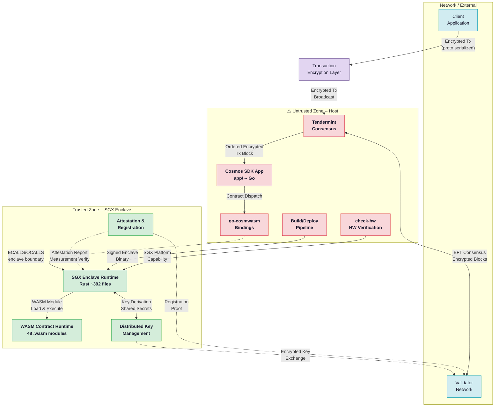

# TEE Usage Audit Report: SecretNetwork

## Executive Summary
The audit identified 5 active findings: 1 High severity, 4 Informational. Nine findings were dismissed as false positives during adversarial review. One partial positive guard was confirmed.

**Key Vulnerability:**
• IV-INV-08 (High): Host-layer replay writes contract state outside enclave, exposing sensitive data through untrusted memory. This is the highest priority remediation item.

**Informational Findings (verification gaps):**
• RV3-U-INV-01: Host cannot verify enclave OCALL validation
• RV3-U-INV-06: Attestation key binding not verifiable
• RV3-U-INV-09: DKG peer attestation not verifiable in app wiring
• RV3-U-INV-11: Seal policy unverified in Go layer

**Positive Guard:** PG3-U-INV-02 confirms registration module is wired into the application (partial completeness).

**12 Unknowns** remain unresolved, covering SGX_MODE rejection guards (U-INV-05), MRENCLAVE governance checks (U-INV-12), enclave response length leakage (U-INV-10), and error propagation paths (U-INV-07).

**Recommendations:**
• Immediately remediate IV-INV-08 by constraining state writes to enclave-managed memory
• Resolve 12 unknowns through runtime testing and code instrumentation
• Implement OCALL validation checks per RV3-U-INV-01

## Dashboard Summary

| Severity | Trust-Path Tier | Count |
| --- | --- | --- |
| High | core | 1 |
| Info | core | 4 |

## Trust Boundary Analysis

| Actor | Component | Context | Boundary Type |
| --- | --- | --- | --- |
| Validator Host | app/ (Cosmos SDK, Go) | untrusted | enclave/host |
| Validator Host | go-cosmwasm (Rust/Go bindings) | untrusted | enclave/host |
| Validator Host | Tendermint Consensus Layer | untrusted | network |
| SGX Enclave | SGX Enclave Runtime (cosmwasm/enclaves/) | trusted | enclave/host |
| SGX Enclave | WASM Contract Execution (inside enclave) | trusted | enclave/host |
| SGX Enclave | Distributed Key Management Module | trusted | crypto boundary |
| SGX Enclave ↔ Network | Attestation & Registration Service | mixed | enclave/network |
| Validator Host | check-hw (Hardware Verification) | untrusted | enclave/host |
| CI/CD Operator | Build & Deployment Pipeline | untrusted | deployment |
| Developer | CosmWasm Contracts Source (cosmwasm/contracts/) | untrusted | build/deployment |
| User ↔ Enclave | Transaction Encryption Layer | mixed | crypto boundary |
| Inter-Module | Proto Definitions (343 .proto files) | mixed | enclave/host |

## Trust Boundary Partition Evidence

### Partition Methodology

**Path and content heuristics** classified files by directory patterns (enclave/, host/, trusted/) and TEE API usage (sgx_trts, sgx_urts, attestation); **LLM-assisted classification** for ambiguous files.

**Project TEE Role:** Mixed (contains both TEE and host code)
> Secret Network is a Cosmos SDK blockchain that uses Intel SGX enclaves for privacy-preserving smart contracts. The repository contains both the enclave code (cosmwasm/enclaves/) that executes inside SGX TEE and the host-side blockchain node code (cmd/secretd, app/, x/) that handles consensus, networking, and enclave management. The trust boundary is clear: enclave handles encrypted contract execution while the Go-based node runs outside on untrusted host.

### Source Code Zone Partition

```
├── app/  🔴 Untrusted (36 files)
│   ├── ./  🔴 Untrusted (6 files)
│   ├── keepers/  🔴 Untrusted (1 file)
│   ├── migrations/  🔴 Untrusted (1 file)
│   ├── migrations/v170/  🔴 Untrusted (1 file)
│   ├── upgrades/  🔴 Untrusted (1 file)
│   ├── upgrades/v1.10/  🔴 Untrusted (1 file)
│   ├── upgrades/v1.11/  🔴 Untrusted (1 file)
│   ├── upgrades/v1.12/  🔴 Untrusted (1 file)
│   ├── upgrades/v1.13/  🔴 Untrusted (1 file)
│   ├── upgrades/v1.14/  🔴 Untrusted (1 file)
│   ├── upgrades/v1.15/  🔴 Untrusted (1 file)
│   ├── upgrades/v1.16/  🔴 Untrusted (1 file)
│   ├── upgrades/v1.17/  🔴 Untrusted (1 file)
│   ├── upgrades/v1.18/  🔴 Untrusted (1 file)
│   ├── upgrades/v1.19/  🔴 Untrusted (1 file)
│   ├── upgrades/v1.20/  🔴 Untrusted (1 file)
│   ├── upgrades/v1.21/  🔴 Untrusted (1 file)
│   ├── upgrades/v1.21.7/  🔴 Untrusted (1 file)
│   ├── upgrades/v1.22/  🔴 Untrusted (1 file)
│   ├── upgrades/v1.23/  🔴 Untrusted (1 file)
│   ├── upgrades/v1.23.1/  🔴 Untrusted (1 file)
│   ├── upgrades/v1.23.2/  🔴 Untrusted (1 file)
│   ├── upgrades/v1.23.3/  🔴 Untrusted (1 file)
│   ├── upgrades/v1.24/  🔴 Untrusted (1 file)
│   ├── upgrades/v1.4/  🔴 Untrusted (3 files)
│   ├── upgrades/v1.5/  🔴 Untrusted (1 file)
│   ├── upgrades/v1.6/  🔴 Untrusted (1 file)
│   ├── upgrades/v1.7/  🔴 Untrusted (1 file)
│   └── upgrades/v1.8/  🔴 Untrusted (1 file)
├── check-hw/  🔴 Untrusted (5 files)
│   ├── ./  🔴 Untrusted (1 file)
│   └── src/  🔴 Untrusted (4 files)
├── client/  🔴 Untrusted (4 files)  — client code
│   ├── docs/static/swagger/  🔴 Untrusted (2 files)
│   └── docs/statik/  🔴 Untrusted (2 files)
├── cmd/  🔴 Untrusted (8 files)  — CLI commands
│   └── secretd/  🔴 Untrusted (8 files)
├── cosmwasm/  🟡 Mixed (147 trusted, 215 untrusted)
│   ├── contracts/v010/burner/examples/  🔴 Untrusted (1 file)  — examples
│   ├── contracts/v010/burner/src/  🔴 Untrusted (3 files)
│   ├── contracts/v010/burner/tests/  🔴 Untrusted (1 file)  — test suite
│   ├── contracts/v010/compute-tests/test-compute-contract/  🔴 Untrusted (2 files)
│   ├── contracts/v010/compute-tests/test-compute-contract-v2/  🔴 Untrusted (1 file)
│   ├── contracts/v010/compute-tests/test-compute-contract-v2/src/  🔴 Untrusted (2 files)
│   ├── contracts/v010/compute-tests/test-compute-contract/src/  🔴 Untrusted (2 files)
│   ├── contracts/v010/erc20/examples/  🔴 Untrusted (1 file)  — examples
│   ├── contracts/v010/erc20/src/  🔴 Untrusted (4 files)
│   ├── contracts/v010/erc20/tests/  🔴 Untrusted (1 file)  — test suite
│   ├── contracts/v010/escrow/examples/  🔴 Untrusted (1 file)  — examples
│   ├── contracts/v010/escrow/src/  🔴 Untrusted (4 files)
│   ├── contracts/v010/escrow/tests/  🔴 Untrusted (1 file)  — test suite
│   ├── contracts/v010/gov/src/  🔴 Untrusted (3 files)
│   ├── contracts/v010/hackatom/examples/  🔴 Untrusted (1 file)  — examples
│   ├── contracts/v010/hackatom/src/  🔴 Untrusted (2 files)
│   ├── contracts/v010/hackatom/tests/  🔴 Untrusted (1 file)  — test suite
│   ├── contracts/v010/mint/src/  🔴 Untrusted (3 files)
│   ├── contracts/v010/plaintext-logs/src/  🔴 Untrusted (3 files)
│   ├── contracts/v010/queue/examples/  🔴 Untrusted (1 file)  — examples
│   ├── contracts/v010/queue/src/  🔴 Untrusted (2 files)
│   ├── contracts/v010/queue/tests/  🔴 Untrusted (1 file)  — test suite
│   ├── contracts/v010/reflect/examples/  🔴 Untrusted (1 file)  — examples
│   ├── contracts/v010/reflect/src/  🔴 Untrusted (5 files)
│   ├── contracts/v010/reflect/tests/  🔴 Untrusted (1 file)  — test suite
│   ├── contracts/v010/staking/src/  🔴 Untrusted (4 files)
│   ├── contracts/v1/burner/examples/  🔴 Untrusted (1 file)  — examples
│   ├── contracts/v1/burner/src/  🔴 Untrusted (3 files)
│   ├── contracts/v1/burner/tests/  🔴 Untrusted (1 file)  — test suite
│   ├── contracts/v1/compute-tests/bench-contract/src/  🔴 Untrusted (5 files)
│   ├── contracts/v1/compute-tests/bench-contract/src/benches/  🔴 Untrusted (5 files)
│   ├── contracts/v1/compute-tests/evaporation/src/  🔴 Untrusted (3 files)
│   ├── contracts/v1/compute-tests/ibc-test-contract/src/  🔴 Untrusted (4 files)
│   ├── contracts/v1/compute-tests/migration/contract-v1/src/  🔴 Untrusted (3 files)
│   ├── contracts/v1/compute-tests/migration/contract-v2/src/  🔴 Untrusted (3 files)
│   ├── contracts/v1/compute-tests/random-test/src/  🔴 Untrusted (4 files)
│   ├── contracts/v1/compute-tests/test-compute-contract-v2/src/  🔴 Untrusted (4 files)
│   ├── contracts/v1/compute-tests/test-compute-contract/src/  🔴 Untrusted (4 files)
│   ├── contracts/v1/crypto-verify/examples/  🔴 Untrusted (1 file)  — examples
│   ├── contracts/v1/crypto-verify/src/  🔴 Untrusted (4 files)
│   ├── contracts/v1/crypto-verify/tests/  🔴 Untrusted (1 file)  — test suite
│   ├── contracts/v1/debug-print/src/  🔴 Untrusted (3 files)
│   ├── contracts/v1/erc20/examples/  🔴 Untrusted (1 file)  — examples
│   ├── contracts/v1/erc20/src/  🔴 Untrusted (4 files)
│   ├── contracts/v1/erc20/tests/  🔴 Untrusted (1 file)  — test suite
│   ├── contracts/v1/escrow/examples/  🔴 Untrusted (1 file)  — examples
│   ├── contracts/v1/escrow/src/  🔴 Untrusted (4 files)
│   ├── contracts/v1/escrow/tests/  🔴 Untrusted (1 file)  — test suite
│   ├── contracts/v1/floaty/examples/  🔴 Untrusted (1 file)  — examples
│   ├── contracts/v1/floaty/src/  🔴 Untrusted (5 files)
│   ├── contracts/v1/gov/src/  🔴 Untrusted (3 files)
│   ├── contracts/v1/hackatom/examples/  🔴 Untrusted (1 file)  — examples
│   ├── contracts/v1/hackatom/src/  🔴 Untrusted (5 files)
│   ├── contracts/v1/hackatom/tests/  🔴 Untrusted (1 file)  — test suite
│   ├── contracts/v1/ibc-reflect-send/examples/  🔴 Untrusted (1 file)  — examples
│   ├── contracts/v1/ibc-reflect-send/src/  🔴 Untrusted (6 files)
│   ├── contracts/v1/ibc-reflect-send/tests/  🔴 Untrusted (1 file)  — test suite
│   ├── contracts/v1/ibc-reflect/examples/  🔴 Untrusted (1 file)  — examples
│   ├── contracts/v1/ibc-reflect/src/  🔴 Untrusted (4 files)
│   ├── contracts/v1/ibc-reflect/tests/  🔴 Untrusted (1 file)  — test suite
│   ├── contracts/v1/mint/src/  🔴 Untrusted (3 files)
│   ├── contracts/v1/plaintext-logs/src/  🔴 Untrusted (3 files)
│   ├── contracts/v1/queue/examples/  🔴 Untrusted (1 file)  — examples
│   ├── contracts/v1/queue/src/  🔴 Untrusted (3 files)
│   ├── contracts/v1/queue/tests/  🔴 Untrusted (1 file)  — test suite
│   ├── contracts/v1/reflect/examples/  🔴 Untrusted (1 file)  — examples
│   ├── contracts/v1/reflect/src/  🔴 Untrusted (6 files)
│   ├── contracts/v1/reflect/tests/  🔴 Untrusted (1 file)  — test suite
│   ├── contracts/v1/staking/examples/  🔴 Untrusted (1 file)  — examples
│   ├── contracts/v1/staking/src/  🔴 Untrusted (5 files)
│   ├── contracts/v1/staking/tests/  🔴 Untrusted (1 file)  — test suite
│   ├── docs/  🔴 Untrusted (1 file)  — documentation
│   ├── enclaves/execute/src/  🟢 Trusted (3 files)
│   ├── enclaves/execute/src/registration/  🟢 Trusted (11 files)
│   ├── enclaves/ffi-types/  🟢 Trusted (1 file)
│   ├── enclaves/ffi-types/src/  🟢 Trusted (2 files)
│   ├── enclaves/shared/block-verifier/src/  🟢 Trusted (5 files)
│   ├── enclaves/shared/block-verifier/src/verify/  🟢 Trusted (6 files)
│   ├── enclaves/shared/contract-engine/src/  🟢 Trusted (18 files)
│   ├── enclaves/shared/contract-engine/src/external/  🟢 Trusted (4 files)
│   ├── enclaves/shared/contract-engine/src/input_validation/  🟢 Trusted (5 files)
│   ├── enclaves/shared/contract-engine/src/wasm3/  🟢 Trusted (4 files)
│   ├── enclaves/shared/cosmos-proto/  🟢 Trusted (1 file)
│   ├── enclaves/shared/cosmos-proto/src/  🟢 Trusted (1 file)
│   ├── enclaves/shared/cosmos-proto/src/base/  🟢 Trusted (1 file)
│   ├── enclaves/shared/cosmos-proto/src/cosmwasm/  🟢 Trusted (1 file)
│   ├── enclaves/shared/cosmos-proto/src/crypto/ed25519/  🟢 Trusted (1 file)
│   ├── enclaves/shared/cosmos-proto/src/crypto/multisig/  🟢 Trusted (2 files)
│   ├── enclaves/shared/cosmos-proto/src/crypto/secp256k1/  🟢 Trusted (1 file)
│   ├── enclaves/shared/cosmos-proto/src/crypto/secp256r1/  🟢 Trusted (1 file)
│   ├── enclaves/shared/cosmos-proto/src/ibc/  🟢 Trusted (5 files)
│   ├── enclaves/shared/cosmos-proto/src/registration/v1beta1/  🟢 Trusted (1 file)
│   ├── enclaves/shared/cosmos-proto/src/tx/  🟢 Trusted (2 files)
│   ├── enclaves/shared/cosmos-types/src/  🟢 Trusted (5 files)
│   ├── enclaves/shared/cosmwasm-types/generic/src/  🟢 Trusted (1 file)
│   ├── enclaves/shared/cosmwasm-types/v0.10/src/  🟢 Trusted (9 files)
│   ├── enclaves/shared/cosmwasm-types/v1.0/src/  🟢 Trusted (6 files)
│   ├── enclaves/shared/cosmwasm-types/v1.0/src/errors/  🟢 Trusted (5 files)
│   ├── enclaves/shared/cosmwasm-types/v1.0/src/math/  🟢 Trusted (3 files)
│   ├── enclaves/shared/cosmwasm-types/v1.0/src/results/  🟢 Trusted (7 files)
│   ├── enclaves/shared/crypto/src/  🟢 Trusted (14 files)
│   ├── enclaves/shared/crypto/src/hash/  🟢 Trusted (3 files)
│   ├── enclaves/shared/utils/src/  🟢 Trusted (13 files)
│   ├── enclaves/test/  🟢 Trusted (1 file)  — tests
│   ├── enclaves/test/src/  🟢 Trusted (3 files)
│   ├── enclaves/xargo/sgx_tstd/  🟢 Trusted (1 file)
│   ├── packages/sgx-vm/src/  🔴 Untrusted (22 files)
│   ├── packages/sgx-vm/src/backends/  🔴 Untrusted (4 files)
│   ├── packages/sgx-vm/src/errors/  🔴 Untrusted (5 files)
│   ├── packages/sgx-vm/src/middleware/  🔴 Untrusted (2 files)
│   ├── packages/sgx-vm/src/testing/  🔴 Untrusted (6 files)  — test utilities
│   └── packages/sgx-vm/src/wasmi/  🔴 Untrusted (6 files)
├── deployment/  🔴 Untrusted (2 files)
│   ├── ci/query-load-test/  🔴 Untrusted (1 file)
│   └── docker/localsecret/faucet/  🔴 Untrusted (1 file)
├── eip191/  🔴 Untrusted (1 file)
│   └── ./  🔴 Untrusted (1 file)
├── go-cosmwasm/  🔴 Untrusted (48 files)
│   ├── ./  🔴 Untrusted (2 files)
│   ├── api/  🔴 Untrusted (22 files)  — API definitions
│   ├── cmd/  🔴 Untrusted (1 file)  — CLI commands
│   ├── src/  🔴 Untrusted (8 files)
│   ├── src/error/  🔴 Untrusted (3 files)
│   ├── types/  🔴 Untrusted (7 files)  — type definitions
│   ├── types/v010/  🔴 Untrusted (1 file)
│   └── types/v1/  🔴 Untrusted (4 files)
├── integration-tests/  🔴 Untrusted (10 files)
│   ├── ./  🔴 Untrusted (3 files)
│   ├── contract-v0.10/src/  🔴 Untrusted (2 files)
│   └── contract-v1/src/  🔴 Untrusted (5 files)
├── scripts/  🔴 Untrusted (1 file)  — build/deploy scripts
│   └── faucet/  🔴 Untrusted (1 file)
├── testutil/  🟡 Mixed (1 trusted, 3 untrusted)
│   ├── ./  🔴 Untrusted (1 file)
│   ├── common/nullify/  🔴 Untrusted (1 file)
│   ├── cron/keeper/  🟢 Trusted (1 file)
│   └── mocks/cron/types/  🔴 Untrusted (1 file)  — type definitions
├── third_party/  🔴 Untrusted (28 files)
│   ├── proto/tendermint/blocksync/  🔴 Untrusted (2 files)
│   ├── proto/tendermint/consensus/  🔴 Untrusted (3 files)
│   ├── proto/tendermint/crypto/  🔴 Untrusted (2 files)  — cryptography
│   ├── proto/tendermint/libs/bits/  🔴 Untrusted (1 file)
│   ├── proto/tendermint/mempool/  🔴 Untrusted (2 files)
│   ├── proto/tendermint/p2p/  🔴 Untrusted (4 files)
│   ├── proto/tendermint/privval/  🔴 Untrusted (1 file)
│   ├── proto/tendermint/rpc/grpc/  🔴 Untrusted (1 file)  — gRPC service
│   ├── proto/tendermint/state/  🔴 Untrusted (1 file)
│   ├── proto/tendermint/statesync/  🔴 Untrusted (2 files)
│   ├── proto/tendermint/store/  🔴 Untrusted (1 file)
│   ├── proto/tendermint/types/  🔴 Untrusted (7 files)  — type definitions
│   └── proto/tendermint/version/  🔴 Untrusted (1 file)
├── types/  🔴 Untrusted (2 files)  — type definitions
│   ├── ./  🔴 Untrusted (1 file)  — type definitions
│   └── util/  🔴 Untrusted (1 file)
└── x/  🟡 Mixed (1 trusted, 195 untrusted)
    ├── compute/  🔴 Untrusted (4 files)
    ├── compute/client/cli/  🔴 Untrusted (3 files)  — CLI interface
    ├── compute/client/utils/  🔴 Untrusted (2 files)  — utilities
    ├── compute/internal/keeper/  🔴 Untrusted (39 files)
    ├── compute/internal/keeper/migrations/v1/  🔴 Untrusted (1 file)
    ├── compute/internal/keeper/migrations/v2/  🔴 Untrusted (1 file)
    ├── compute/internal/types/  🔴 Untrusted (26 files)  — type definitions
    ├── compute/migrations/v106/  🟢 Trusted (1 file)
    ├── compute/migrations/v120/  🔴 Untrusted (2 files)
    ├── cron/  🔴 Untrusted (4 files)
    ├── cron/client/cli/  🔴 Untrusted (4 files)  — CLI interface
    ├── cron/keeper/  🔴 Untrusted (13 files)
    ├── cron/migrations/v2/  🔴 Untrusted (1 file)
    ├── cron/simulation/  🔴 Untrusted (1 file)
    ├── cron/types/  🔴 Untrusted (15 files)  — type definitions
    ├── cron/types/v1/  🔴 Untrusted (1 file)
    ├── emergencybutton/  🔴 Untrusted (3 files)
    ├── emergencybutton/client/  🔴 Untrusted (1 file)  — client code
    ├── emergencybutton/client/cli/  🔴 Untrusted (2 files)  — CLI interface
    ├── emergencybutton/client/grpc/  🔴 Untrusted (1 file)  — gRPC service
    ├── emergencybutton/exported/  🔴 Untrusted (1 file)
    ├── emergencybutton/keeper/  🔴 Untrusted (5 files)
    ├── emergencybutton/migrations/v2/  🔴 Untrusted (1 file)
    ├── emergencybutton/types/  🔴 Untrusted (12 files)  — type definitions
    ├── ibc-hooks/  🔴 Untrusted (5 files)
    ├── ibc-hooks/client/cli/  🔴 Untrusted (1 file)  — CLI interface
    ├── ibc-hooks/keeper/  🔴 Untrusted (1 file)
    ├── ibc-hooks/types/  🔴 Untrusted (2 files)  — type definitions
    ├── registration/  🔴 Untrusted (4 files)
    ├── registration/client/cli/  🔴 Untrusted (2 files)  — CLI interface
    ├── registration/internal/keeper/  🔴 Untrusted (12 files)
    ├── registration/internal/keeper/enclave/  🔴 Untrusted (1 file)  — enclave code
    ├── registration/internal/keeper/mock/  🔴 Untrusted (1 file)
    ├── registration/internal/types/  🔴 Untrusted (12 files)  — type definitions
    ├── registration/migrations/v106/  🔴 Untrusted (1 file)
    ├── registration/migrations/v120/  🔴 Untrusted (2 files)
    ├── registration/migrations/v170/  🔴 Untrusted (2 files)
    └── registration/remote_attestation/  🔴 Untrusted (6 files)
```

_Legend: 🟢 Trusted (enclave) · 🔴 Untrusted (host) · 🟡 Mixed (boundary)_

### Boundary-Defining Files

**`cosmwasm/enclaves/execute/Enclave.edl`** -- EDL interface definition -- defines ECALL/OCALL boundary
```
>>>    1 | enclave {
       2 |     from "sgx_tstd.edl" import *;
       3 |     from "sgx_stdio.edl" import *;
       4 |     from "sgx_fs.edl" import *;
       5 |     from "sgx_net.edl" import *;
       6 |     from "sgx_time.edl" import *;
       7 |     include "sgx_quote.h"
       8 |     include "sgx_ql_quote.h"
       9 |     include "sgx_qve_header.h"
```

**`testutil/cron/keeper/cron.go`** -- Trusted (enclave) representative file
```
      54 | 
      55 | 	ctx := sdk.NewContext(stateStore, tmproto.Header{}, false, log.NewNopLogger())
      56 | 
      57 | 	// Initialize params
      58 | 	err := k.SetParams(ctx, types.DefaultParams())
      59 | 	require.NoError(t, err)
      60 | 
      61 | 	return k, ctx
>>>   62 | }
```

**`app/ante.go`** -- Untrusted (host) representative file
```
      11 | 	"github.com/cosmos/ibc-go/v8/modules/core/keeper"
      12 | 
      13 | 	govkeeper "github.com/cosmos/cosmos-sdk/x/gov/keeper"
      14 | 	"github.com/scrtlabs/SecretNetwork/x/compute"
      15 | )
      16 | 
      17 | // HandlerOptions extend the SDK's AnteHandler options by requiring the IBC
      18 | // channel keeper.
>>>   19 | type HandlerOptions struct {
      20 | 	ante.HandlerOptions
      21 | 
      22 | 	CircuitKeeper         circuitante.CircuitBreaker
      23 | 	appCodec              codec.Codec
      24 | 	govkeeper             govkeeper.Keeper // You'll need the keeper to access stored mrenclave hash
      25 | 	IBCKeeper             *keeper.Keeper
      26 | 	WasmConfig            *compute.WasmConfig
      27 | 	TXCounterStoreService store.KVStoreService
```

### Boundary-Crossing Interface

| Function | Type | Defined In | Zone |
| --- | --- | --- | --- |
| `ecall_run_tests` | ECALL | `cosmwasm/enclaves/execute/Enclave.edl` | unknown |

## Architecture Diagrams

### System Architecture with Trust Boundaries
The system is a Cosmos SDK-based blockchain (Secret Network) where SGX enclaves provide hardware-isolated trusted execution for privacy-preserving smart contracts. The untrusted host layer—comprising the Go application (app/), go-cosmwasm bindings, and Tendermint consensus—handles transaction ordering and network communication but never accesses plaintext contract state. The trusted enclave runtime (cosmwasm/enclaves/) executes CosmWasm WASM contracts, manages distributed encryption keys, and performs all cryptographic operations on private data. Trust boundaries are enforced at the enclave-host ECALL/OCALL interface, the network perimeter where encrypted transactions are broadcast, and the distributed key management layer that coordinates shared secrets across validator enclaves.



### Trust Boundary Narrative

The trusted boundary centers on **SGX Enclave ↔ Host Process (Boundary 1)**, **Enclave ↔ Intel Attestation Service (Boundary 2) and Validator ↔ Validator (Boundary 5)**, **Enclave ↔ Consensus (Boundary 4) and Validator ↔ Validator (Boundary 5)**, **SGX Enclave ↔ Host Process (Boundary 1) — sealed state persistence**, **SGX Enclave ↔ Host Process (Boundary 1) — configuration**. The analysis identified 12 invariants governing trust path integrity.

**Trust Paths Identified:**
- `INV-01`: SGX Enclave ↔ Host Process (Boundary 1) — Data originating from host-side OCALL return values must not flow into enclave security-sensitive operations (key derivation, measurement, policy decisions) without validation, as the host is untrusted.
- `INV-02`: Enclave ↔ Intel Attestation Service (Boundary 2) and Validator ↔ Validator (Boundary 5) — Validator enclave registration must perform full attestation quote verification including TCB status check, measurement comparison (MRENCLAVE/MRSIGNER), and collateral freshness before accepting the enclave into the network.
- `INV-03`: Enclave ↔ Consensus (Boundary 4) and Validator ↔ Validator (Boundary 5) — The on-chain validator registration record must be cryptographically bound to the actual enclave measurement (MRENCLAVE) from the verified attestation report, preventing substitution of a different enclave identity post-attestation.
- `INV-04`: SGX Enclave ↔ Host Process (Boundary 1) — sealed state persistence — Sealed enclave state must include and verify an epoch counter or monotonic version on unseal to prevent rollback to previously sealed states.
- `INV-05`: SGX Enclave ↔ Host Process (Boundary 1) — configuration — SGX simulation mode (SGX_MODE=SW) must not be reachable in production node operation, as it provides no hardware-enforced memory isolation or attestation guarantees.
- `INV-07`: SGX Enclave ↔ Host Process (Boundary 1) — error return path — Error messages and error detail returned from enclave to host must not reveal secret-dependent information, internal enclave state, or cryptographic material through OCALL error propagation.
- `INV-08`: SGX Enclave ↔ Host Process (Boundary 1) and Enclave ↔ Consensus (Boundary 4) — All paths that access or modify plaintext contract state must execute inside the enclave, with no bypass paths in the host Go layer that could read or write unencrypted contract state.
- `INV-09`: Validator ↔ Validator (Boundary 5) — enclave-to-enclave key management — Distributed key generation and sharing among validator enclaves must verify peer enclave attestations before transmitting any key material, ensuring keys are only shared with genuinely attested enclaves.
- `INV-10`: SGX Enclave ↔ Host Process (Boundary 1) — output channel — Enclave response output lengths that depend on secret data must be normalized or padded to prevent inference of secret-conditional branching or secret-dependent data size from the host observer.
- `INV-11`: SGX Enclave ↔ Host Process (Boundary 1) — sealed state integrity — Sealed state must be bound to the creating enclave identity (MRENCLAVE/MRSIGNER) so that sealed data cannot be unsealed by a different enclave binary, even one running on the same platform.
- `INV-12`: Build/Deployment Pipeline → SGX Enclave ↔ Network — Build and signing process for enclave binaries must ensure that the signed enclave measurement matches the governance-approved MRENCLAVE, preventing deployment of unauthorized enclave code.

### Data Flow Summary

Of 12 invariants, **12** involve data crossing the trust boundary between enclave and host.

**Bidirectional** (12 flows)
_Flows crossing the boundary in both directions_
- `INV-01`: **OCALL return value** → **enclave key derivation input**
- `INV-02`: **unverified attestation quote from network** → **validator registration acceptance**
- `INV-03`: **attestation report measurement** → **on-chain registration record**
- `INV-04`: **unsealed blob from host filesystem** → **state restoration in enclave initialization**
- `INV-05`: **SGX_MODE environment variable** → **TEE initialization**
- `INV-06`: **enclave public key** → **attestation quote output**
- `INV-07`: **enclave internal error states** → **OCALL error return value**
- `INV-08`: **host Go layer state access functions** → **plaintext contract state read**

### Invariant Reference

| ID | Description | Trust Path |
| --- | --- | --- |
| INV-01 | Data originating from host-side OCALL return values must not flow into enclave security-sensitive operations (key derivation, measurement, policy decisions) without validation, as the host is untrusted. | SGX Enclave ↔ Host Process (Boundary 1) |
| INV-02 | Validator enclave registration must perform full attestation quote verification including TCB status check, measurement comparison (MRENCLAVE/MRSIGNER), and collateral freshness before accepting the enclave into the network. | Enclave ↔ Intel Attestation Service (Boundary 2) and Validator ↔ Validator (Boundary 5) |
| INV-03 | The on-chain validator registration record must be cryptographically bound to the actual enclave measurement (MRENCLAVE) from the verified attestation report, preventing substitution of a different enclave identity post-attestation. | Enclave ↔ Consensus (Boundary 4) and Validator ↔ Validator (Boundary 5) |
| INV-04 | Sealed enclave state must include and verify an epoch counter or monotonic version on unseal to prevent rollback to previously sealed states. | SGX Enclave ↔ Host Process (Boundary 1) — sealed state persistence |
| INV-05 | SGX simulation mode (SGX_MODE=SW) must not be reachable in production node operation, as it provides no hardware-enforced memory isolation or attestation guarantees. | SGX Enclave ↔ Host Process (Boundary 1) — configuration |
| INV-06 | Attestation report_data field must cryptographically bind the enclave's public key or session identity to the quote, preventing a man-in-the-middle from substituting a different key after attestation. | Enclave ↔ Intel Attestation Service (Boundary 2) and Validator ↔ Validator (Boundary 5) |
| INV-07 | Error messages and error detail returned from enclave to host must not reveal secret-dependent information, internal enclave state, or cryptographic material through OCALL error propagation. | SGX Enclave ↔ Host Process (Boundary 1) — error return path |
| INV-08 | All paths that access or modify plaintext contract state must execute inside the enclave, with no bypass paths in the host Go layer that could read or write unencrypted contract state. | SGX Enclave ↔ Host Process (Boundary 1) and Enclave ↔ Consensus (Boundary 4) |
| INV-09 | Distributed key generation and sharing among validator enclaves must verify peer enclave attestations before transmitting any key material, ensuring keys are only shared with genuinely attested enclaves. | Validator ↔ Validator (Boundary 5) — enclave-to-enclave key management |
| INV-10 | Enclave response output lengths that depend on secret data must be normalized or padded to prevent inference of secret-conditional branching or secret-dependent data size from the host observer. | SGX Enclave ↔ Host Process (Boundary 1) — output channel |
| INV-11 | Sealed state must be bound to the creating enclave identity (MRENCLAVE/MRSIGNER) so that sealed data cannot be unsealed by a different enclave binary, even one running on the same platform. | SGX Enclave ↔ Host Process (Boundary 1) — sealed state integrity |
| INV-12 | Build and signing process for enclave binaries must ensure that the signed enclave measurement matches the governance-approved MRENCLAVE, preventing deployment of unauthorized enclave code. | Build/Deployment Pipeline → SGX Enclave ↔ Network |

## Taxonomy Summary

| Category | Count | Findings |
| --- | --- | --- |
| Output & Metadata Leakage | 2 | V-01, V-04 |

## TEE Usage Problems

### [HIGH] IV-INV-08: Host-layer replay writes contract state outside enclave [Design Appropriateness] (inappropriate_design) (CWE-668)

**Impact**: A replay node or compromised host process can apply arbitrary state mutations to the contract store without enclave execution, potentially writing unencrypted or tampered state if the trace data is not provably encrypted.
**Confidence**: Likely | **Invariant**: INV-08 | **Tier**: core

**Preconditions**:
- Attacker controls or can inject trace data into a replay node
- The enclave does not encrypt all state before producing trace ops
- Node runs in non-SGX replay mode

**Attack Scenario**:
  1. Replay node receives execution trace from consensus without SGX. (`[HOST] go-cosmwasm/api/replay.go:61`)
  2. replayExecution() applies trace.Ops directly to store via ReplayingKVStore. (`[HOST] go-cosmwasm/api/replay.go:64`)
  3. Host Go layer writes state modifications with no enclave mediation. (`[HOST] go-cosmwasm/api/replay.go:65`)
  4. Comment says trace data is trusted completely with no verification. (`[HOST] go-cosmwasm/api/replay.go:13`)

### Code Evidence

**`go-cosmwasm/api/replay.go:61 [HOST]`**
```
      51 | 
      52 | 		if !found {
      53 | 			logWarn("replayExecution", "TRACE NOT FOUND after retries: height=%d index=%d", height, execIndex)
      54 | 			return nil, 0, nil, false
      55 | 		}
      56 | 	}
      57 | 
      58 | 	logDebug("replayExecution", "Found trace: height=%d index=%d ops=%d resultLen=%d gasUsed=%d callbackGas=%d hasError=%v",
      59 | 		height, execIndex, len(trace.Ops), len(trace.Result), trace.GasUsed, trace.CallbackGas, trace.HasError)
      60 | 
>>>   61 | 	// Apply recorded storage ops (trusted data from SGX node).
      62 | 	// The store uses an InfiniteGasMeter (set by keeper), so these
      63 | 	// ops do NOT charge the real gas meter.
      64 | 	replayer := NewReplayingKVStore(store)
      65 | 	replayer.ApplyOps(trace.Ops)
      66 | 
      67 | 	// Stash cross-module ops for the keeper to apply on the real ctx.MultiStore().
      68 | 	// These are mutations that query handlers made to other modules' stores
      69 | 	// (e.g., distribution rewards withdrawal during a staking query).
      70 | 	if len(trace.CrossOps) > 0 {
      71 | 		logDebug("replayExecution", "Stashing %d cross-module ops for keeper", len(trace.CrossOps))
```
Replay node receives execution trace from consensus without SGX.

**`go-cosmwasm/api/replay.go:64 [HOST]`**
```
      54 | 			return nil, 0, nil, false
      55 | 		}
      56 | 	}
      57 | 
      58 | 	logDebug("replayExecution", "Found trace: height=%d index=%d ops=%d resultLen=%d gasUsed=%d callbackGas=%d hasError=%v",
      59 | 		height, execIndex, len(trace.Ops), len(trace.Result), trace.GasUsed, trace.CallbackGas, trace.HasError)
      60 | 
      61 | 	// Apply recorded storage ops (trusted data from SGX node).
      62 | 	// The store uses an InfiniteGasMeter (set by keeper), so these
      63 | 	// ops do NOT charge the real gas meter.
>>>   64 | 	replayer := NewReplayingKVStore(store)
      65 | 	replayer.ApplyOps(trace.Ops)
      66 | 
      67 | 	// Stash cross-module ops for the keeper to apply on the real ctx.MultiStore().
      68 | 	// These are mutations that query handlers made to other modules' stores
      69 | 	// (e.g., distribution rewards withdrawal during a staking query).
      70 | 	if len(trace.CrossOps) > 0 {
      71 | 		logDebug("replayExecution", "Stashing %d cross-module ops for keeper", len(trace.CrossOps))
      72 | 		recorder.SetPendingCrossModuleOps(trace.CrossOps)
      73 | 	}
      74 | 
```
replayExecution() applies trace.Ops directly to store via ReplayingKVStore.

**`go-cosmwasm/api/replay.go:65 [HOST]`**
```
      55 | 		}
      56 | 	}
      57 | 
      58 | 	logDebug("replayExecution", "Found trace: height=%d index=%d ops=%d resultLen=%d gasUsed=%d callbackGas=%d hasError=%v",
      59 | 		height, execIndex, len(trace.Ops), len(trace.Result), trace.GasUsed, trace.CallbackGas, trace.HasError)
      60 | 
      61 | 	// Apply recorded storage ops (trusted data from SGX node).
      62 | 	// The store uses an InfiniteGasMeter (set by keeper), so these
      63 | 	// ops do NOT charge the real gas meter.
      64 | 	replayer := NewReplayingKVStore(store)
>>>   65 | 	replayer.ApplyOps(trace.Ops)
      66 | 
      67 | 	// Stash cross-module ops for the keeper to apply on the real ctx.MultiStore().
      68 | 	// These are mutations that query handlers made to other modules' stores
      69 | 	// (e.g., distribution rewards withdrawal during a staking query).
      70 | 	if len(trace.CrossOps) > 0 {
      71 | 		logDebug("replayExecution", "Stashing %d cross-module ops for keeper", len(trace.CrossOps))
      72 | 		recorder.SetPendingCrossModuleOps(trace.CrossOps)
      73 | 	}
      74 | 
      75 | 	// Consume exactly the CallbackGas recorded by the SGX node.
```
Host Go layer writes state modifications with no enclave mediation.

**`go-cosmwasm/api/replay.go:13 [HOST]`**
```
       3 | package api
       4 | 
       5 | import (
       6 | 	"fmt"
       7 | 	"time"
       8 | 
       9 | 	"github.com/scrtlabs/SecretNetwork/go-cosmwasm/types"
      10 | )
      11 | 
      12 | // replayExecution handles replay of a recorded execution trace.
>>>   13 | // We trust the SGX node's trace data completely.
      14 | //
      15 | // Gas is consumed in two steps to exactly match the SGX node:
      16 | //  1. callbackGas: charged on the original SDK meter directly (callbackGas/1000 SDK gas)
      17 | //     This matches the SGX node where DB callbacks charge gas on ctx.GasMeter() during C.handle.
      18 | //  2. gasUsed (compute gas): returned to the caller so the keeper's consumeGas handles it,
      19 | //     adding (gasUsed/1000 + 1) SDK gas — same as on the SGX node.
      20 | //
      21 | // These must be separate divisions to avoid integer rounding differences.
      22 | func replayExecution(store KVStore, gasMeter *GasMeter, execIndex int64) ([]byte, uint64, error, bool) {
      23 | 	recorder := GetRecorder()
```
Comment says trace data is trusted completely with no verification.

**Remediation**: Ensure the replay path only applies state that was encrypted inside the enclave before inclusion in the trace. Add explicit ciphertext verification at the replay boundary.

## Positive Guards (Confirmed Security Controls)

### PG3-U-INV-02: Registration module wired into app
- **Invariants**: INV-02
- **Completeness**: partial
- **Evidence**: app/app.go: reg "github.com/scrtlabs/SecretNetwork/x/registration" imported; app.AppKeepers.InitCustomKeepers() called at line ~256; app.mm = module.NewManager(Modules(app, appCodec)...) at line ~259

The registration module (x/registration) is properly imported and integrated into the SecretNetwork application. It is imported as 'reg', initialized via InitCustomKeepers, and registered in the module manager through Modules(app, appCodec). The actual attestation verification logic resides in x/registration/keeper/ and x/registration/handler/ which are not in this file.

## Dismissed Findings

_The following findings were dismissed during adversarial review._

### ~~V-01: Debug logging of encrypted seed material in host~~
- **Original Severity**: Info
- **Dismissal Reason**: Adversarial review: false positive. Logging the ENCRYPTED seed is not a vulnerability. Sealed/encrypted seed material is designed to reside in untrusted host storage — that is the entire purpose of sealing. An attacker who can read logs already has direct filesystem access to the same sealed state files on disk. The ciphertext in logs provides zero additional attack surface since the encryption protects the seed regardless of storage location.
- **Location(s)**: `cosmwasm/packages/sgx-vm/src/attestation.rs:100`, `cosmwasm/packages/sgx-vm/src/attestation.rs:132`, `cosmwasm/enclaves/shared/utils/src/key_manager.rs:28`

### ~~V-02: Encrypted seed material logged in untrusted zone~~
- **Original Severity**: Info
- **Dismissal Reason**: Adversarial review: false positive. Duplicate of V-01. Same analysis applies: encrypted seed ciphertext in untrusted space is by-design in SGX sealing. The host already persists this data to disk in untrusted storage. Logging it adds no new information.
- **Location(s)**: `cosmwasm/packages/sgx-vm/src/attestation.rs:100`, `cosmwasm/packages/sgx-vm/src/attestation.rs:132`

### ~~V-03: Spurious call chain — no verifiable TEE vuln~~
- **Original Severity**: Info
- **Dismissal Reason**: Adversarial review: false positive. The finding itself explicitly states the call chain is spurious — 'Chain is not a valid call graph: TypeScript test cannot be callee of Rust extern C.' encode_hex_digit is a trivial utility with no security-sensitive sink. Self-admitted non-issue.
- **Location(s)**: `cosmwasm/packages/sgx-vm/src/attestation.rs:72`, `cosmwasm/enclaves/execute/src/registration/hex.rs:8`

### ~~V-04: Debug log exposes encrypted seed ciphertext~~
- **Original Severity**: Info
- **Dismissal Reason**: Adversarial review: false positive. Duplicate of V-01/V-02. Same encrypted seed logging, same analysis. The sealed state is ciphertext already stored in untrusted space by design. Logging provides no advantage beyond what disk access already gives.
- **Location(s)**: `cosmwasm/packages/sgx-vm/src/attestation.rs:100`, `cosmwasm/packages/sgx-vm/src/attestation.rs:132`, `cosmwasm/enclaves/shared/utils/src/key_manager.rs:28`

### ~~IV-INV-04: No epoch counter on enclave state unseal~~
- **Original Severity**: High
- **Dismissal Reason**: Adversarial review: false positive. Entirely speculative. The finding points only to host-side code (go-cosmwasm/lib.go, app/app.go) but makes claims about enclave unseal behavior without examining any enclave sealing/unsealing code. This is an argument from silence — absence of evidence in host code is not evidence of absence in enclave code. SGX provides monotonic counter primitives, and the finding does not prove they are unused. High severity is unsupported without examining the actual enclave unseal implementation.
- **Location(s)**: `go-cosmwasm/lib.go:53`, `app/app.go:442`

### ~~IV-INV-08: Replay path applies state outside enclave~~
- **Original Severity**: High
- **Dismissal Reason**: Adversarial review: false positive. Replay/observer mode is an intentional, documented design pattern in TEE-based blockchains. Nodes running without SGX in replay mode do not validate transactions — they apply state changes already validated and committed by the consensus of enclave-equipped validators. Security comes from the consensus layer, not from individual replay nodes. This is by-design, not a vulnerability.
- **Location(s)**: `go-cosmwasm/api/replay.go:64`, `go-cosmwasm/api/replay.go:65`

### ~~RV3-U-INV-07: Enclave errors propagated unsanitized to host~~
- **Original Severity**: Low
- **Dismissal Reason**: Adversarial review: false positive. No concrete evidence of secret-dependent error messages. Contract errors are business-logic errors (insufficient funds, unauthorized, etc.), not enclave secrets. The finding speculates about potential leakage without demonstrating any actual secret data flowing into error messages. Weak confidence is telling — this is pure speculation about error content without examining what errors actually contain.
- **Location(s)**: `go-cosmwasm/lib.go:141`, `go-cosmwasm/lib.go:196`, `go-cosmwasm/lib.go:239`, `go-cosmwasm/lib.go:298`, `go-cosmwasm/lib.go:341`

### ~~RV3-U-INV-05: No SGX mode guard in app layer~~
- **Original Severity**: Info
- **Dismissal Reason**: Adversarial review: false positive. An operator compiling with SGX_MODE=SW is choosing to run without hardware TEE protection. Such a node cannot pass remote attestation and therefore cannot join the network as a validator. The attestation protocol prevents SW-mode nodes from participating in consensus. This is a deployment-time configuration choice with no exploitable attack path against the network.
- **Location(s)**: `app/app.go:111`

### ~~RV3-U-INV-12: MRENCLAVE validation not verifiable~~
- **Original Severity**: Info
- **Dismissal Reason**: Adversarial review: false positive. Build pipeline compromise is outside the TEE threat model. If an attacker controls the build pipeline, they can do anything — this applies to all software. MRENCLAVE is verified through the attestation protocol during node registration. The finding does not examine the attestation verification code and provides no evidence that the on-chain MRENCLAVE check is missing or bypassable.
- **Location(s)**: `app/app.go:111`

## Appendix

_Info-severity TEE findings, items requiring manual review, and non-TEE findings are included here for completeness._

### Info-Severity TEE Findings

### [INFO] RV3-U-INV-01: Host-side code cannot verify enclave OCALL validation [Trust Boundary Flow] (incorrect_usage)

**Root Cause**: The provided source file is entirely host-side Go code; the critical enclave Rust code implementing OCALL handlers and key derivation validation is absent, making it impossible to verify the invariant holds.
**Impact**: If the enclave trusts unvalidated OCALL return values from the host, a malicious host could potentially influence key derivation or security-sensitive decisions, undermining TEE security guarantees.
**Confidence**: Weak | **Invariant**: INV-01 | **Tier**: core

**Preconditions**:
- Attacker must control the host environment
- Enclave must perform OCALLs that return data used in security-sensitive operations
- Enclave must lack validation of those return values

**Attack Scenario**:
  1. An attacker controls the untrusted host environment surrounding the enclave (`[HOST] app/app.go:1`)
  2. OCALL return values from host to enclave could contain manipulated data
  3. Without enclave-side validation (absent from provided files), security-sensitive operations like key derivation may consume untrusted data

### Code Evidence

**`app/app.go:1 [HOST]`**
```
>>>    1 | package app
       2 | 
       3 | import (
       4 | 	"bytes"
       5 | 	"encoding/base64"
       6 | 	"io"
       7 | 	"net/http"
       8 | 	"path/filepath"
       9 | 	"syscall"
      10 | 
      11 | 	packetforwardtypes "github.com/cosmos/ibc-apps/middleware/packet-forward-middleware/v8/packetforward/types"
```
An attacker controls the untrusted host environment surrounding the enclave

**Remediation**: Ensure enclave Rust code validates all OCALL return values before using them in key derivation, measurement, or policy decisions. Provide enclave source (EDL files, OCALL handlers, cosmwasm-enclave key derivation) for verification.

### [INFO] RV3-U-INV-06: Attestation key binding not verifiable [Binding Weakness] (incorrect_usage)

**Root Cause**: The attestation registration module exists but its source code (quote generation on enclave side and verification on chain side) was not provided for review.
**Impact**: If report_data does not bind the enclave public key, a man-in-the-middle could substitute a different key after attestation, breaking the trust model of the TEE-based network.
**Confidence**: Weak | **Invariant**: INV-06 | **Tier**: core

**Preconditions**:
- Attacker can intercept or modify the attestation quote in transit
- The report_data field does not contain a hash of the enclave's public key

**Attack Scenario**:
  1. The registration module (x/registration/) is imported at app/app.go:111 but its implementation is not present in the provided source files (`[HOST] app/app.go:111`)
  2. An attacker could potentially substitute a different public key in the attestation flow if report_data does not bind the enclave key
  3. Without visibility into quote generation and verification, the binding cannot be confirmed

### Code Evidence

**`app/app.go:111 [HOST]`**
```
     101 | 	abci "github.com/cometbft/cometbft/abci/types"
     102 | 	tmjson "github.com/cometbft/cometbft/libs/json"
     103 | 	cmtproto "github.com/cometbft/cometbft/proto/tendermint/types"
     104 | 	dbm "github.com/cosmos/cosmos-db"
     105 | 	stakingtypes "github.com/cosmos/cosmos-sdk/x/staking/types"
     106 | 	stakingkeeper "github.com/cosmos/ibc-go/v8/testing/types"
     107 | 
     108 | 	"github.com/gorilla/mux"
     109 | 	"github.com/rakyll/statik/fs"
     110 | 	"github.com/scrtlabs/SecretNetwork/x/compute"
>>>  111 | 	reg "github.com/scrtlabs/SecretNetwork/x/registration"
     112 | 	"github.com/spf13/cast"
     113 | 
     114 | 	// unnamed import of statik for swagger UI support
     115 | 	_ "github.com/scrtlabs/SecretNetwork/client/docs/statik"
     116 | )
     117 | 
     118 | const appName = "secret"
     119 | 
     120 | var (
     121 | 	// DefaultCLIHome default home directories for the application CLI
```
The registration module (x/registration/) is imported at app/app.go:111 but its implementation is not present in the provided source files

**Remediation**: Provide the x/registration/ keeper, handler, and enclave-side Rust quote generation code for review to confirm report_data cryptographically binds the enclave public key to the quote.

### [INFO] RV3-U-INV-09: DKG peer attestation not verifiable in app wiring [Verification Gap] (incorrect_usage)

**Root Cause**: The DKG and attestation verification logic resides in x/registration keeper and enclave Rust code which are not provided for review, making it impossible to confirm the invariant is enforced.
**Impact**: If peer attestation verification is absent or flawed in the unprovided x/registration module, key material could leak to unattested or malicious enclaves, undermining the entire TEE-based trust model.
**Confidence**: Weak | **Invariant**: INV-09 | **Tier**: core

**Preconditions**:
- The x/registration module must have a DKG implementation that transmits key material to peer enclaves
- An attacker must be able to either impersonate an enclave or compromise the DKG protocol

**Attack Scenario**:
  1. An attacker could attempt to participate in DKG as an unattested node if the x/registration module lacks proper verification (`[HOST] app/app.go:111`)
  2. Without verified attestation checks, key material could be shared with malicious or compromised enclaves
  3. Compromised key material would break the confidentiality guarantees of the network

### Code Evidence

**`app/app.go:111 [HOST]`**
```
     101 | 	abci "github.com/cometbft/cometbft/abci/types"
     102 | 	tmjson "github.com/cometbft/cometbft/libs/json"
     103 | 	cmtproto "github.com/cometbft/cometbft/proto/tendermint/types"
     104 | 	dbm "github.com/cosmos/cosmos-db"
     105 | 	stakingtypes "github.com/cosmos/cosmos-sdk/x/staking/types"
     106 | 	stakingkeeper "github.com/cosmos/ibc-go/v8/testing/types"
     107 | 
     108 | 	"github.com/gorilla/mux"
     109 | 	"github.com/rakyll/statik/fs"
     110 | 	"github.com/scrtlabs/SecretNetwork/x/compute"
>>>  111 | 	reg "github.com/scrtlabs/SecretNetwork/x/registration"
     112 | 	"github.com/spf13/cast"
     113 | 
     114 | 	// unnamed import of statik for swagger UI support
     115 | 	_ "github.com/scrtlabs/SecretNetwork/client/docs/statik"
     116 | )
     117 | 
     118 | const appName = "secret"
     119 | 
     120 | var (
     121 | 	// DefaultCLIHome default home directories for the application CLI
```
An attacker could attempt to participate in DKG as an unattested node if the x/registration module lacks proper verification

**Remediation**: Provide the x/registration keeper code and enclave Rust code for full audit; ensure the DKG protocol in those modules verifies remote attestation reports from peer enclaves before any key share transmission, using a whitelist of expected measurement values and checking report freshness.

### [INFO] RV3-U-INV-11: Seal policy unverified in Go layer [Binding Weakness] (incorrect_usage)

**Root Cause**: The seal/unseal policy (MRENCLAVE vs MRSIGNER) is determined entirely within the Rust enclave code which is not auditable from the provided Go application layer.
**Impact**: If the sealing policy uses MRSIGNER instead of MRENCLAVE, any enclave binary signed by the same key could unseal sensitive state data, potentially leaking user secrets across different enclave versions or compromised builds.
**Confidence**: Weak | **Invariant**: INV-11 | **Tier**: core

**Preconditions**:
- The Rust enclave must use MRSIGNER policy instead of MRENCLAVE
- An attacker must deploy a different enclave binary signed by the same signer key on the same platform

**Attack Scenario**:
  1. Attacker deploys a modified enclave binary on the same platform (`[HOST] app/app.go:53`)
  2. If seal policy is MRSIGNER instead of MRENCLAVE, the different binary signed by same key can unseal data
  3. Cross-enclave data leakage or state manipulation occurs

### Code Evidence

**`app/app.go:53 [HOST]`**
```
      43 | 
      44 | 	"github.com/cosmos/cosmos-sdk/runtime"
      45 | 	sdk "github.com/cosmos/cosmos-sdk/types"
      46 | 	"github.com/cosmos/cosmos-sdk/types/module"
      47 | 	vestingtypes "github.com/cosmos/cosmos-sdk/x/auth/vesting/types"
      48 | 	"github.com/cosmos/cosmos-sdk/x/authz"
      49 | 	govkeeper "github.com/cosmos/cosmos-sdk/x/gov/keeper"
      50 | 	"github.com/cosmos/gogoproto/proto"
      51 | 	icatypes "github.com/cosmos/ibc-go/v8/modules/apps/27-interchain-accounts/types"
      52 | 	ibctransfertypes "github.com/cosmos/ibc-go/v8/modules/apps/transfer/types"
>>>   53 | 	ibcexported "github.com/cosmos/ibc-go/v8/modules/core/exported"
      54 | 	ibckeeper "github.com/cosmos/ibc-go/v8/modules/core/keeper"
      55 | 	"github.com/scrtlabs/SecretNetwork/app/keepers"
      56 | 	"github.com/scrtlabs/SecretNetwork/app/upgrades"
      57 | 	v1_10 "github.com/scrtlabs/SecretNetwork/app/upgrades/v1.10"
      58 | 	v1_11 "github.com/scrtlabs/SecretNetwork/app/upgrades/v1.11"
      59 | 	v1_12 "github.com/scrtlabs/SecretNetwork/app/upgrades/v1.12"
      60 | 	v1_13 "github.com/scrtlabs/SecretNetwork/app/upgrades/v1.13"
      61 | 	v1_14 "github.com/scrtlabs/SecretNetwork/app/upgrades/v1.14"
      62 | 	v1_15 "github.com/scrtlabs/SecretNetwork/app/upgrades/v1.15"
      63 | 	v1_16 "github.com/scrtlabs/SecretNetwork/app/upgrades/v1.16"
```
Attacker deploys a modified enclave binary on the same platform

**Remediation**: Verify in the Rust enclave code (cosmwasm-enclave) that sgx_seal_data_ex is called with MRENCLAVE policy, and expose the seal policy configuration or attestation of it to the Go layer for auditability.

### Items Requiring Manual Review

#### U-INV-03: MRENCLAVE registration binding audit

App scaffolding and module imports for registration/attestation binding logic.
- **Why Uncertain**: The x/registration module implementation (message handler, quote verification, keeper store) is imported but not provided in source excerpts.

Second-pass notes: The additional source code provided in this second pass (app/ante.go, app/app.go, app/keepers/keepers.go, app/config.go) does not include any of the critical files requested: x/registration/keeper/msg_server.go, x/registration/keeper/keeper.go, x/registration/types/, or SGX quote verification logic. The registration module is imported as 'reg "github.com/scrtlabs/SecretNetwork/x/registration"' in app/app.go (line 111) and app/keepers/keepers.go (line 61), but no implementation details are visibl
- **Recommended Steps**: Provide x/registration/keeper/msg_server.go and x/registration/keeper/keeper.go, Provide x/registration/types/ files for Msg struct definitions, Provide any SGX quote verification logic in x/registration/

#### U-INV-10: Output length normalization verification

Whether enclave responses are padded/normalized to constant length at SGX boundary.
- **Why Uncertain**: Provided code is host-side Go boilerplate; enclave output serialization and padding logic not visible.

Second-pass notes: The additional source code (app/ante.go, app/keepers/keepers.go, app/modules.go, app/app.go, go-cosmwasm/lib.go) remains host-side Go boilerplate for Cosmos SDK application wiring. It shows the compute module is registered and the ComputeKeeper is initialized, but does not contain the enclave Rust code, the go-cosmwasm/api output handling layer, or the x/compute keeper's query/execute response paths. The critical code for determining whether enclave response output lengths are padded or normaliz
- **Recommended Steps**: Inspect enclave Rust code for response serialization, Check go-cosmwasm/api for output handling and padding, Review x/compute module for query/execute response paths

#### U-INV-04: Unverifiable enclave epoch check

Go host-side init and state loading paths for epoch/monotonic counter verification.
- **Why Uncertain**: Critical enclave sealing/unsealing logic lives in Rust (api.InitEnclaveRuntime), which is not provided in the source snippets.

Second-pass notes: The provided Go source code (lib.go, app.go, ante.go, keepers.go, export.go) shows only the orchestration layer that calls into the Rust TEE enclave via FFI (e.g., api.InitEnclaveRuntime at lib.go:53). The critical sealing/unsealing logic, sealed blob format definition, and any epoch counter or monotonic version verification would all reside inside the Rust enclave implementation, which is still not provided. The Go wrapper passes only moduleCacheSize to InitEnclaveRuntime — no epoch counter par
- **Recommended Steps**: Inspect Rust enclave unseal logic for epoch counter verification, Check api.InitEnclaveRuntime implementation for anti-rollback, Verify sealed blob format includes monotonic version field

#### U-INV-07: Enclave error propagation sanitization

Go-side error return paths from enclave API calls in go-cosmwasm/lib.go
- **Why Uncertain**: Rust enclave code generating errors is not provided; Go layer passes errors through without sanitization but source of error content is unknown

Second-pass notes: The provided additional source code does not include the critical Rust enclave error return paths, the Go FFI `api` package implementation (where OCALL error propagation occurs), or the `api.InitEnclaveRuntime`/`api.Create` error handling. The Go code in lib.go, ante.go, and app.go operates at the application layer and does not reveal whether errors from the enclave boundary are sanitized. The first-pass concern that 'Go layer passes errors through without sanitization' cannot be confirmed or re
- **Recommended Steps**: Audit Rust enclave error return paths for secret leakage, Check api.InitEnclaveRuntime and api.Create error messages, Add error sanitization wrapper in Go FFI layer

#### U-INV-05: SGX simulation mode production guard

Go app/keepers/ and go-cosmwasm for runtime SGX_MODE=SW rejection guards.
- **Why Uncertain**: Enclave Rust code, registration module internals, and build configs not provided; guards likely exist there but cannot confirm.

Second-pass notes: The additional code confirms that the registration module (reg) is imported and wired into the app (app/app.go:111, app/keepers/keepers.go:61), but the actual registration keeper internals, enclave Rust entry point, and build configs (Makefile/Dockerfile) were still not provided. No SGX_MODE=SW rejection logic is visible anywhere in the supplied Go code. The invariant cannot be confirmed as enforced; it may exist in the unprovided x/registration/ module or enclave Rust code. Marking as a weak fi
- **Recommended Steps**: Check x/registration/ for SGX_MODE assertion at registration time, Review enclave Rust entry point for compile-time SW mode rejection, Inspect Makefile/Dockerfile for production build flags

#### U-INV-12: MRENCLAVE governance verification

Enclave build/signing pipeline and MRENCLAVE governance-approval verification logic.
- **Why Uncertain**: Registration module (x/registration) and enclave signing scripts are not in provided source; only imports and init stubs visible.

Second-pass notes: The additional source code confirms the registration module infrastructure exists (imported as `reg` in app/keepers/keepers.go:61 and app/app.go:111) and enclave runtime initialization occurs (go-cosmwasm/lib.go:53 calls `api.InitEnclaveRuntime`), but the actual MRENCLAVE validation logic remains invisible. The registration keeper's implementation, the message handler that validates enclave attestation reports against a governance-approved MRENCLAVE, and the enclave signing scripts are all still
- **Recommended Steps**: Review x/registration keeper for MRENCLAVE validation, Inspect enclave build/signing scripts for measurement pinning, Check governance proposal handler for MRENCLAVE update logic

#### U-INV-03: MRENCLAVE-registration binding unverifiable

Whether validator registration binds MRENCLAVE from attestation quote to on-chain record.
- **Why Uncertain**: The registration module (x/registration) is imported but its keeper, message handlers, and attestation verification logic are not provided in the source.
- **Recommended Steps**: Provide x/registration/keeper/ and msg_server code, Provide attestation quote verification implementation, Check registration tx handler for MRENCLAVE extraction

#### U-INV-04: Enclave unseal epoch check not visible

Go-side enclave initialization and state loading paths for epoch/monotonic version checks.
- **Why Uncertain**: Actual sealing/unsealing logic lives in Rust enclave code (api.InitEnclaveRuntime) which is not provided for review.
- **Recommended Steps**: Audit Rust enclave sealing/unsealing for epoch counter verification, Check go-cosmwasm/api Rust FFI for monotonic counter on unseal, Verify InitEnclaveRuntime implements anti-rollback counter comparison

#### U-INV-05: SGX simulation mode guard location

App entry, wasmer bindings, keeper setup for SGX_MODE=SW rejection guards.
- **Why Uncertain**: Enclave init code, x/registration module, and build configs not provided — guards likely exist there.
- **Recommended Steps**: Check x/registration for HW mode assertion, Review enclave bootstrap for SGX_MODE checks, Inspect Makefile for SW mode compile guards

#### U-INV-07: Enclave error sanitization unverifiable

Go-side error propagation from enclave API calls in go-cosmwasm/lib.go
- **Why Uncertain**: Enclave-side OCALL error handlers and Rust FFI bridge code not provided; only host-side Go wrappers visible
- **Recommended Steps**: Inspect Rust enclave OCALL error return paths, Check go-cosmwasm/api/ for C FFI error bridging, Verify enclave wraps crypto errors generically

#### U-INV-10: Enclave output length normalization

Enclave-to-host response serialization for secret-dependent length leakage.
- **Why Uncertain**: Provided code is Go host-side wrappers only; enclave-side response serialization and padding logic not included in snippets.
- **Recommended Steps**: Inspect Rust enclave response serialization in cosmwasm-enclave, Check api module for output buffer handling, Review compute keeper for response padding

#### U-INV-12: MRENCLAVE governance verification

Enclave initialization path and ante handler for MRENCLAVE governance checks.
- **Why Uncertain**: Core registration module (x/registration/) and Rust enclave verification code not provided; cannot confirm or deny invariant enforcement.
- **Recommended Steps**: Review x/registration/ module for MRENCLAVE governance checks, Inspect Rust enclave quote verification and MRENCLAVE comparison, Check upgrade handlers (app/upgrades/) for measurement update proposals
