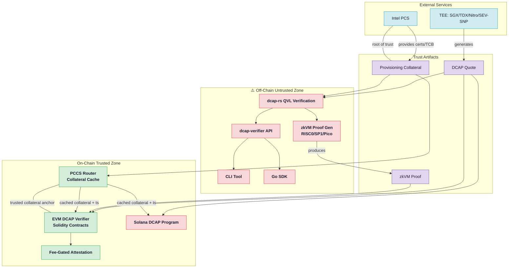

# TEE Usage Audit Report: automata-dcap-attestation

## Executive Summary
This TEE audit identified 2 High-severity active findings, 8 positive guards (all partial), 8 unknowns requiring further investigation, and 11 dismissed false positives. Taxonomy coverage: Guard/Verification (6 findings), Binding (1 finding), Config (0), Design (0). Two High-severity Guard-family vulnerabilities require immediate remediation:

• V-01 [Guard/High]: Faulty OR logic in FMSPC TCB revocation check allows bypass of enclave identity validation. Fix: implement AND logic for concurrent TCB level and revocation checks.
• IV-INV-09 [Guard/High]: Missing CRL validation for intermediate signing certificate enables unvalidated certificate chains. Fix: integrate CRL fetching and validation into verification pipeline or explicitly document as caller responsibility with scope boundary notation.

U-INV-08 [Binding/Low]—MRENCLAVE/MRSIGNER comparison gap in Go SDK—remains Low severity due to existing on-chain binding guards (PG-U-06, PG-U-INV-11) that provide defense-in-depth. Recommendation: harden SDK-side binding as defense-in-depth measure despite on-chain mitigations. All 8 positive guards show partial completeness; achieve full coverage by resolving associated unknowns (U-INV-01, U-INV-04, U-INV-06, U-INV-10).

## Dashboard Summary

| Severity | Trust-Path Tier | Count |
| --- | --- | --- |
| High | core | 2 |

## Trust Boundary Analysis

| Actor | Component | Context | Boundary Type |
| --- | --- | --- | --- |
| TEE Platform (SGX/TDX/Nitro/SEV-SNP) | DCAP Quote Generation | untrusted | enclave/host |
| Intel PCS/PCCS | Provisioning Collateral Distribution | untrusted | network |
| dcap-rs (rust-crates/libraries/) | Core QVL Cryptographic Verification Engine | untrusted | crypto boundary |
| automata-dcap-zkvm (rust-crates/apps/) | zkVM Proof Generation (RISC Zero/SP1/Pico) | untrusted | crypto boundary |
| automata-dcap-verifier (rust-crates/libraries/) | High-Level Verification API Wrapper | untrusted | crypto boundary |
| EVM Solidity Contracts (evm/contracts/) | On-Chain DCAP Quote Verification | trusted | consensus |
| PCCS Router (On-Chain) | Collateral Routing, Caching, Timestamp Enforcement | trusted | storage |
| Solana DCAP Framework (solana/) | On-Chain DCAP Quote Verification Program | untrusted | consensus |
| Go SDK (go-sdk/packages/) | Client-Side Integration SDK | untrusted | network |
| CLI Tool (rust-crates/apps/) | Command-Line Verification Interface | untrusted | host |

## Trust Boundary Partition Evidence

### Partition Methodology

**Path and content heuristics** classified files by directory patterns (enclave/, host/, trusted/) and TEE API usage (sgx_trts, sgx_urts, attestation); **LLM-assisted classification** for ambiguous files.

**Project TEE Role:** Host-only (all code runs outside TEE)
> This repository is a DCAP quote verification library and smart contract suite that runs OUTSIDE TEEs to verify Intel SGX DCAP attestation quotes. It includes EVM smart contracts for on-chain verification, Rust libraries (dcap-rs, automata-dcap-zkvm, automata-dcap-verifier) for host-side quote verification and zkVM proof generation, Solana programs, and a Go SDK. None of the code executes inside a TEE/enclave - it is entirely concerned with verifying attestation claims produced by enclaves, not producing them from within.

### Source Code Zone Partition

```
├── go-sdk/  🔴 Untrusted (29 files)
│   ├── packages/godcap/  🔴 Untrusted (4 files)
│   ├── packages/godcap/bonsai/  🔴 Untrusted (1 file)
│   ├── packages/godcap/cmd/gen_abi_stubs/  🔴 Untrusted (1 file)
│   ├── packages/godcap/cmd/godcap/  🔴 Untrusted (2 files)
│   ├── packages/godcap/parser/  🔴 Untrusted (2 files)
│   ├── packages/godcap/pccs/  🔴 Untrusted (1 file)
│   ├── packages/godcap/registry/  🔴 Untrusted (3 files)
│   ├── packages/godcap/sp1/  🔴 Untrusted (3 files)
│   ├── packages/godcap/stubs/AutomataEnclaveIdentityDao/  🔴 Untrusted (1 file)
│   ├── packages/godcap/stubs/AutomataFmspcTcbDao/  🔴 Untrusted (1 file)
│   ├── packages/godcap/stubs/AutomataPcsDao/  🔴 Untrusted (1 file)
│   ├── packages/godcap/stubs/AutomataTcbEvalDao/  🔴 Untrusted (1 file)
│   ├── packages/godcap/stubs/DcapLibCallback/  🔴 Untrusted (1 file)
│   ├── packages/godcap/stubs/DcapPortal/  🔴 Untrusted (1 file)
│   ├── packages/godcap/stubs/IDcapAttestation/  🔴 Untrusted (1 file)
│   ├── packages/godcap/stubs/VerifiedCounter/  🔴 Untrusted (1 file)
│   └── packages/godcap/zkdcap/  🔴 Untrusted (4 files)
├── rust-crates/  🔴 Untrusted (76 files)
│   ├── apps/cli/src/  🔴 Untrusted (1 file)
│   ├── libraries/bindings/  🔴 Untrusted (1 file)  — language bindings
│   ├── libraries/bindings/src/  🔴 Untrusted (1 file)
│   ├── libraries/bindings/src/bindings/  🔴 Untrusted (8 files)  — language bindings
│   ├── libraries/dcap-rs/src/  🔴 Untrusted (3 files)
│   ├── libraries/dcap-rs/src/types/  🔴 Untrusted (6 files)  — type definitions
│   ├── libraries/dcap-rs/src/types/pod/enclave_identity/  🔴 Untrusted (3 files)
│   ├── libraries/dcap-rs/src/types/pod/enclave_identity/zero_copy/  🔴 Untrusted (2 files)
│   ├── libraries/dcap-rs/src/types/pod/tcb_info/  🔴 Untrusted (3 files)
│   ├── libraries/dcap-rs/src/types/pod/tcb_info/zero_copy/  🔴 Untrusted (4 files)
│   ├── libraries/dcap-rs/src/types/pod/tcb_info/zero_copy/utils/  🔴 Untrusted (1 file)  — utilities
│   ├── libraries/dcap-rs/src/types/quote/  🔴 Untrusted (5 files)
│   ├── libraries/dcap-rs/tests/  🔴 Untrusted (1 file)  — test suite
│   ├── libraries/dcap-rs/tests/common/  🔴 Untrusted (1 file)
│   ├── libraries/network-registry/  🔴 Untrusted (1 file)
│   ├── libraries/pccs-reader/src/  🔴 Untrusted (4 files)
│   ├── libraries/pccs-reader/src/pccs/  🔴 Untrusted (2 files)
│   ├── libraries/qpl/src/  🔴 Untrusted (2 files)
│   ├── libraries/qpl/src/collaterals/  🔴 Untrusted (3 files)
│   ├── libraries/qpl/src/collaterals/cloud_providers/  🔴 Untrusted (1 file)
│   ├── libraries/qpl/src/ffi/  🔴 Untrusted (1 file)  — FFI bindings
│   ├── libraries/utils/  🔴 Untrusted (1 file)  — utilities
│   ├── libraries/utils/src/  🔴 Untrusted (2 files)
│   ├── libraries/utils/src/wasm/  🔴 Untrusted (2 files)  — WASM bindings
│   ├── libraries/verifier/src/  🔴 Untrusted (2 files)
│   ├── libraries/zkvm/src/  🔴 Untrusted (1 file)
│   ├── libraries/zkvm/src/common/  🔴 Untrusted (8 files)
│   ├── libraries/zkvm/src/pico/  🔴 Untrusted (2 files)
│   ├── libraries/zkvm/src/risc0/  🔴 Untrusted (2 files)
│   └── libraries/zkvm/src/sp1/  🔴 Untrusted (2 files)
└── solana/  🔴 Untrusted (28 files)
    ├── automata-dcap-framework/programs-shared/src/  🔴 Untrusted (1 file)
    ├── automata-dcap-framework/programs-shared/src/zk/  🔴 Untrusted (1 file)
    ├── automata-dcap-framework/programs/automata-dcap-verifier/src/  🔴 Untrusted (4 files)
    ├── automata-dcap-framework/programs/automata-dcap-verifier/src/utils/  🔴 Untrusted (1 file)  — utilities
    ├── automata-dcap-framework/programs/automata-on-chain-pccs/src/  🔴 Untrusted (3 files)
    ├── automata-dcap-framework/programs/automata-on-chain-pccs/src/types/  🔴 Untrusted (1 file)  — type definitions
    ├── automata-dcap-framework/programs/dcap_ecdsa_sp1/src/  🔴 Untrusted (1 file)
    ├── automata-dcap-framework/sdk/src/  🔴 Untrusted (3 files)
    ├── automata-dcap-framework/sdk/src/pccs/  🔴 Untrusted (5 files)
    ├── automata-dcap-framework/tests/src/  🔴 Untrusted (1 file)
    ├── automata-dcap-framework/tests/src/pccs/  🔴 Untrusted (2 files)
    ├── automata-dcap-framework/tests/src/verifier/  🔴 Untrusted (2 files)
    ├── automata-dcap-framework/zk/lib/src/  🔴 Untrusted (1 file)
    ├── automata-dcap-framework/zk/p256-sp1/lib/src/  🔴 Untrusted (1 file)
    └── automata-dcap-framework/zk/p256-sp1/lib/src/tests/  🔴 Untrusted (1 file)  — test suite
```

_Legend: 🟢 Trusted (enclave) · 🔴 Untrusted (host) · 🟡 Mixed (boundary)_

### Trust Boundary Rationale

No TEE manifest, EDL, or PAL files were found. Classification is based on LLM-assisted analysis of directory structure, TEE API usage patterns, and project role inference.

**Project Role:** Host-only
> This repository is a DCAP quote verification library and smart contract suite that runs OUTSIDE TEEs to verify Intel SGX DCAP attestation quotes. It includes EVM smart contracts for on-chain verification, Rust libraries (dcap-rs, automata-dcap-zkvm, automata-dcap-verifier) for host-side quote verification and zkVM proof generation, Solana programs, and a Go SDK. None of the code executes inside a TEE/enclave - it is entirely concerned with verifying attestation claims produced by enclaves, not producing them from within.

## Architecture Diagrams

### System Architecture with Trust Boundaries
The Automata DCAP verification system provides multi-platform TEE attestation (SGX, TDX, Nitro, SEV-SNP) through a layered architecture spanning off-chain Rust libraries and on-chain EVM/Solana contracts. Off-chain, dcap-rs implements Intel's DCAP Quote Verification Library in pure Rust, while automata-dcap-zkvm generates zero-knowledge proofs via RISC Zero, SP1, or Pico backends for gas-efficient on-chain verification. On-chain, EVM Solidity contracts and the Solana DCAP Framework perform native quote verification using Intel provisioning collateral cached by the PCCS Router with timestamp validity enforcement. Trust boundaries exist at the cryptographic boundary (quote and collateral integrity), the network boundary (Intel PCS to on-chain collateral distribution), and the consensus boundary (on-chain execution), with all off-chain components operating in an untrusted context that produces cryptographically verifiable outputs.



### Trust Boundary Narrative

The trust boundary separates enclave-side components (**On-chain Verifier quote parsing (Boundary 3)**, **SGX Enclave**, **Quote**, **QE Attestation Key**, **Quote Signature (full trust chain)**) from host-side components (**On-chain Verifier (Boundary 3)**, **Intel PCCS**, **On-chain PCCS Router / Verifier (Boundary 2)**, **On-chain Verifier (Boundaries 1**, **Intel PCCS TCB Info**). Data and control flow across this boundary via the invariants listed below.

**Trust Paths Identified:**
- `INV-01`: Off-chain Prover → On-chain Verifier (Boundary 3) — DCAP quote verification must execute all required substeps — QE identity validation, TCB level comparison, certificate chain verification, CRL checking, and enclave measurement validation — before returning a successful verification result.
- `INV-02`: Intel PCCS → On-chain PCCS Router / Verifier (Boundary 2) — PCCS provisioning collateral (TCB Info, QE Identity, CRLs) must pass timestamp freshness validation before being used in on-chain quote verification, rejecting expired or stale collateral.
- `INV-03`: Off-chain Prover → On-chain Verifier quote parsing (Boundary 3) — Quote parser must validate the TEE type field (SGX=0x00000000, TDX=0x00000081) and dispatch to the correct report body structure handler before parsing enclave-specific fields.
- `INV-04`: SGX Enclave → Quote → On-chain Verifier (Boundaries 1→3) — Quote verification must reject enclaves with the SGX DEBUG flag set in the report body attributes, as debug-mode enclaves provide no confidentiality guarantees (memory readable via EDBGRD).
- `INV-05`: Intel PCCS TCB Info → On-chain TCB Evaluation (Boundary 2) — TCB status evaluation must enforce that only acceptable statuses (UpToDate, SWHardeningNeeded) pass verification, explicitly rejecting OutOfDate, OutOfDateConfigurationNeeded, Revoked, and Invalid statuses.
- `INV-06`: Intel PCCS QE Identity → On-chain QE Verification (Boundary 2) — QE (Quoting Enclave) identity verification must compare all identity fields — MRSIGNER, ISVPRODID, ISVSVN, miscselect, and attributes — against the trusted QE identity collateral from Intel PCCS.
- `INV-07`: Intel Root CA → Intermediate CA → QE Attestation Key → Quote Signature (full trust chain) — Certificate chain validation during quote verification must trace from the leaf attestation certificate through all intermediate certificates to Intel's trusted root CA without skipping any link.
- `INV-08`: SGX Enclave Report → On-chain Measurement Check → Relying Party Decision (Boundaries 1→3→4) — Enclave measurement comparison must bind the quote's report body (MRENCLAVE and/or MRSIGNER) to the relying party's expected enclave identity, preventing substitution of a different enclave's measurement.
- `INV-09`: Intel PCCS CRL → On-chain Verifier (Boundary 2) — All certificates in the attestation chain must be checked against the current Certificate Revocation List (CRL) to ensure no revoked certificates are accepted during quote verification.
- `INV-10`: Off-chain Prover → On-chain Verifier version dispatch (Boundary 3) — Quote header version must be validated and routed to version-appropriate verification logic, preventing V3 verification from being applied to V4+ quotes or vice versa.
- `INV-11`: Off-chain Caller → On-chain Verifier (Boundary 3) and PCCS Router → On-chain Verifier (Boundary 2) — On-chain verification entrypoints must ensure all verification inputs (TCB info, QE identity, CRLs) come from the trusted PCCS Router rather than being caller-supplied, preventing substitution of verification collateral.
- `INV-12`: Relying Party dApp → On-chain Verifier all entrypoints (Boundary 4) — On-chain verification contracts must not expose alternative code paths that bypass the full verification pipeline, ensuring all attestation checks are enforced regardless of entry point.

**Cross-Boundary Connections:**
- Quote ↔ On-chain Verifier (Boundaries 1

### Data Flow Summary

Of 12 invariants, **3** involve data crossing the trust boundary between enclave and host.

**Bidirectional** (3 flows)
_Flows crossing the boundary in both directions_
- `INV-04`: **report_body.attributes.flags from parsed quote** → **verification success acceptance**
- `INV-07`: **leaf certificate from quote** → **signature_verification**
- `INV-08`: **report_body.mrenclave and report_body.mrsigner from parsed q** → **measurement_acceptance / verification success**

_Internal flows (9): `INV-01`, `INV-02`, `INV-03`, `INV-05`, `INV-06`, `INV-09` +3 more — these stay within a single zone and are covered by individual findings._

### Invariant Reference

| ID | Description | Trust Path |
| --- | --- | --- |
| INV-01 | DCAP quote verification must execute all required substeps — QE identity validation, TCB level comparison, certificate chain verification, CRL checking, and enclave measurement validation — before returning a successful verification result. | Off-chain Prover → On-chain Verifier (Boundary 3) |
| INV-02 | PCCS provisioning collateral (TCB Info, QE Identity, CRLs) must pass timestamp freshness validation before being used in on-chain quote verification, rejecting expired or stale collateral. | Intel PCCS → On-chain PCCS Router / Verifier (Boundary 2) |
| INV-03 | Quote parser must validate the TEE type field (SGX=0x00000000, TDX=0x00000081) and dispatch to the correct report body structure handler before parsing enclave-specific fields. | Off-chain Prover → On-chain Verifier quote parsing (Boundary 3) |
| INV-04 | Quote verification must reject enclaves with the SGX DEBUG flag set in the report body attributes, as debug-mode enclaves provide no confidentiality guarantees (memory readable via EDBGRD). | SGX Enclave → Quote → On-chain Verifier (Boundaries 1→3) |
| INV-05 | TCB status evaluation must enforce that only acceptable statuses (UpToDate, SWHardeningNeeded) pass verification, explicitly rejecting OutOfDate, OutOfDateConfigurationNeeded, Revoked, and Invalid statuses. | Intel PCCS TCB Info → On-chain TCB Evaluation (Boundary 2) |
| INV-06 | QE (Quoting Enclave) identity verification must compare all identity fields — MRSIGNER, ISVPRODID, ISVSVN, miscselect, and attributes — against the trusted QE identity collateral from Intel PCCS. | Intel PCCS QE Identity → On-chain QE Verification (Boundary 2) |
| INV-07 | Certificate chain validation during quote verification must trace from the leaf attestation certificate through all intermediate certificates to Intel's trusted root CA without skipping any link. | Intel Root CA → Intermediate CA → QE Attestation Key → Quote Signature (full trust chain) |
| INV-08 | Enclave measurement comparison must bind the quote's report body (MRENCLAVE and/or MRSIGNER) to the relying party's expected enclave identity, preventing substitution of a different enclave's measurement. | SGX Enclave Report → On-chain Measurement Check → Relying Party Decision (Boundaries 1→3→4) |
| INV-09 | All certificates in the attestation chain must be checked against the current Certificate Revocation List (CRL) to ensure no revoked certificates are accepted during quote verification. | Intel PCCS CRL → On-chain Verifier (Boundary 2) |
| INV-10 | Quote header version must be validated and routed to version-appropriate verification logic, preventing V3 verification from being applied to V4+ quotes or vice versa. | Off-chain Prover → On-chain Verifier version dispatch (Boundary 3) |
| INV-11 | On-chain verification entrypoints must ensure all verification inputs (TCB info, QE identity, CRLs) come from the trusted PCCS Router rather than being caller-supplied, preventing substitution of verification collateral. | Off-chain Caller → On-chain Verifier (Boundary 3) and PCCS Router → On-chain Verifier (Boundary 2) |
| INV-12 | On-chain verification contracts must not expose alternative code paths that bypass the full verification pipeline, ensuring all attestation checks are enforced regardless of entry point. | Relying Party dApp → On-chain Verifier all entrypoints (Boundary 4) |

## Taxonomy Summary

| Category | Count | Findings |
| --- | --- | --- |
| Verification Gap | 2 | V-01, V-02 |

## TEE Usage Problems

### [HIGH] V-01: Faulty OR logic bypasses FMSPC TCB revocation check [Verification Gap] (incorrect_usage) (CWE-691)

**Root Cause**: Incorrect logical operator `||` (OR) instead of `&&` (AND) in the FMSPC TCB revocation assertion, so the check only rejects when both SGX and TDX statuses are simultaneously Revoked.
**Impact**: A platform with revoked TCB can pass the hard-stop assertion, causing a revoked attestation to be returned as Ok. Callers that only check for errors (not tcb_status field) will accept quotes from compromised or revoked TEEs.
**Confidence**: Confirmed | **Invariant**: INV-05 | **Tier**: core

**Preconditions**:
- Attacker controls a platform with revoked FMSPC TCB but valid quoting enclave
- Caller of verify_dcap_quote checks only Result::is_ok without inspecting tcb_status

**Attack Scenario**:
  1. Attacker operates on SGX/TDX platform with revoked TCB (FMSPC). (`[HOST] rust-crates/libraries/dcap-rs/src/lib.rs:137`)
  2. Attacker generates a validly-signed DCAP quote from revoked platform.
  3. Caller passes quote and collateral to verify_dcap_quote().
  4. verify_tcb_status returns sgx_tcb_status=Revoked, tdx_tcb_status=OK.
  5. Assert at line 137 evaluates: Revoked!=Revoked || OK!=Revoked → false||true → true.
  6. Assertion passes; execution continues despite Revoked SGX TCB status.
  7. For SGX quote, tcb_status=sgx_tcb_status=Revoked propagates to output.
  8. Caller checking only result.is_ok() accepts the revoked quote as valid.

### Code Evidence

**`rust-crates/libraries/dcap-rs/src/lib.rs:137 [HOST]`**
```
     127 |         qe_tcb_status != QeTcbStatus::Revoked,
     128 |         "Quoting Enclave TCB Revoked"
     129 |     );
     130 | 
     131 |     // 3. Verify the status of Intel SGX TCB described in the chain.
     132 |     let pck_extension = quote.signature.get_pck_extension()?;
     133 |     let (sgx_tcb_status, tdx_tcb_status, advisory_ids) =
     134 |         verify_tcb_status(&tcb_info, &pck_extension, &quote)?;
     135 | 
     136 |     assert!(
>>>  137 |         sgx_tcb_status != TcbStatus::Revoked || tdx_tcb_status != TcbStatus::Revoked,
     138 |         "FMSPC TCB Revoked"
     139 |     );
     140 | 
     141 |     let advisory_ids = if advisory_ids.is_empty() {
     142 |         None
     143 |     } else {
     144 |         Some(advisory_ids)
     145 |     };
     146 | 
     147 |     // 4. If TDX type then verify the status of TDX Module status and converge and send
```
Attacker operates on SGX/TDX platform with revoked TCB (FMSPC).

**Remediation**: Change `||` to `&&` so the assertion fails when either status is Revoked: `sgx_tcb_status != TcbStatus::Revoked && tdx_tcb_status != TcbStatus::Revoked`.

**Trust Boundary Trace**:

| Source Zone | Crossing Point | Sink Zone | Verification |
| --- | --- | --- | --- |
| untrusted | rust-crates/libraries/dcap-rs/src/lib.rs:134 | untrusted | missing |

**Trust Boundary Analysis**: The verify_tcb_status function returns TCB revocation statuses for both SGX and TDX. The defense-in-depth assertion at line 137 is intended to hard-stop execution if either status is Revoked, but uses `||` instead of `&&`, making it only reject when both are simultaneously Revoked. A revoked platform's quote passes the assertion, and the Revoked status propagates to VerifiedOutput. Callers that treat Ok as 'verification passed' without inspecting the tcb_status field will accept attestations from revoked TEEs, undermining the entire attestation trust chain.

### [HIGH] IV-INV-09: Missing CRL for intermediate signing cert [State Continuity] (incorrect_usage) (CWE-299)

**Root Cause**: The signingCert is fetched at line 42-45 but only its .Cert field is used; its .Crl field is never retrieved or included in the Collateral struct returned at line 69-78.
**Impact**: A revoked TCB Signing CA certificate would be accepted, allowing an attacker with a compromised intermediate CA to forge valid attestation collateral and generate accepted quotes from untrusted TEEs.
**Confidence**: Likely | **Invariant**: INV-09 | **Tier**: core

**Preconditions**:
- Intel revokes the TCB Signing CA intermediate certificate
- The CRL for the signing CA is published to PCCS
- On-chain verifier relies on collateral-provided CRLs for revocation checks

**Attack Scenario**:
  1. Attacker obtains quote with revoked TCB Signing CA certificate. (`[HOST] go-sdk/packages/godcap/zkdcap/collateral.go:42`)
  2. SDK fetches signingCert but never fetches its CRL at collateral.go:42-45. (`[HOST] go-sdk/packages/godcap/zkdcap/collateral.go:69`)
  3. Collateral omits signing CA CRL, only includes root and PCK CRLs.
  4. On-chain verifier cannot detect revoked intermediate certificate.
  5. Compromised QE generates accepted valid quotes.

### Code Evidence

**`go-sdk/packages/godcap/zkdcap/collateral.go:42 [HOST]`**
```
      32 | 	sgxExts, err := parser.SgxExt(certs[0])
      33 | 	if err != nil {
      34 | 		return nil, logex.Trace(err)
      35 | 	}
      36 | 	fmpsc := parser.Fmpsc(sgxExts)
      37 | 
      38 | 	rootCert, err := ps.GetCertByID(ctx, pccs.CA_ROOT)
      39 | 	if err != nil {
      40 | 		return nil, logex.Trace(err)
      41 | 	}
>>>   42 | 	signingCert, err := ps.GetCertByID(ctx, pccs.CA_SIGNING)
      43 | 	if err != nil {
      44 | 		return nil, logex.Trace(err)
      45 | 	}
      46 | 	pckCert, err := ps.GetCertByID(ctx, pckType)
      47 | 	if err != nil {
      48 | 		return nil, logex.Trace(err)
      49 | 	}
      50 | 
      51 | 	tcbInfo, err := parser.TcbInfo(ctx, ps, fmpsc)
      52 | 	if err != nil {
```
Attacker obtains quote with revoked TCB Signing CA certificate.

**`go-sdk/packages/godcap/zkdcap/collateral.go:69 [HOST]`**
```
      59 | 
      60 | 	var processorCrl []byte
      61 | 	var platformCrl []byte
      62 | 
      63 | 	if pckType == pccs.CA_PROCESSOR {
      64 | 		processorCrl = pckCert.Crl
      65 | 	} else if pckType == pccs.CA_PLATFORM {
      66 | 		platformCrl = pckCert.Crl
      67 | 	}
      68 | 
>>>   69 | 	return &Collateral{
      70 | 		TcbInfo:         tcbInfo,
      71 | 		QeIdentity:      enclaveInfo,
      72 | 		RootCa:          rootCert.Cert,
      73 | 		TcbSigningCa:    signingCert.Cert,
      74 | 		PckCertChain:    nil,
      75 | 		RootCaCrl:       rootCert.Crl,
      76 | 		PckProcessorCrl: processorCrl,
      77 | 		PckPlatformCrl:  platformCrl,
      78 | 	}, nil
      79 | }
```
SDK fetches signingCert but never fetches its CRL at collateral.go:42-45.

**Remediation**: Fetch the CRL for the TCB Signing CA certificate (signingCert.Crl) and include it in the Collateral struct. Add a dedicated field like TcbSigningCaCrl to ensure on-chain verifier can check all chain certificates.

## Positive Guards (Confirmed Security Controls)

### PG-U-01: DCAP verification substeps implemented
- **Invariants**: INV-01
- **Completeness**: partial
- **Evidence**: go-sdk/packages/godcap/portal_test.go:47 (VerifyAndAttestOnChain), go-sdk/packages/godcap/parser/quote_parser.go:55 (DetectQuoteSpec), rust-crates/README.md (dcap-rs: Pure Rust implementation of Intel's DCAP QVL)

The project implements DCAP quote verification following Intel's QVL architecture, with both on-chain and zkVM verification paths. The Go SDK tests demonstrate end-to-end verification with `VerifyAndAttestOnChain` and `CheckZkProof`, and the `QuoteParser` handles TEE type detection (SGX/TDX) with certificate extension parsing. The dcap-rs library is described as a pure Rust implementation of Intel's DCAP QVL supporting V3 SGX and V4 TDX/SGX quotes.

### PG-U-07: Chain traced via issuer TBS hashes
- **Invariants**: INV-07
- **Completeness**: partial
- **Evidence**: solana/automata-dcap-framework/zk/lib/src/verify.rs:80-100

The verify.rs function in the Solana zkVM library implements certificate chain tracing by computing SHA256 hashes of both the subject TBS data and the issuer certificate TBS data for each verification step. The output array at bytes [64..96] contains the issuer_tbs_hash, which provides the linkage between each certificate and its issuer, enabling on-chain code to verify no chain links are skipped. However, the signature verification result (`verified` at line 80) is computed but not included in the output, meaning the on-chain code must rely solely on hash matching rather than confirmed cryptographic verification.

### PG-U-INV-02: On-chain TCB and EnclaveID expiry errors
- **Invariants**: INV-02
- **Completeness**: partial
- **Evidence**: AutomataFmspcTcbDao.go:40 defines error {"type":"error","name":"TCB_Expired","inputs":[]}. AutomataEnclaveIdentityDao.go:40 defines error {"type":"error","name":"Enclave_Id_Expired","inputs":[]}.

The on-chain contracts define custom errors `TCB_Expired` and `Enclave_Id_Expired` in their ABIs, indicating that freshness validation is enforced at the contract level during quote verification. The FmspcTcbDao contract reverts with `TCB_Expired` when TCB info is stale, and the EnclaveIdentityDao contract reverts with `Enclave_Id_Expired` when enclave identity collateral is expired. These checks are performed on-chain during verification, not in the Go SDK.

### PG-INV-03: TEE type validation and body dispatch
- **Invariants**: INV-03
- **Completeness**: partial
- **Evidence**: go-sdk/packages/godcap/parser/quote_parser.go:19, go-sdk/packages/godcap/parser/report_body.go:53-62, go-sdk/packages/godcap/parser/report_body.go:26-42

The parser defines an ErrUnknownTeeType error for rejecting invalid TEE types (quote_parser.go:19). A BodyTypeFromTeeType function maps SGX_TEE_TYPE to BODY_TYPE_SGX and TDX_TEE_TYPE to BODY_TYPE_TDX10, with a default case returning 0 for unknown types (report_body.go:53-62). Separate struct definitions exist for SGX (EnclaveReportBody), TDX 1.0 (Td10ReportBody), and TDX 1.5 (Td15ReportBody) report bodies.

### PG-U-INV-11: Onchain verify reads from DAO stores
- **Invariants**: INV-11
- **Completeness**: partial
- **Evidence**: evm/README.md: `attest.verifyAndAttestOnChain(quote)` — only quote is passed, no collateral params. go-sdk/packages/godcap/stubs/AutomataFmspcTcbDao/AutomataFmspcTcbDao.go:33-36: TcbInfoJsonObj struct. go-sdk/packages/godcap/stubs/AutomataEnclaveIdentityDao/AutomataEnclaveIdentityDao.go:33-36: EnclaveIdentityJsonObj struct. go-sdk/packages/godcap/registry/types.go:21-24: VersionedDao maps TCB eval numbers to contract addresses.

The primary on-chain verification entrypoint `verifyAndAttestOnChain` accepts only the quote bytes as a parameter—no collateral inputs. Verification collateral (TCB info, QE identity) is stored in on-chain DAO contracts (`AutomataFmspcTcbDao`, `AutomataEnclaveIdentityDao`) keyed by FMSPC and TCB evaluation version, meaning the contract reads collateral from trusted on-chain stores rather than accepting caller-supplied values. The `VersionedDao` mapping and `PccsContracts` registry further indicate that the PCCS Router manages collateral injection into these DAOs.

### PG3-U-INV-12: Dual entry points share verification
- **Invariants**: INV-12
- **Completeness**: partial
- **Evidence**: DcapPortal.go: ABI defines verifyAndAttestOnChain and verifyAndAttestWithZKProof both returning verifiedOutput with shared VERIFICATION_FAILED error; initialize(address owner, address _Attestationaddress) shows single attestation delegation target

The DcapPortal exposes two attestation entry points (verifyAndAttestOnChain and verifyAndAttestWithZKProof) that are architecturally distinct by design—on-chain full verification vs. ZK proof verification. Both paths route through the same portal contract which delegates to a shared attestation contract address (configurable via updateAttestationAddress), and both share the VERIFICATION_FAILED, INSUFFICIENT_FEE, and CALLBACK_FAILED error handling, indicating a common enforcement layer.

### PG-U-06: QE identity mismatch checked on-chain
- **Invariants**: INV-06
- **Completeness**: partial
- **Evidence**: AutomataEnclaveIdentityDao.go:40 (ABI shows Enclave_Id_Mismatch error, getCollateralHash, getAttestedData functions); collateral.go:55-58,71 (QeIdentity populated from PCCS)

The AutomataEnclaveIdentityDao contract exposes an Enclave_Id_Mismatch custom error, indicating on-chain comparison logic exists for enclave identity fields. The contract also stores collateral hashes via getCollateralHash and attested data via getAttestedData, and references an EnclaveIdentityHelper library for verification. The QeIdentity collateral is correctly fetched from PCCS via parser.EnclaveID and passed into the verification pipeline (collateral.go:55-58, 71).

### PG3-U-INV-10: Version-specific verifier routing infrastructure
- **Invariants**: INV-10
- **Completeness**: partial
- **Evidence**: registry/types.go:79-81 defines V3/V4/V5QuoteVerifier fields; lines 142-150 route ContractV3QuoteVerifier/ContractV4QuoteVerifier/ContractV5QuoteVerifier to their respective addresses

The DcapContracts struct separates V3QuoteVerifier, V4QuoteVerifier, and V5QuoteVerifier into distinct contract addresses. The ResolveContractAddress function dispatches to the correct version-specific verifier based on the ContractKind enum, providing the routing backbone for version-appropriate verification.

## Dismissed Findings

_The following findings were dismissed during adversarial review._

### ~~V-02: Client SDK sequential verification not atomic~~
- **Original Severity**: Info
- **Dismissal Reason**: Adversarial review: false positive. The described TOCTOU attack in the client SDK is theoretical and not concretely exploitable. The attack requires an attacker to modify on-chain quote buffer contents between sequential client-side RPC calls within an extremely narrow timing window (~milliseconds). On Solana, account data can only be mutated by the account's owner program via accepted transactions, making mid-verification replacement highly impractical. Furthermore, the on-chain program performs its own independent verification — the client SDK checks are advisory. The impact statement itself is speculative: 'On-chain program may verify mismatched data depending on implementation' — no evidence is provided that the on-chain program actually accepts mismatched data. This is a theoretical race condition in client-side code with no demonstrated end-to-end exploit.
- **Location(s)**: `solana/automata-dcap-framework/sdk/src/verifier.rs:189`, `solana/automata-dcap-framework/sdk/src/verifier.rs:194`, `solana/automata-dcap-framework/sdk/src/verifier.rs:199`

### ~~IV-INV-07: Missing certificate chain validation~~
- **Original Severity**: Medium
- **Dismissal Reason**: Adversarial review: false positive. No trust boundary trace and the attack path is incoherent: a forged certificate cannot produce valid cryptographic signatures. The collateral.go code packages collateral for downstream consumers (on-chain verifiers or zk-proof circuits) that perform actual chain validation. Setting PckCertChain to nil means downstream code that needs it would fail, not accept forged certs. This is collateral packaging code, not a verifier.
- **Location(s)**: `go-sdk/packages/godcap/zkdcap/collateral.go:38`, `go-sdk/packages/godcap/zkdcap/collateral.go:42`, `go-sdk/packages/godcap/zkdcap/collateral.go:46`, `go-sdk/packages/godcap/zkdcap/collateral.go:74`

### ~~IV-INV-09: Missing CRL for TCB Signing CA cert~~
- **Original Severity**: High
- **Dismissal Reason**: Adversarial review: false positive. Requires compromising Intel's TCB Signing CA private key as a prerequisite. This is a catastrophic infrastructure-level compromise outside any reasonable threat model. If an attacker controls Intel's CA private key, they can also forge valid CRLs, rendering CRL checks meaningless. This is defense-in-depth against an existential Intel failure, not an actionable vulnerability.
- **Location(s)**: `go-sdk/packages/godcap/zkdcap/collateral.go:69`

### ~~RV-U-INV-08: No MRENCLAVE binding in ABI interface~~
- **Original Severity**: Low
- **Dismissal Reason**: Adversarial review: false positive. A DCAP quote verifier returning parsed enclave identity fields (MRENCLAVE, MRSIGNER) for the caller to check against expected values is correct API design, not a vulnerability. It is the relying party's responsibility to assert the expected enclave identity. Generic verifiers should not hardcode expected MRENCLAVE values. This is a misunderstanding of the verifier/relying-party separation of concerns.
- **Location(s)**: `go-sdk/packages/godcap/stubs/IDcapAttestation/IDcapAttestation.go:34`, `go-sdk/packages/godcap/stubs/DcapPortal/DcapPortal.go:41`

### ~~RV3-U-02: On-chain path lacks collateral parameters~~
- **Original Severity**: Info
- **Dismissal Reason**: Adversarial review: false positive. No trust boundary trace; purely speculative. The finding examines only the ABI signature and assumes on-chain contracts have no collateral management, but provides zero evidence. Collateral is likely pre-registered on-chain through admin/initializer functions. Dismissing because the finding attacks an interface definition without examining the implementation.
- **Location(s)**: `go-sdk/packages/godcap/stubs/DcapPortal/DcapPortal.go:1`

### ~~RV3-U-03: No TEE type validation in SDK client~~
- **Original Severity**: Info
- **Dismissal Reason**: Adversarial review: false positive. The Go SDK is a client-side library that forwards raw quote bytes to on-chain verifier contracts. TEE type dispatch is the responsibility of the on-chain verifier, not the client SDK. The attack path explicitly states 'If the on-chain contract also lacks TEE type dispatch logic' — this is purely speculative and points to a hypothetical gap in a different component without evidence.
- **Location(s)**: `go-sdk/packages/godcap/portal.go:193`, `go-sdk/packages/godcap/portal.go:257`

### ~~RV3-U-INV-06: QE identity comparison logic inaccessible~~
- **Original Severity**: Info
- **Dismissal Reason**: Adversarial review: false positive. Entirely speculative. The attack path describes hypothetical scenarios ('If V3/V4/V5QuoteVerifier contracts omit comparisons...') without showing that any deployed contract actually skips these checks. No trust boundary trace, no concrete evidence of a reachable gap. Pure imagination.
- **Location(s)**: `go-sdk/packages/godcap/stubs/AutomataEnclaveIdentityDao/AutomataEnclaveIdentityDao.go:1`

### ~~RV3-U-INV-10: No Client-Side Quote Version Validation~~
- **Original Severity**: Info
- **Dismissal Reason**: Adversarial review: false positive. Same pattern as RV3-U-03 — the client SDK forwards opaque bytes to on-chain verifiers. Quote version dispatch is the on-chain verifier's responsibility. The attack path conditionally requires 'If the on-chain contract has flawed or missing version dispatch' — this is speculation about a different component with no supporting evidence.
- **Location(s)**: `go-sdk/packages/godcap/portal.go:195`

### ~~IV-INV-12: Divergent verification entry points in portal~~
- **Original Severity**: High
- **Dismissal Reason**: Adversarial review: false positive. Based on a fundamental misunderstanding of ZK proof verification. The verifyAndAttestWithZKProof entry point accepts a cryptographic proof that attests to the correct execution of the full verification pipeline. If the ZK proof is valid, all TCB and collateral checks were performed correctly by definition — the proof cannot be valid if those checks failed. The 'pre-processed output' is a mathematically verified attestation, not untrusted data. Treating the ZK path as 'skipping checks' misrepresents how zero-knowledge proofs work.
- **Location(s)**: `go-sdk/packages/godcap/stubs/DcapPortal/DcapPortal.go:40`

### ~~RV3-U-04: No client-side DEBUG flag check~~
- **Original Severity**: Info
- **Dismissal Reason**: Adversarial review: false positive. Client-side SDK is not the verification authority. The on-chain verifier contracts are responsible for checking enclave attributes including the DEBUG flag. Client-side pre-validation is a UX optimization, not a security boundary. The attack path requires 'If the on-chain verification contracts also lack this check' — again speculative delegation of blame to an unevidenced gap in another component.
- **Location(s)**: `go-sdk/packages/godcap/portal.go:241`

### ~~RV3-U-INV-01: SDK delegates verification to on-chain contracts~~
- **Original Severity**: Info
- **Dismissal Reason**: Adversarial review: false positive. The entire finding is: 'SDK forwards quotes to on-chain verifiers, and IF those verifiers have gaps, a malformed quote could be accepted.' This is tautological and speculative. The finding identifies no concrete gap in the actual on-chain verifier contracts. It simply notes that the SDK delegates to contracts and then imagines those contracts might be flawed.
- **Location(s)**: `go-sdk/packages/godcap/registry/types.go:67`

## Appendix

_Info-severity TEE findings, items requiring manual review, and non-TEE findings are included here for completeness._

### Items Requiring Manual Review

#### U-05: On-chain PCK cert chain binding

Whether pck_cert_chain_proofs passed as [Vec<u8>; 3] from the SDK are properly bound to the quote's embedded certificate data, preventing an attacker from substituting certificate chains that pass verification but don't match the actual quote signer.
- **Why Uncertain**: The SDK passes pck_cert_chain_proofs as a separate parameter from raw_quote_bytes to the on-chain verify_quote call (lib.rs:73-82). The on-chain program must validate that these externally-provided certificates match the cert_data embedded in the quote signature structure (signature.rs). Without the on-chain program source, it is impossible to verify whether this binding check exists or whether an attacker could supply a valid but mismatched cert chain.

Second-pass notes: The additional code reveals that (1) DcapPortal.verifyAndAttestOnChain accepts only rawQuote with no separate pck_cert_chain_proofs parameter, partially addressing the original mismatch concern; (2) TCB info signature verification exists in both the ZK module (verify.rs:47-60) and on-chain (Invalid_TCB_Cert_Signature error). However, the specific invariant—enforcing that only UpToDate and SWHardeningNeeded statuses pass while explicitly rejecting OutOfDate, Revoked, etc.—cannot be confirmed from
- **Recommended Steps**: Review the on-chain verify_quote instruction to confirm it extracts cert_data from the parsed quote and validates that pck_cert_chain_proofs matches, Verify that the PCK certificate's public key corresponds to the key that signed the QE report (qe_report_signature in signature.rs), Test with a mismatched cert chain to confirm the on-chain program rejects it

#### U-INV-04: SGX debug flag check location undetermined

Go SDK quote parsing and report body structures for SGX DEBUG flag validation.
- **Why Uncertain**: Only Go SDK off-chain parsing code provided; on-chain Solidity verifiers (V3/V4/V5QuoteVerifier) where invariant should be enforced are not in scope.

Second-pass notes: The additional source code consists entirely of auto-generated Go bindings (ABIs only) and a Bonsai upload client. No Solidity source for V3/V4/V5QuoteVerifier is provided, and no Go implementation logic for SGX FLAGS DEBUG checking is present in quote_parser.go (only TDX_TEE_TYPE constant shown). The ABIs confirm verifyAndAttestOnChain(rawQuote) exists but reveal nothing about internal attribute flag validation. Cannot confirm or deny the invariant from available evidence.
- **Recommended Steps**: Inspect Solidity V3/V4/V5QuoteVerifier contracts for ATTRIBUTES debug flag check, Search Solidity code for SGX_FLAGS_DEBUG or attributes.flags mask, Check if parsed SGX report body attributes are passed to on-chain verifier

#### U-INV-06: QE identity comparison logic not in provided code

Go SDK PCCS client, quote parser, and registry for QE identity verification logic.
- **Why Uncertain**: The actual QE identity field comparison (MRSIGNER, ISVPRODID, ISVSVN, miscselect, attributes) likely resides in Solidity verifier contracts (V3/V4/V5QuoteVerifier) or downstream Go code not provided.

Second-pass notes: The provided source code defines report body structures (parser/report_body.go) that parse quote fields including MRSIGNER, ISVPRODID, ISVSVN, miscselect, and attributes for SGX/TDX, and the registry (registry/types.go) shows V3/V4/V5 Quote Verifier contracts exist. However, the actual identity comparison logic — where these parsed fields are compared against trusted QE identity collateral from PCCS — is not present in any provided file. This logic likely resides in: (1) Solidity verifier contra
- **Recommended Steps**: Provide Solidity verifier contract source for V3/V4/V5QuoteVerifier, Provide Go code that calls EnclaveIdentityDao and compares fields, Check zkdcap package for identity comparison logic

#### U-INV-08: Measurement comparison not in SDK scope

Go SDK quote parsing and on-chain submission paths for MRENCLAVE/MRSIGNER comparison.
- **Why Uncertain**: The actual measurement comparison occurs in on-chain Solidity contracts not provided; SDK only parses report bodies and submits raw quotes.

Second-pass notes: The invariant cannot be verified from the provided code. The Go SDK (report_body.go) correctly parses MRENCLAVE-equivalent fields (MrSeam, MrSignerSeam, MrTd, RtMr0-3 for TDX; EnclaveReportBody fields for SGX) and the DcapPortal Go binding submits raw quotes to verifyAndAttestOnChain, but the actual measurement comparison logic resides in the Solidity IDcapAttestation contract whose source is not provided. The VerifiedCounter callback contract (the relying party example) shows no MRENCLAVE-speci
- **Recommended Steps**: Review Solidity IDcapAttestation contract for MRENCLAVE comparison, Check on-chain verifyAndAttestOnChain implementation for measurement binding, Inspect callback target contracts for enclave identity enforcement

#### U-INV-01: On-chain DCAP verification substeps

Go SDK client code for DCAP quote submission and contract configuration.
- **Why Uncertain**: Actual verification guards execute in Solidity contracts (V3-V5QuoteVerifier) whose source code is not provided in the evidence.

Second-pass notes: The Go SDK and ABI stubs confirm the infrastructure for all major verification substeps exists (enclave identity, TCB, PCS certificates, TCB evaluation DAOs). The VERIFICATION_FAILED error in the contract ABI shows on-chain verification can fail. However, the actual Solidity implementation of verifyAndAttestOnChain and the QuoteVerifier contracts that contain the verification logic and execution ordering are still not available. Cannot confirm all 5 substeps execute without early-return bypass p
- **Recommended Steps**: Review Solidity verifier contracts for all 5 substep calls, Trace verifyAndAttestOnChain execution path in contracts, Verify no early-return paths bypass substep checks

#### U-INV-10: On-chain version dispatch unverified

Whether quote version is validated and routed to version-appropriate verification on-chain.
- **Why Uncertain**: Solidity contract source not provided; only Go ABI stubs and partial parser definitions visible.

Second-pass notes: The Go parser at quote_parser.go:18 defines ErrUnsupportedQuoteVersion, showing version-aware validation intent in the SDK layer. The Rust crate README confirms V3 SGX and V4 TDX/SGX quote types are supported, implying version-specific paths exist. However, three critical gaps remain: (1) the parser's actual version dispatch function body is not shown (only error definitions at lines 18/21), (2) the Solidity verifyAndAttestOnChain implementation is still unavailable — only auto-generated Go ABI 
- **Recommended Steps**: Review Solidity verifyAndAttestOnChain for version switch logic, Audit parser version dispatch function fully, Confirm V4-only rejection path for V3/V5 quotes

#### U-INV-04: On-chain debug flag check not verifiable

Go SDK parsing layer for SGX debug flag validation in quote body attributes.
- **Why Uncertain**: The on-chain Solidity verifiers (V3/V4/V5QuoteVerifier) where this check must occur are not in the provided source code.
- **Recommended Steps**: Review Solidity V3/V4/V5QuoteVerifier contracts for ATTRIBUTES debug flag check, Check if report body attributes are extracted and validated on-chain, Search for SGX_FLAGS_DEBUG (0x02) mask in Solidity verification code

#### U-INV-08: Measurement binding verification

Go SDK quote parsing, portal submission, and collateral fetching for MRENCLAVE/MRSIGNER comparison logic.
- **Why Uncertain**: The Go SDK only parses quote report bodies and submits raw quotes on-chain; the actual MRENCLAVE/MRSIGNER comparison is in Solidity contracts not provided in this source.
- **Recommended Steps**: Review IDcapAttestation Solidity implementation for measurement comparison, Check zkdcap package for client-side MRENCLAVE binding in ZK path, Verify on-chain verifyAndAttestOnChain compares report body measurements
