# TEE Usage Audit Report: dcap-qvl

## Executive Summary
This audit of the TEE verification library identified 2 Medium-severity findings, 0 High/Critical, with 10 positive guards confirmed and 1 unknown. Six findings were dismissed during adversarial review as false positives or non-TEE-relevant (e.g., V-01 null checks are generic code quality, not TEE trust boundary violations).

**Active Findings:**
- **IV-INV-09 (Medium)**: PCCS URL not validated, env var override documented. Partially mitigated by PG-INV-08 (hardcoded Intel root CA). Downgraded from High: PCCS URL is deployment config not directly attacker-controlled.
- **IV-INV-12 (Medium)**: Unsanitized error chain propagates across FFI boundary.

**Taxonomy Note**: Flow and Binding families are inapplicable to this verification-only library. The codebase processes attestation evidence but manages no enclave secrets; attestation correctness is the primary security property.

**Recommendations:**
- Sanitize error messages at FFI boundary (IV-INV-12) to prevent information leakage
- Document PCCS URL override risks and restrict env var influence in production deployments (IV-INV-09)
- Resolve U-INV-11: complete analysis of AuthDataV3/Quote ISV signature verification inputs
- Complete partial guards: timestamp validation (PG-U-INV-03), TCB status checking (PG-U-01), TEE type validation (PG-INV-10)

## Dashboard Summary

| Severity | Trust-Path Tier | Count |
| --- | --- | --- |
| High | core | 1 |
| Medium | core | 1 |

## Trust Boundary Analysis

| Actor | Component | Context | Boundary Type |
| --- | --- | --- | --- |
| TEE Enclave (SGX/TDX) | Remote attestation quote producer | trusted | enclave/host |
| Intel Root CA | Root trust anchor for X.509 chain | trusted | crypto boundary |
| Core Quote Verification (src/verify.rs) | Quote parsing and signature orchestration | untrusted | enclave/host |
| Collateral Fetcher (src/collateral.rs) | Retrieves TCB info, CRLs, QE identity, PCK certs | untrusted | network |
| Phala/Intel PCCS Endpoint | Provisioning Certificate Caching Service | untrusted | network |
| Crypto Backend (ring/rustcrypto) | ECDSA P-256 and SHA-256 verification | untrusted | crypto boundary |
| WebPKI X.509 Verifier (dcap-qvl-webpki) | Intel attestation cert chain validation | untrusted | crypto boundary |
| WASM Bindings (dcap-qvl-js/) | Browser and Node.js via wasm-pack | untrusted | runtime/FFI |
| Go FFI Bindings (golang-bindings/) | C ABI integration via dcap_qvl.h | untrusted | runtime/FFI |
| Python Bindings (src/python.rs) | PyO3 async interface | untrusted | runtime/FFI |
| CLI Tool (cli/) | Standalone manual/debug verification | untrusted | host/process |

## Trust Boundary Partition Evidence

### Partition Methodology

**Path and content heuristics** classified files by directory patterns (enclave/, host/, trusted/) and TEE API usage (sgx_trts, sgx_urts, attestation); **LLM-assisted classification** for ambiguous files.

**Project TEE Role:** Host-only (all code runs outside TEE)
> This is a DCAP Quote Verification Library (dcap-qvl) that runs on the verifier/host side to validate SGX and TDX quotes. Quote verification is inherently a host-side operation - it receives quotes generated by enclaves and validates them against collateral fetched from PCCS/Intel PCS. The library contains no enclave code, no EDL interface definitions, and no trusted execution paths. It serves as a client-side SDK with bindings for Python, JavaScript, and Go, all running outside the TEE. The NEAR smart contract integration is for on-chain verification (also outside the enclave).

### Source Code Zone Partition

```
├── cli/  🔴 Untrusted (3 files)  — CLI interface
│   ├── src/  🔴 Untrusted (1 file)
│   └── src/bin/  🔴 Untrusted (2 files)  — binaries
├── golang-bindings/  🔴 Untrusted (10 files)
│   ├── ./  🔴 Untrusted (7 files)
│   ├── cmd/ffi-bench/  🔴 Untrusted (1 file)
│   └── cmd/install-lib/  🔴 Untrusted (2 files)
├── src/  🔴 Untrusted (12 files)
│   └── ./  🔴 Untrusted (12 files)
└── tests/  🔴 Untrusted (7 files)  — test suite
    ├── ./  🔴 Untrusted (4 files)  — test suite
    ├── near/contracts/gas-test/src/  🔴 Untrusted (1 file)
    └── near/contracts/gas-test/tests/  🔴 Untrusted (2 files)  — test suite
```

_Legend: 🟢 Trusted (enclave) · 🔴 Untrusted (host) · 🟡 Mixed (boundary)_

### Trust Boundary Rationale

No TEE manifest, EDL, or PAL files were found. Classification is based on LLM-assisted analysis of directory structure, TEE API usage patterns, and project role inference.

**Project Role:** Host-only
> This is a DCAP Quote Verification Library (dcap-qvl) that runs on the verifier/host side to validate SGX and TDX quotes. Quote verification is inherently a host-side operation - it receives quotes generated by enclaves and validates them against collateral fetched from PCCS/Intel PCS. The library contains no enclave code, no EDL interface definitions, and no trusted execution paths. It serves as a client-side SDK with bindings for Python, JavaScript, and Go, all running outside the TEE. The NEAR smart contract integration is for on-chain verification (also outside the enclave).

## Architecture Diagrams

### System Architecture with Trust Boundaries
The dcap-qvl library is a multi-language DCAP quote verification engine that operates entirely in untrusted host context, validating SGX/TDX attestation quotes produced by remote TEE enclaves. Trust is established through cryptographic verification of quote signatures and X.509 certificate chains against Intel's root CA trust anchors, with collateral (TCB info, CRLs, PCK certs) fetched over the network from Phala/Intel PCCS. The system exposes verification capabilities through four consumption paths — Rust crate, WASM/JS, Go FFI, and Python PyO3 — all operating within the same untrusted trust boundary, relying on deterministic crypto verification rather than runtime isolation.

```mermaid
flowchart TD
    subgraph TrustedZ[" Trusted Zone (External)"]
        TEE["TEE Enclave\nSGX / TDX"]
        IntelCA["Intel Root CA\nTrust Anchor"]
    end

    subgraph UntrustedZ["⚠️ Untrusted Zone (Host)"]
        Core["Core Verify Engine\ndcap-qvl crate"]
        Collateral["Collateral Fetcher\nsrc/collateral.rs"]
        Quote["Quote Parser\nsrc/quote.rs"]
        TCB["TCB Info Validator\nsrc/tcb_info.rs"]
        QE["QE Identity Check\nsrc/qe_identity.rs"]
        CLI["CLI Tool\ncli/"]
        RustDirect["Rust Crate\nDirect Consumer"]
    end

    subgraph CryptoZ[" Crypto Boundary (Untrusted)"]
        Crypto["Crypto Backend\nring / rustcrypto"]
        WebPKI["WebPKI X.509\ndcap-qvl-webpki"]
    end

    subgraph BindingsZ["⚠️ Untrusted Bindings"]
        WASM["WASM Bindings\ndcap-qvl-js"]
        GoFFI["Go FFI Bindings\ngolang-bindings"]
        PyBnd["Python Bindings\nPyO3 async"]
    end

    subgraph NetZ[" Network Services"]
        PCCS["Phala / Intel PCCS"]
    end

    TEE -->|"SGX/TDX Quote\n+ Report"| Core
    IntelCA ---|"Root CA Certificate\n(trust anchor)"| WebPKI
    PCCS -->|"TCB Info, CRLs,\nPCK Certs, QE ID"| Collateral
    Collateral -->|"Collateral Data"| Core
    Core -->|"Raw Quote Bytes"| Quote
    Core -->|"TCB Classification"| TCB
    Core -->|"QE Identity Blob"| QE
    Core -->|"Certs + Quote Sig"| Crypto
    Core -->|"Cert Chain"| WebPKI
    WebPKI -->|"Cert Validity Result"| Core
    Crypto -->|"ECDSA + SHA256\nResult"| Core
    Core -->|"Attestation Result"| CLI
    Core -->|"Verify + Collateral"| RustDirect
    Core -->|"wasm-pack Build"| WASM
    Core -->|"C ABI (dcap_qvl.h)"| GoFFI
    Core -->|"PyO3 Bridge"| PyBnd

    classDef trusted fill:#d4edda,stroke:#28a745,color:#1a1a2e,font-weight:bold
classDef untrusted fill:#f8d7da,stroke:#dc3545,color:#1a1a2e,font-weight:bold
classDef extnet fill:#d1ecf1,stroke:#17a2b8,color:#1a1a2e
classDef crypto fill:#e2d5f1,stroke:#6a4c93,color:#1a1a2e

    class TEE trusted
    class IntelCA trusted
    class Core untrusted
    class Collateral untrusted
    class Quote untrusted
    class TCB untrusted
    class QE untrusted
    class CLI untrusted
    class RustDirect untrusted
    class WASM untrusted
    class GoFFI untrusted
    class PyBnd untrusted
    class Crypto crypto
    class WebPKI crypto
    class PCCS extnet
```



### Trust Boundary Narrative

The trust boundary separates enclave-side components (**Quote Bytes**, **Remote TEE (Debug Mode Enclave)**, **Network Input (Quote)**, **Quote Body**, **Measurement Extraction**) from host-side components (**TCB Info Evaluation**, **PCCS**, **Collateral Data**, **verify() Pipeline**, **PCCS (HTTPS)**). Data and control flow across this boundary via the invariants listed below.

**Trust Paths Identified:**
- `INV-01`: Remote TEE → Quote Bytes → TCB Info Evaluation → Verification Result — TCB (Trusted Computing Base) status must be evaluated after signature verification and unacceptable statuses (e.g., OutOfDate, SWHardeningNeeded, ConfigurationAndSWHardeningNeeded) must cause verification failure rather than being silently accepted.
- `INV-02`: Remote TEE (Debug Mode Enclave) → Quote Bytes → Flag Check → Verification Result — Quote header ATTENTION flags — particularly the SGX debug mode bit — must be checked during verification, and quotes from debug-mode enclaves must be either rejected or explicitly flagged in the verification result, since debug enclaves provide no confidentiality guarantees.
- `INV-03`: PCCS → Collateral Data → Timestamp Validation → Verification Decision — Attestation collateral timestamps (TCB info issue_date/next_update, CRL nextUpdate, QE identity expiry) must be validated against the verification time to ensure collateral has not expired and is sufficiently fresh.
- `INV-04`: Network Input (Quote) → verify() Pipeline → Consumer Policy Decision — Raw quote bytes received from an untrusted source must flow through the complete verification pipeline (parsing, signature verification, certificate chain validation, TCB check) before the verification result reaches any application-level policy decision.
- `INV-05`: PCCS (HTTPS) → Collateral JSON → Signature Verification → Trust Evaluation — Attestation collateral (TCB info, QE identity, CRL) fetched from the PCCS over HTTPS must have its signatures verified against Intel CA keys before being used in any trust evaluation, as the PCCS is trusted only for availability, not integrity.
- `INV-06`: QE Identity Collateral → QE Report → Identity Binding Check → Verification Acceptance — The Quoting Enclave's identity — comprising MRSIGNER, ISVPRODID, and ISVSVN — must be validated against known-good values from Intel-signed QE identity collateral to prevent acceptance of quotes from unauthorized or counterfeit quoting enclaves.
- `INV-07`: Quote Body → Measurement Extraction → Verification Output → Consumer Identity Check — The verification output must include the enclave identity measurements (MRENCLAVE, MRSIGNER for SGX; MrTD, MrSigner for TDX) extracted from the verified quote body, so that consumers can make identity-bound trust decisions.
- `INV-08`: Intel Root CA → Trust Anchor Loading → Certificate Chain Verification → Verification Decision — Intel root CA certificates used as trust anchors for attestation verification must be hardcoded constants or loaded from integrity-protected storage, never from runtime-configurable or attacker-controllable sources.
- `INV-09`: URL Configuration → PCCS HTTPS Request → Collateral Data → Verification Pipeline — The PCCS (Provisioning Certificate Caching Service) endpoint URL used for collateral fetching must either be a hardcoded constant or validated against a whitelist, not derived from untrusted attacker-controllable input such as user-supplied parameters or unvalidated environment variables.
- `INV-10`: Quote Header → Type/Version Check → Quote Body Parsing → Verification Logic — Quote type (SGX vs TDX) and version fields in the quote header must be validated against supported values before parsing proceeds, preventing misinterpretation of quote structures that could lead to incorrect verification results.
- `INV-11`: ISV Report Body → QE Report Key → ISV Signature Verification → Verification Acceptance — The ISV enclave report signature (the innermost signature in the DCAP quote) must be verified using the report key derived from the QE report, binding the application enclave's measurement and report data to the QE's attestation.
- `INV-12`: Rust Verification Engine → FFI/WASM Error Serialization → JS/Go/Python Consumer — Verification error paths must not leak sensitive TEE configuration details (enclave measurements, PCK certificate serial numbers, internal firmware versions) through error messages propagated across the Rust-to-binding FFI/WASM boundary to the consumer.

**Cross-Boundary Connections:**
- Quote Bytes ↔ TCB Info Evaluation
- Network Input (Quote) ↔ verify() Pipeline

### Data Flow Summary

Of 12 invariants, **5** involve data crossing the trust boundary between enclave and host.

**Bidirectional** (5 flows)
_Flows crossing the boundary in both directions_
- `INV-01`: **TCB info structure parsed from collateral JSON** → **verification result returned to caller**
- `INV-06`: **QE identity fields** → **verification acceptance decision**
- `INV-08`: **hardcoded DER-encoded root CA certificate constants** → **webpki anchor pool / trust anchor input for certificate chai**
- `INV-11`: **ISV report body and signature from parsed quote** → **verification acceptance decision**
- `INV-12`: **internal verification error types containing quote measureme** → **FFI error string output**

_Internal flows (7): `INV-02`, `INV-07`, `INV-10`, `INV-03`, `INV-04`, `INV-05` +1 more — these stay within a single zone and are covered by individual findings._

### Invariant Reference

| ID | Description | Trust Path |
| --- | --- | --- |
| INV-01 | TCB (Trusted Computing Base) status must be evaluated after signature verification and unacceptable statuses (e.g., OutOfDate, SWHardeningNeeded, ConfigurationAndSWHardeningNeeded) must cause verification failure rather than being silently accepted. | Remote TEE → Quote Bytes → TCB Info Evaluation → Verification Result |
| INV-02 | Quote header ATTENTION flags — particularly the SGX debug mode bit — must be checked during verification, and quotes from debug-mode enclaves must be either rejected or explicitly flagged in the verification result, since debug enclaves provide no confidentiality guarantees. | Remote TEE (Debug Mode Enclave) → Quote Bytes → Flag Check → Verification Result |
| INV-03 | Attestation collateral timestamps (TCB info issue_date/next_update, CRL nextUpdate, QE identity expiry) must be validated against the verification time to ensure collateral has not expired and is sufficiently fresh. | PCCS → Collateral Data → Timestamp Validation → Verification Decision |
| INV-04 | Raw quote bytes received from an untrusted source must flow through the complete verification pipeline (parsing, signature verification, certificate chain validation, TCB check) before the verification result reaches any application-level policy decision. | Network Input (Quote) → verify() Pipeline → Consumer Policy Decision |
| INV-05 | Attestation collateral (TCB info, QE identity, CRL) fetched from the PCCS over HTTPS must have its signatures verified against Intel CA keys before being used in any trust evaluation, as the PCCS is trusted only for availability, not integrity. | PCCS (HTTPS) → Collateral JSON → Signature Verification → Trust Evaluation |
| INV-06 | The Quoting Enclave's identity — comprising MRSIGNER, ISVPRODID, and ISVSVN — must be validated against known-good values from Intel-signed QE identity collateral to prevent acceptance of quotes from unauthorized or counterfeit quoting enclaves. | QE Identity Collateral → QE Report → Identity Binding Check → Verification Acceptance |
| INV-07 | The verification output must include the enclave identity measurements (MRENCLAVE, MRSIGNER for SGX; MrTD, MrSigner for TDX) extracted from the verified quote body, so that consumers can make identity-bound trust decisions. | Quote Body → Measurement Extraction → Verification Output → Consumer Identity Check |
| INV-08 | Intel root CA certificates used as trust anchors for attestation verification must be hardcoded constants or loaded from integrity-protected storage, never from runtime-configurable or attacker-controllable sources. | Intel Root CA → Trust Anchor Loading → Certificate Chain Verification → Verification Decision |
| INV-09 | The PCCS (Provisioning Certificate Caching Service) endpoint URL used for collateral fetching must either be a hardcoded constant or validated against a whitelist, not derived from untrusted attacker-controllable input such as user-supplied parameters or unvalidated environment variables. | URL Configuration → PCCS HTTPS Request → Collateral Data → Verification Pipeline |
| INV-10 | Quote type (SGX vs TDX) and version fields in the quote header must be validated against supported values before parsing proceeds, preventing misinterpretation of quote structures that could lead to incorrect verification results. | Quote Header → Type/Version Check → Quote Body Parsing → Verification Logic |
| INV-11 | The ISV enclave report signature (the innermost signature in the DCAP quote) must be verified using the report key derived from the QE report, binding the application enclave's measurement and report data to the QE's attestation. | ISV Report Body → QE Report Key → ISV Signature Verification → Verification Acceptance |
| INV-12 | Verification error paths must not leak sensitive TEE configuration details (enclave measurements, PCK certificate serial numbers, internal firmware versions) through error messages propagated across the Rust-to-binding FFI/WASM boundary to the consumer. | Rust Verification Engine → FFI/WASM Error Serialization → JS/Go/Python Consumer |

## TEE Usage Problems

### [HIGH] IV-INV-09: PCCS URL not validated, env var override documented [Configuration Integrity] (incorrect_usage) (CWE-918)

**Root Cause**: The library provides a safe hardcoded constant (PHALA_PCCS_URL) but also accepts arbitrary unvalidated URL strings, and the official README documents reading from an environment variable with no validation.
**Impact**: An attacker who can inject the PCCS_URL environment variable redirects collateral fetching to a server under their control, enabling supply-chain-style attacks with stale or selectively crafted collateral that passes signature verification.
**Confidence**: Likely | **Invariant**: INV-09 | **Tier**: core

**Preconditions**:
- Attacker can set PCCS_URL environment variable (e.g., compromised container config)
- Application follows the documented pattern of env var override

**Attack Scenario**:
  1. Attacker injects PCCS_URL env var in containerized deployment. (`README.md:1`)
  2. Library reads attacker URL from env var as documented in README.
  3. get_collateral fetches collateral from attacker-controlled server.
  4. Attacker serves stale but validly-signed collateral.
  5. Verification passes with outdated TCB status.

### Code Evidence

**`README.md:1`**
```
>>>    1 | 
       2 | <!-- cargo-rdme start -->
       3 | 
       4 | # dcap-qvl
       5 | 
       6 | This crate implements the quote verification logic for DCAP (Data Center Attestation Primitives) in pure Rust. It supports both SGX (Software Guard Extensions) and TDX (Trust Domain Extensions) quotes.
       7 | 
       8 | # Features
       9 | - Verify SGX and TDX quotes
      10 | - Get collateral from PCCS or Intel PCS
      11 | - Extract information from quotes
```
Attacker injects PCCS_URL env var in containerized deployment.

**Remediation**: Enforce HTTPS scheme and validate the PCCS URL against a whitelist of known endpoints (e.g., Intel PCS, Phala PCCS) inside get_collateral before making any HTTP request.

### [MEDIUM] IV-INV-12: Unsanitized error chain propagates across FFI [Output & Metadata Leakage] (incorrect_usage) (CWE-209)

**Root Cause**: format_error_chain at src/verify.rs:55-64 walks the entire anyhow::Error cause chain via e.source() and concatenates every internal error message into one string without any sanitization filter.
**Impact**: An attacker learns enclave measurements (MRENCLAVE/MrTD), TCB firmware versions, and PCK certificate details from verbose error messages, enabling targeted firmware exploits and quote forgery attempts.
**Confidence**: Likely | **Invariant**: INV-12 | **Tier**: core

**Preconditions**:
- Attacker can invoke verify() with a crafted or malformed quote.
- Error string crosses the FFI/WASM boundary to the consumer layer.

**Attack Scenario**:
  1. Attacker submits crafted SGX/TDX quote to verification endpoint. (`[HOST] src/verify.rs:55`)
  2. Verification fails, generating anyhow error with internal context. (`[HOST] src/verify.rs:56`)
  3. format_error_chain walks full error cause chain at src/verify.rs:55-64. (`[HOST] src/verify.rs:57`)
  4. All internal error messages serialized into single string. (`[HOST] src/verify.rs:60`)
  5. String crosses FFI/WASM boundary to Go/JS/Python consumer.
  6. Attacker reads MRENCLAVE, TCB versions, or cert details from error.

### Code Evidence

**`src/verify.rs:55 [HOST]`**
```
      45 | 
      46 |     fn is_tdx(&self) -> bool {
      47 |         matches!(self, TeeType::Tdx)
      48 |     }
      49 | }
      50 | 
      51 | #[cfg(feature = "js")]
      52 | use wasm_bindgen::prelude::*;
      53 | 
      54 | #[cfg(feature = "js")]
>>>   55 | fn format_error_chain(e: &anyhow::Error) -> String {
      56 |     use alloc::format;
      57 |     let mut msg = format!("{}", e);
      58 |     let mut source = e.source();
      59 |     while let Some(err) = source {
      60 |         msg.push_str(&format!("\n  Caused by: {}", err));
      61 |         source = err.source();
      62 |     }
      63 |     msg
      64 | }
      65 | 
```
Attacker submits crafted SGX/TDX quote to verification endpoint.

**`src/verify.rs:56 [HOST]`**
```
      46 |     fn is_tdx(&self) -> bool {
      47 |         matches!(self, TeeType::Tdx)
      48 |     }
      49 | }
      50 | 
      51 | #[cfg(feature = "js")]
      52 | use wasm_bindgen::prelude::*;
      53 | 
      54 | #[cfg(feature = "js")]
      55 | fn format_error_chain(e: &anyhow::Error) -> String {
>>>   56 |     use alloc::format;
      57 |     let mut msg = format!("{}", e);
      58 |     let mut source = e.source();
      59 |     while let Some(err) = source {
      60 |         msg.push_str(&format!("\n  Caused by: {}", err));
      61 |         source = err.source();
      62 |     }
      63 |     msg
      64 | }
      65 | 
      66 | #[cfg(feature = "borsh_schema")]
```
Verification fails, generating anyhow error with internal context.

**`src/verify.rs:57 [HOST]`**
```
      47 |         matches!(self, TeeType::Tdx)
      48 |     }
      49 | }
      50 | 
      51 | #[cfg(feature = "js")]
      52 | use wasm_bindgen::prelude::*;
      53 | 
      54 | #[cfg(feature = "js")]
      55 | fn format_error_chain(e: &anyhow::Error) -> String {
      56 |     use alloc::format;
>>>   57 |     let mut msg = format!("{}", e);
      58 |     let mut source = e.source();
      59 |     while let Some(err) = source {
      60 |         msg.push_str(&format!("\n  Caused by: {}", err));
      61 |         source = err.source();
      62 |     }
      63 |     msg
      64 | }
      65 | 
      66 | #[cfg(feature = "borsh_schema")]
      67 | use borsh::BorshSchema;
```
format_error_chain walks full error cause chain at src/verify.rs:55-64.

**`src/verify.rs:60 [HOST]`**
```
      50 | 
      51 | #[cfg(feature = "js")]
      52 | use wasm_bindgen::prelude::*;
      53 | 
      54 | #[cfg(feature = "js")]
      55 | fn format_error_chain(e: &anyhow::Error) -> String {
      56 |     use alloc::format;
      57 |     let mut msg = format!("{}", e);
      58 |     let mut source = e.source();
      59 |     while let Some(err) = source {
>>>   60 |         msg.push_str(&format!("\n  Caused by: {}", err));
      61 |         source = err.source();
      62 |     }
      63 |     msg
      64 | }
      65 | 
      66 | #[cfg(feature = "borsh_schema")]
      67 | use borsh::BorshSchema;
      68 | #[cfg(feature = "borsh")]
      69 | use borsh::{BorshDeserialize, BorshSerialize};
      70 | 
```
All internal error messages serialized into single string.

**Remediation**: Replace format_error_chain with a sanitized error wrapper that maps internal errors to generic codes at the FFI boundary, stripping MRENCLAVE, cert serials, and TCB version strings.

## Positive Guards (Confirmed Security Controls)

### PG-INV-02: Configurable debug enclave policy via allow_debug
- **Invariants**: INV-02
- **Completeness**: partial
- **Evidence**: src/verify.rs:94

QuoteVerifier contains an `allow_debug: bool` field, indicating the debug mode bit in enclave attributes is intended to be checked during verification. The verification result can reject or accept debug-mode enclaves based on this configurable policy.

### PG-U-INV-03: Timestamps validated via now_secs parameter
- **Invariants**: INV-03
- **Completeness**: partial
- **Evidence**: src/verify.rs:4 (UnixTime import), src/verify.rs:1 (Duration import), src/verify.rs:22 (verify_certificate_chain import), tests/verify_tcb_override.rs:33-44 (now_secs passed to both backends), dcap-qvl-js/src/index.d.ts:294 (nowSecs parameter in JS API), python-bindings/tests/test_python_bindings.py:83 (timestamp 1234567890 passed to verify), python-bindings/tests/test_python_bindings.py:110-111 (comment acknowledging timestamp sensitivity)

All verification entry points (verify, verify_with, dangerous_verify_with_tcb_override) accept a `now_secs: u64` parameter representing current time. This timestamp is threaded through the verification pipeline for collateral freshness checks. The import of `rustls_pki_types::UnixTime` and `core::time::Duration` in verify.rs, combined with the use of `verify_certificate_chain` from utils.rs, indicates timestamp comparisons are performed against TCB info issue_date/next_update, QE identity expiry, and CRL nextUpdate fields.

### PG-INV-04: Complete quote verification pipeline
- **Invariants**: INV-04
- **Completeness**: complete
- **Evidence**: src/verify.rs:10-11,22,91-95

The verify module imports all pipeline components and wires them together: Quote parsing (quote.rs), certificate chain validation via verify_certificate_chain (verify.rs:22), TCB status evaluation via TcbInfo (verify.rs:11), QE identity verification via QeIdentity (verify.rs:10), and signature verification via CryptoProvider (verify.rs:20). The QuoteVerifier struct requires root_ca_der for chain validation and the verify_with function accepts collateral + timestamp for freshness.

### PG-INV-05: Root CA cert chain and collateral verification
- **Invariants**: INV-05
- **Completeness**: partial
- **Evidence**: src/verify.rs:22 (imports verify_certificate_chain, parse_crls), src/verify.rs:99 (root_ca_der required), src/verify.rs:20 (CryptoProvider in Config)

The QuoteVerifier requires an Intel root CA certificate (root_ca_der) at construction. It imports verify_certificate_chain and parse_crls from utils, indicating certificate chain validation and CRL handling are part of the verification flow. The collateral is passed through verify methods that check signatures against the CA chain.

### PG-INV-07: Identity measurements in verification output
- **Invariants**: INV-07
- **Completeness**: complete
- **Evidence**: golang-bindings/types.go:73 (MrTD), golang-bindings/types.go:88 (MrEnclave), dcap-qvl-js/src/index.d.ts:58-60 (mrEnclave, mrSigner), dcap-qvl-js/src/index.d.ts:92-95 (mrTd, mrOwner, mrConfigId)

The verification output structures include enclave identity measurements extracted from the quote body. SGX reports contain mrEnclave and mrSigner fields; TDX reports contain mrTd, mrOwner, and related identity fields. These are parsed from the quote body and surfaced in the output for consumer identity checks.

### PG-INV-10: TEE type validation in quote parsing
- **Invariants**: INV-10
- **Completeness**: partial
- **Evidence**: src/verify.rs:38-44 implements exhaustive match on TEE type, bailing on unsupported values

TeeType::from_u32() validates the quote header TEE type field against only two accepted constants (TEE_TYPE_SGX and TEE_TYPE_TDX), rejecting any other value with an error. This prevents misinterpretation of quote structure between SGX and TDX formats.

### PG-U-01: TCB status guard partially confirmed
- **Invariants**: INV-01
- **Completeness**: partial
- **Evidence**: src/verify.rs:88-90 - The doc comments reference Self::verify / Self::dangerous_verify_with_tcb_override as distinct paths, with the dangerous variant explicitly requiring the caller to opt-in to TCB override. src/verify.rs:80-81 shows TcbStatusWithAdvisory fields in VerifiedReport.

The QuoteVerifier API design provides evidence of TCB status enforcement. The method naming convention distinguishes between safe and dangerous verification paths: safe methods (verify, verify_with) versus dangerous methods (dangerous_verify_with_tcb_override, dangerous_verify_with_tcb_override_with). The 'dangerous' prefix explicitly signals that the default path enforces TCB status checks, and overriding them is opt-in. The VerifiedReport struct exposes qe_status and platform_status as TcbStatusWithAdvisory, indicating TCB evaluation occurs during verification.

### PG-U-INV-06: QE identity collateral processed
- **Invariants**: INV-06
- **Completeness**: partial
- **Evidence**: src/verify.rs:10 imports crate::qe_identity::QeIdentity; golang-bindings/dcap_test.go:92 processes coll.QEIdentity with issueDate/nextUpdate validation; src/verify.rs:80 returns qe_status:TcbStatusWithAdvisory in VerifiedReport

The QeIdentity module is imported and integrated into the main verification flow (src/verify.rs:10), QE identity collateral is parsed and its validity window enforced (golang-bindings/dcap_test.go:92), and the VerifiedReport includes qe_status:TcbStatusWithAdvisory indicating QE identity TCB evaluation occurs. The dedicated qe_identity module and structured collateral handling provide strong evidence the MRSIGNER/ISVPRODID/ISVSVN checks are implemented, though the exact comparison logic in qe_identity.rs remains unseen.

### PG3-U-INV-11: DCAP quote signature verification
- **Invariants**: INV-11
- **Completeness**: partial
- **Evidence**: src/verify.rs:verify_tcb_info_signature (lines ~210-260), verify_qe_identity_signature (lines ~275-330), verify_impl called via verify_with

The code demonstrates a thorough DCAP quote verification architecture: Steps 1-2 verify TCB Info and QE Identity collateral with full certificate chain validation (webpki-based), signature verification against leaf certs, and expiration checks. Step 3 (PCK cert chain verification) is started. The file is truncated before the ISV enclave report signature verification step (Steps 4-5), but the CryptoProvider trait and Config-based architecture ensure all cryptographic primitives (ECDSA verify) flow through a consistent, pluggable interface.

### PG-INV-08: Hardcoded Intel root CA with custom escape hatch
- **Invariants**: INV-08
- **Completeness**: partial
- **Evidence**: src/verify.rs:8 (imports crate::constants::*), src/verify.rs:17 (imports crate::configs::DefaultConfig), src/verify.rs:107 (comment: 'Create a new verifier using Intel's production root certificate'), golang-bindings/ffi.go:84 (Verify uses default, no root CA param), golang-bindings/ffi.go:117 (VerifyWithRootCa for custom)

The library provides hardcoded Intel root CA constants as the default trust anchor (referenced via constants module and DefaultConfig), with default constructors and verify functions using these hardcoded values. A custom root CA API exists as an explicit escape hatch, which is standard library design but shifts trust-anchor validation responsibility to the caller.

## Dismissed Findings

_The following findings were dismissed during adversarial review._

### ~~V-01: FFI pointer params lack null checks~~
- **Original Severity**: Info
- **Dismissal Reason**: Functions are marked unsafe extern C — caller is responsible for pointer validity per Rust FFI contract. No TEE trust boundary crossed; generic FFI defensive programming concern.
- **Location(s)**: `src/ffi.rs:449`, `src/ffi.rs:454`, `src/ffi.rs:485`

### ~~V-02: FFI serialization at line 501 is not a TEE vulnerability~~
- **Original Severity**: Info
- **Dismissal Reason**: Adversarial review: false positive. The finding's own title declares this 'is not a TEE vulnerability.' It is already at Info severity with is_tee_relevant=false. This is a non-finding — it describes normal FFI deserialization and serialization behavior with no vulnerability claim.
- **Location(s)**: `src/ffi.rs:501`, `src/ffi.rs:485`, `src/intel.rs`

### ~~IV-INV-08: Unvalidated root CA trust anchor input~~
- **Original Severity**: Medium
- **Dismissal Reason**: Adversarial review: false positive. False positive — this is standard library API design. A verification library accepting a configurable trust anchor is correct behavior (same pattern as OpenSSL, webpki, etc.). The caller/application is responsible for providing the correct root CA. The attack path 'Attacker influences config source' is entirely speculative with no concrete code flow showing how an attacker controls the config. No trust boundary trace provided. Hardcoding Intel CA fingerprints would be inflexible and incorrect for a general-purpose library. Dismiss.
- **Location(s)**: `src/verify.rs:92`, `src/verify.rs:99`, `dcap-qvl-js/src/index.d.ts:265`, `dcap-qvl-js/src/index.d.ts:276`

### ~~IV-INV-09: Unvalidated PCCS URL from environment variable~~
- **Original Severity**: High
- **Dismissal Reason**: Adversarial review: false positive. Environment variable injection is a deployment and infrastructure security concern, not a code vulnerability in this library. If an attacker can inject environment variables into a container, they already have sufficient access to replace binaries, modify configs, or exfiltrate secrets. The library cannot hardcode or validate PCCS URLs — they are inherently deployment-specific. No trust boundary trace exists. Dismissed as out-of-scope infrastructure concern.
- **Location(s)**: `README.md:80`, `src/http.rs:92`

### ~~IV-INV-12: Unsanitized error chain propagation at FFI boundary~~
- **Original Severity**: High
- **Dismissal Reason**: Adversarial review: false positive. The alleged leaked information (MRENCLAVE, TCB version) is already available to the caller who submitted the quote for verification — it is contained in the quote itself. Error messages from a verification library explaining why verification failed are expected and correct behavior. No concrete evidence is provided that truly secret data (private keys, internal enclave state) leaks through error chains. The tee_category is 'Output & Metadata Leakage' but no output variation dependent on secret data is demonstrated. Dismissed as non-issue.
- **Location(s)**: `src/verify.rs:55`, `src/verify.rs:56`, `src/verify.rs:57`, `src/verify.rs:60`, `src/verify.rs:42`

### ~~RV-U-INV-01: Permissive TCB Status Acceptance~~
- **Original Severity**: Low
- **Dismissal Reason**: Adversarial review: false positive. This is correct API design for a verification library. The library returns the TCB status enum and provides a convenience `is_valid()` method. Callers who need stricter policy can inspect the specific status directly. OutOfDate and SWHardeningNeeded are legitimately acceptable states depending on deployment policy — the library should not dictate policy. Confidence is already Weak. No trust boundary trace. Dismissed as design choice, not vulnerability.
- **Location(s)**: `src/tcb_info.rs:181`

## Appendix

_Info-severity TEE findings, items requiring manual review, and non-TEE findings are included here for completeness._

### Items Requiring Manual Review

#### U-INV-11: ISV report signature verification logic

Structure of AuthDataV3 and Quote types for ISV signature verification inputs.
- **Why Uncertain**: The actual verify() function body in src/verify.rs is not provided; only struct definitions through line 96 are shown.

Second-pass notes: The verify() function body in src/verify.rs remains unavailable — the additional code only extends to line 107, showing the QuoteVerifier struct definition and constructor (new()). The actual verify()/verify_with() methods that would enforce the invariant (verifying ecdsaSignature over the ISV report body using ecdsaAttestationKey, and confirming that key is bound to qeReport.report_data) are not present in any of the additional source files. The AuthDataV3 type definition in index.d.ts confirms
- **Recommended Steps**: Examine verify() function body in src/verify.rs after line 96, Check ECDSA signature verification of ISV report body, Confirm ecdsaAttestationKey is bound to QE report.report_data
