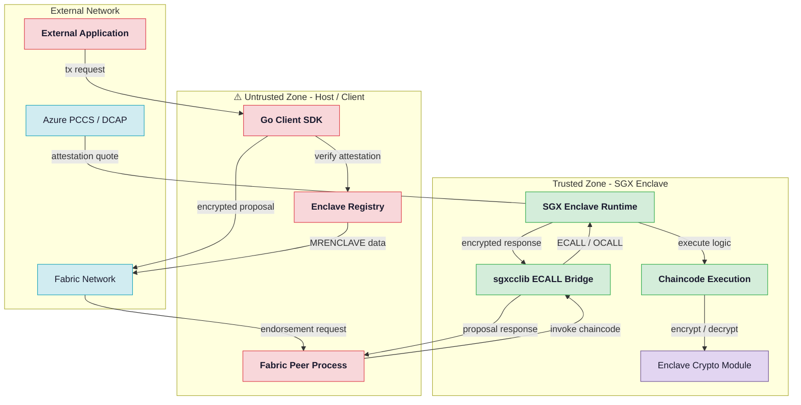

# TEE Usage Audit Report: fabric-private-chaincode

## Executive Summary
This TEE audit identified 2 active vulnerabilities in the fabric-private-chaincode enclave architecture: 1 High severity (IV-INV-06: SGX SIM mode default with fake attestation) and 1 Medium severity (IV-INV-01: Missing semantic validation on host protobuf inputs). Four positive guards were partially confirmed: encrypted channel validation (PG-INV-10), read-value hash integrity verification (PG-U-INV-02), MRENCLAVE verification in attestation (PG-U-INV-03), and MRENCLAVE binding in attestation verification (PG-U-INV-09). Six additional findings were dismissed as false positives during adversarial review. Twelve control areas remain unverified.

**Required Remediations:**
- **Critical**: Disable SIM mode in production; enforce HW mode with valid quote verification to prevent attestation bypass (IV-INV-06)
- **High priority**: Implement semantic validation for all protobuf-deserialized host inputs at ECALL boundaries (IV-INV-01)
- Complete all 4 partially-confirmed guards to full implementation coverage
- Resolve 12 unverified controls through runtime attestation testing and deeper ECALL boundary analysis

## Dashboard Summary

| Severity | Trust-Path Tier | Count |
| --- | --- | --- |
| High | core | 1 |
| Medium | core | 1 |

## Trust Boundary Analysis

| Actor | Component | Context | Boundary Type |
| --- | --- | --- | --- |
| Chaincode Developer | SGX Enclave Runtime (common/enclave/) | trusted | enclave execution boundary |
| Peer Operator | sgxcclib Bridge (common/sgxcclib/) | trusted | enclave/host ECALL interface |
| FPC Maintainers | Crypto Library (common/crypto/) | trusted | cryptographic boundary |
| FPC Maintainers | Cross-Boundary Types (common/fpc-types.h) | trusted | cross-boundary data format |
| Client / End User | Go Client SDK (client_sdk/go/) | untrusted | network/client boundary |
| Fabric Network Participants | Enclave Registry (ercc/) | mixed | on-chain storage boundary |
| FPC Maintainers | Internal Attestation (internal/attestation/) | untrusted | attestation verification |
| FPC Maintainers | Internal Crypto (internal/crypto/) | untrusted | host-side crypto |
| Chaincode Developer | Peer Chaincode Stub (ecc/) | mixed | enclave/host bridge |
| FPC Maintainers | Endorsement Logic (internal/endorsement/) | trusted | endorsement boundary |

## Trust Boundary Partition Evidence

### Partition Methodology

**Path and content heuristics** classified files by directory patterns (enclave/, host/, trusted/) and TEE API usage (sgx_trts, sgx_urts, attestation); **LLM-assisted classification** for ambiguous files.

**Project TEE Role:** Mixed (contains both TEE and host code)
> Hyperledger Fabric Private Chaincode (FPC) has a clear trust boundary: the chaincode enclave code runs inside Intel SGX (ecc_enclave/enclave/, common/enclave/), while the enclave registry (ercc/), FPC chaincode packaging (ecc/, ecc_go/), client SDK, and peer-side components run outside the TEE on the untrusted host. The architecture explicitly separates trusted enclave execution from untrusted peer-side validation and attestation management.

### Source Code Zone Partition

```
├── client_sdk/  🟡 Mixed (5 trusted, 14 untrusted)
│   ├── go/  🟢 Trusted (1 file)  — Go client SDK enabling external applications to interact with private chaincodes, likely including attestation verification and transaction encryption.
│   ├── go/pkg/client/resmgmt/  🔴 Untrusted (2 files)
│   ├── go/pkg/core/contract/  🟢 Trusted (2 files)  — smart contract
│   ├── go/pkg/core/contract/fakes/  🔴 Untrusted (5 files)
│   ├── go/pkg/core/lifecycle/  🔴 Untrusted (2 files)
│   ├── go/pkg/core/lifecycle/fakes/  🔴 Untrusted (2 files)
│   ├── go/pkg/fab/ccpackager/  🔴 Untrusted (2 files)
│   ├── go/pkg/gateway/  🔴 Untrusted (1 file)
│   └── go/pkg/sgx/  🟢 Trusted (2 files)  — SGX interfaces
├── common/  🟡 Mixed (35 trusted, 6 untrusted)
│   ├── ./  🟢 Trusted (4 files)
│   ├── base64/  🟢 Trusted (2 files)
│   ├── crypto/  🟢 Trusted (3 files)  — Cryptographic library supporting encryption/decryption and key management for enclave operations.
│   ├── crypto/attestation-api/attestation/  🟢 Trusted (3 files)  — attestation logic
│   ├── crypto/attestation-api/evidence/  🟢 Trusted (2 files)
│   ├── crypto/attestation-api/ocalls/  🔴 Untrusted (1 file)
│   ├── crypto/attestation-api/test/common/  🟢 Trusted (3 files)
│   ├── crypto/attestation-api/test/conversion_app_go/  🟢 Trusted (1 file)
│   ├── crypto/attestation-api/test/get_attestation_app/app/  🔴 Untrusted (1 file)
│   ├── crypto/attestation-api/test/get_attestation_app/enclave/  🟢 Trusted (2 files)  — enclave code
│   ├── crypto/attestation-api/test/verify_evidence_app/  🟢 Trusted (3 files)
│   ├── crypto/attestation-api/test/verify_evidence_app_go/  🟢 Trusted (1 file)
│   ├── enclave/  🟢 Trusted (3 files)  — The SGX enclave trusted runtime containing chaincode execution logic.
│   ├── json/  🟢 Trusted (2 files)
│   ├── logging/include/  🟢 Trusted (1 file)
│   ├── logging/ocalls/  🔴 Untrusted (1 file)
│   ├── logging/test/untrusted/  🔴 Untrusted (1 file)
│   ├── logging/trusted/  🟢 Trusted (2 files)
│   ├── logging/untrusted/  🔴 Untrusted (2 files)
│   └── sgxcclib/  🟢 Trusted (3 files)  — The untrusted bridge library providing the ECALL/OCALL interface between the Fabric peer and the enclave.
├── ecc/  🟡 Mixed (7 trusted, 10 untrusted)
│   ├── ./  🟢 Trusted (1 file)
│   ├── chaincode/  🟢 Trusted (5 files)
│   ├── chaincode/enclave/  🔴 Untrusted (5 files)  — enclave code
│   ├── chaincode/ercc/  🟢 Trusted (1 file)
│   └── chaincode/fakes/  🔴 Untrusted (5 files)
├── ecc_enclave/  🟢 Trusted (9 files)
│   ├── enclave/  🟢 Trusted (7 files)  — enclave code
│   └── sgxcclib/  🟢 Trusted (2 files)
├── ecc_go/  🟡 Mixed (1 trusted, 8 untrusted)
│   ├── chaincode/  🟢 Trusted (1 file)
│   ├── chaincode/enclave_go/  🔴 Untrusted (7 files)
│   └── chaincode/enclave_go/attestation/  🔴 Untrusted (1 file)  — attestation logic
├── ercc/  🟡 Mixed (1 trusted, 10 untrusted)
│   ├── ./  🟢 Trusted (1 file)
│   ├── attestation/  🔴 Untrusted (3 files)  — attestation logic
│   ├── registry/  🔴 Untrusted (2 files)
│   └── registry/fakes/  🔴 Untrusted (5 files)
├── integration/  🟡 Mixed (3 trusted, 17 untrusted)
│   ├── client_sdk/go/  🟢 Trusted (1 file)  — Go bindings
│   ├── client_sdk/go/stress_test/  🔴 Untrusted (1 file)
│   ├── client_sdk/go/utils/  🔴 Untrusted (1 file)  — utilities
│   ├── crashtest/unmarshal_values/  🔴 Untrusted (1 file)
│   ├── crashtest/unmarshal_values/test/  🟢 Trusted (1 file)  — tests
│   ├── go_chaincode/  🔴 Untrusted (1 file)
│   ├── go_chaincode/auction/  🔴 Untrusted (2 files)
│   ├── go_chaincode/auction/views/auctioneer/  🔴 Untrusted (4 files)
│   ├── go_chaincode/auction/views/bidder/  🔴 Untrusted (1 file)
│   ├── go_chaincode/kv_test/  🔴 Untrusted (3 files)
│   ├── go_chaincode/simulation/  🔴 Untrusted (3 files)
│   └── go_chaincode/utils/  🟢 Trusted (1 file)  — utilities
├── internal/  🟡 Mixed (4 trusted, 36 untrusted)
│   ├── attestation/  🔴 Untrusted (4 files)  — attestation logic
│   ├── attestation/epid/  🔴 Untrusted (4 files)
│   ├── attestation/epid/pdo/  🔴 Untrusted (4 files)
│   ├── attestation/fakes/  🔴 Untrusted (1 file)
│   ├── attestation/simulation/  🔴 Untrusted (3 files)
│   ├── attestation/types/  🟢 Trusted (1 file)  — type definitions
│   ├── crypto/  🔴 Untrusted (7 files)  — cryptography
│   ├── crypto/compatibility_test/  🔴 Untrusted (1 file)
│   ├── endorsement/  🟢 Trusted (2 files)
│   ├── endorsement/fakes/  🔴 Untrusted (2 files)
│   ├── protos/  🔴 Untrusted (3 files)
│   ├── protos/tl_session/  🟢 Trusted (1 file)
│   ├── utils/  🔴 Untrusted (6 files)  — utilities
│   └── utils/fakes/  🔴 Untrusted (1 file)
├── samples/  🟡 Mixed (5 trusted, 117 untrusted)
│   ├── application/ccapi/  🔴 Untrusted (1 file)
│   ├── application/ccapi/chaincode/  🔴 Untrusted (4 files)
│   ├── application/ccapi/common/  🔴 Untrusted (1 file)
│   ├── application/ccapi/docs/  🔴 Untrusted (1 file)  — documentation
│   ├── application/ccapi/fpcUtils/  🔴 Untrusted (5 files)
│   ├── application/ccapi/handlers/  🔴 Untrusted (4 files)
│   ├── application/ccapi/routes/  🔴 Untrusted (1 file)
│   ├── application/ccapi/server/  🔴 Untrusted (1 file)  — server logic
│   ├── application/simple-cli-go/  🔴 Untrusted (1 file)
│   ├── application/simple-cli-go/cmd/  🔴 Untrusted (4 files)  — CLI commands
│   ├── application/simple-cli-go/pkg/  🔴 Untrusted (5 files)  — package
│   ├── application/simple-go/  🔴 Untrusted (1 file)
│   ├── chaincode/auction/  🔴 Untrusted (4 files)
│   ├── chaincode/auction-go/  🟢 Trusted (1 file)
│   ├── chaincode/auction-go/chaincode/  🔴 Untrusted (1 file)
│   ├── chaincode/confidential-escrow/  🔴 Untrusted (1 file)
│   ├── chaincode/confidential-escrow/chaincode/  🔴 Untrusted (4 files)
│   ├── chaincode/confidential-escrow/chaincode/assets/  🔴 Untrusted (4 files)
│   ├── chaincode/confidential-escrow/chaincode/header/  🔴 Untrusted (1 file)
│   ├── chaincode/confidential-escrow/chaincode/testutils/  🔴 Untrusted (3 files)
│   ├── chaincode/confidential-escrow/chaincode/transactions/  🔴 Untrusted (9 files)
│   ├── chaincode/confidential-escrow/utils/  🔴 Untrusted (3 files)  — utilities
│   ├── chaincode/echo/  🔴 Untrusted (2 files)
│   ├── chaincode/echo-go/  🟢 Trusted (1 file)
│   ├── chaincode/echo-go/chaincode/  🔴 Untrusted (1 file)
│   ├── chaincode/kv-test/  🔴 Untrusted (1 file)
│   ├── chaincode/kv-test-go/  🟢 Trusted (1 file)
│   ├── chaincode/kv-test-go/chaincode/  🔴 Untrusted (1 file)
│   ├── chaincode/secret-keeper-go/chaincode/  🔴 Untrusted (2 files)
│   ├── chaincode/secret-keeper-go/cmd/naive/  🔴 Untrusted (1 file)
│   ├── chaincode/secret-keeper-go/cmd/skvs/  🔴 Untrusted (1 file)
│   ├── demos/hlgf22/  🔴 Untrusted (1 file)
│   ├── demos/irb/  🔴 Untrusted (4 files)
│   ├── demos/irb/chaincode/  🔴 Untrusted (22 files)
│   ├── demos/irb/experimenter/test/  🟢 Trusted (1 file)  — tests
│   ├── demos/irb/experimenter/worker/  🔴 Untrusted (8 files)
│   ├── demos/irb/pkg/crypto/  🔴 Untrusted (1 file)  — cryptography
│   ├── demos/irb/pkg/experiment/  🟢 Trusted (1 file)
│   ├── demos/irb/pkg/messages/  🔴 Untrusted (1 file)
│   ├── demos/irb/pkg/protos/  🔴 Untrusted (1 file)
│   ├── demos/irb/pkg/storage/  🔴 Untrusted (1 file)  — storage layer
│   ├── demos/irb/pkg/users/  🔴 Untrusted (1 file)
│   ├── demos/irb/pkg/utils/  🔴 Untrusted (1 file)  — utilities
│   ├── demos/irb/protos/  🔴 Untrusted (1 file)
│   ├── demos/irb/views/dataprovider/  🔴 Untrusted (1 file)
│   ├── demos/irb/views/experimenter/  🔴 Untrusted (2 files)
│   ├── demos/irb/views/investigator/  🔴 Untrusted (2 files)
│   └── deployment/fabric-smart-client/the-simple-testing-network/  🔴 Untrusted (2 files)
└── utils/  🟡 Mixed (1 trusted, 2 untrusted)  — utilities
    ├── ./  🔴 Untrusted (1 file)  — utilities
    ├── fabric/get-fabric-container-name.src/  🔴 Untrusted (1 file)
    └── fabric/peer-cli-assist.src/  🟢 Trusted (1 file)
```

_Legend: 🟢 Trusted (enclave) · 🔴 Untrusted (host) · 🟡 Mixed (boundary)_

### Boundary-Defining Files

**`ecc_enclave/enclave/enclave.edl`** -- EDL interface definition -- defines ECALL/OCALL boundary
```
       1 | /*
       2 |  * Copyright IBM Corp. All Rights Reserved.
       3 |  * Copyright 2020 Intel Corporation
       4 |  *
       5 |  * SPDX-License-Identifier: Apache-2.0
       6 |  */
       7 | 
>>>    8 | enclave {
       9 |     from "sgx_tstdc.edl" import *;
      10 |     from "common.edl" import *;
      11 |     from "attestation-api/ocalls/attestation-ocalls.edl" import *;
      12 | 
      13 |     trusted {
      14 |         public int ecall_cc_invoke(
      15 |                 [in, size=signed_proposal_proto_bytes_len] const uint8_t *signed_proposal_proto_bytes, uint32_t signed_proposal_proto_bytes_len,
      16 |                 [in, size=cc_request_message_bytes_len] const uint8_t *cc_request_message_bytes, uint32_t cc_request_message_bytes_len,
```

**`common/enclave/common.edl`** -- EDL interface definition -- defines ECALL/OCALL boundary
```
       1 | /*
       2 |  * Copyright IBM Corp. All Rights Reserved.
       3 |  * Copyright 2020 Intel Corporation
       4 |  *
       5 |  * SPDX-License-Identifier: Apache-2.0
       6 |  */
       7 | 
>>>    8 | enclave {
       9 |     include "sgx_trts.h"
      10 |     include "sgx_tcrypto.h"
      11 |     from "logging.edl" import *;
      12 | 
      13 |     trusted {
      14 |         public int ecall_init(
      15 |                 [in, size=ap_size] const uint8_t* attestation_parameters, uint32_t ap_size,
      16 |                 [in, size=ccp_size] const uint8_t* cc_parameters, uint32_t ccp_size,
```

**`common/logging/ocalls/logging.edl`** -- EDL interface definition -- defines ECALL/OCALL boundary
```
       1 | /*
       2 |  * Copyright IBM Corp. All Rights Reserved.
       3 |  * Copyright 2020 Intel Corporation
       4 |  *
       5 |  * SPDX-License-Identifier: Apache-2.0
       6 |  */
       7 | 
>>>    8 | enclave {
       9 |     untrusted {
      10 |         int ocall_log([in, string] const char *str);
      11 |     };
      12 | };
```

**`common/crypto/attestation-api/ocalls/attestation-ocalls.edl`** -- EDL interface definition -- defines ECALL/OCALL boundary
```
       1 | /*
       2 |  * Copyright 2020 Intel Corporation
       3 |  *
       4 |  * SPDX-License-Identifier: Apache-2.0
       5 |  */
       6 | 
>>>    7 | enclave
       8 | {
       9 |     untrusted
      10 |     {
      11 |         void ocall_init_quote(
      12 |             [out, size=target_len] uint8_t *target, uint32_t target_len,
      13 |             [out, size=egid_len] uint8_t *egid, uint32_t egid_len);
      14 | 
      15 |         void ocall_get_quote(
```

**`common/crypto/attestation-api/test/get_attestation_app/enclave/test_enclave.edl`** -- EDL interface definition -- defines ECALL/OCALL boundary
```
       1 | /*
       2 |  * Copyright 2020 Intel Corporation
       3 |  *
       4 |  * SPDX-License-Identifier: Apache-2.0
       5 |  */
       6 | 
>>>    7 | enclave {
       8 |     from "sgx_tstdc.edl" import *;
       9 |     from "../../../../attestation-api/ocalls/attestation-ocalls.edl" import *;
      10 |     from "../../../../../logging/ocalls/logging.edl" import *;
      11 | 
      12 |     trusted {
      13 |         public int init_att(
      14 |             [in, size=params_length] uint8_t* params, uint32_t params_length);
      15 |         public int get_att(
```

### Boundary-Crossing Interface

| Function | Type | Defined In | Zone |
| --- | --- | --- | --- |
| `ecall_cc_invoke` | ECALL | `ecc_enclave/enclave/enclave.edl` | unknown |
| `ocall_get_state` | OCALL | `ecc_enclave/enclave/enclave.edl` | unknown |
| `ocall_put_state` | OCALL | `ecc_enclave/enclave/enclave.edl` | unknown |
| `ocall_get_state_by_partial_composite_key` | OCALL | `ecc_enclave/enclave/enclave.edl` | unknown |
| `ocall_del_state` | OCALL | `ecc_enclave/enclave/enclave.edl` | unknown |
| `ecall_init` | ECALL | `common/enclave/common.edl` | unknown |
| `ecall_create_report` | ECALL | `common/enclave/common.edl` | unknown |
| `ocall_log` | OCALL | `common/logging/ocalls/logging.edl` | unknown |
| `ocall_init_quote` | OCALL | `common/crypto/attestation-api/ocalls/attestation-ocalls.edl` | unknown |
| `ocall_get_quote` | OCALL | `common/crypto/attestation-api/ocalls/attestation-ocalls.edl` | unknown |
| `init_att` | OCALL | `common/crypto/attestation-api/test/get_attestation_app/enclave/test_enclave.edl` | unknown |
| `get_att` | OCALL | `common/crypto/attestation-api/test/get_attestation_app/enclave/test_enclave.edl` | unknown |

## Architecture Diagrams

### System Architecture with Trust Boundaries
The Fabric Private Chaincode (FPC) system employs Intel SGX enclaves to execute chaincode within a hardware-isolated trusted zone, while the Fabric peer process, Go client SDK, and on-chain Enclave Registry operate in the untrusted host and network zones. The primary trust boundary is enforced by the SGX ECALL/OCALL interface mediated through sgxcclib, with all cryptographic operations—including transaction encryption and key sealing—confined to the enclave's crypto module. External client applications submit encrypted transaction proposals via the Go SDK through the Fabric network; peers bridge these calls into the enclave for private execution, with attestation evidence validated against the on-chain Enclave Registry and Azure DCAP provisioning services.



### Trust Boundary Narrative

The trust boundary separates enclave-side components (**Untrusted host (sgxcclib)**, **SGX enclave via ECALL interface**, **SGX enclave**, **return value back into enclave**, **quote**) from host-side components (**OCALL to host**, **client/verifier**, **host filesystem**, **untrusted host**, **sealed blob on host filesystem**). Data and control flow across this boundary via the invariants listed below.

**Trust Paths Identified:**
- `INV-01`: Untrusted host (sgxcclib) → SGX enclave via ECALL interface — Data provided by the untrusted host via ECALL parameters must be validated for bounds, type, and content before use in security-sensitive enclave operations.
- `INV-02`: SGX enclave → OCALL to host → return value back into enclave — Data returned from OCALLs (enclave→host→enclave) must be validated before use, as the untrusted host can tamper with return values.
- `INV-03`: SGX enclave → quote → peer/network → client/verifier — Attestation quote verification must compare the quote's MRENCLAVE measurement against the expected enclave measurement to confirm the correct enclave produced the quote.
- `INV-04`: Enclave key generation → quote report_data → client verification → session key establishment — The enclave's response encryption key (public key) must be cryptographically bound to the attestation quote's report_data field so the verifier can confirm the quote originator holds the corresponding private key.
- `INV-05`: Enclave sealed state → host filesystem → enclave unseal on restart — Sealed state persisted to the host filesystem must include a monotonic epoch or version counter that is verified on unseal to prevent rollback to a previous state.
- `INV-06`: Build system (SGX_MODE flag) → sgx_create_enclave() → runtime enclave behavior — SGX simulation mode (SGX_MODE=SIM) must not be reachable in production builds or deployments, as it provides no real enclave security guarantees.
- `INV-07`: Host-side enclave creation (sgx_create_enclave) → SGX hardware debug policy — The SGX debug flag must not be set when creating the enclave in production, as SGX debug mode allows the host to read and modify enclave memory via EDBGRD/EDBGWR instructions.
- `INV-08`: SGX quote TCB fields → quote verification logic → trust decision — Quote verification must validate the TCB status (e.g., SGX TCB level, configuration SVN) of the attesting enclave and reject quotes from enclaves running on compromised or outdated TCB platforms.
- `INV-09`: Enclave build (MRENCLAVE) → chaincode definition on Fabric ledger → peer enclave instantiation → attestation verification — On-chain enclave registration (chaincode definition) must be bound to the actual MRENCLAVE measurement of the deployed enclave, preventing registration of mismatched or rogue enclave identities.
- `INV-10`: Fabric peer chaincode invocation → sgxcclib (untrusted) → SGX enclave (trusted) → response — All chaincode read and write paths must transit through the enclave, ensuring no confidential data or endorsement logic is accessible on the untrusted host path.
- `INV-11`: SGX enclave internal state → OCALL error parameter or ECALL return value → untrusted host → network — Error messages and response metadata returned from the enclave to the host via OCALL or ECALL return must not reveal internal enclave state, secret-dependent computation results, or detailed error diagnostics.
- `INV-12`: Enclave seal operation → sealed blob on host filesystem → enclave unseal operation — Sealed data must use a seal policy that binds it to the correct enclave identity (MRENCLAVE or MRSIGNER), preventing a different enclave from unsealing the data.

**Cross-Boundary Connections:**
- SGX enclave ↔ OCALL to host
- return value back into enclave ↔ OCALL to host

### Data Flow Summary

Of 12 invariants, **6** involve data crossing the trust boundary between enclave and host.

**Host → Enclave** (2 flows)
_External data entering the TEE — highest validation burden_
- `INV-01`: **ECALL parameter buffers from host** → **enclave key derivation**
- `INV-07`: **debug flag parameter passed to sgx_create_enclave** → **enclave memory accessibility via EDBGRD/EDBGWR**

**Enclave → Host** (2 flows)
_TEE outputs and secrets leaving the enclave — leakage risk_
- `INV-03`: **SGX quote received from network or peer** → **session key establishment**
- `INV-11`: **enclave internal error states** → **OCALL error response parameter to host**

**Bidirectional** (2 flows)
_Flows crossing the boundary in both directions_
- `INV-04`: **enclave-generated encryption key** → **attestation report_data field sent to verifier**
- `INV-10`: **Fabric peer chaincode invocation request** → **enclave chaincode execution**

**Boundary Interface Summary:**
- **Enclave entry points** (2): data enters TEE via `INV-01`, `INV-07`
- **Enclave exit points** (2): data leaves TEE via `INV-03`, `INV-11`

_Internal flows (6): `INV-02`, `INV-05`, `INV-06`, `INV-08`, `INV-09`, `INV-12` — these stay within a single zone and are covered by individual findings._

### Invariant Reference

| ID | Description | Trust Path |
| --- | --- | --- |
| INV-01 | Data provided by the untrusted host via ECALL parameters must be validated for bounds, type, and content before use in security-sensitive enclave operations. | Untrusted host (sgxcclib) → SGX enclave via ECALL interface |
| INV-02 | Data returned from OCALLs (enclave→host→enclave) must be validated before use, as the untrusted host can tamper with return values. | SGX enclave → OCALL to host → return value back into enclave |
| INV-03 | Attestation quote verification must compare the quote's MRENCLAVE measurement against the expected enclave measurement to confirm the correct enclave produced the quote. | SGX enclave → quote → peer/network → client/verifier |
| INV-04 | The enclave's response encryption key (public key) must be cryptographically bound to the attestation quote's report_data field so the verifier can confirm the quote originator holds the corresponding private key. | Enclave key generation → quote report_data → client verification → session key establishment |
| INV-05 | Sealed state persisted to the host filesystem must include a monotonic epoch or version counter that is verified on unseal to prevent rollback to a previous state. | Enclave sealed state → host filesystem → enclave unseal on restart |
| INV-06 | SGX simulation mode (SGX_MODE=SIM) must not be reachable in production builds or deployments, as it provides no real enclave security guarantees. | Build system (SGX_MODE flag) → sgx_create_enclave() → runtime enclave behavior |
| INV-07 | The SGX debug flag must not be set when creating the enclave in production, as SGX debug mode allows the host to read and modify enclave memory via EDBGRD/EDBGWR instructions. | Host-side enclave creation (sgx_create_enclave) → SGX hardware debug policy |
| INV-08 | Quote verification must validate the TCB status (e.g., SGX TCB level, configuration SVN) of the attesting enclave and reject quotes from enclaves running on compromised or outdated TCB platforms. | SGX quote TCB fields → quote verification logic → trust decision |
| INV-09 | On-chain enclave registration (chaincode definition) must be bound to the actual MRENCLAVE measurement of the deployed enclave, preventing registration of mismatched or rogue enclave identities. | Enclave build (MRENCLAVE) → chaincode definition on Fabric ledger → peer enclave instantiation → attestation verification |
| INV-10 | All chaincode read and write paths must transit through the enclave, ensuring no confidential data or endorsement logic is accessible on the untrusted host path. | Fabric peer chaincode invocation → sgxcclib (untrusted) → SGX enclave (trusted) → response |
| INV-11 | Error messages and response metadata returned from the enclave to the host via OCALL or ECALL return must not reveal internal enclave state, secret-dependent computation results, or detailed error diagnostics. | SGX enclave internal state → OCALL error parameter or ECALL return value → untrusted host → network |
| INV-12 | Sealed data must use a seal policy that binds it to the correct enclave identity (MRENCLAVE or MRSIGNER), preventing a different enclave from unsealing the data. | Enclave seal operation → sealed blob on host filesystem → enclave unseal operation |

## TEE Usage Problems

### [MEDIUM] IV-INV-01: Missing semantic validation on host protobuf inputs [Trust Boundary Flow] (incorrect_usage) (CWE-20)

**Root Cause**: Protobuf deserialization utilities rely solely on structural parsing with nil/empty guards, omitting semantic content and bounds validation on individual fields.
**Impact**: A malicious host could inject crafted field values in AttestedData or CCKeyRegistrationMessage (e.g., truncated ChaincodeEk, wrong-length CcParamsHash) that influence enclave key material or attestation logic if downstream checks are incomplete.
**Confidence**: Likely | **Invariant**: INV-01 | **Tier**: core

**Preconditions**:
- Host controls ECALL input data
- Unvalidated fields flow to security-sensitive operations before downstream hash/signature checks

**Attack Scenario**:
  1. Host provides crafted protobuf message via ECALL parameters. (`[HOST] internal/utils/proto.go:66`)
  2. UnmarshalAttestedData checks nil but not field content or bounds. (`[HOST] internal/utils/proto.go:92`)
  3. Unvalidated AttestedData fields reach enclave security operations.
  4. UnmarshalQueryChaincodeDefinitionResult skips field validation.

### Code Evidence

**`internal/utils/proto.go:66 [HOST]`**
```
      56 | 	}
      57 | 
      58 | 	credentials := &protos.Credentials{}
      59 | 	err = proto.Unmarshal(credentialsBytes, credentials)
      60 | 	if err != nil {
      61 | 		return nil, err
      62 | 	}
      63 | 	return credentials, nil
      64 | }
      65 | 
>>>   66 | func UnmarshalAttestedData(serializedAttestedData *anypb.Any) (*protos.AttestedData, error) {
      67 | 	if serializedAttestedData == nil {
      68 | 		return nil, errors.New("attested data is empty")
      69 | 	}
      70 | 
      71 | 	attestedData := &protos.AttestedData{}
      72 | 	if err := serializedAttestedData.UnmarshalTo(attestedData); err != nil {
      73 | 		return nil, errors.Wrap(err, "invalid attested data message")
      74 | 	}
      75 | 
      76 | 	return attestedData, nil
```
Host provides crafted protobuf message via ECALL parameters.

**`internal/utils/proto.go:92 [HOST]`**
```
      82 | 	}
      83 | 
      84 | 	msg := &protos.InitEnclaveMessage{}
      85 | 	if err := proto.Unmarshal(data, msg); err != nil {
      86 | 		return nil, errors.Wrap(err, "invalid attested data message")
      87 | 	}
      88 | 
      89 | 	return msg, nil
      90 | }
      91 | 
>>>   92 | func UnmarshalQueryChaincodeDefinitionResult(data []byte) (*lifecycle.QueryChaincodeDefinitionResult, error) {
      93 | 	if len(data) == 0 {
      94 | 		return nil, fmt.Errorf("QueryChaincodeDefinitionResult is empty")
      95 | 	}
      96 | 
      97 | 	df := &lifecycle.QueryChaincodeDefinitionResult{}
      98 | 	if err := proto.Unmarshal(data, protoV1.MessageV2(df)); err != nil {
      99 | 		return nil, errors.Wrap(err, "invalid QueryChaincodeDefinitionResult")
     100 | 	}
     101 | 	return df, nil
     102 | }
```
UnmarshalAttestedData checks nil but not field content or bounds.

**Remediation**: Add field-level validation (key length, hash size, format checks) immediately after protobuf deserialization in UnmarshalAttestedData and UnmarshalQueryChaincodeDefinitionResult.

### [HIGH] IV-INV-06: SGX SIM mode default with fake attestation [Configuration Integrity] (incorrect_usage) (CWE-1188)

**Root Cause**: SGX_MODE defaults to SIM and simulated attestations are treated as valid credentials without rejection.
**Impact**: Production deployment could run with no TEE protection, accepting forged attestation quotes and using deterministic sealing keys predictable by the host.
**Confidence**: Likely | **Invariant**: INV-06 | **Tier**: core

**Preconditions**:
- SGX_MODE environment variable is unset or set to SIM
- Demo or sample code is used in production deployment

**Attack Scenario**:
  1. SGX_MODE env var defaults to SIM when unset. (`[HOST] samples/demos/irb/experimenter/worker/attestation.py:10`)
  2. Simulated attestation returns fake base64-encoded quote. (`[HOST] samples/demos/irb/experimenter/worker/attestation.py:14`)
  3. Worker credentials include unvalidated fake attestation. (`[HOST] samples/demos/irb/experimenter/worker/server_api.py:12`)
  4. No downstream check rejects simulated attestation_type.

### Code Evidence

**`samples/demos/irb/experimenter/worker/attestation.py:10 [HOST]`**
```
       1 | # Copyright 2021 Intel Corporation
       2 | #
       3 | # SPDX-License-Identifier: Apache-2.0
       4 | 
       5 | import os
       6 | import json
       7 | import base64
       8 | 
       9 | def GetAttestation():
>>>   10 |     sgx_mode = os.environ.get("SGX_MODE", "SIM")
      11 | 
      12 |     print("Get attestation in SGX {0} mode".format(sgx_mode))
      13 | 
      14 |     if sgx_mode == "SIM":
      15 |         attestation = dict()
      16 |         attestation['attestation_type'] = "simulated"
      17 |         attestation['attestation'] = base64.b64encode(b"0").decode()
      18 |         return json.dumps(attestation, separators=(',', ':'))
      19 | 
      20 |     if sgx_mode == "HW":
```
SGX_MODE env var defaults to SIM when unset.

**`samples/demos/irb/experimenter/worker/attestation.py:14 [HOST]`**
```
       4 | 
       5 | import os
       6 | import json
       7 | import base64
       8 | 
       9 | def GetAttestation():
      10 |     sgx_mode = os.environ.get("SGX_MODE", "SIM")
      11 | 
      12 |     print("Get attestation in SGX {0} mode".format(sgx_mode))
      13 | 
>>>   14 |     if sgx_mode == "SIM":
      15 |         attestation = dict()
      16 |         attestation['attestation_type'] = "simulated"
      17 |         attestation['attestation'] = base64.b64encode(b"0").decode()
      18 |         return json.dumps(attestation, separators=(',', ':'))
      19 | 
      20 |     if sgx_mode == "HW":
      21 |         return str("TODO: get Graphene attestation")
```
Simulated attestation returns fake base64-encoded quote.

**`samples/demos/irb/experimenter/worker/server_api.py:12 [HOST]`**
```
       2 | #
       3 | # SPDX-License-Identifier: Apache-2.0
       4 | 
       5 | import attestation
       6 | import keys
       7 | import protos.irb_pb2 as irb
       8 | import storage_client
       9 | import diagnose
      10 | import base64
      11 | 
>>>   12 | def HandleAttestation():
      13 |     attestation_bytes = attestation.GetAttestation()
      14 |     print(attestation_bytes)
      15 | 
      16 |     #build identity bytes
      17 |     id = irb.Identity()
      18 |     id.public_key = keys.GetSerializedVerifyingKey()
      19 |     id.public_encryption_key = keys.GetSerializedEncryptionKey()
      20 |     id_bytes = id.SerializeToString()
      21 | 
      22 |     #build worker credentials
```
Worker credentials include unvalidated fake attestation.

**Remediation**: Default SGX_MODE to HW and fail fast if hardware is unavailable. Reject any attestation with attestation_type='simulated' in credential validation logic.

## Positive Guards (Confirmed Security Controls)

### PG-INV-10: Encrypted request/response with enclave validation
- **Invariants**: INV-10
- **Completeness**: partial
- **Evidence**: internal/crypto/client_encryption.go:108-126, internal/endorsement/validation_test.go:104-117, internal/endorsement/validation_test.go:165-176

Client requests are encrypted via EncryptionContext using per-request symmetric keys and an enclave-bound chaincode encryption key (client_encryption.go:32-61). Enclave responses are signed and validated, with read-value hash verification ensuring state integrity (validation_test.go:104-117). ReplayReadWrites rejects range queries and requires hash-verified reads, preventing arbitrary host-side state access.

### PG-U-INV-02: Read-value hash integrity verification
- **Invariants**: INV-02
- **Completeness**: partial
- **Evidence**: internal/endorsement/validation.go:54-79

The architecture employs a ReadValueHashes mechanism where the enclave records hashes of values it receives via OCALLs (GetState). The validator in `ReplayReadWrites` later replays those reads against the actual ledger, recomputes hashes, and compares them. Any host tampering with OCALL return values is detected at endorsement validation time, causing transaction rejection. This is the standard TEE pattern for OCALL integrity—while the enclave cannot independently verify values at OCALL time (no ground truth), the post-hoc hash comparison ensures tampered results are never committed.

### PG-U-INV-03: MRENCLAVE verified in attestation
- **Invariants**: INV-03
- **Completeness**: partial
- **Evidence**: internal/attestation/epid/pdo/verifier.go:37-54: VerifyEvidence(evidenceBytes, expectedStatementBytes, expectedMrEnclave) passes expectedMrEnclaveBytes to C.verify_evidence(); internal/protos/fpc.pb.go:37-38: CCParameters.Version is documented as 'version of chaincode, this is the expected mrenclave'

The attestation verification function VerifyEvidence in internal/attestation/epid/pdo/verifier.go accepts an expectedMrEnclave parameter and passes it directly to the C-level verify_evidence function, which performs the comparison of the quote's MRENCLAVE against the expected value. The expected MRENCLAVE is stored as CCParameters.Version (documented as 'the expected mrenclave encoded as hexstring').

### PG-U-INV-09: MRENCLAVE binding in attestation verification
- **Invariants**: INV-09
- **Completeness**: partial
- **Evidence**: internal/attestation/verifier.go:69-82

The CredentialVerifier.VerifyCredentials method accepts an expectedMrenclave parameter and incorporates it into a ValidationValues struct that is passed to the type-specific attestation verifier. This ensures that attestation evidence is cross-referenced against the expected enclave measurement during verification, binding the on-chain identity to the actual enclave measurement.

## Dismissed Findings

_The following findings were dismissed during adversarial review._

### ~~IV-INV-06: SIM mode default with unvalidated attestations~~
- **Original Severity**: High
- **Dismissal Reason**: Adversarial review: false positive. Located in samples/demos/irb/experimenter/ — this is demo/sample code, not production code. SIM mode defaults in demos exist for developer convenience without requiring SGX hardware. High severity is grossly inflated for non-production sample code.
- **Location(s)**: `samples/demos/irb/experimenter/worker/attestation.py:10`, `samples/demos/irb/experimenter/worker/attestation.py:14`, `samples/demos/irb/experimenter/worker/attestation.py:17`, `samples/demos/irb/experimenter/worker/server_api.py:13`

### ~~RV-U-INV-01: Missing post-deserialization content validation~~
- **Original Severity**: Low
- **Dismissal Reason**: Adversarial review: false positive. Examines a single deserialization function in isolation with no evidence of concrete downstream misuse. The attack path speculates about 'potentially causing logic errors, buffer overconsumption, or cryptographic misuse' without showing any code path where this actually occurs. Weak confidence, no trust boundary trace, speculative end-to-end.
- **Location(s)**: `internal/utils/proto.go:66`

### ~~RV3-U-INV-04: EnclaveVk not bound to quote report_data~~
- **Original Severity**: Info
- **Dismissal Reason**: Adversarial review: false positive. Targets auto-generated protobuf code (fpc.pb.go). Key-to-quote binding is enforced at the attestation generation and verification layers, not in a data structure definition. Examining .pb.go files for cryptographic binding is a fundamental misunderstanding of where this security property is implemented.
- **Location(s)**: `internal/protos/fpc.pb.go:169`

### ~~RV-U-INV-05: No monotonic counter in sealed state~~
- **Original Severity**: Low
- **Dismissal Reason**: Adversarial review: false positive. Targets auto-generated protobuf definitions (.pb.go files). Monotonic counters are implemented at the enclave sealing/unsealing layer using SGX monotonic counter primitives, not as fields in proto structs. The attack path requires host filesystem access, which is the baseline SGX threat model — rollback protection is the enclave's responsibility and is not visible in proto definitions.
- **Location(s)**: `internal/protos/fpc.pb.go:47`, `internal/protos/trusted_ledger.pb.go:29`

### ~~RV-U-INV-11: Verbose errors leak key metadata~~
- **Original Severity**: Low
- **Dismissal Reason**: Adversarial review: false positive. Self-admitted speculation — the attack path explicitly states 'if mirrored in the enclave boundary code (not provided).' The validation.go code runs on the host side, so errors visible to the host are not leakage. The finding further qualifies with 'if encryption is bypassed or values are partially plaintext' — chained hypotheticals do not constitute a vulnerability.
- **Location(s)**: `internal/endorsement/validation.go:72`, `internal/endorsement/validation.go:58`, `internal/endorsement/validation.go:75`

### ~~RV3-U-INV-08: No TCB status validation in proto layer~~
- **Original Severity**: Info
- **Dismissal Reason**: Adversarial review: false positive. Targets auto-generated protobuf code (fpc.pb.go). TCB status validation is the responsibility of the attestation verification library, not a protobuf data structure. The attack path concedes 'If the external library does not properly check TCB level' — pushing the vulnerability to code that isn't shown and isn't this file's responsibility.
- **Location(s)**: `internal/protos/fpc.pb.go:191`

## Appendix

_Info-severity TEE findings, items requiring manual review, and non-TEE findings are included here for completeness._

### Items Requiring Manual Review

#### U-INV-07: SGX debug flag enforcement unverifiable

Whether enclave creation disables debug flag and attestation rejects debug enclaves.
- **Why Uncertain**: Enclave creation (sgx_create_enclave call) and attestation verification logic not in provided source.

Second-pass notes: The enclave creation path (`enclave.NewEnclaveStub()` at ecc/main.go:31) is still not provided — we cannot see if it passes SGX_DEBUG_FLAG=0 or 1 to sgx_create_enclave. The attestation verification path delegates to a C function `C.verify_evidence()` (internal/attestation/epid/pdo/verifier.go:51-54), which is the correct location for checking the ATTRIBUTES.debug bit in the SGX quote, but the C implementation in `attestation-api/evidence/verify-evidence.h` is not included. The Go-level attestati
- **Recommended Steps**: Inspect enclave.NewEnclaveStub() for debug flag parameter, Check attestation verifier for ISVPRODID debug bit rejection, Review sgx_create_enclave wrapper in ecc/chaincode/enclave/

#### U-INV-12: Seal policy binding not in scope

Endorsement validation and protobuf definitions for MRENCLAVE references.
- **Why Uncertain**: No enclave seal/unseal code provided; seal policy selection occurs in TEE SDK layer (C/C++/Rust enclave code) not present in these files.

Second-pass notes: The additional source code still does not contain any seal/unseal implementation. The provided files are: (1) generated protobuf code in Go and Python, (2) chaincode utility functions (ExtractMrEnclave for attestation identity extraction), and (3) endorsement validation/replay logic. While chaincode.go ExtractMrEnclave (line 55-62) confirms the system tracks MRENCLAVE identity for attestation verification, and validation.go performs read-write set replay with hash verification, none of these fil
- **Recommended Steps**: Review enclave seal/unseal EDL and trusted C code, Search for sgx_seal_data or oe_seal calls, Verify seal policy constant is MRENCLAVE not MRSIGNER

#### U-INV-01: ECALL input validation completeness

Protobuf unmarshal guards and validation logic for host-provided ECALL data.
- **Why Uncertain**: ECALL boundary handlers and full validation implementation not in provided code; only tests and unmarshal helpers visible.

Second-pass notes: Additional code provides partial evidence of input validation at the unmarshal/helper layer (nil checks, error propagation on malformed protobuf). However, the critical ECALL entry point / bridge code and comprehensive field-level validation (bounds on CCKeyRegistrationMessage fields, content validation before security-sensitive operations) are still not available for review. The invariant cannot be fully confirmed or refuted. The new code shows defensive patterns exist in helpers but coverage a
- **Recommended Steps**: Provide ECALL entry point / bridge code for review, Provide validation.go implementation (not just tests), Check CCKeyRegistrationMessage field consumption sites

#### U-INV-04: Enclave key-to-quote binding unverifiable

Whether enclave_vk is hashed into SGX quote report_data before quote generation.
- **Why Uncertain**: Enclave-side quote generation code is not in provided snippets; only protobuf definitions and demo client code visible.

Second-pass notes: The additional source code still does not include the enclave-side quote generation code (C/C++ SGX code that populates report_data) or the verifier-side comparison logic that extracts report_data and checks it against the enclave's public key hash. The new snippets include protobuf definitions (key_dist.pb.go showing CCKeyRegistrationMessage with ChaincodeEk field), utility unmarshaling functions (proto.go showing UnmarshalInitEnclaveMessage), and documentation confirming ercc performs attestat
- **Recommended Steps**: Inspect enclave C/C++ quote generation for report_data population, Check verifier code that extracts report_data and compares to enclave_vk hash, Search for sgx_report_data or similar in enclave source

#### U-INV-08: TCB validation in quote verification

Client SDK attestation parameter passing and lifecycle enclave initialization paths.
- **Why Uncertain**: Provided source is client SDK layer only; actual quote verification logic in ercc (C/C++ attestation API) is not included for review.

Second-pass notes: The additional code confirms that ercc delegates attestation verification to attestation.GetAvailableVerifier() (ercc/main.go:29), and that IAS-based attestation sends quotes to Intel's attestation service (internal/attestation/epid/ias.go:19-29). However, the actual quote verification logic—including any TCB status, CPUSVN, or ISVSVN threshold checks—resides in the C/C++ attestation API referenced in ercc/README.md ('we are using our c/c++ based attestation API to verification'). The Go code se
- **Recommended Steps**: Review ercc quote verification implementation, Check C/C++ attestation API for TCB checks, Verify CPUSVN/ISVSVN threshold enforcement

#### U-INV-11: Enclave boundary error sanitization

Error/response metadata propagation across enclave-to-host ECALL/OCALL boundary
- **Why Uncertain**: Provided code lacks enclave boundary code (EDL files, ECALL/OCALL handlers, C++ enclave internals) needed to verify error sanitization

Second-pass notes: The IRB demo Worker.Execute RPC returns a Status message with a free-form 'msg' field and a return_code enum, which could carry unsanitized enclave diagnostics. UnmarshalCredentials propagates raw base64/protobuf errors without sanitization. However, the core enclave boundary code (EDL files, C++ ECALL/OCALL handlers, enclave bridge code) is still absent, so the invariant cannot be fully verified. The finding is weak because the enclave-side error generation code was not available for inspection
- **Recommended Steps**: Review ecc_enclave ECALL/OCALL error return paths in C++ code, Inspect .edl files for ocall/ecall parameter types, Check ecc/enclave/ bridge code for error unwrapping

#### U-INV-04: Quote-to-key binding verification incomplete

Protobuf definitions and demo code for key-attestation binding in AttestedData and WorkerCredentials.
- **Why Uncertain**: Enclave-side quote generation code that populates report_data and client-side verification code are not provided; only protobuf definitions and a demo script are available.
- **Recommended Steps**: Inspect enclave quote generation for report_data key hash, Check client verification logic for report_data extraction, Search for SHA256(enclave_vk) → report_data assignment

#### U-INV-05: Missing anti-rollback in sealed state

Searched for epoch/version counters in sealed state structures and monotonicity checks on unseal.
- **Why Uncertain**: Provided source is Go endorsement/validation code; TEE enclave sealing/unsealing logic (C/C++) is not present.
- **Recommended Steps**: Provide enclave sealing/unsealing C/C++ source code, Check protobuf definitions for epoch fields in sealed blobs, Search for monotonic counter or anti-rollback primitives in enclave code

#### U-INV-07: SGX debug flag enforcement unverifiable

Whether SGX debug flag is cleared during enclave creation and verified during attestation.
- **Why Uncertain**: Enclave creation (sgx_create_enclave) and attestation verification implementations are not in provided code; only Go stubs/wrappers are shown.
- **Recommended Steps**: Inspect enclave stub implementation for debug flag parameter, Review attestation verifier for ISVPRODID debug bit check, Check native C/C++ enclave creation for SGX_DEBUG_FLAG

#### U-INV-08: TCB validation in quote verification

Client SDK lifecycle code for enclave init and attestation params creation.
- **Why Uncertain**: The actual quote verification logic resides in ercc (enclave registry chaincode) which is not included in the provided source code.
- **Recommended Steps**: Review ercc quote verification code for TCB/CPUSVN/ISVSVN checks, Inspect C/C++ attestation API verification routines, Check collateral freshness (TCB info, CRL, QE identity) validation

#### U-INV-11: Enclave error sanitization not observable

Error/message flows crossing enclave boundary in provided source files.
- **Why Uncertain**: Provided code includes protobuf definitions and IAS client but not ECALL/OCALL handlers or enclave-side error paths.
- **Recommended Steps**: Review EDL files for OCALL error parameters, Audit enclave shim error return paths, Check ecc_enclave bridge code for sanitization

#### U-INV-12: Seal policy binding unverified

Seal/unseal operations and policy selection in provided source files.
- **Why Uncertain**: No seal or unseal code found in provided files; enclave sealing logic likely in unprovided C/EDL files.
- **Recommended Steps**: Locate enclave seal/unseal code (sgx_seal_data calls), Verify SGX_SEAL_POLICY flags are MRENCLAVE-bound, Check no MRSIGNER-only fallback exists
