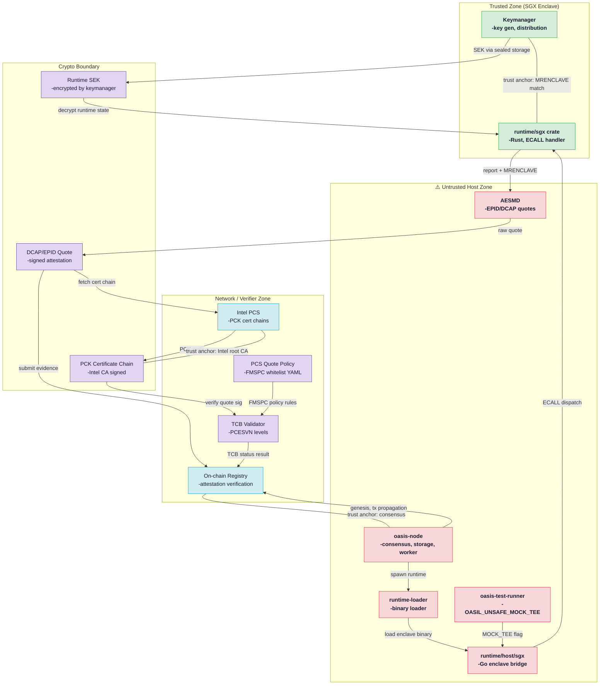

# TEE Usage Audit Report: oasis-core

## Executive Summary
This TEE audit assessed 12 invariants against the Oasis Network SGX enclave codebase, yielding 0 confirmed vulnerabilities, 3 positive guards, and 19 unknown items spanning 10 unique invariants. Six findings were dismissed as non-TEE-relevant false positives.

**Confirmed Positive Guards:**
- DCAP TCB status/level validation (PG-INV-02, complete)
- Debug guard via CfgDebugDontBlameOasis flag (PG3-U-INV-08, partial)
- No SGX monotonic counters in persistence (PG-U-INV-12, partial)

**Critical Unknowns Requiring Dynamic Verification:**
- ECALL entry point parameter validation (U-INV-01)
- Quote policy FMSPC whitelist and attestation age enforcement (U-INV-03)
- RAK public key hash embedding in report_data (U-INV-04)
- SGX sealing MRENCLAVE binding during upgrades (U-INV-05)
- TEE sealed state epoch/version anti-rollback mechanisms (U-INV-06)
- OASIS_UNSAFE_MOCK_TEE production exclusion (U-INV-07)
- Mock SGX signer production attestation exclusion (U-INV-08)
- Key release attestation between runtime and keymanager enclaves (U-INV-09)
- PCS PCK certificate chain validation to Intel root CA (U-INV-10)
- OCALL return value handling at enclave boundary (U-INV-11)

**Coverage Gap:** Design and Leakage vulnerability families have zero invariant assessments. This gap is unacknowledged and must be addressed in subsequent audit phases.

## Dashboard Summary

| Severity | Trust-Path Tier | Count |
| --- | --- | --- |
| — | — | **0** |

_No TEE usage issues identified._

## Trust Boundary Analysis

| Actor | Component | Context | Boundary Type |
| --- | --- | --- | --- |
| Node Operators | runtime/host/sgx (Go) | untrusted | enclave/host |
| Node Operators | runtime-loader | untrusted | enclave/host |
| Node Operators | runtime/sgx (Rust crate) | trusted | enclave/host |
| Network/Verifiers | go/common/sgx/pcs/policy | untrusted | crypto boundary |
| Network/Verifiers | go/common/sgx/pcs/tcb | untrusted | crypto boundary |
| Node Operators/Verifiers | go/common/sgx/pcs (PCS API client) | untrusted | network |
| Designated network entities | keymanager (SGX enclave) | trusted | enclave/host |
| Node Operators | AESMD docker image (EPID/DCAP) | untrusted | enclave/host |
| Developers | go/oasis-test-runner | untrusted | host/process |
| Intel PCS (external) | Intel Provisioning Certification Service | untrusted | network |
| On-chain verifiers | Consensus/Registry (go/consensus) | untrusted | network |

## Trust Boundary Partition Evidence

### Partition Methodology

**Path and content heuristics** classified files by directory patterns (enclave/, host/, trusted/) and TEE API usage (sgx_trts, sgx_urts, attestation); **LLM-assisted classification** for ambiguous files.

**Project TEE Role:** Mixed (contains both TEE and host code)
> Oasis Core is a blockchain platform that uses TEEs (SGX/TDX) for confidential computing. It has code running both inside enclaves (runtime library for SGX/non-SGX runtimes, keymanager) and outside on the host (go/ node, runtime-loader that launches enclaves). The architecture has a clear trust boundary: runtimes execute inside TEEs while the Oasis node and runtime-loader operate on the untrusted host side.

### Source Code Zone Partition

```
├── go/  🟡 Mixed (19 trusted, 1107 untrusted)  — Go bindings
│   ├── ./  🔴 Untrusted (1 file)  — Go bindings
│   ├── beacon/api/  🔴 Untrusted (5 files)  — API definitions
│   ├── beacon/tests/  🔴 Untrusted (1 file)  — test suite
│   ├── common/  🔴 Untrusted (9 files)
│   ├── common/accessctl/  🔴 Untrusted (2 files)
│   ├── common/backoff/  🔴 Untrusted (1 file)
│   ├── common/badger/  🔴 Untrusted (1 file)
│   ├── common/cache/lru/  🔴 Untrusted (2 files)
│   ├── common/cbor/  🔴 Untrusted (6 files)
│   ├── common/crash/  🔴 Untrusted (2 files)
│   ├── common/crypto/address/  🔴 Untrusted (5 files)
│   ├── common/crypto/drbg/  🔴 Untrusted (2 files)
│   ├── common/crypto/hash/  🔴 Untrusted (1 file)
│   ├── common/crypto/mathrand/  🔴 Untrusted (2 files)
│   ├── common/crypto/mrae/api/  🟢 Trusted (1 file)  — API definitions
│   ├── common/crypto/mrae/deoxysii/  🔴 Untrusted (2 files)
│   ├── common/crypto/sakg/  🔴 Untrusted (4 files)
│   ├── common/crypto/signature/  🔴 Untrusted (7 files)  — signature ops
│   ├── common/crypto/signature/signers/composite/  🔴 Untrusted (2 files)
│   ├── common/crypto/signature/signers/file/  🔴 Untrusted (2 files)
│   ├── common/crypto/signature/signers/memory/  🔴 Untrusted (1 file)
│   ├── common/crypto/signature/signers/plugin/  🔴 Untrusted (3 files)
│   ├── common/crypto/signature/signers/remote/  🔴 Untrusted (1 file)
│   ├── common/crypto/signature/tests/  🔴 Untrusted (1 file)  — test suite
│   ├── common/crypto/slip10/  🔴 Untrusted (2 files)
│   ├── common/crypto/tls/  🔴 Untrusted (3 files)
│   ├── common/crypto/tuplehash/  🔴 Untrusted (2 files)
│   ├── common/ctxsync/  🔴 Untrusted (2 files)
│   ├── common/diff/  🔴 Untrusted (2 files)
│   ├── common/dynlib/  🔴 Untrusted (5 files)
│   ├── common/encoding/bech32/  🔴 Untrusted (2 files)
│   ├── common/entity/  🔴 Untrusted (2 files)
│   ├── common/errors/  🔴 Untrusted (2 files)
│   ├── common/fuzz/  🔴 Untrusted (1 file)
│   ├── common/grpc/  🔴 Untrusted (10 files)  — gRPC service
│   ├── common/grpc/auth/  🔴 Untrusted (4 files)  — authentication
│   ├── common/grpc/testing/  🔴 Untrusted (1 file)  — test utilities
│   ├── common/identity/  🔴 Untrusted (2 files)
│   ├── common/keyformat/  🔴 Untrusted (4 files)
│   ├── common/logging/  🔴 Untrusted (9 files)
│   ├── common/node/  🔴 Untrusted (8 files)
│   ├── common/pem/  🔴 Untrusted (1 file)
│   ├── common/persistent/  🔴 Untrusted (2 files)
│   ├── common/prettyprint/  🔴 Untrusted (4 files)
│   ├── common/pubsub/  🔴 Untrusted (2 files)
│   ├── common/quantity/  🔴 Untrusted (2 files)
│   ├── common/random/  🔴 Untrusted (2 files)
│   ├── common/scheduling/  🔴 Untrusted (3 files)
│   ├── common/service/  🔴 Untrusted (3 files)
│   ├── common/sgx/  🔴 Untrusted (4 files)  — SGX interfaces
│   ├── common/sgx/aesm/  🔴 Untrusted (3 files)
│   ├── common/sgx/ias/  🔴 Untrusted (7 files)
│   ├── common/sgx/pcs/  🔴 Untrusted (15 files)
│   ├── common/sgx/quote/  🔴 Untrusted (2 files)
│   ├── common/sgx/sigstruct/  🟢 Trusted (3 files)
│   ├── common/sync/  🔴 Untrusted (4 files)
│   ├── common/syscall/  🔴 Untrusted (3 files)
│   ├── common/testing/  🔴 Untrusted (1 file)  — test utilities
│   ├── common/version/  🔴 Untrusted (2 files)
│   ├── common/workerpool/  🔴 Untrusted (1 file)
│   ├── config/  🔴 Untrusted (3 files)  — configuration
│   ├── consensus/api/  🔴 Untrusted (5 files)  — API definitions
│   ├── consensus/api/events/  🔴 Untrusted (1 file)
│   ├── consensus/api/transaction/  🔴 Untrusted (4 files)
│   ├── consensus/api/transaction/results/  🔴 Untrusted (1 file)
│   ├── consensus/api/transaction/testvectors/  🔴 Untrusted (1 file)
│   ├── consensus/cometbft/  🔴 Untrusted (1 file)
│   ├── consensus/cometbft/abci/  🔴 Untrusted (12 files)
│   ├── consensus/cometbft/api/  🔴 Untrusted (15 files)  — API definitions
│   ├── consensus/cometbft/apps/beacon/  🔴 Untrusted (7 files)
│   ├── consensus/cometbft/apps/beacon/state/  🔴 Untrusted (2 files)
│   ├── consensus/cometbft/apps/beacon/state/interop/  🔴 Untrusted (1 file)
│   ├── consensus/cometbft/apps/consensus/  🔴 Untrusted (2 files)
│   ├── consensus/cometbft/apps/consensus/state/  🔴 Untrusted (1 file)
│   ├── consensus/cometbft/apps/governance/  🔴 Untrusted (11 files)
│   ├── consensus/cometbft/apps/governance/api/  🔴 Untrusted (1 file)  — API definitions
│   ├── consensus/cometbft/apps/governance/state/  🔴 Untrusted (2 files)
│   ├── consensus/cometbft/apps/keymanager/  🔴 Untrusted (5 files)
│   ├── consensus/cometbft/apps/keymanager/churp/  🔴 Untrusted (8 files)
│   ├── consensus/cometbft/apps/keymanager/churp/state/  🔴 Untrusted (2 files)
│   ├── consensus/cometbft/apps/keymanager/churp/state/interop/  🔴 Untrusted (1 file)
│   ├── consensus/cometbft/apps/keymanager/common/  🔴 Untrusted (2 files)
│   ├── consensus/cometbft/apps/keymanager/secrets/  🔴 Untrusted (9 files)
│   ├── consensus/cometbft/apps/keymanager/secrets/state/  🔴 Untrusted (2 files)
│   ├── consensus/cometbft/apps/keymanager/secrets/state/interop/  🔴 Untrusted (1 file)
│   ├── consensus/cometbft/apps/keymanager/state/interop/  🔴 Untrusted (1 file)
│   ├── consensus/cometbft/apps/registry/  🔴 Untrusted (9 files)
│   ├── consensus/cometbft/apps/registry/api/  🔴 Untrusted (1 file)  — API definitions
│   ├── consensus/cometbft/apps/registry/state/  🔴 Untrusted (2 files)
│   ├── consensus/cometbft/apps/registry/state/interop/  🟢 Trusted (1 file)
│   ├── consensus/cometbft/apps/roothash/  🔴 Untrusted (15 files)
│   ├── consensus/cometbft/apps/roothash/api/  🔴 Untrusted (2 files)  — API definitions
│   ├── consensus/cometbft/apps/roothash/state/  🔴 Untrusted (2 files)
│   ├── consensus/cometbft/apps/roothash/state/interop/  🔴 Untrusted (1 file)
│   ├── consensus/cometbft/apps/scheduler/  🔴 Untrusted (10 files)
│   ├── consensus/cometbft/apps/scheduler/api/  🔴 Untrusted (1 file)  — API definitions
│   ├── consensus/cometbft/apps/scheduler/state/  🔴 Untrusted (1 file)
│   ├── consensus/cometbft/apps/staking/  🔴 Untrusted (16 files)
│   ├── consensus/cometbft/apps/staking/api/  🔴 Untrusted (1 file)  — API definitions
│   ├── consensus/cometbft/apps/staking/state/  🔴 Untrusted (5 files)
│   ├── consensus/cometbft/apps/staking/state/interop/  🔴 Untrusted (1 file)
│   ├── consensus/cometbft/apps/supplementarysanity/  🔴 Untrusted (3 files)
│   ├── consensus/cometbft/apps/vault/  🔴 Untrusted (10 files)
│   ├── consensus/cometbft/apps/vault/state/  🔴 Untrusted (2 files)
│   ├── consensus/cometbft/beacon/  🔴 Untrusted (2 files)
│   ├── consensus/cometbft/common/  🔴 Untrusted (3 files)
│   ├── consensus/cometbft/config/  🟢 Trusted (1 file)  — configuration
│   ├── consensus/cometbft/consensus/  🟢 Trusted (1 file)
│   ├── consensus/cometbft/crypto/  🔴 Untrusted (3 files)  — cryptography
│   ├── consensus/cometbft/crypto/merkle/  🔴 Untrusted (2 files)
│   ├── consensus/cometbft/db/  🔴 Untrusted (2 files)  — database
│   ├── consensus/cometbft/db/badger/  🔴 Untrusted (2 files)
│   ├── consensus/cometbft/db/tests/  🔴 Untrusted (1 file)  — test suite
│   ├── consensus/cometbft/features/  🔴 Untrusted (1 file)
│   ├── consensus/cometbft/full/  🔴 Untrusted (7 files)
│   ├── consensus/cometbft/governance/  🔴 Untrusted (3 files)
│   ├── consensus/cometbft/keymanager/  🔴 Untrusted (1 file)
│   ├── consensus/cometbft/keymanager/churp/  🔴 Untrusted (2 files)
│   ├── consensus/cometbft/keymanager/secrets/  🔴 Untrusted (2 files)
│   ├── consensus/cometbft/light/  🔴 Untrusted (7 files)
│   ├── consensus/cometbft/registry/  🔴 Untrusted (3 files)
│   ├── consensus/cometbft/roothash/  🔴 Untrusted (3 files)
│   ├── consensus/cometbft/scheduler/  🔴 Untrusted (2 files)
│   ├── consensus/cometbft/seed/  🔴 Untrusted (1 file)
│   ├── consensus/cometbft/staking/  🔴 Untrusted (3 files)
│   ├── consensus/cometbft/stateless/  🔴 Untrusted (7 files)
│   ├── consensus/cometbft/tests/  🔴 Untrusted (1 file)  — test suite
│   ├── consensus/cometbft/tests/genesis/  🟢 Trusted (1 file)
│   ├── consensus/cometbft/vault/  🔴 Untrusted (3 files)
│   ├── consensus/genesis/  🔴 Untrusted (1 file)
│   ├── consensus/metrics/  🔴 Untrusted (1 file)
│   ├── consensus/p2p/light/  🔴 Untrusted (2 files)
│   ├── consensus/pricediscovery/  🔴 Untrusted (2 files)
│   ├── consensus/tests/  🔴 Untrusted (1 file)  — test suite
│   ├── control/api/  🔴 Untrusted (3 files)  — API definitions
│   ├── extra/extract-metrics/  🟢 Trusted (1 file)
│   ├── genesis/  🔴 Untrusted (1 file)
│   ├── genesis/api/  🔴 Untrusted (2 files)  — API definitions
│   ├── genesis/config/  🔴 Untrusted (1 file)  — configuration
│   ├── genesis/file/  🔴 Untrusted (1 file)
│   ├── genesis/tests/  🔴 Untrusted (1 file)  — test suite
│   ├── governance/api/  🔴 Untrusted (6 files)  — API definitions
│   ├── governance/gen_vectors/  🔴 Untrusted (1 file)
│   ├── governance/tests/  🔴 Untrusted (1 file)  — test suite
│   ├── ias/  🔴 Untrusted (1 file)
│   ├── ias/api/  🔴 Untrusted (2 files)  — API definitions
│   ├── ias/config/  🔴 Untrusted (1 file)  — configuration
│   ├── ias/http/  🔴 Untrusted (1 file)  — HTTP handlers
│   ├── ias/proxy/  🔴 Untrusted (1 file)
│   ├── ias/proxy/client/  🔴 Untrusted (1 file)  — client code
│   ├── keymanager/api/  🔴 Untrusted (2 files)  — API definitions
│   ├── keymanager/churp/  🔴 Untrusted (9 files)
│   ├── keymanager/secrets/  🔴 Untrusted (8 files)
│   ├── oasis-net-runner/  🔴 Untrusted (1 file)
│   ├── oasis-net-runner/cmd/  🔴 Untrusted (1 file)  — CLI commands
│   ├── oasis-net-runner/fixtures/  🔴 Untrusted (4 files)
│   ├── oasis-node/  🔴 Untrusted (3 files)
│   ├── oasis-node/cmd/  🔴 Untrusted (1 file)  — CLI commands
│   ├── oasis-node/cmd/common/  🔴 Untrusted (7 files)
│   ├── oasis-node/cmd/common/background/  🔴 Untrusted (1 file)
│   ├── oasis-node/cmd/common/config/  🔴 Untrusted (1 file)  — configuration
│   ├── oasis-node/cmd/common/consensus/  🔴 Untrusted (1 file)
│   ├── oasis-node/cmd/common/context/  🔴 Untrusted (1 file)
│   ├── oasis-node/cmd/common/flags/  🔴 Untrusted (1 file)
│   ├── oasis-node/cmd/common/genesis/  🔴 Untrusted (1 file)
│   ├── oasis-node/cmd/common/grpc/  🔴 Untrusted (1 file)  — gRPC service
│   ├── oasis-node/cmd/common/metrics/  🔴 Untrusted (7 files)
│   ├── oasis-node/cmd/common/metrics/config/  🔴 Untrusted (1 file)  — configuration
│   ├── oasis-node/cmd/common/pprof/  🔴 Untrusted (1 file)
│   ├── oasis-node/cmd/common/pprof/config/  🔴 Untrusted (1 file)  — configuration
│   ├── oasis-node/cmd/common/signer/  🔴 Untrusted (2 files)  — signing
│   ├── oasis-node/cmd/consensus/  🔴 Untrusted (1 file)
│   ├── oasis-node/cmd/control/  🔴 Untrusted (2 files)
│   ├── oasis-node/cmd/debug/  🔴 Untrusted (1 file)
│   ├── oasis-node/cmd/debug/beacon/  🔴 Untrusted (1 file)
│   ├── oasis-node/cmd/debug/byzantine/  🔴 Untrusted (12 files)
│   ├── oasis-node/cmd/debug/control/  🔴 Untrusted (1 file)
│   ├── oasis-node/cmd/debug/dumpdb/  🟢 Trusted (1 file)
│   ├── oasis-node/cmd/debug/storage/  🔴 Untrusted (3 files)  — storage layer
│   ├── oasis-node/cmd/debug/txsource/  🔴 Untrusted (1 file)
│   ├── oasis-node/cmd/debug/txsource/workload/  🔴 Untrusted (10 files)
│   ├── oasis-node/cmd/genesis/  🔴 Untrusted (2 files)
│   ├── oasis-node/cmd/governance/  🔴 Untrusted (1 file)
│   ├── oasis-node/cmd/ias/  🔴 Untrusted (3 files)
│   ├── oasis-node/cmd/identity/  🔴 Untrusted (1 file)
│   ├── oasis-node/cmd/identity/cometbft/  🔴 Untrusted (1 file)
│   ├── oasis-node/cmd/keymanager/  🔴 Untrusted (1 file)
│   ├── oasis-node/cmd/node/  🔴 Untrusted (11 files)
│   ├── oasis-node/cmd/registry/  🔴 Untrusted (1 file)
│   ├── oasis-node/cmd/registry/entity/  🟢 Trusted (1 file)
│   ├── oasis-node/cmd/registry/node/  🔴 Untrusted (1 file)
│   ├── oasis-node/cmd/registry/runtime/  🔴 Untrusted (1 file)  — runtime engine
│   ├── oasis-node/cmd/signer/  🔴 Untrusted (1 file)  — signing
│   ├── oasis-node/cmd/stake/  🔴 Untrusted (5 files)
│   ├── oasis-node/cmd/storage/  🔴 Untrusted (3 files)  — storage layer
│   ├── oasis-remote-signer/  🔴 Untrusted (1 file)
│   ├── oasis-remote-signer/cmd/  🔴 Untrusted (1 file)  — CLI commands
│   ├── oasis-test-runner/  🔴 Untrusted (2 files)
│   ├── oasis-test-runner/cmd/  🔴 Untrusted (2 files)  — CLI commands
│   ├── oasis-test-runner/cmd/cmp/  🟢 Trusted (1 file)
│   ├── oasis-test-runner/cmd/common/  🔴 Untrusted (1 file)
│   ├── oasis-test-runner/env/  🔴 Untrusted (3 files)
│   ├── oasis-test-runner/log/  🔴 Untrusted (2 files)
│   ├── oasis-test-runner/oasis/  🔴 Untrusted (19 files)
│   ├── oasis-test-runner/oasis/cli/  🔴 Untrusted (5 files)  — CLI interface
│   ├── oasis-test-runner/rust/  🟢 Trusted (1 file)
│   ├── oasis-test-runner/scenario/  🔴 Untrusted (1 file)
│   ├── oasis-test-runner/scenario/e2e/  🔴 Untrusted (19 files)
│   ├── oasis-test-runner/scenario/e2e/runtime/  🔴 Untrusted (53 files)  — runtime engine
│   ├── oasis-test-runner/scenario/pluginsigner/  🔴 Untrusted (2 files)
│   ├── oasis-test-runner/scenario/pluginsigner/example_signer_plugin/  🔴 Untrusted (1 file)
│   ├── oasis-test-runner/scenario/remotesigner/  🔴 Untrusted (2 files)
│   ├── oasis-test-runner/scenario/signer/  🔴 Untrusted (1 file)  — signing
│   ├── p2p/  🔴 Untrusted (6 files)
│   ├── p2p/api/  🔴 Untrusted (5 files)  — API definitions
│   ├── p2p/backup/  🔴 Untrusted (4 files)
│   ├── p2p/config/  🔴 Untrusted (1 file)  — configuration
│   ├── p2p/discovery/bootstrap/  🔴 Untrusted (5 files)
│   ├── p2p/discovery/peerstore/  🔴 Untrusted (2 files)
│   ├── p2p/error/  🔴 Untrusted (2 files)
│   ├── p2p/peermgmt/  🔴 Untrusted (12 files)
│   ├── p2p/protocol/  🔴 Untrusted (2 files)
│   ├── p2p/rpc/  🔴 Untrusted (8 files)  — RPC interface
│   ├── registry/  🔴 Untrusted (1 file)
│   ├── registry/api/  🔴 Untrusted (9 files)  — API definitions
│   ├── registry/gen_vectors/  🔴 Untrusted (1 file)
│   ├── registry/tests/  🔴 Untrusted (1 file)  — test suite
│   ├── roothash/  🔴 Untrusted (1 file)
│   ├── roothash/api/  🔴 Untrusted (8 files)  — API definitions
│   ├── roothash/api/block/  🔴 Untrusted (3 files)
│   ├── roothash/api/commitment/  🔴 Untrusted (7 files)
│   ├── roothash/api/message/  🔴 Untrusted (3 files)
│   ├── roothash/tests/  🟢 Trusted (1 file)  — test suite
│   ├── runtime/api/  🔴 Untrusted (1 file)  — API definitions
│   ├── runtime/bundle/  🔴 Untrusted (13 files)
│   ├── runtime/bundle/component/  🔴 Untrusted (2 files)
│   ├── runtime/client/api/  🔴 Untrusted (2 files)  — API definitions
│   ├── runtime/client/tests/  🔴 Untrusted (1 file)  — test suite
│   ├── runtime/config/  🔴 Untrusted (3 files)  — configuration
│   ├── runtime/enclaverpc/api/  🔴 Untrusted (1 file)  — API definitions
│   ├── runtime/history/  🔴 Untrusted (5 files)
│   ├── runtime/host/  🔴 Untrusted (4 files)  — host-side code
│   ├── runtime/host/composite/  🔴 Untrusted (2 files)
│   ├── runtime/host/loadbalance/  🔴 Untrusted (3 files)
│   ├── runtime/host/mock/  🔴 Untrusted (2 files)
│   ├── runtime/host/multi/  🔴 Untrusted (1 file)
│   ├── runtime/host/protocol/  🔴 Untrusted (7 files)
│   ├── runtime/host/provisioner/  🔴 Untrusted (1 file)
│   ├── runtime/host/sandbox/  🔴 Untrusted (4 files)
│   ├── runtime/host/sandbox/process/  🔴 Untrusted (9 files)
│   ├── runtime/host/sgx/  🔴 Untrusted (6 files)  — SGX interfaces
│   ├── runtime/host/sgx/common/  🔴 Untrusted (2 files)
│   ├── runtime/host/tdx/  🔴 Untrusted (4 files)  — TDX interfaces
│   ├── runtime/host/tests/  🔴 Untrusted (1 file)  — test suite
│   ├── runtime/keymanager/api/  🟢 Trusted (1 file)  — API definitions
│   ├── runtime/localstorage/  🟢 Trusted (1 file)
│   ├── runtime/log/  🔴 Untrusted (4 files)
│   ├── runtime/nodes/  🔴 Untrusted (3 files)
│   ├── runtime/registry/  🔴 Untrusted (10 files)
│   ├── runtime/rofl/api/  🔴 Untrusted (7 files)  — API definitions
│   ├── runtime/transaction/  🔴 Untrusted (7 files)
│   ├── runtime/txpool/  🔴 Untrusted (12 files)
│   ├── runtime/txpool/config/  🔴 Untrusted (1 file)  — configuration
│   ├── runtime/volume/  🔴 Untrusted (4 files)
│   ├── scheduler/api/  🔴 Untrusted (4 files)  — API definitions
│   ├── scheduler/tests/  🔴 Untrusted (1 file)  — test suite
│   ├── sentry/  🔴 Untrusted (1 file)
│   ├── sentry/api/  🔴 Untrusted (2 files)  — API definitions
│   ├── sentry/client/  🔴 Untrusted (1 file)  — client code
│   ├── staking/api/  🔴 Untrusted (14 files)  — API definitions
│   ├── staking/api/token/  🔴 Untrusted (3 files)
│   ├── staking/gen_account_vectors/  🔴 Untrusted (1 file)
│   ├── staking/gen_vectors/  🔴 Untrusted (1 file)
│   ├── staking/tests/  🔴 Untrusted (3 files)  — test suite
│   ├── storage/api/  🔴 Untrusted (4 files)  — API definitions
│   ├── storage/database/  🔴 Untrusted (2 files)  — database layer
│   ├── storage/mkvs/  🔴 Untrusted (16 files)
│   ├── storage/mkvs/checkpoint/  🔴 Untrusted (8 files)
│   ├── storage/mkvs/db/  🔴 Untrusted (2 files)  — database
│   ├── storage/mkvs/db/api/  🔴 Untrusted (3 files)  — API definitions
│   ├── storage/mkvs/db/badger/  🔴 Untrusted (10 files)
│   ├── storage/mkvs/db/pathbadger/  🔴 Untrusted (10 files)
│   ├── storage/mkvs/db/testing/  🔴 Untrusted (1 file)  — test utilities
│   ├── storage/mkvs/interop/  🔴 Untrusted (1 file)
│   ├── storage/mkvs/interop/cmd/  🔴 Untrusted (3 files)  — CLI commands
│   ├── storage/mkvs/interop/fixtures/  🔴 Untrusted (2 files)
│   ├── storage/mkvs/node/  🔴 Untrusted (6 files)
│   ├── storage/mkvs/syncer/  🔴 Untrusted (5 files)
│   ├── storage/mkvs/tests/  🔴 Untrusted (1 file)  — test suite
│   ├── storage/mkvs/writelog/  🔴 Untrusted (3 files)
│   ├── storage/tests/  🔴 Untrusted (1 file)  — test suite
│   ├── upgrade/  🔴 Untrusted (2 files)
│   ├── upgrade/api/  🔴 Untrusted (2 files)  — API definitions
│   ├── upgrade/migrations/  🔴 Untrusted (5 files)
│   ├── vault/api/  🔴 Untrusted (11 files)  — API definitions
│   ├── vault/tests/  🔴 Untrusted (1 file)  — test suite
│   ├── worker/beacon/  🔴 Untrusted (3 files)
│   ├── worker/client/  🔴 Untrusted (3 files)  — client code
│   ├── worker/client/committee/  🔴 Untrusted (1 file)
│   ├── worker/common/  🔴 Untrusted (2 files)
│   ├── worker/common/api/  🟢 Trusted (1 file)  — API definitions
│   ├── worker/common/committee/  🔴 Untrusted (8 files)
│   ├── worker/common/configparser/  🔴 Untrusted (1 file)
│   ├── worker/common/p2p/txsync/  🔴 Untrusted (3 files)
│   ├── worker/compute/executor/  🔴 Untrusted (1 file)
│   ├── worker/compute/executor/api/  🔴 Untrusted (1 file)  — API definitions
│   ├── worker/compute/executor/committee/  🔴 Untrusted (12 files)
│   ├── worker/compute/executor/tests/  🟢 Trusted (1 file)  — test suite
│   ├── worker/keymanager/  🔴 Untrusted (9 files)
│   ├── worker/keymanager/api/  🔴 Untrusted (1 file)  — API definitions
│   ├── worker/keymanager/config/  🔴 Untrusted (1 file)  — configuration
│   ├── worker/keymanager/p2p/  🔴 Untrusted (4 files)
│   ├── worker/registration/  🟢 Trusted (1 file)
│   ├── worker/registration/config/  🔴 Untrusted (1 file)  — configuration
│   ├── worker/sentry/  🔴 Untrusted (1 file)
│   ├── worker/sentry/config/  🔴 Untrusted (1 file)  — configuration
│   ├── worker/storage/  🔴 Untrusted (5 files)  — storage layer
│   ├── worker/storage/api/  🔴 Untrusted (2 files)  — API definitions
│   ├── worker/storage/committee/  🔴 Untrusted (6 files)
│   ├── worker/storage/config/  🔴 Untrusted (1 file)  — configuration
│   ├── worker/storage/p2p/checkpointsync/  🔴 Untrusted (3 files)
│   ├── worker/storage/p2p/diffsync/  🔴 Untrusted (3 files)
│   ├── worker/storage/p2p/pub/  🔴 Untrusted (3 files)
│   ├── worker/storage/p2p/synclegacy/  🔴 Untrusted (3 files)
│   └── worker/storage/tests/  🔴 Untrusted (1 file)  — test suite
├── keymanager/  🟡 Mixed (33 trusted, 4 untrusted)
│   ├── src/  🟢 Trusted (1 file)
│   ├── src/api/  🟢 Trusted (4 files)  — API definitions
│   ├── src/beacon/  🟢 Trusted (2 files)
│   ├── src/churp/  🟢 Trusted (9 files)
│   ├── src/client/  🔴 Untrusted (4 files)  — client code
│   ├── src/crypto/  🟢 Trusted (4 files)  — cryptography
│   ├── src/policy/  🟢 Trusted (4 files)
│   ├── src/registry/  🟢 Trusted (2 files)
│   ├── src/runtime/  🟢 Trusted (3 files)  — runtime engine
│   └── src/secrets/  🟢 Trusted (4 files)
├── runtime/  🟡 Mixed (133 trusted, 9 untrusted)  — runtime engine
│   ├── fuzz/  🟢 Trusted (3 files)
│   ├── src/  🟢 Trusted (11 files)
│   ├── src/app/  🔴 Untrusted (4 files)
│   ├── src/common/  🟢 Trusted (11 files)
│   ├── src/common/crypto/  🟢 Trusted (4 files)  — cryptography
│   ├── src/common/crypto/mrae/  🟢 Trusted (3 files)
│   ├── src/common/sgx/  🟢 Trusted (4 files)  — SGX interfaces
│   ├── src/common/sgx/pcs/  🟢 Trusted (8 files)
│   ├── src/common/tdx/  🟢 Trusted (3 files)  — TDX interfaces
│   ├── src/consensus/  🟢 Trusted (10 files)
│   ├── src/consensus/keymanager/  🟢 Trusted (1 file)
│   ├── src/consensus/roothash/  🟢 Trusted (3 files)
│   ├── src/consensus/roothash/commitment/  🟢 Trusted (3 files)
│   ├── src/consensus/state/  🟢 Trusted (6 files)
│   ├── src/consensus/state/keymanager/  🟢 Trusted (1 file)
│   ├── src/consensus/tendermint/  🟢 Trusted (2 files)
│   ├── src/consensus/tendermint/verifier/  🟢 Trusted (9 files)
│   ├── src/consensus/tendermint/verifier/store/  🟢 Trusted (3 files)
│   ├── src/enclave_rpc/  🟢 Trusted (9 files)
│   ├── src/host/  🔴 Untrusted (5 files)  — host-side code
│   ├── src/storage/  🟢 Trusted (1 file)  — storage layer
│   ├── src/storage/mkvs/  🟢 Trusted (2 files)
│   ├── src/storage/mkvs/cache/  🟢 Trusted (2 files)
│   ├── src/storage/mkvs/interop/  🟢 Trusted (3 files)
│   ├── src/storage/mkvs/sync/  🟢 Trusted (8 files)
│   ├── src/storage/mkvs/tests/  🟢 Trusted (1 file)  — test suite
│   ├── src/storage/mkvs/tree/  🟢 Trusted (15 files)
│   └── src/transaction/  🟢 Trusted (7 files)
├── runtime-loader/  🔴 Untrusted (3 files)
│   ├── bin/  🔴 Untrusted (1 file)  — binaries
│   └── src/  🔴 Untrusted (2 files)
├── secret-sharing/  🟢 Trusted (30 files)
│   ├── src/  🟢 Trusted (1 file)
│   ├── src/churp/  🟢 Trusted (7 files)
│   ├── src/kdc/  🟢 Trusted (1 file)
│   ├── src/poly/  🟢 Trusted (6 files)
│   ├── src/poly/fuzz/  🟢 Trusted (1 file)
│   ├── src/poly/lagrange/  🟢 Trusted (4 files)
│   ├── src/shamir/  🟢 Trusted (4 files)
│   ├── src/suites/  🟢 Trusted (2 files)
│   ├── src/vss/  🟢 Trusted (3 files)
│   └── src/vss/fuzz/  🟢 Trusted (1 file)
├── tests/  🟡 Mixed (12 trusted, 10 untrusted)  — test suite
│   ├── runtimes/simple-keymanager/src/  🟢 Trusted (4 files)
│   ├── runtimes/simple-keyvalue/src/  🟢 Trusted (5 files)
│   ├── runtimes/simple-rofl-tdx/src/  🟢 Trusted (1 file)
│   ├── runtimes/simple-rofl/src/  🟢 Trusted (2 files)
│   ├── upgrade/post/  🔴 Untrusted (1 file)
│   ├── upgrade/post/scenario/e2e/  🔴 Untrusted (2 files)
│   ├── upgrade/post/scenario/e2e/runtime/  🔴 Untrusted (2 files)  — runtime engine
│   ├── upgrade/pre/  🔴 Untrusted (1 file)
│   ├── upgrade/pre/scenario/e2e/  🔴 Untrusted (2 files)
│   └── upgrade/pre/scenario/e2e/runtime/  🔴 Untrusted (2 files)  — runtime engine
└── tools/  🔴 Untrusted (3 files)
    ├── bin/  🔴 Untrusted (1 file)  — binaries
    └── src/  🔴 Untrusted (2 files)
```

_Legend: 🟢 Trusted (enclave) · 🔴 Untrusted (host) · 🟡 Mixed (boundary)_

### Trust Boundary Rationale

No TEE manifest, EDL, or PAL files were found. Classification is based on LLM-assisted analysis of directory structure, TEE API usage patterns, and project role inference.

**Project Role:** Mixed
> Oasis Core is a blockchain platform that uses TEEs (SGX/TDX) for confidential computing. It has code running both inside enclaves (runtime library for SGX/non-SGX runtimes, keymanager) and outside on the host (go/ node, runtime-loader that launches enclaves). The architecture has a clear trust boundary: runtimes execute inside TEEs while the Oasis node and runtime-loader operate on the untrusted host side.

## Architecture Diagrams

### System Architecture with Trust Boundaries
The Oasis Network runtime architecture is divided into a small trusted computing base inside SGX enclaves (keymanager and runtime/sgx crate) and a large untrusted host perimeter (Go node, runtime-loader, consensus, storage, and worker layers). Attestation data flows outward from enclaves through the untrusted AESMD quote broker to Intel PCS and on-chain verifiers, while encryption keys and sensitive state flow inward only after successful quote and TCB validation. The trust boundary is sharply drawn at the ECALL/OCALL interface between the SGX enclave boundary and the host process, with all Go code operating in untrusted context and only Rust enclave crates and the keymanager source classified as trusted.



### Trust Boundary Narrative

The trust boundary separates enclave-side components (**Enclave via ECALL entry points**, **Local Node quote verification (go/common/sgx/pcs/tcb)**, **Peer Node Attestation**, **Local Node Policy Enforcement (go/common/sgx/pcs/policy)**, **Enclave Quote Generation**) from host-side components (**Untrusted Host**, **Host Filesystem (sealed state)**, **Host Storage**). Data and control flow across this boundary via the invariants listed below.

**Trust Paths Identified:**
- `INV-01`: Untrusted Host → Enclave via ECALL entry points — Host-controlled data passed to enclave via ECALL parameters must be validated before use in security-critical enclave decisions such as key derivation or state modification.
- `INV-02`: Network Peer → Local Node quote verification (go/common/sgx/pcs/tcb) — DCAP quote verification must validate complete TCB status including PCESVN level before accepting attestation evidence as trustworthy.
- `INV-03`: Peer Node Attestation → Local Node Policy Enforcement (go/common/sgx/pcs/policy) — Quote policy enforcement must check FMSPC whitelist membership and maximum attestation age before accepting peer attestations.
- `INV-04`: Enclave Quote Generation → Network Attestation Dissemination — The attestation report_data field must cryptographically bind the Runtime Attestation Key (RAK) public key to the enclave quote to prevent key substitution attacks.
- `INV-05`: Enclave → Host Filesystem (sealed state) → Enclave on restart — Sealed data must be bound to the enclave's MRENCLAVE identity using SGX sealing to prevent a different enclave from unsealing the data.
- `INV-06`: Enclave State Persistence → Host Storage → Enclave State Recovery — TEE sealed state must include epoch or version binding to ensure monotonic progression and prevent rollback to previous states.
- `INV-07`: Build/Deployment Configuration → TEE Initialization in runtime-loader — The OASIS_UNSAFE_MOCK_TEE environment flag must not be active in production deployments as it completely bypasses TEE hardware attestation and enforcement.
- `INV-08`: Build Configuration → Attestation Verification (keymanager mock signers) — Debug SGX builds with mock trusted signers must not be accepted in production attestation verification paths.
- `INV-09`: Runtime Enclave ↔ Key Manager Enclave (cross-enclave key exchange) — Key release from the keymanager enclave to a requesting runtime enclave requires mutual attestation — both runtime-to-keymanager and keymanager-to-runtime attestation must complete before key material is exchanged.
- `INV-10`: Intel PCS API → Node Certificate Chain Validation (go/common/sgx GetPCKCertificateChain) — PCS PCK certificate chain verification must validate the full chain anchored in Intel's root CA before trusting any attestation collateral.
- `INV-11`: Untrusted Host → Enclave via OCALL return values — OCALL return values consumed by the enclave must be validated before use in security-critical decisions since they originate from the untrusted host.
- `INV-12`: TDX VM State Persistence → Host Storage → TDX VM State Recovery — TDX runtime state persistence must not rely on SGX-style monotonic counters, and any persisted trusted state must implement alternative continuity guarantees appropriate to the TDX platform.

**Cross-Boundary Connections:**
- Enclave via ECALL entry points ↔ Untrusted Host

### Data Flow Summary

Of 12 invariants, **8** involve data crossing the trust boundary between enclave and host.

**Host → Enclave** (4 flows)
_External data entering the TEE — highest validation burden_
- `INV-01`: **host-provided ECALL parameters** → **enclave key derivation**
- `INV-02`: **DCAP quote from network peer** → **attestation acceptance decision**
- `INV-10`: **PCK certificate chain from Intel PCS API** → **DCAP quote trust decision**
- `INV-11`: **OCALL return values from host process** → **enclave policy decisions**

**Enclave → Host** (1 flow)
_TEE outputs and secrets leaving the enclave — leakage risk_
- `INV-04`: **RAK public key generated in enclave** → **on-chain node registration**

**Bidirectional** (3 flows)
_Flows crossing the boundary in both directions_
- `INV-03`: **RAK-signed attestation from peer node** → **peer node acceptance**
- `INV-08`: **mock trusted signer keys in debug builds** → **keymanager attestation acceptance**
- `INV-09`: **runtime attestation quote sent to keymanager** → **key material released by keymanager**

**Boundary Interface Summary:**
- **Enclave entry points** (4): data enters TEE via `INV-01`, `INV-02`, `INV-10`, `INV-11`
- **Enclave exit points** (1): data leaves TEE via `INV-04`

_Internal flows (4): `INV-05`, `INV-06`, `INV-07`, `INV-12` — these stay within a single zone and are covered by individual findings._

### Invariant Reference

| ID | Description | Trust Path |
| --- | --- | --- |
| INV-01 | Host-controlled data passed to enclave via ECALL parameters must be validated before use in security-critical enclave decisions such as key derivation or state modification. | Untrusted Host → Enclave via ECALL entry points |
| INV-02 | DCAP quote verification must validate complete TCB status including PCESVN level before accepting attestation evidence as trustworthy. | Network Peer → Local Node quote verification (go/common/sgx/pcs/tcb) |
| INV-03 | Quote policy enforcement must check FMSPC whitelist membership and maximum attestation age before accepting peer attestations. | Peer Node Attestation → Local Node Policy Enforcement (go/common/sgx/pcs/policy) |
| INV-04 | The attestation report_data field must cryptographically bind the Runtime Attestation Key (RAK) public key to the enclave quote to prevent key substitution attacks. | Enclave Quote Generation → Network Attestation Dissemination |
| INV-05 | Sealed data must be bound to the enclave's MRENCLAVE identity using SGX sealing to prevent a different enclave from unsealing the data. | Enclave → Host Filesystem (sealed state) → Enclave on restart |
| INV-06 | TEE sealed state must include epoch or version binding to ensure monotonic progression and prevent rollback to previous states. | Enclave State Persistence → Host Storage → Enclave State Recovery |
| INV-07 | The OASIS_UNSAFE_MOCK_TEE environment flag must not be active in production deployments as it completely bypasses TEE hardware attestation and enforcement. | Build/Deployment Configuration → TEE Initialization in runtime-loader |
| INV-08 | Debug SGX builds with mock trusted signers must not be accepted in production attestation verification paths. | Build Configuration → Attestation Verification (keymanager mock signers) |
| INV-09 | Key release from the keymanager enclave to a requesting runtime enclave requires mutual attestation — both runtime-to-keymanager and keymanager-to-runtime attestation must complete before key material is exchanged. | Runtime Enclave ↔ Key Manager Enclave (cross-enclave key exchange) |
| INV-10 | PCS PCK certificate chain verification must validate the full chain anchored in Intel's root CA before trusting any attestation collateral. | Intel PCS API → Node Certificate Chain Validation (go/common/sgx GetPCKCertificateChain) |
| INV-11 | OCALL return values consumed by the enclave must be validated before use in security-critical decisions since they originate from the untrusted host. | Untrusted Host → Enclave via OCALL return values |
| INV-12 | TDX runtime state persistence must not rely on SGX-style monotonic counters, and any persisted trusted state must implement alternative continuity guarantees appropriate to the TDX platform. | TDX VM State Persistence → Host Storage → TDX VM State Recovery |

## Positive Guards (Confirmed Security Controls)

### PG-INV-02: DCAP TCB status and level validation
- **Invariants**: INV-02
- **Completeness**: complete
- **Evidence**: runtime/src/common/sgx/pcs/quote.rs:84-96

TCB status is validated at quote.rs:87-96, accepting only UpToDate and SWHardeningNeeded. OutOfDate variants require an explicit unsafe compile flag. The quote.verify() call at line 84 performs SVN-level comparison against TCB info and QE identity collateral, returning a tcb_level with status for policy enforcement.

### PG3-U-INV-08: Debug guard via CfgDebugDontBlameOasis flag
- **Invariants**: INV-08
- **Completeness**: partial
- **Evidence**: go/genesis/genesis_test.go:166

The codebase uses a CfgDebugDontBlameOasis flag as a gate for debug-only features. Test code explicitly sets this flag to true via viper.Set(cmdFlags.CfgDebugDontBlameOasis, true), indicating that production paths default to false and would reject debug/mock configurations.

### PG-U-INV-12: No SGX monotonic counters in persistence
- **Invariants**: INV-12
- **Completeness**: partial
- **Evidence**: go/upgrade/upgrade.go:54-56 shows cbor.NewVersioned used for pending upgrade persistence; go/genesis/genesis_test.go:21 imports sgx only for test node construction; tests/upgrade/pre/scenario/e2e/upgrade.go:95 uses cbor.NewVersioned for upgrade descriptors

The upgrade and state persistence code paths use generic CBOR-based versioned storage (cbor.NewVersioned, store.GetCBOR/PutCBOR) with no references to SGX-style monotonic counters. The SGX import in genesis_test.go is limited to test genesis node construction (node identity types), not state persistence. Upgrade descriptors use software-level versioning via cbor.NewVersioned(upgrade.LatestDescriptorVersion), which is TEE-agnostic.

## Dismissed Findings

_The following findings were dismissed during adversarial review._

### ~~V-01: Log filter utility not a TEE issue~~
- **Original Severity**: Info
- **Dismissal Reason**: Adversarial review: false positive. Self-dismissing non-finding. The finding explicitly states 'no TEE attack path exists' and is_tee_relevant=false. There is no vulnerability to report.
- **Location(s)**: `go/common/logging/filter.go:30`

### ~~V-02: Test vector generator outputs private keys~~
- **Original Severity**: Info
- **Dismissal Reason**: Adversarial review: false positive. Test vector generator performing its intended function. The tool exists to generate test vectors from hardcoded test mnemonics — outputting private keys is its purpose. This is not production code and not an attack surface.
- **Location(s)**: `go/staking/gen_account_vectors/main.go:97`, `go/staking/gen_account_vectors/main.go:121`

### ~~V-03: Logging library not a TEE trust boundary issue~~
- **Original Severity**: Info
- **Dismissal Reason**: Adversarial review: false positive. Self-dismissing non-finding. Finding explicitly concludes 'No TEE primitives are involved' and 'No trust boundary crossing exists.' There is no vulnerability to report.
- **Location(s)**: `go/common/logging/logging.go:162`

### ~~V-04: Multi-logger error aggregation in untrusted zone~~
- **Original Severity**: Info
- **Dismissal Reason**: Adversarial review: false positive. Speculative finding with no evidence of sensitive data leakage. The attack path assumes errors contain 'sensitive internal state' but provides no evidence. Standard Go errors.Join of logging backend errors is not a vulnerability without concrete proof of sensitive data exposure.
- **Location(s)**: `go/common/logging/multi.go:16`, `go/common/logging/multi.go:17`

### ~~V-05: CLI stats tool: no TEE trust boundary issue~~
- **Original Severity**: Info
- **Dismissal Reason**: Adversarial review: false positive. Self-dismissing non-finding. Finding explicitly states 'No attack path — code is a CLI diagnostic tool outside TEE boundary.' There is no vulnerability to report.
- **Location(s)**: `go/oasis-node/cmd/control/runtime_stats.go:246`, `go/oasis-node/cmd/control/runtime_stats.go:293`

### ~~RV3-U-INV-05: SGX sealing binding unverified~~
- **Original Severity**: Info
- **Dismissal Reason**: Adversarial review: false positive. Test code only (tests/ directory), weak confidence, no trust boundary trace. The attack path is speculative — describing what an attacker 'could' do without showing how production sealing code actually fails to verify binding. A finding about SGX sealing must reference the actual sealing/unsealing implementation, not a test file.
- **Location(s)**: `tests/upgrade/post/scenario/e2e/runtime/secure_upgrade.go:1`

## Appendix

_Info-severity TEE findings, items requiring manual review, and non-TEE findings are included here for completeness._

### Items Requiring Manual Review

#### U-INV-01: No ECALL boundary code in scope

Searched provided files for ECALL entry points and enclave parameter validation.
- **Why Uncertain**: Provided code is test infrastructure, genesis tests, and P2P networking; no enclave/ECALL boundary code present to evaluate.

Second-pass notes: The additional source code still does not include enclave EDL files, ECALL handler implementations, trusted/untrusted bridge code, or runtime key derivation/state mutation code. The provided files are test infrastructure (genesis_test.go, node_test.go, secure_upgrade.go) and a common type definition (namespace.go). While namespace.go shows input validation in UnmarshalBinary (length check + isValid flag check), this is common-type deserialization validation, not ECALL boundary validation. The in
- **Recommended Steps**: Provide enclave EDL/ECALL handler source files, Provide runtime key derivation or state mutation code, Provide trusted/untrusted bridge implementations

#### U-INV-03: FMSPC/age policy enforcement unverifiable

Quote policy enforcement in go/common/sgx/pcs/policy for FMSPC whitelist and attestation age checks.
- **Why Uncertain**: The critical source files (go/common/sgx/pcs/policy) are not provided; only test runner and sanity check code was given.

Second-pass notes: The critical source files for quote policy enforcement (go/common/sgx/pcs/policy) remain absent in this second pass. The newly provided files — genesis_test.go (test helpers for genesis documents), secure_upgrade.go (E2E upgrade scenario runner), upgrade.go (upgrade manager with descriptor submission/flush logic), node_test.go (integration test wiring), and post-upgrade main.go — contain no references to the PCS quote verification pipeline, FMSPC whitelist membership checks, or attestation times
- **Recommended Steps**: Provide go/common/sgx/pcs/policy source for analysis, Trace Verify() in quote verification pipeline, Check FMSPC whitelist and timestamp freshness guards

#### U-INV-04: RAK binding in report_data

Source code for RAK embedding in report_data during quote generation.
- **Why Uncertain**: Provided snippets contain only p2p and e2e test code, lacking quote generation logic.

Second-pass notes: The additional source code provided (upgrade test scenarios, network address utilities, governance API tests) does not contain attestation worker code, quote generation logic, or report_data population logic. The invariant about cryptographic binding of RAK to report_data remains unverifiable. Files needed: the enclave quote generation module, the attestation worker/agent code, and any code that populates the SGX report_data or TEE quote fields.
- **Recommended Steps**: Inspect attestation worker code for report_data population, Check enclave quote generation logic

#### U-INV-06: Sealed state epoch binding verification

TEE sealed state epoch/version binding and anti-rollback mechanisms in enclave seal/unseal paths.
- **Why Uncertain**: Provided code is test infrastructure only; actual TEE sealing/unsealing implementation with epoch counter checks was not included for review.

Second-pass notes: The additional code still does not include the actual TEE seal/unseal implementation. The provided files are: (1) genesis test infrastructure, (2) upgrade management with epoch-based network upgrade descriptors (go/upgrade/upgrade.go uses cbor.NewVersioned and epoch fields), (3) governance test infrastructure, and (4) E2E upgrade test scenarios. While the upgrade system demonstrates epoch-aware versioning at the network/consensus layer (upgrade.Descriptor has Epoch and Versioned fields), this is
- **Recommended Steps**: Provide enclave seal/unseal implementation files, Check keymanager secrets package for epoch binding, Review go/common/sgx or similar for monotonic counter usage

#### U-INV-07: Mock TEE flag guard verification

Whether OASIS_UNSAFE_MOCK_TEE is blocked in production runtime initialization paths.
- **Why Uncertain**: Provided source files are test code and P2P dispatch; runtime-loader TEE init code was not included for inspection.

Second-pass notes: The additional source code provided (P2P dispatch, host, gossipsub initialization, node tests, and upgrade test scenarios) contains no references to OASIS_UNSAFE_MOCK_TEE, TEE initialization, attestation, or build-time TEE guards. The critical files needed to verify this invariant — runtime-loader TEE init code, build configuration files (Makefile, build tags), and deployment scripts — were still not provided. The invariant cannot be verified from the available code.
- **Recommended Steps**: Provide runtime-loader TEE initialization source code, Provide build configuration files (Makefile, build tags), Provide deployment scripts checking OASIS_UNSAFE_MOCK_TEE

#### U-INV-09: Mutual attestation enforcement unverifiable

Key release attestation guards between runtime and keymanager enclaves.
- **Why Uncertain**: Provided files are test infrastructure, namespace utilities, and P2P dispatch; no keymanager or runtime enclave attestation logic included.

Second-pass notes: The additional source code still does not contain the keymanager enclave quote verification logic, runtime enclave attestation of keymanager logic, or MRENCLAVE/MRSIGNER binding in cross-enclave handshake. The files provided are: (1) genesis_test.go - test genesis document construction referencing keymanager imports but no attestation logic; (2) secure_upgrade.go - upgrade E2E test exercising encrypted key-value operations with master secret generations, which implicitly requires keymanager but 
- **Recommended Steps**: Review go/keymanager/ enclave quote verification and key release logic, Review go/runtime/ enclave attestation of keymanager before accepting keys, Check MRENCLAVE/MRSIGNER binding in cross-enclave handshake

#### U-INV-10: PCK cert chain validation code not provided

Searched provided code for PCS PCK certificate chain validation anchored to Intel root CA.
- **Why Uncertain**: Provided files are test code and P2P code; the actual GetPCKCertificateChain implementation in go/common/sgx was not included.

Second-pass notes: The additional source code provided (genesis_test.go, node_test.go, dispatch.go, test-runner.go, namespace.go) does not contain the actual GetPCKCertificateChain implementation or any PCS/quote verification logic. The go/common/sgx package is imported in genesis_test.go (line 21) but the implementation files (go/common/sgx/*.go) are still missing. The recommended files from the first pass—go/common/sgx/*.go source files, PCS/quote verification implementation files, and certificate chain validati
- **Recommended Steps**: Provide go/common/sgx/*.go source files, Provide PCS/quote verification implementation files, Check certificate chain validation in Intel SGX PCS integration

#### U-INV-11: OCALL return validation in enclave code

All provided files for OCALL return value handling in enclave boundary code.
- **Why Uncertain**: Provided files are test scenarios and utility code; no enclave/OCALL implementation code was supplied for analysis.

Second-pass notes: The additional source code provided consists entirely of test infrastructure (secure_upgrade.go, genesis_test.go, node_test.go, governance tester.go, api_test.go) and host-side Go code. None of these files contain enclave-facing OCALL bridge source, EDL definitions, or enclave-side dispatch/handler code where OCALL return values would be consumed and potentially validated. The actual TEE enclave implementation (likely in Rust/C) where OCALL responses are processed remains unavailable for analysi
- **Recommended Steps**: Provide enclave-facing OCALL bridge source files, Provide EDL files defining OCALL interfaces, Provide enclave-side OCALL dispatch/handler code

#### U-INV-05: Sealing policy not visible in provided code

Upgrade test scenarios and p2p dispatch for SGX sealing with MRENCLAVE binding.
- **Why Uncertain**: Provided code is host-side Go test/p2p code; actual SGX seal/unseal logic is in enclave Rust runtime, not included.

Second-pass notes: The additional source code provided (Go test scenarios for upgrade testing, governance API tests, genesis tests, p2p dispatch, and test runner main) is entirely host-side Go code. It references encrypted key-value storage with generations and master secrets (secure_upgrade.go lines 79-93, keymanager/secrets import in genesis_test.go line 29), which suggests a sealing/key management system exists, but the actual SGX seal/unseal Rust implementation in the enclave runtime (runtime/src/) is still no
- **Recommended Steps**: Inspect enclave sealing Rust code in runtime/src/ for sgx_seal_data calls, Verify SGX_SEAL_POLICY_MRENCLAVE is used, not MRSIGNER, Check unseal path verifies enclave identity matches sealed blob

#### U-INV-08: Mock signer attestation guard not assessable

Whether mock SGX signers are excluded from production attestation paths.
- **Why Uncertain**: Provided code lacks attestation verifier, keymanager verification logic, and mock signer definitions needed to assess invariant.

Second-pass notes: The additional source code still does not include the critical components needed to verify this invariant: the SGX attestation verifier implementation, mock signer definitions (likely in go/common/sgx or similar), build configuration files controlling debug/mock vs production signers, or the keymanager attestation verification logic. The code shows SGX attestation parameters being configured (e.g., DefaultMaxAttestationAge in secure_upgrade.go line 182) and imports of sgx and keymanager packages
- **Recommended Steps**: Provide go/keymanager/secrets and SGX attestation verifier files, Provide build config files controlling mock vs real signers, Check go/common/sgx and attestation-related source files

#### U-INV-01: No ECALL entry code provided

Searched provided files for ECALL entry points and enclave input validation.
- **Why Uncertain**: Provided files are test infrastructure, P2P networking, and genesis tests—no enclave ECALL boundary code present.
- **Recommended Steps**: Provide enclave EDL/ECALL handler source files, Provide runtime key derivation and state mutation code, Provide raft/consensus entry point validation logic

#### U-INV-03: FMSPC and age policy enforcement

Whether quote policy checks FMSPC whitelist and max attestation age in go/common/sgx/pcs/policy.
- **Why Uncertain**: The actual policy enforcement code at go/common/sgx/pcs/policy was not provided; only test runner and sanity check files were given.
- **Recommended Steps**: Provide go/common/sgx/pcs/policy source for review, Search for FMSPC whitelist check in policy files, Search for max_attestation_age validation logic

#### U-INV-04: RAK-to-report_data binding not in provided code

Whether RAK public key hash is embedded in report_data during quote generation.
- **Why Uncertain**: Provided files are test code (secure_upgrade.go) and P2P networking (p2p.go, dispatch.go), none contain quote generation or RAK binding logic.
- **Recommended Steps**: Provide enclave quote generation and RAK initialization source files, Check runtime attestation key generation and report_data population, Examine SGX/TDX quote creation code for report_data binding

#### U-INV-05: Sealing MRENCLAVE binding verification

Searched provided source for SGX seal/unseal with MRENCLAVE binding enforcement.
- **Why Uncertain**: Provided files are test infrastructure and P2P dispatch; actual sealing implementation code was not included for review.
- **Recommended Steps**: Provide runtime host sealing/unsealing implementation files, Provide key manager secrets and enclave sealing code, Check sgx_seal_data calls for MRENCLAVE vs MRSIGNER policy

#### U-INV-06: TEE sealed state epoch binding verification

Whether TEE sealed state includes epoch/version binding for anti-rollback in provided code.
- **Why Uncertain**: Only test code provided; actual TEE sealing/unsealing logic with epoch counter checks not in scope.
- **Recommended Steps**: Inspect enclave sealing/unseal implementation in runtime SDK, Check keymanager secrets handler for monotonic counter validation, Verify SGX monotonic counter usage in sealed state recovery path

#### U-INV-07: Mock TEE flag guard not determinable

Whether OASIS_UNSAFE_MOCK_TEE is excluded from production codepaths.
- **Why Uncertain**: Provided source files are test code and P2P dispatch; no TEE init or runtime-loader code included to inspect the flag.
- **Recommended Steps**: Provide runtime-loader TEE initialization source, Provide build configuration and deployment scripts, Provide the file referencing OASIS_UNSAFE_MOCK_TEE

#### U-INV-09: Mutual attestation for key release

Key release attestation flow between keymanager and runtime enclaves.
- **Why Uncertain**: Provided source files are test code, namespace utils, and P2P dispatch; no keymanager enclave or runtime enclave key exchange logic present.
- **Recommended Steps**: Provide go/keymanager/ enclave and runtime host source files, Check keymanager/api/ and keymanager/secrets/ for key release guards, Review runtime-to-keymanager attestation call sites

#### U-INV-10: PCK cert chain validation not in provided code

Provided source files for genesis tests, upgrade scenarios, and p2p code.
- **Why Uncertain**: The invariant's trust path references go/common/sgx GetPCKCertificateChain, which is not included in provided code.
- **Recommended Steps**: Provide go/common/sgx certificate chain validation code, Provide Intel PCS API integration code, Check for root CA pinning and full chain walk

#### U-INV-11: No OCALL code in provided files

Checked provided test and utility files for OCALL return value handling.
- **Why Uncertain**: All provided files are test scenarios (tests/upgrade/) and utility code (go/common/address.go) with no OCALL definitions or enclave boundary logic.
- **Recommended Steps**: Provide enclave EDL files and OCALL handler implementations, Provide enclave-side code that consumes OCALL return values, Examine go/runtime/host/ or go/sgx/ for OCALL processing
