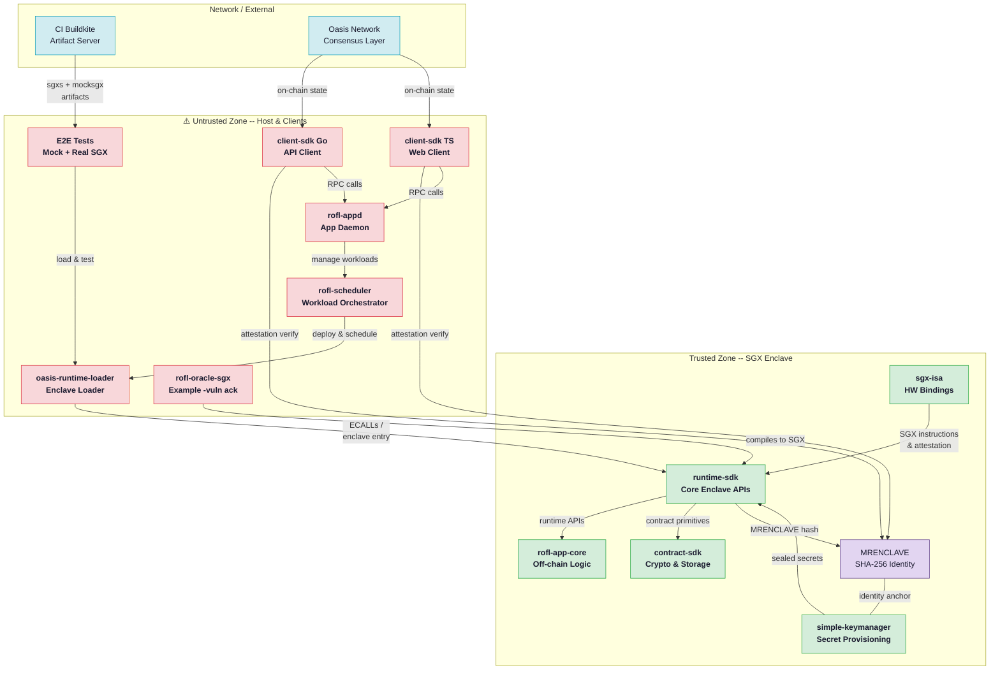

# TEE Usage Audit Report: oasis-sdk

## Executive Summary
This TEE audit evaluated 22 invariants across the enclave trust boundary and identified zero active vulnerabilities but confirmed only one positive guard (PG3-U-INV-12): encrypted call format protects the TEE boundary with partial completeness. 21 invariants remain unresolved (95% coverage gap), including critical security properties: OCALL return value validation before enclave operations (U-INV-02), MRENCLAVE/MRSIGNER binding to on-chain registration (U-INV-10), sealed state anti-rollback protections (U-INV-04), debug-mock-sgx feature flag gating in production builds (U-INV-01), and ECALL parameter validation at enclave entry points (U-INV-09). Three findings were dismissed as false positives during adversarial review.

**Critical gaps requiring immediate resolution:**
- **Boundary validation**: No evidence of ECALL input validation or OCALL return checks—host-enclave interface may accept untrusted data without verification
- **Identity binding**: Unable to confirm ROFL enclave identity (MRENCLAVE/MRSIGNER) is bound to on-chain registration, risking impersonation attacks
- **Seal key integrity**: Seal key derivation binding to enclave identity (U-INV-11) and anti-rollback epoch binding (U-INV-04) unverified
- **Build security**: debug-mock-sgx feature flag gating for production SGX builds not confirmed
- **Client verification**: ROFL client SDKs (Python, TypeScript) attestation verification before trusting enclave responses unchecked (U-INV-06)

**Recommendations:**
1. Resolve OCALL/ECALL boundary validation (U-INV-02, U-INV-09) through targeted code review of enclave entry/exit points
2. Verify on-chain MRENCLAVE binding exists in registration contracts and matches enclave measurement
3. Confirm seal key derivation includes MRENCLAVE/MRSIGNER and monotonic counters enforce anti-rollback
4. Audit build configuration to ensure debug-mock-sgx cannot activate in production builds
5. Evaluate for Flow/Design family issues: secrets crossing enclave boundary, architectural trust boundary placement, error propagation info leakage (U-INV-08)
6. Assess ROFL client SDKs for proper attestation report verification before acting on enclave responses

## Dashboard Summary

| Severity | Trust-Path Tier | Count |
| --- | --- | --- |
| — | — | **0** |

_No TEE usage issues identified._

## Trust Boundary Analysis

| Actor | Component | Context | Boundary Type |
| --- | --- | --- | --- |
| Runtime Developers | runtime-sdk (src/, modules/) | trusted | enclave |
| Runtime Developers | contract-sdk (src/, crypto/, storage/, types/) | trusted | enclave |
| ROFL App Developers | rofl-app-core (src/) | trusted | enclave |
| Enclave Code | sgx-isa crate | trusted | enclave |
| Key Manager Operators | simple-keymanager (.sgxs enclave) | trusted | enclave |
| Host Operator | oasis-core-runtime-loader | untrusted | enclave/host |
| Workload Orchestrator | rofl-scheduler (src/) | untrusted | enclave/host |
| ROFL App Daemon | rofl-appd (src/) | untrusted | enclave/host |
| End User / DApp | client-sdk (Go, TypeScript) | untrusted | network |
| Off-chain Consumer | rofl-client (py, rs, ts) | untrusted | network |
| CI/CD Pipeline | tests/e2e, download-artifacts | untrusted | storage |
| Example Consumer | rofl-oracle-sgx example | untrusted | enclave |

## Trust Boundary Partition Evidence

### Partition Methodology

**Path and content heuristics** classified files by directory patterns (enclave/, host/, trusted/) and TEE API usage (sgx_trts, sgx_urts, attestation); **LLM-assisted classification** for ambiguous files.

**Project TEE Role:** Mixed (contains both TEE and host code)
> The Oasis SDK is a mixed repository containing both TEE-enclave code and host-side code. The runtime-sdk and contract-sdk produce code that executes inside TEE enclaves (SGX/TDX) as Oasis runtimes, while client-sdk provides untrusted host-side libraries for interacting with runtimes. ROFL components (app-core, appd, containers, proxy, scheduler) provide off-chain logic that bridges trusted and untrusted domains. The Cargo.toml excludes mention 'Conflicts with production TDX flags' confirming TEE integration.

### Source Code Zone Partition

```
├── client-sdk/  🟡 Mixed (2 trusted, 158 untrusted)
│   ├── go/callformat/  🟢 Trusted (1 file)
│   ├── go/client/  🔴 Untrusted (3 files)  — client code
│   ├── go/config/  🔴 Untrusted (8 files)  — configuration
│   ├── go/connection/  🔴 Untrusted (1 file)
│   ├── go/crypto/signature/  🔴 Untrusted (4 files)  — signature ops
│   ├── go/crypto/signature/ed25519/  🔴 Untrusted (3 files)
│   ├── go/crypto/signature/secp256k1/  🔴 Untrusted (3 files)
│   ├── go/crypto/signature/sr25519/  🔴 Untrusted (3 files)
│   ├── go/helpers/  🔴 Untrusted (4 files)  — helper functions
│   ├── go/modules/accounts/  🔴 Untrusted (2 files)
│   ├── go/modules/consensus/  🔴 Untrusted (2 files)
│   ├── go/modules/consensusaccounts/  🔴 Untrusted (3 files)
│   ├── go/modules/contracts/  🔴 Untrusted (3 files)  — smart contracts
│   ├── go/modules/contracts/oas20/  🔴 Untrusted (2 files)
│   ├── go/modules/core/  🔴 Untrusted (2 files)  — core logic
│   ├── go/modules/evm/  🔴 Untrusted (4 files)
│   ├── go/modules/rewards/  🔴 Untrusted (3 files)
│   ├── go/modules/rofl/  🔴 Untrusted (6 files)
│   ├── go/modules/roflmarket/  🔴 Untrusted (2 files)
│   ├── go/testing/  🔴 Untrusted (2 files)  — test utilities
│   ├── go/types/  🔴 Untrusted (13 files)  — type definitions
│   ├── ts-web/core/  🔴 Untrusted (3 files)  — core logic
│   ├── ts-web/core/cypress/  🔴 Untrusted (1 file)
│   ├── ts-web/core/cypress/e2e/  🔴 Untrusted (1 file)
│   ├── ts-web/core/playground/  🔴 Untrusted (2 files)
│   ├── ts-web/core/playground/src/  🔴 Untrusted (1 file)
│   ├── ts-web/core/playground/src/errata/  🔴 Untrusted (1 file)
│   ├── ts-web/core/reflect-go/  🟢 Trusted (1 file)
│   ├── ts-web/core/src/  🔴 Untrusted (24 files)
│   ├── ts-web/core/test/  🔴 Untrusted (1 file)  — tests
│   ├── ts-web/ext-utils/  🔴 Untrusted (2 files)
│   ├── ts-web/ext-utils/cypress/e2e/  🔴 Untrusted (1 file)
│   ├── ts-web/ext-utils/sample-ext/  🔴 Untrusted (1 file)
│   ├── ts-web/ext-utils/sample-ext/src/  🔴 Untrusted (1 file)
│   ├── ts-web/ext-utils/sample-ext/src/errata/  🔴 Untrusted (1 file)
│   ├── ts-web/ext-utils/sample-page/  🔴 Untrusted (1 file)
│   ├── ts-web/ext-utils/sample-page/src/  🔴 Untrusted (1 file)
│   ├── ts-web/ext-utils/sample-page/src/errata/  🔴 Untrusted (1 file)
│   ├── ts-web/ext-utils/src/  🔴 Untrusted (6 files)
│   ├── ts-web/rt/  🔴 Untrusted (3 files)
│   ├── ts-web/rt/cypress/e2e/  🔴 Untrusted (1 file)
│   ├── ts-web/rt/playground/  🔴 Untrusted (1 file)
│   ├── ts-web/rt/playground/src/  🔴 Untrusted (3 files)
│   ├── ts-web/rt/playground/src/errata/  🔴 Untrusted (1 file)
│   ├── ts-web/rt/src/  🔴 Untrusted (18 files)
│   ├── ts-web/rt/src/mrae/  🔴 Untrusted (1 file)
│   ├── ts-web/rt/test/  🔴 Untrusted (3 files)  — tests
│   ├── ts-web/signer-ledger/  🔴 Untrusted (1 file)
│   ├── ts-web/signer-ledger/playground/  🔴 Untrusted (1 file)
│   ├── ts-web/signer-ledger/playground/src/  🔴 Untrusted (1 file)
│   ├── ts-web/signer-ledger/playground/src/errata/  🔴 Untrusted (1 file)
│   └── ts-web/signer-ledger/src/  🔴 Untrusted (1 file)
├── contract-sdk/  🟢 Trusted (39 files)
│   ├── crypto/src/  🟢 Trusted (4 files)
│   ├── specs/access/oas173/src/  🟢 Trusted (3 files)
│   ├── specs/token/oas20/src/  🟢 Trusted (3 files)
│   ├── src/  🟢 Trusted (9 files)
│   ├── src/abi/  🟢 Trusted (6 files)
│   ├── storage/src/  🟢 Trusted (3 files)
│   ├── types/src/  🟢 Trusted (9 files)
│   └── types/src/modules/  🟢 Trusted (2 files)
├── contract-sdk-macros/  🟢 Trusted (5 files)
│   └── src/  🟢 Trusted (5 files)
├── examples/  🔴 Untrusted (10 files)  — examples
│   ├── client-sdk/go/minimal-runtime-client/  🔴 Untrusted (1 file)
│   ├── contract-sdk/c10l-hello-world/src/  🔴 Untrusted (1 file)
│   ├── contract-sdk/hello-world/src/  🔴 Untrusted (1 file)
│   ├── runtime-sdk/minimal-runtime/src/  🔴 Untrusted (2 files)
│   ├── runtime-sdk/rofl-oracle-sgx/contracts/  🔴 Untrusted (1 file)  — Reference implementation of a ROFL oracle running in SGX.
│   ├── runtime-sdk/rofl-oracle-sgx/contracts/contracts/  🔴 Untrusted (1 file)  — smart contracts
│   ├── runtime-sdk/rofl-oracle-sgx/contracts/src/  🔴 Untrusted (1 file)
│   ├── runtime-sdk/rofl-oracle-sgx/src/  🔴 Untrusted (1 file)
│   └── runtime-sdk/rofl-oracle-tdx-raw/src/  🔴 Untrusted (1 file)
├── rofl-app-core/  🟢 Trusted (11 files)
│   ├── src/  🟢 Trusted (9 files)
│   └── src/init/  🟢 Trusted (2 files)
├── rofl-appd/  🔴 Untrusted (11 files)
│   ├── src/  🔴 Untrusted (2 files)
│   ├── src/routes/  🔴 Untrusted (6 files)
│   └── src/services/  🔴 Untrusted (3 files)
├── rofl-client/  🔴 Untrusted (14 files)
│   ├── py/examples/  🔴 Untrusted (1 file)  — examples
│   ├── py/src/oasis_rofl_client/  🔴 Untrusted (5 files)
│   ├── py/tests/  🔴 Untrusted (2 files)  — test suite
│   ├── rs/examples/  🔴 Untrusted (1 file)  — examples
│   ├── rs/src/  🔴 Untrusted (1 file)
│   ├── ts/examples/  🔴 Untrusted (1 file)  — examples
│   ├── ts/src/  🔴 Untrusted (2 files)
│   └── ts/test/  🔴 Untrusted (1 file)  — tests
├── rofl-containers/  🔴 Untrusted (10 files)
│   ├── src/  🔴 Untrusted (5 files)
│   ├── src/proxy/  🔴 Untrusted (3 files)
│   └── src/storage/  🔴 Untrusted (2 files)  — storage layer
├── rofl-proxy/  🔴 Untrusted (8 files)
│   ├── fuzz/  🔴 Untrusted (1 file)
│   ├── src/  🔴 Untrusted (1 file)
│   ├── src/http/  🔴 Untrusted (4 files)  — HTTP handlers
│   └── src/wireguard/  🔴 Untrusted (2 files)
├── rofl-scheduler/  🔴 Untrusted (14 files)  — Manages scheduling and deployment of ROFL off-chain workloads.
│   ├── src/  🔴 Untrusted (8 files)
│   ├── src/proxy/  🔴 Untrusted (2 files)
│   └── src/serverd/  🔴 Untrusted (4 files)
├── rofl-utils/  🔴 Untrusted (2 files)
│   └── src/  🔴 Untrusted (2 files)
├── runtime-sdk/  🟢 Trusted (127 files)
│   ├── modules/contracts/src/  🟢 Trusted (7 files)
│   ├── modules/contracts/src/abi/  🟢 Trusted (2 files)
│   ├── modules/contracts/src/abi/oasis/  🟢 Trusted (7 files)
│   ├── modules/evm/benches/  🟢 Trusted (1 file)
│   ├── modules/evm/fuzz/  🟢 Trusted (4 files)
│   ├── modules/evm/src/  🟢 Trusted (9 files)
│   ├── modules/evm/src/precompile/  🟢 Trusted (8 files)
│   ├── modules/evm/src/precompile/standard/  🟢 Trusted (4 files)
│   ├── modules/rofl-market/src/  🟢 Trusted (9 files)
│   ├── src/  🟢 Trusted (16 files)
│   ├── src/crypto/  🟢 Trusted (2 files)  — cryptography
│   ├── src/crypto/multisig/  🟢 Trusted (2 files)
│   ├── src/crypto/signature/  🟢 Trusted (8 files)  — signature ops
│   ├── src/modules/  🟢 Trusted (1 file)
│   ├── src/modules/access/  🟢 Trusted (3 files)
│   ├── src/modules/accounts/  🟢 Trusted (4 files)
│   ├── src/modules/consensus/  🟢 Trusted (3 files)
│   ├── src/modules/consensus_accounts/  🟢 Trusted (4 files)
│   ├── src/modules/core/  🟢 Trusted (3 files)  — core logic
│   ├── src/modules/rewards/  🟢 Trusted (3 files)
│   ├── src/modules/rofl/  🟢 Trusted (9 files)
│   ├── src/storage/  🟢 Trusted (8 files)  — storage layer
│   ├── src/testing/  🟢 Trusted (4 files)  — test utilities
│   └── src/types/  🟢 Trusted (6 files)  — type definitions
├── runtime-sdk-macros/  🟢 Trusted (11 files)
│   ├── src/  🟢 Trusted (7 files)
│   └── src/module_derive/  🟢 Trusted (4 files)
├── tests/  🟡 Mixed (1 trusted, 75 untrusted)  — test suite
│   ├── benchmark/  🔴 Untrusted (1 file)  — benchmarks
│   ├── benchmark/benchmarks/accounts/  🔴 Untrusted (1 file)
│   ├── benchmark/benchmarks/api/  🔴 Untrusted (1 file)  — API definitions
│   ├── benchmark/cmd/  🔴 Untrusted (3 files)  — CLI commands
│   ├── benchmark/runtime/  🔴 Untrusted (2 files)  — runtime engine
│   ├── contracts/bench/src/  🔴 Untrusted (1 file)
│   ├── contracts/hello/src/  🟢 Trusted (1 file)
│   ├── e2e/  🔴 Untrusted (2 files)
│   ├── e2e/base/  🔴 Untrusted (3 files)
│   ├── e2e/consensusaccounts/  🔴 Untrusted (2 files)
│   ├── e2e/contracts/  🔴 Untrusted (3 files)  — smart contracts
│   ├── e2e/evm/  🔴 Untrusted (8 files)
│   ├── e2e/evm/contracts/  🔴 Untrusted (4 files)  — smart contracts
│   ├── e2e/evm/contracts/delegation/  🔴 Untrusted (2 files)
│   ├── e2e/evm/contracts/faucet/  🔴 Untrusted (1 file)  — Solidity contracts
│   ├── e2e/evm/contracts/query/  🔴 Untrusted (2 files)
│   ├── e2e/evm/contracts/retval/  🔴 Untrusted (2 files)
│   ├── e2e/evm/contracts/rng/  🔴 Untrusted (2 files)
│   ├── e2e/evm/contracts/subcall/  🔴 Untrusted (2 files)
│   ├── e2e/evm/contracts/use_gas/  🔴 Untrusted (1 file)  — Solidity contracts
│   ├── e2e/rofl/  🔴 Untrusted (4 files)
│   ├── e2e/scenario/  🔴 Untrusted (3 files)
│   ├── e2e/txgen/  🔴 Untrusted (2 files)
│   ├── runtimes/benchmarking/src/  🔴 Untrusted (2 files)
│   ├── runtimes/benchmarking/src/runtime/  🔴 Untrusted (2 files)  — runtime engine
│   ├── runtimes/components-rofl/src/  🔴 Untrusted (1 file)
│   ├── runtimes/components-ronl/src/  🔴 Untrusted (2 files)
│   ├── runtimes/components-ronl/src/oracle/  🔴 Untrusted (5 files)
│   ├── runtimes/simple-consensus/src/  🔴 Untrusted (2 files)
│   ├── runtimes/simple-contracts/src/  🔴 Untrusted (2 files)
│   ├── runtimes/simple-evm/src/  🔴 Untrusted (2 files)
│   ├── runtimes/simple-keyvalue/src/  🔴 Untrusted (4 files)
│   └── runtimes/simple-keyvalue/src/keyvalue/  🔴 Untrusted (1 file)
└── tools/  🔴 Untrusted (4 files)
    ├── gen_runtime_vectors/  🔴 Untrusted (2 files)
    └── orc/  🔴 Untrusted (2 files)
```

_Legend: 🟢 Trusted (enclave) · 🔴 Untrusted (host) · 🟡 Mixed (boundary)_

### Trust Boundary Rationale

No TEE manifest, EDL, or PAL files were found. Classification is based on LLM-assisted analysis of directory structure, TEE API usage patterns, and project role inference.

**Project Role:** Mixed
> The Oasis SDK is a mixed repository containing both TEE-enclave code and host-side code. The runtime-sdk and contract-sdk produce code that executes inside TEE enclaves (SGX/TDX) as Oasis runtimes, while client-sdk provides untrusted host-side libraries for interacting with runtimes. ROFL components (app-core, appd, containers, proxy, scheduler) provide off-chain logic that bridges trusted and untrusted domains. The Cargo.toml excludes mention 'Conflicts with production TDX flags' confirming TEE integration.

## Architecture Diagrams

### System Architecture with Trust Boundaries
The system is an Oasis ROFL framework targeting Intel SGX via the Fortanix toolchain, where trusted enclave code (runtime-sdk, contract-sdk, rofl-app-core, sgx-isa) executes inside SGX enclaves managed by an untrusted host-side runtime loader. The primary trust boundary lies at the enclave/host interface (oasis-core-runtime-loader), with a secondary boundary at the network perimeter where client-sdk libraries verify attestation evidence before trusting enclave responses. Secrets are provisioned through a dedicated key management enclave (simple-keymanager) using MRENCLAVE-based identity, and the full trust chain is validated end-to-end via deterministic build artifacts and attestation verification in both mock and real SGX modes.



### Trust Boundary Narrative

The trusted boundary centers on **Mock SGX / Real SGX Boundary — build configuration to enclave measurement**, **Host/Enclave Boundary — OCALL return values from host to enclave**, **Key Manager / Runtime Enclave Boundary — secret provisioning channel**, **Host/Enclave Boundary — sealed state persistence and restoration**, **Client / Runtime Boundary — attestation verification to key trust establishment**. The analysis identified 12 invariants governing trust path integrity.

**Trust Paths Identified:**
- `INV-01`: Mock SGX / Real SGX Boundary — build configuration to enclave measurement — The debug-mock-sgx feature flag must not be enabled in production SGX enclave builds, as it substitutes deterministic SHA-256-based MRENCLAVE values for real hardware measurements, completely bypassing TEE attestation guarantees.
- `INV-02`: Host/Enclave Boundary — OCALL return values from host to enclave — Data returned from OCALLs (untrusted host) must not flow into enclave security-critical operations — such as key derivation, policy decisions, or measurement fields — without explicit validation.
- `INV-03`: Key Manager / Runtime Enclave Boundary — secret provisioning channel — Key material exchange between the simple-keymanager enclave and runtime enclaves requires verified mutual attestation — both parties must confirm each other's MRENCLAVE before any secret is released or accepted.
- `INV-04`: Host/Enclave Boundary — sealed state persistence and restoration — Sealed state must be cryptographically bound to a monotonic epoch or version counter that prevents rollback — unsealed blobs from the host filesystem cannot be accepted without verifying they represent the latest known state.
- `INV-05`: Client / Runtime Boundary — attestation verification to key trust establishment — The attestation report_data field must be cryptographically bound to any key material released or derived as a result of that attestation, preventing key-quote substitution attacks.
- `INV-06`: Client / Runtime Boundary — external client to enclave trust establishment — Client SDKs must perform complete attestation verification — including quote signature validation, TCB status checking, MRENCLAVE comparison against expected values, and collateral freshness — before trusting any enclave response.
- `INV-07`: ROFL Scheduler / TDX Instance Boundary — VM launch configuration — TDX firmware, kernel, and initrd artifacts resolved by rofl-scheduler must be integrity-verified against their expected hashes before being used to launch a TEE instance — unverified artifacts enable supply-chain compromise of the trusted computing base.
- `INV-08`: Host/Enclave Boundary — enclave error/response output to host — Error messages and response metadata propagated from enclave to untrusted host must be sanitized to prevent leakage of internal enclave state, secret-dependent processing paths, or TEE configuration details.
- `INV-09`: Host/Enclave Boundary — ECALL parameter passing from host to enclave — ECALL parameters provided by the untrusted host must be validated at enclave entry points before being used in any security-sensitive operation — the host is outside the TCB and can supply arbitrary data.
- `INV-10`: ROFL Enclave / On-chain Registration Boundary — identity binding across on-chain and off-chain domains — The ROFL off-chain enclave identity (MRENCLAVE/MRSIGNER) must be cryptographically bound to its on-chain registration so that attestation from an unregistered or substituted enclave is rejected.
- `INV-11`: Host/Enclave Boundary — sealed state protection against unauthorized unsealing — Sealed data must be bound to the creating enclave's identity (MRENCLAVE or MRSIGNER seal policy) so that only the legitimate enclave can unseal it — cross-enclave unsealing must be prevented.
- `INV-12`: End-to-end trust chain — from key manager enclave through runtime enclave to client — The trust model must ensure that all secret material (private keys, master secrets, user data) is only derivable or accessible within the TEE boundary — no trust path should allow secret derivation to bypass the enclave.

### Data Flow Summary

Of 12 invariants, **12** involve data crossing the trust boundary between enclave and host.

**Bidirectional** (12 flows)
_Flows crossing the boundary in both directions_
- `INV-01`: **debug-mock-sgx feature flag** → **MRENCLAVE measurement computation**
- `INV-02`: **OCALL return values** → **key derivation input**
- `INV-03`: **runtime enclave attestation quote presented to keymanager** → **key material release from keymanager**
- `INV-04`: **unsealed blob from host filesystem** → **state restoration in enclave initialization**
- `INV-05`: **attestation quote report_data field** → **key release decision**
- `INV-06`: **attestation quote received from network/node** → **client trust decision for runtime response**
- `INV-07`: **firmware URL resolved from rofl.yaml or artifacts map** → **TDX VM launch configuration**
- `INV-08`: **enclave internal error states** → **OCALL error response to host**

### Invariant Reference

| ID | Description | Trust Path |
| --- | --- | --- |
| INV-01 | The debug-mock-sgx feature flag must not be enabled in production SGX enclave builds, as it substitutes deterministic SHA-256-based MRENCLAVE values for real hardware measurements, completely bypassing TEE attestation guarantees. | Mock SGX / Real SGX Boundary — build configuration to enclave measurement |
| INV-02 | Data returned from OCALLs (untrusted host) must not flow into enclave security-critical operations — such as key derivation, policy decisions, or measurement fields — without explicit validation. | Host/Enclave Boundary — OCALL return values from host to enclave |
| INV-03 | Key material exchange between the simple-keymanager enclave and runtime enclaves requires verified mutual attestation — both parties must confirm each other's MRENCLAVE before any secret is released or accepted. | Key Manager / Runtime Enclave Boundary — secret provisioning channel |
| INV-04 | Sealed state must be cryptographically bound to a monotonic epoch or version counter that prevents rollback — unsealed blobs from the host filesystem cannot be accepted without verifying they represent the latest known state. | Host/Enclave Boundary — sealed state persistence and restoration |
| INV-05 | The attestation report_data field must be cryptographically bound to any key material released or derived as a result of that attestation, preventing key-quote substitution attacks. | Client / Runtime Boundary — attestation verification to key trust establishment |
| INV-06 | Client SDKs must perform complete attestation verification — including quote signature validation, TCB status checking, MRENCLAVE comparison against expected values, and collateral freshness — before trusting any enclave response. | Client / Runtime Boundary — external client to enclave trust establishment |
| INV-07 | TDX firmware, kernel, and initrd artifacts resolved by rofl-scheduler must be integrity-verified against their expected hashes before being used to launch a TEE instance — unverified artifacts enable supply-chain compromise of the trusted computing base. | ROFL Scheduler / TDX Instance Boundary — VM launch configuration |
| INV-08 | Error messages and response metadata propagated from enclave to untrusted host must be sanitized to prevent leakage of internal enclave state, secret-dependent processing paths, or TEE configuration details. | Host/Enclave Boundary — enclave error/response output to host |
| INV-09 | ECALL parameters provided by the untrusted host must be validated at enclave entry points before being used in any security-sensitive operation — the host is outside the TCB and can supply arbitrary data. | Host/Enclave Boundary — ECALL parameter passing from host to enclave |
| INV-10 | The ROFL off-chain enclave identity (MRENCLAVE/MRSIGNER) must be cryptographically bound to its on-chain registration so that attestation from an unregistered or substituted enclave is rejected. | ROFL Enclave / On-chain Registration Boundary — identity binding across on-chain and off-chain domains |
| INV-11 | Sealed data must be bound to the creating enclave's identity (MRENCLAVE or MRSIGNER seal policy) so that only the legitimate enclave can unseal it — cross-enclave unsealing must be prevented. | Host/Enclave Boundary — sealed state protection against unauthorized unsealing |
| INV-12 | The trust model must ensure that all secret material (private keys, master secrets, user data) is only derivable or accessible within the TEE boundary — no trust path should allow secret derivation to bypass the enclave. | End-to-end trust chain — from key manager enclave through runtime enclave to client |

## Positive Guards (Confirmed Security Controls)

### PG3-U-INV-12: Encrypted call format protects TEE boundary
- **Invariants**: INV-12
- **Completeness**: partial
- **Evidence**: tests/e2e/evm/tests.go:evmSimulateCall uses callDataPublicKey from runtime, encrypts signed call data via callformat.EncodeCall with CallFormatEncryptedX25519DeoxysII before submitting to enclave

Client-side E2E tests confirm that confidential (c10l) calls use CallFormatEncryptedX25519DeoxysII with a CallDataPublicKey obtained from the runtime, and signed call data packs are encrypted before submission. User signing keys (testing.Dave.SecretKey) are used client-side for transaction authorization, which is expected; enclave-internal key derivation logic is not in this file.

## Dismissed Findings

_The following findings were dismissed during adversarial review._

### ~~RV3-U-INV-06: No Attestation Verification in Enclave Calls~~
- **Original Severity**: Info
- **Dismissal Reason**: Adversarial review: false positive. Located entirely in test code (tests/e2e/base/tests.go). The finding complains that test infrastructure doesn't verify attestation before using an enclave public key, but test clients talking to test enclaves have no need for attestation verification — that is the responsibility of production verifiers, not test harnesses. No production attack surface is identified. No trust boundary trace exists.
- **Location(s)**: `tests/e2e/base/tests.go:340`

### ~~RV3-U-INV-01: No production guard for debug-mock-sgx~~
- **Original Severity**: Info
- **Dismissal Reason**: Adversarial review: false positive. Located entirely in test code (tests/e2e/scenario/scenario.go). The finding speculates about 'if debug-mock-sgx is enabled in production Cargo.toml' but provides zero evidence this occurs in any production build configuration. The mock SGX feature exists explicitly for testing. Conflating a test-only feature flag with a production deployment risk is a false positive without proof of production misconfiguration.
- **Location(s)**: `tests/e2e/scenario/scenario.go:161`

### ~~RV3-U-INV-10: Missing enclave attestation binding verification~~
- **Original Severity**: Info
- **Dismissal Reason**: Adversarial review: false positive. Located entirely in test code (tests/e2e/rofl/tests.go). The attack path is entirely speculative — 'if on-chain verification is absent or incomplete.' The finding observes that test code doesn't show attestation quote verification, but test code is not responsible for on-chain verification. No concrete evidence is provided that the production runtime lacks this binding. No trust boundary trace exists.
- **Location(s)**: `tests/e2e/rofl/tests.go:147`

## Appendix

_Info-severity TEE findings, items requiring manual review, and non-TEE findings are included here for completeness._

### Items Requiring Manual Review

#### U-INV-02: OCALL return validation not observable

Whether OCALL return values are validated before security-critical enclave operations.
- **Why Uncertain**: All provided source files are test infrastructure (tests/e2e/, tests/benchmark/); no enclave-side OCALL handlers or Rust runtime code included.

Second-pass notes: The additional source code provided (tests/e2e Go test harness, benchmark infrastructure, orc bundle tooling, and API definitions) contains no enclave-side OCALL handler implementations, EDL files, or Rust runtime SDK code. All files are external tooling and test clients written in Go that interact with runtimes from the outside. The invariant requires inspecting enclave-internal code paths where OCALL return values are consumed—specifically the Rust runtime-sdk dispatcher, key derivation logic,
- **Recommended Steps**: Provide Rust runtime SDK source with OCALL definitions, Include enclave EDL files and dispatch handlers, Provide key derivation / attestation code paths

#### U-INV-03: Mutual attestation enforcement unverifiable

Key manager to runtime enclave mutual MRENCLAVE attestation in provided source files.
- **Why Uncertain**: All provided files are test fixtures, E2E test code, and documentation; no enclave attestation or key provisioning logic is present.

Second-pass notes: The additional source code still does not contain the keymanager enclave Rust source, runtime enclave key retrieval logic, or mutual attestation protocol implementation. The provided files are: (1) tools/orc — a CLI tool for constructing SIGSTRUCT and manipulating runtime bundles, which shows MRENCLAVE is computed from bundles at build-time but says nothing about runtime attestation verification; (2) E2E test code that references confidential call formats (CallFormatEncryptedX25519DeoxysII) and 
- **Recommended Steps**: Provide keymanager enclave Rust source (e.g., runtime-sdk/modules/crypto), Provide runtime enclave key retrieval and quote verification code, Provide the mutual attestation protocol implementation

#### U-INV-04: Sealed state anti-rollback enforcement

Sealed state epoch/version binding and monotonic counter checks on unseal.
- **Why Uncertain**: All provided files are test/benchmark Go code; no production sealing/unsealing logic or monotonic counter code was provided for review.

Second-pass notes: The additional source code provided (client-sdk TypeScript binding generator, e2e test files for EVM and base scenarios, benchmark fixture configuration, and test scenario framework) contains no production sealing/unsealing implementation, monotonic counter logic, or sealed blob metadata parsing. All files remain test/benchmark Go code or client SDK tooling. The runtime-sdk Rust sealing/unsealing implementation files recommended in the first pass were not provided. No evidence for or against the
- **Recommended Steps**: Provide runtime-sdk Rust sealing/unsealing implementation files., Check for monotonic counter comparison in state restoration paths., Verify version binding in sealed blob metadata parsing.

#### U-INV-05: Attestation-key binding not in test files

E2E test code for attestation report_data to key material binding.
- **Why Uncertain**: All provided files are test code (tests/e2e/*); production attestation and key binding logic not present in evidence.

Second-pass notes: The additional source code provided is exclusively end-to-end test code (tests/e2e/*) covering EVM transactions, consensus accounts, contract operations, and base transaction flows. None of these files contain production attestation logic, quote verification, key derivation, or report_data binding code. The recommended verification targets—runtime-sdk attestation module, client-sdk quote verification, and key derivation code—remain absent from the evidence. No attestation or key-release code pat
- **Recommended Steps**: Review runtime-sdk attestation module for report_data binding, Check client-sdk quote verification for key hash comparison, Inspect key derivation code for quote-to-key cryptographic binding

#### U-INV-07: TDX artifact hash verification absent from code

Test fixtures and scenario configs for TDX artifact integrity verification before VM launch.
- **Why Uncertain**: All provided code is test infrastructure (tests/e2e/, tests/benchmark/); rofl-scheduler and TDX launch code with hash verification logic was not included for review.

Second-pass notes: The additional source code provided is still exclusively test infrastructure (e2e test helpers for contracts, EVM transactions, and scenarios). The critical rofl-scheduler implementation code — specifically the TDX instance launch logic, artifact resolution/download code, hash verification/comparison logic, and rofl.yaml manifest parsing with #sha256 fragment handling — remains absent from the review corpus. None of the provided files (tests/e2e/contracts/tests.go, tests/e2e/base/tests.go, tests
- **Recommended Steps**: Provide rofl-scheduler TDX instance launch code, Provide artifact resolution and hash comparison logic, Check rofl.yaml parsing for #sha256 fragment handling

#### U-INV-08: Enclave-host error sanitization

Error propagation paths from enclave to host for info leakage.
- **Why Uncertain**: All provided source files are test/benchmark code under tests/; production enclave boundary code was not supplied for review.

Second-pass notes: The additional source code provided is entirely test/benchmark code (tests/e2e/evm/tests.go, tests/benchmark/benchmarks/accounts/accounts.go, tests/e2e/contracts/tests.go, tests/e2e/txgen/txgen.go) and client-side tooling (client-sdk/ts-web/core/reflect-go/main.go). None of it contains the production Rust runtime enclave boundary code (src/), CBOR/protobuf serialization at the enclave exit boundary, or error mapping logic between enclave internals and host responses. The txgen.go file shows clie
- **Recommended Steps**: Provide runtime enclave Rust source (src/), especially host call handlers, Provide CBOR/protobuf serialization at enclave exit boundary, Provide error mapping code between enclave internals and host responses

#### U-INV-09: ECALL input validation not assessable

Searched for ECALL entry-point parameter validation in enclave-side code.
- **Why Uncertain**: All provided source files are Go test harness code in tests/ directories; no enclave-side ECALL handler code was supplied for review.

Second-pass notes: The additional source code provided (tests/e2e/scenario/scenario.go, tests/e2e/base/tests.go, tests/e2e/evm/tests.go, client-sdk/ts-web/core/reflect-go/main.go, tests/e2e/contracts/tests.go) remains exclusively Go test harness and client SDK code that executes outside the TEE. No Rust runtime ECALL handler code, EDL definitions, enclave entry shim logic, or runtime-loader dispatch code has been supplied. The invariant concerns validation at the enclave boundary (inside the TEE), which is entirel
- **Recommended Steps**: Provide Rust runtime ECALL handler source for review, Inspect runtime-loader and SDK enclave entry shim, Check oasis-core-runtime-loader EDL and dispatch code

#### U-INV-11: Seal policy binding not verifiable

Seal key derivation and enclave identity binding in production enclave code.
- **Why Uncertain**: All provided source is test infrastructure (tests/ directories); no production seal/unseal implementation was available to analyze.

Second-pass notes: The additional source code provided (tests/e2e/contracts/tests.go, tests/e2e/evm/tests.go, tests/e2e/base/tests.go, tests/e2e/consensusaccounts/tests.go, tests/e2e/evm/eth_tx.go) is entirely Go test infrastructure — transaction helpers, gas estimation, deposit/withdrawal flows, and EVM tx construction. None of these files contain runtime/enclave seal key derivation logic, key manager sealing/unsealing implementation, or Rust TEE seal policy selection. The README and rofl-scheduler docs similarly
- **Recommended Steps**: Provide runtime/enclave seal key derivation code for review, Provide key manager sealing/unsealing implementation, Check Rust runtime TEE seal policy selection logic

#### U-INV-01: debug-mock-sgx feature flag enforcement

Whether debug-mock-sgx feature flag is prevented from enabling in production enclave builds.
- **Why Uncertain**: Provided source files are all Go test/benchmark infrastructure; no Rust Cargo.toml, build config, or enclave code containing debug-mock-sgx references was supplied.

Second-pass notes: The additional source code consists entirely of Go test/benchmark tooling and runtime bundling utilities. None of the files contain Rust Cargo.toml definitions, build.rs scripts, or Rust source with #[cfg(feature = "debug-mock-sgx")] conditional compilation. The tools/orc/main.go references SGX SIGSTRUCT construction with a debug flag (line 54), but this controls SGX debug attributes in the SIGSTRUCT (a distinct concept from the debug-mock-sgx Rust feature). The benchmark fixture uses TEEHardwar
- **Recommended Steps**: Search Cargo.toml files for debug-mock-sgx feature definition, Check CI pipeline for feature flag gating on SGX targets, Inspect enclave build scripts for conditional compilation

#### U-INV-10: MRENCLAVE on-chain binding verification

Whether MRENCLAVE/MRSIGNER is bound to on-chain registration in provided files.
- **Why Uncertain**: All provided source files are test code or documentation; no production attestation/registration logic available.

Second-pass notes: The additional source code provides indirect evidence of enclave identity infrastructure but still lacks the core attestation verification logic needed to confirm or deny the invariant. The ROFL test code (tests/e2e/rofl/tests.go:169-170) shows that application instances store a RAK (Runtime Attestation Key) on-chain, and the orc tool (tools/orc/main.go:153) constructs SIGSTRUCTs containing MRENCLAVE/MRSIGNER. However, the critical binding verification code—that would extract MRENCLAVE from a qu
- **Recommended Steps**: Review runtime-sdk/modules/rofl/ for enclave identity binding logic, Check quote verification against on-chain registered MRENCLAVE, Trace attestation validation in runtime-sdk/src/tee/ code

#### U-INV-01: Mock SGX feature flag enforcement

Whether debug-mock-sgx feature flag is gated from production SGX builds.
- **Why Uncertain**: Provided code is entirely Go test/benchmark infrastructure; Rust feature flag definitions and enclave build configs not included.
- **Recommended Steps**: Inspect Cargo.toml for debug-mock-sgx feature definition, Check Rust source for #[cfg(feature = "debug-mock-sgx")] guards, Review CI pipeline for feature flag gating on release builds

#### U-INV-02: OCALL return validation in enclave

Whether OCALL return values are validated before use in enclave security-critical operations.
- **Why Uncertain**: All provided source files are test infrastructure (tests/e2e/, tests/benchmark/) and do not contain production enclave OCALL handling code.
- **Recommended Steps**: Provide enclave OCALL bridge Rust source (src/ or runtime/ dirs), Examine ocall_* handler functions in runtime SDK crate, Check key derivation paths for host-derived inputs

#### U-INV-03: Attestation enforcement code not in scope

Test fixtures and E2E scenario config for keymanager-runtime secret provisioning.
- **Why Uncertain**: Provided code is test infrastructure only; actual MRENCLAVE verification logic resides in enclave Rust code not included in scope.
- **Recommended Steps**: Review runtime-sdk/src/crypto/keymanager attestation modules, Check enclave quote verification in runtime host protocol, Inspect simple-keymanager enclave secret release logic

#### U-INV-04: No sealed state code in provided files

Sealed state anti-rollback and epoch binding in provided source files.
- **Why Uncertain**: All provided files are test/benchmark code (tests/, tests/benchmark/) with no seal/unseal logic or monotonic counter mechanisms present.
- **Recommended Steps**: Provide runtime-sdk Rust sealing/unsealing implementation files, Check oasis-core runtime host/storage layer for anti-rollback counters, Examine enclave state restoration and epoch validation code

#### U-INV-05: Attestation-key binding not in test code

E2E test files for attestation report_data to key binding enforcement.
- **Why Uncertain**: All provided files are in tests/e2e/ directories; core attestation and key binding logic in runtime-sdk/client-sdk not provided.
- **Recommended Steps**: Review runtime-sdk/src/crypto/attestation for report_data binding, Check client-sdk quote verification for key hash comparison, Inspect CallFormatEncryptedX25519DeoxysII setup for key-quote binding

#### U-INV-06: Client SDK attestation verification

ROFL client SDKs (Python, TypeScript) for attestation verification before trusting enclave responses.
- **Why Uncertain**: Provided code is partial (ellipsis markers in roflClient.ts); attestation may occur in omitted sections or at a lower daemon/node layer not shown.
- **Recommended Steps**: Review full roflClient.ts for quote/attestation verification, Check if attestation handled by rofl-appd or node layer, Verify remote client path performs MRENCLAVE/TCB checks

#### U-INV-07: Artifact integrity verification in rofl-scheduler

Looked for hash verification of TDX firmware/kernel/initrd artifacts before VM launch.
- **Why Uncertain**: Provided source files are all test infrastructure (tests/e2e/, tests/benchmark/); no rofl-scheduler production code included.
- **Recommended Steps**: Provide rofl-scheduler artifact resolution and TDX launch code, Search for sha256 fragment handling in artifact URLs, Trace VM launch path from artifact fetch to TD creation

#### U-INV-08: Enclave error sanitization unverifiable

Error propagation patterns in test/benchmark Go code for enclave response handling.
- **Why Uncertain**: All provided files are test and benchmark code outside the enclave; no enclave-side boundary error handling code was available for review.
- **Recommended Steps**: Review Rust runtime dispatch error mapping at enclave boundary, Check map_err/opaque error wrappers in runtime/src/dispatch/, Inspect OCall response serialization for leaked internals

#### U-INV-09: ECALL input validation in enclave code

ECALL parameter validation at host-enclave boundary in enclave entry points.
- **Why Uncertain**: All provided files are test infrastructure in tests/ directories; actual enclave ECALL handler code is not included for review.
- **Recommended Steps**: Provide runtime/enclave Rust source files (e.g., src/main.rs, dispatch code), Examine ECALL dispatch handlers for input validation guards, Check oasis-core-runtime-loader for boundary validation

#### U-INV-10: MRENCLAVE registration binding

Whether ROFL enclave identity is bound to on-chain registration in provided files.
- **Why Uncertain**: All provided files are test infrastructure, benchmarks, and docs; no attestation verification or on-chain registration binding code is present.
- **Recommended Steps**: Provide runtime-sdk ROFL attestation verification source, Provide on-chain rofl module registration handlers, Provide enclave quote validation and MRENCLAVE comparison logic

#### U-INV-11: Seal policy binding verification

Seal key derivation and MRENCLAVE/MRSIGNER binding in enclave sealing/unsealing code.
- **Why Uncertain**: All provided files are test fixtures and configuration; no production sealing/unsealing implementation code was supplied for review.
- **Recommended Steps**: Provide runtime enclave Rust code implementing seal/unseal, Review SGX seal key derivation and policy selection logic, Check MRENCLAVE vs MRSIGNER policy in production config
