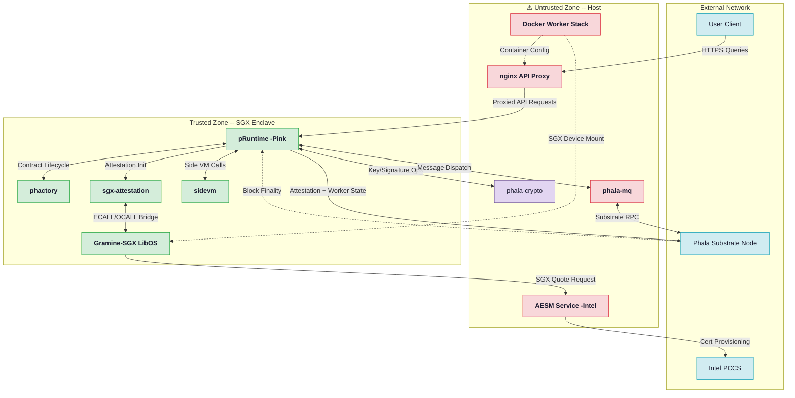

# TEE Usage Audit Report: phala-blockchain

## Executive Summary
The TEE audit identified 5 active findings: 3 Medium, 1 Low, and 1 Info severity. Nine findings were dismissed during adversarial review, including V-05 (no TEE boundary issue) and V-08 (test-only mock code, not production attack surface). V-01 and V-02 were consolidated as they describe the same underlying unverified runtime_info issue. Four positive guards were confirmed (report_data binding, on-chain attestation validation, MRENCLAVE binding, private key protection), all with partial completeness. Twelve unknowns remain due to insufficient code coverage.

Key vulnerabilities:
- **IV-INV-08** (Medium): Configurable attestation bypass skips AESM trust, undermining TEE trust chain
- **IV-INV-01** (Info): None-attestation mode allows unvalidated workers to join network
- **V-06** (Medium): Operator key injection bypasses TEE key secrecy guarantees
- **V-03** (Medium): DCAP collateral fetched without freshness validation enables replay attacks
- **V-01** (Low): Unverified runtime info forwarded from enclave responses

Recommended actions:
- Remove or gate attestation bypass mechanisms (IV-INV-08, IV-INV-01) before production deployment
- Implement DCAP collateral freshness checks per Intel guidelines (V-03)
- Enforce TEE-managed key derivation over operator injection (V-06)
- Validate runtime info before forwarding (V-01)
- Resolve 12 unknowns, prioritizing TLS termination point (U-INV-07), Gramine bridge input validation (U-INV-05), and TEE type validation (U-INV-10)

## Dashboard Summary

| Severity | Trust-Path Tier | Count |
| --- | --- | --- |
| Medium | core | 3 |
| Low | adjacent | 1 |
| Info | core | 1 |

## Trust Boundary Analysis

| Actor | Component | Context | Boundary Type |
| --- | --- | --- | --- |
| pRuntime (Pink) | crates/pink/ | trusted | enclave/host |
| phactory | crates/phactory/ | trusted | enclave/host |
| sgx-attestation | crates/sgx-attestation/ | trusted | crypto boundary |
| Gramine-SGX LibOS | gramine-sgx runtime | trusted | enclave/host |
| sidevm | crates/sidevm/ | trusted | enclave/host |
| phala-crypto | crates/phala-crypto/ | untrusted | crypto boundary |
| phala-mq | crates/phala-mq/ | untrusted | enclave/host |
| AESM Service | aesm_service (Intel) | mixed | enclave/host |
| nginx API Proxy | api.nginx.conf | untrusted | network |
| Docker Worker Stack | dockerfile.d/ | untrusted | storage |
| Phala Substrate Node | pallets/phala/ + pallets/offchain-rollup/ | untrusted | network |
| User Client | External HTTPS caller | untrusted | network |

## Trust Boundary Partition Evidence

### Partition Methodology

**Gramine enclave detection** identified the enclave root via `pal_gramine.rs` and Cargo.toml dependency graphs, classifying enclave-local crates as trusted and standalone host tools as untrusted; **TEE manifest parsing** extracted trusted file lists from Gramine manifests or EDL files; **Path and content heuristics** classified files by directory patterns (enclave/, host/, trusted/) and TEE API usage (sgx_trts, sgx_urts, attestation); **LLM-assisted classification** for ambiguous files.

**Project TEE Role:** Mixed (contains both TEE and host code)
> Phala Network is a blockchain with TEE-based confidential computing. The repository contains both TEE-enclave code (phactory/pRuntime running in Gramine SGX, pink runtime for Phat Contracts) and untrusted host code (Substrate blockchain node, pherry bridge, pallets, prb relay). The gramine.Dockerfile confirms SGX enclave usage. The trust boundary is between pRuntime (trusted) and the blockchain node/bridges (untrusted), with message queue (phala-mq) and prpc defining the communication interface.

### Source Code Zone Partition

```
├── crates/  🟡 Mixed (142 trusted, 32 untrusted)
│   ├── phactory/api/  🟢 Trusted (1 file)  — API definitions
│   ├── phactory/api/src/  🟢 Trusted (10 files)
│   ├── phactory/api/src/crypto/  🟢 Trusted (1 file)  — cryptography
│   ├── phactory/api/src/proto_generated/  🟢 Trusted (4 files)  — generated protobuf
│   ├── phactory/api/tests/  🟢 Trusted (1 file)  — test suite
│   ├── phactory/pal/src/  🟢 Trusted (1 file)
│   ├── phactory/src/  🟢 Trusted (10 files)
│   ├── phactory/src/contracts/  🟢 Trusted (3 files)  — smart contracts
│   ├── phactory/src/contracts/pink/  🟢 Trusted (1 file)  — pRuntime (pink) node
│   ├── phactory/src/contracts/support/  🟢 Trusted (1 file)
│   ├── phactory/src/cryptography/  🟢 Trusted (2 files)
│   ├── phactory/src/light_validation/  🟢 Trusted (5 files)
│   ├── phactory/src/system/  🟢 Trusted (3 files)
│   ├── phactory/tests/  🟢 Trusted (1 file)  — test suite
│   ├── phala-crypto/src/  🔴 Untrusted (5 files)
│   ├── phala-crypto/src/aead/  🟢 Trusted (1 file)
│   ├── phala-mq/src/  🔴 Untrusted (6 files)
│   ├── phala-mq/src/signer/  🔴 Untrusted (1 file)  — signing
│   ├── phala-mq/tests/  🔴 Untrusted (1 file)  — test suite
│   ├── phala-node-rpc-ext/src/  🔴 Untrusted (3 files)
│   ├── phala-node-rpc-ext/types/src/  🔴 Untrusted (1 file)
│   ├── phala-trie-storage/src/  🟢 Trusted (1 file)
│   ├── phala-types/src/  🟢 Trusted (2 files)
│   ├── phaxt/src/  🔴 Untrusted (4 files)
│   ├── phaxt/src/dynamic/  🔴 Untrusted (1 file)
│   ├── pink-libs/s3/src/  🟢 Trusted (1 file)
│   ├── pink/capi/  🟢 Trusted (1 file)  — C API
│   ├── pink/capi/src/  🟢 Trusted (3 files)
│   ├── pink/capi/src/v1/  🟢 Trusted (3 files)
│   ├── pink/chain-extension/src/  🟢 Trusted (3 files)
│   ├── pink/loader/src/  🟢 Trusted (3 files)
│   ├── pink/loader/src/runtimes/  🟢 Trusted (1 file)  — runtime backends
│   ├── pink/macro/src/  🟢 Trusted (2 files)
│   ├── pink/pink-types/src/  🟢 Trusted (4 files)
│   ├── pink/pink/macro/src/  🟢 Trusted (4 files)
│   ├── pink/pink/src/  🟢 Trusted (6 files)
│   ├── pink/pink/src/chain_extension/  🟢 Trusted (3 files)
│   ├── pink/pink/tests/  🟢 Trusted (1 file)  — test suite
│   ├── pink/runtime/src/  🟢 Trusted (5 files)
│   ├── pink/runtime/src/capi/  🟢 Trusted (3 files)  — C API
│   ├── pink/runtime/src/runtime/  🟢 Trusted (2 files)  — runtime engine
│   ├── pink/runtime/src/storage/  🟢 Trusted (3 files)  — storage layer
│   ├── pink/runtime/tests/  🟢 Trusted (1 file)  — test suite
│   ├── pink/runtime/tests/helpers/  🟢 Trusted (5 files)  — helper functions
│   ├── prpc-build/src/  🔴 Untrusted (5 files)
│   ├── prpc/src/  🔴 Untrusted (1 file)
│   ├── sgx-api-lite/src/  🟢 Trusted (2 files)
│   ├── sgx-api-lite/tests/  🟢 Trusted (1 file)  — test suite
│   ├── sgx-attestation/  🟢 Trusted (1 file)
│   ├── sgx-attestation/src/  🟢 Trusted (4 files)
│   ├── sgx-attestation/src/dcap/  🟢 Trusted (4 files)
│   ├── sgx-attestation/src/ias/  🟢 Trusted (1 file)
│   ├── sidevm/env/src/  🟢 Trusted (7 files)
│   ├── sidevm/host-runtime/src/  🟢 Trusted (9 files)
│   ├── sidevm/host-runtime/src/env/  🟢 Trusted (1 file)
│   ├── sidevm/host-runtime/src/env/wasi_env/  🔴 Untrusted (1 file)
│   ├── sidevm/host/src/  🔴 Untrusted (3 files)
│   ├── sidevm/macro/src/  🟢 Trusted (2 files)
│   └── sidevm/sidevm/src/  🟢 Trusted (8 files)
├── e2e/  🔴 Untrusted (12 files)
│   ├── contracts/check_system/  🔴 Untrusted (3 files)
│   ├── contracts/check_system/sideabi/src/  🔴 Untrusted (1 file)
│   ├── contracts/check_system/sideprog/src/  🔴 Untrusted (1 file)
│   ├── contracts/indeterministic_functions/  🔴 Untrusted (1 file)
│   ├── src/  🔴 Untrusted (2 files)
│   └── src/utils/  🔴 Untrusted (4 files)  — utilities
├── frontend/  🔴 Untrusted (61 files)
│   ├── apps/prb3-monitor/  🔴 Untrusted (1 file)
│   ├── apps/prb3-monitor/src/  🔴 Untrusted (3 files)
│   ├── apps/prb3-monitor/src/components/  🔴 Untrusted (1 file)
│   ├── apps/prb3-monitor/src/pages/  🔴 Untrusted (3 files)
│   ├── apps/prb3-monitor/src/pages/[wm]/inv/  🔴 Untrusted (3 files)
│   ├── apps/prb3-monitor/src/pages/[wm]/status/  🔴 Untrusted (2 files)
│   ├── apps/prb3-monitor/src/pages/api/p/  🔴 Untrusted (1 file)
│   ├── packages/sdk/  🔴 Untrusted (2 files)
│   ├── packages/sdk/src/  🔴 Untrusted (6 files)
│   ├── packages/sdk/src/abis/  🔴 Untrusted (1 file)
│   ├── packages/sdk/src/actions/  🔴 Untrusted (3 files)
│   ├── packages/sdk/src/contracts/  🔴 Untrusted (5 files)  — smart contracts
│   ├── packages/sdk/src/ha/  🔴 Untrusted (3 files)
│   ├── packages/sdk/src/providers/  🔴 Untrusted (4 files)
│   ├── packages/sdk/src/pruntime/  🔴 Untrusted (5 files)
│   ├── packages/sdk/src/pruntime/proto/  🔴 Untrusted (2 files)  — protocol buffers
│   ├── packages/sdk/src/utils/  🔴 Untrusted (9 files)  — utilities
│   ├── packages/sdk/src/utils/abi/  🔴 Untrusted (1 file)
│   ├── packages/sdk/tests/contracts/  🔴 Untrusted (1 file)  — smart contracts
│   ├── packages/sdk/tests/providers/  🔴 Untrusted (1 file)
│   ├── packages/sdk/tests/pruntime/  🔴 Untrusted (1 file)
│   └── packages/sdk/tests/utils/  🔴 Untrusted (3 files)  — utilities
├── pallets/  🟡 Mixed (2 trusted, 31 untrusted)
│   ├── offchain-rollup/src/  🔴 Untrusted (5 files)
│   ├── phala/mq-runtime-api/src/  🔴 Untrusted (1 file)
│   ├── phala/src/  🔴 Untrusted (10 files)
│   ├── phala/src/compute/  🔴 Untrusted (7 files)
│   ├── phala/src/migrations/  🔴 Untrusted (1 file)
│   ├── phala/src/mq/  🟢 Trusted (1 file)  — message queue
│   ├── phala/src/phat_tokenomic/  🔴 Untrusted (1 file)
│   ├── phala/src/phat_tokenomic/tests/  🟢 Trusted (1 file)  — test suite
│   └── phala/src/utils/  🔴 Untrusted (6 files)  — utilities
├── scripts/  🔴 Untrusted (49 files)  — build/deploy scripts
│   ├── ./  🔴 Untrusted (4 files)  — build/deploy scripts
│   ├── debug-cli/src/  🔴 Untrusted (3 files)
│   ├── js/bugfix-tools/  🔴 Untrusted (17 files)
│   ├── js/src/  🔴 Untrusted (3 files)
│   ├── js/src/bin/  🔴 Untrusted (4 files)  — binaries
│   ├── js/src/bin/crowdloan/  🔴 Untrusted (2 files)
│   ├── js/src/proto/  🔴 Untrusted (4 files)  — protocol buffers
│   ├── js/src/utils/  🔴 Untrusted (8 files)  — utilities
│   ├── js/src/worker-snapshot/  🔴 Untrusted (2 files)
│   └── prometheus_exporter/  🔴 Untrusted (2 files)
└── standalone/  🟡 Mixed (6 trusted, 68 untrusted)
    ├── executor/benches/  🔴 Untrusted (1 file)
    ├── executor/src/  🔴 Untrusted (1 file)
    ├── headers-cache/src/  🔴 Untrusted (4 files)
    ├── headers-cache/src/web_api/  🔴 Untrusted (1 file)
    ├── justification-validate/src/  🔴 Untrusted (3 files)
    ├── node/  🔴 Untrusted (1 file)
    ├── node/bin/  🔴 Untrusted (1 file)  — binaries
    ├── node/src/  🔴 Untrusted (6 files)
    ├── node/tests/  🔴 Untrusted (6 files)  — test suite
    ├── phat-poller/src/  🔴 Untrusted (8 files)
    ├── pherry/src/  🔴 Untrusted (10 files)
    ├── pherry/src/bin/  🔴 Untrusted (1 file)  — binaries
    ├── prb/src/  🔴 Untrusted (19 files)
    ├── prb/src/bin/  🔴 Untrusted (2 files)  — binaries
    ├── prouter/src/  🔴 Untrusted (2 files)
    ├── pruntime/  🟢 Trusted (1 file)
    ├── pruntime/src/  🟢 Trusted (5 files)
    ├── replay/src/  🔴 Untrusted (1 file)
    └── runtime/src/  🔴 Untrusted (1 file)
```

_Legend: 🟢 Trusted (enclave) · 🔴 Untrusted (host) · 🟡 Mixed (boundary)_

### Boundary-Defining Files

**`standalone/pruntime/gramine-build/pruntime.manifest.template`** -- TEE manifest -- defines enclave configuration, trusted files, encrypted mounts
```
       1 | 
       2 | 
       3 | [libos]
>>>    4 | entrypoint = "pruntime"
       5 | 
       6 | [loader]
       7 | entrypoint = "file:{{ libos }}"
       8 | log_level = "{{ log_level }}"
       9 | argv0_override = "pruntime"
      10 | insecure__use_cmdline_argv = true
      11 | 
      12 | [sys]
```

**`standalone/pruntime/src/pal_gramine.rs`** -- Platform Abstraction Layer -- enclave sealing/attestation interface
```
      15 | 
      16 | #[derive(Debug, Clone, Copy, serde::Serialize, serde::Deserialize)]
      17 | pub(crate) struct GraminePlatform;
      18 | 
      19 | impl Sealing for GraminePlatform {
      20 |     type SealError = std::io::Error;
      21 |     type UnsealError = std::io::Error;
      22 | 
>>>   23 |     fn seal_data(
      24 |         &self,
      25 |         path: impl AsRef<std::path::Path>,
      26 |         data: &[u8],
      27 |     ) -> Result<(), Self::SealError> {
      28 |         std::fs::write(path, data)?;
      29 |         Ok(())
      30 |     }
      31 | 
```

**`crates/pink/capi/src/v1/types.h`** -- ECALL/OCALL interface -- cross-boundary call definitions
```
       1 | // File: types.h
       2 | //
       3 | // This file defines the pink runtime v1 interface types.
       4 | // We use a C header file to make sure that the types are ffi-safe.
       5 | 
       6 | #include <inttypes.h>
       7 | #include <stddef.h>
       8 | 
>>>    9 | typedef void (*output_fn_t)(void *ctx, const uint8_t *data, size_t len);
      10 | typedef void (*cross_call_fn_t)(uint32_t call_id, const uint8_t *data, size_t len, void *ctx, output_fn_t output);
      11 | typedef void (*ecall_get_version_fn_t)(uint32_t *major, uint32_t *minor);
      12 | typedef uint8_t *(*alloc_fn_t)(size_t size, size_t align);
      13 | typedef void (*dealloc_fn_t)(uint8_t *p, size_t size, size_t align);
      14 | 
      15 | typedef struct
      16 | {
      17 |     // The outwards cross-call function of the runtime.
```

**`crates/pink/capi/build.rs`** -- ECALL/OCALL interface -- cross-boundary call definitions
```
       3 |     let capi_dir = format!("{rootdir}/src");
       4 |     #[allow(clippy::single_element_loop)]
       5 |     for ver in ["v1"] {
       6 |         println!("cargo:rerun-if-changed={capi_dir}/{ver}/types.h");
       7 |         let bindings = bindgen::Builder::default()
       8 |             .header(format!("{capi_dir}/{ver}/types.h"))
       9 |             .use_core()
      10 |             .derive_default(true)
>>>   11 |             .parse_callbacks(Box::new(bindgen::CargoCallbacks))
      12 |             .layout_tests(false)
      13 |             .generate()
      14 |             .expect("Unable to generate bindings");
      15 |         let out_file = format!("{capi_dir}/{ver}/types.rs");
      16 |         bindings
      17 |             .write_to_file(out_file)
      18 |             .expect("Couldn't write bindings!");
      19 |     }
```

**`standalone/pruntime/build.rs`** -- Trusted (enclave) representative file
```
       1 | use std::env;
       2 | 
>>>    3 | fn main() {
       4 |     let ias_env = env::var("IAS_ENV").unwrap_or_else(|_| "DEV".to_string());
       5 |     match ias_env.as_ref() {
       6 |         "PROD" => {
       7 |             println!("cargo:rustc-env=IAS_HOST=api.trustedservices.intel.com");
       8 |             println!("cargo:rustc-env=IAS_SIGRL_ENDPOINT=/sgx/attestation/v4/sigrl/");
       9 |             println!("cargo:rustc-env=IAS_REPORT_ENDPOINT=/sgx/attestation/v4/report");
      10 |         }
      11 |         _ => {
```

## Architecture Diagrams

### System Architecture with Trust Boundaries
The Phala Phat Contract system centers on pRuntime executing inside a Gramine-SGX enclave, providing hardware-backed isolation for Phat Contract execution with remote attestation establishing a trust chain from SGX hardware to the Phala blockchain. The trusted TCB encompasses pRuntime, phactory, sgx-attestation, sidevm, and the Gramine LibOS boundary layer, while phala-crypto and phala-mq are classified outside the trusted zone per code analysis—representing boundary-spanning attack surface that warrants particular scrutiny since they handle key management and inter-component messaging despite enclave invocation. User privacy is enforced via enclave-derived fingerprints (public key hashed with a cluster-private-key salt accessible only inside SGX), preventing cross-cluster user tracking by external observers. Data crosses trust boundaries at four critical interfaces: the nginx-to-enclave API ingress path, the Gramine ECALL/OCALL bridge to Intel AESM for quote generation, the attestation report submitted to the Phala Substrate Node, and the phala-mq/phala-crypto channels linking enclave logic to host-classified libraries.



### Trust Boundary Narrative

The trust boundary separates enclave-side components (**Gramine-SGX**, **pRuntime enclave initialization**, **pRuntime enclave**, **Attestation quote**, **Attestation quote report_data**) from host-side components (**Host OS**, **Phala blockchain verifier**, **Host filesystem (sealed blob)**, **nginx (TLS termination, host)**, **Verifier**). Data and control flow across this boundary via the invariants listed below.

**Trust Paths Identified:**
- `INV-01`: Host OS -> Gramine-SGX -> pRuntime enclave initialization — SGX simulation mode (SGX_MODE=SW) must not be reachable in production deployments, as it disables all hardware-backed memory isolation and attestation guarantees.
- `INV-02`: pRuntime enclave -> Attestation quote -> Phala blockchain verifier — Remote attestation quote verification during worker registration must validate the full quote including TCB status, collateral freshness, and expected measurements.
- `INV-03`: pRuntime key generation -> Attestation quote report_data -> Blockchain verification — The enclave's cryptographic identity (master key) must be cryptographically bound to the attestation report_data field so that the verified quote proves possession of the claimed key.
- `INV-04`: pRuntime enclave -> Host filesystem (sealed blob) -> pRuntime enclave on restart — Sealed state must include a monotonic epoch or version counter that is verified on unseal to prevent rollback to a previous state.
- `INV-05`: Host OS -> Gramine trusted bridge (OCALL/entry) -> pRuntime enclave logic — Data received from the untrusted host through Gramine's trusted/untrusted bridge must be validated before use in security-critical enclave operations.
- `INV-06`: Verified attestation quote -> Blockchain worker registration extrinsic -> On-chain worker identity — On-chain worker registration must bind the registered worker identity to the specific MRENCLAVE measurement extracted from a verified attestation quote.
- `INV-07`: End user -> nginx (TLS termination, host) -> pRuntime enclave API — The TLS termination point at the host-side nginx proxy exposes user query plaintext to the worker operator before it reaches the enclave, undermining the confidentiality guarantee for user-to-enclave communication.
- `INV-08`: AESM daemon (aesm_service) -> pRuntime enclave provisioning — AESM service must be verified as the genuine Intel-provided binary before the enclave trusts its provisioning and quote generation services.
- `INV-09`: pRuntime enclave error path -> Gramine bridge -> nginx -> User HTTP response — Error responses from the pRuntime API must use generic error messages and constant-length responses to avoid revealing enclave internal state or secret-dependent processing outcomes.
- `INV-10`: Attestation quote (SGX or TDX) -> Verifier -> Worker acceptance — The sgx-attestation crate must accept both SGX and TDX quote types but verify that the TEE type field in the quote matches the platform the verifier expects.
- `INV-11`: Cluster private key (enclave) -> User fingerprint salt derivation -> External log monitoring — Enclave secrets derived from cluster private key must not be extractable or derivable from the user fingerprint salt outside the enclave boundary.

**Cross-Boundary Connections:**
- Gramine-SGX ↔ Host OS
- pRuntime enclave ↔ Host filesystem (sealed blob)
- Attestation quote ↔ Phala blockchain verifier

### Data Flow Summary

Of 11 invariants, **6** involve data crossing the trust boundary between enclave and host.

**Host → Enclave** (3 flows)
_External data entering the TEE — highest validation burden_
- `INV-01`: **SGX_MODE environment variable** → **gramine-sgx enclave launch**
- `INV-05`: **OCALL return values** → **Key derivation input**
- `INV-07`: **User HTTPS requests to pRuntime API** → **nginx plaintext forwarding to enclave**

**Enclave → Host** (2 flows)
_TEE outputs and secrets leaving the enclave — leakage risk_
- `INV-02`: **Unverified attestation quote from network** → **Worker registration acceptance**
- `INV-09`: **Enclave internal error states** → **HTTP response body with variable-length error detail**

**Bidirectional** (1 flow)
_Flows crossing the boundary in both directions_
- `INV-11`: **Cluster private key inside enclave** → **User fingerprint computation**

**Boundary Interface Summary:**
- **Enclave entry points** (3): data enters TEE via `INV-01`, `INV-05`, `INV-07`
- **Enclave exit points** (2): data leaves TEE via `INV-02`, `INV-09`

_Internal flows (5): `INV-04`, `INV-08`, `INV-10`, `INV-03`, `INV-06` — these stay within a single zone and are covered by individual findings._

### Invariant Reference

| ID | Description | Trust Path |
| --- | --- | --- |
| INV-01 | SGX simulation mode (SGX_MODE=SW) must not be reachable in production deployments, as it disables all hardware-backed memory isolation and attestation guarantees. | Host OS -> Gramine-SGX -> pRuntime enclave initialization |
| INV-02 | Remote attestation quote verification during worker registration must validate the full quote including TCB status, collateral freshness, and expected measurements. | pRuntime enclave -> Attestation quote -> Phala blockchain verifier |
| INV-03 | The enclave's cryptographic identity (master key) must be cryptographically bound to the attestation report_data field so that the verified quote proves possession of the claimed key. | pRuntime key generation -> Attestation quote report_data -> Blockchain verification |
| INV-04 | Sealed state must include a monotonic epoch or version counter that is verified on unseal to prevent rollback to a previous state. | pRuntime enclave -> Host filesystem (sealed blob) -> pRuntime enclave on restart |
| INV-05 | Data received from the untrusted host through Gramine's trusted/untrusted bridge must be validated before use in security-critical enclave operations. | Host OS -> Gramine trusted bridge (OCALL/entry) -> pRuntime enclave logic |
| INV-06 | On-chain worker registration must bind the registered worker identity to the specific MRENCLAVE measurement extracted from a verified attestation quote. | Verified attestation quote -> Blockchain worker registration extrinsic -> On-chain worker identity |
| INV-07 | The TLS termination point at the host-side nginx proxy exposes user query plaintext to the worker operator before it reaches the enclave, undermining the confidentiality guarantee for user-to-enclave communication. | End user -> nginx (TLS termination, host) -> pRuntime enclave API |
| INV-08 | AESM service must be verified as the genuine Intel-provided binary before the enclave trusts its provisioning and quote generation services. | AESM daemon (aesm_service) -> pRuntime enclave provisioning |
| INV-09 | Error responses from the pRuntime API must use generic error messages and constant-length responses to avoid revealing enclave internal state or secret-dependent processing outcomes. | pRuntime enclave error path -> Gramine bridge -> nginx -> User HTTP response |
| INV-10 | The sgx-attestation crate must accept both SGX and TDX quote types but verify that the TEE type field in the quote matches the platform the verifier expects. | Attestation quote (SGX or TDX) -> Verifier -> Worker acceptance |
| INV-11 | Enclave secrets derived from cluster private key must not be extractable or derivable from the user fingerprint salt outside the enclave boundary. | Cluster private key (enclave) -> User fingerprint salt derivation -> External log monitoring |

## Taxonomy Summary

| Category | Count | Findings |
| --- | --- | --- |
| Trust Boundary Flow | 2 | V-04, V-07 |
| Verification Gap | 1 | V-03 |
| Binding Weakness | 2 | V-01, V-02 |
| Configuration Integrity | 1 | V-06 |

## TEE Usage Problems

### [LOW] V-01: Unverified runtime info forwarded from enclave response [Binding Weakness] (incorrect_usage) (CWE-345)

**Root Cause**: The untrusted host forwards encoded_runtime_info independently of the attestation without host-side binding verification, relying entirely on on-chain checks not visible in this code.
**Impact**: If on-chain binding is incomplete, a compromised host could submit a valid attestation with a modified encoded_runtime_info, potentially registering a worker with incorrect or malicious runtime parameters.
**Confidence**: Weak | **Invariant**: INV-06 | **Tier**: adjacent

**Preconditions**:
- Attacker controls the prb host process
- On-chain register_worker does not verify binding between attestation report_data and encoded_runtime_info

**Attack Scenario**:
  1. Attacker controls the prb host process between enclave and chain (`[HOST] standalone/prb/src/compute_management.rs:229`)
  2. Host receives InitRuntimeResponse containing attestation and encoded_runtime_info (`[HOST] standalone/prb/src/compute_management.rs:195`)
  3. Host calls attestation_to_report to convert attestation format (`[HOST] standalone/prb/src/compute_management.rs:210`)
  4. Host passes encoded_runtime_info and converted attestation to register_worker (`[ENCLAVE] standalone/pruntime/build.rs:8`)
  5. If on-chain binding check is incomplete, substituted runtime_info accepted

### Code Evidence

**`standalone/prb/src/compute_management.rs:229 [HOST]`**
```
     219 |         Err(err) => {
     220 |             error!("[{}] Failed to get attestation report. {}", worker_id, err);
     221 |             let _ = bus.send_worker_mark_error(
     222 |                 worker_id,
     223 |                 err.to_string(),
     224 |             );
     225 |             return;
     226 |         },
     227 |     };
     228 | 
>>>  229 |     let result = txm.register_worker(pool_id, response.encoded_runtime_info, attestation, v2).await;
     230 |     match result {
     231 |         Ok(_) => {
     232 |             info!("[{}] Worker Register Completed.", worker_id);
     233 |             let _ = bus.send_worker_event(
     234 |                 worker_id.clone(),
     235 |                 WorkerEvent::UpdateMessage((
     236 |                     Utc::now(),
     237 |                     "Worker Register Completed.".to_string(),
     238 |                 ))
     239 |             );
```
Attacker controls the prb host process between enclave and chain

**`standalone/prb/src/compute_management.rs:195 [HOST]`**
```
     185 |             worker.worker_status.worker.stake.clone()
     186 |         ));
     187 |     }
     188 | }
     189 | 
     190 | pub async fn do_register(
     191 |     bus: Arc<Bus>,
     192 |     txm: Arc<TxManager>,
     193 |     worker_id: String,
     194 |     pool_id: u64,
>>>  195 |     response: InitRuntimeResponse,
     196 |     pccs_url: String,
     197 |     pccs_timeout_secs: u64,
     198 | ) {
     199 |     let attestation = match response.attestation {
     200 |         Some(attestation) => attestation,
     201 |         None => {
     202 |             error!("[{}] Worker has no attestation.", worker_id);
     203 |             let _ = bus.send_worker_mark_error(
     204 |                 worker_id,
     205 |                 "Failed to register: worker has no attestation".to_string(),
```
Host receives InitRuntimeResponse containing attestation and encoded_runtime_info

**`standalone/prb/src/compute_management.rs:210 [HOST]`**
```
     200 |         Some(attestation) => attestation,
     201 |         None => {
     202 |             error!("[{}] Worker has no attestation.", worker_id);
     203 |             let _ = bus.send_worker_mark_error(
     204 |                 worker_id,
     205 |                 "Failed to register: worker has no attestation".to_string(),
     206 |             );
     207 |             return;
     208 |         },
     209 |     };
>>>  210 |     let v2 = attestation.payload.is_none();
     211 |     let attestation = pherry::attestation_to_report(
     212 |         attestation,
     213 |         &pccs_url,
     214 |         pccs_timeout_secs,
     215 |     )
     216 |     .await;
     217 |     let attestation = match attestation {
     218 |         Ok(attestation) => attestation,
     219 |         Err(err) => {
     220 |             error!("[{}] Failed to get attestation report. {}", worker_id, err);
```
Host calls attestation_to_report to convert attestation format

**`standalone/pruntime/build.rs:8 [ENCLAVE]`**
```
       1 | use std::env;
       2 | 
       3 | fn main() {
       4 |     let ias_env = env::var("IAS_ENV").unwrap_or_else(|_| "DEV".to_string());
       5 |     match ias_env.as_ref() {
       6 |         "PROD" => {
       7 |             println!("cargo:rustc-env=IAS_HOST=api.trustedservices.intel.com");
>>>    8 |             println!("cargo:rustc-env=IAS_SIGRL_ENDPOINT=/sgx/attestation/v4/sigrl/");
       9 |             println!("cargo:rustc-env=IAS_REPORT_ENDPOINT=/sgx/attestation/v4/report");
      10 |         }
      11 |         _ => {
      12 |             // DEV by default
      13 |             println!("cargo:rustc-env=IAS_HOST=api.trustedservices.intel.com");
      14 |             println!("cargo:rustc-env=IAS_SIGRL_ENDPOINT=/sgx/dev/attestation/v4/sigrl/");
      15 |             println!("cargo:rustc-env=IAS_REPORT_ENDPOINT=/sgx/dev/attestation/v4/report");
      16 |         }
      17 |     }
      18 |     if env::var("IAS_API_KEY").is_err() {
```
Host passes encoded_runtime_info and converted attestation to register_worker

**Remediation**: Hash the encoded_runtime_info on-chain and verify it matches the report_data bound in the attestation quote. Ensure the chain-level register_worker extrinsic validates the cryptographic binding between attestation and runtime info.

**Trust Boundary Trace**:

| Source Zone | Crossing Point | Sink Zone | Verification |
| --- | --- | --- | --- |
| untrusted | standalone/prb/src/compute_management.rs:195 InitRuntimeResponse received | untrusted | missing |
| untrusted | standalone/prb/src/compute_management.rs:229 register_worker call | untrusted | present |

**Cross-File Call Chain** (zone source: gramine_host):
```
[HOST      ] standalone/prb/src/compute_management.rs:195  do_register → InitRuntimeResponse
[HOST      ] standalone/prb/src/compute_management.rs:229  do_register → txm.register_worker
```

**Trust Boundary Analysis**: The InitRuntimeResponse crosses from the trusted pRuntime enclave to the untrusted prb host. The attestation is processed through pherry::attestation_to_report which performs DCAP quote verification, but the encoded_runtime_info field is forwarded to the chain without any host-side binding verification against the attestation. This is acceptable only if the on-chain register_worker extrinsic cryptographically verifies the binding between the attestation's report_data and the encoded_runtime_info. If that on-chain check is absent or incomplete, a compromised host could substitute different runtime info while forwarding a valid attestation.

### [MEDIUM] V-03: DCAP collateral fetched without freshness validation [Verification Gap] (incorrect_usage) (CWE-345)

**Root Cause**: The untrusted relay fetches DCAP collateral from an operator-controlled PCCS URL and forwards it on-chain without checking staleness or performing any local verification.
**Impact**: A worker with revoked or compromised TCB could register on-chain, gaining access to sealed secrets or computation tasks that should be restricted to genuine, up-to-date enclaves.
**Confidence**: Likely | **Invariant**: INV-02 | **Tier**: core

**Preconditions**:
- Operator is malicious or PCCS is compromised
- On-chain pallet does not independently verify collateral freshness (next_update)
- Worker TCB has been revoked since collateral was originally cached

**Attack Scenario**:
  1. Operator configures pherry with malicious PCCS URL via CLI arg (`[HOST] standalone/pherry/src/lib.rs:784`)
  2. pRuntime (TEE) generates valid DCAP quote with revoked TCB (`[HOST] standalone/pherry/src/lib.rs:786`)
  3. pherry calls get_collateral() with operator-controlled pccs_url (line 784) (`[HOST] standalone/pherry/src/lib.rs:806`)
  4. Malicious PCCS returns stale but cryptographically valid collateral (`[HOST] standalone/pherry/src/lib.rs:788`)
  5. Stale collateral re-encoded into AttestationReport::SgxDcap (line 786) (`[ENCLAVE] crates/pink/capi/src/types.rs:106`)
  6. register_worker submits quote + stale collateral on-chain (line 806) (`[ENCLAVE] crates/pink/capi/src/types.rs:112`)
  7. If pallet omits next_update check, revoked worker registers

### Code Evidence

**`standalone/pherry/src/lib.rs:784 [HOST]`**
```
     774 |             let report = Option::<AttestationReport>::decode(&mut &attestation.encoded_report[..]);
     775 |             if let Ok(Some(AttestationReport::SgxDcap {
     776 |                 quote,
     777 |                 collateral: None,
     778 |             })) = report
     779 |             {
     780 |                 if pccs_url.is_empty() {
     781 |                     anyhow::bail!("pccs_url is required when using dcap");
     782 |                 }
     783 |                 let timeout = Duration::from_secs(pccs_timeout_secs);
>>>  784 |                 let collateral = get_collateral(pccs_url, &quote, timeout).await?;
     785 |                 let collateral = Some(Collateral::SgxV30(collateral));
     786 |                 Some(AttestationReport::SgxDcap { quote, collateral }).encode()
     787 |             } else {
     788 |                 attestation.encoded_report
     789 |             }
     790 |         }
     791 |     };
     792 |     Ok(report)
     793 | }
     794 | 
```
Operator configures pherry with malicious PCCS URL via CLI arg

**`standalone/pherry/src/lib.rs:786 [HOST]`**
```
     776 |                 quote,
     777 |                 collateral: None,
     778 |             })) = report
     779 |             {
     780 |                 if pccs_url.is_empty() {
     781 |                     anyhow::bail!("pccs_url is required when using dcap");
     782 |                 }
     783 |                 let timeout = Duration::from_secs(pccs_timeout_secs);
     784 |                 let collateral = get_collateral(pccs_url, &quote, timeout).await?;
     785 |                 let collateral = Some(Collateral::SgxV30(collateral));
>>>  786 |                 Some(AttestationReport::SgxDcap { quote, collateral }).encode()
     787 |             } else {
     788 |                 attestation.encoded_report
     789 |             }
     790 |         }
     791 |     };
     792 |     Ok(report)
     793 | }
     794 | 
     795 | async fn register_worker(
     796 |     para_api: &ParachainApi,
```
pRuntime (TEE) generates valid DCAP quote with revoked TCB

**`standalone/pherry/src/lib.rs:806 [HOST]`**
```
     796 |     para_api: &ParachainApi,
     797 |     encoded_runtime_info: Vec<u8>,
     798 |     attestation: prpc::Attestation,
     799 |     signer: &mut SrSigner,
     800 |     args: &Args,
     801 | ) -> Result<()> {
     802 |     chain_client::update_signer_nonce(para_api, signer).await?;
     803 |     let params = mk_params(para_api, args.longevity, args.tip).await?;
     804 |     let v2 = attestation.payload.is_none();
     805 |     let attestation = attestation_to_report(attestation, &args.pccs_url, args.pccs_timeout).await?;
>>>  806 |     let tx = phaxt::dynamic::tx::register_worker(encoded_runtime_info, attestation, v2);
     807 | 
     808 |     let encoded_call_data = tx
     809 |         .encode_call_data(&para_api.metadata())
     810 |         .expect("should encoded");
     811 |     debug!("register_worker call: 0x{}", hex::encode(encoded_call_data));
     812 | 
     813 |     let ret = para_api
     814 |         .tx()
     815 |         .create_signed_with_nonce(&tx, &signer.signer, signer.nonce(), params)?
     816 |         .submit_and_watch()
```
pherry calls get_collateral() with operator-controlled pccs_url (line 784)

**`standalone/pherry/src/lib.rs:788 [HOST]`**
```
     778 |             })) = report
     779 |             {
     780 |                 if pccs_url.is_empty() {
     781 |                     anyhow::bail!("pccs_url is required when using dcap");
     782 |                 }
     783 |                 let timeout = Duration::from_secs(pccs_timeout_secs);
     784 |                 let collateral = get_collateral(pccs_url, &quote, timeout).await?;
     785 |                 let collateral = Some(Collateral::SgxV30(collateral));
     786 |                 Some(AttestationReport::SgxDcap { quote, collateral }).encode()
     787 |             } else {
>>>  788 |                 attestation.encoded_report
     789 |             }
     790 |         }
     791 |     };
     792 |     Ok(report)
     793 | }
     794 | 
     795 | async fn register_worker(
     796 |     para_api: &ParachainApi,
     797 |     encoded_runtime_info: Vec<u8>,
     798 |     attestation: prpc::Attestation,
```
Malicious PCCS returns stale but cryptographically valid collateral

**Remediation**: Add relay-side freshness validation of DCAP collateral (check next_update timestamp is in the future) before submitting on-chain. Ensure the on-chain pallet independently verifies collateral freshness as a primary defense.

**Trust Boundary Trace**:

| Source Zone | Crossing Point | Sink Zone | Verification |
| --- | --- | --- | --- |
| untrusted | standalone/pherry/src/lib.rs:833-835 (pr.get_runtime_info) | untrusted | missing |
| untrusted | standalone/pherry/src/lib.rs:784 (get_collateral) | untrusted | missing |
| untrusted | standalone/pherry/src/lib.rs:806 (register_worker tx) | untrusted | present |

**Cross-File Call Chain** (zone source: gramine_host):
```
[HOST      ] standalone/pherry/src/lib.rs:833  try_register_worker → get_runtime_info
[HOST      ] standalone/pherry/src/lib.rs:784  attestation_to_report → get_collateral
[HOST      ] standalone/pherry/src/lib.rs:806  register_worker → tx::register_worker
```

**Trust Boundary Analysis**: The attestation pipeline flows from the TEE (pRuntime) through the untrusted pherry relay to the on-chain pallet. At line 833, the relay fetches runtime info including the DCAP quote from pRuntime without local validation. At line 784, the relay fetches DCAP collateral from an operator-controlled PCCS URL and does not verify freshness (next_update timestamps) or TCB status before including it in the on-chain submission at line 806. The security of the entire registration flow depends on the on-chain pallet performing complete collateral verification including freshness checks. The fallback path at line 788 also passes unrecognized attestation formats through unmodified.

### [MEDIUM] V-06: Operator key injection bypasses TEE key secrecy [Configuration Integrity] (incorrect_usage) (CWE-489)

**Root Cause**: Debug key injection flags (--use-dev-key, --inject-key) are available at runtime in production builds with no guard preventing their use outside development environments.
**Impact**: Operator can forge worker signatures and decrypt messages intended for the worker outside the TEE, undermining the network's trust model and the worker's identity guarantee.
**Confidence**: Likely | **Invariant**: INV-06 | **Tier**: core

**Preconditions**:
- Operator has CLI access to pherry process
- pRuntime can be re-initialized (not already initialized)
- No build-time guard strips debug flags from production binary

**Attack Scenario**:
  1. Operator launches pherry with --use-dev-key or --inject-key flag. (`[HOST] standalone/pherry/src/lib.rs:730`)
  2. Pherry decodes the key bytes at lib.rs:737 or lib.rs:740. (`[HOST] standalone/pherry/src/lib.rs:737`)
  3. Pherry sends init_runtime RPC to pRuntime with debug_set_key at lib.rs:744. (`[HOST] standalone/pherry/src/lib.rs:740`)
  4. pRuntime (TEE enclave) initializes with the injected known private key. (`[HOST] standalone/pherry/src/lib.rs:744`)
  5. Attestation passes on-chain: MRENCLAVE is correct, quote signatures are valid. (`[HOST] standalone/pherry/src/lib.rs:876`)
  6. Operator knows the private key and forges worker signatures outside the TEE. (`[ENCLAVE] crates/phactory/src/prpc_service.rs:371`)
  **Evidence**: `[ENCLAVE] crates/phactory/src/prpc_service.rs:1461`

### Code Evidence

**`standalone/pherry/src/lib.rs:730 [HOST]`**
```
     720 |     let genesis_info = if let Some(cache) = cache {
     721 |         cache.get_genesis(start_header).await.ok()
     722 |     } else {
     723 |         None
     724 |     };
     725 |     let genesis_info = match genesis_info {
     726 |         Some(genesis_info) => genesis_info,
     727 |         None => fetch_genesis_info(api, start_header).await?,
     728 |     };
     729 |     let genesis_state = chain_client::fetch_genesis_storage(para_api).await?;
>>>  730 |     let mut debug_set_key = None;
     731 |     if !inject_key.is_empty() {
     732 |         if inject_key.len() != 64 {
     733 |             panic!("inject-key must be 32 bytes hex");
     734 |         } else {
     735 |             info!("Inject key {}", inject_key);
     736 |         }
     737 |         debug_set_key = Some(hex::decode(inject_key).expect("Invalid dev key"));
     738 |     } else if use_dev_key {
     739 |         info!("Inject key {}", DEV_KEY);
     740 |         debug_set_key = Some(hex::decode(DEV_KEY).expect("Invalid dev key"));
```
Operator launches pherry with --use-dev-key or --inject-key flag.

**`standalone/pherry/src/lib.rs:737 [HOST]`**
```
     727 |         None => fetch_genesis_info(api, start_header).await?,
     728 |     };
     729 |     let genesis_state = chain_client::fetch_genesis_storage(para_api).await?;
     730 |     let mut debug_set_key = None;
     731 |     if !inject_key.is_empty() {
     732 |         if inject_key.len() != 64 {
     733 |             panic!("inject-key must be 32 bytes hex");
     734 |         } else {
     735 |             info!("Inject key {}", inject_key);
     736 |         }
>>>  737 |         debug_set_key = Some(hex::decode(inject_key).expect("Invalid dev key"));
     738 |     } else if use_dev_key {
     739 |         info!("Inject key {}", DEV_KEY);
     740 |         debug_set_key = Some(hex::decode(DEV_KEY).expect("Invalid dev key"));
     741 |     }
     742 | 
     743 |     let resp = pr
     744 |         .init_runtime(prpc::InitRuntimeRequest::new(
     745 |             attestation_provider.is_none(),
     746 |             genesis_info,
     747 |             debug_set_key,
```
Pherry decodes the key bytes at lib.rs:737 or lib.rs:740.

**`standalone/pherry/src/lib.rs:740 [HOST]`**
```
     730 |     let mut debug_set_key = None;
     731 |     if !inject_key.is_empty() {
     732 |         if inject_key.len() != 64 {
     733 |             panic!("inject-key must be 32 bytes hex");
     734 |         } else {
     735 |             info!("Inject key {}", inject_key);
     736 |         }
     737 |         debug_set_key = Some(hex::decode(inject_key).expect("Invalid dev key"));
     738 |     } else if use_dev_key {
     739 |         info!("Inject key {}", DEV_KEY);
>>>  740 |         debug_set_key = Some(hex::decode(DEV_KEY).expect("Invalid dev key"));
     741 |     }
     742 | 
     743 |     let resp = pr
     744 |         .init_runtime(prpc::InitRuntimeRequest::new(
     745 |             attestation_provider.is_none(),
     746 |             genesis_info,
     747 |             debug_set_key,
     748 |             genesis_state,
     749 |             operator,
     750 |             is_parachain,
```
Pherry sends init_runtime RPC to pRuntime with debug_set_key at lib.rs:744.

**`standalone/pherry/src/lib.rs:744 [HOST]`**
```
     734 |         } else {
     735 |             info!("Inject key {}", inject_key);
     736 |         }
     737 |         debug_set_key = Some(hex::decode(inject_key).expect("Invalid dev key"));
     738 |     } else if use_dev_key {
     739 |         info!("Inject key {}", DEV_KEY);
     740 |         debug_set_key = Some(hex::decode(DEV_KEY).expect("Invalid dev key"));
     741 |     }
     742 | 
     743 |     let resp = pr
>>>  744 |         .init_runtime(prpc::InitRuntimeRequest::new(
     745 |             attestation_provider.is_none(),
     746 |             genesis_info,
     747 |             debug_set_key,
     748 |             genesis_state,
     749 |             operator,
     750 |             is_parachain,
     751 |             attestation_provider,
     752 |         ))
     753 |         .await?;
     754 |     Ok(resp)
```
pRuntime (TEE enclave) initializes with the injected known private key.

**Remediation**: Gate key injection behind a compile-time debug feature flag that is disabled in production builds, or have pRuntime reject debug_set_key when not in development mode. Remove or protect --use-dev-key and --inject-key CLI flags in production binaries.

**Trust Boundary Trace**:

| Source Zone | Crossing Point | Sink Zone | Verification |
| --- | --- | --- | --- |
| untrusted | standalone/pherry/src/lib.rs:737-740 | untrusted | missing |
| untrusted | standalone/pherry/src/lib.rs:744 | untrusted | missing |
| untrusted | standalone/pherry/src/lib.rs:838-845 | untrusted | present |

**Cross-File Call Chain** (zone source: gramine_host):
```
[HOST      ] standalone/pherry/src/lib.rs:744  init_runtime → prpc::init_runtime
[HOST      ] standalone/pherry/src/lib.rs:744  init_runtime → prpc::InitRuntimeRequest
[HOST      ] standalone/pherry/src/lib.rs:838  try_register_worker → pherry::register_worker
```

**Trust Boundary Analysis**: The pherry process (untrusted host) accepts a --use-dev-key or --inject-key CLI flag that produces a known private key, then sends this key across the enclave boundary to pRuntime via the init_runtime RPC. The TEE enclave accepts this externally-provided key material without verifying it is operating in a development mode, violating the principle that secret keys should be generated within the TEE. The resulting attestation is cryptographically valid (correct MRENCLAVE, proper quote signature), so the on-chain verifier cannot detect that the worker's key is known to the operator. This allows a malicious operator to forge worker operations outside the TEE while maintaining the appearance of a legitimate attested worker.

### [MEDIUM] IV-INV-08: Configurable attestation bypass skips AESM trust [Verification Gap] (inappropriate_design) (CWE-1188)

**Root Cause**: A runtime configuration constant controls whether attestation can be skipped entirely, returning Ok with a sentinel confidence_level rather than rejecting unattested workers.
**Impact**: When EnableNoneAttestation is true, workers join with no attestation at all, meaning no AESM/QE provisioning chain is validated. This allows untrusted enclaves to participate and breaks the entire attestation trust model.
**Confidence**: Confirmed | **Invariant**: INV-08 | **Tier**: core

**Preconditions**:
- Chain is deployed or upgraded with EnableNoneAttestation = true
- Caller does not explicitly reject confidence_level == 128

**Attack Scenario**:
  1. Deploy chain with EnableNoneAttestation set to true. (`[HOST] pallets/phala/src/utils/attestation.rs:147`)
  2. Worker registers with None attestation variant. (`[HOST] pallets/phala/src/utils/attestation.rs:148`)
  3. validate() returns Ok with confidence_level 128. (`[HOST] pallets/phala/src/registry.rs:83`)
  4. Caller may not reject confidence_level 128 workers.
  5. No AESM or QE verification ever occurs for that worker.

### Code Evidence

**`pallets/phala/src/utils/attestation.rs:147 [HOST]`**
```
     137 | 			};
     138 | 			validate_dcap(
     139 | 				&quote,
     140 | 				&collateral,
     141 | 				now,
     142 | 				user_data_hash,
     143 | 				verify_pruntime_hash,
     144 | 				pruntime_allowlist,
     145 | 			)
     146 | 		}
>>>  147 | 		None => {
     148 | 			if opt_out_enabled {
     149 | 				Ok(ConfidentialReport {
     150 | 					provider: None,
     151 | 					runtime_hash: Vec::new(),
     152 | 					confidence_level: 128u8,
     153 | 				})
     154 | 			} else {
     155 | 				Err(Error::NoneAttestationDisabled)
     156 | 			}
     157 | 		}
```
Deploy chain with EnableNoneAttestation set to true.

**`pallets/phala/src/utils/attestation.rs:148 [HOST]`**
```
     138 | 			validate_dcap(
     139 | 				&quote,
     140 | 				&collateral,
     141 | 				now,
     142 | 				user_data_hash,
     143 | 				verify_pruntime_hash,
     144 | 				pruntime_allowlist,
     145 | 			)
     146 | 		}
     147 | 		None => {
>>>  148 | 			if opt_out_enabled {
     149 | 				Ok(ConfidentialReport {
     150 | 					provider: None,
     151 | 					runtime_hash: Vec::new(),
     152 | 					confidence_level: 128u8,
     153 | 				})
     154 | 			} else {
     155 | 				Err(Error::NoneAttestationDisabled)
     156 | 			}
     157 | 		}
     158 | 	}
```
Worker registers with None attestation variant.

**`pallets/phala/src/registry.rs:83 [HOST]`**
```
      73 | 	pub trait Config: frame_system::Config {
      74 | 		type RuntimeEvent: From<Event<Self>> + IsType<<Self as frame_system::Config>::RuntimeEvent>;
      75 | 
      76 | 		/// The currency in which fees are paid and contract balances are held.
      77 | 		type Currency: Currency<Self::AccountId>;
      78 | 
      79 | 		type UnixTime: UnixTime;
      80 | 
      81 | 		type LegacyAttestationValidator: AttestationValidator;
      82 | 
>>>   83 | 		/// Enable None Attestation, SHOULD BE SET TO FALSE ON PRODUCTION !!!
      84 | 		#[pallet::constant]
      85 | 		type NoneAttestationEnabled: Get<bool>;
      86 | 
      87 | 		/// Verify attestation
      88 | 		///
      89 | 		/// SHOULD NOT SET TO FALSE ON PRODUCTION!!!
      90 | 		#[pallet::constant]
      91 | 		type VerifyPRuntime: Get<bool>;
      92 | 
      93 | 		/// Verify relaychain genesis
```
validate() returns Ok with confidence_level 128.

**Remediation**: Remove the None attestation code path from production builds entirely, or enforce at compile time via a cargo feature gate so it cannot be enabled on a live chain.

## Positive Guards (Confirmed Security Controls)

### PG-U-INV-03: report_data binding to user_data_hash
- **Invariants**: INV-03
- **Completeness**: partial
- **Evidence**: pallets/phala/src/utils/attestation_legacy.rs:17-26 (AttestationValidator trait with user_data_hash parameter), pallets/phala/src/utils/attestation_legacy.rs:84-94 (IasFields extraction of report_data from quote)

The AttestationValidator trait's validate method accepts a user_data_hash parameter (&[u8; 32]) and IasFields::from_ias_report extracts report_data from the SGX quote body, returning it in IasFields. This architectural pattern ensures the caller can verify that the enclave's report_data matches the expected cryptographic identity hash. The validate method is designed to compare these values.

### PG3-U-05: On-chain attestation validation guard present
- **Invariants**: INV-05
- **Completeness**: partial
- **Evidence**: pallets/phala/src/registry.rs:94-109 (Config traits), registry.rs:145-165 (Attestation error types), registry.rs:97 (LegacyAttestationValidator: AttestationValidator)

The registry pallet imports and configures attestation validation via AttestationValidator and IasValidator traits, with dedicated error types for invalid reports (InvalidReport, InvalidQuoteStatus, BadIASReport, OutdatedIASReport, InvalidDCAPQuote). The Config trait enforces a LegacyAttestationValidator and provides VerifyPRuntime flag (with strong warning to keep true in production), ensuring on-chain verification of worker attestation data before registration.

### PG3-U-06: Registry delegates MRENCLAVE binding
- **Invariants**: INV-06
- **Completeness**: partial
- **Evidence**: computation.rs: references to `registry::Config`, `registry::workers::<T>::get(&worker)` in bind/start flows

This computation pallet delegates worker registration and attestation verification to `crate::registry`, which is the expected module for MRENCLAVE-to-worker-identity binding. Every session operation (bind, start, etc.) queries `registry::workers::<T>::get(&worker)` to confirm the worker is registered, establishing the registry as the trust boundary for attestation-based identity.

### PG3-U-INV-11: Private keys never exposed on-chain
- **Invariants**: INV-11
- **Completeness**: partial
- **Evidence**: registry.rs:ClusterKeys<T> = StorageMap<_, Twox64Concat, ContractClusterId, ClusterPublicKey> — only stores ClusterPublicKey, never any private key or salt

The on-chain pallet correctly confines itself to handling only public keys (WorkerPublicKey, MasterPublicKey, ClusterPublicKey, ContractPublicKey, EcdhPublicKey). No private key material, salt derivation logic, or secret handling exists in this codebase, ensuring enclave secrets cannot leak through the on-chain layer.

## Dismissed Findings

_The following findings were dismissed during adversarial review._

### ~~V-02: Unverified runtime_info relayed with attestation~~
- **Original Severity**: Info
- **Dismissal Reason**: Adversarial review: false positive. Duplicate of V-01. Same core issue (relay forwarding runtime_info) with subset of code locations. The finding also speculates that on-chain validation is absent without demonstrating this.
- **Location(s)**: `standalone/prb/src/compute_management.rs:229`, `standalone/prb/src/compute_management.rs:199`, `standalone/pruntime/build.rs:8`

### ~~V-04: Unrecognized attestation format pass-through~~
- **Original Severity**: Low
- **Dismissal Reason**: Adversarial review: false positive. Not a vulnerability. A relay passing through unrecognized attestation formats to the chain verifier is correct behavior — the relay is untrusted and should not be making filtering decisions. The on-chain pallet is the authoritative verifier and will reject unknown formats. This is defense-in-depth done right, not a bug.
- **Location(s)**: `standalone/pherry/src/lib.rs:788`, `standalone/pherry/src/lib.rs:774`, `crates/pink/capi/src/types.rs:106`, `crates/pink/capi/src/types.rs:112`

### ~~V-05: Off-chain attestation verify has no TEE boundary issue~~
- **Original Severity**: Info
- **Dismissal Reason**: Adversarial review: false positive. Self-refuting finding. The attack path explicitly states 'Signature verification fails... returns None — no bypass.' This documents correct cryptographic verification behavior, not a vulnerability. Should never have been filed.
- **Location(s)**: `crates/pink-libs/utils/src/attestation.rs:26`, `crates/pink-libs/utils/src/attestation.rs:36`

### ~~V-07: Generator privkey field publicly accessible~~
- **Original Severity**: Low
- **Dismissal Reason**: Adversarial review: false positive. False positive from misunderstood TEE model. Within the enclave, all code shares the same trusted address space. A `pub` field on a Rust struct is an API visibility concern, not a security boundary. Any contract code running inside the TEE can already read all enclave memory. The speculative leak 'if encoded and returned through query' is not demonstrated in the attack path.
- **Location(s)**: `crates/pink-libs/utils/src/attestation.rs:48`

### ~~V-08: Attestation test uses mock extension~~
- **Original Severity**: Info
- **Dismissal Reason**: Adversarial review: false positive. Test code using mocks is normal and expected. Tests are not a production attack surface. Filing a finding because a test uses mock crypto is like filing a finding because a unit test doesn't connect to a real database.
- **Location(s)**: `crates/pink-libs/utils/src/attestation.rs:83`, `crates/pink-libs/utils/src/attestation.rs:93`

### ~~RV-U-INV-07: pRuntime lacks TLS, exposing queries to host~~
- **Original Severity**: Low
- **Dismissal Reason**: Adversarial review: false positive. Fundamentally misunderstands the TEE threat model. The operator controls the entire host — OS, kernel, network stack, memory mapping. TLS termination at nginx vs. pRuntime is irrelevant because the operator can intercept traffic at any host-level point regardless. The actual protection in TEE systems is end-to-end encryption using the enclave's sealed key, not transport-layer TLS. The operator being able to see host-side plaintext is the entire reason TEE exists.
- **Location(s)**: `standalone/pruntime/src/api_server.rs:4`, `standalone/pruntime/src/api_server.rs:205`

### ~~RV-U-INV-09: pRuntime API leaks non-generic error details~~
- **Original Severity**: Low
- **Dismissal Reason**: Adversarial review: false positive. Standard HTTP error responses ('Io error', 'Entity too large') are not a vulnerability. The attack path mentions 'timing-based side-channel refinement' which is speculative and not concrete output-dependent leakage. Error message differentiation in HTTP APIs is normal behavior, not information disclosure. The finding fails to show how these error messages depend on secret data.
- **Location(s)**: `standalone/pruntime/src/api_server.rs:105`, `standalone/pruntime/src/api_server.rs:111`

### ~~RV3-U-03: NoneAttestationEnabled bypasses key binding~~
- **Original Severity**: Low
- **Dismissal Reason**: Adversarial review: false positive. Duplicate of IV-INV-01. Same NoneAttestationEnabled configuration concern with fewer code locations and weaker analysis. IV-INV-01 already covers this at Info severity.
- **Location(s)**: `pallets/phala/src/registry.rs:100`

### ~~RV3-U-INV-08: AESM verification absent from chain-side code~~
- **Original Severity**: Info
- **Dismissal Reason**: Adversarial review: false positive. Misunderstands SGX quote verification architecture. The chain validates quotes by verifying cryptographic signatures back to Intel's root CA. AESM is a local platform service — the chain cannot and should not verify AESM. If AESM is compromised on a genuine SGX platform, the quote is still signed by the legitimate quoting enclave. If the platform itself is compromised, AESM verification wouldn't help. This is not a gap; it's the correct verification model.
- **Location(s)**: `pallets/phala/src/registry.rs:1`

## Appendix

_Info-severity TEE findings, items requiring manual review, and non-TEE findings are included here for completeness._

### Info-Severity TEE Findings

### [INFO] IV-INV-01: None-attestation bypass allows unvalidated workers [Configuration Integrity] (incorrect_usage) (CWE-1188)

**Root Cause**: The NoneAttestationEnabled guard is only enforced by a comment ("SHOULD BE SET TO FALSE ON PRODUCTION") with no compile-time or runtime hard enforcement preventing it from being true in production.
**Impact**: Workers can join the network with zero hardware attestation, voiding all TEE memory isolation and attestation guarantees. SGX simulation mode enclaves would be indistinguishable from genuine ones.
**Confidence**: Likely | **Invariant**: INV-01 | **Tier**: core

**Preconditions**:
- NoneAttestationEnabled is set to true in the runtime config
- Attacker controls a worker binary submitting registration transactions

**Attack Scenario**:
  1. Operator deploys with NoneAttestationEnabled = true in production. (`[HOST] pallets/phala/src/registry.rs:83`)
  2. Worker registers with attestation field set to None. (`[HOST] pallets/phala/src/utils/attestation.rs:147`)
  3. validate() returns Ok with provider=None, confidence_level=128. (`[HOST] pallets/phala/src/utils/attestation.rs:148`)
  4. Worker operates without any hardware-backed TEE attestation. (`[HOST] pallets/phala/src/utils/attestation.rs:149`)

### Code Evidence

**`pallets/phala/src/registry.rs:83 [HOST]`**
```
      73 | 	pub trait Config: frame_system::Config {
      74 | 		type RuntimeEvent: From<Event<Self>> + IsType<<Self as frame_system::Config>::RuntimeEvent>;
      75 | 
      76 | 		/// The currency in which fees are paid and contract balances are held.
      77 | 		type Currency: Currency<Self::AccountId>;
      78 | 
      79 | 		type UnixTime: UnixTime;
      80 | 
      81 | 		type LegacyAttestationValidator: AttestationValidator;
      82 | 
>>>   83 | 		/// Enable None Attestation, SHOULD BE SET TO FALSE ON PRODUCTION !!!
      84 | 		#[pallet::constant]
      85 | 		type NoneAttestationEnabled: Get<bool>;
      86 | 
      87 | 		/// Verify attestation
      88 | 		///
      89 | 		/// SHOULD NOT SET TO FALSE ON PRODUCTION!!!
      90 | 		#[pallet::constant]
      91 | 		type VerifyPRuntime: Get<bool>;
      92 | 
      93 | 		/// Verify relaychain genesis
```
Operator deploys with NoneAttestationEnabled = true in production.

**`pallets/phala/src/utils/attestation.rs:147 [HOST]`**
```
     137 | 			};
     138 | 			validate_dcap(
     139 | 				&quote,
     140 | 				&collateral,
     141 | 				now,
     142 | 				user_data_hash,
     143 | 				verify_pruntime_hash,
     144 | 				pruntime_allowlist,
     145 | 			)
     146 | 		}
>>>  147 | 		None => {
     148 | 			if opt_out_enabled {
     149 | 				Ok(ConfidentialReport {
     150 | 					provider: None,
     151 | 					runtime_hash: Vec::new(),
     152 | 					confidence_level: 128u8,
     153 | 				})
     154 | 			} else {
     155 | 				Err(Error::NoneAttestationDisabled)
     156 | 			}
     157 | 		}
```
Worker registers with attestation field set to None.

**`pallets/phala/src/utils/attestation.rs:148 [HOST]`**
```
     138 | 			validate_dcap(
     139 | 				&quote,
     140 | 				&collateral,
     141 | 				now,
     142 | 				user_data_hash,
     143 | 				verify_pruntime_hash,
     144 | 				pruntime_allowlist,
     145 | 			)
     146 | 		}
     147 | 		None => {
>>>  148 | 			if opt_out_enabled {
     149 | 				Ok(ConfidentialReport {
     150 | 					provider: None,
     151 | 					runtime_hash: Vec::new(),
     152 | 					confidence_level: 128u8,
     153 | 				})
     154 | 			} else {
     155 | 				Err(Error::NoneAttestationDisabled)
     156 | 			}
     157 | 		}
     158 | 	}
```
validate() returns Ok with provider=None, confidence_level=128.

**`pallets/phala/src/utils/attestation.rs:149 [HOST]`**
```
     139 | 				&quote,
     140 | 				&collateral,
     141 | 				now,
     142 | 				user_data_hash,
     143 | 				verify_pruntime_hash,
     144 | 				pruntime_allowlist,
     145 | 			)
     146 | 		}
     147 | 		None => {
     148 | 			if opt_out_enabled {
>>>  149 | 				Ok(ConfidentialReport {
     150 | 					provider: None,
     151 | 					runtime_hash: Vec::new(),
     152 | 					confidence_level: 128u8,
     153 | 				})
     154 | 			} else {
     155 | 				Err(Error::NoneAttestationDisabled)
     156 | 			}
     157 | 		}
     158 | 	}
     159 | }
```
Worker operates without any hardware-backed TEE attestation.

**Remediation**: Remove the opt-out path entirely from production builds via a compile-time feature gate, or add a runtime assertion that panics if NoneAttestationEnabled is true outside of test configurations.

### Items Requiring Manual Review

#### U-04: derive_sr25519_key enclave binding

Whether the chain extension derive_sr25519_key combines the caller-provided salt with the enclave's secret key material, making the derived key unreproducible outside the TEE.
- **Why Uncertain**: The chain extension delegates to ext().derive_sr25519_key() whose runtime implementation is not in the provided code context. The documentation states the salt is only accessible within the SGX, but the actual key derivation logic could not be verified.

Second-pass notes: The additional source code provided covers on-chain pallets (stake_pool_v2, base_pool, offchain-rollup anchor, registry) and an e2e test contract, but none of these contain the TEE-internal sealed state sealing/unsealing logic. The invariant concerns whether the SGX enclave's sealed state includes a monotonic epoch/version counter verified on unseal. The `pink` runtime's derive_sr25519_key implementation and the actual sealing mechanism inside pRuntime (the enclave) are still not present. The of
- **Recommended Steps**: Inspect the pink runtime implementation of derive_sr25519_key chain extension, Verify that the enclave secret (e.g., cluster key or worker identity key) is mixed into the KDF input alongside the salt, Confirm the derived key cannot be reproduced by calling sr25519 key derivation with only the salt outside the TEE

#### U-INV-04: pRuntime sealed state anti-rollback

Sealed state epoch/version monotonicity guards in provided pallet source files.
- **Why Uncertain**: Provided code is blockchain pallets (offchain-rollup, phala compute), not pRuntime enclave sealing/unsealing logic where invariant applies.

Second-pass notes: The provided source code remains blockchain pallet code (offchain-rollup anchor, phala compute computation, registry, stake_pool_v2, mq). The invariant specifically concerns pRuntime enclave sealing/unsealing logic — the code that encrypts and persists TEE state to disk, and the code that decrypts and restores it on startup. This code would reside in the pruntime/ directory (the SGX enclave binary), which is not included in the provided files. No sealed blob structures, monotonic counters, or ep
- **Recommended Steps**: Examine pruntime/ enclave sealing and unseal code paths, Check for monotonic counter in sealed blob structure, Verify epoch comparison on unseal in enclave entry point

#### U-INV-05: Gramine bridge input validation

Input validation at Gramine trusted/untrusted bridge in pRuntime enclave code.
- **Why Uncertain**: Provided source files are Substrate pallets (blockchain runtime), not pRuntime enclave code where Gramine OCALL/entry bridge validation would occur.

Second-pass notes: The additional source code remains exclusively Substrate pallet code (registry, computation, stake_pool_v2, base_pool, mock). None of the recommended files were provided: no standalone/pruntime/ enclave entry points, no ocalls.rs/ecalls.rs Gramine bridge handlers, no enclave main loop. The invariant concerns validation at the Gramine trusted/untrusted boundary (OCALL/ECALL buffer consumption inside the enclave), which is architecturally separate from the blockchain runtime pallets. The pallets p
- **Recommended Steps**: Review standalone/pruntime/ or crates/ for enclave entry point code, Check ocalls.rs and ecalls.rs for Gramine bridge handlers, Inspect host-provided buffer consumption in enclave main loop

#### U-INV-08: AESM binary verification scope

On-chain attestation validation paths (IAS and DCAP) for quote and report verification.
- **Why Uncertain**: AESM trust is established enclave-side (pRuntime); provided code is on-chain pallet logic, not the enclave code that interfaces with AESM.

Second-pass notes: The invariant concerns enclave-side AESM local attestation and QE identity verification, which occurs inside pRuntime enclave code (the SGX trusted runtime). The provided codebase consists of on-chain pallet logic (attestation.rs, attestation_legacy.rs, registry.rs) that validates submitted attestation reports and DCAP quotes after the fact, not the enclave-side code that initially interfaces with AESM for quote generation. Key observations from available code: (1) pallets/phala/src/utils/attest
- **Recommended Steps**: Audit pRuntime enclave code for AESM local attestation, Check DCAP validate_dcap for QE identity collateral check, Verify opt_out_enabled is forced false in production config

#### U-INV-09: pRuntime error response sanitization

Whether pRuntime API error paths use generic messages and constant-length responses.
- **Why Uncertain**: Provided code is Substrate pallet (on-chain) logic, not the pRuntime enclave HTTP API where error responses are constructed and returned to users.

Second-pass notes: The additional source code provided (registry.rs, mock.rs, computation.rs, base_pool.rs, mq.rs, and README files) is entirely Substrate pallet on-chain logic and SDK/frontend documentation. None of it contains the pRuntime enclave HTTP handler code where error responses to external callers are constructed and returned. The invariant concerns the enclave's HTTP API layer (pRuntime), which is a separate component not represented in the provided files. The recommended audit steps (reviewing pRuntim
- **Recommended Steps**: Audit pRuntime enclave Rust HTTP handler code, Check nginx and Gramine bridge error path configs, Review pruntime error formatting functions

#### U-INV-10: TEE type field validation in DCAP path

Whether TEE type field in quote is validated against expected SGX/TDX types.
- **Why Uncertain**: The validate_dcap() body and sgx_attestation crate source are truncated/unavailable, so TEE type checking cannot be confirmed.

Second-pass notes: The critical validation code is still unavailable. The `validate_dcap()` function body in attestation.rs (which would contain TEE type field checking) is not provided — the file cuts off at line 100 showing only IAS `from_ias_report` logic. The `sgx_attestation` crate source (which would contain quote parsing and TEE type field extraction) is not included. The `phala_types::AttestationReport` enum definition (which would show whether a TDX variant exists) is not shown. What IS visible: (1) `pal_
- **Recommended Steps**: Review validate_dcap() in attestation.rs beyond line 159, Check sgx_attestation crate for TEE type field checks, Verify AttestationReport enum has TDX variant in phala_types

#### U-INV-11: Enclave salt derivation not in scope

On-chain pallets for cluster key and fingerprint salt handling.
- **Why Uncertain**: Enclave-side cluster private key management and fingerprint salt derivation logic is not present in provided source files.

Second-pass notes: The additional source code still does not contain the enclave-side pRuntime salt derivation logic, cluster key ECDH implementation, or fingerprint salt handling in MQ messages. The api_server.rs shows RPC endpoint classification (Public/Private) but not the internal cryptographic operations. The phat.rs pallet references ClusterPublicKey and contract types but not the enclave-side key derivation. The stake_pool_v2.rs and anchor.rs are unrelated to the invariant. Without the TEE worker's internal
- **Recommended Steps**: Review enclave-side pRuntime code for salt derivation, Check cluster key ECDH logic inside TEE worker, Verify fingerprint salt never appears in MQ messages

#### U-INV-07: Host-side TLS termination unverified

Whether user-to-enclave data path is protected end-to-end by TLS inside the TEE.
- **Why Uncertain**: Provided source is all on-chain pallet code (staking, registry, pools); nginx config and pRuntime HTTP handlers where TLS termination occurs are not included.

Second-pass notes: The additional source code is still primarily on-chain pallet code (staking, registry, mq, phat contracts) and does not include the nginx proxy configuration or pRuntime HTTP/HTTPS handler code needed to verify the TLS termination point. The prouter README references exposing a local HTTP endpoint on port 8000 (not HTTPS), which is weak circumstantial evidence that inter-component communication may be unencrypted on the host side. The phala-docker repository (referenced in the main README) would
- **Recommended Steps**: Provide nginx proxy configuration files for review, Provide pRuntime HTTP/HTTPS handler code, Check if pRuntime exposes its own TLS listener inside enclave

#### U-INV-04: Sealed state epoch not in provided code

Searched pallet code for sealed blob epoch/version monotonicity on unseal.
- **Why Uncertain**: Provided code is on-chain Substrate pallets only; pRuntime enclave sealing/unsealing logic is not included.
- **Recommended Steps**: Review pruntime/ enclave sealing code for epoch counter, Check unseal path for monotonic version comparison, Verify anti-rollback counter persistence in TEE

#### U-INV-07: TLS termination architecture

Whether TLS terminates inside or outside the enclave in user-to-pRuntime path.
- **Why Uncertain**: Provided code is all on-chain Substrate pallets (registry, stake pool, mock). No nginx config, pRuntime HTTP server, or enclave networking code was available to inspect.
- **Recommended Steps**: Review nginx.conf and Dockerfile for TLS termination config, Inspect pRuntime HTTP server setup for in-enclave TLS, Check docker-compose or deployment manifests for proxy topology

#### U-INV-09: pRuntime API error sanitization

Error response handling in pRuntime enclave HTTP API paths for information leakage.
- **Why Uncertain**: Provided source is Substrate pallet code (on-chain); pRuntime enclave HTTP error handling is in separate off-chain component not included in review.
- **Recommended Steps**: Review pruntime/ enclave HTTP handler error paths, Check pruntime/src/rpc/ or similar for response construction, Verify constant-length error responses at enclave boundary

#### U-INV-10: TEE type field validation in DCAP quotes

Whether DCAP quote validation checks the TEE type field to distinguish SGX from TDX.
- **Why Uncertain**: The validate_dcap function is called at attestation.rs:138 but its implementation is not shown in the provided source.
- **Recommended Steps**: Inspect validate_dcap body for TEE type field checks, Check sgx-attestation crate for quote header TEE type parsing, Verify AttestationReport enum for TDX-specific variants
