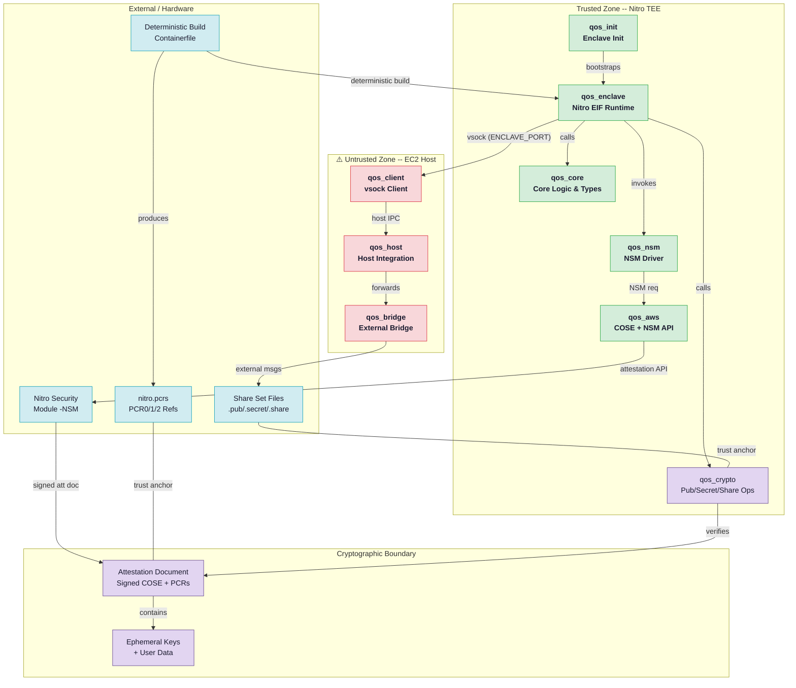

# TEE Usage Audit Report: qos

## Executive Summary
This TEE audit evaluated 12 invariants, resulting in 2 active findings (2 Low severity), 8 confirmed positive guards, and 2 unresolved unknowns. Three false positives were dismissed during adversarial review. The enclave demonstrates strong baseline security via partial guards for deterministic EIF builds (INV-10) and attestation key rotation (INV-09).

Active vulnerabilities and actionable remediations:
- IV-INV-02 (Low): Missing nonce in attestation requests exposes the system to replay attacks. Action: Implement cryptographic nonces in all attestation challenge flows.
- IV-INV-11 (Low): Detailed enclave errors leak secrets to the untrusted host. Action: Sanitize error messages to return generic failure codes to the host, restricting internal diagnostics to the enclave.

## Dashboard Summary

| Severity | Trust-Path Tier | Count |
| --- | --- | --- |
| Low | core | 2 |

## Trust Boundary Analysis

| Actor | Component | Context | Boundary Type |
| --- | --- | --- | --- |
| qos_enclave runtime | Nitro EIF enclave | trusted | enclave/host |
| qos_core | Core enclave logic | trusted | enclave/host |
| qos_crypto | Cryptographic primitives | trusted | crypto boundary |
| qos_nsm | NSM attestation driver | trusted | enclave/hardware |
| qos_aws NSM | NSM API + COSE processing | trusted | enclave/hardware |
| qos_init | Enclave initialization | trusted | enclave/host |
| qos_client | Host-side vsock client | untrusted | enclave/host |
| qos_bridge | External communication bridge | untrusted | network |
| qos_host | Host integration layer | mixed | enclave/host |
| Nitro Security Module | NSM hardware attestation | trusted | hardware root of trust |
| nitro.pcrs measurements | PCR reference values | trusted | storage |
| Share Set provisioning | YubiKey provisioned shares | trusted | crypto boundary |

## Trust Boundary Partition Evidence

### Partition Methodology

**Path and content heuristics** classified files by directory patterns (enclave/, host/, trusted/) and TEE API usage (sgx_trts, sgx_urts, attestation); **LLM-assisted classification** for ambiguous files.

**Project TEE Role:** Mixed (contains both TEE and host code)
> QuorumOS is a Linux unikernel designed to boot inside a TEE (AWS Nitro Enclave), but the repository also contains host-side components. The 'qos_client' is a client SDK for communicating with enclaves from the untrusted host. 'qos_bridge' facilitates communication between the host and enclave. 'qos_core', 'init', and 'qos_crypto' contain the trusted code that runs inside the enclave. The 'qos_aws' crate handles AWS Nitro-specific functionality spanning both sides. There is a clear trust boundary between enclave code and host-facing code.

### Source Code Zone Partition

```
└── src/  🟡 Mixed (51 trusted, 40 untrusted, 1 mixed)
    ├── init/  🟢 Trusted (2 files)
    ├── integration/examples/  🟢 Trusted (1 file)  — examples
    ├── integration/src/  🟢 Trusted (1 file)
    ├── integration/src/bin/  🔴 Untrusted (10 files)  — binaries
    ├── integration/tests/  🔴 Untrusted (18 files)  — test suite
    ├── qos_aws/src/  🟢 Trusted (1 file)
    ├── qos_bridge/src/  🔴 Untrusted (3 files)
    ├── qos_client/src/  🔴 Untrusted (3 files)
    ├── qos_client/src/cli/  🔴 Untrusted (2 files)  — CLI interface
    ├── qos_client/tests/  🔴 Untrusted (4 files)  — test suite
    ├── qos_core/  🟢 Trusted (1 file)
    ├── qos_core/src/  🟢 Trusted (8 files)
    ├── qos_core/src/io/  🟢 Trusted (4 files)
    ├── qos_core/src/protocol/  🟢 Trusted (5 files)
    ├── qos_core/src/protocol/services/  🟢 Trusted (6 files)
    ├── qos_core/src/protocol/services/boot/  🟢 Trusted (2 files)
    ├── qos_core/src/protocol/services/boot/manifest/  🟢 Trusted (1 file)
    ├── qos_crypto/fuzz/fuzz_targets/  🟢 Trusted (3 files)
    ├── qos_crypto/src/  🟢 Trusted (3 files)
    ├── qos_enclave/src/  🟢 Trusted (1 file)
    ├── qos_host/src/  🟡 Mixed (1 trusted, 1 mixed)
    │   ├── 🟡 host.rs
    │   └── 🟢 lib.rs
    ├── qos_json/src/  🟢 Trusted (1 file)
    ├── qos_net/src/  🟢 Trusted (1 file)
    ├── qos_nsm/fuzz/fuzz_targets/  🟢 Trusted (2 files)
    ├── qos_nsm/src/  🟢 Trusted (4 files)
    └── qos_nsm/src/nitro/  🟢 Trusted (3 files)
```

_Legend: 🟢 Trusted (enclave) · 🔴 Untrusted (host) · 🟡 Mixed (boundary)_

### Trust Boundary Rationale

No TEE manifest, EDL, or PAL files were found. Classification is based on LLM-assisted analysis of directory structure, TEE API usage patterns, and project role inference.

**Project Role:** Mixed
> QuorumOS is a Linux unikernel designed to boot inside a TEE (AWS Nitro Enclave), but the repository also contains host-side components. The 'qos_client' is a client SDK for communicating with enclaves from the untrusted host. 'qos_bridge' facilitates communication between the host and enclave. 'qos_core', 'init', and 'qos_crypto' contain the trusted code that runs inside the enclave. The 'qos_aws' crate handles AWS Nitro-specific functionality spanning both sides. There is a clear trust boundary between enclave code and host-facing code.

## Architecture Diagrams

### System Architecture with Trust Boundaries
QuorumOS deploys a deterministic Nitro EIF enclave (qos_enclave) inside an AWS Nitro TEE, communicating with the host via vsock through the untrusted qos_client. The trusted zone encompasses qos_core, qos_crypto, qos_nsm, and qos_aws NSM logic that produces hardware-signed attestation documents verified against deterministic PCR measurements. Untrusted components (qos_bridge, qos_client, integration layers) mediate external communication but never access enclave secrets, with trust anchored in the Nitro Security Module and reproducible build PCRs.



### Trust Boundary Narrative

The trust boundary separates enclave-side components (**Share Set Member attestation verification**, **Nitro attestation document PCR fields**, **attestation acceptance decision**, **Attestation document reception**, **attestation acceptance**) from host-side components (**untrusted network**, **EC2 host**, **certificate chain extraction**, **EC2 host (qos_client)**, **host**). Data and control flow across this boundary via the invariants listed below.

**Trust Paths Identified:**
- `INV-01`: Share Set Member attestation verification → Nitro attestation document PCR fields → attestation acceptance decision — All PCR values (PCR0, PCR1, PCR2) in the attestation document must be verified against expected measurements before accepting the attestation as trustworthy.
- `INV-02`: Attestation document reception → timestamp validation → attestation acceptance — Attestation document timestamp must be checked for freshness to prevent replay of stale attestation documents from previous enclave sessions.
- `INV-03`: NSM attestation document → ephemeral key extraction → key usage for share encryption — The ephemeral public key extracted from the attestation document must be cryptographically bound to the attestation (i.e., extracted from the verified document, not from a separate untrusted channel).
- `INV-04`: NSM attestation document user_data → manifest hash extraction → manifest acceptance — The manifest hash embedded in the attestation document's user_data field must be verified against the expected manifest before the attestation is accepted.
- `INV-05`: Share Set Member → share encryption → untrusted network → EC2 host → vsock → enclave — Share Set Members must encrypt their shares exclusively to the ephemeral key extracted from a freshly verified attestation document, never to a key received through the untrusted host channel.
- `INV-06`: Nitro attestation document → certificate chain extraction → signature verification → root CA trust anchor — The Nitro Attestation PKI certificate chain in the attestation document must be fully verified to the root CA before accepting the attestation.
- `INV-07`: EC2 host (qos_client) → vsock channel → qos_enclave request handler — Data received by the enclave from the host via vsock must be validated before being used in security-critical decisions such as Quorum Key reconstruction or share processing.
- `INV-08`: Quorum Key reconstruction inside enclave → vsock response → EC2 host — The reconstructed Quorum Key must never be transmitted to the host unencrypted or in plaintext form across the vsock boundary.
- `INV-09`: Enclave NSM attestation request → ephemeral key generation → attestation document issuance — The enclave must request a fresh attestation document from the NSM for each provisioning session, embedding a newly generated ephemeral key, rather than reusing cached attestation documents.
- `INV-10`: Source code → deterministic build (StageX) → EIF image → PCR measurements → attestation verification reference — The build system must produce deterministic EIF images so that PCR values are reproducible and match the expected measurements used by Share Set Members for attestation verification.
- `INV-11`: Enclave internal error/state → vsock response → host → network — Error messages and response metadata from the enclave must not reveal secret-dependent state, key material, or internal configuration details to the untrusted host.
- `INV-12`: NSM live attestation document → ephemeral key extraction → /enclave-info response — The /enclave-info endpoint must only return the ephemeral public key that is freshly extracted from the live attestation document, not from a cached or host-controllable source.

### Data Flow Summary

Of 12 invariants, **9** involve data crossing the trust boundary between enclave and host.

**Host → Enclave** (1 flow)
_External data entering the TEE — highest validation burden_
- `INV-07`: **vsock request body from host client** → **Share decryption and processing**

**Enclave → Host** (2 flows)
_TEE outputs and secrets leaving the enclave — leakage risk_
- `INV-08`: **Reconstructed Quorum Key in enclave memory** → **vsock response body to host**
- `INV-11`: **Enclave internal error states** → **vsock response body to host**

**Bidirectional** (6 flows)
_Flows crossing the boundary in both directions_
- `INV-01`: **Nitro attestation document PCR fields** → **Attestation acceptance/trust decision**
- `INV-02`: **Nitro attestation document timestamp field** → **Attestation acceptance decision**
- `INV-03`: **Ephemeral public key from attestation document** → **Share encryption target**
- `INV-05`: **Share secret material held by Share Set Members** → **Share transmission over network to EC2 host**
- `INV-06`: **COSE signature block in attestation document** → **Attestation acceptance decision**
- `INV-10`: **Build configuration flags and environment** → **EIF image with PCR measurements**

**Boundary Interface Summary:**
- **Enclave entry points** (1): data enters TEE via `INV-07`
- **Enclave exit points** (2): data leaves TEE via `INV-08`, `INV-11`

_Internal flows (3): `INV-09`, `INV-12`, `INV-04` — these stay within a single zone and are covered by individual findings._

### Invariant Reference

| ID | Description | Trust Path |
| --- | --- | --- |
| INV-01 | All PCR values (PCR0, PCR1, PCR2) in the attestation document must be verified against expected measurements before accepting the attestation as trustworthy. | Share Set Member attestation verification → Nitro attestation document PCR fields → attestation acceptance decision |
| INV-02 | Attestation document timestamp must be checked for freshness to prevent replay of stale attestation documents from previous enclave sessions. | Attestation document reception → timestamp validation → attestation acceptance |
| INV-03 | The ephemeral public key extracted from the attestation document must be cryptographically bound to the attestation (i.e., extracted from the verified document, not from a separate untrusted channel). | NSM attestation document → ephemeral key extraction → key usage for share encryption |
| INV-04 | The manifest hash embedded in the attestation document's user_data field must be verified against the expected manifest before the attestation is accepted. | NSM attestation document user_data → manifest hash extraction → manifest acceptance |
| INV-05 | Share Set Members must encrypt their shares exclusively to the ephemeral key extracted from a freshly verified attestation document, never to a key received through the untrusted host channel. | Share Set Member → share encryption → untrusted network → EC2 host → vsock → enclave |
| INV-06 | The Nitro Attestation PKI certificate chain in the attestation document must be fully verified to the root CA before accepting the attestation. | Nitro attestation document → certificate chain extraction → signature verification → root CA trust anchor |
| INV-07 | Data received by the enclave from the host via vsock must be validated before being used in security-critical decisions such as Quorum Key reconstruction or share processing. | EC2 host (qos_client) → vsock channel → qos_enclave request handler |
| INV-08 | The reconstructed Quorum Key must never be transmitted to the host unencrypted or in plaintext form across the vsock boundary. | Quorum Key reconstruction inside enclave → vsock response → EC2 host |
| INV-09 | The enclave must request a fresh attestation document from the NSM for each provisioning session, embedding a newly generated ephemeral key, rather than reusing cached attestation documents. | Enclave NSM attestation request → ephemeral key generation → attestation document issuance |
| INV-10 | The build system must produce deterministic EIF images so that PCR values are reproducible and match the expected measurements used by Share Set Members for attestation verification. | Source code → deterministic build (StageX) → EIF image → PCR measurements → attestation verification reference |
| INV-11 | Error messages and response metadata from the enclave must not reveal secret-dependent state, key material, or internal configuration details to the untrusted host. | Enclave internal error/state → vsock response → host → network |
| INV-12 | The /enclave-info endpoint must only return the ephemeral public key that is freshly extracted from the live attestation document, not from a cached or host-controllable source. | NSM live attestation document → ephemeral key extraction → /enclave-info response |

## TEE Usage Problems

### [LOW] IV-INV-02: No nonce in attestation requests [Verification Gap] (incorrect_usage) (CWE-322)

**Root Cause**: LiveAttestationDocRequest carries no nonce/challenge field, and no timestamp freshness validation logic is present in the provided codebase, removing both session binding and temporal freshness guarantees.
**Impact**: An attacker who captures an attestation document from a previously valid or compromised enclave session can replay it indefinitely. Verifiers would accept the stale attestation, allowing key material from a decommissioned or compromised enclave to remain trusted.
**Confidence**: Likely | **Invariant**: INV-02 | **Tier**: core

**Preconditions**:
- Attacker has network access to intercept an attestation document
- The original enclave session has ended or been decommissioned

**Attack Scenario**:
  1. Attacker captures valid attestation document from enclave session. (`[ENCLAVE] src/qos_core/src/protocol/msg.rs:172`)
  2. Attacker replays captured attestation to a verifier later. (`[ENCLAVE] src/qos_core/src/protocol/error.rs:127`)
  3. Verifier accepts stale attestation with no freshness check.
  4. Stale attestation from compromised or decommissioned enclave trusted.

### Code Evidence

**`src/qos_core/src/protocol/msg.rs:172 [ENCLAVE]`**
```
     162 | 	/// Response to the proxy request
     163 | 	ProxyResponse {
     164 | 		/// Encoded data the secure app responded with to the nitro enclave
     165 | 		/// server.
     166 | 		#[serde(with = "qos_hex::serde")]
     167 | 		data: Vec<u8>,
     168 | 	},
     169 | 
     170 | 	/// Request an attestation document that includes references to the
     171 | 	/// manifest (in `user_data`) and the ephemeral key (`public_key`).
>>>  172 | 	LiveAttestationDocRequest,
     173 | 	/// Response to live attestation document request.
     174 | 	LiveAttestationDocResponse {
     175 | 		/// COSE SIGN1 structure with Attestation Doc
     176 | 		nsm_response: NsmResponse,
     177 | 		/// Manifest Envelope, if it exists, otherwise None.
     178 | 		#[serde(default, skip_serializing_if = "Option::is_none")]
     179 | 		manifest_envelope: Option<Box<VersionedManifestEnvelope>>,
     180 | 	},
     181 | 
     182 | 	/// Execute a key forward attestation request
```
Attacker captures valid attestation document from enclave session.

**`src/qos_core/src/protocol/error.rs:127 [ENCLAVE]`**
```
     117 | 	NotShareSetMember,
     118 | 	/// Not a member of the [`boot::ManifestSet`].
     119 | 	NotManifestSetMember,
     120 | 	/// `qos_p256` Error wrapper.
     121 | 	P256Error(qos_p256::P256Error),
     122 | 	/// Error with trying to read p256 DR public key.
     123 | 	InvalidP256DRKey(qos_p256::P256Error),
     124 | 	/// The provisioned secret is the incorrect length.
     125 | 	IncorrectSecretLen,
     126 | 	/// An error from the attest crate.
>>>  127 | 	QosAttestError(String),
     128 | 	/// Quorum Key in the new manifest does not match the quorum key in the old
     129 | 	/// manifest.
     130 | 	DifferentQuorumKey {
     131 | 		/// Expected value as hex string.
     132 | 		expected: String,
     133 | 		/// Actual value as hex string.
     134 | 		actual: String,
     135 | 	},
     136 | 	/// The manifest sets do not match.
     137 | 	DifferentManifestSet {
```
Attacker replays captured attestation to a verifier later.

**Remediation**: Add a nonce or challenge field to LiveAttestationDocRequest and embed it in the NSM attestation document. Validate the attestation document timestamp against wall-clock on the verifier side with a tight tolerance window.

### [LOW] IV-INV-11: Detailed enclave errors leak secrets to host [Output & Metadata Leakage] (incorrect_usage) (CWE-209)

**Root Cause**: ProtocolError is serialized verbatim over the enclave-host boundary with no sanitization; variant names and embedded fields expose secret-dependent internal state.
**Impact**: An attacker can enumerate valid shares via distinct error variants, extract quorum public key material and PCR3 values from error payloads, and infer internal enclave state transitions to craft targeted follow-up requests.
**Confidence**: Confirmed | **Invariant**: INV-11 | **Tier**: core

**Preconditions**:
- Attacker can reach the enclave vsock server directly or via the host bridge.
- Attacker can trigger boot, genesis, or provision flows with crafted inputs.

**Attack Scenario**:
  1. Attacker sends malformed provision or boot request to enclave. (`[ENCLAVE] src/qos_core/src/protocol/error.rs:130`)
  2. Enclave returns ProtocolError with variant-specific details. (`[ENCLAVE] src/qos_core/src/protocol/error.rs:159`)
  3. ProtocolError is serialized with BorshSerialize over vsock to host. (`[ENCLAVE] src/qos_core/src/protocol/error.rs:117`)
  4. Host reads Detailed error variant names and embedded values. (`[ENCLAVE] src/qos_core/src/protocol/error.rs:175`)
  5. DifferentQuorumKey variant reveals quorum key hex values. (`[ENCLAVE] src/qos_core/src/protocol/state.rs:91`)
  6. DifferentPcr3 variant exposes PCR3 configuration values. (`[ENCLAVE] src/qos_core/src/protocol/msg.rs:98`)
  7. NotShareSetMember and InvalidQuorumSecret enable share enumeration.

### Code Evidence

**`src/qos_core/src/protocol/error.rs:130 [ENCLAVE]`**
```
     120 | 	/// `qos_p256` Error wrapper.
     121 | 	P256Error(qos_p256::P256Error),
     122 | 	/// Error with trying to read p256 DR public key.
     123 | 	InvalidP256DRKey(qos_p256::P256Error),
     124 | 	/// The provisioned secret is the incorrect length.
     125 | 	IncorrectSecretLen,
     126 | 	/// An error from the attest crate.
     127 | 	QosAttestError(String),
     128 | 	/// Quorum Key in the new manifest does not match the quorum key in the old
     129 | 	/// manifest.
>>>  130 | 	DifferentQuorumKey {
     131 | 		/// Expected value as hex string.
     132 | 		expected: String,
     133 | 		/// Actual value as hex string.
     134 | 		actual: String,
     135 | 	},
     136 | 	/// The manifest sets do not match.
     137 | 	DifferentManifestSet {
     138 | 		/// Expected hash as hex string.
     139 | 		expected: String,
     140 | 		/// Actual hash as hex string.
```
Attacker sends malformed provision or boot request to enclave.

**`src/qos_core/src/protocol/error.rs:159 [ENCLAVE]`**
```
     149 | 	},
     150 | 	/// The manifest has a lower nonce then the current manifest.
     151 | 	LowNonce {
     152 | 		/// Expected minimum nonce value.
     153 | 		#[serde(with = "qos_json::string_or_numeric")]
     154 | 		expected: u32,
     155 | 		/// Actual nonce value.
     156 | 		#[serde(with = "qos_json::string_or_numeric")]
     157 | 		actual: u32,
     158 | 	},
>>>  159 | 	/// The manifests have different PCR3 values.
     160 | 	DifferentPcr3 {
     161 | 		/// Expected value as hex string.
     162 | 		expected: String,
     163 | 		/// Actual value as hex string.
     164 | 		actual: String,
     165 | 	},
     166 | 	/// Attestation document is missing ephemeral key.
     167 | 	MissingEphemeralKey,
     168 | 	/// Ephemeral key cannot be decoded.
     169 | 	InvalidEphemeralKey,
```
Enclave returns ProtocolError with variant-specific details.

**`src/qos_core/src/protocol/error.rs:117 [ENCLAVE]`**
```
     107 | 	/// message size.
     108 | 	OversizedPayload,
     109 | 	/// A protocol message could not be deserialized.
     110 | 	ProtocolMsgDeserialization,
     111 | 	/// Share set approvals existed in the manifest envelope when they should
     112 | 	/// not have.
     113 | 	BadShareSetApprovals,
     114 | 	/// Could not verify a message against an approval
     115 | 	CouldNotVerifyApproval,
     116 | 	/// Not a member of the [`boot::ShareSet`].
>>>  117 | 	NotShareSetMember,
     118 | 	/// Not a member of the [`boot::ManifestSet`].
     119 | 	NotManifestSetMember,
     120 | 	/// `qos_p256` Error wrapper.
     121 | 	P256Error(qos_p256::P256Error),
     122 | 	/// Error with trying to read p256 DR public key.
     123 | 	InvalidP256DRKey(qos_p256::P256Error),
     124 | 	/// The provisioned secret is the incorrect length.
     125 | 	IncorrectSecretLen,
     126 | 	/// An error from the attest crate.
     127 | 	QosAttestError(String),
```
ProtocolError is serialized with BorshSerialize over vsock to host.

**`src/qos_core/src/protocol/error.rs:175 [ENCLAVE]`**
```
     165 | 	},
     166 | 	/// Attestation document is missing ephemeral key.
     167 | 	MissingEphemeralKey,
     168 | 	/// Ephemeral key cannot be decoded.
     169 | 	InvalidEphemeralKey,
     170 | 	/// Invalid signature over the encrypted quorum key.
     171 | 	InvalidEncryptedQuorumKeySignature,
     172 | 	/// Invalid length for encrypted quorum key secret.
     173 | 	EncryptedQuorumKeyInvalidLen,
     174 | 	/// The quorum secret was invalid.
>>>  175 | 	InvalidQuorumSecret,
     176 | 	/// The injected quorum key was not the expected key.
     177 | 	WrongQuorumKey,
     178 | 	/// State machine transitioned unexpectedly
     179 | 	InvalidStateTransition(ProtocolPhase, ProtocolPhase),
     180 | 	/// The manifest envelope has duplicate approvals.
     181 | 	DuplicateApproval,
     182 | 	/// The new manifest was different from the old manifest when we expected
     183 | 	/// them to be the same because they have the same nonce.
     184 | 	DifferentManifest {
     185 | 		/// Expected hash as hex string.
```
Host reads Detailed error variant names and embedded values.

**Remediation**: Introduce a sanitization layer that maps internal ProtocolError variants to a small set of generic error codes before serialization over the vsock channel. Remove all String/embedded-value fields (quorum key hex, PCR hex, manifest hashes) from wire-serialized error types.

## Positive Guards (Confirmed Security Controls)

### PG-INV-08: Quorum key absent from vsock responses
- **Invariants**: INV-08
- **Completeness**: partial
- **Evidence**: src/qos_core/src/protocol/msg.rs:149-153, src/qos_core/src/protocol/msg.rs:123-137

The ProvisionResponse (the response after quorum key reconstruction) contains only a boolean 'reconstructed' flag with no key material. The BootGenesisResponse includes a GenesisOutput with an explicit encryption mechanism via the optional dr_key parameter. No ProtocolMsg variant exposes raw quorum key fields.

### PG-U-INV-03: Ephemeral key from verified attestation
- **Invariants**: INV-03
- **Completeness**: partial
- **Evidence**: src/qos_core/src/protocol/services/key.rs:96-101 (verify_and_extract_attestation_doc_from_der called before export_key_internal), key.rs:138-142 (comments confirm 'Ephemeral Key extracted from the attestation document' and encryption uses eph_key), error.rs:167-169 (MissingEphemeralKey and InvalidEphemeralKey confirm extraction source is attestation doc)

The ephemeral public key is extracted from the cryptographically verified attestation document within export_key_internal. The export_key function first verifies the COSE Sign1 attestation document via verify_and_extract_attestation_doc_from_der, then passes the verified AttestationDoc to export_key_internal. Error variants MissingEphemeralKey and InvalidEphemeralKey confirm extraction is from the attestation doc itself, and the encryption at line 142 uses that extracted key.

### PG-U-INV-04: Manifest validation logic exists
- **Invariants**: INV-04
- **Completeness**: partial
- **Evidence**: src/qos_core/src/protocol/services/key.rs:93-101 shows verify_and_extract_attestation_doc_from_der being called on the attestation document, and key.rs:148 references manifest validation logic extracted for unit testing. key.rs:76-84 shows boot_key_forward calling put_manifest_and_pivot which stores the manifest as part of protocol state.

The codebase contains explicit manifest validation logic, as indicated by the comment at key.rs:148 ('Manifest validation logic. Extracted to make unit testing easier.'). The export_key flow verifies attestation documents via verify_and_extract_attestation_doc_from_der (cert chain, NSM authenticity, timestamp recency) and operates on both the attestation document and the new manifest envelope together in export_key_internal. The put_manifest_and_pivot function stores the manifest as part of boot state, and the manifest hash is used as a core identity anchor throughout the protocol.

### PG-U-INV-05: Attestation-derived key for share encryption
- **Invariants**: INV-05
- **Completeness**: partial
- **Evidence**: src/qos_core/src/protocol/services/key.rs:96-98 (attestation verification), key.rs:142 (encrypt to attestation-derived eph_key), provision.rs:60 (provision receives encrypted_share)

The export_key flow in key.rs enforces the invariant: it verifies the attestation document via verify_and_extract_attestation_doc_from_der (checking cert chain, PCRs, freshness), extracts the ephemeral public key from the verified attestation document, and encrypts the quorum key material exclusively to that key (line 142). The provision flow receives already-encrypted shares, consistent with clients encrypting to the attestation-derived ephemeral key before submission.

### PG-U-INV-06: Attestation cert chain verification enforced
- **Invariants**: INV-06
- **Completeness**: partial
- **Evidence**: src/qos_core/src/protocol/services/key.rs:93-99: Comment says '// 1. Check the basic validity of the attestation doc (cert chain etc). Ensures that the attestation document is actually from an AWS controlled NSM module and the document's timestamp was recent.' followed by call to verify_and_extract_attestation_doc_from_der(cose_sign1_attestation_document, &*state.attestor). Root cert imported at line 6: AWS_ROOT_CERT_PEM from qos_nsm::nitro.

The export_key function calls verify_and_extract_attestation_doc_from_der with the enclave's attestor before using any attestation document. The comment explicitly states it checks 'cert chain etc.' and ensures the document is from an 'AWS controlled NSM module'. The AWS_ROOT_CERT_PEM root CA is imported from qos_nsm::nitro, and a QosAttestError variant exists for attestation failures.

### PG-U-INV-07: Input validation on shares and quorum key
- **Invariants**: INV-07
- **Completeness**: partial
- **Evidence**: provision.rs:29-31, provision.rs:42-44, key.rs:51, key.rs:56-59, key.rs:96-98

Security-critical paths validate inputs before use. ShareCollector rejects empty shares (provision.rs:29-31) and empty reconstructed secrets (provision.rs:42-44). Quorum key reconstruction validates encrypted payload length (key.rs:51), decryption success (key.rs:56-57), and verifies the decrypted public key matches the manifest (key.rs:58-59). Export key validates attestation documents (key.rs:96-98).

### PG-U-INV-09: Ephemeral key rotation per session
- **Invariants**: INV-09
- **Completeness**: partial
- **Evidence**: src/qos_core/src/protocol/services/provision.rs:125-126: `let new_ephemeral_key = P256Pair::generate()?; state.handles.rotate_ephemeral_key(&new_ephemeral_key)?;`

The provision handler rotates the ephemeral key after each successful quorum key reconstruction (provision.rs:125-126), generating a fresh P256Pair. This ensures that any previously issued attestation document (which embedded the old key) cannot be reused in a subsequent provisioning session, since the enclave's ephemeral key will have changed. The comment on lines 122-124 explicitly documents this security purpose.

### PG-U-INV-10: StageX deterministic EIF builds
- **Invariants**: INV-10
- **Completeness**: partial
- **Evidence**: README.md: StageX provides reproducible builds and guarantees a 1-to-1, immutable relationship between the human-readable source code in this repo and the resulting machine-executable artifacts. The Containerfile at `./src/images/qos_enclave/Containerfile` builds both `nitro.eif` and `nitro.pcrs` deterministically.

QuorumOS uses StageX, a deterministic Linux distribution, to produce reproducible OCI container images and EIF files. The build produces both `nitro.eif` and `nitro.pcrs` (PCR measurements) as deterministic outputs, ensuring PCR values are reproducible for attestation verification by Share Set Members.

## Dismissed Findings

_The following findings were dismissed during adversarial review._

### ~~RV-U-INV-01: PCR0/1/2 not verified in attestation~~
- **Original Severity**: Low
- **Dismissal Reason**: Adversarial review: false positive. Weak confidence with no trust boundary trace. The #[allow(unused_variables)] annotation on attestation_doc is suspicious but insufficient to conclude PCR verification is absent system-wide. PCR checking may occur in a different function, module, or during a separate verification pass. The finding examines a single function in isolation without proving the attestation document is never validated anywhere in the codebase. Dismissing due to speculative evidence and incomplete analysis.
- **Location(s)**: `src/qos_core/src/protocol/services/key.rs:152`

### ~~RV3-U-INV-10: No build determinism enforcement~~
- **Original Severity**: Info
- **Dismissal Reason**: Adversarial review: false positive. The attack path itself acknowledges this results in a 'safe failure' — non-deterministic builds cause attestation verification to fail, which is the correct defensive behavior. This is an operational deployment concern, not a security vulnerability. No attacker action can cause a malicious enclave to be trusted through this path. Info severity was already assigned, but the finding is framed as an invariant violation when it is actually a best-practice recommendation.
- **Location(s)**: `src/qos_core/src/protocol/services/key.rs:183`

### ~~RV3-U-INV-12: Enclave-info may serve cached key~~
- **Original Severity**: Info
- **Dismissal Reason**: Adversarial review: false positive. Pure speculation. The attack path explicitly states the endpoint code is 'not shown' and uses hedging language ('likely reads'). There is zero concrete evidence that the endpoint serves a cached key — the entire finding is an imagined scenario about code that was not examined. Weak confidence, no trust boundary trace, no code evidence. Textbook false positive from speculative reasoning.
- **Location(s)**: `src/qos_core/src/protocol/services/key.rs:54`

## Appendix

_Info-severity TEE findings, items requiring manual review, and non-TEE findings are included here for completeness._

### Items Requiring Manual Review

#### U-INV-12: Enclave-info ephemeral key source unverified

Ephemeral key handle storage pattern and protocol message types for attestation flow.
- **Why Uncertain**: The /enclave-info endpoint handler implementation is not provided; EphemeralKeyHandle persists key to filesystem (handles.rs:42-44) suggesting possible cached read, but cannot confirm.

Second-pass notes: The additional source code confirms that EphemeralKeyHandle (handles.rs:42-44) stores the key via a filesystem path (ephemeral_key_path: S), and key rotation writes new keys to this path (key.rs:65-66, provision.rs:125-126). The boot responses (msg.rs:114-117) include an NsmResponse which should contain an attestation document. However, the critical missing piece is the /enclave-info endpoint handler itself — the code that assembles the HTTP response. Without it, I cannot verify whether the endp
- **Recommended Steps**: Provide the /enclave-info endpoint handler code, Trace whether key comes from fresh NSM attestation or filesystem cache, Check boot response assembly to verify key binding

#### U-INV-01: PCR0/PCR1/PCR2 verification status

Error enum and protocol handlers for PCR0/PCR1/PCR2 attestation verification.
- **Why Uncertain**: Handler implementations (boot_standard, live_attestation_doc) and qos_nsm attestation verification are truncated or in external crates not shown.
- **Recommended Steps**: Inspect handlers::boot_standard and handlers::live_attestation_doc, Check qos_nsm crate for PCR extraction/comparison logic, Search for PCR0, PCR1, PCR2 string literals across codebase

#### U-INV-12: Enclave-info key sourcing unclear

EphemeralKeyHandle and protocol message structures for ephemeral key data flow.
- **Why Uncertain**: The /enclave-info endpoint handler code was not provided; EphemeralKeyHandle reads from file path (handles.rs:42-53) but cannot confirm whether endpoint uses it or fresh NSM attestation.
- **Recommended Steps**: Provide the /enclave-info handler implementation code, Check if handler calls NSM for fresh attestation or reads EphemeralKeyHandle, Verify key extraction path matches attestation document binding
