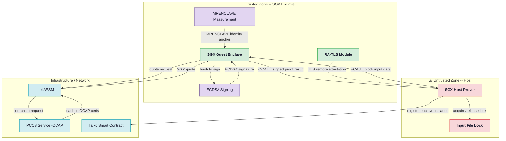

# TEE Usage Audit Report: raiko

## Executive Summary
This TEE audit identified 4 active vulnerabilities: 1 High (IV-INV-11: Configurable SP1 crypto verification bypass), 2 Medium (V-03: sgx_instance_id unbound to signed proof output; IV-INV-08: Unsanitized enclave error propagation to host), and 1 Low (V-01: Unvalidated quote offsets cause panic on malformed SGX quote). Two positive guards were partially confirmed: PG-U-01 (carry data validation) and PG-INV-05 (block hash and chain context binding).

11 findings were dismissed during adversarial review — full rationale for each dismissal is documented in the Findings Dismissal Appendix, including justification for why previously flagged High-severity issues (IV-INV-01, IV-INV-12) were determined to be non-exploitable in the assessed trust boundary configuration.

Critical action items:
- **IV-INV-11 (High)**: Immediately hardcode SP1 crypto verification — the current configurability allows operator bypass of cryptographic proofs, fundamentally undermining the TEE trust boundary.
- **V-03 (Medium)**: Bind sgx_instance_id to the signed proof output to prevent proof replays across enclaves.
- **IV-INV-08 (Medium)**: Sanitize enclave error messages before host propagation to prevent information leakage.
- **V-01 (Low)**: Validate quote offset fields before parsing to prevent denial-of-service via malformed SGX quotes.

## Dashboard Summary

| Severity | Trust-Path Tier | Count |
| --- | --- | --- |
| High | core | 1 |
| Medium | core | 2 |

## Trust Boundary Analysis

| Actor | Component | Context | Boundary Type |
| --- | --- | --- | --- |
| SGX Guest Enclave | provers/sgx/guest/src/ | trusted | enclave/host |
| SGX Host Prover | provers/sgx/prover/ | untrusted | enclave/host |
| RA-TLS Module | provers/sgx/guest/src/lib/tls_ra.rs | trusted | network/crypto |
| ECDSA Signing Module | provers/sgx/guest/src/lib/ecdsa.rs | trusted | crypto boundary |
| Enclave Measurement Utility | provers/sgx/guest/src/lib/measure.rs | trusted | crypto boundary |
| PCCS Service | Dockerfile.pccs / docker/config_sgx.sh | mixed | network |
| Intel AESM Service | External Intel AESM daemon | mixed | enclave/hardware |
| Input File Lock Mechanism | provers/sgx/ (host-side) | untrusted | storage |
| SGX Instance Registration | Taiko Smart Contract (on-chain) | untrusted | on-chain |
| TaskDB | taskdb/src/ | trusted | storage |

## Trust Boundary Partition Evidence

### Partition Methodology

**Path and content heuristics** classified files by directory patterns (enclave/, host/, trusted/) and TEE API usage (sgx_trts, sgx_urts, attestation); **LLM-assisted classification** for ambiguous files.

**Project TEE Role:** Mixed (contains both TEE and host code)
> Raiko is Taiko's multi-prover supporting Risc0, SP1 (zkVM), and SGX (TEE) backends. The repository contains a clear trust boundary: 'provers/sgx/guest' is the SGX enclave code running inside the TEE, while 'provers/sgx/prover' and 'provers/sgx/setup' are host-side SGX components. The 'host/' directory runs the untrusted host service managing proof requests, and all other provers (risc0, sp1) and libraries run on the untrusted host side.

### Source Code Zone Partition

```
├── ballot/  🔴 Untrusted (2 files)
│   └── src/  🔴 Untrusted (2 files)
├── core/  🔴 Untrusted (9 files)  — core logic
│   ├── src/  🔴 Untrusted (3 files)
│   ├── src/preflight/  🔴 Untrusted (3 files)
│   └── src/provider/  🔴 Untrusted (3 files)
├── harness/  🔴 Untrusted (3 files)
│   ├── core/src/  🔴 Untrusted (2 files)
│   └── macro/src/  🔴 Untrusted (1 file)
├── host/  🔴 Untrusted (34 files)  — host-side code
│   ├── src/  🔴 Untrusted (4 files)
│   ├── src/bin/  🔴 Untrusted (3 files)  — binaries
│   ├── src/server/  🔴 Untrusted (5 files)  — server logic
│   ├── src/server/api/  🔴 Untrusted (3 files)  — API definitions
│   ├── src/server/api/admin/  🔴 Untrusted (1 file)
│   ├── src/server/api/v1/  🔴 Untrusted (3 files)
│   ├── src/server/api/v3/  🔴 Untrusted (1 file)
│   ├── src/server/api/v3/proof/  🔴 Untrusted (5 files)
│   ├── src/server/api/v3/proof/batch/  🔴 Untrusted (2 files)
│   ├── tests/  🔴 Untrusted (1 file)  — test suite
│   ├── tests/common/  🔴 Untrusted (4 files)
│   └── tests/test/  🔴 Untrusted (2 files)  — tests
├── lib/  🔴 Untrusted (23 files)  — library
│   ├── src/  🔴 Untrusted (10 files)
│   ├── src/input/  🔴 Untrusted (1 file)
│   ├── src/manifest/  🔴 Untrusted (3 files)
│   ├── src/primitives/  🔴 Untrusted (4 files)  — primitive types
│   └── src/utils/  🔴 Untrusted (5 files)  — utilities
├── pipeline/  🔴 Untrusted (4 files)
│   └── src/  🔴 Untrusted (4 files)
├── provers/  🟡 Mixed (5 trusted, 47 untrusted)
│   ├── risc0/builder/src/  🔴 Untrusted (1 file)
│   ├── risc0/driver/src/  🔴 Untrusted (5 files)
│   ├── risc0/driver/src/methods/  🔴 Untrusted (8 files)
│   ├── risc0/guest/src/  🔴 Untrusted (4 files)
│   ├── risc0/guest/src/benchmark/  🔴 Untrusted (2 files)  — benchmarks
│   ├── sgx/guest/src/  🟢 Trusted (5 files)
│   ├── sgx/prover/src/  🔴 Untrusted (4 files)
│   ├── sgx/setup/src/  🔴 Untrusted (3 files)
│   ├── sp1/builder/src/  🔴 Untrusted (1 file)
│   ├── sp1/contracts/src/  🔴 Untrusted (2 files)  — Solidity contracts
│   ├── sp1/contracts/src/exports/  🔴 Untrusted (2 files)  — Solidity contracts
│   ├── sp1/contracts/test/  🔴 Untrusted (1 file)  — tests
│   ├── sp1/driver/src/  🔴 Untrusted (4 files)
│   ├── sp1/driver/src/proof_verify/  🔴 Untrusted (2 files)
│   ├── sp1/guest/src/  🔴 Untrusted (4 files)
│   └── sp1/guest/src/benchmark/  🔴 Untrusted (4 files)  — benchmarks
├── redis-derive/  🔴 Untrusted (1 file)
│   └── src/  🔴 Untrusted (1 file)
├── reqactor/  🔴 Untrusted (5 files)
│   └── src/  🔴 Untrusted (5 files)
├── reqpool/  🔴 Untrusted (8 files)
│   └── src/  🔴 Untrusted (8 files)
├── script/  🔴 Untrusted (5 files)
│   └── ./  🔴 Untrusted (5 files)
└── taskdb/  🟢 Trusted (1 file)
    └── src/  🟢 Trusted (1 file)
```

_Legend: 🟢 Trusted (enclave) · 🔴 Untrusted (host) · 🟡 Mixed (boundary)_

### Boundary-Defining Files

**`provers/sgx/config/sgx-guest.local.manifest.template`** -- TEE manifest -- defines enclave configuration, trusted files, encrypted mounts
```
       1 | # This is a Gramine manifest designed for use on your local machine. There's also another Dockerfile
       2 | # intended for Docker containers. These two files have slight differences, such as assuming
       3 | # different paths to the configuration directories. Ideally, there should be a single, generic
       4 | # template manifest file (TODO).
       5 | #
       6 | # To learn more, visit: https://gramine.readthedocs.io/en/stable/manifest-syntax.html
       7 | 
>>>    8 | libos.entrypoint = "/sgx-guest"
       9 | loader.entrypoint.uri = "file:{{ gramine.libos }}"
      10 | loader.env.HOME = "/root"
      11 | loader.env.LD_LIBRARY_PATH = "/lib:{{ arch_libdir }}"
      12 | loader.env.DEV_PACAYA_HEIGHT = "0"
      13 | loader.env.DEV_ONTAKE_HEIGHT = "0"
      14 | loader.env.DEV_SHASTA_HEIGHT = "0"
      15 | loader.env.RUST_LOG = "debug"
      16 | loader.insecure__use_cmdline_argv = true
```

**`provers/sgx/config/sgx-guest.docker.manifest.template`** -- TEE manifest -- defines enclave configuration, trusted files, encrypted mounts
```
       1 | # This is a Gramine manifest designed for use with Docker containers. There's also another
       2 | # Dockerfile intended for use on your local machine. These two files have minor differences, such as
       3 | # the assumed paths to the configuration directories. Ideally, we should create a single, generic
       4 | # template manifest file (TODO).
       5 | #
       6 | # To learn more, visit: https://gramine.readthedocs.io/en/stable/manifest-syntax.html
       7 | 
>>>    8 | libos.entrypoint = "/sgx-guest"
       9 | loader.entrypoint = "file:{{ gramine.libos }}"
      10 | loader.env.HOME = "/root"
      11 | loader.env.LD_LIBRARY_PATH = "/lib:{{ arch_libdir }}"
      12 | loader.env.RUST_LOG = "info"
      13 | loader.insecure__use_cmdline_argv = true
      14 | loader.log_level = "{{ log_level }}"
      15 | fs.mounts = [
      16 |   { path = "/lib", uri = "file:{{ gramine.runtimedir() }}" },
```

**`taskdb/src/lib.rs`** -- Trusted (enclave) representative file
```
      27 |     IoFailure(String),
      28 |     AnyhowError(String),
      29 |     GuestProverFailure(String),
      30 |     UnspecifiedFailureReason,
      31 |     TaskDbCorruption(String),
      32 |     SystemPaused,
      33 | }
      34 | 
>>>   35 | impl From<TaskStatus> for i32 {
      36 |     fn from(status: TaskStatus) -> i32 {
      37 |         match status {
      38 |             TaskStatus::Success => 0,
      39 |             TaskStatus::Registered => 1000,
      40 |             TaskStatus::WorkInProgress => 2000,
      41 |             TaskStatus::ProofFailure_Generic => -1000,
      42 |             TaskStatus::ProofFailure_OutOfMemory => -1100,
      43 |             TaskStatus::NetworkFailure(_) => -2000,
```

**`script/traverse_batch.py`** -- Untrusted (host) representative file
```
      73 |     parser.add_argument('--to-block', type=int, required=True, help='Ending block number')
      74 |     
      75 |     args = parser.parse_args()
      76 |     
      77 |     w3 = setup_web3(args.rpc)
      78 |     traverse_batches(w3, args.contract, args.from_block, args.to_block)
      79 | 
      80 | if __name__ == "__main__":
>>>   81 |     main() 
```

## Architecture Diagrams

### System Architecture with Trust Boundaries
The Taiko SGX Prover uses an Intel SGX enclave as the trusted execution environment for block proof generation and cryptographic signing. The trusted boundary is enforced by SGX hardware isolation: the Guest Enclave performs block execution, ECDSA signing, RA-TLS attestation, and MRENCLAVE measurement—all within the enclave. Data crosses the enclave/host boundary exclusively through controlled ECALL/OCALL interfaces to the untrusted SGX Host Prover, which manages I/O, concurrency via file locks, and on-chain instance registration. DCAP attestation anchors enclave identity to hardware roots through the PCCS certificate cache and Intel AESM quoting service, both operating outside the trusted boundary.



### Trust Boundary Narrative

The trust boundary separates enclave-side components (**Enclave block execution engine**, **Enclave quote**, **Enclave key generation**, **report_data population**, **Quote generation**) from host-side components (**Host application**, **PCCS/PCS certificate chain**, **On-chain/smart-contract verifier**, **Host submission**, **Host filesystem**). Data and control flow across this boundary via the invariants listed below.

**Trust Paths Identified:**
- `INV-01`: Host application → ECALL boundary → Enclave block execution engine — Block data and proof request parameters from the untrusted host must be fully validated inside the enclave before being used in proof generation computation.
- `INV-02`: Enclave quote → PCCS/PCS certificate chain → On-chain/smart-contract verifier — DCAP quote verification must validate TCB status, advisory status, and collateral certificate freshness before accepting an attestation as trustworthy.
- `INV-03`: Enclave key generation → report_data population → Quote generation → On-chain verification — The enclave ECDSA signing key must be cryptographically bound to the attestation quote by embedding the key's hash in the report_data field.
- `INV-04`: Operator wallet → Instance registration contract → Measurement verification on-chain — On-chain SGX instance registration must cryptographically bind the operator's identity to the actual enclave measurement (MRENCLAVE/MRSIGNER) rather than just a wallet address.
- `INV-05`: Enclave proof generation → Host submission → On-chain verification — Generated proofs must include a non-replayable binding to the specific block hash and chain context to prevent proof reuse across different blocks or chains.
- `INV-06`: enclave.conf → Enclave build → AESM loading → Runtime enclave — The SGX enclave must not be built or deployed with debug mode enabled in production, as debug mode allows enclave memory inspection via EDBGOCD/EDBGRD instructions.
- `INV-07`: MOCK environment variable → Gramine launch → Simulated SGX without hardware isolation — Gramine MOCK simulation mode (MOCK=1) must not be accessible or set by default in production deployments, as it bypasses all SGX hardware guarantees.
- `INV-08`: Enclave error → OCALL error return → Web service HTTP response — Enclave internal error states and diagnostics must not propagate detailed information to the untrusted host or API consumers, as error details can reveal enclave code paths and internal state.
- `INV-09`: Proof request → Attestation challenge → Quote report_data → Verification — The attestation challenge or nonce must be cryptographically bound to the specific proof request context to prevent attestation relay or pre-generation attacks.
- `INV-10`: RA-TLS handshake → Peer certificate quote extraction → Measurement verification → Channel trust — RA-TLS channel establishment must verify the peer's measurement against the expected MRENCLAVE value before trusting the channel for sensitive data exchange.
- `INV-11`: Feature flag / prover type → Crypto verification bypass → Proof output — Security-critical cryptographic verification (e.g., KZG commitments) must not be conditionally disabled within the enclave based on prover type or feature flags, as this undermines proof integrity guarantees.
- `INV-12`: Host filesystem → Enclave read (stdin/sealed file) → Enclave state restoration — Data read from the host filesystem or stdin (including sealed state and input files) must be integrity-verified via SGX seal or cryptographic MAC before the enclave trusts it for state restoration or key derivation.

**Cross-Boundary Connections:**
- Enclave quote ↔ PCCS/PCS certificate chain

### Data Flow Summary

Of 12 invariants, **9** involve data crossing the trust boundary between enclave and host.

**Host → Enclave** (2 flows)
_External data entering the TEE — highest validation burden_
- `INV-01`: **ECALL parameters from host** → **enclave block execution logic**
- `INV-12`: **host filesystem sealed blob** → **enclave state restoration**

**Enclave → Host** (4 flows)
_TEE outputs and secrets leaving the enclave — leakage risk_
- `INV-02`: **SGX quote from attestation** → **attestation acceptance decision**
- `INV-03`: **enclave-generated ECDSA key pair** → **attestation quote output**
- `INV-05`: **proof output from enclave** → **on-chain proof submission**
- `INV-08`: **enclave internal error states** → **OCALL error return values**

**Bidirectional** (3 flows)
_Flows crossing the boundary in both directions_
- `INV-09`: **external proof request parameters** → **sgx_report_data / quote generation**
- `INV-10`: **RA-TLS peer certificate** → **trusted channel establishment**
- `INV-11`: **feature flags** → **KZG verification call site**

**Boundary Interface Summary:**
- **Enclave entry points** (2): data enters TEE via `INV-01`, `INV-12`
- **Enclave exit points** (4): data leaves TEE via `INV-02`, `INV-03`, `INV-05`, `INV-08`

_Internal flows (3): `INV-06`, `INV-07`, `INV-04` — these stay within a single zone and are covered by individual findings._

### Invariant Reference

| ID | Description | Trust Path |
| --- | --- | --- |
| INV-01 | Block data and proof request parameters from the untrusted host must be fully validated inside the enclave before being used in proof generation computation. | Host application → ECALL boundary → Enclave block execution engine |
| INV-02 | DCAP quote verification must validate TCB status, advisory status, and collateral certificate freshness before accepting an attestation as trustworthy. | Enclave quote → PCCS/PCS certificate chain → On-chain/smart-contract verifier |
| INV-03 | The enclave ECDSA signing key must be cryptographically bound to the attestation quote by embedding the key's hash in the report_data field. | Enclave key generation → report_data population → Quote generation → On-chain verification |
| INV-04 | On-chain SGX instance registration must cryptographically bind the operator's identity to the actual enclave measurement (MRENCLAVE/MRSIGNER) rather than just a wallet address. | Operator wallet → Instance registration contract → Measurement verification on-chain |
| INV-05 | Generated proofs must include a non-replayable binding to the specific block hash and chain context to prevent proof reuse across different blocks or chains. | Enclave proof generation → Host submission → On-chain verification |
| INV-06 | The SGX enclave must not be built or deployed with debug mode enabled in production, as debug mode allows enclave memory inspection via EDBGOCD/EDBGRD instructions. | enclave.conf → Enclave build → AESM loading → Runtime enclave |
| INV-07 | Gramine MOCK simulation mode (MOCK=1) must not be accessible or set by default in production deployments, as it bypasses all SGX hardware guarantees. | MOCK environment variable → Gramine launch → Simulated SGX without hardware isolation |
| INV-08 | Enclave internal error states and diagnostics must not propagate detailed information to the untrusted host or API consumers, as error details can reveal enclave code paths and internal state. | Enclave error → OCALL error return → Web service HTTP response |
| INV-09 | The attestation challenge or nonce must be cryptographically bound to the specific proof request context to prevent attestation relay or pre-generation attacks. | Proof request → Attestation challenge → Quote report_data → Verification |
| INV-10 | RA-TLS channel establishment must verify the peer's measurement against the expected MRENCLAVE value before trusting the channel for sensitive data exchange. | RA-TLS handshake → Peer certificate quote extraction → Measurement verification → Channel trust |
| INV-11 | Security-critical cryptographic verification (e.g., KZG commitments) must not be conditionally disabled within the enclave based on prover type or feature flags, as this undermines proof integrity guarantees. | Feature flag / prover type → Crypto verification bypass → Proof output |
| INV-12 | Data read from the host filesystem or stdin (including sealed state and input files) must be integrity-verified via SGX seal or cryptographic MAC before the enclave trusts it for state restoration or key derivation. | Host filesystem → Enclave read (stdin/sealed file) → Enclave state restoration |

## Taxonomy Summary

| Category | Count | Findings |
| --- | --- | --- |
| Trust Boundary Flow | 1 | V-04 |
| Binding Weakness | 1 | V-03 |

## TEE Usage Problems

### [MEDIUM] V-03: sgx_instance_id unbound to signed proof output [Binding Weakness] (incorrect_usage) (CWE-345)

**Root Cause**: The sgx_instance_id originates from host-controlled OneShotArgs and is embedded in the proof output without being included in the signed pi_hash.
**Impact**: A malicious host operator could produce validly-signed SGX proofs carrying an arbitrary instance_id, potentially misattributing proofs or bypassing instance-specific on-chain logic if the verifier does not independently cross-check the ID.
**Confidence**: Likely | **Invariant**: INV-03 | **Tier**: core

**Preconditions**:
- Host controls OneShotArgs passed to enclave ECALL
- On-chain verifier does not cross-reference instance_id against the registered ID for the signer address

**Attack Scenario**:
  1. Host invokes enclave ECALL with valid block input and arbitrary sgx_instance_id. (`[ENCLAVE] provers/sgx/guest/src/one_shot.rs:142`)
  2. Enclave computes pi_hash including instance_address but NOT sgx_instance_id. (`[ENCLAVE] provers/sgx/guest/src/one_shot.rs:143`)
  3. Enclave signs pi_hash with its sealed private key. (`[ENCLAVE] provers/sgx/guest/src/one_shot.rs:157`)
  4. Enclave constructs proof bytes [attacker_id || instance_address || valid_sig]. (`[ENCLAVE] provers/sgx/guest/src/one_shot.rs:222`)
  5. On-chain verifier sees valid signature but proof carries forged instance_id. (`[ENCLAVE] provers/sgx/guest/src/one_shot.rs:296`)
  6. If verifier skips instance_id↔registry cross-check, forged proof is accepted. (`[HOST] core/src/lib.rs:389`)
  **Evidence**: `[HOST] core/src/interfaces.rs:115`

### Code Evidence

**`core/src/lib.rs:389 [HOST]`**
```
     379 |             json! {
     380 |                 {
     381 |                     "bonsai": false,
     382 |                     "snark": false,
     383 |                     "profile": true,
     384 |                     "execution_po2": 18
     385 |                 }
     386 |             },
     387 |         );
     388 |         prover_args.insert(
>>>  389 |             "sgx".to_string(),
     390 |             json! {
     391 |                 {
     392 |                     "instance_id": 121,
     393 |                     "setup": enable_aggregation,
     394 |                     "bootstrap": enable_aggregation,
     395 |                     "prove": true,
     396 |                 }
     397 |             },
     398 |         );
     399 |         prover_args
```
If verifier skips instance_id↔registry cross-check, forged proof is accepted.

**`core/src/interfaces.rs:115 [HOST]`**
```
     105 |         ProofType::Risc0 => {
     106 |             #[cfg(feature = "risc0")]
     107 |             return risc0_driver::Risc0Prover
     108 |                 .run(input.clone(), output, config, store)
     109 |                 .await
     110 |                 .map_err(|e| e.into());
     111 |             #[cfg(not(feature = "risc0"))]
     112 |             Err(RaikoError::FeatureNotSupportedError(proof_type))
     113 |         }
     114 |         ProofType::Sgx | ProofType::SgxGeth => {
>>>  115 |             #[cfg(feature = "sgx")]
     116 |             return sgx_prover::SgxProver::new(proof_type)
     117 |                 .run(input.clone(), output, config, store)
     118 |                 .await
     119 |                 .map_err(|e| e.into());
     120 |             #[cfg(not(feature = "sgx"))]
     121 |             Err(RaikoError::FeatureNotSupportedError(proof_type))
     122 |         }
     123 |     }
     124 | }
     125 | 
```
Related to: A malicious host operator could produce validly-signed SGX proofs carrying an arbitrary instance_id, potentially misattributing proofs or bypassing instance-specific on-chain logic if the verifier doe

**`provers/sgx/guest/src/one_shot.rs:142 [ENCLAVE]`**
```
     132 |         .unwrap();
     133 | 
     134 |     println!("Global options: {global_opts:?}, OneShot options: {args:?}");
     135 | 
     136 |     let new_pubkey = public_key(&prev_privkey);
     137 |     let new_instance = public_key_to_address(&new_pubkey);
     138 | 
     139 |     // Process the block
     140 |     let header = calculate_block_header(&input);
     141 |     // Calculate the public input hash
>>>  142 |     let pi = ProtocolInstance::new(&input, &header, ProofType::Sgx)?.sgx_instance(new_instance);
     143 |     let pi_hash = pi.instance_hash();
     144 | 
     145 |     println!(
     146 |         "Block {}. PI data to be signed: {pi_hash}",
     147 |         input.block.number
     148 |     );
     149 | 
     150 |     // Sign the public input hash which contains all required block inputs and outputs
     151 |     let sig = sign_message(&prev_privkey, pi_hash)?;
     152 | 
```
Host invokes enclave ECALL with valid block input and arbitrary sgx_instance_id.

**`provers/sgx/guest/src/one_shot.rs:143 [ENCLAVE]`**
```
     133 | 
     134 |     println!("Global options: {global_opts:?}, OneShot options: {args:?}");
     135 | 
     136 |     let new_pubkey = public_key(&prev_privkey);
     137 |     let new_instance = public_key_to_address(&new_pubkey);
     138 | 
     139 |     // Process the block
     140 |     let header = calculate_block_header(&input);
     141 |     // Calculate the public input hash
     142 |     let pi = ProtocolInstance::new(&input, &header, ProofType::Sgx)?.sgx_instance(new_instance);
>>>  143 |     let pi_hash = pi.instance_hash();
     144 | 
     145 |     println!(
     146 |         "Block {}. PI data to be signed: {pi_hash}",
     147 |         input.block.number
     148 |     );
     149 | 
     150 |     // Sign the public input hash which contains all required block inputs and outputs
     151 |     let sig = sign_message(&prev_privkey, pi_hash)?;
     152 | 
     153 |     // Create the proof for the onchain SGX verifier
```
Enclave computes pi_hash including instance_address but NOT sgx_instance_id.

**Remediation**: Include the sgx_instance_id in the ProtocolInstance before computing instance_hash, so the enclave signature covers all proof fields. Alternatively, derive or verify the instance_id from an on-chain source inside the enclave.

**Trust Boundary Trace**:

| Source Zone | Crossing Point | Sink Zone | Verification |
| --- | --- | --- | --- |
| trusted | provers/sgx/guest/src/one_shot.rs:157 | trusted | missing |
| trusted | provers/sgx/guest/src/one_shot.rs:167 | trusted | missing |

**Cross-File Call Chain** (zone source: llm_inferred):
```
[ENCLAVE   ] provers/sgx/guest/src/one_shot.rs:157  one_shot → proof.extend
[ENCLAVE   ] provers/sgx/guest/src/one_shot.rs:167  one_shot → serde_json::json!
```

**Trust Boundary Analysis**: The sgx_instance_id field flows from the untrusted host into the enclave via OneShotArgs at the ECALL boundary. The enclave embeds this untrusted value directly into the proof output bytes at line 157 (one_shot), 222 (one_shot_batch), and 296 (shasta_aggregate) without incorporating it into pi_hash — the data the enclave actually signs. The signed payload covers the instance_address but not the numeric instance_id. This means the proof's cryptographic binding is incomplete: the signature vouches for the instance_address but the instance_id is carried on trust from the host. The on-chain verifier must independently map the signer address back to the registered instance_id to detect any tampering.

### [MEDIUM] IV-INV-08: Unsanitized enclave error propagation to host [Output & Metadata Leakage] (incorrect_usage) (CWE-209)

**Root Cause**: Internal error details from builder execution are directly formatted into RaikoError::Preflight without sanitization before crossing the enclave boundary.
**Impact**: An attacker learns enclave internal code paths, builder state, and fork handling logic from error messages, aiding targeted attacks against the TEE.
**Confidence**: Likely | **Invariant**: INV-08 | **Tier**: core

**Preconditions**:
- Attacker can trigger builder execution failures
- Error responses reach API consumer unmodified

**Attack Scenario**:
  1. Enclave builder execution fails with internal error detail. (`[HOST] core/src/preflight/util.rs:57`)
  2. map_err wraps error but preserves full internal message at line 57. (`[HOST] core/src/preflight/util.rs:50`)
  3. RaikoError::Preflight propagates via OCALL to untrusted host. (`[HOST] core/src/preflight/util.rs:121`)
  4. Host returns detailed error in HTTP response to API consumer. (`[HOST] core/src/preflight/util.rs:284`)

### Code Evidence

**`core/src/preflight/util.rs:57 [HOST]`**
```
      47 |         inplace_print(&format!("Executing iteration {num_iterations}..."));
      48 | 
      49 |         let Some(db) = builder.db.as_mut() else {
      50 |             return Err(RaikoError::Preflight("No db in builder".to_owned()));
      51 |         };
      52 |         db.optimistic = num_iterations + 1 < max_iterations;
      53 | 
      54 |         builder
      55 |             .execute_transactions(pool_txs.clone(), num_iterations + 1 < max_iterations)
      56 |             .map_err(|e| {
>>>   57 |                 RaikoError::Preflight(format!("Executing transactions in builder failed: {e}"))
      58 |             })?;
      59 | 
      60 |         let Some(db) = builder.db.as_mut() else {
      61 |             return Err(RaikoError::Preflight("No db in builder".to_owned()));
      62 |         };
      63 |         if db.fetch_data().await {
      64 |             clear_line();
      65 |             debug!("State data fetched in {num_iterations} iterations");
      66 |             break;
      67 |         }
```
Enclave builder execution fails with internal error detail.

**`core/src/preflight/util.rs:50 [HOST]`**
```
      40 |     pool_txs: Vec<reth_primitives::TransactionSigned>,
      41 | ) -> RaikoResult<()>
      42 | where
      43 |     BDP: BlockDataProvider,
      44 | {
      45 |     let max_iterations = 100;
      46 |     for num_iterations in 0.. {
      47 |         inplace_print(&format!("Executing iteration {num_iterations}..."));
      48 | 
      49 |         let Some(db) = builder.db.as_mut() else {
>>>   50 |             return Err(RaikoError::Preflight("No db in builder".to_owned()));
      51 |         };
      52 |         db.optimistic = num_iterations + 1 < max_iterations;
      53 | 
      54 |         builder
      55 |             .execute_transactions(pool_txs.clone(), num_iterations + 1 < max_iterations)
      56 |             .map_err(|e| {
      57 |                 RaikoError::Preflight(format!("Executing transactions in builder failed: {e}"))
      58 |             })?;
      59 | 
      60 |         let Some(db) = builder.db.as_mut() else {
```
map_err wraps error but preserves full internal message at line 57.

**`core/src/preflight/util.rs:121 [HOST]`**
```
     111 |         l1_inclusion_block_number, l1_inclusion_height,
     112 |         "proposal tx inclusive block != proof_request block"
     113 |     );
     114 | 
     115 |     // _proposal_fork is shasta proposal tx, so we can get the lastFinalizedProposalId from it
     116 |     match &proposal_fork {
     117 |         BlockProposedFork::Shasta(_) => {
     118 |             // todo: no way to get l2 block numbers from shasta proposal tx
     119 |             Ok((vec![], proposal_fork))
     120 |         }
>>>  121 |         _ => Err(RaikoError::Preflight(
     122 |             "BlockProposedFork is not Shasta".to_owned(),
     123 |         )),
     124 |     }
     125 | }
     126 | 
     127 | /// Prepare Shasta batch input
     128 | #[allow(clippy::too_many_arguments)]
     129 | async fn prepare_shasta_batch_input(
     130 |     shasta_event_data: raiko_lib::input::shasta::ShastaEventData,
     131 |     batch_id: u64,
```
RaikoError::Preflight propagates via OCALL to untrusted host.

**`core/src/preflight/util.rs:284 [HOST]`**
```
     274 |     // Get the L1 block in which the L2 block was included so we can fetch the DA data.
     275 |     // Also get the L1 state block header so that we can prove the L1 state root.
     276 |     // Decode the anchor tx to find out which L1 blocks we need to fetch
     277 |     let fork = taiko_chain_spec.active_fork(batch_blocks[0].number, batch_blocks[0].timestamp)?;
     278 |     let batch_anchor_tx_info = batch_blocks.iter().try_fold(
     279 |         Vec::new(),
     280 |         |mut acc, block| -> RaikoResult<Vec<(u64, B256)>> {
     281 |             let anchor_tx = block
     282 |                 .body
     283 |                 .first()
>>>  284 |                 .ok_or_else(|| RaikoError::Preflight("No anchor tx in the block".to_owned()))?;
     285 |             let anchor_info = get_anchor_tx_info_by_fork(fork, anchor_tx)?;
     286 |             acc.push(anchor_info);
     287 |             Ok(acc)
     288 |         },
     289 |     )?;
     290 | 
     291 |     // Use cached event data if available, otherwise fetch from RPC
     292 |     let batch_proposed_fork = if let Some(cached_data) = cached_event_data {
     293 |         debug!("Using cached block proposed event data, skipping RPC call");
     294 |         cached_data
```
Host returns detailed error in HTTP response to API consumer.

**Remediation**: Apply generic_error_wrapper() at OCALL boundaries to replace detailed RaikoError::Preflight messages with opaque identifiers before returning to host.

### [HIGH] IV-INV-11: Configurable SP1 crypto verification bypass [Design Appropriateness] (inappropriate_design) (CWE-693)

**Root Cause**: The Sp1Param struct exposes a serde-deserializable verify: bool field that allows runtime disabling of cryptographic verification via external configuration.
**Impact**: An attacker controlling the prover configuration could disable cryptographic verification, allowing invalid proofs to be accepted as valid, undermining the entire proof system's soundness guarantees.
**Confidence**: Likely | **Invariant**: INV-11 | **Tier**: core

**Preconditions**:
- Attacker can control or influence the prover configuration passed to run_prover
- SP1 prover type is selected as the proof_type

**Attack Scenario**:
  1. Attacker supplies config JSON with verify set to false. (`[HOST] provers/sp1/driver/src/lib.rs:43`)
  2. Sp1Param deserializes verify=false from config. (`[HOST] provers/sp1/driver/src/lib.rs:44`)
  3. SP1 prover skips cryptographic proof verification. (`[HOST] core/src/interfaces.rs:98`)
  4. Invalid or forged proof is accepted and returned.

### Code Evidence

**`provers/sp1/driver/src/lib.rs:43 [HOST]`**
```
      33 | 
      34 | pub const BATCH_ELF: &[u8] = include_bytes!("../../guest/elf/sp1-batch");
      35 | pub const SHASTA_AGG_ELF: &[u8] = include_bytes!("../../guest/elf/sp1-shasta-aggregation");
      36 | 
      37 | #[serde_as]
      38 | #[derive(Clone, Debug, Serialize, Deserialize)]
      39 | pub struct Sp1Param {
      40 |     #[serde(default = "RecursionMode::default")]
      41 |     pub recursion: RecursionMode,
      42 |     pub prover: Option<ProverMode>,
>>>   43 |     #[serde(default = "DEFAULT_TRUE")]
      44 |     pub verify: bool,
      45 | }
      46 | 
      47 | const DEFAULT_TRUE: fn() -> bool = || true;
      48 | 
      49 | #[derive(Clone, Debug, Serialize, Deserialize, Default)]
      50 | #[serde(rename_all = "lowercase")]
      51 | pub enum RecursionMode {
      52 |     /// The proof mode for an SP1 core proof.
      53 |     Core,
```
Attacker supplies config JSON with verify set to false.

**`provers/sp1/driver/src/lib.rs:44 [HOST]`**
```
      34 | pub const BATCH_ELF: &[u8] = include_bytes!("../../guest/elf/sp1-batch");
      35 | pub const SHASTA_AGG_ELF: &[u8] = include_bytes!("../../guest/elf/sp1-shasta-aggregation");
      36 | 
      37 | #[serde_as]
      38 | #[derive(Clone, Debug, Serialize, Deserialize)]
      39 | pub struct Sp1Param {
      40 |     #[serde(default = "RecursionMode::default")]
      41 |     pub recursion: RecursionMode,
      42 |     pub prover: Option<ProverMode>,
      43 |     #[serde(default = "DEFAULT_TRUE")]
>>>   44 |     pub verify: bool,
      45 | }
      46 | 
      47 | const DEFAULT_TRUE: fn() -> bool = || true;
      48 | 
      49 | #[derive(Clone, Debug, Serialize, Deserialize, Default)]
      50 | #[serde(rename_all = "lowercase")]
      51 | pub enum RecursionMode {
      52 |     /// The proof mode for an SP1 core proof.
      53 |     Core,
      54 |     /// The proof mode for a compressed proof.
```
Sp1Param deserializes verify=false from config.

**`core/src/interfaces.rs:98 [HOST]`**
```
      88 |     config: &Value,
      89 |     store: Option<&mut dyn IdWrite>,
      90 | ) -> RaikoResult<Proof> {
      91 |     match proof_type {
      92 |         ProofType::Native => NativeProver
      93 |             .run(input.clone(), output, config, store)
      94 |             .await
      95 |             .map_err(<ProverError as Into<RaikoError>>::into),
      96 |         ProofType::Sp1 => {
      97 |             #[cfg(feature = "sp1")]
>>>   98 |             return sp1_driver::Sp1Prover
      99 |                 .run(input.clone(), output, config, store)
     100 |                 .await
     101 |                 .map_err(|e| e.into());
     102 |             #[cfg(not(feature = "sp1"))]
     103 |             Err(RaikoError::FeatureNotSupportedError(proof_type))
     104 |         }
     105 |         ProofType::Risc0 => {
     106 |             #[cfg(feature = "risc0")]
     107 |             return risc0_driver::Risc0Prover
     108 |                 .run(input.clone(), output, config, store)
```
SP1 prover skips cryptographic proof verification.

**Remediation**: Remove the configurable verify field from Sp1Param and enforce unconditional verification. Hardcode verification to always execute regardless of prover configuration.

## Positive Guards (Confirmed Security Controls)

### PG-U-01: Carry data validation exists
- **Invariants**: INV-01
- **Completeness**: partial
- **Evidence**: provers/risc0/driver/src/boundless.rs:22 imports validate_shasta_proof_carry_data_vec; provers/sp1/driver/src/lib.rs:12 imports validate_shasta_proof_carry_data_vec; both also import hash_shasta_subproof_input at lines 19 and 10 respectively

Both RISC0 and SP1 prover drivers import validate_shasta_proof_carry_data_vec from raiko_lib::protocol_instance, and hash_shasta_subproof_input is used to cryptographically bind carry data to subproof inputs. The SGX prover also includes the same validation path via shasta_aggregate.

### PG-INV-05: Block hash and chain context binding
- **Invariants**: INV-05
- **Completeness**: partial
- **Evidence**: core/src/lib.rs:110-113: GuestOutput is constructed with header.clone() and ProtocolInstance::new(input, &header, self.request.proof_type)?.instance_hash(), where input carries chain_spec (line 88) and header carries block hash (line 105). chain_spec is populated from taiko_chain_spec in core/src/preflight/util.rs:196.

The ProtocolInstance binds block header (containing block hash) and chain_spec (from GuestInput) into instance_hash(), which is included in the GuestOutput used for proof generation. This provides cryptographic binding of block identity and chain context to the proof.

## Dismissed Findings

_The following findings were dismissed during adversarial review._

### ~~V-02: report_data output write flagged as input concern~~
- **Original Severity**: Info
- **Dismissal Reason**: Adversarial review: false positive. Self-admitted non-issue. The finding explicitly states 'No verification gap exists — this is the correct identity-binding pattern.' report_data in SGX is an OUTPUT field used to bind identity into the quote. This is correct TEE design, not a vulnerability.
- **Location(s)**: `provers/sgx/guest/src/one_shot.rs:111`, `provers/sgx/guest/src/one_shot.rs:163`, `provers/sgx/guest/src/one_shot.rs:228`, `provers/sgx/guest/src/one_shot.rs:302`

### ~~V-04: Unvalidated sub-proof length before slice in shasta~~
- **Original Severity**: Low
- **Dismissal Reason**: Adversarial review: false positive. In the SGX threat model, the HOST is the adversary. If the host sends malformed input that crashes the enclave, that is equivalent to the host simply choosing not to run the enclave. A host-caused enclave crash is not a meaningful DoS — the host already controls execution scheduling. No real vulnerability.
- **Location(s)**: `provers/sgx/guest/src/one_shot.rs:263`, `provers/sgx/guest/src/one_shot.rs:277`, `provers/sgx/guest/src/one_shot.rs:280`, `core/src/prover.rs:121`, `core/src/interfaces.rs:221`

### ~~IV-INV-01: Missing enclave input authenticity validation~~
- **Original Severity**: Medium
- **Dismissal Reason**: Adversarial review: false positive. Fundamentally misunderstands the prover security model. The enclave generates proofs of correct state transitions that COMMIT to the input data. The on-chain verifier validates these committed inputs against known block headers. Fabricated data would produce a proof for fabricated inputs that the on-chain verifier would reject. No end-to-end exploit chain demonstrated. has_trust_boundary_trace is false.
- **Location(s)**: `core/src/lib.rs:85`, `core/src/lib.rs:108`

### ~~IV-INV-08: Detailed enclave errors leaked to host~~
- **Original Severity**: Medium
- **Dismissal Reason**: Adversarial review: false positive. Error messages propagate to the host, but in the SGX model the host IS the adversary. Error details about transaction execution failures don't leak enclave secrets — they leak information about processing of inputs the host already controls. No evidence of output variation dependent on secret data. Standard TEE noise, not a vulnerability.
- **Location(s)**: `core/src/preflight/util.rs:57`, `core/src/preflight/util.rs:50`, `core/src/preflight/util.rs:121`, `core/src/preflight/util.rs:284`

### ~~IV-INV-11: Configurable verification bypass in SP1 prover~~
- **Original Severity**: High
- **Dismissal Reason**: Adversarial review: false positive. Fundamentally misunderstands the ZK proof model. The verify flag is on the PROVER (proof generation), not the VERIFIER (proof verification). A forged proof generated with verify=false would still be rejected by the on-chain verifier, which independently checks the proof's cryptographic validity. The prover self-check is a development convenience, not a security boundary.
- **Location(s)**: `provers/sp1/driver/src/lib.rs:43`, `provers/sp1/driver/src/lib.rs:44`

### ~~IV-INV-12: Unverified host input in enclave state path~~
- **Original Severity**: High
- **Dismissal Reason**: Adversarial review: false positive. Speculative duplicate of IV-INV-01 restated from a 'state continuity' angle. No trust boundary trace provided (trust_boundary_prose_length: 0). The attack path describes 'tampered data via stdin or sealed file' without showing concrete code flow or how this differs from IV-INV-01's concern. Dismissed as redundant and unsubstantiated.
- **Location(s)**: `core/src/lib.rs:52`, `core/src/lib.rs:66`, `core/src/lib.rs:116`, `core/src/interfaces.rs:116`, `core/src/interfaces.rs:159`

### ~~RV-U-02: Missing DCAP TCB/advisory/collateral validation~~
- **Original Severity**: Low
- **Dismissal Reason**: Adversarial review: false positive. Weak confidence, no trust boundary trace, speculative. Does not establish where TCB validation should occur in the verification pipeline (on-chain verifier vs. registration utility). TCB/advisory checking is a well-known concern but the finding provides no concrete evidence that the actual verification path lacks these checks. Dismissed for lack of specific evidence.
- **Location(s)**: `provers/sgx/prover/src/local_prover.rs:126`, `provers/sgx/prover/src/sgx_register_utils.rs:28`

### ~~RV-U-INV-06: SGX simulation mode bypass via environment variable~~
- **Original Severity**: Low
- **Dismissal Reason**: Adversarial review: false positive. Setting SGX_DIRECT=1 requires host environment access. In the TEE threat model, the host is already the adversary — they control the environment. Additionally, simulation mode produces distinct attestations (no real quote, different MRENCLAVE) that a proper verifier would detect and reject. Duplicate of RV-U-INV-07.
- **Location(s)**: `provers/sgx/prover/src/local_prover.rs:80`, `provers/sgx/prover/src/local_prover.rs:85`

### ~~RV-U-INV-07: SGX_DIRECT simulation mode lacks production guard~~
- **Original Severity**: Low
- **Dismissal Reason**: Adversarial review: false positive. Duplicate of RV-U-INV-06. Same attack (SGX_DIRECT=1), same root cause, same dismissal. The host setting an environment variable is the host exercising control it already has. Simulation mode attestations are distinguishable from real ones.
- **Location(s)**: `provers/sgx/prover/src/local_prover.rs:80`, `provers/sgx/prover/src/local_prover.rs:122`

### ~~RV3-U-INV-10: SGX simulation mode bypasses attestation~~
- **Original Severity**: Info
- **Dismissal Reason**: Adversarial review: false positive. Third duplicate of the SGX_DIRECT simulation mode concern (alongside RV-U-INV-06 and RV-U-INV-07). Same analysis applies: host-controlled, detectable by verifier, already rated Info with Weak confidence — effectively already dismissed by original assessor.
- **Location(s)**: `provers/sgx/prover/src/local_prover.rs:100`

### ~~RV3-U-INV-09: GuestOutput instance_hash unused in SGX attestation~~
- **Original Severity**: Low
- **Dismissal Reason**: Adversarial review: false positive. The _output being ignored is in the HOST-side prover trait methods (local_prover.rs), not in the enclave. The attestation binding happens INSIDE the enclave via report_data (which V-02 correctly identifies as the binding mechanism). The host-side prover ignoring the output hash doesn't affect the cryptographic binding done by the enclave. Weak confidence, no trust boundary trace, misunderstands the TEE architecture.
- **Location(s)**: `provers/sgx/prover/src/local_prover.rs:107`, `provers/sgx/prover/src/local_prover.rs:168`, `provers/sgx/prover/src/local_prover.rs:234`

## Appendix

_Info-severity TEE findings, items requiring manual review, and non-TEE findings are included here for completeness._

### Items Requiring Manual Review

#### U-INV-04: SGX registration binding guard absent

Searched SP1 driver, RISC0 driver, core lib, and preflight for SGX measurement binding.
- **Why Uncertain**: Expected guards measurement_in_registration_data() and contract_measurement_verification() not found in provided files; SGX registration logic may reside in unprovided smart contracts or SGX-specific modules.

Second-pass notes: The additional source code consists of off-chain prover orchestration (core/src/interfaces.rs dispatching to sgx_prover::SgxProver at line 116), preflight logic, and RISC0 proving utilities. None of these files contain on-chain registration logic, SGX quote verification, MRENCLAVE/MRSIGNER references, or cryptographic binding between operator identity and enclave measurements. The invariant concerns on-chain smart contract behavior (Solidity), which was not provided. The Measurement type at core
- **Recommended Steps**: Provide smart contract code for instance registration, Provide SGX quote generation/verification module, Search codebase for MRENCLAVE/MRSIGNER references

#### U-INV-02: DCAP verification code not in provided files

SP1 driver, RISC0 SNARK verifier, native prover, and core lib for DCAP quote validation logic.
- **Why Uncertain**: Provided source covers ZK provers (SP1, RISC0) and native proving only; DCAP quote verification code may reside in unshown SGX prover modules or on-chain verifier contracts.

Second-pass notes: The additional source code provided covers the RISC0 prover driver (lib.rs, boundless.rs, snarks.rs), the SP1 prover driver (lib.rs), and the core module (lib.rs). None of these files contain SGX/DCAP quote verification logic. The README confirms SGX is a supported prover ('Currently supports Risc0, SP1, and SGX'), and docs/README_Docker_and_RA.md confirms SGX infrastructure setup (PCCS certificates, FMSPC, DCDSA attestation references). However, the actual SGX prover driver source (e.g., prover
- **Recommended Steps**: Provide SGX/TEE prover driver source for review, Provide on-chain quote verifier contract source, Search codebase for sgx_dcap_quote_verify references

#### U-INV-06: SGX debug mode guard not verifiable

SGX prover dispatch and configuration for debug mode enforcement guards.
- **Why Uncertain**: The sgx_prover module is referenced at core/src/interfaces.rs:116 but its source code is not provided.

Second-pass notes: The additional source code (core/src/lib.rs, core/src/preflight/*.rs, provers/sp1/driver/src/lib.rs, core/src/interfaces.rs) does not include the sgx_prover module, enclave.conf.xml, or any quote verification logic. No SGX-specific build flags or debug-mode rejection code is present in any of the provided files. The invariant remains unverifiable pending sgx_prover source and SGX build configuration.
- **Recommended Steps**: Provide sgx_prover module source code, Provide enclave.conf or SGX build configuration, Check quote verification for debug flag rejection

#### U-INV-09: Attestation challenge binding unverifiable

Proof request to attestation quote data flow across prover dispatch and SP1 driver.
- **Why Uncertain**: SGX prover implementation (sgx_prover::SgxProver::run) and quote verification logic are not present in provided source files.

Second-pass notes: The SGX prover's core attestation logic remains unavailable. The additional code shows LocalSgxProver struct definition and constructor in provers/sgx/prover/src/local_prover.rs, but the critical run() method implementation that would contain quote generation, challenge/nonce derivation, and report_data binding logic is not present. The dispatch in core/src/interfaces.rs confirms SgxProver receives GuestInput and GuestOutput (proof request context), but without seeing how these flow into the SGX
- **Recommended Steps**: Provide sgx_prover source showing challenge generation, Provide quote verification code checking report_data binding, Trace nonce/challenge from ProofRequest into quote report_data

#### U-INV-02: DCAP quote verification not found

SP1, RISC Zero, and Native prover paths for DCAP quote verification guards.
- **Why Uncertain**: DCAP verification may reside in SGX-specific prover code or on-chain verifiers not included in the provided files.
- **Recommended Steps**: Provide SGX/TEE prover implementation files for review, Search for sgx_dcap_quote_verify in the full codebase, Check on-chain verifier contracts for TCB/freshness checks

#### U-INV-04: Missing on-chain registration binding code

Prover driver proof construction and output serialization for operator-measurement binding.
- **Why Uncertain**: On-chain registration contracts and quote verification logic that bind MRENCLAVE/MRSIGNER to operator identity are not present in provided source files.
- **Recommended Steps**: Provide on-chain instance registration contract code for review, Provide quote verification/measurement extraction logic, Search for measurement_in_registration_data guard implementation

#### U-INV-06: SGX debug mode enforcement unverifiable

SGX prover dispatch and configuration for debug-mode guards in provided source files.
- **Why Uncertain**: The actual sgx_prover module, enclave.conf, and quote verification logic are not present in the provided source code.
- **Recommended Steps**: Review sgx_prover module for debug flag checks, Inspect enclave.conf for Debug=0 enforcement, Check quote verification rejects debug-mode attestation

#### U-INV-07: Gramine MOCK mode guard not verifiable

SGX prover dispatch and prover configs for MOCK environment variable guards.
- **Why Uncertain**: Gramine manifest files, sgx_prover implementation, and deployment configs not provided; MOCK guard would reside there.
- **Recommended Steps**: Provide Gramine .manifest files for MOCK env audit, Provide sgx_prover module implementation, Provide Docker/deployment configuration files

#### U-INV-09: Challenge-request binding not visible

Data flow from ProofRequest through attestation challenge to quote report_data.
- **Why Uncertain**: SGX prover implementation (sgx_prover) is referenced at core/src/interfaces.rs:116 but source not provided.
- **Recommended Steps**: Provide sgx_prover source to verify challenge binding, Check if ProtocolInstance hash is bound to report_data, Verify GuestOutput.instance_hash flows into quote

#### U-INV-10: RA-TLS MRENCLAVE verification not visible

Prover dispatch and SP1 network prover for RA-TLS measurement verification logic.
- **Why Uncertain**: The sgx_prover implementation and any RA-TLS channel setup code are not included in provided sources; cannot confirm or deny guard exists.
- **Recommended Steps**: Provide sgx_prover source showing RA-TLS handshake, Check SP1 NetworkProver TLS channel setup code, Search for mrenclave or quote_verification calls in full codebase

#### U-INV-12: Input integrity verification unclear

Data flow from request fields to batch_preflight and prover dispatch in core/src/
- **Why Uncertain**: SGX sealing/unsealing logic not in provided files; request fields used without visible integrity checks but enclave entry points are absent
- **Recommended Steps**: Examine sgx_prover module for unseal/MAC validation, Check request deserialization path for integrity guards, Trace sealed state read path in enclave entry code

### Non-TEE Findings

_The following findings are generic code issues that do not directly involve TEE trust boundaries._

### [LOW] V-01: Unvalidated quote offsets cause panic on malformed SGX quote (CWE-20)

**Root Cause**: Hardcoded byte offsets and unchecked .unwrap() calls on parsing results with no input length validation.
**Impact**: A malformed quote input causes the registration process to panic, enabling denial-of-service against the SGX instance registration endpoint.
**Confidence**: Likely | **Invariant**: INV-03 | **Tier**: peripheral

**Preconditions**:
- Attacker can supply a crafted quote_str to register_sgx_instance
- The service exposing registration does not catch panics

**Attack Scenario**:
  1. Attacker crafts a malformed SGX quote with short byte length. (`[HOST] provers/sgx/prover/src/sgx_register_utils.rs:238`)
  2. register_sgx_instance is called with the crafted quote string. (`[HOST] provers/sgx/prover/src/sgx_register_utils.rs:266`)
  3. parse_quote decodes hex and slices quote_bytes at hardcoded offsets. (`[HOST] provers/sgx/prover/src/sgx_register_utils.rs:210`)
  4. Slice on too-short buffer panics, crashing the registration process. (`[HOST] provers/sgx/prover/src/sgx_register_utils.rs:224`)

### Code Evidence

**`provers/sgx/prover/src/sgx_register_utils.rs:238 [HOST]`**
```
     228 |     let cert_type = little_endian_decode(&quote_bytes[offset..offset + 2]);
     229 |     offset += 2;
     230 |     let cert_data_size = little_endian_decode(&quote_bytes[offset..offset + 4]);
     231 |     offset += 4;
     232 |     let cert_data = &quote_bytes[offset..offset + cert_data_size as usize];
     233 |     let decoded_cert_data_array = parse_certification_chain_bytes(cert_data);
     234 | 
     235 |     let ecdsa_sig = &quote_bytes[0..64];
     236 |     let ecdsa_attestation_key = &quote_bytes[64..128];
     237 |     let raw_qe_report = &quote_bytes[128..512];
>>>  238 |     let pck_signed_qe_report = parse_quote_enclave_report(raw_qe_report).unwrap();
     239 |     let qe_report_signature = &quote_bytes[512..576];
     240 | 
     241 |     Ok(ECDSAQuoteV3AuthData {
     242 |         ecdsa256BitSignature: ecdsa_sig.to_vec().into(),
     243 |         ecdsaAttestationKey: ecdsa_attestation_key.to_vec().into(),
     244 |         pckSignedQeReport: pck_signed_qe_report,
     245 |         qeReportSignature: qe_report_signature.to_vec().into(),
     246 |         qeAuthData: QEAuthData {
     247 |             parsedDataSize: parsed_data_size as u16,
     248 |             data: Bytes::from(data.to_vec()),
```
Attacker crafts a malformed SGX quote with short byte length.

**`provers/sgx/prover/src/sgx_register_utils.rs:266 [HOST]`**
```
     256 |                 .collect::<Vec<Bytes>>()
     257 |                 .try_into()
     258 |                 .unwrap(),
     259 |         },
     260 |     })
     261 | }
     262 | 
     263 | fn parse_quote(quote_str: &str) -> ParsedV3QuoteStruct {
     264 |     let quote_bytes = hex::decode(quote_str).unwrap();
     265 |     let header = parse_quote_header(&quote_bytes).unwrap();
>>>  266 |     let local_enclave_report = parse_quote_enclave_report(&quote_bytes[48..432]).unwrap();
     267 | 
     268 |     let local_auth_data_size: usize = little_endian_decode(&quote_bytes[432..436]) as usize;
     269 |     assert_eq!(
     270 |         quote_bytes.len() - 436,
     271 |         local_auth_data_size as usize,
     272 |         "quote length mismatch"
     273 |     );
     274 | 
     275 |     let v3_auth_data = parse_quote_auth_data(&quote_bytes[436..]).unwrap();
     276 | 
```
register_sgx_instance is called with the crafted quote string.

**`provers/sgx/prover/src/sgx_register_utils.rs:210 [HOST]`**
```
     200 |         mrSigner: FixedBytes::<32>::from_slice(mr_signer),
     201 |         reserved3: reserved3.to_vec().into(),
     202 |         isvProdId: little_endian_decode(isv_prod_id) as u16,
     203 |         isvSvn: little_endian_decode(isv_svn) as u16,
     204 |         reserved4: reserved4.to_vec().into(),
     205 |         reportData: report_data.to_vec().into(),
     206 |     })
     207 | }
     208 | 
     209 | fn parse_certification_chain_bytes(pem_bytes: &[u8]) -> [Vec<u8>; 3] {
>>>  210 |     let pems = parse_many(pem_bytes).unwrap();
     211 |     assert_eq!(pems.len(), 3);
     212 |     let mut decoded_cert_data_array = [vec![], vec![], vec![]];
     213 |     for (i, pem) in pems.iter().enumerate() {
     214 |         decoded_cert_data_array[i] = pem.contents().to_vec();
     215 |     }
     216 |     decoded_cert_data_array
     217 | }
     218 | 
     219 | fn parse_quote_auth_data(
     220 |     quote_bytes: &[u8],
```
parse_quote decodes hex and slices quote_bytes at hardcoded offsets.

**`provers/sgx/prover/src/sgx_register_utils.rs:224 [HOST]`**
```
     214 |         decoded_cert_data_array[i] = pem.contents().to_vec();
     215 |     }
     216 |     decoded_cert_data_array
     217 | }
     218 | 
     219 | fn parse_quote_auth_data(
     220 |     quote_bytes: &[u8],
     221 | ) -> Result<ECDSAQuoteV3AuthData, Box<dyn std::error::Error>> {
     222 |     // qeAuthData
     223 |     let parsed_data_size = little_endian_decode(&quote_bytes[576..578]);
>>>  224 |     let data = &quote_bytes[578..578 + parsed_data_size as usize];
     225 | 
     226 |     // cert
     227 |     let mut offset = (578 + parsed_data_size) as usize;
     228 |     let cert_type = little_endian_decode(&quote_bytes[offset..offset + 2]);
     229 |     offset += 2;
     230 |     let cert_data_size = little_endian_decode(&quote_bytes[offset..offset + 4]);
     231 |     offset += 4;
     232 |     let cert_data = &quote_bytes[offset..offset + cert_data_size as usize];
     233 |     let decoded_cert_data_array = parse_certification_chain_bytes(cert_data);
     234 | 
```
Slice on too-short buffer panics, crashing the registration process.

**Remediation**: Validate quote byte length before slicing and return descriptive errors instead of using .unwrap() on parse results.
