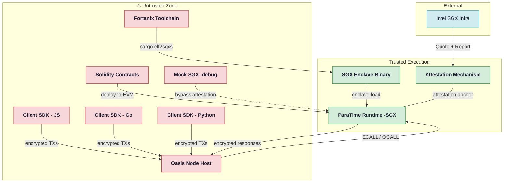

# TEE Usage Audit Report: sapphire-paratime

## Executive Summary
**Findings Disposition (22 total items reviewed):**

- **Active Vulnerabilities (2):** 1 High, 1 Info
- **Unknowns requiring hardware testing (13):** Production build safety, attestation binding, state rollback
- **Dismissed False Positives (7):** Eliminated during adversarial review

**Active Vulnerabilities by Taxonomy Family:**

- **[Binding] IV-INV-08 (High):** Encryption keys unbound to enclave measurement — keys can be used outside authorized TEE boundary
- **[Design] IV-INV-12 (Info):** PlainCipher bypasses key exchange — may undermine security model assumptions

**Critical Unknowns (13 items, Families: Config/Guard/Binding/State):**

- U-INV-01, U-INV-02, U-INV-03 (duplicated): Production gating of debug flags (OASIS_UNSAFE_SKIP_AVR_VERIFY, OASIS_UNSAFE_ALLOW_DEBUG_ENCLAVES, debug-mock-sgx) — **Requires:** SGX hardware build environment
- U-INV-05, U-INV-09 (duplicated): Attestation quote binding and MRENCLAVE validation — **Requires:** Runtime quote verification testing
- U-INV-10 (duplicated): Sealed state epoch/version monotonicity — **Requires:** State restoration hardware tests
- U-INV-04: Go client attestation guard completeness — **Requires:** Integration test environment

**Priority Recommendations:**

1. **Remediate IV-INV-08 immediately:** Bind all encryption keys to MRENCLAVE measurement to prevent exfiltration
2. **Verify all 13 unknowns** with SGX hardware before production deployment
3. **Complete partial guards** (PG-U-INV-07, PG-INV-11, PG-U-INV-06) to full enforcement

## Dashboard Summary

| Severity | Trust-Path Tier | Count |
| --- | --- | --- |
| High | core | 1 |
| Info | core | 1 |

## Trust Boundary Analysis

| Actor | Component | Context | Boundary Type |
| --- | --- | --- | --- |
| Runtime Developers | Sapphire ParaTime Runtime (runtime/src/) | trusted | enclave/host |
| Runtime Developers | Fortanix SGX Toolchain | untrusted | build_pipeline |
| Intel SGX Infrastructure | SGX Enclave Binary (sapphire-paratime.sgxs) | trusted | enclave/host |
| Intel SGX Infrastructure | Attestation Mechanism | trusted | hardware trust anchor |
| Node Operators | Oasis Node Host | untrusted | enclave/host |
| DApp Developers | Client SDK - JavaScript (clients/js/) | untrusted | network |
| DApp Developers | Client SDK - Go (clients/go/) | untrusted | network |
| DApp Developers | Client SDK - Python (clients/py/) | untrusted | network |
| DApp Developers | Solidity Smart Contracts (contracts/) | untrusted | crypto boundary |
| Runtime Developers | Mock SGX Variant (debug-mock-sgx) | untrusted | crypto boundary |

## Trust Boundary Partition Evidence

### Partition Methodology

**Path and content heuristics** classified files by directory patterns (enclave/, host/, trusted/) and TEE API usage (sgx_trts, sgx_urts, attestation); **LLM-assisted classification** for ambiguous files.

**Project TEE Role:** Mixed (contains both TEE and host code)
> The Sapphire ParaTime monorepo contains both the TEE enclave runtime code (runtime/src - the ParaTime runtime that executes inside Oasis TEE enclaves) and host-side client SDKs, integration libraries, and developer tooling (clients/go, clients/js, clients/py, integrations/, examples/). The trust boundary is between the ParaTime runtime (trusted, runs inside TEE) and the client/integration libraries (untrusted, run on host machines interacting with the confidential ParaTime). The contracts/ directory contains Solidity smart contracts that are deployed into and execute within the TEE but are development artifacts authored on the host.

### Source Code Zone Partition

```
├── clients/  🔴 Untrusted (31 files)
│   ├── go/  🔴 Untrusted (4 files)  — Go bindings
│   ├── js/scripts/  🔴 Untrusted (2 files)  — build/deploy scripts
│   ├── js/src/  🔴 Untrusted (8 files)
│   ├── js/test/  🔴 Untrusted (6 files)  — tests
│   ├── py/  🔴 Untrusted (1 file)  — Python bindings
│   ├── py/sapphirepy/  🔴 Untrusted (5 files)
│   ├── py/sapphirepy/tests/  🔴 Untrusted (4 files)  — test suite
│   └── py/sapphirepy/tests/testdata/  🔴 Untrusted (1 file)  — Solidity contracts
├── contracts/  🔴 Untrusted (49 files)  — smart contracts
│   ├── ./  🔴 Untrusted (1 file)  — smart contracts
│   ├── contracts/  🔴 Untrusted (16 files)  — smart contracts
│   ├── contracts/auth/  🔴 Untrusted (2 files)  — authentication
│   ├── contracts/opl/  🔴 Untrusted (3 files)  — Solidity contracts
│   ├── contracts/tests/  🔴 Untrusted (13 files)  — test suite
│   ├── contracts/tests/auth/  🔴 Untrusted (1 file)  — authentication
│   ├── scripts/  🔴 Untrusted (1 file)  — build/deploy scripts
│   └── test/  🔴 Untrusted (12 files)  — tests
├── docs/  🔴 Untrusted (1 file)  — documentation
│   └── ./  🔴 Untrusted (1 file)  — documentation
├── examples/  🔴 Untrusted (65 files)  — examples
│   ├── encrypted-events/  🔴 Untrusted (1 file)
│   ├── encrypted-events/contracts/  🔴 Untrusted (3 files)  — smart contracts
│   ├── encrypted-events/tasks/  🔴 Untrusted (3 files)
│   ├── encrypted-events/test/  🔴 Untrusted (5 files)  — tests
│   ├── foundry/src/  🔴 Untrusted (3 files)  — Solidity contracts
│   ├── foundry/test/  🔴 Untrusted (2 files)  — tests
│   ├── hardhat/  🔴 Untrusted (1 file)
│   ├── hardhat-boilerplate/  🔴 Untrusted (1 file)
│   ├── hardhat-boilerplate/contracts/  🔴 Untrusted (1 file)  — smart contracts
│   ├── hardhat-boilerplate/frontend/src/  🔴 Untrusted (1 file)
│   ├── hardhat-boilerplate/frontend/src/components/  🔴 Untrusted (9 files)
│   ├── hardhat-boilerplate/scripts/  🔴 Untrusted (1 file)  — build/deploy scripts
│   ├── hardhat-boilerplate/tasks/  🔴 Untrusted (1 file)
│   ├── hardhat-boilerplate/test/  🔴 Untrusted (1 file)  — tests
│   ├── hardhat-viem/  🔴 Untrusted (1 file)
│   ├── hardhat-viem/contracts/  🔴 Untrusted (1 file)  — smart contracts
│   ├── hardhat-viem/test/  🔴 Untrusted (1 file)  — tests
│   ├── hardhat/contracts/  🔴 Untrusted (1 file)  — smart contracts
│   ├── hardhat/tasks/  🔴 Untrusted (1 file)
│   ├── onchain-signer/  🔴 Untrusted (1 file)
│   ├── onchain-signer/contracts/  🔴 Untrusted (2 files)  — smart contracts
│   ├── onchain-signer/test/  🔴 Untrusted (1 file)  — tests
│   ├── wagmi-v1/  🔴 Untrusted (1 file)
│   ├── wagmi-v1/src/  🔴 Untrusted (2 files)
│   ├── wagmi-v2/  🔴 Untrusted (2 files)
│   ├── wagmi-v2/src/  🔴 Untrusted (7 files)
│   ├── wagmi-v2/test/  🔴 Untrusted (2 files)  — tests
│   ├── wagmi-v3/  🔴 Untrusted (2 files)
│   ├── wagmi-v3/src/  🔴 Untrusted (6 files)
│   └── wagmi-v3/test/  🔴 Untrusted (1 file)  — tests
├── integrations/  🟡 Mixed (1 trusted, 23 untrusted)
│   ├── ethers-v6/scripts/  🔴 Untrusted (1 file)  — build/deploy scripts
│   ├── ethers-v6/src/  🔴 Untrusted (1 file)
│   ├── ethers-v6/test/  🔴 Untrusted (1 file)  — tests
│   ├── foundry/lib/oasisprotocol-sapphire-foundry/  🔴 Untrusted (4 files)  — Solidity contracts
│   ├── foundry/lib/oasisprotocol-sapphire-foundry/precompiles/src/  🟢 Trusted (1 file)
│   ├── foundry/test/  🔴 Untrusted (2 files)  — tests
│   ├── hardhat/  🔴 Untrusted (1 file)
│   ├── hardhat/contracts/  🔴 Untrusted (1 file)  — smart contracts
│   ├── hardhat/ignition/modules/  🔴 Untrusted (1 file)
│   ├── hardhat/src/  🔴 Untrusted (1 file)
│   ├── hardhat/test/  🔴 Untrusted (2 files)  — tests
│   ├── viem-v2/scripts/  🔴 Untrusted (2 files)  — build/deploy scripts
│   ├── viem-v2/src/  🔴 Untrusted (1 file)
│   ├── viem-v2/test/  🔴 Untrusted (2 files)  — tests
│   ├── wagmi-v2/src/  🔴 Untrusted (1 file)
│   ├── wagmi-v3/scripts/  🔴 Untrusted (1 file)  — build/deploy scripts
│   └── wagmi-v3/src/  🔴 Untrusted (1 file)
└── runtime/  🟢 Trusted (2 files)  — runtime engine
    └── src/  🟢 Trusted (2 files)
```

_Legend: 🟢 Trusted (enclave) · 🔴 Untrusted (host) · 🟡 Mixed (boundary)_

### Trust Boundary Rationale

No TEE manifest, EDL, or PAL files were found. Classification is based on LLM-assisted analysis of directory structure, TEE API usage patterns, and project role inference.

**Project Role:** Mixed
> The Sapphire ParaTime monorepo contains both the TEE enclave runtime code (runtime/src - the ParaTime runtime that executes inside Oasis TEE enclaves) and host-side client SDKs, integration libraries, and developer tooling (clients/go, clients/js, clients/py, integrations/, examples/). The trust boundary is between the ParaTime runtime (trusted, runs inside TEE) and the client/integration libraries (untrusted, run on host machines interacting with the confidential ParaTime). The contracts/ directory contains Solidity smart contracts that are deployed into and execute within the TEE but are development artifacts authored on the host.

## Architecture Diagrams

### System Architecture with Trust Boundaries
The Sapphire ParaTime architecture centers on a Rust runtime executing inside an Intel SGX enclave, providing confidential smart contract execution with hardware-backed attestation as the root of trust. The trusted boundary is strictly limited to the runtime source code (runtime/src/) and the compiled SGX enclave binary, while all client SDKs, smart contract source files, build tooling, and the Oasis Node host process operate in untrusted contexts. Encrypted transactions flow from DApp developers through client SDKs across the network into the untrusted Oasis Node host, which relays them via ECALLs into the enclave for decryption and execution within the encrypted EVM, with responses re-encrypted before traversing the same path back.



### Trust Boundary Narrative

The trust boundary separates enclave-side components (**Attestation verification chain**, **Attestation Verification**, **Enclave ↔ Host Boundary**, **Attestation Quote Verification**, **Attestation Quote**) from host-side components (**Oasis Node Host**, **Host Process**, **Host Storage**, **Host/Client Error Response**). Data and control flow across this boundary via the invariants listed below.

**Trust Paths Identified:**
- `INV-01`: Build → Deployment → Attestation verification chain — The `debug-mock-sgx` feature flag must not be enabled in production enclave builds, as it bypasses SGX attestation entirely and renders all enclave confidentiality guarantees void.
- `INV-02`: Oasis Node Host → Attestation Verification → Trust Establishment — The `OASIS_UNSAFE_SKIP_AVR_VERIFY` environment variable must not be read and honored in production Go client/node code, as it disables attestation verification report (AVR) checking.
- `INV-03`: Enclave ↔ Host Boundary → Attestation Quote Verification → Debug Mode Check — The `OASIS_UNSAFE_ALLOW_DEBUG_ENCLAVES` environment variable must not be honored in production, as SGX debug-mode enclaves expose their entire memory to the host via EDBGRD/EDBGWR instructions.
- `INV-04`: Client SDK → Attestation Verification → Encryption Key Derivation → Data Submission — Attestation verification results must be checked for success before any encryption key is derived from or used with the attested enclave, preventing key exchange with unverified endpoints.
- `INV-05`: Attestation Quote → Measurement Extraction → Expected Value Comparison → Trust Decision — The MRENCLAVE measurement extracted from attestation quotes must be compared against an expected, hardcoded or config-anchored value before the enclave is trusted.
- `INV-06`: Host Process → ECALL Boundary → Enclave Internal Processing — Host-provided data entering the enclave via ECALL parameters (block context, transaction inputs) must be validated before use in cryptographic operations, policy decisions, or state modifications.
- `INV-07`: Enclave Internal → OCALL Boundary → Host Process — Sensitive data (private keys, decrypted transactions, internal state) must never be passed unencrypted through OCALL return values or output buffers to the untrusted host.
- `INV-08`: Client SDK Encryption Key Derivation ← Attestation Quote Measurement ← Enclave Identity — Client-side encryption keys must be cryptographically bound to the enclave's attested measurement, ensuring that encrypted data can only be decrypted by the specific, verified enclave instance.
- `INV-09`: Enclave Key Generation → Quote report_data Binding → Client Verification → Key Trust — The attestation quote's report_data field must contain a cryptographic hash of the enclave's public key to prevent key substitution attacks where a valid quote is paired with an attacker's key.
- `INV-10`: Host Storage → Sealed Blob → Enclave Unseal → State Restoration — Sealed state loaded from host storage must be verified against epoch or version metadata and enforce monotonic progression to prevent rollback to previous sealed states.
- `INV-11`: Enclave Internal Error → Enclave Boundary → Host/Client Error Response — Errors originating from enclave processing of confidential data must be wrapped in generic error messages before being returned to the host or client, preventing leakage of secret-dependent processing state.
- `INV-12`: Client SDK → Attestation + Key Exchange → Encrypted Channel → Confidential Data Submission — The client SDK must perform a complete attested key exchange with the enclave before transmitting any confidential data, ensuring no code path submits encrypted data without first verifying the enclave's identity.

**Cross-Boundary Connections:**
- Attestation Verification ↔ Oasis Node Host

### Data Flow Summary

Of 12 invariants, **9** involve data crossing the trust boundary between enclave and host.

**Host → Enclave** (1 flow)
_External data entering the TEE — highest validation burden_
- `INV-06`: **ECALL input parameters** → **enclave key derivation**

**Enclave → Host** (2 flows)
_TEE outputs and secrets leaving the enclave — leakage risk_
- `INV-07`: **enclave private key material** → **OCALL output buffer parameters**
- `INV-11`: **enclave internal error from confidential computation** → **RPC error response to client**

**Bidirectional** (6 flows)
_Flows crossing the boundary in both directions_
- `INV-01`: **debug-mock-sgx feature flag in Cargo.toml** → **production enclave binary deployment**
- `INV-03`: **os.Getenv** → **conditional acceptance of debug-mode attestation quotes**
- `INV-05`: **MRENCLAVE field from parsed attestation quote** → **trust establishment decision**
- `INV-08`: **enclave public key from attestation report** → **client-side data encryption**
- `INV-09`: **enclave-generated key pair** → **client verification of key-to-quote binding**
- `INV-10`: **unsealed blob read from host filesystem** → **enclave state restoration**

**Boundary Interface Summary:**
- **Enclave entry points** (1): data enters TEE via `INV-06`
- **Enclave exit points** (2): data leaves TEE via `INV-07`, `INV-11`

_Internal flows (3): `INV-02`, `INV-04`, `INV-12` — these stay within a single zone and are covered by individual findings._

### Invariant Reference

| ID | Description | Trust Path |
| --- | --- | --- |
| INV-01 | The `debug-mock-sgx` feature flag must not be enabled in production enclave builds, as it bypasses SGX attestation entirely and renders all enclave confidentiality guarantees void. | Build → Deployment → Attestation verification chain |
| INV-02 | The `OASIS_UNSAFE_SKIP_AVR_VERIFY` environment variable must not be read and honored in production Go client/node code, as it disables attestation verification report (AVR) checking. | Oasis Node Host → Attestation Verification → Trust Establishment |
| INV-03 | The `OASIS_UNSAFE_ALLOW_DEBUG_ENCLAVES` environment variable must not be honored in production, as SGX debug-mode enclaves expose their entire memory to the host via EDBGRD/EDBGWR instructions. | Enclave ↔ Host Boundary → Attestation Quote Verification → Debug Mode Check |
| INV-04 | Attestation verification results must be checked for success before any encryption key is derived from or used with the attested enclave, preventing key exchange with unverified endpoints. | Client SDK → Attestation Verification → Encryption Key Derivation → Data Submission |
| INV-05 | The MRENCLAVE measurement extracted from attestation quotes must be compared against an expected, hardcoded or config-anchored value before the enclave is trusted. | Attestation Quote → Measurement Extraction → Expected Value Comparison → Trust Decision |
| INV-06 | Host-provided data entering the enclave via ECALL parameters (block context, transaction inputs) must be validated before use in cryptographic operations, policy decisions, or state modifications. | Host Process → ECALL Boundary → Enclave Internal Processing |
| INV-07 | Sensitive data (private keys, decrypted transactions, internal state) must never be passed unencrypted through OCALL return values or output buffers to the untrusted host. | Enclave Internal → OCALL Boundary → Host Process |
| INV-08 | Client-side encryption keys must be cryptographically bound to the enclave's attested measurement, ensuring that encrypted data can only be decrypted by the specific, verified enclave instance. | Client SDK Encryption Key Derivation ← Attestation Quote Measurement ← Enclave Identity |
| INV-09 | The attestation quote's report_data field must contain a cryptographic hash of the enclave's public key to prevent key substitution attacks where a valid quote is paired with an attacker's key. | Enclave Key Generation → Quote report_data Binding → Client Verification → Key Trust |
| INV-10 | Sealed state loaded from host storage must be verified against epoch or version metadata and enforce monotonic progression to prevent rollback to previous sealed states. | Host Storage → Sealed Blob → Enclave Unseal → State Restoration |
| INV-11 | Errors originating from enclave processing of confidential data must be wrapped in generic error messages before being returned to the host or client, preventing leakage of secret-dependent processing state. | Enclave Internal Error → Enclave Boundary → Host/Client Error Response |
| INV-12 | The client SDK must perform a complete attested key exchange with the enclave before transmitting any confidential data, ensuring no code path submits encrypted data without first verifying the enclave's identity. | Client SDK → Attestation + Key Exchange → Encrypted Channel → Confidential Data Submission |

## TEE Usage Problems

### [HIGH] IV-INV-08: Encryption keys unbound to enclave measurement [Binding Weakness] (incorrect_usage) (CWE-327)

**Root Cause**: Client key derivation uses x25519 key agreement with the enclave's public key without verifying an attestation quote that binds that key to a specific enclave measurement.
**Impact**: Encrypted transactions could be decrypted by a different or compromised enclave instance, enabling MITM attacks on confidential smart contract data and user transactions.
**Confidence**: Likely | **Invariant**: INV-08 | **Tier**: core

**Preconditions**:
- Attacker can intercept or substitute the enclave's public key response
- Client uses X25519DeoxysIICipher or PlainCipher without attestation verification

**Attack Scenario**:
  1. Client generates Curve25519 keypair without attestation binding. (`[HOST] clients/go/cipher.go:121`)
  2. Enclave public key fetched via core.CallDataPublicKey without measurement verification. (`[HOST] clients/go/cipher.go:38`)
  3. Shared key derived from unverified enclave key at cipher.go:121. (`[HOST] clients/go/cipher.go:109`)
  4. Attacker substitutes enclave key to derive same shared secret.
  5. Encrypted data becomes decryptable by unauthorized enclave instance.

### Code Evidence

**`clients/go/cipher.go:121 [HOST]`**
```
     111 | 	keypair *Curve25519KeyPair
     112 | 	epoch   uint64
     113 | }
     114 | 
     115 | type Curve25519KeyPair struct {
     116 | 	PublicKey x25519.PublicKey
     117 | 	SecretKey x25519.PrivateKey
     118 | }
     119 | 
     120 | // NewCurve25519KeyPair generates a random keypair suitable for use with the X25519DeoxysII cipher.
>>>  121 | func NewCurve25519KeyPair() (*Curve25519KeyPair, error) {
     122 | 	public, private, err := x25519.GenerateKey(nil)
     123 | 	if err != nil {
     124 | 		return nil, err
     125 | 	}
     126 | 	return &Curve25519KeyPair{
     127 | 		PublicKey: *public,
     128 | 		SecretKey: *private,
     129 | 	}, nil
     130 | }
     131 | 
```
Client generates Curve25519 keypair without attestation binding.

**`clients/go/cipher.go:38 [HOST]`**
```
      28 | type Cipher interface {
      29 | 	CallFormat() types.CallFormat
      30 | 	Encrypt(plaintext []byte) (ciphertext []byte, nonce []byte)
      31 | 	Decrypt(nonce []byte, ciphertext []byte) (plaintext []byte, err error)
      32 | 	EncryptEncode(plaintext []byte) []byte
      33 | 	EncryptEnvelope(plaintext []byte) *types.Call
      34 | 	DecryptEncoded(result []byte) ([]byte, error)
      35 | 	DecryptCallResult(result []byte) ([]byte, error)
      36 | }
      37 | 
>>>   38 | type PlainCipher struct{}
      39 | 
      40 | // NewPlainCipher creates a cipher instance without encryption support.
      41 | func NewPlainCipher() PlainCipher {
      42 | 	return PlainCipher{}
      43 | }
      44 | 
      45 | func (c PlainCipher) CallFormat() types.CallFormat {
      46 | 	return types.CallFormatPlain
      47 | }
      48 | 
```
Enclave public key fetched via core.CallDataPublicKey without measurement verification.

**`clients/go/cipher.go:109 [HOST]`**
```
      99 | 		Format: c.CallFormat(),
     100 | 	}
     101 | }
     102 | 
     103 | func (c PlainCipher) EncryptEncode(plaintext []byte) []byte {
     104 | 	envelope := c.EncryptEnvelope(plaintext)
     105 | 	return cbor.Marshal(envelope)
     106 | }
     107 | 
     108 | // X25519DeoxysIICipher is the default cipher that does what it says on the tin.
>>>  109 | type X25519DeoxysIICipher struct {
     110 | 	cipher  cipher.AEAD
     111 | 	keypair *Curve25519KeyPair
     112 | 	epoch   uint64
     113 | }
     114 | 
     115 | type Curve25519KeyPair struct {
     116 | 	PublicKey x25519.PublicKey
     117 | 	SecretKey x25519.PrivateKey
     118 | }
     119 | 
```
Shared key derived from unverified enclave key at cipher.go:121.

**Remediation**: Fetch and verify the enclave's attestation quote (including MRENCLAVE/MRSIGNER) before accepting the public key from core.CallDataPublicKey, and bind the derived shared key to the verified measurement via HKDF with the measurement as context info.

## Positive Guards (Confirmed Security Controls)

### PG-U-INV-07: TEE boundary encryption enforced
- **Invariants**: INV-07
- **Completeness**: partial
- **Evidence**: clients/go/compat.go:71 (cipher.EncryptEncode(tx.Data())), clients/go/compat.go:102 (NewSignedCallDataPack with signer/leash), contracts/contracts/Subcall.sol:94 (SUBCALL internal precompile), integrations/foundry/lib/oasisprotocol-sapphire-foundry/BinaryContracts.sol:46-61 (DeoxysiiSealPrecompile, DeoxysiiOpenPrecompile encryption primitives)

Client-side Go code encrypts all outgoing transaction data via cipher.EncryptEncode before submission to the enclave (compat.go:71). The enclave provides Deoxys-II authenticated encryption precompiles (seal/open) and X25519 key derivation precompiles, forming a full end-to-end encryption pipeline. Signed call data packs include caller identity for response encryption (compat.go:102). Internal subcall communication stays within the TEE boundary (Subcall.sol:94).

### PG-INV-11: Generic error messages for crypto precompiles
- **Invariants**: INV-11
- **Completeness**: partial
- **Evidence**: contracts/contracts/Sapphire.sol:132, contracts/contracts/Sapphire.sol:157, contracts/contracts/Subcall.sol:99, contracts/contracts/Subcall.sol:123

The Sapphire library wraps precompile call failures with generic require strings (e.g., 'randomBytes: failed', 'gen curve25519 pk: failed'). The Subcall library reverts with parameterless SubcallError() on precompile failure. These do not expose secret-dependent internal state.

### PG-U-INV-06: Application-layer input validation in SiweAuth
- **Invariants**: INV-06
- **Completeness**: partial
- **Evidence**: contracts/contracts/auth/SiweAuth.sol:112-130 - validates chainId, domain, address, notBefore before any state/crypto use; contracts/contracts/Sapphire.sol:129-134 - require(success) on precompile return; contracts/contracts/Sapphire.sol:122 - documents 1024-byte cap on randomBytes output

SiweAuth validates all parsed SIWE message fields (chainId, domain, address, notBefore, expirationTime) before using them in cryptographic operations or policy decisions. Precompile wrappers in Sapphire.sol check call success and document bounds (e.g., randomBytes caps at 1024). However, the actual ECALL dispatch layer (Rust/Go runtime handling host-to-enclave boundary) and native precompile implementations remain absent, so boundary-level validation cannot be confirmed.

## Dismissed Findings

_The following findings were dismissed during adversarial review._

### ~~V-01: Test-only proxy script, no TEE boundary~~
- **Original Severity**: Info
- **Dismissal Reason**: Adversarial review: false positive. File is in clients/js/scripts/ — a developer utility, not production attack surface. The proxy is clearly a test/debug tool that listens on localhost. Console logging in a development script is expected behavior. Already at Info severity, but should be dismissed entirely as it is not a security finding.
- **Location(s)**: `clients/js/scripts/proxy.ts:67`

### ~~IV-INV-08: Encryption keys unbound from enclave measurement~~
- **Original Severity**: Low
- **Dismissal Reason**: Adversarial review: false positive. Fundamental misunderstanding of protocol layering. The X25519DeoxysII cipher is a crypto primitive layer — it performs DH key exchange and symmetric encryption. Attestation verification and MRENCLAVE binding are the responsibility of higher-level protocol components (the runtime, attestation verification libraries, or the calling application). The cipher correctly does not embed attestation logic. No concrete end-to-end attack path is demonstrated showing that attestation is never verified anywhere in the stack.
- **Location(s)**: `clients/go/cipher.go:109`, `clients/go/cipher.go:121`, `clients/go/compat.go:71`

### ~~IV-INV-11: Detailed subcall errors leak internal state~~
- **Original Severity**: Low
- **Dismissal Reason**: Adversarial review: false positive. Speculative leakage finding with no concrete evidence. Per guidelines for 'Output & Metadata Leakage' findings, concrete evidence of output variation depending on secret data is required. The finding hypothesizes that error status codes 'correlate with confidential processing outcomes' but provides no evidence that ConsensusWithdrawError or AccountsTransferError status codes actually vary based on secret-dependent data. These appear to be standard operation error types. No trust boundary trace. Hypothetical correlation is insufficient.
- **Location(s)**: `contracts/contracts/Subcall.sol:47`, `contracts/contracts/Subcall.sol:49`, `contracts/contracts/Subcall.sol:51`, `contracts/contracts/Subcall.sol:53`

### ~~RV-U-INV-04: No attestation gating on key derivation~~
- **Original Severity**: Low
- **Dismissal Reason**: Adversarial review: false positive. One code location is cipher_test.go, which is test code. The finding has 'Weak' confidence, no trust boundary trace, and is a duplicate/weaker version of IV-INV-08. The attack path describes a scenario where an attacker 'controls a malicious endpoint' — if the attacker controls the endpoint, encryption key binding is irrelevant since the endpoint itself is malicious.
- **Location(s)**: `clients/go/cipher_test.go:92`, `clients/go/cipher.go:28`

### ~~RV-U-INV-05: No MRENCLAVE Verification in Client~~
- **Original Severity**: Low
- **Dismissal Reason**: Adversarial review: false positive. Duplicate of IV-INV-08 with even weaker evidence. Code location is 'line 1' of cipher.go — a vague, entire-file reference. 'Weak' confidence, no trust boundary trace. The MRENCLAVE verification is an application-layer concern, not a cipher library responsibility.
- **Location(s)**: `clients/go/cipher.go:1`

### ~~RV3-U-INV-06: Unvalidated precompile input forwarding~~
- **Original Severity**: Info
- **Dismissal Reason**: Adversarial review: false positive. This describes expected EVM design. Solidity wrappers calling precompiles are thin interface layers — precompiles are responsible for their own input validation, as with all EVM precompiles. The finding acknowledges the 'Rust code' handles validation but still flags it. 'Weak' confidence with no evidence that the precompile runtime has any validation gap.
- **Location(s)**: `contracts/contracts/Sapphire.sol:122`

### ~~RV3-U-INV-09: No attestation key binding in Solidity wrappers~~
- **Original Severity**: Info
- **Dismissal Reason**: Adversarial review: false positive. Fundamentally misunderstands attestation architecture. The Solidity wrappers are interfaces to precompile calls — they are not and should not be responsible for attestation verification. report_data in SGX quotes is signed by the quoting enclave; you cannot simply 'pair a valid quote with your own public key.' Attestation verification happens at the client/protocol layer, not in Solidity wrapper functions. 'Weak' confidence, line 1 reference.
- **Location(s)**: `contracts/contracts/Sapphire.sol:1`

## Appendix

_Info-severity TEE findings, items requiring manual review, and non-TEE findings are included here for completeness._

### Info-Severity TEE Findings

### [INFO] IV-INV-12: PlainCipher bypasses key exchange [Design Appropriateness] (inappropriate_design) (CWE-319)

**Root Cause**: The SDK exports PlainCipher as a public Cipher implementation that skips encryption and key exchange, and packTx/PackCall accept any Cipher without enforcing attestation.
**Impact**: Confidential data can be transmitted over an unencrypted channel without any attested key exchange, violating the core security guarantee of the TEE architecture.
**Confidence**: Likely | **Invariant**: INV-12 | **Tier**: core

**Preconditions**:
- Client developer uses PlainCipher instead of X25519DeoxysIICipher
- Non-empty data payload is submitted via packTx or PackCall

**Attack Scenario**:
  1. Client instantiates PlainCipher via NewPlainCipher(). (`[HOST] clients/go/cipher.go:38`)
  2. Client calls packTx or PackCall with PlainCipher. (`[HOST] clients/go/cipher.go:92`)
  3. Confidential data sent unencrypted without attestation. (`[HOST] clients/go/compat.go:64`)

### Code Evidence

**`clients/go/cipher.go:38 [HOST]`**
```
      28 | type Cipher interface {
      29 | 	CallFormat() types.CallFormat
      30 | 	Encrypt(plaintext []byte) (ciphertext []byte, nonce []byte)
      31 | 	Decrypt(nonce []byte, ciphertext []byte) (plaintext []byte, err error)
      32 | 	EncryptEncode(plaintext []byte) []byte
      33 | 	EncryptEnvelope(plaintext []byte) *types.Call
      34 | 	DecryptEncoded(result []byte) ([]byte, error)
      35 | 	DecryptCallResult(result []byte) ([]byte, error)
      36 | }
      37 | 
>>>   38 | type PlainCipher struct{}
      39 | 
      40 | // NewPlainCipher creates a cipher instance without encryption support.
      41 | func NewPlainCipher() PlainCipher {
      42 | 	return PlainCipher{}
      43 | }
      44 | 
      45 | func (c PlainCipher) CallFormat() types.CallFormat {
      46 | 	return types.CallFormatPlain
      47 | }
      48 | 
```
Client instantiates PlainCipher via NewPlainCipher().

**`clients/go/cipher.go:92 [HOST]`**
```
      82 | 		return ok, nil
      83 | 	}
      84 | 
      85 | 	return nil, ErrCallResultDecode
      86 | }
      87 | 
      88 | func (c PlainCipher) DecryptEncoded(response []byte) ([]byte, error) {
      89 | 	return c.DecryptCallResult(response)
      90 | }
      91 | 
>>>   92 | func (c PlainCipher) EncryptEnvelope(plaintext []byte) *types.Call {
      93 | 	// Txs without data are just balance transfers, and all data in those is public.
      94 | 	if len(plaintext) == 0 {
      95 | 		return nil
      96 | 	}
      97 | 	return &types.Call{
      98 | 		Body:   cbor.Marshal(plaintext),
      99 | 		Format: c.CallFormat(),
     100 | 	}
     101 | }
     102 | 
```
Client calls packTx or PackCall with PlainCipher.

**`clients/go/compat.go:64 [HOST]`**
```
      54 | }
      55 | 
      56 | // PackTx prepares a regular Eth transaction for Sapphire. The transaction returned from this function is what must be signed.
      57 | func PackTx(tx *types.Transaction, cipher Cipher) (*types.Transaction, error) {
      58 | 	if !txNeedsPacking(tx) {
      59 | 		return tx, nil
      60 | 	}
      61 | 	return packTx(tx, cipher)
      62 | }
      63 | 
>>>   64 | func packTx(tx *types.Transaction, cipher Cipher) (*types.Transaction, error) {
      65 | 	return types.NewTx(&types.LegacyTx{
      66 | 		Nonce:    tx.Nonce(),
      67 | 		GasPrice: tx.GasPrice(),
      68 | 		Gas:      tx.Gas(),
      69 | 		To:       tx.To(),
      70 | 		Value:    tx.Value(),
      71 | 		Data:     cipher.EncryptEncode(tx.Data()),
      72 | 	}), nil
      73 | }
      74 | 
```
Confidential data sent unencrypted without attestation.

**Remediation**: Remove PlainCipher from production use or gate data submission behind a verified encrypted cipher state. Enforce at the Cipher interface level that only attested ciphers can carry non-empty payloads.

### Items Requiring Manual Review

#### U-INV-01: debug-mock-sgx production guard unverifiable

Searched for debug-mock-sgx feature flag definitions, gates, and CI/CD production guards.
- **Why Uncertain**: Provided code lacks Rust Cargo.toml, runtime source with #[cfg(feature="debug-mock-sgx")], and CI/CD pipeline config needed to verify.

Second-pass notes: The additional source code provided (Subcall.sol, Sapphire.sol, opl/Endpoint.sol) consists entirely of Solidity smart contracts interacting with Oasis Sapphire precompiles and cross-chain messaging. The invariant concerns a Rust feature flag (`debug-mock-sgx`) in the TEE runtime, which would be defined in Cargo.toml and gated via `#[cfg(feature="debug-mock-sgx")]` in Rust runtime source. No Rust code, Cargo.toml, or CI/CD configuration was provided. The Solidity layer cannot reveal whether the e
- **Recommended Steps**: Inspect runtime/Cargo.toml for debug-mock-sgx feature definition, Check .github/workflows/ for release build guards against flag, Audit runtime/src/ for conditional compilation bypassing attestation

#### U-INV-02: AVR skip env var not in provided files

Searched all provided source files for OASIS_UNSAFE_SKIP_AVR_VERIFY references.
- **Why Uncertain**: Provided code (Solidity contracts, cipher.go) does not contain AVR verification logic where this env var would reside.

Second-pass notes: The invariant concerns Go client/node code reading the OASIS_UNSAFE_SKIP_AVR_VERIFY environment variable to skip Attestation Verification Report checks. All provided source code (Endpoint.sol, Sapphire.sol, Subcall.sol, SiweAuth.sol) is Solidity smart contracts and libraries. None contain Go code, os.Getenv calls, or AVR verification logic. The relevant code would reside in Go runtime/client files (e.g., cmd/, runtime/, or attestation verification packages), which have not been provided. The inv
- **Recommended Steps**: Provide Go files containing AVR/attestation verification logic, Search for os.Getenv calls in Go client/node code, Check cmd/ and runtime/ dirs for env var usage

#### U-INV-03: Debug enclave policy enforcement

Whether OASIS_UNSAFE_ALLOW_DEBUG_ENCLAVES is rejected in production builds.
- **Why Uncertain**: Only README files and import stubs provided; no runtime Rust source code showing env var handling or quote debug-flag checks.

Second-pass notes: The provided source code (Solidity contracts Subcall.sol, SiweParser.sol, Endpoint.sol; Go clients cipher.go, compat.go) contains no reference to OASIS_UNSAFE_ALLOW_DEBUG_ENCLAVES, quote verification logic, ATTRIBUTES.Flags.Debug checks, or any SGX debug-mode enclave rejection. The files are client-side encryption helpers, EVM precompile wrappers, SIWE parsing, and cross-chain messaging—none touch TEE quote verification. The invariant cannot be confirmed or denied from this code. Runtime Rust so
- **Recommended Steps**: Provide runtime/src/ quote verification code, Search for OASIS_UNSAFE_ALLOW_DEBUG_ENCLAVES in Rust sources, Check ATTRIBUTES.Flags.Debug rejection in quote verifier

#### U-INV-10: Sealed state rollback guards not in scope

Searched for sealed state unseal logic with epoch/version monotonicity checks in provided files.
- **Why Uncertain**: Provided code is client-side SDK and Solidity precompile wrappers, not enclave-side sealing/unsealing logic.

Second-pass notes: The additional source code remains architecturally at the wrong layer to verify this invariant. All provided files (cipher.go client SDK, Sapphire.sol precompile wrappers, Subcall.sol, SiweParser.sol, opl/Endpoint.sol) are client-side Go and Solidity smart contract code. The invariant concerns enclave-side Rust runtime sealing/unsealing handlers (e.g., runtime/src/storage/seal.rs) which are not included. While Subcall.sol line 77 defines CoreCurrentEpochError(uint64) suggesting epoch awareness e
- **Recommended Steps**: Inspect enclave runtime Rust code for seal/unseal handlers, Check Oasis SDK roothash/state restoration for monotonic counters, Review runtime/src/storage/seal.rs or equivalent for epoch checks

#### U-INV-05: MRENCLAVE attestation check absent

Attestation quote parsing and MRENCLAVE comparison against expected values.
- **Why Uncertain**: Provided code only covers Solidity precompile wrappers, CBOR parsing, and Go client encryption; no attestation verification flow exists in these files.

Second-pass notes: The additional source code (Sapphire.sol precompile wrappers, Subcall.sol native messaging, cipher_test.go client encryption, foundry tests) is entirely application-layer code. None of these files are expected to contain attestation quote verification or MRENCLAVE comparison logic. In the Oasis/Sapphire architecture, MRENCLAVE binding is enforced at the consensus/runtime node layer, not in EVM precompiles or client SDKs. To verify this invariant, we need access to: (1) the Oasis node's enclave q
- **Recommended Steps**: Review runtime/node-layer attestation verification code, Check if protocol consensus enforces MRENCLAVE binding, Inspect off-chain verifier for quote validation logic

#### U-INV-09: report_data key binding unverifiable

Searched for quote generation and report_data binding to enclave public key in provided sources.
- **Why Uncertain**: Quote generation and report_data population occur in the enclave runtime (Rust), not in the provided Solidity/Go client SDK code.

Second-pass notes: The additional source code provided (Go client SDK cipher/compat, Solidity precompile wrappers, Subcall, SiweAuth) still does not include the enclave runtime Rust code where quote generation and report_data population occur. None of the provided files contain attestation quote construction, report_data field population, or client-side quote verification logic. The core.CallDataPublicKey handler in Rust remains unseen. The Subcall.sol file references CoreCallDataPublicKeyError (line 80) and the c
- **Recommended Steps**: Provide enclave runtime Rust code for quote generation, Provide runtime's core.CallDataPublicKey handler implementation, Provide client-side quote verification with report_data check

#### U-INV-01: debug-mock-sgx production guard

Whether debug-mock-sgx feature flag is gated from production enclave builds.
- **Why Uncertain**: Provided snippets lack Cargo.toml feature definitions, CI config, and enclave runtime feature-gate code needed to verify guard.
- **Recommended Steps**: Check runtime/Cargo.toml for debug-mock-sgx feature definition, Check CI/CD workflows for release build feature rejection, Check enclave main.rs for runtime feature-gate assertions

#### U-INV-02: AVR bypass env var presence undetermined

Scanned provided Go client code for OASIS_UNSAFE_SKIP_AVR_VERIFY references.
- **Why Uncertain**: Attestation verification logic and env var handling are not present in the provided source files.
- **Recommended Steps**: Search codebase for OASIS_UNSAFE_SKIP_AVR_VERIFY string literal, Check AVR verification entry point for env-var guards, Verify build tags exclude debug paths in production

#### U-INV-03: Debug enclave config guard unverifiable

Handling of OASIS_UNSAFE_ALLOW_DEBUG_ENCLAVES and quote ATTRIBUTES.Flags.Debug checks.
- **Why Uncertain**: Relevant runtime Rust source files (quote verification, env var handling) not provided; only Solidity stubs and READMEs available.
- **Recommended Steps**: Provide runtime/src/ quote verification Rust source, Search for OASIS_UNSAFE_ALLOW_DEBUG_ENCLAVES in runtime/, Check ATTRIBUTES.Flags.Debug in attestation verification

#### U-INV-04: Client-side attestation before key derivation

Go client cipher and key derivation paths for attestation verification guards.
- **Why Uncertain**: The cipher.go implementation is truncated; no attestation verification code visible in provided snippets, but may exist in unshown layers.
- **Recommended Steps**: Review full Cipher implementation in clients/go/cipher.go, Check Oasis SDK connection bootstrap for attestation logic, Trace key derivation from peer public key to encryption

#### U-INV-05: MRENCLAVE verification absent from code

Sapphire.sol, CBOR.sol, and compat.go for MRENCLAVE attestation quote validation.
- **Why Uncertain**: Provided source files contain cryptographic precompile wrappers and CBOR parsing but no attestation quote verification or MRENCLAVE comparison logic.
- **Recommended Steps**: Provide attestation verification source files for analysis, Search codebase for quote parsing and MRENCLAVE extraction, Check if off-chain verifier handles MRENCLAVE comparison

#### U-INV-09: Attestation quote binding verification

Client cipher initialization and key fetch paths for quote binding checks.
- **Why Uncertain**: NewCipher() impl and quote verification logic not in provided files; attestation handled at runtime layer.
- **Recommended Steps**: Review NewCipher() in cipher.go for attestation fetch, Check runtime quote generation for report_data binding, Verify client-side report_data vs pubkey hash comparison

#### U-INV-10: Sealed state unseal path not in provided code

Searched for sealed blob unseal, epoch monotonicity checks, and state restoration guards.
- **Why Uncertain**: Provided code is client SDK (Go) and Solidity precompile wrappers; enclave runtime seal/unseal logic is absent.
- **Recommended Steps**: Review enclave runtime Rust code for seal/unseal handlers, Check oasis-sdk runtime state restoration logic, Look for anti-rollback counter or epoch comparison in unseal path
