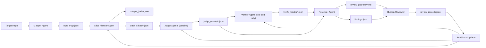

# Multi-Agent Harness

## Purpose

`TEECheck` should evolve into a **security research harness**, not just a
single scanner.

The harness exists to make AI-assisted TEE review:

- more structured than "let the model read the repo"
- more scalable than pure manual review
- more explainable than one-shot vulnerability claims
- more improvable than prompt-only iteration

The goal is not to fully automate vulnerability discovery.

The goal is to build a repeatable system that can:

1. compress a repository into reviewable units
2. generate candidate security concerns
3. attach evidence to each concern
4. route high-value candidates to verification
5. learn from human review outcomes

## Design Position

This document assumes the following role split:

- `GitNexus` or similar tools provide repository structure
- `LLMs` make bounded semantic judgments over compact audit slices
- `humans` remain the final arbiter
- `Joern` or other heavier static analysis is optional verification, not the
  first stage for every repository

In other words:

`repo -> structure -> slices -> AI judgment -> verification -> human review -> feedback`

## Why A Harness Instead Of A Single Agent

TEE usage issues are usually not obvious syntax bugs. They are often about:

- missing revalidation across trust boundaries
- incomplete attestation or policy checks
- missing authorization or binding
- unsafe state-machine transitions
- insecure fallback after secure-path failure

These are best handled by a system where:

- one component compresses context
- another selects review targets
- another judges likely issues
- another verifies evidence
- another prepares review packets

This separation improves:

- context control
- explainability
- parallelism
- replayability
- error attribution

## Principles

### 1. Humans Steer, Agents Execute

Agents should produce structured intermediate artifacts.
Humans should decide whether a result is a real vulnerability, a research lead,
or an error in the harness.

### 2. File-Based Coordination Over Conversational Coordination

Agents should exchange JSON and Markdown artifacts on disk.
They should not rely on long shared chats as the source of truth.

### 3. Small Audit Units

The LLM should review an `audit slice`, not an entire repository and not even a
whole knowledge pack.

### 4. Verification Is Selective

Expensive verification should only happen for:

- high-priority candidates
- conflicting judgments
- candidates with plausible impact but weak evidence

### 5. Feedback Is Mandatory

Every reviewed candidate should produce learning data:

- true positive
- false positive
- inconclusive
- slice quality issue
- skill issue
- prompt issue
- verifier issue

## System Overview



## Agent Roles

### 1. Mapper Agent

The `Mapper Agent` turns repository structure into a durable repo map.

Responsibilities:

- load repository metadata
- ingest GitNexus output or similar structure output
- identify modules, entrypoints, boundaries, and critical components
- produce a repository summary that later stages can trust

Inputs:

- target repository path
- commit hash
- structure graph export

Outputs:

- `repo_map.json`

Should not:

- make vulnerability claims
- classify specific code as insecure

### 2. Slice Planner Agent

The `Slice Planner Agent` converts the repo map into review tasks.

Responsibilities:

- identify hotspots
- classify hotspots by security concern type
- generate compact `audit_slices`
- attach audit questions and expected obligations

Inputs:

- `repo_map.json`
- focus area
- TEE obligation library

Outputs:

- `hotspot_index.json`
- `audit_slices/*.json`

Should not:

- decide final risk
- perform heavyweight verification

### 3. Judge Agents

Judge agents are parallel workers that review one slice at a time.

Responsibilities:

- inspect one slice together with the relevant skill material
- decide whether the slice suggests a likely TEE usage issue
- explain the suspected missing obligation
- report uncertainty explicitly

Inputs:

- one `audit_slice.json`
- relevant skill fragments
- optional local code references

Outputs:

- `judge_results/<slice_id>.json`

Should not:

- report repository-wide conclusions
- silently infer facts not present in the slice or source

### 4. Verifier Agent

The verifier strengthens or refutes promising candidates.

Responsibilities:

- inspect cited code locations in more detail
- run grep, targeted source review, or heavier static analysis
- confirm or contradict the judge's evidence
- note if the slice omitted key context

Inputs:

- one `judge_result.json`
- linked source files
- optional verification tools such as Joern

Outputs:

- `verify_results/<slice_id>.json`

Should not:

- rewrite the original slice
- override human review

### 5. Reviewer Agent

The reviewer prepares the final human-facing packet.

Responsibilities:

- merge judge and verification outputs
- produce a concise candidate narrative
- present key evidence and next inspection steps
- keep the output review-friendly

Inputs:

- `judge_results/*.json`
- `verify_results/*.json`

Outputs:

- `review_packets/*.md`
- `findings.json`

### 6. Human Reviewer

The human reviewer is the final gate.

Responsibilities:

- confirm, reject, or defer findings
- note why the harness succeeded or failed
- decide whether an issue deserves escalation

Outputs:

- `review_records.jsonl`

### 7. Feedback Updater

This is a maintenance role, not necessarily an always-on agent.

Responsibilities:

- aggregate review outcomes
- detect recurring false positive patterns
- improve hotspot ranking, slice generation, skills, and verifier routing

Outputs:

- updated prompts, skills, ranking logic, and replay expectations

## Run Directory Layout

Each run should be isolated under a stable run folder.

```text
runs/<run_id>/
├── 00_manifest.json
├── 01_repo_map/
│   └── repo_map.json
├── 02_hotspots/
│   └── hotspot_index.json
├── 03_slices/
│   ├── slice-001.json
│   ├── slice-002.json
│   └── ...
├── 04_judge/
│   ├── slice-001.result.json
│   ├── slice-002.result.json
│   └── ...
├── 05_verify/
│   ├── slice-001.verify.json
│   └── ...
├── 06_review/
│   ├── findings.json
│   ├── slice-001.packet.md
│   └── ...
└── 07_feedback/
    └── review_records.jsonl
```

This layout is important because it gives:

- replayability
- deterministic paths
- easy debugging
- easy artifact upload

## File Handoff Protocol

JSON is the primary machine contract.
Markdown is only for human review.

### `00_manifest.json`

Purpose:

- identify the run and the environment

Recommended fields:

```json
{
  "run_id": "2026-04-01-oasis-sdk-runtime-001",
  "repo_url": "https://github.com/oasisprotocol/oasis-sdk",
  "local_path": "/abs/path/to/repo",
  "commit": "8a7f4414d4dd5fdc0ec24aef1db44cf7118dfb76",
  "focus": "runtime",
  "created_at": "2026-04-01T11:30:00+08:00",
  "tool_versions": {
    "gitnexus": "local-export",
    "teecheck": "prototype",
    "go": "1.25.0"
  }
}
```

### `01_repo_map/repo_map.json`

Purpose:

- give the harness a stable structural summary

Recommended fields:

```json
{
  "schema_version": "teecheck.repo_map.v1",
  "repo": {
    "url": "https://github.com/oasisprotocol/oasis-sdk",
    "commit": "8a7f4414d4dd5fdc0ec24aef1db44cf7118dfb76",
    "focus": "runtime"
  },
  "modules": [],
  "entrypoints": [],
  "boundaries": [],
  "important_files": [],
  "important_symbols": [],
  "cross_language_links": [],
  "notes": []
}
```

Minimum guarantees:

- each module should have a stable id
- each boundary should name its trust direction
- important files and symbols should include why they were selected

### `02_hotspots/hotspot_index.json`

Purpose:

- identify review-worthy targets before slice generation

Recommended fields:

```json
{
  "schema_version": "teecheck.hotspots.v1",
  "run_id": "2026-04-01-oasis-sdk-runtime-001",
  "hotspots": [
    {
      "hotspot_id": "hotspot-001",
      "kind": "boundary",
      "priority": "high",
      "paths": ["rofl-appd/src/routes/tx.rs"],
      "symbols": ["sign_and_submit"],
      "why_selected": [
        "sensitive transaction path",
        "acts across app identity boundary"
      ]
    }
  ]
}
```

### `03_slices/slice-*.json`

Purpose:

- provide the smallest useful unit for AI review

Recommended fields:

```json
{
  "schema_version": "teecheck.audit_slice.v1",
  "slice_id": "oasis-sdk@8a7f441:runtime:boundary:001",
  "hotspot_id": "hotspot-001",
  "category": "boundary",
  "priority": "high",
  "target_files": ["rofl-appd/src/routes/tx.rs"],
  "target_symbols": ["sign_and_submit"],
  "why_selected": [
    "handles app-authorized transaction submission",
    "touches app identity and signing semantics"
  ],
  "graph_facts": [],
  "code_refs": [],
  "snippets": [],
  "audit_questions": [],
  "expected_obligations": [
    "authorization",
    "caller binding",
    "secure failure"
  ],
  "open_questions": []
}
```

Required constraints:

- one slice should focus on one local security question
- slices should be compact enough for a single LLM turn
- slices should mention why they exist, not only what files they include

### `04_judge/<slice_id>.result.json`

Purpose:

- capture one judge's reasoning in structured form

Recommended fields:

```json
{
  "schema_version": "teecheck.judge_result.v1",
  "slice_id": "oasis-sdk@8a7f441:runtime:boundary:001",
  "agent_id": "judge-03",
  "verdict": "likely_issue",
  "confidence": "medium",
  "candidate_findings": [],
  "missing_obligations": ["caller binding"],
  "evidence_refs": [],
  "uncertainties": [],
  "needs_verification": true
}
```

Allowed verdicts:

- `no_issue_observed`
- `needs_review`
- `likely_issue`
- `confirmed_candidate`

### `05_verify/<slice_id>.verify.json`

Purpose:

- describe verification work and its outcome

Recommended fields:

```json
{
  "schema_version": "teecheck.verify_result.v1",
  "slice_id": "oasis-sdk@8a7f441:runtime:boundary:001",
  "verification_status": "supports_judge",
  "checks_run": [],
  "sources_consulted": [],
  "confirmed_refs": [],
  "contradictions": [],
  "notes": []
}
```

Allowed statuses:

- `supports_judge`
- `weakens_judge`
- `inconclusive`
- `not_run`

### `06_review/findings.json`

Purpose:

- expose the harness output in a stable downstream format

Recommended fields:

```json
{
  "schema_version": "teecheck.findings.v1",
  "run_id": "2026-04-01-oasis-sdk-runtime-001",
  "findings": [
    {
      "finding_id": "finding-001",
      "slice_id": "oasis-sdk@8a7f441:runtime:boundary:001",
      "status": "needs_review",
      "severity": "medium",
      "confidence": "medium",
      "files": [],
      "summary": "Potential missing caller binding before app-authorized transaction submission.",
      "evidence": []
    }
  ]
}
```

### `06_review/<slice_id>.packet.md`

Purpose:

- give a human a quick, complete review packet

Packet should include:

- the suspected issue
- why the slice was selected
- the key source references
- the relevant obligations
- the verifier result
- what to inspect next

### `07_feedback/review_records.jsonl`

Purpose:

- store human outcomes as replayable training data for the harness

Suggested line format:

```json
{
  "slice_id": "oasis-sdk@8a7f441:runtime:boundary:001",
  "reviewer": "pw0rld",
  "final_status": "false_positive",
  "reason": "The binding was enforced in a helper outside the original slice.",
  "feedback_tags": ["slice_missing_context", "planner_should_expand_helpers"]
}
```

## Slice Categories

The harness should start with a small number of stable slice types.

Recommended first set:

- `boundary`
- `attestation`
- `authorization`
- `state_machine`
- `key_management`
- `fallback`
- `storage_or_replay`

Each slice category should map to expected obligations.

Example:

- `attestation` -> chain validation, signature validation, identity binding,
  TCB checks, freshness
- `authorization` -> caller binding, principal binding, capability boundary
- `fallback` -> fail-closed behavior, no insecure downgrade

## Status Model

The harness should use a simple state machine:

```text
mapped
-> sliced
-> judged
-> verified (optional)
-> reviewed
-> decided
-> learned
```

Operationally:

- `mapped` means repo structure exists
- `sliced` means review units exist
- `judged` means at least one AI result exists
- `verified` means optional evidence strengthening has run
- `reviewed` means human-facing packets exist
- `decided` means a human final status exists
- `learned` means the result has been written back into feedback storage

## Orchestration Rules

### Determinism

- `run_id` should be stable and timestamped
- `slice_id` should be derived from repo, commit, focus, category, and ordinal
- all generated files should have deterministic names

### Parallelism

- `Judge` agents can run in parallel over independent slices
- `Verifier` should run selectively
- `Reviewer` should aggregate after judge and verification completion

### Idempotency

Each stage should be re-runnable without manual cleanup.

If a file already exists:

- overwrite only the stage's own output
- never silently mutate earlier stage files

### Retry Rules

- `Mapper` may retry on export failure
- `Judge` may retry on model failure, not on semantic disagreement
- `Verifier` may retry on tool failure
- repeated semantic disagreement should be recorded, not hidden

### Promotion To Verification

A slice should route to verification when:

- the judge reports `likely_issue` with medium or high confidence
- multiple judges disagree materially
- the slice concerns a high-impact trust boundary
- a human flags it as important

## Human Review Contract

The harness should not claim a real vulnerability until a human has reviewed:

- the core source references
- the claimed missing obligation
- the verifier notes if present

Human review questions should stay simple:

1. Is the claimed obligation actually required here?
2. Is it really missing, or just outside the slice?
3. Does the evidence support a concrete impact?
4. Is this a real issue, a weak lead, or a harness error?

## Relationship To Existing Components

### GitNexus

GitNexus should be treated as:

- a repository structure source
- a hotspot discovery helper

GitNexus should not be treated as:

- a vulnerability detector
- the final context format handed to the judge

### Joern

Joern should be treated as:

- an optional verifier
- a way to strengthen evidence for selected slices

Joern should not be required for every repository or every slice in the first
MVP.

### Skills And Prompts

Skills should encode:

- obligation libraries
- review discipline
- recurring TEE misuse patterns

Prompts should encode:

- output format
- bounded review behavior
- conservative verdict rules

## CLI Mapping

This architecture suggests a future CLI like:

```text
teecheck map
teecheck hotspots
teecheck slices
teecheck judge
teecheck verify
teecheck review
teecheck replay
teecheck run
```

Where:

- `run` is an orchestrator
- other subcommands remain usable independently for debugging and iteration

## Suggested Go Package Layout

The current repository already has working packages for `kgpack`, `scan`,
rules, prompts, and evidence. The multi-agent harness can grow on top of that
without replacing everything at once.

Recommended package split:

```text
internal/
├── config/        # shared CLI config parsing
├── gitnexus/      # graph import and repo map helpers
├── repomap/       # repo_map builders
├── hotspots/      # hotspot ranking and category assignment
├── slices/        # audit slice generation
├── judge/         # LLM judge orchestration and result parsing
├── verify/        # source verification and optional Joern checks
├── review/        # review packet assembly
├── replay/        # benchmark/replay execution
├── feedback/      # review record ingestion and learning support
├── evidence/      # shared evidence structs reused by verification
└── report/        # stable report emission
```

Suggested `cmd/tee-usage-scanner` rollout:

- keep `kgpack` as a temporary repo-map precursor
- add `map`
- add `hotspots`
- add `slices`
- add `judge`
- add `verify`
- add `review`
- add `replay`
- later wrap them with `run`

## Implementation Work Breakdown

### Workstream A: Contracts

Deliverables:

- Go structs for all run artifact files
- JSON marshal/unmarshal tests
- one `schema_version` per artifact family

Acceptance criteria:

- every stage can read the previous stage's output without custom glue code
- every artifact can be reloaded from disk deterministically

### Workstream B: Repo Map

Deliverables:

- `repomap` package
- `teecheck map` command
- conversion from GitNexus export to `repo_map.json`

Acceptance criteria:

- one repository run produces stable modules, boundaries, and important symbols
- rerunning on the same commit produces meaningfully similar output

### Workstream C: Hotspots And Slices

Deliverables:

- `hotspots` package
- `slices` package
- initial slice templates for `boundary`, `attestation`, `authorization`

Acceptance criteria:

- one repository can produce 5 to 15 review-worthy slices
- each slice is small enough for a single LLM turn
- a human can understand why each slice exists

### Workstream D: Judge Stage

Deliverables:

- `judge` package
- bounded prompt template
- one parser for structured judge output

Acceptance criteria:

- each slice yields a valid `judge_result.json`
- invalid or malformed model output is rejected and surfaced clearly

### Workstream E: Verification

Deliverables:

- `verify` package
- lightweight verification first: grep, direct source review, source refs
- optional Joern adapter for selected slice categories

Acceptance criteria:

- high-value candidates gain stronger evidence
- low-value candidates are not forced through expensive tooling

### Workstream F: Human Review And Feedback

Deliverables:

- `review` package
- Markdown review packets
- `review_records.jsonl`
- `feedback` package for summarizing review outcomes

Acceptance criteria:

- a reviewer can finish one candidate review using only the packet and source
- feedback records can be replayed later to evaluate harness changes

## Initial Delivery Plan

### Sprint 1: File Contracts And Repo Map

- create run folder layout
- implement `manifest`, `repo_map`, and `hotspot_index` structs
- convert `kgpack` output into the new repo map contract

Exit criteria:

- one repo can produce `00_manifest.json` and `01_repo_map/repo_map.json`

### Sprint 2: First Slices

- implement `boundary` and `authorization` slice builders
- generate slices for one target repository
- manually inspect whether the slices are useful

Exit criteria:

- one run produces at least 5 useful slices

### Sprint 3: Judge And Review Packets

- implement one judge prompt
- store `judge_results`
- generate review packets and a first `findings.json`

Exit criteria:

- a human reviewer can assess candidates from generated packets

### Sprint 4: Feedback And Replay

- add review records
- add replay over saved runs
- compare earlier and updated slice generation behavior

Exit criteria:

- one harness change can be evaluated against old review outcomes

## MVP Implementation Plan

### Phase 0: Contracts First

- define `repo_map`, `hotspot_index`, `audit_slice`, `judge_result`,
  `verify_result`, and `review_record` schemas
- define a first TEE obligation library
- choose one initial repository family

### Phase 1: Repo Map And Slices

- wire GitNexus output into `repo_map`
- generate `hotspot_index`
- generate 5 to 15 slices for one repository

Success condition:

- the slices are small and understandable by a human without extra tooling

### Phase 2: Judge Stage

- add one bounded judge prompt
- run one or more judge workers over slices
- store structured results

Success condition:

- judges produce conservative, evidence-backed candidate outputs

### Phase 3: Review Packets

- generate human-readable review packets
- define review result recording

Success condition:

- a human can review a candidate in minutes, not hours

### Phase 4: Selective Verification

- route high-value slices to verification
- add targeted grep/source review first
- add Joern only where it materially improves confidence

Success condition:

- verification reduces false positives without making the system too heavy

### Phase 5: Replay And Feedback

- build a benchmark/replay harness
- measure false positives, missed context, and prompt drift
- refine planner and obligations

## Success Metrics

The harness should be judged on operational quality before vulnerability count.

Recommended early metrics:

- number of slices per run
- percentage of slices humans judge as worth reviewing
- percentage of judge outputs that are malformed
- percentage of candidates needing verification
- false positive rate after human review
- median human review time per packet
- replay stability across repeated runs on the same commit

## Open Questions

These should be resolved incrementally, not all up front:

- How many slice categories should exist before the first replay loop?
- Should one repository family have its own specialized slice planner?
- When should Joern be called automatically, and when should it stay manual?
- Should multiple judge models vote, or should one judge plus one verifier be enough?
- How much code should a slice embed versus reference by path and line?

## Immediate Next Steps

1. Implement schemas for the run artifacts listed above.
2. Convert `knowledge pack` into `repo_map` plus `hotspot_index`.
3. Implement the first `audit_slice` generator for one repository family.
4. Define the first judge output schema and packet format.
5. Add `review_records.jsonl` and replay support before scaling up the number of agents.
