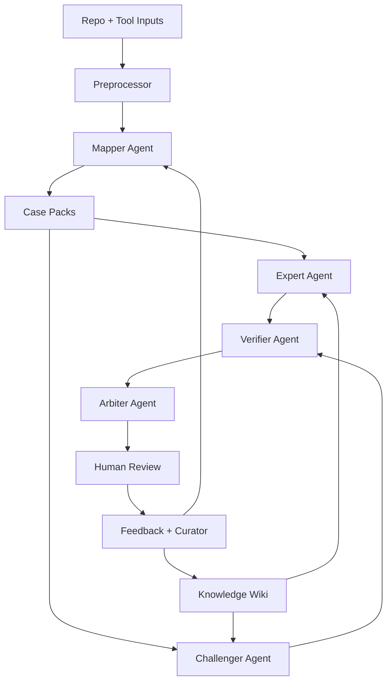

# TEECheck Collaborative Harness

## Overview

`TEECheck` is a case-driven, multi-agent audit harness for TEE-focused security
research.

The system is not designed as a one-shot scanner. It is designed as a
collaborative review machine:

- static tooling compresses repositories into reviewable case packs
- multiple agents analyze the same case from different roles
- humans remain the final authority
- every review leaves behind reusable knowledge

The current preferred direction is:

`file-driven runtime + collaborative case agents + accumulated knowledge wiki`

## Core Decisions

### 1. Cases, Not Whole Repositories

The unit of collaboration is a `case pack`, not an entire repository.

Every agent should work on a bounded case containing:

- repository facts from static tooling
- trust-boundary context
- code snippets and file references
- open questions
- expected obligations

### 2. Collaboration, Not Assembly-Line Isolation

Agents still have specialized roles, but they collaborate around the same case.

This means:

- the `Mapper` (heuristic mode) or the `L3 Planner` (LLM mode) prepares the case
- the `Expert` proposes the main security hypothesis
- the `Challenger` attacks or questions that hypothesis
- the `Verifier` strengthens or weakens the evidence
- the `Arbiter` prepares a final review packet

> **Note (2026-04-15):** In LLM mode the L3 planner replaces the keyword-based
> mapper as the hotspot picker. It runs an action-registry loop against the
> cloned repo and produces an `evidence_bundle.json` that is shimmed into the
> legacy `hotspot_index.json` format so the downstream 4-agent chain is
> unchanged. See `docs/superpowers/specs/2026-04-11-llm-planner-design.md`.

### 3. No Plain Chunk-RAG As The Main Knowledge Strategy

We are intentionally not centering the system around classic
"upload documents, retrieve chunks, answer from scratch" RAG.

Instead, the preferred knowledge model is:

`raw sources -> curator agent -> accumulated wiki -> agents query wiki pages`

This means:

- raw CVEs, papers, SDK docs, audit notes, and prior reviews are preserved
- a knowledge-curation process turns them into stable, structured wiki pages
- agents primarily read curated knowledge pages, not raw chunks
- retrieval is still allowed, but only as lightweight lookup over curated wiki
  pages and metadata

Code evidence and domain knowledge stay separate:

- code facts come from `Mapper` and `Verifier`
- durable domain knowledge comes from the knowledge wiki

### 4. Heavy Static Tools Stay Selective But Important

CodeQL, Joern, grep, Semgrep, and similar tools belong in the harness, but they
should be used where they create leverage:

- `Mapper` uses them to prepare better case packs
- `Verifier` uses them to resolve disputes or strengthen evidence

They are evidence generators, not the sole decision makers.

### 5. Human Review Is Mandatory

The harness may produce:

- `no_issue_observed`
- `needs_review`
- `likely_issue`
- `confirmed_candidate`

But only a human reviewer can conclude that something is a real vulnerability.

## Agent Layers



### Layer 0: Preprocessor

Responsibilities:

- identify repository metadata
- detect languages, frameworks, and trust boundaries
- identify candidate TEE or trust-sensitive subsystems
- create a repository profile for later stages

Output:

- `project_profile.json`

### Layer 1: Mapper Agent

Responsibilities:

- run static tools such as CodeQL, Joern, Semgrep, grep, and tree-sitter
- identify hotspots, entrypoints, trust boundaries, and sensitive flows
- collect code snippets, call-path context, and tool facts
- prepare `case packs` for collaborative review

The mapper does not decide whether something is a vulnerability.
It prepares a bounded, high-recall case for later judgment.

Outputs:

- `repo_map.json`
- `hotspot_index.json`
- `case_pack/*.json`

### Layer 2A: Expert Agent

Responsibilities:

- read a case pack
- consult the accumulated knowledge wiki
- choose the relevant obligation families
- propose the main security hypothesis
- identify missing checks, bindings, or state guarantees

Inputs:

- `case_pack`
- curated knowledge wiki
- current harness memories and review policy

Outputs:

- `hypothesis/*.json`

### Layer 2B: Challenger Agent

Responsibilities:

- read the same case pack
- challenge the Expert's assumptions
- reason from attacker and skeptic perspectives
- assess exploitability, missing context, and false-positive risk

Inputs:

- `case_pack`
- `hypothesis`
- curated knowledge wiki
- historical false-positive notes

Outputs:

- `challenge/*.json`

> **Known limitation.** The Challenger reads the Expert's hypothesis
> verbatim and runs on the same model — the design is closer to
> sequential self-refinement than independent counter-argument. See
> [`ADVERSARIAL_INDEPENDENCE.md`](ADVERSARIAL_INDEPENDENCE.md) for
> the structural fix tiers (input blinding, two-phase reveal, model
> heterogeneity).

### Layer 3: Verifier Agent

Responsibilities:

- run targeted checks to resolve disagreement
- request additional grep, CodeQL, Joern, or syntax-level evidence
- confirm or weaken key claims

Inputs:

- `case_pack`
- `hypothesis`
- `challenge`

Outputs:

- `verify/*.json`

> **Known limitation.** The Verifier currently sees both the
> hypothesis and the challenge before judging, which primes the model
> with the prior agents' framing. The agentbus Q&A channel registered
> for inter-agent questions is hollow — the registered "expert" /
> "challenger" handlers answer without their case artifacts in
> context. See
> [`ADVERSARIAL_INDEPENDENCE.md`](ADVERSARIAL_INDEPENDENCE.md) for
> the two-phase reveal proposal and the agentbus fix.

### Layer 4: Arbiter Agent

Responsibilities:

- synthesize mapper facts, expert reasoning, challenger objections, and
  verifier evidence
- keep conclusions bounded to evidence
- produce the human-facing review packet

Outputs:

- `review_packet/*.md`
- `findings.json`

> **Known limitation.** The Arbiter reads the verifier memo before
> issuing a verdict, so the agreement metric `VerifierAgreementRate`
> is structurally biased and weak as a quality signal — it tracks
> internal consistency, not finding correctness. See
> [`ADVERSARIAL_INDEPENDENCE.md`](ADVERSARIAL_INDEPENDENCE.md).

### Layer 5: Human Review

Responsibilities:

- decide whether the candidate is real, false, or still inconclusive
- add review notes and reusable tags
- feed the result back into the harness

Outputs:

- `review_records.jsonl`

### Layer 6: Feedback And Knowledge Curation

Responsibilities:

- derive planner hints from review outcomes
- turn stable lessons into curated wiki pages or updates
- distinguish true positive patterns from false-positive patterns
- keep the knowledge layer accumulative instead of rediscovered every run

Outputs:

- `planner_hints.json`
- updates under `knowledge/wiki/`
- updates under `knowledge/learned/`

## Knowledge Layer

The knowledge layer is not a generic RAG bucket.
It is a structured, accumulative system.

### Knowledge Flow

```text
raw sources
  -> curator ingestion
  -> normalized notes
  -> stable wiki pages
  -> agent lookup during case review
```

### Knowledge Sources

- CVEs
- exploit writeups
- TEE SDK documentation
- prior audit reports
- human review notes
- false-positive explanations
- project-specific observations

### Knowledge Storage Model

```text
knowledge/
├── raw/
│   ├── cve/
│   ├── papers/
│   ├── sdk/
│   ├── blogs/
│   └── prior-reviews/
├── wiki/
│   ├── obligations/
│   ├── patterns/
│   ├── apis/
│   ├── projects/
│   └── open-questions/
└── learned/
    ├── true-positive/
    ├── false-positive/
    └── review-memory/
```

### Why This Replaces Plain RAG

Plain chunk-RAG forces the model to rediscover synthesized knowledge on every
query.

The preferred model here is different:

- synthesis happens once and is retained
- the wiki becomes the stable knowledge surface
- retrieval, if used, is over wiki pages and metadata
- the harness accumulates expertise instead of recomputing it every time

This means:

- we do not need a dedicated vector-database-first architecture
- we do not need to center the system on chunk retrieval
- we may still keep simple retrieval helpers for wiki pages, tags, and review
  memory

## Runtime And Artifact Flow

The runtime backbone remains file-driven and replayable.

```text
repo
-> repo_map
-> hotspot_index
-> case_pack
-> hypothesis
-> challenge
-> verify
-> review_packet
-> review_record
-> planner_hints
-> knowledge updates
```

Key properties:

- every stage writes explicit artifacts
- every agent owns a narrow output boundary
- the same case can be replayed
- humans can inspect every intermediate step

## Project Structure

```text
teecheck/
├── cmd/
│   └── teecheck/
├── config/
│   ├── settings.yaml
│   ├── rules/
│   └── skills/
├── internal/
│   ├── preprocessor/
│   ├── mapper/
│   ├── expert/
│   ├── challenger/
│   ├── verifier/
│   ├── arbiter/
│   ├── orchestrator/
│   ├── console/
│   ├── knowledge/
│   └── tools/
├── knowledge/
│   ├── raw/
│   ├── wiki/
│   └── learned/
├── runs/
└── docs/
```

## Minimal Case Protocol

Every collaborative review should revolve around one `case_pack`.

At minimum a case pack should contain:

- `case_id`
- `category`
- `focus`
- `why_selected`
- `target_files`
- `target_symbols`
- `tool_facts`
- `graph_facts`
- `snippets`
- `open_questions`
- `expected_obligations`

This gives all later agents a shared review substrate.

## CLI Philosophy

The runtime should stay CLI-first.

Preferred operation model:

- pipeline commands for deterministic runs
- a Claude Code-like shell for interactive human control
- no dependency on a heavyweight general agent framework

This means:

- orchestration remains explicit
- collaboration happens through case artifacts
- the shell gives a better human interface without becoming the system of
  record

## Success Criteria

The harness is working when:

- the mapper prepares bounded, high-value case packs
- expert and challenger genuinely disagree when warranted
- verifier can resolve important disputes
- arbiter produces clear review packets
- humans can add feedback quickly
- review feedback improves future planning and knowledge pages

## Summary

The current design is:

`static evidence -> case packs -> collaborative agents -> human review -> accumulated wiki`

And the current knowledge stance is:

`No plain chunk-RAG as the core architecture.`

If retrieval exists, it should serve the accumulated wiki and review memory,
not replace them.
